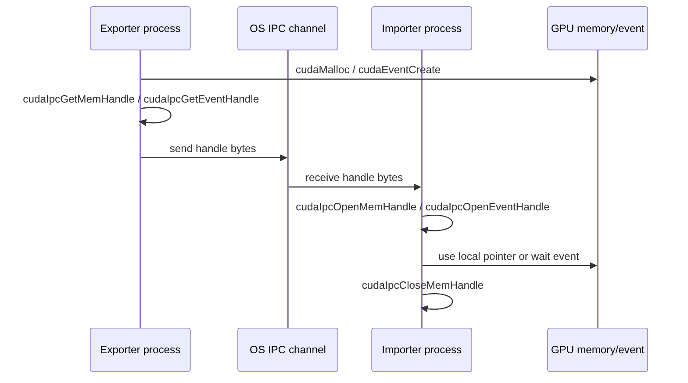

# 第 57 章 Legacy CUDA IPC：跨进程共享 device memory 的简单路径和限制

## 57.1 问题的由来

同一个进程里，host thread 可以直接使用另一个 thread 创建的 CUDA device pointer 或 event。跨进程以后，指针值就失效了：它只是某个进程地址空间里的本地表示，另一个进程拿到这个数值也不能解引用。

CUDA IPC 提供的是“把本进程资源导出成可传递 handle，再由另一个进程导入成本地对象”的机制。它适合单机 Linux 上比较直接的 GPU buffer 或 event 共享。它不解决同步协议，也不管理对端进程生命周期。

## 57.2 核心模型

handle 传递的是访问能力，不传递“什么时候可以读写”的顺序。进程之间仍然需要 event、socket、shared memory、MPI 或其他协议约定 ready/done。

图 57.1 是一次完整的共享过程：导出进程分配资源并取得 handle，handle 作为普通字节经操作系统的 IPC 通道送到导入进程，导入进程打开 handle 后使用本地指针或等待 event，用完再关闭映射。CUDA 只参与两端的导出和导入，中间的传递完全由应用负责。

<figure>

<figcaption>图 57.1：导出进程经 OS IPC 通道传递 handle，导入进程打开后使用</figcaption>
</figure>

## 57.3 详解

Legacy CUDA IPC 主要有两类 handle：

| handle | 用途 |
|---|---|
| `cudaIpcMemHandle_t` | 把 device memory 暴露给另一个进程 |
| `cudaIpcEventHandle_t` | 把 CUDA event 暴露给另一个进程做同步 |

memory handle 的典型流程是 exporter `cudaMalloc` 后调用 `cudaIpcGetMemHandle`，把 handle 作为普通字节传给 importer。importer 调用 `cudaIpcOpenMemHandle` 得到本进程可用的 device pointer。

event handle 的流程类似，但 event 创建时必须带 `cudaEventInterprocess`。常见做法是 exporter 写完 buffer 后 record event，importer 打开 event handle，并在自己的 stream 上 `cudaStreamWaitEvent`。

需要牢记几个限制：

| 限制 | 说明 |
|---|---|
| 平台 | Legacy CUDA IPC memory 主要支持 Linux |
| Managed memory | 不支持 `cudaMallocManaged` allocation |
| 版本 | 使用 IPC 通信的应用应使用相同 CUDA driver/runtime 编译、链接和运行 |
| Tegra/L4T | 只支持 IPC event sharing，不支持 IPC memory sharing |
| 安全 | `cudaMalloc` 可能从更大底层 block sub-allocate，IPC 可能暴露整个底层 block |

2MiB 对齐的建议出于安全考虑：如果要共享 `cudaMalloc` allocation，最好只共享 2MiB 对齐大小的 allocation，降低把同一底层 block 内其他 sub-allocation 一并暴露的风险。

## 57.4 代码示例

Exporter:

```cpp
void* dptr = nullptr;
cudaMalloc(&dptr, bytes);
cudaIpcMemHandle_t mem_handle{};
cudaIpcGetMemHandle(&mem_handle, dptr);
send_bytes_to_peer(&mem_handle, sizeof(mem_handle));
cudaEvent_t ready{};
cudaEventCreate(&ready, cudaEventInterprocess | cudaEventDisableTiming);
cudaIpcEventHandle_t event_handle{};
cudaIpcGetEventHandle(&event_handle, ready);
send_bytes_to_peer(&event_handle, sizeof(event_handle));
producer_kernel<<<grid, block, 0, stream>>>(dptr);
cudaEventRecord(ready, stream);
```

Importer:

```cpp
cudaIpcMemHandle_t mem_handle = recv_mem_handle();
void* remote_ptr = nullptr;
cudaIpcOpenMemHandle(
    &remote_ptr,
    mem_handle,
    cudaIpcMemLazyEnablePeerAccess);
cudaIpcEventHandle_t event_handle = recv_event_handle();
cudaEvent_t ready{};
cudaIpcOpenEventHandle(&ready, event_handle);
cudaStreamWaitEvent(stream, ready, 0);
consumer_kernel<<<grid, block, 0, stream>>>(remote_ptr);
cudaStreamSynchronize(stream);
cudaIpcCloseMemHandle(remote_ptr);
```

Exporter 不能在 importer 还可能使用时提前 `cudaFree(dptr)` 或销毁 event。CUDA IPC 的 handle 没有跨进程引用计数，生命周期协议必须由应用自己建立。

## 57.5 工程判断

| 需求 | Legacy IPC 是否合适 | 说明 |
|---|---|---|
| 单机 Linux 两进程共享一个 device buffer | 合适 | API 少，路径直接 |
| 需要跨 Windows/Linux 平台统一 handle | 不优先 | VMM shareable handle 更适合 |
| 需要共享 managed memory | 不适合 | legacy IPC 不支持 |
| 需要细粒度控制哪些 GPU 可访问 | 不优先 | VMM 的 per-allocation access 更精确 |
| 只需要跨进程同步 | IPC event 合适 | 不一定要共享 memory |
| 需要跨节点共享 | 不适合 | 看 VMM fabric handle / EGM |

## 57.6 API 与要点速查

Memory IPC API：

| API | 作用 |
|---|---|
| `cudaIpcGetMemHandle` | 从本进程 device pointer 导出 IPC memory handle |
| `cudaIpcOpenMemHandle` | 在另一个进程打开 memory handle，得到本地 pointer |
| `cudaIpcCloseMemHandle` | 关闭导入的 IPC memory mapping |
| `cudaIpcMemLazyEnablePeerAccess` | 打开 handle 时可请求 lazy peer access |

Event IPC API：

| API/flag | 作用 |
|---|---|
| `cudaEventInterprocess` | 创建可跨进程导出的 event |
| `cudaEventDisableTiming` | IPC event 常配合关闭 timing |
| `cudaIpcGetEventHandle` | 导出 event handle |
| `cudaIpcOpenEventHandle` | 导入 event handle |
| `cudaStreamWaitEvent` | 在 importer stream 中等待 exporter event |

限制清单：

| 项 | 说明 |
|---|---|
| OS IPC | CUDA 不负责传 handle，要用 socket、pipe、shared memory、文件、MPI 等 |
| 生命周期 | exporter 拥有原始 allocation/event |
| 同步 | memory handle 不携带同步语义 |
| 对齐 | 建议共享 2MiB 对齐大小的 allocation |
| managed allocation | `cudaMallocManaged` 不适用 legacy IPC |

## 57.7 小结

读完本章，你应该能够：

- 写出 CUDA IPC memory 和 event 的 exporter/importer 流程。
- 知道 handle 只是访问能力，不是同步协议。
- 解释 legacy IPC 的平台、managed memory 和安全限制。
- 判断什么时候应该升级到 VMM。
