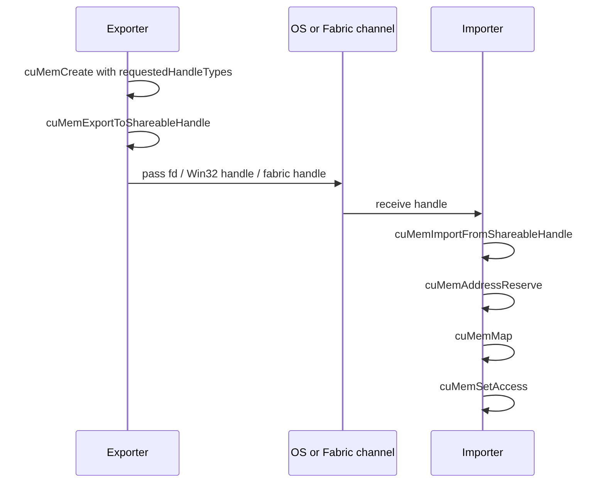

# 第 59 章 用 VMM 做跨进程共享：POSIX fd、Win32 handle 与安全边界

## 59.1 问题的由来

Legacy CUDA IPC 简单，但它把很多选择都固定住了。VMM 的 shareable handle 机制更底层：创建 allocation 时就声明它可以导出成哪类平台 handle，再由另一个进程导入、reserve、map、set access。

这条路径更复杂，但它给你 per-allocation 权限控制、平台 handle 选择、fabric handle 扩展和更明确的安全边界。对自定义 allocator、多进程服务、跨节点系统库来说，这是比 legacy IPC 更合适的基础设施。

## 59.2 核心模型

导入以后仍然没有可用 pointer。VMM handle 表示的是物理 allocation，必须映射到本进程的 VA，再设置访问权限。

图 59.1 是完整的跨进程顺序：导出方在 `cuMemCreate` 时声明 handle 类型，再把 allocation 导出成平台 handle；handle 经操作系统或 fabric 通道到达导入方；导入方依次 import、reserve、map、set access。

<figure>

<figcaption>图 59.1：shareable handle 的导出、传递、导入与映射顺序</figcaption>
</figure>

映射完成后，两个进程看到的是同一组物理页，但各自通过自己的虚拟地址访问：导入方 reserve 到的地址范围由它自己的进程决定，数值通常和导出方的指针不同。跨 GPU 时，导入方 GPU 经由统一地址空间（多节点时是 fabric 地址空间）访问导出方 GPU 上的物理内存。所以进程之间能传递的只有 handle，指针数值本身没有意义。

## 59.3 详解

VMM shareable handle 的第一步是在 `CUmemAllocationProp::requestedHandleTypes` 中声明你打算导出的 handle 类型。

| 平台/场景 | Handle type |
|---|---|
| Linux 单节点 | `CU_MEM_HANDLE_TYPE_POSIX_FILE_DESCRIPTOR` |
| Windows | `CU_MEM_HANDLE_TYPE_WIN32` |
| NVLink fabric / 多节点 | `CU_MEM_HANDLE_TYPE_FABRIC` |

导出使用 `cuMemExportToShareableHandle`，导入使用 `cuMemImportFromShareableHandle`。CUDA 不负责传输 handle。POSIX fd 可以通过 Unix domain socket 传递；Win32 handle 能被哪些进程打开，由创建 allocation 时通过 `CUmemAllocationProp::win32HandleMetaData` 提供的安全信息决定，跨进程时还可能用到 `DuplicateHandle`；fabric handle 可以作为普通结构体字节通过 MPI、TCP 或 RPC 传递，但需要 IMEX channel 支持。

使用 fabric handle 前要查询设备是否支持：

```cpp
int supports_fabric = 0;
cuDeviceGetAttribute(
    &supports_fabric,
    CU_DEVICE_ATTRIBUTE_HANDLE_TYPE_FABRIC_SUPPORTED,
    device);
```

使用 POSIX/Win32 handle 也要查平台相关支持。不要只根据操作系统分支就假设设备支持。

## 59.4 代码示例

Exporter 创建可导出的 allocation。`padded_size` 已经按粒度对齐，Windows 分支里的 `object_attributes` 由应用事先准备好：

```cpp
CUmemAllocationProp prop{};
prop.type          = CU_MEM_ALLOCATION_TYPE_PINNED;
prop.location.type = CU_MEM_LOCATION_TYPE_DEVICE;
prop.location.id   = exporting_device;
#if defined(_WIN32)
// Windows：导出成 Win32 NT handle。win32HandleMetaData 指向一个
// OBJECT_ATTRIBUTES，其中的安全描述符决定哪些进程可以打开这个 handle。
prop.requestedHandleTypes = CU_MEM_HANDLE_TYPE_WIN32;
prop.win32HandleMetaData  = &object_attributes;
#else
// Linux：导出成 POSIX 文件描述符
prop.requestedHandleTypes = CU_MEM_HANDLE_TYPE_POSIX_FILE_DESCRIPTOR;
#endif
CUmemGenericAllocationHandle handle = 0;
cuMemCreate(&handle, padded_size, &prop, 0);  // padded_size 已按粒度对齐
```

Linux fd 导出：

```cpp
int fd = -1;
cuMemExportToShareableHandle(
    &fd,
    handle,
    CU_MEM_HANDLE_TYPE_POSIX_FILE_DESCRIPTOR,
    0);
send_fd_over_unix_domain_socket(fd);
```

Importer 导入并映射：

```cpp
int fd = recv_fd_over_unix_domain_socket();
CUmemGenericAllocationHandle imported{};
cuMemImportFromShareableHandle(
    &imported,
    reinterpret_cast<void*>(static_cast<uintptr_t>(fd)),  // 传 fd 的值，不是 &fd
    CU_MEM_HANDLE_TYPE_POSIX_FILE_DESCRIPTOR);
CUdeviceptr ptr = 0;
cuMemAddressReserve(&ptr, padded_size, 0, 0, 0);
cuMemMap(ptr, padded_size, 0, imported, 0);
CUmemAccessDesc access{};
access.location.type = CU_MEM_LOCATION_TYPE_DEVICE;
access.location.id = importing_device;
access.flags = CU_MEM_ACCESS_FLAGS_PROT_READWRITE;
cuMemSetAccess(ptr, padded_size, &access, 1);
```

注意 `cuMemImportFromShareableHandle` 的第二个参数：POSIX fd 和 Win32 handle 是把 handle 的值本身转成 `void*` 传进去，传 `&fd` 会导入失败；fabric handle 则相反，传的是 `CUmemFabricHandle` 结构体的地址。

Fabric handle 的导出/导入形状类似：

```cpp
CUmemFabricHandle fabric{};
cuMemExportToShareableHandle(
    &fabric,
    handle,
    CU_MEM_HANDLE_TYPE_FABRIC,
    0);
CUmemGenericAllocationHandle imported{};
cuMemImportFromShareableHandle(
    &imported,
    &fabric,
    CU_MEM_HANDLE_TYPE_FABRIC);
```

## 59.5 工程判断

| 需求 | 推荐 handle | 关键风险 |
|---|---|---|
| Linux 单机多进程 | POSIX fd | fd 传递和关闭要按 OS 规则处理 |
| Windows 多进程 | Win32 handle | security attributes 和 handle duplication |
| 跨节点 NVLink fabric | Fabric handle | 需要 IMEX channel 和平台支持 |
| 只在单进程内重排 VA | 不需要 shareable handle | 普通 VMM 即可 |
| 需要导出给图形 API | 平台/interop handle | 要看目标 API 的 external memory 要求 |

## 59.6 API 与要点速查

Shareable handle API：

| API/类型 | 作用 |
|---|---|
| `CUmemAllocationProp::requestedHandleTypes` | 声明 allocation 可导出的 handle 类型 |
| `cuMemExportToShareableHandle` | 导出平台或 fabric handle |
| `cuMemImportFromShareableHandle` | 导入 handle 成 `CUmemGenericAllocationHandle` |
| `CU_MEM_HANDLE_TYPE_POSIX_FILE_DESCRIPTOR` | Linux POSIX fd |
| `CU_MEM_HANDLE_TYPE_WIN32` | Windows handle |
| `CU_MEM_HANDLE_TYPE_FABRIC` | NVLink fabric handle |
| `CUmemFabricHandle` | fabric handle 数据结构 |

能力查询：

| 属性 | 作用 |
|---|---|
| `CU_DEVICE_ATTRIBUTE_HANDLE_TYPE_POSIX_FILE_DESCRIPTOR_SUPPORTED` | 查询 POSIX fd handle 支持 |
| `CU_DEVICE_ATTRIBUTE_HANDLE_TYPE_WIN32_HANDLE_SUPPORTED` | 查询 Win32 handle 支持 |
| `CU_DEVICE_ATTRIBUTE_HANDLE_TYPE_FABRIC_SUPPORTED` | 查询 fabric handle 支持 |

IMEX 相关提醒：

| 项 | 说明 |
|---|---|
| `/proc/devices` | 应存在 `nvidia-caps-imex-channels` |
| `/dev/nvidia-caps-imex-channels/channelN` | fabric handle 安全导入导出的设备节点 |
| 管理员配置 | 多节点 fabric 场景通常需要系统级配置 |

## 59.7 小结

读完本章，你应该能够：

- 区分 legacy IPC handle 和 VMM shareable handle。
- 写出 export/import/reserve/map/access 的顺序。
- 知道 POSIX、Win32、fabric handle 的平台差异。
- 把 shareable handle 当作安全边界和生命周期问题处理。
