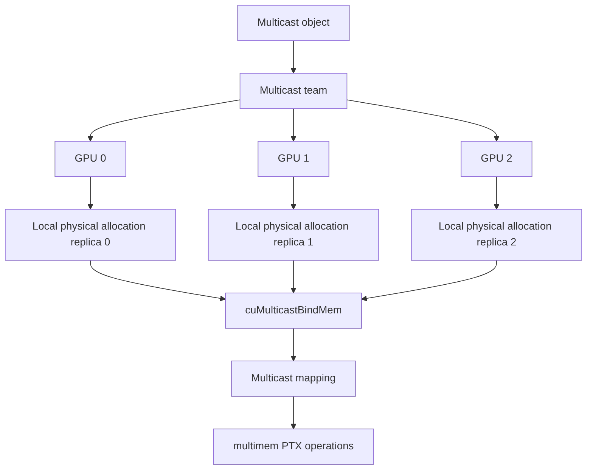

# 第 60 章 Multicast Objects：为什么系统库需要比 peer access 更底层的能力

## 60.1 问题的由来

普通 peer access 让一个 GPU 访问另一个 GPU 的 memory。对很多应用来说这已经足够。但通信库、集合通信 runtime 和 NVLink/NVSwitch 系统还需要更底层的能力：多个 GPU 组成一个 team，每个 GPU 给同一个 multicast object 提供本地物理 backing，然后通过 multicast mapping 和 `multimem` 指令完成 broadcast、reduction 等 in-fabric operation。

这就是 CUDA Multicast Object Management API 的位置。它不是普通业务代码的默认选择，更像 NCCL、NVSHMEM 或系统通信库的底层构件。

## 60.2 核心模型

一个 multicast team 的 N 张 GPU 会有 N 份本地 physical replica。`multimem` 指令通过 multicast mapping 对这些 replica 执行集合式访问。

图 60.1 画出了这几个对象的关系：multicast object 定义一个 team，team 里每张 GPU 各自分配一块本地 physical memory，再用 `cuMulticastBindMem` 绑定到同一个 multicast object；之后通过 multicast mapping，kernel 里的一条 `multimem` 操作就能作用到所有 replica。

<figure>

<figcaption>图 60.1：team 中各 GPU 的本地 replica 绑定到同一 multicast object</figcaption>
</figure>

## 60.3 详解

Multicast 的典型流程：

1. 查询设备和平台是否支持 multicast。
2. 用 `cuMulticastCreate` 创建 multicast handle。
3. 把 multicast handle 分享给参与进程。
4. 用 `cuMulticastAddDevice` 把 GPU 加入 team。
5. 每个 GPU 用 `cuMemCreate` 创建自己的 physical memory。
6. 用 `cuMulticastBindMem` 把本地 memory 绑定到 multicast object。
7. reserve/map multicast handle，并为参与设备设置访问权限。
8. kernel 中用 `multimem` PTX 或 CUDA C++ wrapper 访问。

能力查询：

```cpp
int supports_multicast = 0;
cuDeviceGetAttribute(
    &supports_multicast,
    CU_DEVICE_ATTRIBUTE_MULTICAST_SUPPORTED,
    device);
```

顺序上要注意：所有设备都要在 bind memory 之前加入 team。multicast object 的语义是 team 共同拥有一组 replicas，成员要先确定，不能先绑定一部分再动态拼凑。

## 60.4 代码示例

创建 multicast object：

```cpp
// 返回 multicast handle；*aligned_bytes 是按粒度向上对齐后的每卡大小，
// 后面的绑定和映射都用这个大小。CU_CHECK 的写法见第 58 章。
CUmemGenericAllocationHandle create_multicast_object(unsigned int num_devices,
                                                     size_t bytes,
                                                     size_t* aligned_bytes)
{
    CUmulticastObjectProp prop{};
    prop.numDevices  = num_devices;
    // 要把 handle 交给其他进程，就得声明导出类型：
    // 单节点用 POSIX fd，跨节点的 NVLink 系统用 CU_MEM_HANDLE_TYPE_FABRIC。
    prop.handleTypes = CU_MEM_HANDLE_TYPE_POSIX_FILE_DESCRIPTOR;

    size_t granularity = 0;
    CU_CHECK(cuMulticastGetGranularity(&granularity, &prop,
                                       CU_MULTICAST_GRANULARITY_RECOMMENDED));
    prop.size = (bytes + granularity - 1) / granularity * granularity;

    CUmemGenericAllocationHandle mc_handle = 0;
    CU_CHECK(cuMulticastCreate(&mc_handle, &prop));
    *aligned_bytes = prop.size;
    return mc_handle;
}

// 调用：devices 是参与 team 的 GPU 列表
size_t bytes = 0;
CUmemGenericAllocationHandle mc_handle = create_multicast_object(
    static_cast<unsigned int>(devices.size()), requested_bytes, &bytes);
```

加入设备并绑定本地 allocation：

```cpp
for (int dev : devices) {
    cuMulticastAddDevice(mc_handle, dev);
}
for (int dev : devices) {
    CUmemGenericAllocationHandle local = create_local_allocation(dev, bytes);
    cuMulticastBindMem(
        mc_handle,
        0,      // multicast object offset
        local,
        0,      // local memory offset
        bytes,
        0);
}
```

device 侧使用 multicast mapping 时会接触 `multimem` 指令。下面的片段用 multicast 地址上的一次归约实现跨 GPU 的“报到计数”：每张 GPU 把计数器加 1，再在本地副本上等计数到齐。它要求 compute capability 9.0 及以上（为更低的架构编译时直接报错），并在 reduction 之后加了 proxy fence。

```cpp
#include <cuda/atomic>
#include <cuda/ptx>
#include <cstdint>

#if defined(__CUDA_ARCH__) && __CUDA_ARCH__ < 900
#error "multimem 指令需要 compute capability 9.0 及以上，请用 sm_90 或更高的架构编译"
#endif

// mc_counter：计数器在 multicast 映射里的地址，对它的归约会作用到 team 里每张 GPU 的副本。
// my_counter：同一个计数器在本 GPU 普通（unicast）映射里的地址，只读本地副本。
// 每张 GPU 上由一个线程调用：报到一次，然后等所有 GPU 都报到。
__device__ void arrive_and_wait(std::uint32_t* mc_counter,
                                std::uint32_t* my_counter,
                                std::uint32_t num_gpus)
{
    namespace ptx = cuda::ptx;
    // 给所有副本各加 1；release 保证本 GPU 之前的写入先于这次报到可见
    ptx::multimem_red(ptx::sem_release, ptx::scope_sys, ptx::op_add,
                      mc_counter, 1u);
    // 刚才走的是 multicast 地址，接下来要通过另一个地址读同一位置；
    // 两个地址是同一物理内存的别名，中间需要 proxy fence
    ptx::fence_proxy_alias();

    cuda::atomic_ref<std::uint32_t, cuda::thread_scope_system> counter(*my_counter);
    while (counter.load(cuda::memory_order_acquire) < num_gpus) {
        // 自旋等待其他 GPU 报到
    }
}
```

`multimem_red` 看起来像 `atomicAdd`，但访问路径进入了 multicast proxy。涉及 proxy 时，fence 和 operation boundary 要特别清楚。

## 60.5 工程判断

| 需求 | 是否适合 Multicast | 说明 |
|---|---|---|
| 普通两个 GPU 互相读写 buffer | 通常不需要 | peer access 或 VMM access 就够 |
| 通信库实现 broadcast/reduction | 适合 | 可利用 NVLink SHARP/in-fabric operation |
| 应用层手写 all-reduce | 通常不优先 | 先用 NCCL/NVSHMEM |
| 需要多 GPU 本地 replica 共同映射 | 适合 | multicast object 正是这个模型 |
| 不确定硬件拓扑 | 先不要用 | 必须查 multicast 和 fabric 支持 |

## 60.6 API 与要点速查

Multicast API：

| API/类型 | 作用 |
|---|---|
| `cuMulticastCreate` | 创建 multicast object |
| `cuMulticastAddDevice` | 把 device 加入 multicast team |
| `cuMulticastBindMem` | 绑定本地 physical memory 到 multicast object |
| `cuMulticastGetGranularity` | 查询 multicast allocation 粒度 |
| `CUmulticastObjectProp` | multicast object 属性：设备数、大小、handle 类型 |
| `CU_DEVICE_ATTRIBUTE_MULTICAST_SUPPORTED` | 查询 multicast 支持 |
| `CU_MEM_HANDLE_TYPE_FABRIC` | 常用于 fabric/multicast handle |

Device 侧相关：

| 名称 | 作用 |
|---|---|
| `cuda::ptx::multimem_red` | multicast reduction 操作 |
| `cuda::ptx::fence_proxy_alias` | 处理 alias/proxy 一致性 |
| `cuda::atomic_ref<..., cuda::thread_scope_system>` | 系统范围同步等待常用构件 |
| `__CUDA_ARCH__ >= 900` | multimem 指令的架构要求 |

和普通 VMM 的关系：

| 普通 VMM | Multicast VMM |
|---|---|
| 一个 physical allocation 映射到 VA | 多个 device replica 绑定到 multicast object |
| access descriptor 控制 device 访问 | multicast team 控制参与 device |
| 适合显式共享和自定义 allocator | 适合集合通信和 in-fabric operation |

## 60.7 小结

读完本章，你应该能够：

- 解释 multicast object 为什么不是普通 peer access。
- 列出 create、add device、bind memory、map、use 的调用顺序。
- 知道 `multimem` 涉及 proxy 和架构约束。
- 判断普通应用什么时候应该使用 NCCL/NVSHMEM 而不是直接写 multicast。
