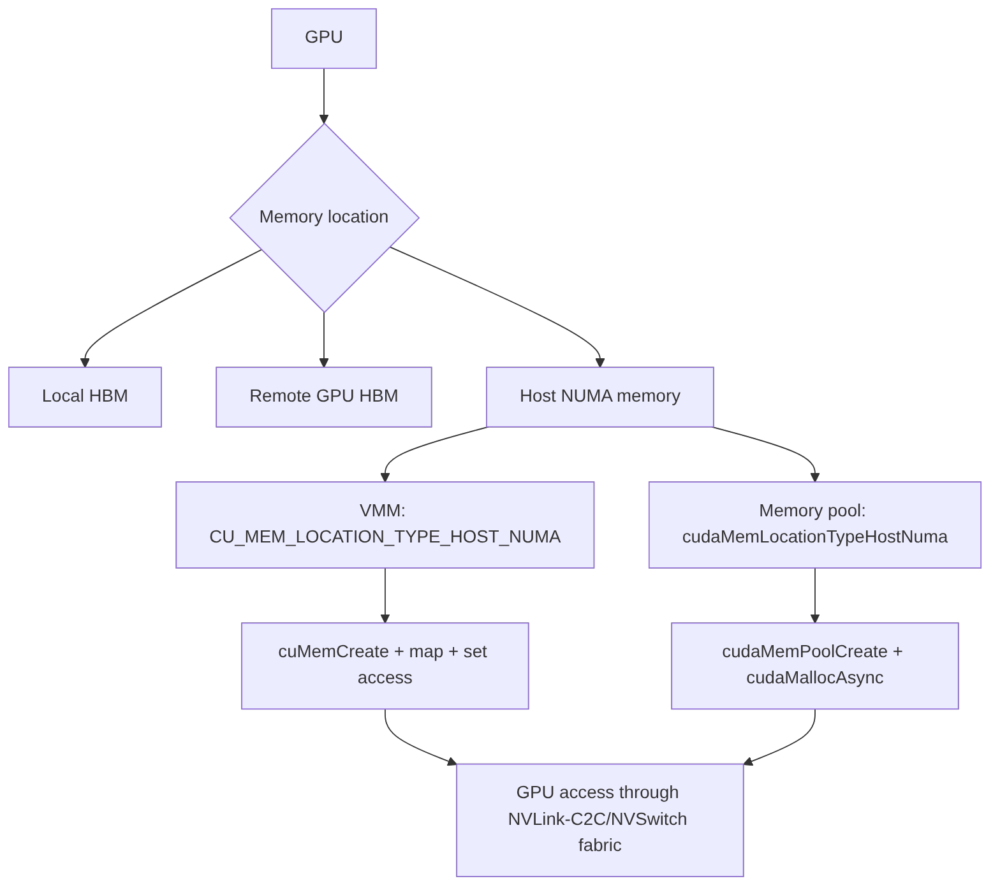

# 第 61 章 EGM 与 Compressible Memory：当 GPU 内存边界延伸到系统级内存池

## 61.1 问题的由来

传统 CUDA 程序通常把“GPU memory”理解成本卡 HBM，把 host memory 理解成要通过 PCIe/NVLink 拷贝的数据源。Extended GPU Memory 改变了这个边界：在支持 NVLink-C2C、NVSwitch fabric 等平台上，GPU 可以高效访问更大范围的系统内存，包括 CPU-attached memory 和其他 GPU 的 HBM。

EGM 并不等于“无限显存”。它仍然受拓扑、NUMA、page size、handle type、访问权限和 allocator 约束。更准确的理解是：系统级内存位置被纳入了 VMM 和 memory pool 的 location 模型。

## 61.2 核心模型

EGM 用 OS NUMA node identifier 表达 host memory 位置。这个 ID 不是 CUDA device ordinal，而是操作系统分配的 host node ID。

从 GPU 的角度看，一次访问可能落在三类位置：本卡 HBM、其他 GPU 的 HBM、host NUMA 内存。EGM 的分配接口针对的是 host NUMA 内存，图 61.1 列出了两条分配路径：VMM 用 `CU_MEM_LOCATION_TYPE_HOST_NUMA` 加 create/map/set access；memory pool 用 `cudaMemLocationTypeHostNuma` 创建 pool，再指定这个 pool 做 stream-ordered 分配（`cudaMallocFromPoolAsync`，或者带 pool 参数的 C++ 重载 `cudaMallocAsync`）。两条路径分配出的内存，最终都由 GPU 经 NVLink-C2C 或 NVSwitch fabric 访问。

<figure>

<figcaption>图 61.1：EGM 经 VMM 或 memory pool 两条路径分配 host NUMA 内存</figcaption>
</figure>

## 61.3 详解

EGM 常见于三类拓扑：

| 拓扑 | 特点 |
|---|---|
| Single-node, single-GPU | Arm CPU、CPU-attached memory、GPU，通过高带宽 C2C 互连 |
| Single-node, multi-GPU | CPU 和多张 GPU 通过 NVLink/NVSwitch 网络连接 |
| Multi-node, multi-GPU | 多个节点通过 NVLink fabric 连接 |

以 CPU 和 GPU 通过 NVLink-C2C 直连、多组这样的 CPU+GPU 之间再用 NVLink 互连的系统为例，GPU 访问本卡 HBM 以外的内存有三条路径：

- 经自己这一组的 C2C 互连访问本地 CPU 挂载的内存；
- 经 NVLink 访问对端 GPU 的 HBM；
- 经 NVLink 到对端，再经对端的 C2C 访问对端 CPU 挂载的内存。

EGM 路由依赖 CUDA 对可见设备和拓扑的理解。需要特别注意：不要用 cgroups 限制可见设备来做 EGM 路由控制，这可能阻断 EGM routing 并造成性能问题；应该使用 `CUDA_VISIBLE_DEVICES`。

查询 GPU 最近的 host NUMA ID：

```cpp
int numa_id = -1;
cuDeviceGetAttribute(
    &numa_id,
    CU_DEVICE_ATTRIBUTE_HOST_NUMA_ID,
    device_ordinal);
```

EGM 当前主要通过两类 allocator 使用：

| 路径 | location 类型 |
|---|---|
| VMM `cuMemCreate` | `CU_MEM_LOCATION_TYPE_HOST_NUMA` |
| Stream-ordered memory pool `cudaMemPoolCreate` | `cudaMemLocationTypeHostNuma` |

Compressible memory 则是 VMM 的另一个高级属性。它让支持 compute data compression 的设备有机会压缩某些数据模式，节省 DRAM 带宽、L2 读带宽或 L2 容量。它是性能机会，不是语义保证。

Virtual aliasing 则是把同一个 physical allocation 映射到多个 VA。它很强，但一致性规则更细：同一 kernel 内通过不同 alias 写后读，默认可能是不一致的；跨 device operation 边界并用 stream/event 排序才更容易得到清晰语义。如果必须在同一 kernel 内跨 alias/proxy，可使用 `cuda::ptx::fence_proxy_alias()`。

## 61.4 代码示例

VMM 分配 EGM memory：

```cpp
// numa_node：物理内存所在的 host NUMA 节点（例如 61.3 节查到的 HOST_NUMA_ID），不是 GPU 编号
// accessing_gpu：要访问这块内存的 GPU，这里取当前 context 的设备
// CU_CHECK 的写法见第 58 章
CUdevice accessing_gpu = 0;
CU_CHECK(cuCtxGetDevice(&accessing_gpu));

CUmemAllocationProp prop{};
prop.type          = CU_MEM_ALLOCATION_TYPE_PINNED;
prop.location.type = CU_MEM_LOCATION_TYPE_HOST_NUMA;
prop.location.id   = numa_node;

size_t granularity = 0;
CU_CHECK(cuMemGetAllocationGranularity(&granularity, &prop,
                                       CU_MEM_ALLOC_GRANULARITY_MINIMUM));
size_t size = (bytes + granularity - 1) / granularity * granularity;

CUmemGenericAllocationHandle handle = 0;
CUdeviceptr ptr = 0;
CU_CHECK(cuMemCreate(&handle, size, &prop, 0));
CU_CHECK(cuMemAddressReserve(&ptr, size, 0, 0, 0));
CU_CHECK(cuMemMap(ptr, size, 0, handle, 0));

// 两条权限：CPU 侧按 host NUMA location 授权，GPU 侧按 device 授权
CUmemAccessDesc access[2] = {};
access[0].location.type = CU_MEM_LOCATION_TYPE_HOST_NUMA;
access[0].location.id   = numa_node;  // 这一类型下 id 实际被忽略
access[0].flags         = CU_MEM_ACCESS_FLAGS_PROT_READWRITE;
access[1].location.type = CU_MEM_LOCATION_TYPE_DEVICE;
access[1].location.id   = accessing_gpu;
access[1].flags         = CU_MEM_ACCESS_FLAGS_PROT_READWRITE;
CU_CHECK(cuMemSetAccess(ptr, size, access, 2));
```

Memory pool 分配 EGM。`numa_node` 和 `accessing_gpu` 是两个不同编号空间里的 ID，不要混用；`CUDA_CHECK` 是检查 `cudaError_t` 的宏，写法和 `CU_CHECK` 相同：

```cpp
int accessing_gpu = 0;  // 要使用这块内存的 GPU，stream 也建在这张卡上
int numa_node = -1;     // pool 的内存放在哪个 host NUMA 节点：这里取离 GPU 最近的
CUDA_CHECK(cudaDeviceGetAttribute(&numa_node, cudaDevAttrHostNumaId,
                                  accessing_gpu));

cudaMemPoolProps props{};
props.allocType     = cudaMemAllocationTypePinned;
props.handleTypes   = cudaMemHandleTypeNone;
props.location.type = cudaMemLocationTypeHostNuma;
props.location.id   = numa_node;

cudaMemPool_t egm_pool = nullptr;
CUDA_CHECK(cudaMemPoolCreate(&egm_pool, &props));

// host NUMA pool 默认只有 CPU 能访问，GPU 要单独授权
cudaMemAccessDesc gpu_access{};
gpu_access.location.type = cudaMemLocationTypeDevice;
gpu_access.location.id   = accessing_gpu;
gpu_access.flags         = cudaMemAccessFlagsProtReadWrite;
CUDA_CHECK(cudaMemPoolSetAccess(egm_pool, &gpu_access, 1));

// 显式指定 pool。C API 的 cudaMallocAsync(ptr, size, stream) 只用
// stream 所在设备的当前 pool，不会从 host NUMA pool 分配。
void* buf = nullptr;
CUDA_CHECK(cudaMallocFromPoolAsync(&buf, bytes, egm_pool, stream));
consume<<<grid, block, 0, stream>>>(buf);
CUDA_CHECK(cudaFreeAsync(buf, stream));

CUDA_CHECK(cudaStreamSynchronize(stream));
CUDA_CHECK(cudaMemPoolDestroy(egm_pool));
```

请求 compressible memory。即使设备支持压缩，带压缩请求的 `cuMemCreate` 返回成功也不代表拿到的就是可压缩内存，所以要从 handle 读回属性确认：

```cpp
int compression_supported = 0;
CU_CHECK(cuDeviceGetAttribute(&compression_supported,
                              CU_DEVICE_ATTRIBUTE_GENERIC_COMPRESSION_SUPPORTED,
                              device));

CUmemAllocationProp prop{};
prop.type          = CU_MEM_ALLOCATION_TYPE_PINNED;
prop.location.type = CU_MEM_LOCATION_TYPE_DEVICE;
prop.location.id   = device;
if (compression_supported) {
    prop.allocFlags.compressionType = CU_MEM_ALLOCATION_COMP_GENERIC;
}

// 粒度要用带压缩请求的 prop 查询
size_t granularity = 0;
CU_CHECK(cuMemGetAllocationGranularity(&granularity, &prop,
                                       CU_MEM_ALLOC_GRANULARITY_MINIMUM));
size_t size = (bytes + granularity - 1) / granularity * granularity;

CUmemGenericAllocationHandle handle = 0;
CU_CHECK(cuMemCreate(&handle, size, &prop, 0));

// 压缩只是请求：从 handle 读回实际属性，才知道这次拿到的是什么
CUmemAllocationProp actual{};
CU_CHECK(cuMemGetAllocationPropertiesFromHandle(&actual, handle));
bool compressible =
    actual.allocFlags.compressionType == CU_MEM_ALLOCATION_COMP_GENERIC;
// 之后照常 reserve、map、set access；compressible 为 false 时按普通内存对待
```

Virtual aliasing 的危险写法：

```cpp
__global__ void bad_alias(char* a, char* b)
{
    *a = 1;
    printf("%d\n", *b); // a 和 b 如果是同一 allocation 的 alias，语义不清晰
}
```

同一 kernel 内需要跨 proxy 时：

```cpp
__global__ void alias_with_fence(char* a, char* b)
{
    *a = 1;
    cuda::ptx::fence_proxy_alias();
    printf("%d\n", *b);
}
```

## 61.5 工程判断

| 需求 | 机制 | 注意点 |
|---|---|---|
| GPU 访问 CPU-attached memory | EGM VMM 或 pool | 需要 host NUMA location |
| 多节点共享 host NUMA allocation | EGM + fabric handle | 需要 IMEX/fabric 支持 |
| Stream-ordered 风格分配 EGM | memory pool | 用 `cudaMemPoolSetAccess` 给 GPU 授权，用 `cudaMallocFromPoolAsync` 指定 pool 分配 |
| 希望压缩稀疏或可压缩数据 | compressible VMM allocation | 必须查询支持并验证实际属性 |
| 同一 allocation 多个 VA | virtual aliasing | 需要 operation boundary 或 proxy fence |
| 普通显存不够想自动扩容 | 不能简单这样理解 | EGM 是拓扑能力，不是无限显存 |

## 61.6 API 与要点速查

EGM 相关类型和属性：

| 名称 | 作用 |
|---|---|
| `CU_DEVICE_ATTRIBUTE_HOST_NUMA_ID` | 查询设备最近 host NUMA ID |
| `CU_MEM_LOCATION_TYPE_HOST_NUMA` | VMM host NUMA location |
| `cudaMemLocationTypeHostNuma` | Runtime memory pool host NUMA location |
| `CU_MEM_HANDLE_TYPE_FABRIC` | 多节点/fabric sharing |
| `cudaMemPoolCreate` | 创建 stream-ordered memory pool |
| `cudaMemPoolSetAccess` | 设置 memory pool 访问权限 |
| `cudaMallocFromPoolAsync` | 从指定 pool 异步分配；EGM pool 用它分配 |
| `cudaMallocAsync` | C API 只从 stream 所在设备的当前 pool 分配，用不到 host NUMA pool |
| `cudaDeviceSetMemPool` | 只接受该设备本地的 pool，不能把 host NUMA pool 设成设备的当前 pool |

Compressible memory：

| 名称 | 作用 |
|---|---|
| `CU_DEVICE_ATTRIBUTE_GENERIC_COMPRESSION_SUPPORTED` | 查询 compute data compression 支持 |
| `CUmemAllocationProp::allocFlags::compressionType` | 请求 compression 类型 |
| `CU_MEM_ALLOCATION_COMP_GENERIC` | generic compression 请求 |
| `cuMemGetAllocationPropertiesFromHandle` | 验证实际 allocation 属性 |

Virtual aliasing：

| 规则 | 说明 |
|---|---|
| 多个 VA 指向同一 physical allocation | 可以通过多次 `cuMemMap` 实现 |
| 同一 kernel 内写一个 alias 后读另一个 alias | 默认可能不一致 |
| 不同 GPU operation 之间 | 通过 stream/event/memcpy 等 operation boundary 排序更清晰 |
| 同一 kernel 内跨 proxy | 需要 `cuda::ptx::fence_proxy_alias()` |

性能提醒：

| 项 | 说明 |
|---|---|
| EGM page | EGM 映射使用 2MB pages |
| TLB | 大 allocation 可能遇到更多 TLB miss |
| 路由 | 不要用 cgroups 限制设备可见性来做 EGM 路由控制 |
| 压缩 | compression 是性能优化机会，不改变程序语义 |

## 61.7 小结

读完本章，你应该能够：

- 解释 EGM 为什么是系统级内存拓扑能力，而不是无限显存。
- 写出 VMM 和 memory pool 两条 EGM 分配路径。
- 知道 NUMA ID 与 CUDA device ordinal 的区别。
- 使用 compressible memory 前后做能力查询和属性验证。
- 识别 virtual aliasing 的一致性边界。
