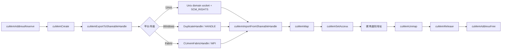

# 第 62 章 VMM、平台句柄与跨进程内存：从虚拟地址到可共享资源

第 58 章讲了 VMM 的 reserve、create、map、set access、unmap、release 生命周期，第 59 章讲了 shareable handle 的基本用法。本章补上几处系统编程细节：平台句柄如何传递，POSIX fd、Win32 handle、fabric handle 分别有什么边界，以及 IPC 和 VMM 的释放顺序为什么不能写反。

读完本章，你不一定要马上手写一套跨进程内存管理器，但应该能看懂一段生产代码里为什么同时出现 `cuMemExportToShareableHandle`、`SCM_RIGHTS`、`DuplicateHandle`、`cuMemImportFromShareableHandle` 和 `cuMemRelease`。

## 62.1 核心模型

图 62.1 是跨进程使用一块 VMM 内存的完整链路：导出方 reserve、create 后导出平台句柄；句柄按平台走 Unix domain socket（`SCM_RIGHTS`）、`DuplicateHandle` 或 fabric handle + MPI 传到接收方；接收方 import 后再 map、set access，用完按 unmap、release、address free 的顺序拆除。

<figure>

<figcaption>图 62.1：VMM 跨进程共享的完整链路与三种句柄传递方式</figcaption>
</figure>

这条链路要分清三个对象：虚拟地址范围、物理 allocation、平台可共享句柄。虚拟地址是进程本地的；allocation 可以被导出；平台句柄只是传递 allocation 的载体。把它们混在一起，是 VMM 代码最常见的 bug 来源。

## 62.2 详解

传统 `cudaMalloc` 返回的是一段已经可访问的设备内存。VMM 把这个过程拆开：先保留虚拟地址，再创建物理内存，再把物理内存映射到虚拟地址上，最后设置访问权限。拆开的好处是可以做稀疏映射、跨设备访问控制、跨进程共享和大地址空间管理。

跨进程时，导出方并不直接把指针传出去。指针在另一个进程里没有意义。导出方需要把 allocation 导出成平台句柄；接收方通过平台机制拿到这个句柄，再 import 成自己的 CUDA allocation handle，然后映射到自己的虚拟地址空间。

Linux 上常见的是 POSIX file descriptor。fd 本身是进程局部编号，所以不能用普通整数传给另一个进程后直接使用，必须通过 Unix domain socket 的 ancillary data 机制传递，也就是 `SCM_RIGHTS`。Windows 上的 HANDLE 也有进程所有权问题，需要 `DuplicateHandle` 或 CUDA 支持的 Win32 handle 类型配合安全属性。Fabric handle 则面向支持 fabric 的多节点或多 GPU 系统，常和 MPI 这样的通信层一起出现。

## 62.3 代码示例

下面是单进程版本的简化生命周期，重点看最后三行的释放顺序。真正项目中每一步都要检查返回值，并处理部分成功后的回滚。

```cpp
CUdeviceptr ptr = 0;
size_t size = ROUND_UP(bytes, granularity);
CUmemGenericAllocationHandle handle;
cuMemAddressReserve(&ptr, size, 0, 0, 0);
cuMemCreate(&handle, size, &prop, 0);
cuMemMap(ptr, size, 0, handle, 0);
cuMemSetAccess(ptr, size, &access_desc, 1);
// ... use ptr ...
cuMemUnmap(ptr, size);
cuMemRelease(handle);
cuMemAddressFree(ptr, size);
```

跨进程版本会在 `cuMemCreate` 之后导出句柄，在另一个进程中 import 后再 `cuMemMap`。注意：导出方释放本地 handle 并不等价于所有进程的映射都消失；各进程仍需要各自 unmap、release 和 address free。

## 62.4 工程判断

| 场景 | 推荐机制 | 不推荐做法 | 原因 |
|---|---|---|---|
| 单进程普通临时 device buffer | `cudaMalloc` / stream-ordered allocator | 直接上 VMM | 生命周期简单时 VMM 增加复杂度 |
| 需要预留大虚拟地址空间，按需映射 | VMM reserve/map | 反复 `cudaMalloc` 大块内存 | VMM 更适合稀疏和分段管理 |
| 同机 Linux 跨进程共享 allocation | VMM + POSIX fd + `SCM_RIGHTS` | 把 fd 整数写入文件或 socket 文本 | fd 编号不能跨进程直接复用 |
| Windows 跨进程共享 allocation | VMM + Win32 handle | 混用无权限的 HANDLE | HANDLE 权限和继承需要显式处理 |
| 多节点或 fabric 语义共享 | Fabric handle | 用普通 fd 伪装远端资源 | fabric handle 代表不同传输语义 |
| 和 MPI 进程组集成 | VMM handle + MPI 传输元数据 | 用 CUDA 指针当 MPI payload | 指针只在本进程地址空间有效 |

## 62.5 API 与要点速查

### 62.5.1 VMM 生命周期 API

| API / 宏 | 用途 | 注意点 |
|---|---|---|
| `cuMemAddressReserve` | 预留虚拟地址范围 | 只保留地址，不创建物理内存 |
| `cuMemCreate` | 创建物理 allocation | 由 `CUmemAllocationProp` 描述位置、类型、句柄类型 |
| `cuMemMap` | 把 allocation 映射到虚拟地址 | 映射粒度要满足设备要求 |
| `cuMemSetAccess` | 设置设备访问权限 | 可为多个 device 设置不同权限 |
| `cuMemGetAllocationGranularity` | 查询粒度 | 分配大小通常要向上取整 |
| `ROUND_UP` | 向粒度对齐的常见宏 | 应基于 allocation granularity |
| `cuMemUnmap` | 解除映射 | 先 unmap 再 release allocation handle |
| `cuMemRelease` | 释放 allocation handle | 不释放虚拟地址范围 |
| `cuMemAddressFree` | 释放虚拟地址范围 | 最后执行 |

### 62.5.2 可共享句柄类型

| 句柄类型 | 适用平台 | 说明 |
|---|---|---|
| `CU_MEM_HANDLE_TYPE_POSIX_FILE_DESCRIPTOR` | Linux / POSIX | 导出为 fd，跨进程传递应使用 fd passing |
| `CU_MEM_HANDLE_TYPE_WIN32` | Windows | 导出为 Win32 HANDLE，可携带安全属性 |
| `CU_MEM_HANDLE_TYPE_WIN32_KMT` | Windows | KMT handle，语义和普通 Win32 handle 不同 |
| `CU_MEM_HANDLE_TYPE_FABRIC` | 支持 fabric 的平台 | 对应 `CUmemFabricHandle` |
| `CUmemFabricHandle` | Fabric 共享 | 常与进程间通信框架配合传播 |

`cuMemExportToShareableHandle` 把 CUDA allocation handle 导出为平台句柄；`cuMemImportFromShareableHandle` 在另一个进程或上下文中把平台句柄导入回 CUDA handle。两者处理的是 allocation，不是虚拟地址。

### 62.5.3 Linux fd passing 关键符号

| 符号 | 所属机制 | 说明 |
|---|---|---|
| `AF_UNIX` | Unix domain socket | 本机进程间 fd passing 常用 socket family |
| `SOL_SOCKET` | socket option level | ancillary data 使用的 level |
| `SCM_RIGHTS` | ancillary data type | 用来传递 fd 权限 |
| `CMSG_SPACE` | control buffer 大小 | 分配足够空间容纳 cmsghdr 和 fd |
| `CMSG_LEN` | control message 长度 | 设置消息实际长度 |
| `CMSG_FIRSTHDR` | 获取第一个 control header | 解析 ancillary data |
| `CMSG_DATA` | 访问 control payload | 读写 fd 数组 |

fd passing 的关键是“传递打开文件描述符的能力”，不是传递一个数字。接收端拿到的是自己进程里的新 fd，需要负责关闭。

### 62.5.4 Windows handle 关键符号

| 符号 | 用途 | 说明 |
|---|---|---|
| `LPSECURITY_ATTRIBUTES` | 安全属性 | 控制 handle 继承和权限 |
| `DuplicateHandle` | 复制 HANDLE 到目标进程 | 跨进程共享常见路径 |
| `DUPLICATE_SAME_ACCESS` | 复制时保持访问权限 | 避免权限不一致 |
| `PROCESS_DUP_HANDLE` | 目标进程权限 | 调用 `OpenProcess` 时常见 |
| `INVALID_HANDLE_VALUE` | 无效 handle 标记 | 错误处理必须检查 |
| `LPOVERLAPPED` | 异步 I/O 参数 | 和部分 Windows 同步对象交互时出现 |

Windows 的 HANDLE 不应被当成裸整数。进程边界、权限、继承性都会影响 CUDA 是否能成功 import。

### 62.5.5 Fabric 与 MPI 传递

| 名称 | 说明 |
|---|---|
| `CUmemFabricHandle` | CUDA fabric 共享句柄结构 |
| `CU_MEM_HANDLE_TYPE_FABRIC` | allocation 可导出为 fabric handle |
| `MPI_BYTE` | 以字节形式传输 handle payload |
| `MPI_COMM_WORLD` | 示例中常用的 MPI communicator |

MPI 传的是句柄内容或元数据，不是 device pointer。接收方拿到 fabric handle 后仍要执行 CUDA import、map 和 access 配置。

### 62.5.6 IPC、VMM、EGM、Multicast 对比

| 机制 | 解决的问题 | 典型 API | 适合边界 |
|---|---|---|---|
| CUDA IPC | 同机进程间共享 CUDA allocation 或 event | `cudaIpcGetMemHandle`、`cudaIpcOpenMemHandle` | Runtime 风格，封装较高 |
| VMM shareable handle | 精细控制虚拟地址、权限、粒度和平台句柄 | `cuMemExportToShareableHandle`、`cuMemImportFromShareableHandle` | Driver 风格，系统级内存管理 |
| EGM | Extended GPU Memory 访问 | 依赖平台和设备能力 | 大规模系统和远端内存访问 |
| Multicast | 一次写入广播到多个映射 | VMM multicast API | 多 GPU 同步更新数据 |

## 62.6 小结

读完本章，你应该能够：

- 区分虚拟地址、allocation handle 和平台共享句柄。
- 写出 VMM 的正确释放顺序，并知道为什么顺序不能反。
- 解释 Linux fd passing 为什么要用 `SCM_RIGHTS`。
- 根据平台选择 POSIX fd、Win32 HANDLE 或 fabric handle。
- 把 IPC、VMM、EGM、Multicast 放在同一张表里比较各自解决的问题。
