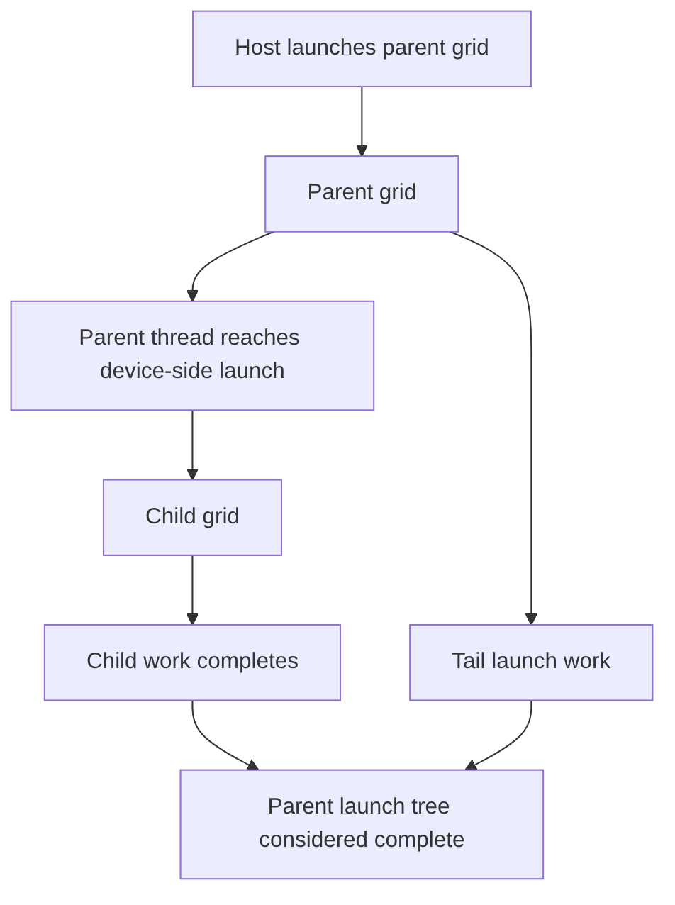

# 第 63 章 CUDA Dynamic Parallelism：GPU 端 launch kernel 解决什么问题

## 63.1 问题的由来

有些算法的下一层并行工作量只有 GPU 线程跑到某个位置才知道：树遍历、图搜索、自适应网格、递归细分、动态规划中的不规则边界。如果每次都让 GPU 停下来，把中间状态拷回 host，再由 CPU 决定下一轮 kernel，调度成本和同步成本会很高。

CUDA Dynamic Parallelism，简称 CDP，允许 device code 在 GPU 端 launch 子 kernel。它解决的是不规则并行的表达问题，不是让 GPU 变成一个通用 CPU 调度器。device-side launch 有开销，device runtime 有作用域限制，parent/child grid 的生命周期也比普通 host launch 更严格。

从 CUDA 12.0 起默认是 CDP2，compute capability 9.0 及以上只支持 CDP2。旧的 CDP1 已经弃用。CUDA 13 的头文件里仍保留 `-DCUDA_FORCE_CDP1_IF_SUPPORTED` 这个开关，但 CDP1 特有的 device 侧 `cudaDeviceSynchronize()` 只在为 compute capability 9.0 以下的目标编译时可用，而且会得到弃用警告；为 9.0 及以上编译时，device 代码里根本没有这个函数。另外，在启用 CDP 的编译中（`-rdc=true`）包含 CUDA 13 附带的 CCCL 头文件（Thrust、CUB、libcu++）时，定义这个宏会直接报错。新代码应按 CDP2 的模型编写。

## 63.2 核心模型

CDP 的关键词是 properly nested。parent grid 发起的 child grids 不是完全脱离 parent 的后台任务；parent grid 的完成包含它创建的 child work 的完成关系。

按时间顺序看一次嵌套：host 线程 launch grid A；grid A 中某个线程在执行途中 launch grid B。grid A 自己的线程可能早就全部跑完了，但 grid A 要等 grid B 也完成后才算完成，host 看到的“grid A 结束”已经包含了 grid B。child 再 launch 孙一级的 grid 时，同样的规则逐层套用。

图 63.1 把这种关系画成一棵 launch tree。除了普通 child grid，parent 还可以提交 tail launch 工作；child work 和 tail launch 工作都完成后，整棵 parent launch tree 才算结束。tail launch 的用法在下一节展开。

<figure>

<figcaption>图 63.1：parent grid、child grid 与 tail launch 构成的 launch tree</figcaption>
</figure>

## 63.3 详解

device 侧 launch 使用和 host 端类似的三尖括号语法：

```cpp
child_kernel<<<grid, block, shared_bytes, stream>>>(args...);
```

但它的执行环境不同。device runtime 中的 stream/event 只在创建它们的 grid 内有效。host 创建的 stream/event 不能拿到 device 侧乱用；parent grid 创建的 stream/event 也不能传给 child grid 继续使用。

Device 侧 implicit NULL stream 也不要照搬 host 侧直觉。它在 device runtime 中有自己的作用域，同一个 thread block 内的 implicit stream launch 可以按顺序理解；不同 block 发出的 launch 不能假设全局固定顺序。多个线程向同一个 named stream 提交 work 时，顺序受线程调度影响，需要通过程序结构或同步表达。

CDP 不提供新的并发保证。child grid 可能在依赖满足且资源可用时启动，也可能被延迟。程序不能依赖 parent 和 child 一定并发，也不能依赖多个 child grids 一定并发。

CDP2 下，不再把 device-side `cudaDeviceSynchronize()` 当作中途等待 child 并读取结果的常规模式。如果 parent 之后还有处理 child 结果的需求，通常用 tail launch 把后续处理表达为 launch tree 的尾部工作。

## 63.4 代码示例

一个最小 CDP 程序：

```cpp
#include <cstdio>
__global__ void child_kernel(int* data)
{
    int i = threadIdx.x;
    data[i] += 1;
}
__global__ void tail_kernel(int* data)
{
    int i = threadIdx.x;
    data[i] *= 2;
}
__global__ void parent_kernel(int* data)
{
    int i = threadIdx.x;
    data[i] = i;
    __syncthreads();
    if (threadIdx.x == 0) {
        child_kernel<<<1, 256>>>(data);
        if (cudaGetLastError() != cudaSuccess) {
            return;
        }
        tail_kernel<<<1, 256, 0, cudaStreamTailLaunch>>>(data);
    }
}
int main()
{
    int* data = nullptr;
    cudaMalloc(&data, 256 * sizeof(int));
    parent_kernel<<<1, 256>>>(data);
    cudaGetLastError();
    cudaDeviceSynchronize();
    cudaFree(data);
}
```

构建时需要 relocatable device code 和 device runtime：

```bash
nvcc -arch=sm_75 -rdc=true cdp.cu -o cdp -lcudadevrt
```

如果 pending launch 数量可能很大，可以在 host 侧调整 device runtime 限制：

```cpp
cudaDeviceSetLimit(cudaLimitDevRuntimePendingLaunchCount, pending_count);
```

## 63.5 工程判断

| 问题 | CDP 是否合适 | 理由 |
|---|---|---|
| GPU 端才知道下一层 work 大小 | 可能合适 | 可减少 host-device 往返 |
| child work 很小、数量很多 | 谨慎 | device-side launch overhead 可能吞掉收益 |
| parent 需要中途同步读取 child 结果 | 不优先 | CDP2 更推荐 tail launch 或重构流程 |
| 规则工作量的分层计算 | 通常不需要 | host launch、Graph 或 persistent kernel 更简单 |
| 递归/不规则细分 | 可能合适 | CDP 能表达动态 launch tree |
| 需要稳定低延迟调度 | 谨慎 | device runtime launch pool 和资源竞争会影响延迟 |

## 63.6 API 与要点速查

CDP 执行环境要点：

| 项 | 说明 |
|---|---|
| parent grid | 发起 child launch 的 grid |
| child grid | device-side launch 出来的 kernel invocation |
| properly nested | child work 完成关系纳入 parent launch tree |
| CDP2 | CUDA 12.0 起默认；CC 9.0+ 只支持 CDP2 |
| CDP1 compatibility | 已弃用；CUDA 13 中 `CUDA_FORCE_CDP1_IF_SUPPORTED` 只在 CC 9.0 以下的目标上提供 device 侧 `cudaDeviceSynchronize()`，且与 CCCL 头文件冲突 |
| device runtime | CDP 依赖的 device-side runtime 支持 |

Device-side stream：

| stream | 含义 |
|---|---|
| implicit NULL stream | device runtime 中有 grid/block 作用域语义，不能照搬 host 端全局默认 stream |
| named device stream | 在创建它的 grid 内有效 |
| `cudaStreamFireAndForget` | 不要求 parent 等待的 fire-and-forget 语义，但有使用限制 |
| `cudaStreamTailLaunch` | 在 parent launch tree 尾部执行后续 work |

相关限制：

| 限制 | 说明 |
|---|---|
| host stream/event | 在 device code 中使用 host 创建对象是 undefined behavior |
| child concurrency | 没有“一定并发”的保证 |
| launch error | device-side launch 也要检查 `cudaGetLastError()` |
| pending launch pool | 大量动态 launch 可能需要调整 `cudaLimitDevRuntimePendingLaunchCount` |

## 63.7 小结

读完本章，你应该能够：

- 解释 CDP 适合不规则并行，而不是普通 kernel 加速。
- 描述 parent/child launch tree 和 properly nested 的含义。
- 知道 CDP2 下为什么 tail launch 很重要。
- 写出最小 device-side launch 程序和编译命令。
