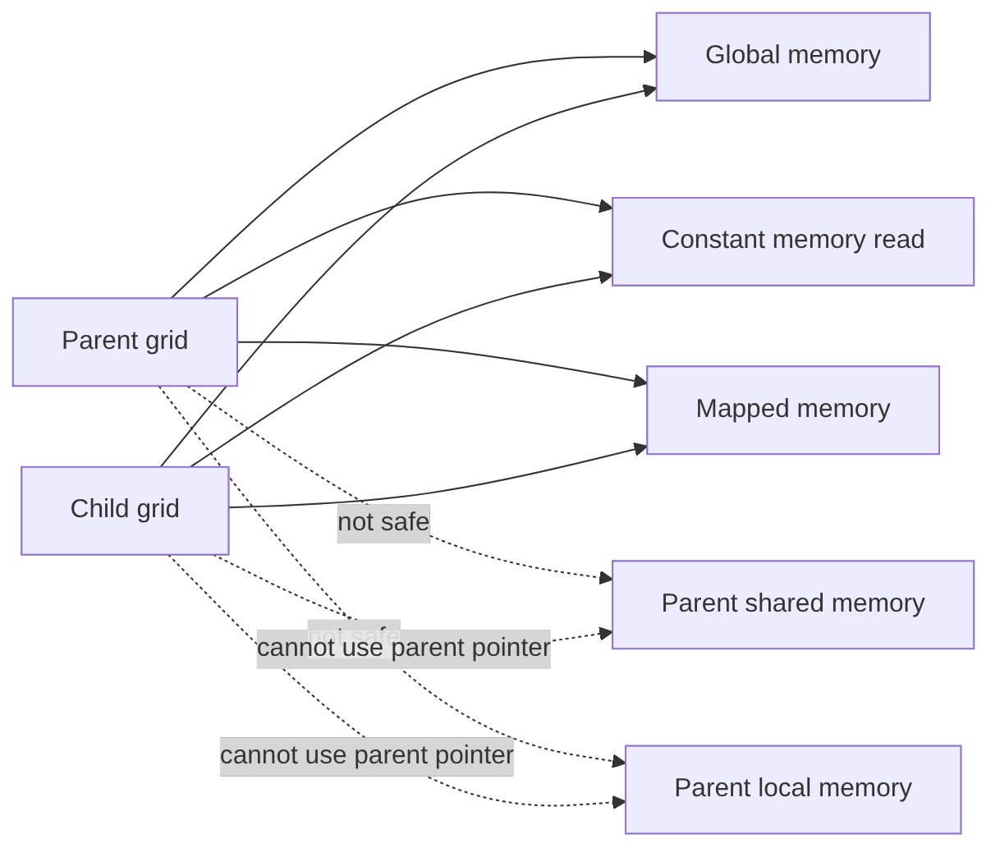

# 第 64 章 CDP 的内存一致性和低层 API：global 可以共享，shared/local 不行

## 64.1 问题的由来

CDP 最危险的地方不是 launch 语法，而是很多 host 端直觉在 device 端不成立。parent 和 child 都在 GPU 上运行，看起来应该可以随便共享指针；但 CUDA 的 memory space 有严格边界。global memory 可以跨 parent/child 共享，parent 的 shared memory 和 local memory 不能交给 child。

如果这个边界搞错，程序通常不会在编译期报错，而是运行时行为未定义。所以写 CDP 程序时，最先要弄清的就是哪些内存可以交给 child。

## 64.2 核心模型

child grid 能看到的不是 parent 的所有地址，而是 CUDA 定义为跨 grid 可见的 memory spaces。

图 64.1 把两类内存分开画：global、constant（只读）和 mapped memory 对 parent 和 child 都可用；parent 的 shared memory 和 local memory 只属于 parent 的 block 或线程，child 拿到指向它们的指针也不能用。

<figure>

<figcaption>图 64.1：child grid 能安全使用与不能使用的 parent 内存空间</figcaption>
</figure>

## 64.3 详解

CDP memory visibility 可以压缩成这张表：

| Memory space | Parent/child 共享 | 说明 |
|---|---|---|
| Global memory | 可以 | 最主要的数据交换位置 |
| Mapped host memory | 可以 | 仍要遵守系统范围同步和可见性 |
| Constant memory | 可读共享 | device 侧不能在运行中改 constant |
| Texture memory | 只读访问 | 一致性受 texture/cache 规则限制 |
| Shared memory | 不可以 | shared memory 生命周期属于 parent block |
| Local memory | 不可以 | local memory 生命周期属于 parent thread |

global memory 也不是任何时刻都自动一致。child launch 前，launching thread 自己已经可见的 global writes 可以被 child 看见。若整个 parent block 都写了 global memory，并希望 child 看到这些写入，launch 前要用 `__syncthreads()` 让 block 内写入完成并形成清晰的程序顺序。

shared/local pointer 错误很常见：

```cpp
__global__ void child(int* p) { p[0] = 1; }
__global__ void parent()
{
    __shared__ int smem[1];
    int local = 0;
    if (threadIdx.x == 0) {
        child<<<1, 1>>>(smem);   // 错：parent shared memory
        child<<<1, 1>>>(&local); // 错：parent local memory
    }
}
```

如果你在底层库里收到一个 generic pointer，并想防御性地避免把 local/shared pointer 传给 child，可以用地址空间谓词：

```cpp
if (__isGlobal(ptr)) {
    child<<<grid, block>>>(ptr);
}
```

## 64.4 代码示例

正确的数据路径通常把 parent/child 共享数据放在 global memory：

```cpp
__global__ void child(int* global_data)
{
    int i = threadIdx.x;
    global_data[i] += 1;
}
__global__ void parent(int* global_data)
{
    int i = threadIdx.x;
    global_data[i] = i;
    __syncthreads();
    if (threadIdx.x == 0) {
        child<<<1, blockDim.x>>>(global_data);
    }
}
```

三尖括号 device launch 底层可以理解为“申请 parameter buffer、按顺序写入参数、提交 launch”三步，device runtime 为此提供了两对低层 API。普通应用一般不直接使用，但了解它们有助于看懂 device runtime：

```cpp
__device__ cudaError_t cudaLaunchDevice(void* func,
                                        void* parameterBuffer,
                                        dim3 gridDimension,
                                        dim3 blockDimension,
                                        unsigned int sharedMemSize,
                                        cudaStream_t stream);
__device__ void* cudaGetParameterBuffer(size_t alignment,
                                        size_t size);
// V2：申请 buffer 时就带上 kernel 和 launch 配置，提交时只需 buffer 和 stream
__device__ void* cudaGetParameterBufferV2(void* func,
                                          dim3 gridDimension,
                                          dim3 blockDimension,
                                          unsigned int sharedMemSize);
__device__ cudaError_t cudaLaunchDeviceV2(void* parameterBuffer,
                                          cudaStream_t stream);
```

CUDA 13 的编译器把 device 侧 `<<<>>>` 翻译成 V2 这一对调用。旧的一对仍然保留，但在 CUDA 13.3、compute capability 12.0 的 GPU 上实测，用 `cudaLaunchDevice` 往 `cudaStreamTailLaunch` 或 `cudaStreamFireAndForget` 提交会返回 `cudaErrorInvalidValue`，所以下面的伪流程用 V2：

```cpp
__device__ void low_level_launch(int* data)
{
    void* buffer = cudaGetParameterBufferV2(reinterpret_cast<void*>(child),
                                            dim3(1),
                                            dim3(256),
                                            0);
    *reinterpret_cast<int**>(buffer) = data;  // 按 child 的形参布局写入
    cudaLaunchDeviceV2(buffer, cudaStreamTailLaunch);
}
```

真实 parameter buffer 需要严格遵守每个参数的对齐、顺序和大小限制。这类接口主要服务编译器和底层 runtime，日常代码优先使用三尖括号。

## 64.5 工程判断

| 场景 | 写法 | 风险 |
|---|---|---|
| parent 初始化 global，child 读取 | global memory + launch 前同步 | block 内多线程写入要 `__syncthreads()` |
| parent shared tile 交给 child | 不要这样写 | shared 生命周期不跨 child grid |
| parent thread local 临时变量交给 child | 不要这样写 | local 生命周期和地址空间不适合 child |
| device runtime symbol 访问 | 直接使用 `__device__` symbol | device runtime 不支持 host symbol API 那套调用 |
| 底层框架自定义 launch | parameter buffer + `cudaLaunchDeviceV2` | ABI、对齐和错误处理复杂 |

## 64.6 API 与要点速查

CDP memory coherence：

| 项 | 要点 |
|---|---|
| launch 前写入 | child 可见性取决于写入是否已经对 launching context 可见 |
| parent completion | child completion 嵌入 parent launch tree |
| tail launch | CDP2 中表达 child 之后处理的推荐方式 |
| constant memory | child 可读同一模块级 constant；device runtime 中不能用 symbol API 改 constant |
| texture/surface | device runtime 对 texture/surface 有独立限制，不能把 host 端资源模型直接搬进去 |

低层 API：

| API | 作用 |
|---|---|
| `cudaGetParameterBuffer` | device 侧获得参数缓冲 |
| `cudaLaunchDevice` | device 侧低层 launch |
| `cudaGetParameterBufferV2` | 带 kernel 和 launch 配置获得参数缓冲 |
| `cudaLaunchDeviceV2` | 提交 V2 参数缓冲；编译器为 `<<<>>>` 生成的就是这一对 |
| `cudaGetLastError` | device 侧检查 launch 错误 |
| `__isGlobal` | 判断指针是否指向 global memory |
| `cudaStreamFireAndForget` | fire-and-forget stream |
| `cudaStreamTailLaunch` | tail launch stream |

Device runtime scope：

| 对象 | Scope |
|---|---|
| device-created stream | 创建它的 grid 内有效 |
| device-created event | 创建它的 grid 内有效 |
| host-created stream/event | 不应在 device runtime 中使用 |
| parent-created stream/event | 不能传给 child grid 继续使用 |

## 64.7 小结

读完本章，你应该能够：

- 判断哪些 memory space 可以跨 parent/child 共享。
- 解释为什么 shared/local pointer 传给 child 是未定义行为。
- 知道低层 `cudaLaunchDevice` / `cudaLaunchDeviceV2` 存在，但不把它们当日常接口。
- 为 CDP 程序设计清晰的 global memory 交换边界。
