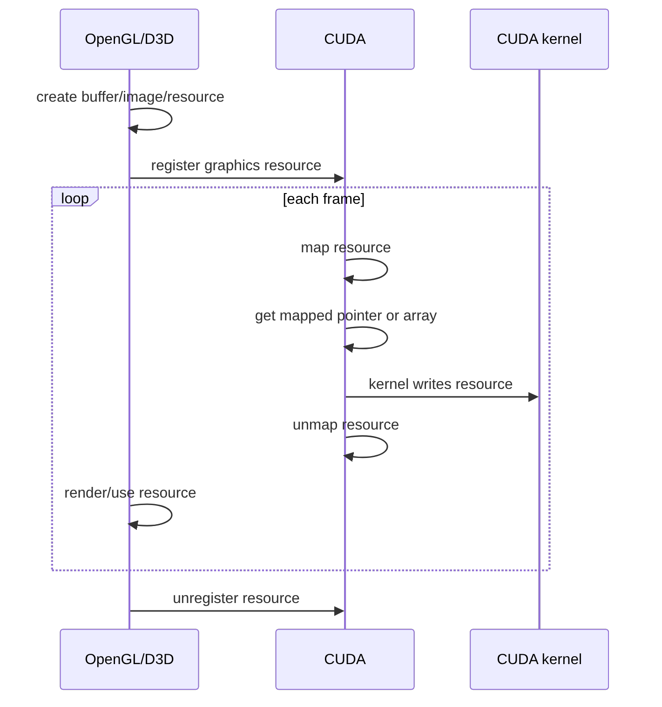

# 第 65 章 OpenGL/D3D 互操作：register、map、use、unmap 的资源所有权

## 65.1 问题的由来

渲染、仿真、可视化和交互式工具经常需要 CUDA 生成数据，再由图形 API 直接显示。最糟糕的路径是 CUDA 写 device memory，拷回 CPU，再交给 OpenGL 或 Direct3D 上传到 GPU。Graphics interoperability 让 CUDA 和图形 API 共享同一个资源，避免 CPU 中转。

这类互操作要处理的是资源所有权的切换，光拿到一个指针并不够。资源注册给 CUDA 后，每帧由 CUDA map，CUDA 使用期间外部 API 不能同时访问；CUDA unmap 后，资源再回到图形 API。

## 65.2 核心模型

register 通常是初始化阶段动作；map/unmap 才是每帧循环里的动作。

图 65.1 是一个资源的完整生命周期：图形 API 创建资源后注册给 CUDA；进入循环后，每帧由 CUDA map、取得 pointer 或 array、让 kernel 写入、再 unmap，之后图形 API 才渲染或使用这份资源；程序结束前注销。循环里资源在 CUDA 和图形 API 之间来回交接，同一时刻只归一方使用。

<figure>

<figcaption>图 65.1：注册一次、每帧 map/unmap 的图形资源所有权切换</figcaption>
</figure>

## 65.3 详解

OpenGL buffer 通常映射成 device pointer，texture/renderbuffer 通常映射成 CUDA array。D3D11 resource 也类似：buffer 走 mapped pointer，texture/subresource 走 mapped array。

互操作中的三个错误最常见：

1. 每帧重复 register/unregister，把昂贵操作放进热路径。
2. resource mapped 给 CUDA 时，图形 API 仍在访问它。
3. 把 buffer 和 image 的映射方式混淆，应该拿 array 时拿 pointer。

注册 flag 也表达使用意图。`cudaGraphicsRegisterFlagsWriteDiscard` 常用于 CUDA 每帧完全重写 buffer 的场景；surface load/store 需要注册时声明相应能力。注意 register flag（`cudaGraphicsRegisterFlags*`）和 map flag（`cudaGraphicsMapFlags*`，配合 `cudaGraphicsResourceSetMapFlags` 使用）是两组枚举，`WriteDiscard` 在两组里数值相同，但注册时应该用前者。

## 65.4 代码示例

OpenGL VBO 注册：

```cpp
cudaGraphicsResource* resource = nullptr;
cudaGraphicsGLRegisterBuffer(
    &resource,
    vbo,
    cudaGraphicsRegisterFlagsWriteDiscard);
```

每帧 map、获取 pointer、launch、unmap：

```cpp
float4* ptr = nullptr;
size_t bytes = 0;
cudaGraphicsMapResources(1, &resource, stream);
cudaGraphicsResourceGetMappedPointer(
    reinterpret_cast<void**>(&ptr),
    &bytes,
    resource);
simple_vbo_kernel<<<grid, block, 0, stream>>>(ptr, width, height, time);
cudaGraphicsUnmapResources(1, &resource, stream);
```

OpenGL image/texture：

```cpp
cudaGraphicsResource* image_resource = nullptr;
cudaGraphicsGLRegisterImage(
    &image_resource,
    texture,
    GL_TEXTURE_2D,
    cudaGraphicsRegisterFlagsSurfaceLoadStore);
cudaGraphicsMapResources(1, &image_resource, stream);
cudaArray_t array = nullptr;
cudaGraphicsSubResourceGetMappedArray(&array, image_resource, 0, 0);
// 之后可以绑定到 surface/texture object，或通过 CUDA array 相关 API 使用。
cudaGraphicsUnmapResources(1, &image_resource, stream);
```

D3D11 resource 注册形状：

```cpp
cudaGraphicsResource* cuda_resource = nullptr;
cudaGraphicsD3D11RegisterResource(
    &cuda_resource,
    d3d_resource,
    cudaGraphicsRegisterFlagsNone);
cudaGraphicsMapResources(1, &cuda_resource, stream);
cudaArray_t array = nullptr;
cudaGraphicsSubResourceGetMappedArray(&array, cuda_resource, 0, 0);
cudaGraphicsUnmapResources(1, &cuda_resource, stream);
```

不再使用时：

```cpp
cudaGraphicsUnregisterResource(resource);
```

## 65.5 工程判断

| 场景 | 推荐路径 | 注意点 |
|---|---|---|
| CUDA 写 OpenGL VBO | `cudaGraphicsGLRegisterBuffer` + mapped pointer | 每帧 map/unmap，不要每帧 register |
| CUDA 写 OpenGL texture | `cudaGraphicsGLRegisterImage` + mapped array | surface 写入要注册 flag |
| CUDA 写 D3D11 texture | `cudaGraphicsD3D11RegisterResource` + mapped array | subresource index 要正确 |
| Vulkan/D3D12 互操作 | external memory/semaphore | 不走传统 graphics register/map 模型 |
| 多 GPU/SLI 渲染 | 谨慎 | 资源注册设备和渲染设备要匹配 |
| 外部 API 和 CUDA 同时访问 | 禁止 | mapped 期间外部访问结果未定义 |

## 65.6 API 与要点速查

通用 Graphics Interop API：

| API | 作用 |
|---|---|
| `cudaGraphicsMapResources` | map 一个或多个 graphics resources |
| `cudaGraphicsUnmapResources` | unmap resources |
| `cudaGraphicsResourceGetMappedPointer` | 从 mapped buffer 得到 device pointer |
| `cudaGraphicsSubResourceGetMappedArray` | 从 mapped image/subresource 得到 CUDA array |
| `cudaGraphicsUnregisterResource` | 注销 graphics resource |

OpenGL：

| API | 作用 |
|---|---|
| `cudaGraphicsGLRegisterBuffer` | 注册 OpenGL buffer |
| `cudaGraphicsGLRegisterImage` | 注册 OpenGL texture/renderbuffer |

D3D：

| API | 作用 |
|---|---|
| `cudaGraphicsD3D9RegisterResource` | D3D9 resource interop |
| `cudaGraphicsD3D10RegisterResource` | D3D10 resource interop |
| `cudaGraphicsD3D11RegisterResource` | D3D11 resource interop |

Flags：

| Flag | 语义 |
|---|---|
| `cudaGraphicsRegisterFlagsNone` | 默认注册 |
| `cudaGraphicsRegisterFlagsReadOnly` | CUDA 只读 |
| `cudaGraphicsRegisterFlagsWriteDiscard` | CUDA 写入且可丢弃旧内容 |
| `cudaGraphicsRegisterFlagsSurfaceLoadStore` | 允许 surface load/store |
| `cudaGraphicsRegisterFlagsTextureGather` | texture gather 相关能力 |

## 65.7 小结

读完本章，你应该能够：

- 说清 register/map/use/unmap 的所有权切换。
- 区分 buffer pointer 和 image array 两类映射。
- 知道 mapped 期间外部 API 同时访问是未定义行为。
- 判断传统 graphics interop 与 external resource interop 的边界。
