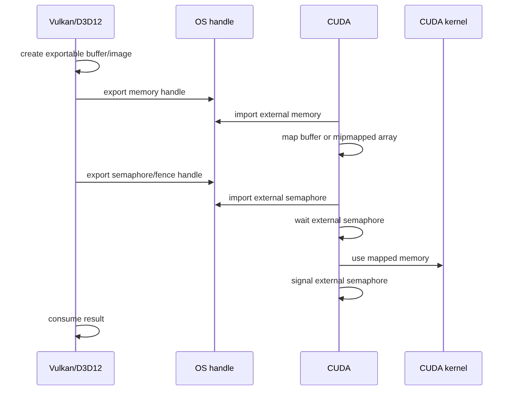

# 第 66 章 Vulkan/D3D12 互操作：external memory 与 external semaphore 是同一套边界问题

## 66.1 问题的由来

Vulkan 和 D3D12 的资源共享模型更显式：资源可以导出为 OS handle，CUDA 再导入这些 external memory 和 external semaphore。和 OpenGL/D3D11 的 register/map 不同，这里不是 CUDA 直接“注册图形对象”，而是双方通过外部 handle 共享底层对象，并用外部同步对象表达执行顺序。

这条线里最重要的规则是：memory handle 不提供同步，semaphore/fence handle 不管理内存生命周期。两者必须一起设计。

## 66.2 核心模型

Vulkan 用 UUID 匹配物理设备，D3D12 常用 LUID 匹配。设备不匹配，资源共享就没有可靠语义。

设备匹配之后，共享分成两条线，见图 66.1：图形 API 导出 memory handle，CUDA 导入为 external memory 并映射成 buffer 或 mipmapped array；图形 API 再导出 semaphore/fence handle，CUDA 导入为 external semaphore。每轮工作里，CUDA 先在 stream 上等待 semaphore，kernel 使用映射出的内存，最后 signal semaphore，图形 API 等到 signal 后再消费结果。

<figure>

<figcaption>图 66.1：Vulkan/D3D12 资源经 OS handle 导入 CUDA，并用 semaphore 同步</figcaption>
</figure>

## 66.3 详解

External memory 的 CUDA 侧流程：

1. 填 `cudaExternalMemoryHandleDesc`。
2. 调 `cudaImportExternalMemory`。
3. 用 `cudaExternalMemoryGetMappedBuffer` 得到 pointer，或用 `cudaExternalMemoryGetMappedMipmappedArray` 得到 mipmapped array。
4. 映射出的 pointer 用 `cudaFree` 释放；mipmapped array 用 `cudaFreeMipmappedArray` 释放。
5. external memory object 本身用 `cudaDestroyExternalMemory` 销毁。

External semaphore 的 CUDA 侧流程：

1. 填 `cudaExternalSemaphoreHandleDesc`。
2. 调 `cudaImportExternalSemaphore`。
3. 在 CUDA stream 中 `cudaWaitExternalSemaphoresAsync`。
4. CUDA work 访问 imported memory。
5. `cudaSignalExternalSemaphoresAsync` 通知外部 API。
6. 所有 outstanding wait/signal 完成后 `cudaDestroyExternalSemaphore`。

Linux fd 和 Windows NT handle 的所有权规则不同。CUDA 成功导入 Linux fd 后通常接管 fd；Windows NT handle 则不由 CUDA 接管，应用仍然要关闭 handle。

## 66.4 代码示例

导入 external memory：

```cpp
cudaExternalMemoryHandleDesc mem_desc{};
mem_desc.type = cudaExternalMemoryHandleTypeOpaqueFd;
mem_desc.handle.fd = fd;
mem_desc.size = size;
cudaExternalMemory_t ext_mem{};
cudaImportExternalMemory(&ext_mem, &mem_desc);
```

映射成 buffer pointer：

```cpp
cudaExternalMemoryBufferDesc buffer_desc{};
buffer_desc.offset = 0;
buffer_desc.size = size;
void* ptr = nullptr;
cudaExternalMemoryGetMappedBuffer(&ptr, ext_mem, &buffer_desc);
// 使用后：
cudaFree(ptr);
cudaDestroyExternalMemory(ext_mem);
```

映射成 mipmapped array：

```cpp
cudaExternalMemoryMipmappedArrayDesc mip_desc{};
mip_desc.offset = offset;
mip_desc.formatDesc = channel_desc;
mip_desc.extent = extent;
mip_desc.flags = flags;
mip_desc.numLevels = levels;
cudaMipmappedArray_t mipmap{};
cudaExternalMemoryGetMappedMipmappedArray(&mipmap, ext_mem, &mip_desc);
cudaFreeMipmappedArray(mipmap);
```

导入并使用 external semaphore：

```cpp
cudaExternalSemaphoreHandleDesc sem_desc{};
sem_desc.type = cudaExternalSemaphoreHandleTypeTimelineSemaphoreFd;
sem_desc.handle.fd = sem_fd;
cudaExternalSemaphore_t sem{};
cudaImportExternalSemaphore(&sem, &sem_desc);
cudaExternalSemaphoreWaitParams wait_params{};
wait_params.params.fence.value = wait_value;
cudaWaitExternalSemaphoresAsync(&sem, &wait_params, 1, stream);
kernel<<<grid, block, 0, stream>>>(ptr);
cudaExternalSemaphoreSignalParams signal_params{};
signal_params.params.fence.value = signal_value;
cudaSignalExternalSemaphoresAsync(&sem, &signal_params, 1, stream);
```

## 66.5 工程判断

| 场景 | 关键判断 | 常见错误 |
|---|---|---|
| Vulkan buffer 共享给 CUDA | UUID 匹配 + opaque fd/Win32 handle | CUDA device 选错 |
| Vulkan image 共享 | dedicated allocation、layout、mipmapped array 参数 | offset/extent/format 不匹配 |
| D3D12 resource 共享 | LUID 匹配 + D3D12 resource handle | 套用 D3D11 register 模型 |
| timeline semaphore | wait/signal value 单调设计 | wait value 和 signal value 混乱 |
| binary semaphore | signal 必须先于对应 wait 的提交规则 | wait/signal 顺序反了 |
| 释放资源 | 先完成 outstanding work | mapped pointer/array 忘记单独释放 |

## 66.6 API 与要点速查

External memory：

| API/类型 | 作用 |
|---|---|
| `cudaExternalMemoryHandleDesc` | external memory 导入描述 |
| `cudaImportExternalMemory` | 导入外部 memory |
| `cudaExternalMemoryGetMappedBuffer` | 映射为 device pointer |
| `cudaExternalMemoryGetMappedMipmappedArray` | 映射为 mipmapped array |
| `cudaDestroyExternalMemory` | 销毁 external memory object |
| `cudaExternalMemoryBufferDesc` | buffer 映射参数 |
| `cudaExternalMemoryMipmappedArrayDesc` | mipmapped array 映射参数 |

External semaphore：

| API/类型 | 作用 |
|---|---|
| `cudaExternalSemaphoreHandleDesc` | external semaphore 导入描述 |
| `cudaImportExternalSemaphore` | 导入外部 semaphore/fence |
| `cudaWaitExternalSemaphoresAsync` | CUDA stream 等待外部同步 |
| `cudaSignalExternalSemaphoresAsync` | CUDA stream signal 外部同步 |
| `cudaDestroyExternalSemaphore` | 销毁 external semaphore |
| `cudaExternalSemaphoreWaitParams` | wait 参数，timeline value 等 |
| `cudaExternalSemaphoreSignalParams` | signal 参数 |

常见 handle type：

| 类型 | 用途 |
|---|---|
| `cudaExternalMemoryHandleTypeOpaqueFd` | Linux opaque fd memory |
| `cudaExternalMemoryHandleTypeOpaqueWin32` | Windows opaque handle memory |
| `cudaExternalMemoryHandleTypeD3D12Resource` | D3D12 resource |
| `cudaExternalSemaphoreHandleTypeOpaqueFd` | Linux opaque fd semaphore |
| `cudaExternalSemaphoreHandleTypeTimelineSemaphoreFd` | Vulkan timeline semaphore fd |
| `cudaExternalSemaphoreHandleTypeD3D12Fence` | D3D12 fence |

## 66.7 小结

读完本章，你应该能够：

- 区分 external memory 和 external semaphore 的职责。
- 写出 import-map-wait-kernel-signal-release 的完整顺序。
- 知道 UUID/LUID 匹配是互操作正确性的前提。
- 识别 pointer/array 和 external object 的双层生命周期。
