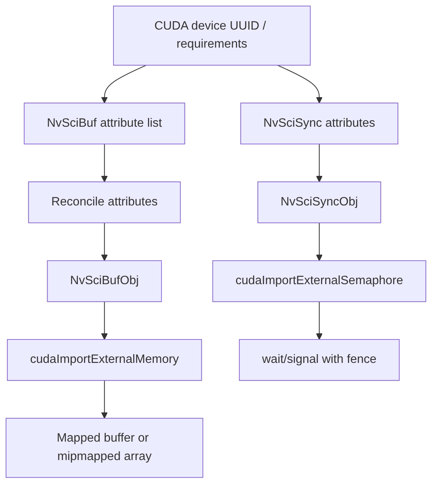

# 第 67 章 NVSCI 互操作：安全系统里的共享内存和同步对象

## 67.1 问题的由来

NVSCI 面向更复杂的软件通信场景：不同用户态驱动、进程、安全域之间共享 buffer 和同步对象。和 Vulkan/D3D12 一样，它最终进入 CUDA 时也表现为 external memory 和 external semaphore，但创建对象之前有一套 attribute negotiation 和权限协商。

如果说 Vulkan/D3D12 的关键是 handle type 和设备匹配，那么 NVSCI 的关键就是 attribute list、权限、cache coherency 和 NvSciSync 的 fence 顺序。

## 67.2 核心模型

NVSCI 的流程更像“先协商，再导入”，不是拿到一个现成 fd 就直接 map。

图 67.1 是两条并行的路径，起点都是 CUDA device 的 UUID 和访问需求。内存一侧：写出 NvSciBuf attribute list，与其他参与方的需求 reconcile 后得到 NvSciBufObj，再由 `cudaImportExternalMemory` 导入，映射成 buffer 或 mipmapped array。同步一侧：生成 NvSciSync attributes，创建 NvSciSyncObj，由 `cudaImportExternalSemaphore` 导入，之后 wait/signal 都带 fence。

<figure>

<figcaption>图 67.1：NvSciBuf 与 NvSciSync 先协商属性、再导入 CUDA</figcaption>
</figure>

## 67.3 详解

NvSciBuf 负责内存对象。为 CUDA 设备创建兼容 NvSciBuf 时，需要把目标 GPU id 放入 attribute list，例如 `NvSciBufGeneralAttrKey_GpuId`。还可以表达 required permissions、cache coherency 等属性。

权限很重要。可以用 `NvSciBufObjDupWithReducePerm` 创建降低权限的 duplicate object，比如只给 CUDA read-only 视图。不要把所有 participant 都默认设成读写。

导入到 CUDA 时，handle type 是 `cudaExternalMemoryHandleTypeNvSciBuf`。导入后，映射出的 pointer 要 `cudaFree`，映射出的 mipmapped array 要 `cudaFreeMipmappedArray`；NvSciBuf 对象本身的 attribute list 和生命周期仍然由应用维护。

NvSciSync 负责同步对象。CUDA 可以用 `cudaDeviceGetNvSciSyncAttributes` 往应用事先创建好的属性列表里填入与某个 CUDA device 兼容的 signaler/waiter attributes，再参与 NvSciSyncObj 创建。Runtime API 这一侧的 flag 是 `cudaNvSciSyncAttrSignal` / `cudaNvSciSyncAttrWait`；Driver API 的 `cuDeviceGetNvSciSyncAttributes` 对应的是 `CUDA_NVSCISYNC_ATTR_SIGNAL` / `CUDA_NVSCISYNC_ATTR_WAIT`，两套名字不要混用。导入后，CUDA 使用 `cudaWaitExternalSemaphoresAsync` / `cudaSignalExternalSemaphoresAsync`。

cache coherency 是 NVSCI 互操作的重点之一。`NvSciBufGeneralAttrKey_GpuSwNeedCacheCoherency` 如果表明不需要 CUDA 额外做 memory sync，才应该设置对应 skip mem sync flags。不要为了性能盲目跳过同步。

## 67.4 代码示例

伪流程：创建 CUDA 兼容 NvSciBuf attributes。NvSciBuf 侧的模块、属性列表和键值对类型都来自 NvSciBuf 的头文件，这里省略了错误检查：

```cpp
// 1. 取 CUDA 设备的 UUID，NvSciBuf 用它识别是哪张 GPU
cudaDeviceProp prop{};
cudaGetDeviceProperties(&prop, cuda_device);
NvSciRmGpuId gpu_id{};
std::memcpy(gpu_id.bytes, prop.uuid.bytes, sizeof(gpu_id.bytes));

// 2. 为 CUDA 这一方创建一个空的属性列表
NvSciBufModule buf_module = nullptr;
NvSciBufModuleOpen(&buf_module);
NvSciBufAttrList cuda_attrs = nullptr;
NvSciBufAttrListCreate(buf_module, &cuda_attrs);

// 3. 写入两类需求：哪张 GPU 要访问、需要什么权限
NvSciBufAttrValAccessPerm perm = NvSciBufAccessPerm_ReadWrite;
NvSciBufAttrKeyValuePair pairs[] = {
    {NvSciBufGeneralAttrKey_GpuId,        &gpu_id, sizeof(gpu_id)},
    {NvSciBufGeneralAttrKey_RequiredPerm, &perm,   sizeof(perm)},
};
NvSciBufAttrListSetAttrs(cuda_attrs, pairs, sizeof(pairs) / sizeof(pairs[0]));
// 之后和其他参与方的属性列表一起 reconcile，再据此分配 NvSciBufObj
```

导入 NvSciBuf 到 CUDA：

```cpp
cudaExternalMemoryHandleDesc desc{};
desc.type = cudaExternalMemoryHandleTypeNvSciBuf;
desc.handle.nvSciBufObject = buffer_obj;
desc.size = size;
cudaExternalMemory_t ext_mem{};
cudaImportExternalMemory(&ext_mem, &desc);
cudaExternalMemoryBufferDesc buffer_desc{};
buffer_desc.offset = 0;
buffer_desc.size = size;
void* ptr = nullptr;
cudaExternalMemoryGetMappedBuffer(&ptr, ext_mem, &buffer_desc);
```

NvSciSync attribute 与导入：

```cpp
NvSciSyncAttrList signaler = nullptr;
NvSciSyncAttrList waiter = nullptr;
NvSciSyncAttrListCreate(sync_module, &signaler);  // 先建空列表，再让 CUDA 填写
NvSciSyncAttrListCreate(sync_module, &waiter);
cudaDeviceGetNvSciSyncAttributes(
    signaler,
    cuda_device,
    cudaNvSciSyncAttrSignal);
cudaDeviceGetNvSciSyncAttributes(
    waiter,
    cuda_device,
    cudaNvSciSyncAttrWait);
cudaExternalSemaphoreHandleDesc sem_desc{};
sem_desc.type = cudaExternalSemaphoreHandleTypeNvSciSync;
sem_desc.handle.nvSciSyncObj = sync_obj;
cudaExternalSemaphore_t sem{};
cudaImportExternalSemaphore(&sem, &sem_desc);
```

wait/signal 时可携带 fence：

```cpp
cudaExternalSemaphoreWaitParams wait_params{};
wait_params.params.nvSciSync.fence = &fence;  // 指向 NvSciSyncFence
wait_params.flags = 0; // 或按 coherency 属性设置 skip flag
cudaWaitExternalSemaphoresAsync(&sem, &wait_params, 1, stream);
```

## 67.5 工程判断

| 问题 | 判断方式 | 注意点 |
|---|---|---|
| CUDA 是否能访问 NvSciBuf | attribute list 中 GPU id 和权限 | UUID/权限不匹配会导致导入或访问失败 |
| 是否可以跳过 mem sync | 查看 `GpuSwNeedCacheCoherency` | 只有属性允许时才设置 skip flag |
| 只读共享 | duplicate object with reduced permission | 不要默认给读写权限 |
| 同步对象导入 | NvSciSyncObj → external semaphore | NvSciSyncObj 生命周期仍由应用负责 |
| 多 participant | attribute reconciliation | 失败时应打印冲突 attribute |

## 67.6 API 与要点速查

NvSciBuf 相关：

| 名称 | 作用 |
|---|---|
| `NvSciBufGeneralAttrKey_GpuId` | 指定兼容 GPU |
| `NvSciBufGeneralAttrKey_RequiredPerm` | 指定访问权限 |
| `NvSciBufGeneralAttrKey_GpuSwNeedCacheCoherency` | 是否需要 GPU software cache coherency |
| `NvSciBufObjDupWithReducePerm` | 创建降低权限的 duplicate object |
| `cudaExternalMemoryHandleTypeNvSciBuf` | CUDA 导入 NvSciBuf 的 handle type |

NvSciSync 相关：

| 名称 | 作用 |
|---|---|
| `cudaDeviceGetNvSciSyncAttributes` | 生成 CUDA 兼容 NvSciSync attributes |
| `cudaNvSciSyncAttrSignal` | CUDA 作为 signaler |
| `cudaNvSciSyncAttrWait` | CUDA 作为 waiter |
| `cudaExternalSemaphoreHandleTypeNvSciSync` | CUDA 导入 NvSciSyncObj |
| `cudaExternalSemaphoreSignalSkipNvSciBufMemSync` | signal 时跳过 NvSciBuf mem sync |
| `cudaExternalSemaphoreWaitSkipNvSciBufMemSync` | wait 时跳过 NvSciBuf mem sync |

生命周期提醒：

| 对象 | 谁负责 |
|---|---|
| NvSciBuf attribute list | 应用维护和释放 |
| NvSciBufObj | 应用维护；CUDA import 不代表 CUDA 接管全部生命周期 |
| mapped CUDA pointer | `cudaFree` |
| mapped mipmapped array | `cudaFreeMipmappedArray` |
| NvSciSyncObj | 应用维护；导入后不能提前释放导致 CUDA 未定义行为 |
| CUDA external semaphore | `cudaDestroyExternalSemaphore` |

## 67.7 小结

读完本章，你应该能够：

- 把 NVSCI 看成 attribute negotiation + external resource import。
- 区分 NvSciBuf 和 NvSciSync 的角色。
- 知道权限和 cache coherency 不是性能细节，而是正确性边界。
- 写出 CUDA 导入 NvSciBuf/NvSciSync 的关键结构。
