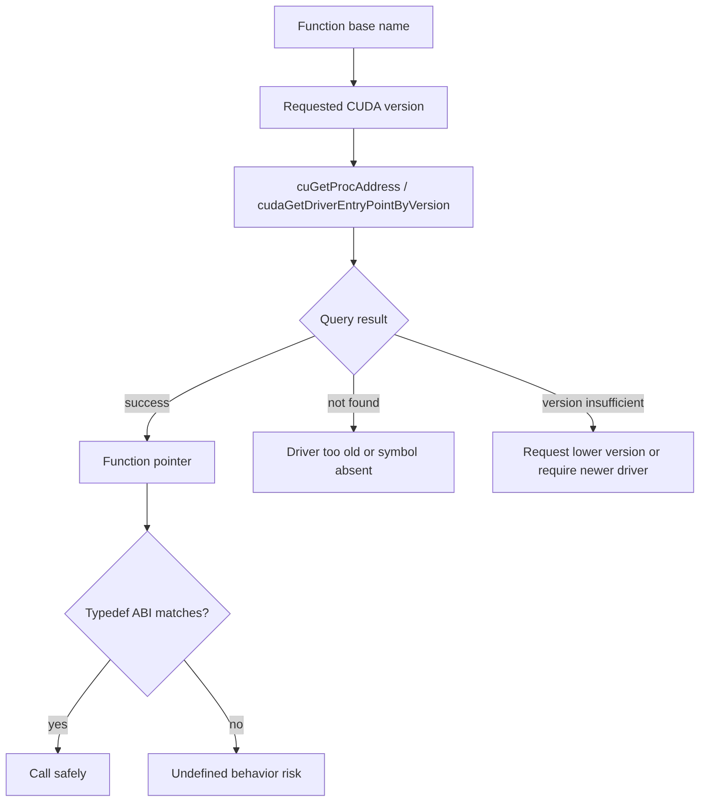

# 第 68 章 `cuGetProcAddress`：动态获取 Driver API 函数指针时，版本和 ABI 才是重点

## 68.1 问题的由来

普通 CUDA 程序直接链接 Driver API 或 Runtime API 就够了。但插件系统、动态加载框架、跨 toolkit/driver 部署、只更新 driver 不更新 toolkit 的环境，会遇到一个问题：能不能在运行时查询某个 Driver API 的入口地址？

从 CUDA 11.3 起，Driver Entry Point Access API 提供了这个能力。它看起来像 `dlsym`/`GetProcAddress`，但不能只按“找到函数名就调用”理解。CUDA Driver API 有版本化符号，typedef 有 ABI 版本，默认 stream 语义也可能分 legacy stream 和 per-thread default stream。

## 68.2 核心模型

版本号和 typedef 必须一起看。拿新 driver 版本去查询旧 typedef 不能自动变安全。

图 68.1 是一次查询要经过的判断：用函数的 base name 加上请求的 CUDA version 调用 `cuGetProcAddress`（或 Runtime 侧的 `cudaGetDriverEntryPointByVersion`），先看 query result。找不到符号，说明 driver 太旧或符号不存在；版本不足，就请求更低版本或要求升级 driver。只有成功拿到函数指针、并且手里的 typedef 与这个版本的 ABI 一致时，调用才安全；typedef 对不上，就是未定义行为。

<figure>

<figcaption>图 68.1：按 base name 和版本查询 entry point，再核对 typedef 的流程</figcaption>
</figure>

## 68.3 详解

CUDA Toolkit 提供 typedef headers。它们定义函数指针类型，不定义函数指针变量。

| Driver header | Typedef header |
|---|---|
| `cuda.h` | `cudaTypedefs.h` |
| `cudaGL.h` | `cudaGLTypedefs.h` |
| `cudaProfiler.h` | `cudaProfilerTypedefs.h` |
| `cudaVDPAU.h` | `cudaVDPAUTypedefs.h` |
| `cudaEGL.h` | `cudaEGLTypedefs.h` |
| `cudaD3D9.h` | `cudaD3D9Typedefs.h` |
| `cudaD3D10.h` | `cudaD3D10Typedefs.h` |
| `cudaD3D11.h` | `cudaD3D11Typedefs.h` |

Driver symbol 会随 ABI 演进产生版本。例如 `cuMemAlloc` 有旧版和新版 typedef：

```cpp
typedef CUresult (CUDAAPI *PFN_cuMemAlloc_v3020)(CUdeviceptr_v2* dptr,
                                                 size_t bytesize);
typedef CUresult (CUDAAPI *PFN_cuMemAlloc_v2000)(CUdeviceptr_v1* dptr,
                                                 unsigned int bytesize);
```

如果你想要某个具体 ABI，就用对应 typedef，并传入该 ABI 引入的 CUDA version。不要用运行时查询到的最新 driver version 去请求，然后仍用旧 typedef 调用。

CUDA 13 的 `cudaTypedefs.h` 只提供带版本后缀的 typedef，旧版本头文件里那种不带后缀的别名（例如 `PFN_cuMemAllocAsync`、`PFN_cuLaunchKernel`）已经没有了。上面 `PFN_cuMemAlloc_v2000` 这类很早期的 typedef 也只在内部宏 `__CUDA_API_VERSION_INTERNAL` 打开时才声明。下面的示例都显式写出版本后缀，并让传入的 version 与后缀一致。

## 68.4 代码示例

Driver API 查询：

```cpp
#include <cuda.h>
#include <cudaTypedefs.h>
PFN_cuStreamBeginCapture_v10010 pfn_begin_capture = nullptr;
CUdriverProcAddressQueryResult query{};
CUresult st = cuGetProcAddress(
    "cuStreamBeginCapture",
    reinterpret_cast<void**>(&pfn_begin_capture),
    10010,
    CU_GET_PROC_ADDRESS_DEFAULT,
    &query);
if (st == CUDA_SUCCESS && query == CU_GET_PROC_ADDRESS_SUCCESS) {
    // pfn_begin_capture 使用 v10010 typedef，对应 CUDA 10.1 ABI。
}
```

Runtime API 查询 Driver entry point。CUDA 13.0 起 `cudaGetDriverEntryPoint` 已标为弃用（它隐式使用 runtime 版本号），应改用显式传版本号的 `cudaGetDriverEntryPointByVersion`：

```cpp
#include <cuda_runtime_api.h>
#include <cudaTypedefs.h>
PFN_cuMemAllocAsync_v11020 pfn_alloc_async = nullptr;
cudaDriverEntryPointQueryResult query{};
cudaError_t st = cudaGetDriverEntryPointByVersion(
    "cuMemAllocAsync",
    reinterpret_cast<void**>(&pfn_alloc_async),
    11020,  // 与 typedef 的 _v11020 后缀一致
    cudaEnableDefault,
    &query);
if (st == cudaSuccess && query == cudaDriverEntryPointSuccess) {
    // 使用 pfn_alloc_async
}
```

如果要 per-thread default stream 语义：

```cpp
PFN_cuLaunchKernel_v7000_ptsz pfn_launch = nullptr;
CUdriverProcAddressQueryResult query{};
cuGetProcAddress(
    "cuLaunchKernel",
    reinterpret_cast<void**>(&pfn_launch),
    7000,  // per-thread 版本从 CUDA 7.0 起提供，与 typedef 后缀一致
    CU_GET_PROC_ADDRESS_PER_THREAD_DEFAULT_STREAM,
    &query);
```

## 68.5 工程判断

| 问题 | 正确做法 | 风险 |
|---|---|---|
| 只想获取当前 toolkit 知道的最新 ABI | 用头文件里后缀最新的 typedef + 对应 version（12.x 及以前可用不带后缀的 typedef + `CUDA_VERSION`） | 仍要检查 query result |
| 想固定某个 ABI | 用版本化 typedef + 对应 CUDA version | 不要传更高 version 赌兼容 |
| 想访问新 driver feature | 手写或提供新 typedef，检查 driver | ABI 变更风险由你承担 |
| 默认 stream 语义敏感 | 显式选择 legacy/per-thread flag | 隐式语义不匹配会产生 ordering bug |
| plugin 可选功能 | 获取失败后走 fallback | 不要把 optional feature 当必然存在 |

## 68.6 API 与要点速查

Entry point API：

| API/类型 | 作用 |
|---|---|
| `cuGetProcAddress` | Driver API 获取 driver function pointer |
| `cudaGetDriverEntryPoint` | Runtime API 按 runtime version 获取 driver entry point；CUDA 13.0 起弃用 |
| `cudaGetDriverEntryPointByVersion` | Runtime API 按用户指定 version 获取 |
| `CUdriverProcAddressQueryResult` | Driver 侧 query result |
| `cudaDriverEntryPointQueryResult` | Runtime 侧 query result |

Flags 和默认 stream：

| 名称 | 作用 |
|---|---|
| `CU_GET_PROC_ADDRESS_DEFAULT` | 默认查询 |
| `CU_GET_PROC_ADDRESS_LEGACY_STREAM` | 请求 legacy default stream 语义 |
| `CU_GET_PROC_ADDRESS_PER_THREAD_DEFAULT_STREAM` | 请求 per-thread default stream 语义 |
| `cudaEnableDefault` | Runtime 查询默认行为 |
| `cudaEnableLegacyStream` | Runtime legacy stream |
| `cudaEnablePerThreadDefaultStream` | Runtime per-thread default stream |
| `--default-stream per-thread` | 编译期开启 per-thread default stream |
| `CUDA_API_PER_THREAD_DEFAULT_STREAM` | 宏方式请求 per-thread default stream |

失败判断：

| 情况 | 处理 |
|---|---|
| `CUDA_ERROR_NOT_FOUND` | symbol 不存在或 version 不合法 |
| `CUDA_ERROR_INVALID_VALUE` | 参数或 flag 错误 |
| version not sufficient | 请求版本不可用，降级或要求升级 |
| function pointer 为 null | 不调用，走 fallback |
| typedef 不匹配 | 不调用，修正 typedef/version 对应关系 |

ABI 风险原则：

| 原则 | 说明 |
|---|---|
| typedef 和 version 必须匹配 | 这是最重要的安全边界 |
| driver version 不是越新越适合传入 | 新 version 可能返回新 ABI |
| base name 不是错误 | `cuGetProcAddress` 用 base name + version 找 ABI |
| optional feature 必须可降级 | 部署环境 driver/toolkit 组合不可控 |

## 68.7 小结

读完本章，你应该能够：

- 解释 `cuGetProcAddress` 的用途和 ABI 风险。
- 知道 typedef header 只提供类型，不提供函数指针变量。
- 正确处理 legacy/per-thread default stream 语义。
- 为跨版本部署设计 fallback 策略。
