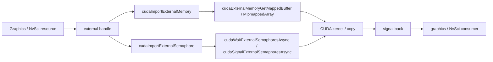

# 第 69 章 CUDA 互操作参考表：D3D、Vulkan、NvSci 与外部同步对象

第 63–68 章分别讲了 CDP、OpenGL/D3D 的 register/map/use/unmap 路径、Vulkan/D3D12 和 NVSCI 的 external memory / semaphore 导入，以及 Driver Entry Point。本章把这些主题涉及的枚举、句柄类型和平台 API 对应关系整理成查阅表：当你面对 D3D12 resource、Vulkan semaphore 或 NvSciBuf 时，可以快速判断 CUDA 侧应该使用哪类 external memory / semaphore 描述符。

互操作代码最容易出错的地方不是少调用一个函数，而是把资源所有权、格式、同步对象和设备 UUID 对错位。CUDA 并不知道图形 API 的高层语义，它只接收外部资源句柄和描述符；描述符写错，轻则 import 失败，重则同步看似成功但数据并不一致。

## 69.1 核心模型

数据资源和同步资源要分开看。external memory 描述“哪块数据可以被 CUDA 访问”，external semaphore 描述“什么时候可以访问、什么时候交还”。很多 bug 都来自只 import 了 memory，却没有建立正确的 semaphore wait/signal。

图 69.1 把两条线放在一起：图形或 NvSci 资源导出成 external handle 后，数据一侧经 `cudaImportExternalMemory` 映射成 buffer 或 mipmapped array，同步一侧经 `cudaImportExternalSemaphore` 得到可以 wait/signal 的对象。两条线在 CUDA kernel 或 copy 处汇合，CUDA 完成后 signal，把资源交还给外部消费者。

<figure>

<figcaption>图 69.1：external memory 与 external semaphore 两条导入路径汇合到 CUDA 工作</figcaption>
</figure>

## 69.2 详解

OpenGL 互操作通常围绕 buffer、texture/image 的注册和映射展开；D3D 和 Vulkan 更强调外部 memory handle 与 semaphore/fence 的显式导入；NvSci 进一步把跨驱动、跨进程和一致性需求放进 attribute list 中协商。它们的表面 API 差异很大，但 CUDA 侧统一成两类对象：`cudaExternalMemory_t` 和 `cudaExternalSemaphore_t`。

D3D12 中，resource 的 heap flag、resource flag 和 DXGI format 会影响 CUDA 侧能否按 buffer、array 或 mipmapped array 访问。Vulkan 中，opaque fd、opaque Win32 handle、timeline semaphore fd 等句柄类型必须和创建资源时声明的 external handle type 对齐。NvSci 中，attribute list 需要表达 GPU ID、权限、cache coherency 和同步需求；这些协商结果再转成 CUDA import 描述符。

CDP 和 Driver Entry Point 与互操作放在同一部分，是因为它们都在 CUDA“普通 kernel + Runtime API”之外，并不是因为功能相似。CDP 把 launch 能力带进 device 侧；Driver Entry Point 则让程序在运行时按版本查询 driver API 符号。这些能力都需要比普通 Runtime 编程更严格地管理 ABI、版本和资源边界。

## 69.3 代码示例

下面是 external semaphore 的最小流程骨架。真实代码需要由图形 API 创建并导出 fence/semaphore handle。

```cpp
cudaExternalSemaphoreHandleDesc sem_desc{};
sem_desc.type = cudaExternalSemaphoreHandleTypeD3D12Fence;
sem_desc.handle.win32.handle = shared_fence_handle;
cudaExternalSemaphore_t ext_sem{};
cudaImportExternalSemaphore(&ext_sem, &sem_desc);
cudaExternalSemaphoreWaitParams wait_params{};
wait_params.params.fence.value = wait_value;
cudaWaitExternalSemaphoresAsync(&ext_sem, &wait_params, 1, stream);
my_kernel<<<grid, block, 0, stream>>>(ptr);
cudaExternalSemaphoreSignalParams signal_params{};
signal_params.params.fence.value = signal_value;
cudaSignalExternalSemaphoresAsync(&ext_sem, &signal_params, 1, stream);
cudaDestroyExternalSemaphore(ext_sem);
```

这里的同步边界在 stream 内。`cudaWaitExternalSemaphoresAsync` 之后的 CUDA work 等待外部生产者；`cudaSignalExternalSemaphoresAsync` 之前的 CUDA work 完成后通知外部消费者。

## 69.4 工程判断

| 场景 | CUDA 侧资源 | 同步方式 | 常见错误 |
|---|---|---|---|
| D3D12 texture 给 CUDA kernel 处理 | external memory mapped array | D3D12 fence external semaphore | DXGI format 和 CUDA channel desc 不匹配 |
| Vulkan buffer 给 CUDA 写入 | external memory mapped buffer | binary/timeline semaphore | handle type 和 Vulkan 创建参数不一致 |
| NvSciBuf 跨驱动共享 | `cudaExternalMemoryHandleTypeNvSciBuf` | NvSciSync external semaphore | 忽略 cache coherency attribute |
| OpenGL buffer 互操作 | graphics resource register/map | GL/CUDA 显式同步 | map 后仍在 GL 侧访问 |
| 只需要同进程 CUDA 内部共享 | 普通 device pointer 或 IPC | CUDA event/stream | 过度使用 graphics interop |
| device 侧动态发射子 kernel | CDP | device runtime sync | 误以为 host stream 语义完全相同 |

## 69.5 API 与要点速查

### 69.5.1 External memory handle 类型

| CUDA handle type | 对应资源 | 说明 |
|---|---|---|
| `cudaExternalMemoryHandleTypeOpaqueFd` | POSIX opaque fd | Linux Vulkan / 通用外部内存常见 |
| `cudaExternalMemoryHandleTypeOpaqueWin32` | Win32 HANDLE | Windows opaque resource |
| `cudaExternalMemoryHandleTypeOpaqueWin32Kmt` | Win32 KMT handle | 与普通 Win32 HANDLE 生命周期不同 |
| `cudaExternalMemoryHandleTypeD3D12Heap` | D3D12 heap | CUDA 从 heap 映射资源 |
| `cudaExternalMemoryHandleTypeD3D12Resource` | D3D12 resource | 直接导入 resource |
| `cudaExternalMemoryHandleTypeNvSciBuf` | NvSciBuf object | 跨驱动、跨进程共享 buffer |

常见映射 API 包括 `cudaImportExternalMemory`、`cudaExternalMemoryGetMappedBuffer`、`cudaExternalMemoryGetMappedMipmappedArray`、`cudaDestroyExternalMemory`。

### 69.5.2 External semaphore handle 类型

| CUDA semaphore type | 对应同步对象 | 说明 |
|---|---|---|
| `cudaExternalSemaphoreHandleTypeOpaqueFd` | POSIX opaque fd semaphore | Linux 通用同步对象 |
| `cudaExternalSemaphoreHandleTypeOpaqueWin32` | Win32 opaque semaphore | Windows 通用同步对象 |
| `cudaExternalSemaphoreHandleTypeOpaqueWin32Kmt` | Win32 KMT semaphore | KMT 生命周期特殊 |
| `cudaExternalSemaphoreHandleTypeD3D12Fence` | D3D12 fence | 使用 fence value wait/signal |
| `cudaExternalSemaphoreHandleTypeTimelineSemaphoreFd` | Vulkan timeline semaphore fd | 使用 timeline value |
| `cudaExternalSemaphoreHandleTypeTimelineSemaphoreWin32` | Vulkan timeline semaphore Win32 | Windows timeline semaphore |
| `cudaExternalSemaphoreHandleTypeNvSciSync` | NvSciSync object | NvSci 同步互操作 |

常见 API 包括 `cudaImportExternalSemaphore`、`cudaWaitExternalSemaphoresAsync`、`cudaSignalExternalSemaphoresAsync`、`cudaDestroyExternalSemaphore`。

### 69.5.3 D3D12 关键 flag 和类型

| 名称 | 作用 | CUDA 互操作关注点 |
|---|---|---|
| `D3D12_FENCE_FLAG_SHARED` | fence 可共享 | 没有 shared flag 通常无法导出给 CUDA |
| `D3D12_HEAP_FLAG_SHARED` | heap 可共享 | heap 级 external memory 需要 |
| `D3D12_RESOURCE_FLAGS` | resource flag 集合 | 决定资源用途和可访问方式 |
| `D3D12_RESOURCE_FLAG_ALLOW_RENDER_TARGET` | render target | CUDA 侧映射时要注意格式和 layout |
| `D3D12_RESOURCE_FLAG_ALLOW_UNORDERED_ACCESS` | UAV 访问 | 常见于 compute interop |
| `D3D12_RESOURCE_FLAG_ALLOW_DEPTH_STENCIL` | depth/stencil | CUDA 处理受格式和用途限制 |
| `D3D12_SRV_DIMENSION` | shader resource view 维度 | 影响 CUDA array/mipmapped array 理解 |
| `D3D12_SRV_DIMENSION_TEXTURE1D` | 1D texture | 对应一维数组视图 |
| `D3D12_SRV_DIMENSION_TEXTURE1DARRAY` | 1D texture array | 需要 array 层数 |
| `D3D12_SRV_DIMENSION_TEXTURE2D` | 2D texture | 常见图像互操作 |
| `D3D12_SRV_DIMENSION_TEXTURE2DARRAY` | 2D texture array | CUDA 侧要处理 layer |
| `D3D12_SRV_DIMENSION_TEXTURE3D` | 3D texture | 对应三维数组 |
| `D3D12_SRV_DIMENSION_TEXTURECUBE` | cube texture | CUDA 侧按 array 面理解 |
| `D3D12_SRV_DIMENSION_TEXTURECUBEARRAY` | cube texture array | 维度和层数更复杂 |

### 69.5.4 DXGI format 常见映射提醒

| DXGI format | 数据形态 | 互操作提醒 |
|---|---|---|
| `DXGI_FORMAT_R8G8B8A8_UNORM` | 8-bit normalized RGBA | 图像后处理常见 |
| `DXGI_FORMAT_R8G8B8A8_UINT` | 8-bit unsigned RGBA | CUDA 侧可按整数处理 |
| `DXGI_FORMAT_R16G16_UINT` | 16-bit unsigned 双通道 | 注意 CUDA channel order |
| `DXGI_FORMAT_R16G16B16A16_UINT` | 16-bit unsigned RGBA | 带宽和对齐都要检查 |
| `DXGI_FORMAT_R16G16B16A16_SINT` | 16-bit signed RGBA | signedness 必须一致 |
| `DXGI_FORMAT_R16G16B16A16_FLOAT` | half RGBA | CUDA 侧常对应 half 数据 |
| `DXGI_FORMAT_R32_FLOAT` | FP32 单通道 | 数值 buffer/texture 常见 |
| `DXGI_FORMAT_R32G32_FLOAT` | FP32 双通道 | 注意 pitch 和 row alignment |
| `DXGI_FORMAT_R32G32B32A32_FLOAT` | FP32 RGBA | 数据量大，适合 coalesced 访问 |
| `DXGI_FORMAT_R32G32B32A32_UINT` | 32-bit unsigned RGBA | 图形 ID / mask 处理常见 |

并不是所有 DXGI format 都能无损映射成 CUDA 侧期望的数据解释。格式、维度、mip level、array layer 和 pitch 必须一起验证。

### 69.5.5 Vulkan external memory / semaphore 流程表

| 阶段 | Vulkan 侧 | CUDA 侧 |
|---|---|---|
| 声明可导出 | 创建 buffer/image/semaphore 时指定 external handle type | 选择匹配的 `cudaExternal*HandleType*` |
| 导出 handle | fd 或 Win32 handle | 填写 `cudaExternalMemoryHandleDesc` 或 `cudaExternalSemaphoreHandleDesc` |
| 导入 | 交给 CUDA | `cudaImportExternalMemory` / `cudaImportExternalSemaphore` |
| 映射数据 | Vulkan 不再同时写同一区域 | `cudaExternalMemoryGetMappedBuffer` 或 mipmapped array |
| 等待 | signal semaphore | `cudaWaitExternalSemaphoresAsync` |
| 使用 | CUDA kernel/copy | stream 内访问 |
| 交还 | CUDA signal | `cudaSignalExternalSemaphoresAsync` 后 Vulkan wait |

### 69.5.6 NvSciBuf / NvSciSync 关键属性

| 名称 | 作用 | 说明 |
|---|---|---|
| `NvSciBufGeneralAttrKey_GpuId` | 指定 GPU | 必须和 CUDA device 匹配 |
| `NvSciBufGeneralAttrKey_RequiredPerm` | 权限需求 | read/write 权限要协商清楚 |
| `NvSciBufGeneralAttrKey_GpuSwNeedCacheCoherency` | GPU 软件 cache coherency 需求 | 影响是否需要额外同步或 cache 操作 |
| `NvSciBufObjDupWithReducePerm` | 降权复制 NvSciBuf object | 给消费者最小必要权限 |
| `cudaExternalMemoryHandleTypeNvSciBuf` | CUDA 导入 NvSciBuf | external memory 入口 |
| `cudaExternalSemaphoreHandleTypeNvSciSync` | CUDA 导入 NvSciSync | external semaphore 入口 |
| `cudaDeviceGetNvSciSyncAttributes` | 查询 CUDA 对 NvSciSync 的 attribute 需求 | signal/wait 两侧分别查询 |
| `cudaNvSciSyncAttrSignal` | signal attribute | CUDA 作为 signaler（Driver API 中为 `CUDA_NVSCISYNC_ATTR_SIGNAL`） |
| `cudaNvSciSyncAttrWait` | wait attribute | CUDA 作为 waiter（Driver API 中为 `CUDA_NVSCISYNC_ATTR_WAIT`） |

NvSci 的重点是协商。不要只看最终 handle，要检查 attribute list 是否同时满足生产者、消费者和 CUDA device 的需求。

### 69.5.7 CDP 与 Driver Entry Point 要点

| 名称 | 用途 | 说明 |
|---|---|---|
| CUDA Dynamic Parallelism | device 侧 launch 子 kernel | 需要 device runtime 支持，资源和同步成本不可忽略 |
| `cudaDeviceSynchronize` device runtime 语义 | CDP1 中 device 侧等待子工作 | CDP2 下不再支持，后续处理改用 tail launch（见第 63 章） |
| `cuGetProcAddress` | 按名称和版本查询 driver entry point | 适合处理 driver API 版本差异 |
| `CU_GET_PROC_ADDRESS_DEFAULT` | 默认查询策略 | 常规路径 |
| `CU_GET_PROC_ADDRESS_LEGACY_STREAM` | legacy stream 语义 | 处理 stream ABI 差异 |
| `CU_GET_PROC_ADDRESS_PER_THREAD_DEFAULT_STREAM` | per-thread default stream 语义 | 和默认 stream 模型相关 |

`cuGetProcAddress` 的价值在于让二进制在不同 driver 版本上更稳健地发现能力，而不是静态假设所有符号都可用。

## 69.6 小结

读完本章，你应该能够：

- 把 external memory 和 external semaphore 分开建模。
- 根据 D3D12、Vulkan、NvSci 的资源类型选择 CUDA handle type。
- 读懂 D3D12 flag、DXGI format 和 CUDA array/buffer 映射之间的关系。
- 解释 NvSci attribute 协商为什么比普通 fd import 更复杂。
- 把 CDP 和 `cuGetProcAddress` 放到 CUDA 边界能力的正确位置上。
