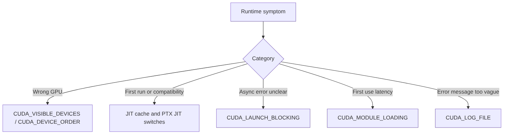

# 第 70 章 CUDA 环境变量：不改代码也能改变设备、JIT、加载和错误观察方式

## 70.1 问题的由来

CUDA 程序的很多行为不写在源码里：进程能看到哪些 GPU、fatbin 是否走 PTX JIT、JIT cache 放在哪里、kernel launch 是否阻塞、module 是 lazy 还是 eager、错误日志写到哪里。环境变量替代不了正确的代码，它们是排查和部署时使用的运行时开关。

这些变量数量不少，不必当成一张散列表来背，按“设备枚举、JIT、执行行为、module loading、错误日志”五组来记更容易。

## 70.2 核心模型

环境变量的作用是把异步执行、动态加载和设备枚举这些平时看不见的状态显式化。排查时可以从现象出发：先判断问题属于哪一类，再检查对应的那一组变量（图 70.1）。

<figure>

<figcaption>图 70.1：按运行时现象选择要检查的 CUDA 环境变量</figcaption>
</figure>

## 70.3 详解

`CUDA_VISIBLE_DEVICES` 会改变进程看到的设备列表和 ordinal。设置 `CUDA_VISIBLE_DEVICES=2,1` 后，进程里的 CUDA device 0 对应物理列表中的 device 2。它还支持 GPU UUID 和 MIG instance 标识。生产环境脚本里优先使用 UUID，通常比 ordinal 稳定。

`CUDA_DEVICE_ORDER` 控制枚举顺序。`FASTEST_FIRST` 适合默认选择，`PCI_BUS_ID` 更接近很多运维工具的显示顺序。

JIT 变量用来验证二进制兼容性。`CUDA_FORCE_PTX_JIT=1` 强制走 PTX JIT，适合确认 fatbin 里是否带了可用于未来架构的 PTX；`CUDA_DISABLE_PTX_JIT=1` 禁止 PTX JIT，适合确认是否已经包含当前设备 SASS。

`CUDA_LAUNCH_BLOCKING=1` 让 launch 同步化，适合定位异步错误。它会改变性能和并发，不应作为长期运行配置。

`CUDA_MODULE_LOADING=LAZY|EAGER` 控制 module/kernel 的加载时机。lazy 可以减少启动成本，但首个使用点会变慢。benchmark 和服务冷启动路径必须显式考虑它（详见[第 54 章](ch054.md)）。

`CUDA_LOG_FILE` 输出更具体的 CUDA 错误日志（详见[第 55 章](ch055.md)）。它配合返回码检查使用，不替代错误处理。

## 70.4 代码示例

常用排查组合：

```text
# 固定设备可见性。
CUDA_DEVICE_ORDER=PCI_BUS_ID CUDA_VISIBLE_DEVICES=0 ./app
# 验证 PTX JIT 路径。
CUDA_FORCE_PTX_JIT=1 ./app
CUDA_DISABLE_PTX_JIT=1 ./app
# 固定异步错误位置并输出日志。
CUDA_LAUNCH_BLOCKING=1 CUDA_LOG_FILE=stderr ./app
# 对比 first-use loading 成本。
CUDA_MODULE_LOADING=LAZY ./bench
CUDA_MODULE_LOADING=EAGER ./bench
```

配合源码中的错误边界：

```cpp
kernel<<<grid, block, shared_bytes, stream>>>(args...);
cudaError_t launch_err = cudaGetLastError();
cudaError_t exec_err = cudaStreamSynchronize(stream);
```

前者更接近 launch 配置错误，后者暴露 stream 上已提交工作的执行错误。

## 70.5 工程判断

| 现象 | 先看什么 | 原因 |
|---|---|---|
| 程序跑到错误 GPU | `CUDA_VISIBLE_DEVICES` | ordinal 可能被进程内重编号 |
| `nvidia-smi` 和 CUDA ordinal 对不上 | `CUDA_DEVICE_ORDER` | 枚举顺序不同 |
| 新 GPU 上启动失败 | `CUDA_FORCE_PTX_JIT` / `CUDA_DISABLE_PTX_JIT` | fatbin 可能缺 PTX 或 SASS |
| 首轮慢、后面快 | JIT cache / lazy loading | 首次编译或加载进入测量窗口 |
| kernel 报错行号不准 | `CUDA_LAUNCH_BLOCKING=1` | 默认 launch 异步 |
| 错误码太粗 | `CUDA_LOG_FILE` | error log 给更多上下文 |

## 70.6 API 与要点速查

环境变量索引：

| 类别 | 变量 | 作用 |
|---|---|---|
| Device enumeration | `CUDA_VISIBLE_DEVICES` | 控制可见 GPU 和进程内 ordinal |
| Device enumeration | `CUDA_DEVICE_ORDER` | `FASTEST_FIRST` 或 `PCI_BUS_ID` 等枚举策略 |
| Unified Memory | `CUDA_MANAGED_FORCE_DEVICE_ALLOC` | 强制 managed allocation 使用 device memory |
| JIT cache | `CUDA_CACHE_DISABLE` | 禁用或启用 JIT cache |
| JIT cache | `CUDA_CACHE_PATH` | 指定 cache 目录 |
| JIT cache | `CUDA_CACHE_MAXSIZE` | 设置 cache 最大大小 |
| JIT path | `CUDA_FORCE_PTX_JIT`、`CUDA_FORCE_JIT` | 强制 PTX JIT |
| JIT path | `CUDA_DISABLE_PTX_JIT`、`CUDA_DISABLE_JIT` | 禁止 PTX JIT |
| Loading | `CUDA_FORCE_PRELOAD_LIBRARIES` | 控制 JIT 相关库预加载 |
| Execution | `CUDA_LAUNCH_BLOCKING` | launch 同步化 |
| Execution | `CUDA_DEVICE_MAX_CONNECTIONS` | 控制 GPU workqueue connections |
| Execution | `CUDA_DEVICE_MAX_COPY_CONNECTIONS` | 控制 copy connections |
| Execution | `CUDA_SCALE_LAUNCH_QUEUES` | 调整 launch queue 规模 |
| Graph | `CUDA_GRAPHS_USE_NODE_PRIORITY` | 控制 graph node priority 使用 |
| Debug | `CUDA_DEVICE_WAITS_ON_EXCEPTION` | device exception 时等待 |
| Cache | `CUDA_DEVICE_DEFAULT_PERSISTING_L2_CACHE_PERCENTAGE_LIMIT` | persisting L2 默认比例 |
| Perf | `CUDA_DISABLE_PERF_BOOST` | Linux 下禁用 perf boost |
| Deprecated | `CUDA_AUTO_BOOST` | 已废弃，应用时钟改用 `nvidia-smi` 或 NVML |
| Module | `CUDA_MODULE_LOADING` | `EAGER` 或 `LAZY` |
| Module data | `CUDA_MODULE_DATA_LOADING` | 控制 module data loading |
| Loader | `CUDA_BINARY_LOADER_THREAD_COUNT` | binary loader 线程数 |
| Error log | `CUDA_LOG_FILE` | 输出 CUDA error log |

`CUDA_VISIBLE_DEVICES` 细节：

| 规则 | 说明 |
|---|---|
| 未设置 | 所有 GPU 可见 |
| 空字符串 | 没有 GPU 可见 |
| invalid index | 只保留 invalid index 前出现的设备 |
| UUID | 可用完整或足够唯一的前缀 |
| MIG | 可指定 MIG instance |
| `cudaGetDeviceCount` | 返回可见设备数，不是物理总数 |

## 70.7 小结

读完本章，你应该能够：

- 按问题类别选择环境变量，而不是盲目设置。
- 解释 CUDA ordinal 为什么可能和物理 GPU 编号不同。
- 用 JIT 开关验证 fatbin 兼容性。
- 把 loading、JIT、kernel 稳态性能区分开。
