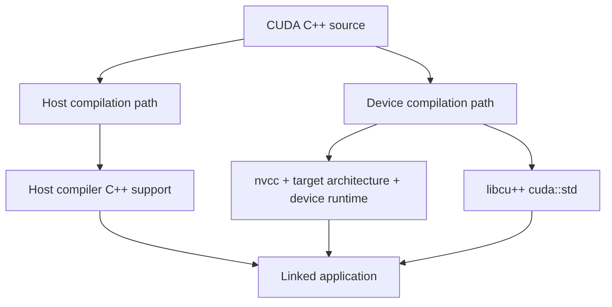

# 第 71 章 CUDA C++ 不是普通 C++ 加三尖括号：标准支持、lambda 和限制条件

## 71.1 问题的由来

CUDA C++ 看起来像 C++，但 `.cu` 文件会走 host/device 两条编译路径。host 代码由 host compiler 处理，device 代码受 nvcc、目标架构、device runtime 和 CUDA C++ 标准库限制。一个语法在 CPU 侧可用，不代表它能在 GPU 侧执行。

所以判断一段代码能不能用，先别问“CUDA 支持 C++ 几”，先问：这段代码会在 host 还是 device 执行？如果两边都执行，它是否同时满足两边的约束？

## 71.2 核心模型

同一份 CUDA C++ 源码会分成 host 和 device 两条编译路径（图 71.1）。host 路径能用什么，取决于 host compiler 的 C++ 支持；device 路径能用什么，取决于 nvcc、目标架构、device runtime 和 libcu++。两条路径的产物最后链接成同一个程序。

<figure>

<figcaption>图 71.1：CUDA C++ 源码分别经过 host 与 device 两条编译路径</figcaption>
</figure>

`__host__ __device__` 函数会同时进入两条路径，因此最容易暴露两边的差异。

## 71.3 详解

C++ 标准支持受多层因素影响：nvcc 版本、host compiler、目标架构、是否启用 relocatable device code、是否使用 device runtime。用 `--std=c++17` 或 `--std=c++20` 只是起点。

```bash
nvcc --std=c++17 app.cu -o app
nvcc --std=c++20 app.cu -o app
```

device 侧标准库优先查 libcu++，也就是 `cuda::std` 和 `cuda::` namespace。并发设施、atomic、barrier、semaphore、limits、complex 等不要直接假设 host `std::` 等价可用。

```cpp
#include <cuda/std/limits>
__host__ __device__ float eps()
{
    return cuda::std::numeric_limits<float>::epsilon();
}
```

device C library 支持一部分函数，例如 `printf`、`malloc/free`、`memcpy/memset`、`clock/clock64`、`alloca`。它们能用不代表免费：device `printf` 依赖 FIFO 并在同步点刷新；device heap 受 `cudaLimitMallocHeapSize` 限制；device stack 受 stack limit 约束。

Extended lambda 可以标记执行空间（编译时需要加 `--extended-lambda`）：

```cpp
auto square = [] __host__ __device__ (float x) {
    return x * x;
};
```

但捕获对象必须在 device 侧可访问。捕获 host 指针、host-only 对象、复杂 wrapper 或带不合法成员的对象，可能编译失败或运行错误。

## 71.4 代码示例

典型错误：`__host__ __device__` 函数里调用 host-only API。

```cpp
__host__ __device__ int bad(int x)
{
    // device 编译路径不能调用 std::cout。
    // std::cout << x << "\n";
    return x + 1;
}
```

可维护的写法是分路径，并保持签名一致：

```cpp
__host__ __device__ float abs_like(float x)
{
#if defined(__CUDA_ARCH__)
    return fabsf(x);
#else
    return std::fabs(x);
#endif
}
```

device `printf` 示例：

```cpp
__global__ void debug_kernel(const int* data)
{
    if (threadIdx.x == 0 && blockIdx.x == 0) {
        printf("first value = %d\n", data[0]);
    }
}
debug_kernel<<<1, 128>>>(data);
cudaDeviceSynchronize(); // 输出通常在同步后可见
```

device heap limit：

```cpp
cudaDeviceSetLimit(cudaLimitMallocHeapSize, 64 * 1024 * 1024);
```

## 71.5 工程判断

| 问题 | 第一判断 | 处理 |
|---|---|---|
| host 能编译，device 不能编译 | 是否进入 device path | 检查 `__device__` / `__host__ __device__` |
| 标准库类型 device 侧不可用 | 是否有 libcu++ 版本 | 查 `cuda::std` |
| lambda 传入 kernel 后失败 | 捕获对象是否 device 可访问 | 改显式参数或 device-side storage |
| device `printf` 输出不稳定 | 异步刷新和 FIFO | 加同步，增大 `cudaLimitPrintfFifoSize` |
| device malloc 很慢 | heap 分配争用 | 预分配、arena 或 block-local 设计 |
| `volatile` 想当同步 | 语义不对 | 用 atomic、barrier、fence |

## 71.6 API 与要点速查

C++ support 关注点：

| 类别 | 要查的限制 |
|---|---|
| C++ standard | `--std=c++11/14/17/20` 与 host compiler 支持 |
| libcu++ | `<cuda/std/atomic>`、`<cuda/std/barrier>`、`<cuda/std/semaphore>`、`<cuda/std/complex>`、`<cuda/std/limits>` |
| CUDA headers | `<cuda/barrier>`、`<cuda/pipeline>` |
| C library | `printf`、`malloc/free`、`memcpy/memset`、`clock/clock64`、`alloca` |
| device limits | `cudaLimitPrintfFifoSize`、`cudaLimitMallocHeapSize`、stack size |

Language restrictions 索引：

| 领域 | 典型限制 |
|---|---|
| host/device pointer | 不能混用地址空间 |
| local variables | 生命周期和地址传递限制 |
| `static` / `thread_local` | device 侧支持和初始化规则不同 |
| `extern` variables | separate compilation 和链接边界 |
| recursion | 可用但受 stack 和性能约束 |
| `__global__` parameters | 参数类型、拷贝、析构和 layout 限制 |
| classes | polymorphic class、virtual、layout、member function 限制 |
| templates | host/device 实例化一致性 |
| extended lambda | 嵌套、捕获、enclosing function、deduced return type 等限制 |
| polymorphic wrappers | device callable wrapper 的性能和可用性限制 |

Device C library：

| 功能 | API/限制 |
|---|---|
| timing | `clock()`、`clock64()` |
| printing | `printf()`，受 FIFO 和同步影响 |
| memory ops | `memcpy()`、`memset()` |
| heap | `malloc()`、`free()`，受 `cudaLimitMallocHeapSize` |
| stack | `alloca()`，受 stack limit |

## 71.7 小结

读完本章，你应该能够：

- 把 CUDA C++ 问题分成 host path、device path 和双路径。
- 知道何时查 `cuda::std`。
- 避免把 host C++ 惯用法直接搬进 kernel。
- 按限制类型找到对应的参考条目。
