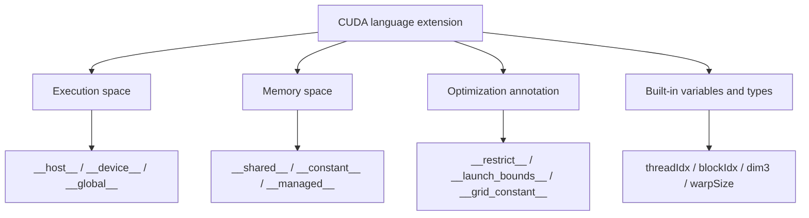

# 第 72 章 CUDA 语言扩展：执行空间、存储空间和优化修饰符不是装饰

## 72.1 问题的由来

CUDA 语言扩展最容易被当成语法糖：`__global__`、`__device__`、`__shared__`、`__restrict__` 看起来只是修饰符。但它们改变的是执行位置、存储位置、生命周期、可见性和编译器的优化假设。

读这些修饰符时先分类：它改变的是函数在哪里执行、变量在哪里存放，还是优化器能做什么假设？

## 72.2 核心模型

修饰符是写给编译器、运行时和硬件执行模型的契约，不是给读者看的注释。按作用对象，CUDA 语言扩展可以分成四类：执行空间、存储空间、优化注解，以及内建变量和类型（图 72.1）。

<figure>

<figcaption>图 72.1：CUDA 语言扩展的四个类别及代表性关键字</figcaption>
</figure>

## 72.3 详解

Execution space specifiers：

| 修饰符 | 调用侧 | 执行侧 |
|---|---|---|
| `__host__` | host | host |
| `__device__` | device | device |
| `__global__` | host 或 device launch | device |
| `__host__ __device__` | host 和 device | 两侧各编译一份 |

`__global__` 是 kernel 入口，返回类型必须是 `void`。三尖括号 launch 是异步提交，不是普通函数调用。

Memory space specifiers：

| 修饰符 | 存储位置 | 生命周期/可见性 |
|---|---|---|
| `__device__` | device global memory | 跨 kernel，可由 symbol API 访问 |
| `__constant__` | constant memory | device 只读，host 写入 |
| `__shared__` | block shared memory | thread block 生命周期 |
| `extern __shared__` | dynamic shared memory | launch 时指定字节数 |
| `__managed__` | managed memory | host/device 统一地址和迁移规则 |

Optimization annotations 需要真实承诺。`__restrict__` 表示指针无别名，如果实际重叠就是未定义行为。`__launch_bounds__` 和 `__maxnreg__` 约束资源，可能提高 occupancy，也可能增加 spill。`__grid_constant__` 让 grid 范围只读参数避免每线程私有副本，但要求 const 和只读语义。

## 72.4 代码示例

执行空间和存储空间组合：

```cpp
__constant__ float coeff[64];
__device__ float scale;
__managed__ int counter;
__device__ float apply(float x)
{
    return x * scale;
}
__global__ void kernel(const float* in, float* out, int n)
{
    __shared__ float tile[256];
    int i = blockIdx.x * blockDim.x + threadIdx.x;
    if (i < n) {
        tile[threadIdx.x] = apply(in[i]) + coeff[threadIdx.x % 64];
    }
    __syncthreads();
    if (i < n) {
        out[i] = tile[threadIdx.x];
    }
}
```

dynamic shared memory 切分：

```cpp
__global__ void dynamic_smem(float* out)
{
    extern __shared__ unsigned char smem[];
    float* values = reinterpret_cast<float*>(smem);
    int* flags = reinterpret_cast<int*>(values + blockDim.x);
    values[threadIdx.x] = 1.0f;
    flags[threadIdx.x] = 1;
    __syncthreads();
    out[threadIdx.x] = values[threadIdx.x] + flags[threadIdx.x];
}
size_t bytes = block.x * (sizeof(float) + sizeof(int));
dynamic_smem<<<grid, block, bytes, stream>>>(out);
```

`__restrict__` 和 launch bounds：

```cpp
// __launch_bounds__(256, 4)：每个 block 最多 256 个线程，
// 并希望每个 SM 上至少能同时驻留 4 个这样的 block。
// 编译器据此压低每个线程的寄存器用量，必要时宁可 spill 到 local memory。
__global__ void __launch_bounds__(256, 4)
saxpy(int n, float a, const float* __restrict__ x, float* __restrict__ y)
{
    // __restrict__ 是调用者的承诺：x 和 y 指向的区域互不重叠。
    // 编译器因此可以假定写 y 不会改到 x，更自由地安排访存顺序。
    int i = blockIdx.x * blockDim.x + threadIdx.x;
    if (i < n) {
        y[i] = a * x[i] + y[i];
    }
}
// block 大小超过 256 时 launch 会失败（cudaErrorInvalidValue）。
saxpy<<<(n + 255) / 256, 256>>>(n, 2.0f, d_x, d_y);
```

## 72.5 工程判断

| 需求 | 使用什么 | 注意点 |
|---|---|---|
| kernel 入口 | `__global__` | 异步 launch，返回 `void` |
| kernel 内辅助函数 | `__device__` | host 不能直接调用 |
| host/device 共用小函数 | `__host__ __device__` | 函数体必须两侧合法 |
| block 内 tile | `__shared__` | 生命周期只在 block 内 |
| 小型广播式只读表 | `__constant__` | host 通过 symbol API 写入 |
| 避免别名保守优化 | `__restrict__` | 必须保证真实无别名 |
| 控制资源/occupancy | `__launch_bounds__` / `__maxnreg__` | 要 profiling 验证 |
| 大只读 kernel 参数 | `__grid_constant__` | 参数必须 const 且不能修改 |

## 72.6 API 与要点速查

Specifier 速查：

| 类别 | 名称 |
|---|---|
| execution | `__host__`、`__device__`、`__global__`、`__host__ __device__` |
| memory | `__device__`、`__constant__`、`__shared__`、`extern __shared__`、`__managed__` |
| optimization | `__forceinline__`、`__noinline__`、`__restrict__`、`__grid_constant__`、`__launch_bounds__`、`__maxnreg__`、`__cluster_dims__` |

Built-in variables/types：

| 名称 | 作用 |
|---|---|
| `gridDim` | grid 维度 |
| `blockIdx` | block index |
| `blockDim` | block 维度 |
| `threadIdx` | thread index |
| `warpSize` | warp 宽度 |
| `dim3`、`uint3` | 三维配置类型 |
| vector types | `char2`、`int4`、`float4` 等 |

Symbol API：

| API | 作用 |
|---|---|
| `cudaGetSymbolAddress` | 获取 device/global/constant symbol 地址 |
| `cudaGetSymbolSize` | 查询 symbol 大小 |
| `cudaMemcpyToSymbol` | host 写入 symbol |
| `cudaMemcpyFromSymbol` | host 从 symbol 读取 |

CUDA-specific macros/functions：

| 名称 | 作用 |
|---|---|
| `__CUDA_ARCH__` | device 编译路径中的 virtual architecture |
| `__CUDA_ARCH_SPECIFIC__` | architecture-specific target |
| `__CUDA_ARCH_FAMILY_SPECIFIC__` | architecture family target |
| `__isGlobal`、`__isShared`、`__isConstant`、`__isLocal`、`__isGridConstant` | 地址空间谓词 |
| `__cvta_generic_to_global` 等 | 地址空间转换 |
| `__trap` | 触发异常并终止 kernel |
| `__nanosleep` | device 侧短暂休眠 |
| `#pragma unroll` | 控制紧随其后的循环展开 |

## 72.7 小结

读完本章，你应该能够：

- 按执行空间、存储空间、优化注解分类理解修饰符。
- 知道 dynamic shared memory 是一块字节缓冲，需要自己处理布局。
- 把 `__restrict__` 和 `__launch_bounds__` 当作契约，而不是装饰。
- 使用 built-in variables 写出正确 indexing。
