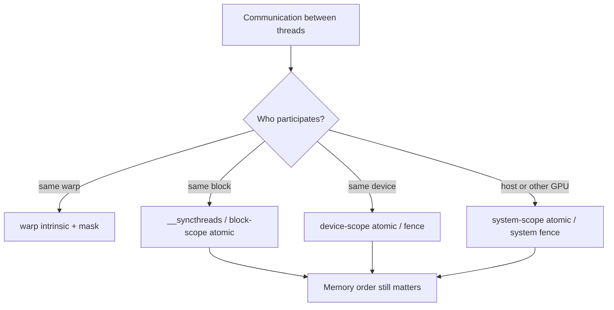

# 第 73 章 同步、Fence、Atomic 和 Warp Functions：先问清楚作用域

## 73.1 问题的由来

CUDA 中的“同步”不是一个动作。block 内同步、warp 内同步、memory fence、atomic order、atomic scope、system-scope visibility 都是不同问题。很多并发 bug 来自把其中一种误当成另一种：用 fence 当等待，用 `volatile` 当 atomic，用 full warp mask 处理部分 lane。

所以遇到线程间通信，第一个问题是作用域：参与通信的线程分布在多大范围内？

## 73.2 核心模型

按参与者的范围，可以选出对应的机制（图 73.1）：同一个 warp 内用 warp intrinsic 并给对 mask；同一个 block 内用 `__syncthreads()` 或 block-scope atomic；跨 block 用 device-scope atomic 或 fence；涉及 host 或其他 GPU 时用 system scope。无论哪一层，memory order 都要另外考虑。

<figure>

<figcaption>图 73.1：按通信参与者的范围选择同步机制</figcaption>
</figure>

如果 scope 覆盖不到通信双方，程序的问题就不是“偶发慢”，而是语义错误。

## 73.3 详解

Block 同步用 `__syncthreads()`。它要求同一个 block 中应该参与的线程都到达。分支中使用时必须确保不会有部分线程绕过导致死锁。

Fence 解决的是内存操作的顺序和可见性，它不会让其他线程停下来等。旧式 fence：

| 函数 | 范围 |
|---|---|
| `__threadfence_block()` | 当前 block |
| `__threadfence()` | 当前 device |
| `__threadfence_system()` | system 范围 |

Atomic 要同时看三件事：操作是否原子、memory order 是什么、thread scope 覆盖谁。传统 `atomicAdd` 等很方便，但表达 order/scope 的能力有限。现代 CUDA C++ 推荐 `cuda::atomic` / `cuda::atomic_ref`，低层还提供 `__nv_atomic_*` built-ins。

Warp functions 的第一原则是 mask。mask 是正确性参数，不是性能提示：参与同一次 warp intrinsic 的线程集合必须与 mask 一致。

## 73.4 代码示例

Block 内同步：

```cpp
__global__ void block_sum(const float* in, float* out)
{
    __shared__ float tile[256];
    int t = threadIdx.x;
    tile[t] = in[blockIdx.x * blockDim.x + t];
    __syncthreads();
    for (int stride = blockDim.x / 2; stride > 0; stride /= 2) {
        if (t < stride) {
            tile[t] += tile[t + stride];
        }
        __syncthreads();
    }
    if (t == 0) out[blockIdx.x] = tile[0];
}
```

Device-scope message passing：

```cpp
// Producer thread
payload = 42;
cuda::atomic_ref<int, cuda::thread_scope_device> flag(flag_storage);
flag.store(1, cuda::std::memory_order_release);
// Consumer thread
cuda::atomic_ref<int, cuda::thread_scope_device> flag(flag_storage);
while (flag.load(cuda::std::memory_order_acquire) != 1) {}
int v = payload;
```

Warp reduce：

```cpp
// mask 里只有 lane 0–15。width 设为 16，shuffle 只在这 16 个 lane 内取值；
// offset 从 8 开始，每一步读到的源 lane 都在 mask 之内。
__device__ float half_warp_sum(float v, unsigned mask)
{
    for (int offset = 8; offset > 0; offset /= 2) {
        v += __shfl_down_sync(mask, v, offset, 16);
    }
    return v;
}
__global__ void kernel(float* out)
{
    bool active = threadIdx.x < 16;
    unsigned mask = __ballot_sync(0xffffffffu, active);  // 0x0000ffff
    if (active) {
        float s = half_warp_sum(1.0f, mask);
        if (threadIdx.x == 0) out[blockIdx.x] = s;       // 16
    }
}
```

mask 不只规定哪些 lane 参与，shuffle 读取的源 lane 也必须在 mask 里，否则读到的值没有定义。如果照搬整 warp 的写法，让 offset 从 `warpSize / 2` 开始，lane 0 第一步就会去读 mask 之外的 lane 16，得到的和不可信。整数求和还可以直接用 `__reduce_add_sync(mask, value)`（compute capability 8.0 起），它只对 mask 里的 lane 求和，不用自己安排 offset。

## 73.5 工程判断

| 需求 | 机制 | 常见误区 |
|---|---|---|
| block 内共享 memory 后读取 | `__syncthreads()` | 分支中部分线程不到达 |
| warp 内寄存器交换 | `__shfl_*_sync(mask, ...)` | mask 写成全 1 但只有部分 lane 参与；shuffle 的源 lane 落在 mask 之外 |
| block 间 flag 通信 | device-scope atomic + release/acquire | 普通 load/store 或 block scope atomic |
| host/device flag 通信 | system-scope atomic，且内存类型支持 | 以为 device scope 自动覆盖 host |
| 只需要写入顺序可见 | fence | 把 fence 当线程等待 |
| 传统 atomic 计数 | legacy atomic | 忽略 memory order/scope 需求 |

## 73.6 API 与要点速查

Synchronization primitives：

| 类别 | API |
|---|---|
| Block sync | `__syncthreads`、`__syncthreads_count`、`__syncthreads_and`、`__syncthreads_or` |
| Warp sync | `__syncwarp(mask)` |
| Fence | `__threadfence_block`、`__threadfence`、`__threadfence_system` |
| libcu++ | `cuda::barrier`、`cuda::atomic`、`cuda::atomic_ref` |

Legacy atomic 全族：

| 类别 | API |
|---|---|
| arithmetic | `atomicAdd`、`atomicSub`、`atomicInc`、`atomicDec` |
| bitwise | `atomicAnd`、`atomicOr`、`atomicXor` |
| min/max | `atomicMin`、`atomicMax` |
| exchange | `atomicExch` |
| compare-swap | `atomicCAS` |

`__nv_atomic_*` built-ins：

| API | 作用 |
|---|---|
| `__nv_atomic_add`、`__nv_atomic_sub` | 算术更新 |
| `__nv_atomic_and`、`__nv_atomic_or`、`__nv_atomic_xor` | 位运算更新 |
| `__nv_atomic_min`、`__nv_atomic_max` | min/max |
| `__nv_atomic_exchange` | exchange |
| `__nv_atomic_compare_exchange` | compare exchange |
| `__nv_atomic_load`、`__nv_atomic_store` | load/store |
| `__nv_atomic_thread_fence` | thread fence |

Warp functions：

| 类别 | API |
|---|---|
| Active mask | `__activemask` |
| Vote | `__all_sync`、`__any_sync`、`__ballot_sync`、`__uni_sync` |
| Match | `__match_any_sync`、`__match_all_sync` |
| Reduce | `__reduce_add_sync`、`__reduce_min_sync`、`__reduce_max_sync`、`__reduce_and_sync`、`__reduce_or_sync`、`__reduce_xor_sync` |
| Shuffle | `__shfl_sync`、`__shfl_up_sync`、`__shfl_down_sync`、`__shfl_xor_sync` |
| Sync | `__syncwarp` |

Thread scopes：

| Scope | 覆盖范围 |
|---|---|
| `cuda::thread_scope_thread` | 当前线程 |
| `cuda::thread_scope_block` | 当前 block |
| `cuda::thread_scope_device` | 当前 device |
| `cuda::thread_scope_system` | system 范围 |

## 73.7 小结

读完本章，你应该能够：

- 区分同步、fence、atomic、warp intrinsic 的职责。
- 为通信双方选择正确 scope。
- 写出 release/acquire + scope 的基本通信模式。
- 把 warp mask 当正确性条件处理。
