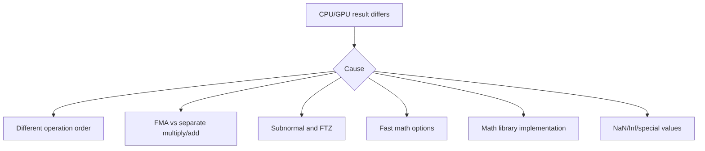

# 第 74 章 GPU 和 CPU 浮点结果不同，不自动说明谁错了

## 74.1 问题的由来

CUDA 程序经常把 CPU 结果当 reference，然后发现 GPU 结果有细微差异。差异不一定是 bug。浮点是有限精度系统，运算顺序、舍入模式、FMA、subnormal、NaN、编译选项、数学库实现都会改变 bit pattern。

本章要建立的是数值判断：什么时候应该追 bug，什么时候应该改验证标准，什么时候是编译选项改变了数值语义。

## 74.2 核心模型

浮点验证要从“是否完全相等”改成“误差是否符合算法和选项的预期”。

CPU 和 GPU 结果不一致时，常见原因有六类（图 74.1）：运算顺序不同、FMA 与分开的乘加、subnormal 与 FTZ、fast math 选项、数学库实现，以及 NaN/Inf 等特殊值。其中多数是合法的数值差异，要和真正的 bug 区分开。

<figure>

<figcaption>图 74.1：CPU 与 GPU 浮点结果不一致的常见原因</figcaption>
</figure>

## 74.3 详解

IEEE-754 浮点由 sign、exponent、significand 三部分组成。正规数的值是 (−1)^sign × 1.fraction × 2^(exponent − bias)：指数字段按偏置值存储，尾数字段只存小数部分，最高位的 1 是隐含的。CUDA 中常见浮点格式的位宽如下：

| 格式 | CUDA 类型 | 符号位 | 指数位 | 尾数位 | 指数偏置 |
|---|---|---|---|---|---|
| IEEE binary16（half） | `__half` | 1 | 5 | 10 | 15 |
| bfloat16（不是 IEEE 格式） | `__nv_bfloat16` | 1 | 8 | 7 | 127 |
| IEEE binary32（single） | `float` | 1 | 8 | 23 | 127 |
| IEEE binary64（double） | `double` | 1 | 11 | 52 | 1023 |
| IEEE binary128（quad） | `__float128` | 1 | 15 | 112 | 16383 |

bfloat16 的指数位和 float 一样多，所以数值范围接近 float，但尾数只有 7 位，精度比 half 还低。

举一个编码的例子：−6.5 = −1.625 × 2^2，存成 float 时符号位为 1，指数字段是 2 + 127 = 129（`10000001`），尾数字段是 1.625 = 1.101₂ 的小数部分，即 `101` 后面接 20 个 0。−6.5 能精确表示，但很多十进制数不能，例如 0.1 存进 float 后实际是 0.100000001490116…，进入变量时就已经舍入。

靠近 0 的区域有 subnormal，提供 gradual underflow。以 float 为例，最小的正规数是 2^−126（约 1.18 × 10^−38），对应指数字段为 1、尾数全 0；指数字段为 0 且尾数非 0 时是 subnormal，隐含位变成 0，可以继续表示到 2^−149（约 1.4 × 10^−45），代价是数值越小有效位越少。启用 `-ftz=true` 或 `--use_fast_math` 可能 flush-to-zero，把这些值直接当作 0，改变严格数值语义。

特殊值包括 signed zero、infinity、NaN，它们和 subnormal 一起占用了指数字段的两个极端值。下表按指数字段对 float 的位模式分类：

| 指数字段 | 尾数字段 | 表示的值 |
|---|---|---|
| 全 0 | 全 0 | ±0（符号位区分 +0 和 −0，二者比较相等） |
| 全 0 | 非 0 | subnormal |
| 1～254 | 任意 | 正规数 |
| 全 1 | 全 0 | ±infinity |
| 全 1 | 最高位为 1 | quiet NaN |
| 全 1 | 最高位为 0，其余位不全为 0 | signaling NaN |

NaN 参与比较非常反直觉：`NaN == NaN` 为 false，`NaN != NaN` 为 true，应该用 `isnan` 判断。

并行 reduction 改变加法顺序。数学加法有结合律，浮点加法不一定。CPU 串行求和和 GPU tree reduction 得到不同低位是正常现象。

FMA 将 `a * b + c` 作为一次 fused 操作，只舍入一次；拆成乘法再加法会舍入两次。FMA 通常更准，但会改变结果。

## 74.4 代码示例

并行顺序差异：

```cpp
float serial_sum(const float* x, int n)
{
    float s = 0.0f;
    for (int i = 0; i < n; ++i) {
        s += x[i];
    }
    return s;
}
```

GPU reduction 会换成另一棵求和树，验证时应使用误差容忍。

显式 FMA：

```cpp
__global__ void fma_kernel(const float* a,
                           const float* b,
                           const float* c,
                           float* out,
                           int n)
{
    int i = blockIdx.x * blockDim.x + threadIdx.x;
    if (i < n) {
        out[i] = fmaf(a[i], b[i], c[i]);
    }
}
```

查询数值范围：

```cpp
#include <cuda/std/limits>
__host__ __device__ float eps_float()
{
    return cuda::std::numeric_limits<float>::epsilon();
}
```

## 74.5 工程判断

| 现象 | 可能原因 | 处理 |
|---|---|---|
| CPU/GPU 低位不同 | 运算顺序或 FMA | 用相对/绝对误差或 ULP |
| 小值变成 0 | FTZ 或 underflow | 检查 `-ftz`、`--use_fast_math` |
| NaN 传播 | 非法运算或输入异常 | 用 `isnan`、`isfinite` 分类 |
| fast math 后误差变大 | 近似函数和编译选项 | 明确性能/精度取舍 |
| dot/reduction 不可复现 | 并行调度和 atomic 顺序 | 设计 deterministic reduction 或接受误差 |
| host/device math 函数不同 | 库实现差异 | 查 CUDA Math API 和 host compiler 选项 |

## 74.6 API 与要点速查

浮点类型（各格式的位宽见 74.3 节）：

| 类型 | 说明 |
|---|---|
| `__half` | half precision，`<cuda_fp16.h>` |
| `__nv_bfloat16` | bfloat16，`<cuda_bf16.h>`，常见要求 CC 8.0+ |
| `float` | single precision |
| `double` | double precision |
| `__float128` / `_Float128` | quad precision，依赖 host compiler 和较新架构 |
| TF32、MX、FP8/FP6/FP4 | 面向 Tensor Core 或低精度专用路径 |

FMA 和舍入：

| 名称 | 作用 |
|---|---|
| `fma`、`fmaf` | 标准 FMA |
| `cuda::std::fma`、`cuda::std::fmaf` | CUDA C++ 标准库 FMA |
| `__fmaf_[rn,rz,ru,rd]` | 单精度 intrinsic，指定舍入 |
| `__fmaf_ieee_[rn,rz,ru,rd]` | IEEE 行为相关 intrinsic |
| `__fma_[rn,rz,ru,rd]` | 双精度 intrinsic |
| `rn` | round to nearest, ties to even |
| `rz` | round toward zero |
| `ru` | round toward positive infinity |
| `rd` | round toward negative infinity |

编译选项：

| 选项 | 影响 |
|---|---|
| `-ftz=true` | flush subnormal to zero |
| `-prec-div=false` | 降低除法精度要求 |
| `-prec-sqrt=false` | 降低 sqrt 精度要求 |
| `-fmad=true` | 允许 FMA 融合 |
| `--use_fast_math` | 启用一组快速数学近似和选项 |

数学函数族：

| 类别 | 示例 |
|---|---|
| basic operations | 基本算术、fabs、fmin/fmax |
| exponential | exp、log、log2、log10 |
| power | pow、sqrt、cbrt |
| trigonometric | sin、cos、tan |
| hyperbolic | sinh、cosh、tanh |
| error/gamma | erf、erfc、tgamma、lgamma |
| nearest integer | floor、ceil、trunc、round |
| manipulation | frexp、ldexp、modf |
| classification/comparison | `isnan`、`isinf`、`isfinite`、`isnormal`、`signbit` |
| intrinsics | fast intrinsic、single-precision-only intrinsic |

## 74.7 小结

读完本章，你应该能够：

- 解释 CPU/GPU 浮点差异不自动等于错误。
- 识别 reduction order、FMA、fast math 和 subnormal 的影响。
- 为数值测试选择合理误差标准。
- 知道什么时候查 CUDA Math API 和编译选项。
