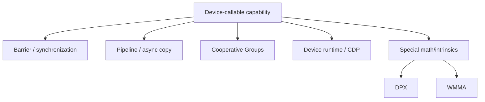

# 第 75 章 专用指令和 Device-callable API：DPX、WMMA、device runtime 不是日常语法

## 75.1 问题的由来

CUDA 提供了大量 device-callable API：barrier primitives、pipeline primitives、Cooperative Groups、device runtime、DPX、WMMA。它们不属于 kernel 入门语法，通常在写高性能库、通信原语、矩阵计算、动态并行或底层 runtime 时才会用到。

查这类 API 的方法是：先按能力分类，再查 header、参与者、生命周期和硬件要求。

## 75.2 核心模型

按能力，这些 API 可以分成五组：barrier 与同步、pipeline 与 async copy、Cooperative Groups、device runtime 与 CDP，以及 DPX、WMMA 这类专用指令（图 75.1）。

<figure>

<figcaption>图 75.1：device 侧可调用 API 按能力分成的五组</figcaption>
</figure>

不管属于哪一组，都要问四件事：在哪个 header、在哪个 scope、哪些线程必须参与、需要什么 compute capability。

## 75.3 详解

Barrier primitives 是更底层的 arrive/wait 同步工具，适合隐藏同步延迟或配合 async copy。Pipeline primitives 用来表达 global-to-shared async copy 与计算重叠，和[第 47 章](ch047.md)的 pipeline、[第 49 章](ch049.md)的 TMA 相连。

Cooperative Groups 把“谁在一起协作”写成对象：`thread_block`、`cluster_group`、`grid_group`、`thread_block_tile`、`coalesced_group`。配套 headers 提供 async copy、partition、reduce、scan、sync。

Device runtime 包含 device-side launch、device streams、fire-and-forget stream、tail launch stream、symbol 地址等。它和[第 63 章](ch063.md)讲的 CDP 直接相连。

DPX 面向动态规划类操作，不能当作通用算术的替代。WMMA 面向 warp matrix functions，入口是 `nvcuda::wmma`，核心动作是 fragment、load、mma、store。

## 75.4 代码示例

WMMA 最小结构：

```cpp
#include <mma.h>
#include <cuda_fp16.h>
using namespace nvcuda;
// 一个 warp 计算 C = A × B，A、B 都是 16×16 的 half 矩阵，C 用 float 累加。
// A 按行主序存放：A(r, k) 在 a[r * lda + k]，lda 是相邻两行起点相隔的元素数；
// B 按列主序存放：B(k, c) 在 b[c * ldb + k]，ldb 是相邻两列起点相隔的元素数；
// C 按行主序写回，ldc 的含义同 lda。这里三个矩阵都是独立的 16×16 数组，ld 都是 16；
// 如果从更大的矩阵里取一块，ld 要填大矩阵的行宽（行主序）或列高（列主序）。
// a、b、c 要求 32 字节对齐，cudaMalloc 返回的地址满足这一点。
__global__ void wmma_16x16x16(const half* a, const half* b, float* c)
{
    wmma::fragment<wmma::matrix_a, 16, 16, 16, half, wmma::row_major> a_frag;
    wmma::fragment<wmma::matrix_b, 16, 16, 16, half, wmma::col_major> b_frag;
    wmma::fragment<wmma::accumulator, 16, 16, 16, float> acc;
    wmma::fill_fragment(acc, 0.0f);            // 累加器清零
    wmma::load_matrix_sync(a_frag, a, 16);     // lda = 16
    wmma::load_matrix_sync(b_frag, b, 16);     // ldb = 16
    wmma::mma_sync(acc, a_frag, b_frag, acc);  // acc = A × B + acc
    wmma::store_matrix_sync(c, acc, 16, wmma::mem_row_major);  // ldc = 16
}
// 用一个完整的 warp 启动，warp 内 32 个线程都要执行每个 *_sync 调用：
// wmma_16x16x16<<<1, 32>>>(d_a, d_b, d_c);
```

Cooperative Groups block reduce skeleton：

```cpp
#include <cooperative_groups.h>
#include <cooperative_groups/reduce.h>
namespace cg = cooperative_groups;
// cg::reduce 只接受 thread_block_tile 和 coalesced_group，不能直接对整个 block 归约：
// 先在每个 32 线程的 tile 内归约，再把各 tile 的部分和累加到 shared memory。
__global__ void reduce_kernel(const int* in, int* out)
{
    __shared__ int block_sum;
    cg::thread_block block = cg::this_thread_block();
    cg::thread_block_tile<32> tile = cg::tiled_partition<32>(block);
    if (block.thread_rank() == 0) block_sum = 0;
    block.sync();
    int v = in[blockIdx.x * blockDim.x + threadIdx.x];
    int tile_sum = cg::reduce(tile, v, cg::plus<int>());
    if (tile.thread_rank() == 0) atomicAdd(&block_sum, tile_sum);
    block.sync();
    if (block.thread_rank() == 0) {
        out[blockIdx.x] = block_sum;
    }
}
```

Pipeline primitive 形状：

```text
__pipeline_memcpy_async(dst, src, bytes);
__pipeline_commit();
__pipeline_wait_prior(0);
```

真实代码需要保证对齐、shared memory 生命周期和生产者/消费者阶段正确。

## 75.5 工程判断

| 需求 | 机制 | 注意点 |
|---|---|---|
| block/cluster 内显式协作 | Cooperative Groups | 所有参与线程必须一致调用 |
| async copy 与计算重叠 | pipeline primitives 或 `cuda::pipeline` | stage 生命周期和 alignment |
| 矩阵乘走 Tensor Core 风格路径 | WMMA | fragment ABI 和 layout 限制 |
| 动态规划特殊操作 | DPX | 查架构支持和具体 intrinsic |
| GPU 端 launch kernel | device runtime / CDP | launch overhead、stream scope、memory coherence |
| 底层 barrier 控制 | `__mbarrier_*` | phase、token、transaction count 容易错 |

## 75.6 API 与要点速查

Barrier primitives：

| API/类型 | 作用 |
|---|---|
| `<cuda_awbarrier_primitives.h>` | barrier primitive header |
| `__mbarrier_t` | low-level barrier object |
| `__mbarrier_token_t` | arrival token |
| `__mbarrier_maximum_count` | 最大 count |
| `__mbarrier_init` | 初始化 |
| `__mbarrier_inval` | invalidation |
| `__mbarrier_arrive` | arrive |
| `__mbarrier_arrive_and_drop` | arrive and drop |
| `__mbarrier_test_wait` | test wait |
| `__mbarrier_try_wait` | try wait |

Pipeline primitives：

| API | 作用 |
|---|---|
| `<cuda_pipeline_primitives.h>` | pipeline primitive header |
| `__pipeline_memcpy_async` | async copy |
| `__pipeline_commit` | commit 当前批次 |
| `__pipeline_wait_prior` | 等待 prior batches |
| `__pipeline_arrive_on` | copy 完成后 arrive on barrier |

Cooperative Groups：

| Header | 内容 |
|---|---|
| `<cooperative_groups.h>` | group classes；tiled/labeled/binary partition；sync、barrier\_arrive/barrier\_wait |
| `<cooperative_groups/memcpy_async.h>` | async copy：`memcpy_async`、`wait`、`wait_prior` |
| `<cooperative_groups/reduce.h>` | reduce（作用于 tile 和 coalesced group） |
| `<cooperative_groups/scan.h>` | inclusive/exclusive scan |

Group classes：

| Class | 协作范围 |
|---|---|
| `thread_block` | block |
| `cluster_group` | cluster |
| `grid_group` | cooperative grid |
| `thread_block_tile` | tile |
| `coalesced_group` | coalesced active lanes |

WMMA：

| API | 作用 |
|---|---|
| `wmma::fragment` | matrix fragment |
| `wmma::fill_fragment` | 填充 accumulator |
| `wmma::load_matrix_sync` | 加载 fragment |
| `wmma::mma_sync` | matrix multiply-accumulate |
| `wmma::store_matrix_sync` | 写回 memory |

Device runtime：

| 类别 | 内容 |
|---|---|
| launch | device-side launch、`cudaLaunchDevice`、parameter buffer |
| streams | implicit NULL stream、fire-and-forget stream、tail launch stream |
| memory | device runtime memory、device malloc/free、device/constant declarations |
| symbol | device-side symbol address，host symbol API 不适用 |
| texture/surface | device runtime 中的 texture/surface 限制 |
| identifiers | SM id、warp id |

## 75.7 小结

读完本章，你应该能够：

- 按能力分类查 API，而不是硬背名字。
- 知道 WMMA fragment 不应随便跨外部接口传递。
- 把 Cooperative Groups API 与第八部分（从[第 43 章](ch043.md)开始）的协作模型联系起来。
- 识别 device runtime API 和 CDP 的边界。
