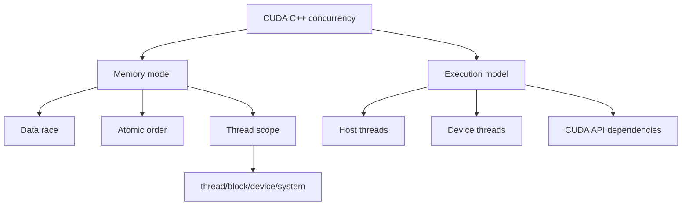

# 第 76 章 CUDA C++ Memory Model 与 Execution Model：把 C++ 并发语义放到 GPU 上会变形

## 76.1 问题的由来

标准 C++ 并发模型的很多直觉来自 CPU thread。CUDA 也有 C++ memory model 和 execution model，但 GPU 线程层级、scope、stream、event、kernel launch、host/device 边界会让这些语义变形。把 `std::thread`、`volatile` 或 CPU lock-free 经验直接搬到 GPU 上，很容易写出看似能跑、实际未定义的代码。

本章的核心判断是：同步关系必须覆盖所有参与者，执行进度必须按 CUDA 的线程层级来理解。

## 76.2 核心模型

CUDA C++ 的并发语义分成两部分（图 76.1）。memory model 回答“访问是否有定义”，涉及 data race、atomic order 和 thread scope；execution model 回答“哪些执行代理会前进，CUDA API 之间有哪些依赖”，涉及 host threads、device threads 和 CUDA API 建立的顺序关系。

<figure>

<figcaption>图 76.1：CUDA C++ 并发语义分为 memory model 与 execution model</figcaption>
</figure>

## 76.3 详解

CUDA thread scopes：

| Scope | 覆盖范围 |
|---|---|
| `cuda::thread_scope_thread` | 当前线程 |
| `cuda::thread_scope_block` | 当前 thread block |
| `cuda::thread_scope_device` | 当前 CUDA device |
| `cuda::thread_scope_system` | host、device 和系统范围参与者 |

Atomicity 只在指定 scope 内成立。block-scope atomic 不能保护跨 block 访问；device-scope atomic 不自动保护 CPU 访问；system-scope atomic 也依赖内存类型和硬件能力。

System-scope atomicity 的条件很具体，不能简化成“用了 system scope 就一定跨 CPU/GPU 原子”。它可能依赖 pageable memory access、managed memory 的 concurrent access、mapped memory 的 host native atomic support、自然对齐大小、GPU 之间 native atomic support 等。

`volatile` 不是同步方案。它不能代替 atomic order、fence、barrier，也不能建立 C++ memory model 中的 happens-before。

Execution model 里要区分 host threads 和 device threads。CUDA API 常常只是向 stream 入队；host API 返回不等于 device work 完成。device thread 的 forward progress 也不能照搬 CPU 线程直觉，尤其在 persistent kernel、spin wait、跨 block 通信和 device runtime 场景。

## 76.4 代码示例

错误的跨 block 通信：

```cpp
__device__ int payload;
__device__ int flag;
__global__ void bad()
{
    if (blockIdx.x == 0 && threadIdx.x == 0) {
        payload = 42;
        flag = 1; // 普通写入，不建立同步关系
    }
    if (blockIdx.x == 1 && threadIdx.x == 0) {
        while (flag == 0) {}
        printf("%d\n", payload); // 数据竞争或未定义语义
    }
}
```

使用 device-scope release/acquire：

```cpp
#include <cuda/atomic>
__device__ int payload;
__device__ int flag_storage;
__global__ void good()
{
    if (blockIdx.x == 0 && threadIdx.x == 0) {
        payload = 42;
        cuda::atomic_ref<int, cuda::thread_scope_device> flag(flag_storage);
        flag.store(1, cuda::std::memory_order_release);
    }
    if (blockIdx.x == 1 && threadIdx.x == 0) {
        cuda::atomic_ref<int, cuda::thread_scope_device> flag(flag_storage);
        while (flag.load(cuda::std::memory_order_acquire) != 1) {}
        printf("%d\n", payload);
    }
}
```

如果通信对象跨 host/device，需要 system scope，并确认内存类型支持相应 atomicity。

## 76.5 工程判断

| 问题 | 要问什么 | 常见错误 |
|---|---|---|
| 两个线程访问同一对象 | 是否有 happens-before 或 atomic | 普通 load/store 数据竞争 |
| block 内通信 | 是否只在 block 内 | 用 block scope 是合理的 |
| 跨 block 通信 | scope 是否至少 device | 错用 `__syncthreads()` |
| host/device 通信 | system scope 是否支持 | 只用 device scope |
| spin wait | 参与者能否 forward progress | persistent kernel 中容易死锁 |
| stream/event ordering | API 依赖是否表达清楚 | 以 host 返回当作 device 完成 |
| `volatile` | 是否只是防优化 | 误当同步原语 |

## 76.6 API 与要点速查

Memory model 条目：

| 项 | 说明 |
|---|---|
| data race | 没有同步的冲突访问导致未定义语义 |
| atomic object | `cuda::atomic`、`cuda::atomic_ref` |
| memory order | relaxed、release、acquire、acq\_rel、seq\_cst 等 |
| thread scope | thread、block、device、system |
| fence | 建立内存顺序，不等价于线程等待 |
| volatile access | 不是同步机制 |

System-scope atomicity 条件索引：

| Memory / attribute | 说明 |
|---|---|
| system allocated memory + `pageableMemoryAccess` | 取决于设备属性 |
| managed memory + `concurrentManagedAccess` | 取决于 managed memory 并发访问能力 |
| mapped memory + `hostNativeAtomicSupported` | host native atomic 支持 |
| naturally aligned 1/2/4/8/16 byte load/store | 对齐和大小影响 atomicity |
| GPU memory between GPUs | 取决于 native atomic support |
| single GPU GPU-only access | 条件最简单，但仍看 scope |

Execution model 条目：

| 项 | 说明 |
|---|---|
| host threads | 标准 C++ host execution agents |
| device threads | CUDA device execution agents |
| forward progress | device progress 受 CUDA execution model 影响 |
| `std::thread` / `std::jthread` | host execution 语义 |
| `std::this_thread::yield` | device 侧不能照搬 CPU 直觉 |
| library I/O | device printf 等 I/O 暴露有同步边界 |
| termination | device 异常/断言通常在同步点向 host 暴露 |
| trivial infinite loop | progress 讨论中的特殊条目 |
| CUDA API dependencies | stream、event、memory operation、graph 等建立顺序关系 |

与其他章节的联系：

| 主题 | 回看 |
|---|---|
| memory synchronization domains | [第 51 章](ch051.md) |
| stream/event 依赖 | [第 12 章](ch012.md)、[第 13 章](ch013.md) |
| managed/mapped memory | 第四部分，[第 19 章](ch019.md)～[第 22 章](ch022.md) |
| IPC/VMM/EGM system memory | 第十部分，[第 57 章](ch057.md)～[第 61 章](ch061.md) |
| CDP device runtime | [第 63 章](ch063.md)、[第 64 章](ch064.md) |

## 76.7 小结

读完本章，你应该能够：

- 判断一个跨线程通信是否被正确同步。
- 选择 block/device/system scope，而不是默认用最强 scope。
- 解释 `volatile` 为什么不能替代 atomic。
- 把 CUDA API 的异步提交和 C++ execution model 分开理解。
