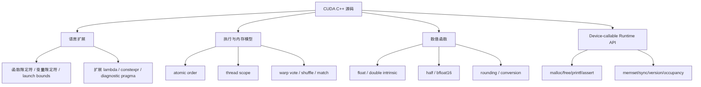

# 第 77 章 CUDA 语言扩展与数值函数完整索引：把参考手册放回工程语境

第十二部分是全书最像参考手册的一部分：语言扩展、C++ 限制、atomic、warp intrinsic、浮点函数、half/bfloat16、device-callable runtime API、memory model。前面各章已经按主题讲过核心思想，但还有大量“具体名字”散落在各处。CUDA 程序员排查问题时，往往就是在查一个宏、一个内建函数、一个 rounding mode 或一个线程作用域。

本章把这些名字整理成一份可以阅读的索引：先读“详解”一节建立分类，再到“API 与要点速查”的表格里找具体名字。读前面各章时建立模型，写代码和做 review 时再回到这里查名字、边界和误区。

## 77.1 核心模型

语言层的内容要和执行层一起看。一个 `__device__` 函数能不能被调用，取决于编译目标、调用位置、C++ 限制和设备运行时支持；一个 atomic 是否正确，取决于操作本身、memory order 和 thread scope；一个数学函数是否适合，取决于精度、舍入、吞吐和特殊值语义。

本章的索引大致按图 77.1 的四个分区组织：语言扩展、执行与内存模型、数值函数、device-callable Runtime API。

<figure>

<figcaption>图 77.1：CUDA C++ 参考内容的四个分区及其主要条目</figcaption>
</figure>

## 77.2 详解

CUDA C++ 的语言扩展大致分成四类。第一类是执行位置相关的限定符，例如 `__global__`、`__device__`、`__host__`，它们决定函数在哪边编译、从哪边调用。第二类是内存空间限定符，例如 `__shared__`、`__constant__`、`__managed__`，它们决定变量的存储位置和可见性。第三类是性能和编译控制，例如 `__launch_bounds__`、`__noinline__`、`__forceinline__`、`__align__`。第四类是和 C++ 语言结合的扩展，例如 extended lambda、relaxed constexpr、diagnostic pragma。

Atomic 的复杂性不在“原子加”本身，而在“谁需要看见这个顺序”。CUDA 新式 atomic 内建把 C++ memory order 和 CUDA thread scope 分开表达。`__NV_ATOMIC_ACQUIRE`、`__NV_ATOMIC_RELEASE`、`__NV_ATOMIC_SEQ_CST` 这些 order 说明同一作用域内的可见顺序；`__NV_THREAD_SCOPE_BLOCK`、`__NV_THREAD_SCOPE_DEVICE`、`__NV_THREAD_SCOPE_SYSTEM` 说明这个顺序扩展到多大范围。order 和 scope 写错，程序可能在小测试里正确，在多 block、多 GPU 或 CPU/GPU 共享场景里失效。

数值函数则要分成“准确语义”和“工程取舍”两层。`sinf`、`cosf` 这样的标准风格函数通常更强调语义；`__sinf`、`__cosf` 这类 intrinsic 更强调速度和硬件路径；带 `_rn`、`_rz`、`_ru`、`_rd` 的转换或算术函数把舍入模式写进名字。half 和 bfloat16 函数又引入向量化、比较、饱和、特殊值判断等细节。

## 77.3 代码示例

下面是一个把 atomic order、scope 和 device 侧判断放在一起的最小片段。

```cpp
__device__ int ready = 0;
__device__ float payload[1024];
// 两个 kernel 都只用 1 个 block（不超过 1024 个线程）启动，放在不同 stream 上并发运行。
__global__ void producer() {
    int i = threadIdx.x;
    payload[i] = static_cast<float>(i);
    __syncthreads();  // 本 block 所有 payload 写入都排在下面的 release 之前
    if (threadIdx.x == 0) {
        __nv_atomic_store_n(&ready,
                            1,
                            __NV_ATOMIC_RELEASE,
                            __NV_THREAD_SCOPE_DEVICE);
    }
}
__global__ void consumer(float* out) {
    if (threadIdx.x == 0) {
        while (__nv_atomic_load_n(&ready,
                                  __NV_ATOMIC_ACQUIRE,
                                  __NV_THREAD_SCOPE_DEVICE) == 0) {
        }
    }
    __syncthreads();  // 线程 0 的 acquire 成功之后，再放行整个 block 读 payload
    int i = threadIdx.x;
    out[i] = payload[i];
}
```

这段代码并不推荐用 busy-wait 写生产者消费者，只用来展示 release/acquire 和 device scope 的含义。producer 里每个线程写自己的 `payload[i]`，`__syncthreads()` 让这些写入都排在线程 0 的 release store 之前；consumer 里线程 0 的 acquire load 读到 1 之后，再用 `__syncthreads()` 把这个顺序传给 block 内其他线程，它们读到的就是 producer 写好的 payload。去掉 producer 里的 `__syncthreads()`，release 只能保证线程 0 自己写的 `payload[0]`。

两个 kernel 必须真正并发，consumer 才等得到 ready。还要注意 lazy loading（[第 54 章](ch054.md)）：如果 consumer 已经在自旋，producer 才第一次被加载，加载过程可能等不到 consumer 结束而卡住。先用 `cudaFuncGetAttributes` 预加载两个 kernel，或者设置 `CUDA_MODULE_LOADING=EAGER`。

## 77.4 工程判断

| 问题 | 优先选择 | 慎用或不用 | 判断依据 |
|---|---|---|---|
| block 内计数或队列 | block scope atomic / shared memory atomic | system scope atomic | 同步范围越大成本越高 |
| GPU 和 CPU 共享 managed / mapped 状态 | system scope atomic | device scope atomic | CPU 也要参与可见顺序 |
| warp 内规约或广播 | warp shuffle / vote | shared memory + `__syncthreads()` | warp 内通信更轻 |
| 追求吞吐的近似数学 | intrinsic 如 `__cosf` | 默认高精度函数 | 需要确认误差可接受 |
| 金融/科学计算确定性 | 明确 rounding mode 函数 | 隐式 fast math | 舍入和特殊值必须可解释 |
| half/bfloat16 推理 | half/bfloat16 intrinsic | 手写 bit cast | 类型语义和向量化更清楚 |
| device 侧动态分配 | 预分配池或 host 分配 | 频繁 device `malloc` | device heap 成本和限制明显 |

## 77.5 API 与要点速查

### 77.5.1 编译与语言能力宏

| 宏 | 含义 | 用途 |
|---|---|---|
| `__CUDACC__` | nvcc 编译 CUDA 代码 | 条件编译 CUDA 路径 |
| `__CUDACC_RDC__` | relocatable device code | 判断是否启用 RDC |
| `__CUDACC_DEBUG__` | device debug 编译 | 调试路径条件编译 |
| `__CUDACC_EXTENDED_LAMBDA__` | extended lambda 支持 | 判断 `--extended-lambda` |
| `__CUDACC_RELAXED_CONSTEXPR__` | relaxed constexpr 支持 | 判断 `--expt-relaxed-constexpr` |
| `__CUDACC_DEVICE_ATOMIC_BUILTINS__` | device atomic builtin 支持 | 使用 `__nv_atomic_*` 前可检查 |
| `__CUDA_ARCH__` | device 编译目标架构 | device 代码中按 SM 分支 |
| `__NVCC_DIAG_PRAGMA_SUPPORT__` | diagnostic pragma 支持 | 控制 nvcc 诊断 |
| `__SIZEOF_FLOAT128__` | host compiler 支持 `__float128`（GCC/Clang 预定义，nvcc 两条编译路径都能看到） | device 侧使用 `__float128` 还要求较新的目标架构 |

### 77.5.2 Diagnostic pragma

| 形式 | 说明 |
|---|---|
| `#pragma nv_diag_suppress <diag>` | 抑制指定 nvcc 诊断 |
| `#pragma nv_diag_warning <diag>` | 把指定诊断作为 warning |
| `#pragma nv_diag_error <diag>` | 把指定诊断作为 error |
| `#pragma nv_diag_default <diag>` | 恢复默认诊断级别 |

诊断 pragma 应该局部使用，最好包住非常小的代码区域，并在注释里说明为什么这个 warning 对当前代码是可接受的。

### 77.5.3 函数、变量与布局限定符

| 限定符 | 作用 | 注意点 |
|---|---|---|
| `__global__` | kernel，host 发射、device 可在 CDP 中发射 | 返回类型必须是 `void` |
| `__device__` | device 侧函数或变量 | host 不能直接调用 device 函数 |
| `__host__` | host 侧函数 | 可和 `__device__` 组合生成双版本 |
| `__shared__` | block shared memory | 生命周期随 block |
| `extern __shared__` | dynamic shared memory | launch 时指定字节数 |
| `__constant__` | constant memory | 适合广播式只读访问 |
| `__managed__` | managed 全局变量 | 受 Unified Memory 迁移和一致性约束 |
| `__grid_constant__` | grid 常量参数 | 避免每线程本地副本的特定优化 |
| `__launch_bounds__` | 限制 block 线程数和最小 block 数 | 影响寄存器分配和 occupancy |
| `__align__` | 对齐声明 | shared/TMA/向量化访问常用 |
| `__noinline__` | 禁止内联 | 调试或控制代码尺寸 |
| `__forceinline__` | 强制内联倾向 | 可能增加寄存器压力 |

### 77.5.4 Atomic memory order 与 thread scope

| Order | 含义 | 常见用法 |
|---|---|---|
| `__NV_ATOMIC_RELAXED` | 只保证原子性，不建立同步顺序 | 计数器、统计 |
| `__NV_ATOMIC_CONSUME` | consume 语义 | 使用较少，通常避免依赖 |
| `__NV_ATOMIC_ACQUIRE` | acquire 读 | 消费者读取 flag |
| `__NV_ATOMIC_RELEASE` | release 写 | 生产者发布数据 |
| `__NV_ATOMIC_ACQ_REL` | acquire + release | read-modify-write 同步 |
| `__NV_ATOMIC_SEQ_CST` | 顺序一致 | 最强、成本也最高 |

| Scope | 可见范围 | 常见用途 |
|---|---|---|
| `__NV_THREAD_SCOPE_THREAD` | 单线程 | 极少用于跨线程同步 |
| `__NV_THREAD_SCOPE_BLOCK` | block 内 | shared 状态、block 内队列 |
| `__NV_THREAD_SCOPE_CLUSTER` | cluster 内 | cluster 协作 |
| `__NV_THREAD_SCOPE_DEVICE` | device 内 | 多 block 同步状态 |
| `__NV_THREAD_SCOPE_SYSTEM` | system 范围 | CPU/GPU 或多设备可见 |

### 77.5.5 新式 atomic builtin 家族

| 函数族 | 操作 | 说明 |
|---|---|---|
| `__nv_atomic_load_n` | load | 指定 order 和 scope |
| `__nv_atomic_store_n` | store | 发布 flag 常用 release |
| `__nv_atomic_exchange_n` | exchange | 替换并返回旧值 |
| `__nv_atomic_compare_exchange_n` | compare exchange | lock-free 状态机常用 |
| `__nv_atomic_fetch_add` | fetch add | 计数器 |
| `__nv_atomic_fetch_sub` | fetch sub | 引用计数、队列 |
| `__nv_atomic_fetch_and` | fetch and | bit mask |
| `__nv_atomic_fetch_or` | fetch or | bit set |
| `__nv_atomic_fetch_xor` | fetch xor | bit toggle |
| `__nv_atomic_fetch_min` | fetch min | 并行最小值 |
| `__nv_atomic_fetch_max` | fetch max | 并行最大值 |

旧式 `atomicAdd`、`atomicCAS` 等仍然常见，但新式 builtin 的优势是把 memory order 和 scope 写清楚。选择时要看目标架构和 CUDA 版本支持。

### 77.5.6 Warp vote、match、shuffle 与 reduce

| 函数族 | 用途 |
|---|---|
| `__activemask` | 返回当前 active lane mask |
| `__all_sync` | 判断 mask 内线程条件是否全真 |
| `__any_sync` | 判断是否任一线程为真 |
| `__ballot_sync` | 收集 predicate bitmask |
| `__match_any_sync` | 找到具有相同值的 lane 集合 |
| `__match_all_sync` | 判断值是否全相等 |
| `__shfl_sync` | 按 lane 取值 |
| `__shfl_up_sync` | 从上方 lane 取值 |
| `__shfl_down_sync` | 从下方 lane 取值 |
| `__shfl_xor_sync` | XOR 模式交换 |
| `__reduce_add_sync` | warp 内求和 |
| `__reduce_min_sync` | warp 内最小值 |
| `__reduce_max_sync` | warp 内最大值 |
| `__reduce_and_sync` | warp 内按位与 |
| `__reduce_or_sync` | warp 内按位或 |
| `__reduce_xor_sync` | warp 内按位异或 |

所有 `_sync` 函数的 mask 都是语义的一部分。mask 写错可能导致部分 lane 等待不存在的参与者。

### 77.5.7 Float intrinsic 与 rounding

| 函数 | 类型 | 说明 |
|---|---|---|
| `__cosf` | float intrinsic | 快速 cosine |
| `__sinf` | float intrinsic | 快速 sine |
| `__tanf` | float intrinsic | 快速 tangent |
| `__expf` | float intrinsic | 快速 exp |
| `__exp10f` | float intrinsic | 快速 10 底指数 |
| `__logf` | float intrinsic | 快速 log |
| `__log2f` | float intrinsic | 快速 log2 |
| `__log10f` | float intrinsic | 快速 log10 |
| `__fdividef` | float intrinsic | 快速除法 |
| `__frsqrt_rn` | float intrinsic | round-to-nearest reciprocal sqrt |
| `__fsqrt_rn` | float intrinsic | round-to-nearest sqrt |
| `__fmaf_rn` | fused multiply-add | round-to-nearest |
| `__fmaf_rz` | fused multiply-add | round-toward-zero |
| `__fmaf_ru` | fused multiply-add | round-up |
| `__fmaf_rd` | fused multiply-add | round-down |
| `__double2int_rz` | conversion | double 到 int，向零舍入 |
| `__double2int_rn` | conversion | double 到 int，最近舍入 |
| `__float2int_rz` | conversion | float 到 int，向零舍入 |
| `__float2uint_rz` | conversion | float 到 unsigned，向零舍入 |

如果代码启用了 fast math，编译器可能替换部分数学路径。对误差敏感的模块应在代码和构建配置中显式记录精度策略。

### 77.5.8 Half 函数索引

| 函数 | 用途 |
|---|---|
| `__habs` | half 绝对值 |
| `__hadd` | half 加法 |
| `__hsub` | half 减法 |
| `__hmul` | half 乘法 |
| `__hdiv` | half 除法 |
| `__hfma` | half fused multiply-add |
| `__hneg` | half 取负 |
| `__hmax` | half 最大值 |
| `__hmin` | half 最小值 |
| `__hge` | half 大于等于比较 |
| `__hgt` | half 大于比较 |
| `__hle` | half 小于等于比较 |
| `__hlt` | half 小于比较 |
| `__heq` | half 相等比较 |
| `__hne` | half 不等比较 |
| `__hisinf` | 判断 infinity |
| `__hisnan` | 判断 NaN |
| `__hadd2` | half2 加法 |
| `__hmul2` | half2 乘法 |
| `__hfma2` | half2 fused multiply-add |

half2 把两个 half 打包到一个操作中，适合吞吐型代码；但数据对齐、向量化和边界元素处理要一起设计。

### 77.5.9 Bfloat16 常见函数族

| 函数族 | 用途 |
|---|---|
| `__hadd` / `__hadd2` 对应 bfloat16 版本 | bfloat16 加法 |
| `__hmul` / `__hmul2` 对应 bfloat16 版本 | bfloat16 乘法 |
| `__hfma` / `__hfma2` 对应 bfloat16 版本 | bfloat16 FMA |
| comparison intrinsics | bfloat16 比较 |
| conversion intrinsics | float、half、bfloat16 之间转换 |

bfloat16 的优势是指数范围更接近 FP32，常用于深度学习训练和推理；它不是 half 的简单替代，误差形态不同。

### 77.5.10 Address space 与转换辅助

| 函数 | 用途 |
|---|---|
| `__isGlobal` | 判断指针是否指向 global memory |
| `__isShared` | 判断 shared memory 指针 |
| `__isConstant` | 判断 constant memory 指针 |
| `__isLocal` | 判断 local memory 指针 |
| `__cvta_generic_to_global` | generic pointer 转 global address |
| `__cvta_generic_to_shared` | generic pointer 转 shared address |
| `__cvta_generic_to_constant` | generic pointer 转 constant address |
| `__cvta_generic_to_local` | generic pointer 转 local address |
| `__cvta_global_to_generic` | global address 转 generic pointer |
| `__cvta_shared_to_generic` | shared address 转 generic pointer |

这些函数通常出现在低层库、inline PTX、调试工具或需要显式地址空间判断的模板代码里。

### 77.5.11 Device-callable Runtime API

| API | device 侧用途 | 注意点 |
|---|---|---|
| `malloc` / `free` | device heap 动态分配 | 需要配置 heap，成本较高 |
| `printf` | device 侧打印 | buffer 有限制，输出在同步后可见 |
| `assert` | device 侧断言 | 失败会影响后续 CUDA 调用错误状态 |
| `cudaDeviceSynchronize` | 旧 CDP1 中 parent 等待 child | CDP2（CUDA 12 起默认，CC 9.0+ 只支持 CDP2）不能在 device 侧调用；child 完成后的处理改用 tail launch（见[第 63 章](ch063.md)） |
| `cudaGetLastError` | 查询 device runtime 错误 | device runtime 支持范围受限 |
| `cudaPeekAtLastError` | 查看错误但不清除 | 和 host 侧概念类似但环境不同 |
| `cudaRuntimeGetVersion` | 查询 runtime 版本 | device-callable 支持需看版本 |
| `cudaMemsetAsync` | 异步 memset | device 侧可调用范围受限制 |
| `cudaMemset2DAsync` | 二维异步 memset | pitch 参数要正确 |
| `cudaMemset3DAsync` | 三维异步 memset | extent 和 pitched pointer 要匹配 |
| `cudaOccupancyMaxActiveBlocksPerMultiprocessor` | occupancy 估算 | 可用于 device 侧自适应 launch 场景 |
| `cudaLimitStackSize` | stack size limit | 影响递归或深调用 device 代码 |
| `cudaLimitMallocHeapSize` | device heap limit | device malloc/free 相关 |
| `cudaLimitPrintfFifoSize` | printf FIFO size | device printf 相关 |

Device-callable API 不应被当成 host Runtime API 的完全复制。它们服务于 CDP、device runtime 和少数自适应场景，普通 kernel 热路径中要非常谨慎。

### 77.5.12 C++ 限制与实践提醒

| 主题 | 提醒 |
|---|---|
| `__host__ __device__` 函数 | 两边都会编译，函数体必须同时满足 host 和 device 限制 |
| 虚函数/ RTTI / exception | 支持和限制与编译目标、设备代码能力相关，热路径中要谨慎 |
| 静态局部变量 | device 侧初始化和生命周期需要关注 |
| lambda | extended lambda 依赖编译选项和宏 |
| constexpr | relaxed constexpr 需要选项支持 |
| 标准库 | 不是所有 host 标准库设施都能在 device 侧使用 |
| 递归 | 受 stack size 和编译支持影响 |
| 动态分配 | device heap 有全局限制和性能成本 |

## 77.6 小结

读完本章，你应该能够：

- 根据函数名判断 CUDA 数值 intrinsic 的类型、舍入和速度取向。
- 把 atomic order 与 thread scope 组合成正确的同步语义。
- 在代码 review 中识别 `__host__ __device__`、extended lambda、diagnostic pragma 的风险点。
- 快速找到 half、warp、address space、device runtime API 的常见符号。
- 把 CUDA 语言扩展当成工程工具，而不是孤立语法表。
