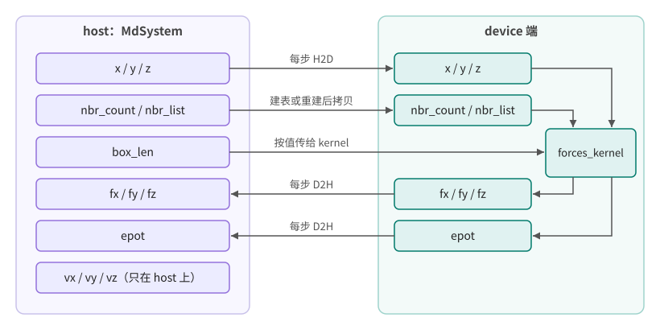
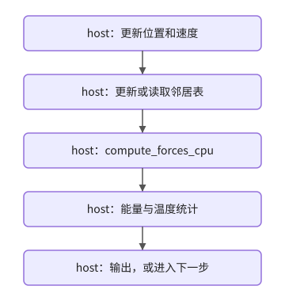
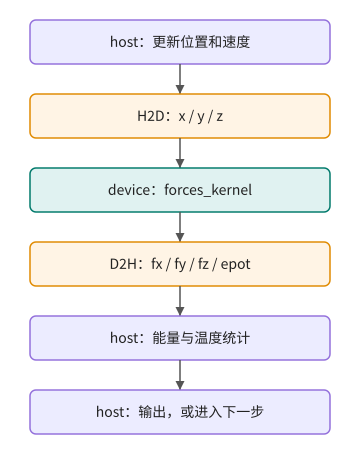
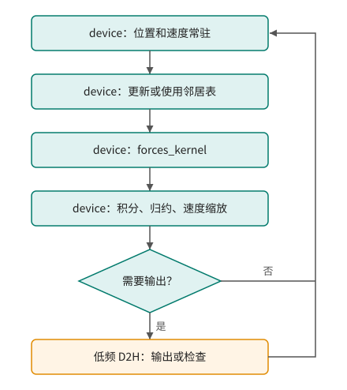

# 第 87 章 MD 数据布局与时间步数据流：从数组位置判断迁移边界

## 87.1 问题的由来

MD 案例只看 `forces_kernel` 还不够。读者需要知道数组在哪里、每个时间步谁读写这些数组、哪些 host/device 往返会吞掉 kernel 加速。这个判断比单独优化一个 kernel 更接近真实的 CUDA 工程。

本章把前面三章的 MD 案例浓缩成两类图：数据布局图和时间步数据流图。

## 87.2 核心模型

force-only port 的问题不在于线程映射不清楚，而在于每一步仍然把主循环数据切回 CPU。图 87.1 画出了 force-only port 中 `MdSystem` 各数组的位置：左侧是 host 端，右侧是 device 端和求力 kernel `forces_kernel`。邻居表在初始化或更新后可以留在 device，盒子参数按值传给 kernel；但位置每步都要 H2D，力和势能每步都要 D2H，速度则始终只在 host 上。

<figure>

<figcaption>图 87.1：force-only port 中 MD 数组在 host 与 device 两侧的分布和每步传输</figcaption>
</figure>

## 87.3 详解

CPU baseline 的时间步可以看成：

<figure>

<figcaption>图 87.2：CPU baseline 的一个时间步：所有步骤都在 host 上执行</figcaption>
</figure>

force-only CUDA port 只替换其中最热的一段，代价是求力前后各多了一次传输：

<figure>

<figcaption>图 87.3：force-only port 的一个时间步：求力移到 device，前后各有一次传输</figcaption>
</figure>

whole-code data residency 的目标是减少中间往返，只在需要输出或检查时才把数据拷回 host：

<figure>

<figcaption>图 87.4：whole-code port 的时间步：数据常驻 device，只在输出时低频拷回</figcaption>
</figure>

这三张图说明同一个原则：迁移顺序应该跟着数据流走，而不是跟着函数列表走。

## 87.4 代码示例

本章的图是根据前面几章的代码整理的，各图和章节的对应关系如下：

| 章节 | 内容 | 对应的图 |
|---|---|---|
| [第 84 章](ch084.md) | MD C++ baseline：CPU 热点定位，`compute_forces_cpu` 的数组读写 | 图 87.2 |
| [第 85 章](ch085.md) | force-only CUDA port：第一版迁移和数据边界 | 图 87.1、图 87.3 |
| [第 86 章](ch086.md) | whole-code data residency：数据驻留判断 | 图 87.4 |

## 87.5 工程判断

| 观察 | 意味着什么 |
|---|---|
| 每步都 H2D 位置、D2H 力 | force-only port 还不是端到端 GPU 程序 |
| 邻居表读多写少 | 适合考虑 device 驻留，但更新策略要单独评估 |
| 能量统计每步都回 host | 归约也可能需要迁移 |
| 输出频率远低于时间步频率 | 输出可以作为低频同步边界 |
| GPU kernel 很快但总时间不降 | 优先查数据传输和同步，而不是继续微调 block size |

## 87.6 API 与要点速查

| 要点 | 做法 |
|---|---|
| 数据布局图 | 把 `x/y/z/fx/fy/fz/epot/nbr_count/nbr_list` 的 host/device 位置画出来 |
| 时间步数据流 | 分别画出 CPU baseline、force-only port、whole-code residency 三个阶段 |
| 迁移判断 | 从“迁移哪个函数”转到“主循环数据走哪条路径” |

## 87.7 小结

读完本章，你应该能够看出一个科学计算程序的 CUDA 迁移边界：先画数组位置，再画每步的读写，然后决定哪个函数应该迁移。只看单个 kernel 的速度，无法判断整个程序是否真的变快了。
