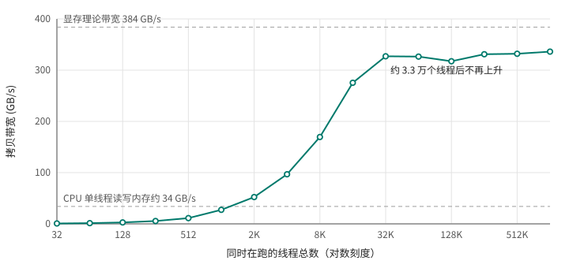

# 第 1 章 GPU 擅长什么：从一个 for 循环说起

刚接触 CUDA 的人，最想知道的往往是：GPU 到底比 CPU 快多少？这个问题没有一个固定答案。有的程序换到 GPU 上快几十倍，有的反而更慢，差别取决于程序在做什么、数据在哪里。与其背结论，不如直接量一量。

本章拿两个最简单的循环做实验。一个很轻，每个元素只做一次乘加：

```cpp
{{#include code/ch01/loops.cu:loops}}
```

`saxpy` 是线性代数里的老朋友，`y = a·x + y`，每个元素读 8 字节、写 4 字节，只做一次乘加。`heavy` 则让每个元素迭代 256 次，大约 512 次浮点运算，读写各 4 字节。`__host__ __device__` 让同一个函数既能在 CPU 上调用，也能在 GPU 上调用，这样两边算的东西完全一样。

两个循环都处理 6400 万个 `float`，分别用四种方式跑：CPU 单线程；CPU 全部 32 个线程（用 OpenMP 分配，每个线程内部再用 AVX-512 一次算 16 个元素，对 CPU 算是公平的）；GPU 只算 kernel，数据事先已经在显存里；GPU 从主机内存开始，算上把数据拷上去、把结果拷回来的时间。完整程序是 [loops.cu](code/ch01/loops.cu)。

本书的测量都在同一台笔记本上完成：CPU 是 16 核 32 线程的 Ryzen 9 9955HX，GPU 是 RTX 5060 Laptop GPU（8 GB 显存），两者之间是 PCIe 4.0 x8，CUDA 13.3。换一台机器数字会变，但本章的现象都能复现。

## 1.1 同一个循环，换成 GPU 的写法

GPU 版本长这样：

```cpp
{{#include code/ch01/loops.cu:kernels}}
```

最明显的变化是 `for` 循环不见了。`__global__` 标记的函数叫 kernel，在 GPU 上执行。启动 kernel 时，GPU 会同时开出成千上万个线程，每个线程都执行这同一个函数体，区别只在于 `blockIdx`、`blockDim`、`threadIdx` 这几个内置变量的值不同。`i = blockIdx.x * blockDim.x + threadIdx.x` 把它们换算成一个全局编号，于是每个线程认领一个 `i`，处理一个元素。原来循环的每一次迭代，变成了一个线程。

线程是成组启动的：256 个线程一组，叫一个 block，6400 万个元素需要 262144 个 block。启动的写法是：

```cpp
int threads = 256, blocks = (N + threads - 1) / threads;
saxpy_gpu<<<blocks, threads>>>(N, 2.0f, d_x, d_y);
```

尖括号里的两个数就是 block 的个数和每个 block 的线程数。`(N + threads - 1) / threads` 是向上取整，最后一个 block 可能有几个线程分不到元素，所以 kernel 里要有 `if (i < n)` 这道检查。这些坐标怎么用、block 该开多大，第 3 章会细讲；分配显存、拷贝数据这些准备工作，第 2 章会一步步写出来。这一章只关心结果。

## 1.2 结果

```text
32 个 CPU 线程

                       saxpy        heavy
CPU 单线程             23.5 ms    1203.1 ms
CPU 全部线程           27.8 ms      80.0 ms
GPU，只算 kernel        2.3 ms       4.3 ms
GPU，算上拷贝          70.5 ms      50.4 ms
```

（笔记本 CPU 的多线程性能受功耗和温度影响很大，多跑几次，“CPU 全部线程”的 heavy 在 59 到 85 ms 之间波动；其余几项都很稳定。）

这张表里有好几件值得细看的事。

**saxpy 用 32 个线程并不比 1 个线程快。** 一个元素只做一次乘加，CPU 核心几乎一直在等内存。6400 万个元素一共要读写 768 MiB，单线程跑了 23.5 ms，相当于每秒 34 GB 左右，这已经是这台笔记本内存带宽的上限。瓶颈不在核心上，加再多线程也没用。

**GPU 的 kernel 跑 saxpy 只要 2.3 ms，快了 10 倍。** 原因同样是带宽：GPU 的显存是 128 位宽的 GDDR7，理论带宽 384 GB/s，这个 kernel 跑出了 350 GB/s 左右。对这种算得少、读写多的循环，谁的内存带宽高，谁就快。

**可一旦算上拷贝，saxpy 在 GPU 上要 70.5 ms，比 CPU 单线程还慢 3 倍。** 数据得先经过 PCIe 拷到显存，结果再拷回来：一共 768 MiB 的数据过 PCIe，而这条链路每秒只能走十几 GB，比 CPU 自己读内存还慢。kernel 本身的 2.3 ms 在这里无足轻重。

**heavy 是另一番景象。** CPU 单线程要 1.2 秒，32 个线程把它分开算，降到 60 到 85 ms，这次多线程有用了，因为瓶颈是计算而不是内存。GPU 只要 4.3 ms，比满载的 16 核 CPU 还快 14 到 20 倍。算上拷贝是 50.4 ms，仍然比 CPU 略快，但这 50 ms 里有 46 ms 花在 PCIe 上。

两个循环放在一起看，GPU 什么时候划算就清楚了：一是每搬一个字节，要有足够多的计算，否则时间都耗在 PCIe 上；二是数据能留在显存里，连续做很多步计算，只在开头和结尾过一次 PCIe。真实的 GPU 程序，从深度学习训练到分子动力学模拟，都是按第二种方式组织的：数据一次拷上去，成百上千步计算全在显存里完成。第 13 章会讲怎么让拷贝和计算同时进行，第 29 章会用一个完整的案例演示让数据留在 GPU 上能省下多少时间。

## 1.3 GPU 的一个线程其实很慢

GPU 跑 saxpy 比 CPU 快 10 倍，容易让人以为 GPU 的线程比 CPU 的快。下面这个实验说明事情正好相反。

[threads.cu](code/ch01/threads.cu) 做的是最简单的事：把 256 MiB 的数据从显存的一处拷到另一处。和 saxpy 不同，这次不是一个元素开一个线程，而是只开固定数量的线程，每个线程处理完一个元素，就往后跳过“线程总数”个位置，接着处理下一个，直到全部做完：

```cpp
{{#include code/ch01/threads.cu:copy}}
```

线程总数从 32 开始翻倍，一直加到 100 万，每次量一下带宽：

```text
   线程总数    带宽
        32      0.7 GB/s
        64      1.4 GB/s
       128      2.8 GB/s
       256      5.6 GB/s
       512     11.2 GB/s
      1024     27.4 GB/s
      2048     52.3 GB/s
      4096     96.7 GB/s
      8192    169.5 GB/s
     16384    275.4 GB/s
     32768    327.1 GB/s
     65536    326.5 GB/s
    131072    317.4 GB/s
    262144    331.0 GB/s
    524288    332.0 GB/s
   1048576    336.2 GB/s
```

<figure>

<figcaption>图 1.1：显存拷贝带宽随同时运行的线程数变化</figcaption>
</figure>

32 个 GPU 线程只能跑出 0.7 GB/s，而上一节 CPU 一个线程就跑到了 34 GB/s。带宽随线程数几乎成正比地上升，一直到 3 万多个线程才停在 330 GB/s 左右（图 1.1）。

原因在于一次显存访问要等多久。从第一行可以估算出来：32 个线程每轮各读 4 字节，一共 128 字节，0.7 GB/s 里读和写各占一半，算下来每一轮要花大约 360 纳秒。也就是说，一个线程发出读请求以后，要等几百纳秒数据才回来，这段时间里它什么也做不了。

CPU 也面对同样的延迟，但它花了大量芯片面积来对付它：几十 MB 的多级缓存、能提前猜出下一次访问地址的预取器、在等数据时先去执行后面不相关指令的乱序执行。所以一个 CPU 线程看到的内存很“快”。GPU 没在单个线程上下这么多功夫。它的办法是让大量线程同时驻留在芯片上，一批线程在等数据，就切换到另一批已经拿到数据的线程去执行，切换几乎没有代价。只要同时在等的请求足够多，总带宽就能跑满。

需要多少线程？按第一行的速度，每个线程能贡献 0.7 GB/s ÷ 32 ≈ 22 MB/s，要跑到 330 GB/s，大约需要 1.5 万个线程。实测 1.6 万个线程时是 275 GB/s，要到 3.3 万个才饱和，比估算多了一倍。差别在于延迟不是固定的：显存空闲时一次访问等 360 纳秒，忙起来以后请求要排队，每个请求等得更久，就需要更多线程同时在路上补足。这个关系就是排队论里的 Little 定律：同时在路上的数据量 = 带宽 × 延迟。想要的带宽越高、延迟越长，同时在路上的请求就得越多。

这就是 GPU 编程最基本的约束：**要给它几万个可以同时推进的独立任务**。一个线程本身很慢，GPU 的速度来自同时有几万个线程在跑。上一节的 saxpy 启动了 6400 万个线程，远远超过需要，所以能跑满带宽；如果一个任务只能拆成几百份，放到 GPU 上多半比 CPU 还慢。

## 1.4 这块 GPU 里有什么

几万个线程同时驻留在哪里？GPU 芯片由许多个 SM（streaming multiprocessor）组成，线程以 block 为单位分配到各个 SM 上执行。这块 RTX 5060 Laptop GPU 有 26 个 SM，每个 SM 最多同时驻留 1536 个线程，全卡就是将近 4 万个，正好覆盖上一节需要的 3 万多。

和这台笔记本的 CPU 对比一下：

| | CPU（Ryzen 9 9955HX） | GPU（RTX 5060 Laptop） |
|---|---|---|
| 核心 | 16 个核心，每个 2 个硬件线程 | 26 个 SM，每个最多 1536 个驻留线程 |
| 同时运行的线程 | 32 | 约 4 万 |
| 末级缓存 | 64 MB L3 | 32 MB L2 |
| 内存带宽（实测） | 约 34 GB/s | 330～350 GB/s |

每个 SM 有 128 条 FP32 运算通道，全卡 3328 条。heavy kernel 跑的时候 SM 频率是 2.8 GHz 左右（`nvidia-smi` 可以看到），理论上每秒能执行 3328 × 2.8 G ≈ 9.4 万亿条 FP32 指令。用 `cuobjdump -sass` 看编译出来的指令，heavy 的每次迭代正好是一条乘法和一条乘加，6400 万个元素 × 256 次迭代 × 2 条指令，4.3 ms 跑完，相当于每秒 8 万亿条，达到了峰值的 85% 左右。这样一个没做任何优化的 kernel 就能接近算术峰值，是因为它的计算完全独立、几乎不访问内存。大多数真实的 kernel 没有这么理想，后面第二部分会讲怎么找出它们离峰值差在哪里。

每个 SM 上还有 64K 个 32 位寄存器和 100 KB 的 shared memory，由驻留在上面的线程分着用。这两样资源决定了一个 SM 实际能驻留多少线程，第 10 章会专门讨论。

## 1.5 什么时候该用 GPU

把本章的实验归纳一下，一个任务适合放到 GPU 上，通常要满足这几条：

- **能拆成大量独立的小任务**，至少几万个，最好几百万个。每个任务之间很少需要互相等待。
- **计算相对数据搬运足够多**，或者数据能长期留在显存里，不必每次都过 PCIe。
- **各个任务做的事情大体相同**。GPU 的线程是按组执行的，同一组里的线程走不同的分支，就要轮流执行，第 6 章会量化这个代价。

满足这几条以后，也不一定要自己写 kernel。矩阵乘法、FFT、排序、随机数、深度学习算子，NVIDIA 和社区都有高度优化的库（cuBLAS、cuFFT、Thrust、cuDNN 等），PyTorch 这样的框架又在它们之上包了一层。能用库就先用库，第五部分会介绍其中几个。自己写 kernel 的理由通常是：没有现成的库覆盖你的计算；或者几个算子之间来回读写显存，想把它们合成一个 kernel；或者需要精细控制数据放置、stream、同步。本书讲的就是这种时候需要的知识。

## 1.6 回头看

GPU 的快，来自几万个线程同时在跑，而不是单个线程快。显存带宽是 CPU 内存的 10 倍，算力也高出一个数量级，但前提是给它足够多的并行任务，而且数据不能频繁地往返 PCIe。下一章从头写一个完整的 CUDA 程序，看看分配显存、拷贝数据、启动 kernel、检查错误这一整套流程具体怎么写，以及每一步花多少时间。

## 1.7 练习

1. 把 `HEAVY_ITERS` 依次改成 16、64、1024，重新运行 loops。“GPU，算上拷贝”从第几档开始稳定地快过“CPU 全部线程”？为什么 kernel 时间变化很大，而“算上拷贝”那一行变化不大？
2. 把 threads.cu 的 `copy` 改成每个线程搬一个 `float4`（16 字节，元素个数相应地除以 4）。按 Little 定律，带宽曲线的拐点会移到多少个线程？改完跑一次验证。
3. 用 `OMP_NUM_THREADS=1 ./loops`、`OMP_NUM_THREADS=4 ./loops`、`OMP_NUM_THREADS=16 ./loops` 分别运行，记下 CPU 两列随线程数的变化，解释为什么 saxpy 和 heavy 表现不同。
