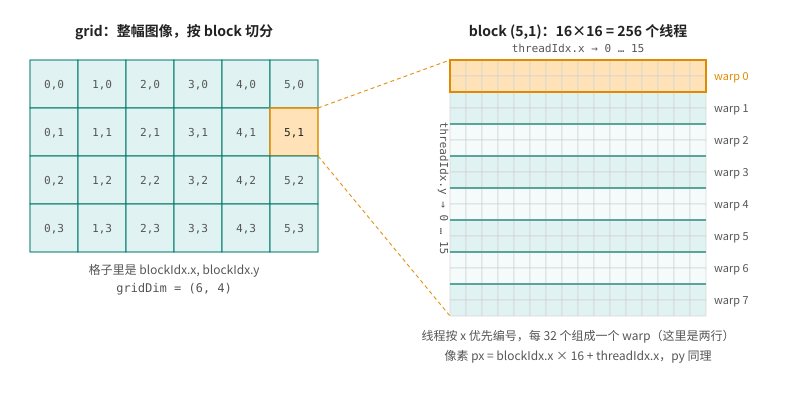

# 第 3 章 线程怎么分到数据上

前两章的数据都是一维数组，一个元素一个线程，下标就是 `blockIdx.x * blockDim.x + threadIdx.x`。但很多数据天生是二维或三维的：图像、矩阵、体数据。这一章先用一个二维的例子把 CUDA 的线程坐标讲清楚，再用实测回答一个每次写 kernel 都要面对的问题：block 该开多大、什么形状。最后讲两个和下标有关的坑。

## 3.1 一个像素一个线程

Mandelbrot 集合是复平面上的一个点集：对每个点 c，从 z = 0 开始反复计算 z = z² + c，如果 |z| 一直不超过 2，c 就属于这个集合。画图时，每个像素对应复平面上的一个点，迭代到 |z| 超过 2 为止，用迭代次数决定颜色。每个像素的计算完全独立，正好一个像素交给一个线程。

kernel 是这样的（完整程序 [mandelbrot.cu](code/ch03/mandelbrot.cu)）：

```cpp
{{#include code/ch03/mandelbrot.cu:kernel}}
```

和一维的写法相比，只是把下标拆成了两个方向：`px` 由 `x` 分量算出，是像素所在的列；`py` 由 `y` 分量算出，是像素所在的行。图像在内存里按行存放，第 `py` 行第 `px` 列的像素在 `img[py * width + px]`。

启动时，block 和 grid 都用 `dim3` 描述成二维的：

```cpp
{{#include code/ch03/mandelbrot.cu:launch}}
```

1920×1080 的图像，横向需要 120 个 block，纵向需要 68 个。68 × 16 = 1088，比 1080 多出 8 行，最下面一排 block 里有一半线程分不到像素，所以 kernel 开头要同时检查两个方向的边界。

运行结果：

```text
1920×1080，grid 120×68 个 block，每个 block 16×16 个线程
GPU 0.55 ms，CPU 单线程 576.0 ms，9115 个像素和 CPU 结果不同
```

<figure>

<figcaption>图 3.1：mandelbrot.cu 生成的图像，黑色部分属于 Mandelbrot 集合</figcaption>
</figure>

这是一个纯计算的 kernel，黑色区域里每个像素都要迭代满 512 次，GPU 比 CPU 单线程快了一千倍。

有意思的是最后那个数：有 9115 个像素（约 0.4%）和 CPU 算的颜色不一样，可两边执行的明明是同一个函数。原因在编译器：nvcc 默认会把 `x * x - y * y + cx` 这样的乘法和加法合并成一条 FMA（fused multiply-add）指令，中间结果不做舍入，结果和先乘后加差最后一位。Mandelbrot 的迭代会把这种微小差别放大，集合边界附近的点就可能在不同的迭代次数上逃逸。用 `-fmad=false` 关掉这种合并再编译：

```text
GPU 0.59 ms，CPU 单线程 574.2 ms，0 个像素和 CPU 结果不同
```

结果就逐像素一致了。哪个结果“更对”？其实 FMA 少一次舍入，通常更精确。GPU 和 CPU 浮点结果不一致的原因不止这一个，第 36 章会专门讨论。

## 3.2 grid、block、线程

把上面的例子抽象一下。一次 kernel 启动会创建一个 **grid**，grid 由许多 **block** 组成，每个 block 由许多**线程**组成。grid 和 block 都可以是一维、二维或三维的，kernel 里通过四个内置变量知道自己的位置：

- `gridDim`：grid 在每个方向上有几个 block；
- `blockIdx`：当前 block 在 grid 里的坐标；
- `blockDim`：block 在每个方向上有几个线程；
- `threadIdx`：当前线程在 block 里的坐标。

<figure>

<figcaption>图 3.2：grid 由 block 组成，block 由线程组成，线程按 x 优先编号，每 32 个组成一个 warp</figcaption>
</figure>

为什么要分两层，而不是直接给每个线程一个全局编号？因为这两层在硬件上的含义不同。

block 是分配给 SM 的单位。同一个 block 的线程一定在同一个 SM 上执行，所以它们能共享这个 SM 上的 shared memory，能用 `__syncthreads()` 互相等待（第 9 章）。不同的 block 之间则完全独立：它们以什么顺序执行、哪些同时执行，都不保证，一个 block 也不能等另一个 block。正因为 block 之间没有依赖，同一个程序在 26 个 SM 的笔记本 GPU 上和在一百多个 SM 的数据中心 GPU 上都能正确运行，只是同时跑的 block 数量不同。

block 内部的线程还有一层分组：硬件按 32 个线程一组来执行，这一组叫 **warp**。block 里的线程按 x 优先的顺序编号，`threadIdx.x` 变化最快，然后是 `y`，最后是 `z`，连续的 32 个组成一个 warp。16×16 的 block 里，每个 warp 是两行（图 3.2）。warp 是理解 GPU 性能的关键，第 6 章会细讲，下一节的实验已经能看到它的影响。

几个尺寸上限：一个 block 最多 1024 个线程，`x`、`y` 方向各不超过 1024，`z` 方向不超过 64；grid 的 `x` 方向最多 2³¹ − 1 个 block，`y`、`z` 方向各最多 65535 个。

## 3.3 block 该开多大、什么形状

Mandelbrot 用的是 16×16 的 block。换成别的形状会怎样？[shapes.cu](code/ch03/shapes.cu) 用一个更能说明问题的 kernel 来试：对一幅 8192×8192 的 `float` 图像做亮度变换，每个像素读一次、写一次，几乎不计算，速度完全取决于访存。

```cpp
{{#include code/ch03/shapes.cu:kernel}}
```

先固定每个 block 256 个线程，只改形状：

```text
每个 block 256 个线程，形状不同：
block 形状     时间      带宽
  256 × 1       1.59 ms    338 GB/s
  128 × 2       1.59 ms    337 GB/s
   64 × 4       1.59 ms    337 GB/s
   32 × 8       1.60 ms    335 GB/s
   16 × 16      1.67 ms    322 GB/s
    8 × 32      1.64 ms    327 GB/s
    4 × 64      1.72 ms    313 GB/s
    2 × 128     2.00 ms    268 GB/s
    1 × 256     3.63 ms    148 GB/s
```

只要 block 的 `x` 方向不少于 32，速度都一样；比 32 窄以后开始变慢，1×256 慢了一倍多。原因就在 warp：一个 warp 是 x 优先的连续 32 个线程。block 是 256×1 时，一个 warp 的 32 个线程处理同一行上相邻的 32 个像素，它们读的是内存里连续的 128 字节，硬件可以把 32 次读取合并成很少几次内存事务。block 是 1×256 时，一个 warp 的 32 个线程排成一列，处理 32 个不同行的像素，地址相隔整整一行（32 KB），32 次读取就是 32 个分散的位置。第 8 章会把这种“合并访问”量化清楚。现在只需要记住：**让 `threadIdx.x` 对应内存里连续的那个方向**。

再固定形状为一行，只改大小：

```text
形状都是“一行”，大小不同：
   32 × 1       3.13 ms    171 GB/s
   64 × 1       1.59 ms    338 GB/s
  128 × 1       1.58 ms    340 GB/s
  256 × 1       1.59 ms    338 GB/s
  512 × 1       1.61 ms    334 GB/s
 1024 × 1       2.17 ms    248 GB/s
```

64 到 512 个线程都一样快，两头却都慢了。这和第 1 章的结论有关：要跑满显存带宽，需要几万个线程同时在跑。一个 SM 能同时驻留多少线程，不只受 1536 个线程这个上限约束。[resident.cu](code/ch03/resident.cu) 用 CUDA 提供的占用率查询函数算了一下：

```cpp
{{#include code/ch03/resident.cu:query}}
```

```text
每个 SM 最多 24 个 block、1536 个线程

block 大小  每个 SM 驻留的 block  驻留的线程
      32              24               768
      64              24              1536
     128              12              1536
     256               6              1536
     512               3              1536
    1024               1              1024
```

每个 SM 最多驻留 24 个 block。block 只有 32 个线程时，24 个 block 加起来才 768 个线程，SM 有一半的线程位置空着；而且每个 block 只处理 32 个像素，两百万个小 block 排队上 SM，调度本身也成了负担。block 有 1024 个线程时，一个 SM 只放得下一个（两个就是 2048，超过 1536），驻留线程又只剩 1024 个。两种情况下全卡同时在跑的线程都不够多，带宽就上不去。“一个 SM 实际能驻留多少线程”有个专门的名字叫 occupancy，除了这里的两个限制，寄存器和 shared memory 的用量也会限制它，第 10 章会专门讨论。

所以 block 大小的经验值是 **128 或 256 个线程**，而且是 32 的倍数（否则最后一个 warp 有空位，白白浪费）。二维数据用 32×8、64×4 或 16×16 都可以，前提是 `x` 方向对应内存里连续的方向。

## 3.4 线程比数据少的时候

到目前为止都是“一个元素一个线程”。第 1 章的 threads.cu 用过另一种写法：只开固定数量的线程，每个线程循环处理多个元素，每次往后跳过整个 grid 的线程总数：

```cpp
{{#include code/ch01/threads.cu:copy}}
```

这种写法叫 grid-stride 循环。它的好处是 grid 的大小和数据量脱钩：不管 `n` 是一千还是十亿，都可以只开“SM 数 × 每个 SM 驻留的 block 数”这么多个 block，正好把 GPU 填满。每个线程的准备工作（比如算一些常量、把参数读进寄存器）也只做一次，摊到许多个元素上。数据量超过 grid 的上限时，它也不会出问题。

一个元素一个线程的写法更简单，数据量适中时两者速度差不多。后面的章节两种写法都会用到。

## 3.5 下标会溢出

`blockIdx.x * blockDim.x + threadIdx.x` 这几个内置变量都是 32 位无符号整数，乘积也是 32 位的。数组不超过 2³¹ 个元素时，用 `int` 存下标没问题；一旦超过，就会出错。8 GB 显存放 25 亿个字节绰绰有余，[overflow.cu](code/ch03/overflow.cu) 就分配了这么大的一个 `unsigned char` 数组，用两种下标各写一遍：

```cpp
{{#include code/ch03/overflow.cu:kernels}}
```

```text
$ ./overflow int
int 下标：最后一个字节 = 0
$ ./overflow size_t
size_t 下标：最后一个字节 = 1
```

`int` 版本没有崩溃，也没有报任何错，只是数组后面那 5 亿多个字节根本没有写。下标超过 2³¹ − 1 以后变成了负数，再和 `size_t` 类型的 `n` 比较时，负数被转换成一个巨大的无符号数，`i < n` 不成立，这些线程就直接跳过了。这种错误最难查，因为程序看上去一切正常。

数据可能超过 2³¹ 个元素时，下标一律用 `size_t`，而且要在乘法之前就转换成 64 位，像 `fill_size_t` 那样写 `size_t(blockIdx.x) * blockDim.x`。如果写成 `size_t i = blockIdx.x * blockDim.x + threadIdx.x;`，乘法仍然在 32 位里进行，超过 2³² 照样会溢出。

## 3.6 回头看

CUDA 用两层坐标描述线程：block 是分配给 SM 的单位，block 内的线程可以协作，block 之间互相独立；线程按 x 优先编号，每 32 个组成一个 warp。实际写 kernel 时：block 开 128 或 256 个线程；让 `threadIdx.x` 对应内存连续的方向；两个方向都要做边界检查；数据大时下标用 64 位。下一章看看 kernel 写完以后，nvcc 把它编译成了什么，以及第一次运行为什么有时会特别慢。

## 3.7 练习

1. 把 mandelbrot.cu 的 block 改成 32×8 和 8×32，各运行几次。时间有区别吗？这个 kernel 几乎不访存，和 shapes.cu 的结论对照一下。
2. 用 `./mandelbrot 7680 4320` 生成一张 8K 的图，看 GPU 时间增加了多少倍、CPU 时间增加了多少倍。
3. 把 shapes.cu 改写成 grid-stride 循环的形式，grid 固定为 26 × 6 个 block（每个 block 256 个线程），和一个像素一个线程的版本比较速度。
4. 在 overflow.cu 里加一个 `fill_wrong` kernel，下标写成 `size_t i = blockIdx.x * blockDim.x + threadIdx.x;`，预测它的输出，再运行验证。（提示：比较一下 `n` 和 2³² 的大小。要让这个 kernel 出错，数组至少要多大？8 GB 显存放得下吗？）
