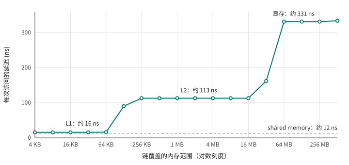

# 第 7 章 内存空间一览

到目前为止，kernel 读写的数据都来自 `cudaMalloc`，这种内存叫 global memory。kernel 里的局部变量放在哪里，没有细想过。实际上 GPU 有好几种存储空间，它们的速度、容量、谁能看见、活多久都不一样。写快的 kernel，很大程度上就是让数据待在合适的地方。这一章先把各种存储的速度量出来，再逐个介绍。

## 7.1 一次访存要等多久

量延迟的经典办法是指针追逐：在一块内存里把若干位置随机地串成一个环，每个位置存着下一个位置的下标，然后让一个线程沿着环一路读下去：

```cpp
{{#include code/ch07/latency.cu:chase}}
```

下一次读哪里，要等这一次读出来才知道，所以每次读取都不能和别的读取重叠，走一步的时间就是一次访存的延迟。环上的节点随机排列，硬件没法预取；相邻节点至少隔 128 字节，不会碰巧落在同一个缓存行里。改变环覆盖的内存范围，就能看出数据分别落在哪一级缓存上。完整程序是 [latency.cu](code/ch07/latency.cu)：

```text
范围          global 延迟
     4 KB      15.6 ns
     8 KB      15.6 ns
    16 KB      15.7 ns
    32 KB      15.8 ns
    64 KB      16.2 ns
   128 KB      90.4 ns
   256 KB     113.1 ns
   512 KB     113.1 ns
     1 MB     113.1 ns
     2 MB     113.1 ns
     4 MB     113.1 ns
     8 MB     113.1 ns
    16 MB     113.1 ns
    32 MB     162.3 ns
    64 MB     331.5 ns
   128 MB     331.5 ns
   256 MB     331.5 ns
   512 MB     334.0 ns

shared memory      11.9 ns
constant memory    42.3 ns
```

<figure>

<figcaption>图 7.1：指针追逐测出的访存延迟随数据范围变化，三级台阶分别是 L1、L2 和显存</figcaption>
</figure>

图 7.1 上有三级清楚的台阶：

- 64 KB 以内，约 16 ns。数据在 **L1 缓存**里。每个 SM 有自己的 L1，和下面要讲的 shared memory 共用同一块片上存储。
- 128 KB 到 16 MB，约 113 ns。数据在 **L2 缓存**里。L2 由所有 SM 共享，这块 GPU 上有 32 MB。到 32 MB 时开始有一部分访问落空，延迟升到 162 ns。
- 64 MB 以上，约 331 ns。数据要从**显存**里读，按运行时 2.8 GHz 的频率算，大约是 900 个时钟周期。

作为对比，CPU 的 L1 延迟大约是 1 纳秒，内存延迟一百纳秒左右。GPU 每一级都慢得多，这正是第 1 章和第 6 章讲的设计取舍：GPU 不在单个线程的延迟上花芯片面积，而是靠同时驻留大量 warp、轮流执行来掩盖延迟。

延迟慢，带宽却很高。[bandwidth.cu](code/ch07/bandwidth.cu) 用很多线程反复拷贝一块数据，数据量从 1 MB 加到 256 MB：

```text
每个数组      带宽
   1 MB     1183 GB/s
   2 MB     1494 GB/s
   4 MB     1708 GB/s
   8 MB     1841 GB/s
  16 MB     1402 GB/s
  32 MB      338 GB/s
  64 MB      336 GB/s
 128 MB      337 GB/s
 256 MB      336 GB/s
```

源数组和目标数组都放得进 L2 时，反复拷贝走的是 L2，带宽达到 1.8 TB/s，是显存的 5 倍多；超出 L2 容量后，就回到第 1 章测过的 337 GB/s。（1 MB 那一档偏低，是因为每次 kernel 只干一点点活，启动开销占了大头。）一个 kernel 的数据如果能在 L2 里反复使用，速度会快很多，第 23 章会介绍怎么让重要的数据更多地留在 L2 里。

## 7.2 寄存器和 local memory

kernel 里的局部变量，编译器会尽量放进寄存器。寄存器是最快的存储，读写几乎没有延迟，每个线程有自己的一份。这块 GPU 每个 SM 有 65536 个 32 位寄存器，由驻留在上面的所有线程分着用；一个线程最多能用 255 个。

寄存器不够用的时候，编译器只能把一部分变量挤到别处，这叫**寄存器溢出**（register spilling）。[spill.cu](code/ch07/spill.cu) 里有一段计算，48 个累加器在整个循环里互相依赖，都得一直留着：

```cpp
{{#include code/ch07/spill.cu:body}}
```

两个 kernel 的计算完全一样，区别只在 `__launch_bounds__`。它的第一个参数告诉编译器每个 block 最多有多少线程，第二个参数要求每个 SM 至少能同时驻留多少个这样的 block。`mix_tight` 要求同时驻留 6 个 256 线程的 block，也就是 1536 个线程，65536 个寄存器分下来，每个线程只能用 40 个出头。编译时加上 `-Xptxas -v`，ptxas 会报告每个 kernel 的资源使用情况（这里去掉了几行无关的信息）：

```text
$ nvcc -O2 -arch=native -Xptxas -v spill.cu -o spill
ptxas info    : Compiling entry function '_Z9histogramPKiPii' for 'sm_120'
ptxas info    : Function properties for _Z9histogramPKiPii
    128 bytes stack frame, 0 bytes spill stores, 0 bytes spill loads
ptxas info    : Used 18 registers, used 0 barriers, 128 bytes cumulative stack size
ptxas info    : Compiling entry function '_Z9mix_tightPKfPf' for 'sm_120'
ptxas info    : Function properties for _Z9mix_tightPKfPf
    96 bytes stack frame, 180 bytes spill stores, 180 bytes spill loads
ptxas info    : Used 40 registers, used 0 barriers, 96 bytes cumulative stack size
ptxas info    : Compiling entry function '_Z8mix_freePKfPf' for 'sm_120'
ptxas info    : Function properties for _Z8mix_freePKfPf
    0 bytes stack frame, 0 bytes spill stores, 0 bytes spill loads
ptxas info    : Used 56 registers, used 0 barriers
$ ./spill
mix_free     0.78 ms
mix_tight    5.05 ms
```

`mix_free` 用了 56 个寄存器，没有溢出。`mix_tight` 被限制在 40 个，ptxas 报告了 180 字节的 spill stores 和 spill loads：放不下的变量被存进了每个线程私有的 local memory，用的时候再读回来。结果慢了 6 倍多。

local memory 的名字有误导性：它是每个线程私有的，但物理上就在显存里，和 global memory 走同一条路，靠 L1 和 L2 缓存加速。从 7.1 节的数字看，命中 L1 也要 16 ns，比寄存器慢得多，更别说缓存放不下的时候了。

除了溢出，还有一种情况会用到 local memory：局部数组用运行时才知道的下标访问。spill.cu 的 `histogram` kernel 让每个线程在一个局部数组里统计直方图：

```cpp
{{#include code/ch07/spill.cu:dynamic}}
```

寄存器没有“第 k 个寄存器”这种寻址方式，下标在运行时才知道，数组只能放进 local memory。ptxas 的输出里，`histogram` 有 128 bytes stack frame，正好是 32 个 `int`。这一行不算 spill，但同样是在用 local memory。如果局部数组的下标在编译时就能确定（比如完全展开的循环），编译器通常能把它放进寄存器。

所以写完 kernel，用 `-Xptxas -v` 看一眼是个好习惯：寄存器用了多少，有没有 spill，有没有 stack frame。寄存器用得多也有代价：每个线程用的寄存器越多，一个 SM 能驻留的线程就越少，第 10 章会讨论这个取舍。

## 7.3 shared memory

shared memory 是每个 SM 上的一块片上存储，由驻留在这个 SM 上的 block 分着用，一个 block 里的线程共享同一份，不同 block 之间互相看不见，block 结束就消失。它和 L1 缓存共用同一块硬件，但由程序显式管理：放什么、什么时候放，都由代码决定。7.1 节测出它的延迟是 12 ns，比 L1 还快一点。

声明 shared memory 有两种写法。大小在编译时确定的，直接写 `__shared__ float tile[256];`，第 5 章的 `reverse_block` 就是这样。大小在启动时才确定的，用 `extern __shared__` 声明，大小由启动参数的第三项给出：

```cpp
{{#include code/ch07/latency.cu:shared}}
```

```cpp
{{#include code/ch07/latency.cu:launch_shared}}
```

这块 GPU 每个 SM 有 100 KB shared memory。一个 block 默认最多用 48 KB，要用更多，得先用 `cudaFuncSetAttribute` 为这个 kernel 申请，最多 99 KB。

shared memory 的典型用法是：一个 block 的线程合作，把一块数据从 global memory 搬进 shared memory，然后各自反复读其中的不同部分，省掉重复的 global 访问。因为是多个线程合作写、合作读，中间必须用 `__syncthreads()` 同步，否则就是第 5 章的数据竞争。第 9 章会用它优化矩阵转置，并讨论它特有的 bank conflict 问题。

## 7.4 constant memory

constant memory 是一块 64 KB 的只读存储，用 `__constant__` 声明，主机端用 `cudaMemcpyToSymbol` 填充：

```cpp
{{#include code/ch07/constant.cu:decl}}
```

```cpp
{{#include code/ch07/constant.cu:copy}}
```

它物理上也在显存里，但有专门的缓存。这个缓存有个特点：一个 warp 读同一个地址时，一次就能把值广播给 32 个线程；读不同地址时，要一个地址一个地址地依次处理。[constant.cu](code/ch07/constant.cu) 用一张 256 项的系数表算多项式，分别放在 constant memory 和 global memory 里，再分别让同一时刻所有线程读同一个系数、或者各读各的系数：

```cpp
{{#include code/ch07/constant.cu:kernels}}
```

```text
                 同一个系数   各读各的
constant memory     0.15 ms     4.41 ms
global memory       0.17 ms     0.16 ms
```

所有线程读同一个系数时，constant memory 最快；各读各的时，它慢了将近 30 倍，正是一个 warp 的 32 个不同地址被依次处理的结果。同一张表放在 global memory 里，两种读法都差不多快：L1 缓存可以同时服务一个 warp 里的多个不同地址。（global 版本的参数写成了 `const float* __restrict__`，告诉编译器这块内存在 kernel 执行期间只读、不会通过别的指针被修改，编译器可以放心地走只读缓存的路径。）

所以 constant memory 只适合一种用法：数据量小，而且同一个 warp 的线程总是同时读同一个位置，比如所有线程共用的参数、按相同顺序遍历的系数。kernel 的参数本身也放在 constant memory 里，第 4 章的 SASS 里那些 `c[0x0][...]` 就是。指针追逐那一项测出 42 ns，也说明 constant 缓存很小，随机访问 16 KB 的数据就已经大量落空了。

## 7.5 global memory

global memory 就是 `cudaMalloc` 分配的显存，所有线程都能读写，主机可以用 `cudaMemcpy` 访问，一直存在到 `cudaFree`。所有访问都经过 L2，读取默认还会经过 L1。它容量最大（8 GB），延迟最长（331 ns），带宽在用足够多的线程时能达到 337 GB/s（第 1 章）。

global memory 的性能，除了取决于数据在哪一级缓存里，还很大程度上取决于一个 warp 的 32 个线程访问的地址是什么样子。第 3 章已经看到，同一个 kernel 换一种 block 形状就慢了一倍多。下一章专门讨论这个问题。

还有两种历史比较长的存储方式：texture 和 surface。它们走专门的硬件路径，能做硬件插值、自动处理越界坐标，在图像处理里有时还有用；对于一般的数据访问，global memory 加缓存已经足够好，本书不展开讨论。

## 7.6 回头看

把本章测到的数字放在一起：

| 存储 | 谁能看见 | 活多久 | 这块 GPU 上的容量 | 实测延迟 |
|---|---|---|---|---|
| 寄存器 | 一个线程 | 线程 | 每 SM 64K 个 | 几乎为零 |
| local memory | 一个线程 | 线程 | 在显存里 | 同 global（经缓存） |
| shared memory | 一个 block | block | 每 SM 100 KB | 12 ns |
| constant memory | 所有线程，只读 | 程序 | 64 KB | 广播时快，分散时慢 |
| L1 缓存 | 一个 SM | 自动管理 | 与 shared memory 共用 | 16 ns |
| L2 缓存 | 所有 SM | 自动管理 | 32 MB | 113 ns |
| global memory | 所有线程和主机 | 到 `cudaFree` | 8 GB | 331 ns |

越快的存储越小，范围也越窄。性能优化的很多手段，归根到底是让频繁使用的数据待在更快的那一层：用寄存器而不是 local memory，用 shared memory 缓存反复读的数据，让工作集能放进 L2。

## 7.7 练习

1. 把 latency.cu 的 `chase_global` 改成用一个 warp（`<<<1, 32>>>`）启动，每个线程从链上不同的起点出发（比如第 `threadIdx.x * 1000` 个节点），各追各的。在 256 MB 的范围上，每一步的时间会变成多少？32 个线程加起来每秒完成的访问次数又是多少？这说明了延迟和吞吐的什么关系？
2. 把 spill.cu 里 `mix_tight` 的 `__launch_bounds__(256, 6)` 依次改成 `(256, 4)` 和 `(256, 5)`，看 ptxas 报告的寄存器数和 spill 量怎么变，时间怎么变。
3. 在 constant.cu 里加一种读法：`j = (k + threadIdx.x / 16) % TERMS`，也就是每半个 warp 读同一个系数。constant memory 版本会慢多少？先预测再运行。
4. 用 `-Xptxas -v` 编译第 6 章的 sorting.cu，看看 `process` kernel 用了多少寄存器。
