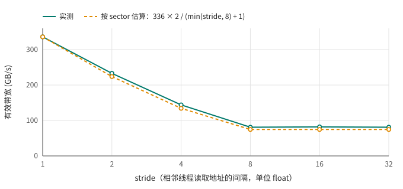

# 第 8 章 合并访问

第 3 章的 shapes 实验里，同一个 kernel 只是把 block 从 256×1 换成 1×256，就慢了一倍多。当时的解释是：一个 warp 的 32 个线程读的是连续的 128 字节时，硬件可以把它们合并成很少几次内存访问；地址分散时就不行。这一章把“合并”到底是怎么回事量清楚，并给出一个能预测带宽的简单算法。

## 8.1 相邻线程隔得越远越慢

[stride.cu](code/ch08/stride.cu) 让第 `i` 个线程读 `in[i * stride]`，写 `out[i]`：

```cpp
{{#include code/ch08/stride.cu:kernels}}
```

`stride` 为 1 时，相邻线程读相邻的 `float`；为 2 时，隔一个读一个；依此类推。每种情况下读写的元素个数一样，都是 1600 多万个，所以“有效带宽”统一按程序真正需要的字节数计算：读 n 个 `float`、写 n 个 `float`。数据量超过了 32 MB 的 L2，量到的是显存的速度。

```text
stride   时间      有效带宽
    1   0.399 ms     336 GB/s
    2   0.577 ms     233 GB/s
    4   0.929 ms     144 GB/s
    8   1.652 ms      81 GB/s
   16   1.646 ms      82 GB/s
   32   1.652 ms      81 GB/s
```

stride 从 1 变成 2，有效带宽就掉了三分之一；到 8 以后掉到四分之一以下，然后不再变化。为什么正好在 8 停住？

## 8.2 显存按 sector 搬运

GPU 从显存读数据，最小的单位不是一个字节，也不是一个 `float`，而是 32 字节，叫一个 **sector**。四个相邻的 sector 组成一个 128 字节的缓存行。一个 warp 执行一条读指令时，硬件先算出 32 个线程的地址都落在哪些 sector 里，然后只搬这些 sector，每个 sector 搬一次。

- stride 为 1：32 个线程读连续的 128 字节，正好 4 个 sector，每个字节都有用。
- stride 为 2：32 个线程的地址跨了 256 字节，要搬 8 个 sector，其中一半的字节没人要。
- stride 为 8：相邻线程隔 32 字节，每个线程独占一个 sector，32 个线程要搬 32 个 sector，每个 sector 里只有 4 个字节有用。
- stride 再大，还是每个线程一个 sector，搬的量不再增加。所以曲线在 8 以后变平。

用 ncu 可以直接看到每个 warp 请求实际要搬几个 sector：

```bash
ncu --metrics l1tex__t_sectors_pipe_lsu_mem_global_op_ld.sum,l1tex__t_requests_pipe_lsu_mem_global_op_ld.sum -k read_strided ./stride
```

两个指标相除：

```text
stride  每个 warp 请求读到的 sector 数
    1     4.0
    2     8.0
    4    16.0
    8    32.0
   16    32.0
   32    32.0
```

和上面的分析一模一样。这就是**合并访问**（coalesced access）的含义：一个 warp 访问的地址越集中，需要搬的 sector 越少，有用字节的比例越高。

有了这个模型就能预测带宽。这个 kernel 的写总是合并的，只有读是跨步的。stride 为 2 时，读要搬 2 倍的数据，写 1 倍，总共是理想情况的 3/2，有效带宽应该是 336 × 2/3 ≈ 224 GB/s；stride 为 4 时是 336 × 2/5 ≈ 134 GB/s；stride 不小于 8 时是 336 × 2/9 ≈ 75 GB/s。图 8.1 把预测和实测画在一起：

<figure>

<figcaption>图 8.1：跨步读取的有效带宽：实测值和按 sector 数估算的值</figcaption>
</figure>

预测和实测几乎重合。分析一个访存为主的 kernel 时，可以按这个思路估算：数一数每个 warp 每次访问要搬几个 sector，乘上访问次数，得到实际搬运的字节数，除以 336 GB/s 就是时间的下限。

## 8.3 地址对齐还重要吗

还有一种常被提起的情况：地址整体不对齐。stride.cu 的第二组实验让第 `i` 个线程读 `in[i + offset]`：

```text
offset   时间      有效带宽
    0   0.399 ms     336 GB/s
    1   0.401 ms     335 GB/s
    2   0.401 ms     335 GB/s
    4   0.401 ms     335 GB/s
    8   0.401 ms     335 GB/s
   16   0.402 ms     333 GB/s
   32   0.401 ms     335 GB/s
```

完全没有影响。错开一个 `float` 以后，一个 warp 的 128 字节会跨 5 个 sector 而不是 4 个，多搬一个；但相邻 warp 正好要用这个多出来的 sector，它已经在缓存里了，整体上几乎没有浪费。很早以前的 GPU 对对齐非常敏感，现在的硬件以 sector 为单位、又有 L1 和 L2 缓存，整体错位已经不是问题。真正要紧的是 8.1 节那种相邻线程之间的间隔。

## 8.4 数据布局：结构体数组还是数组结构体

跨步访问最常见的来源是数据布局。比如一组粒子，每个粒子有位置、速度、质量、电荷 8 个字段。最自然的写法是定义一个结构体，然后开一个结构体数组，这叫 AoS（array of structures）。另一种写法是每个字段一个数组，叫 SoA（structure of arrays）。[layout.cu](code/ch08/layout.cu) 两种都写了：

```cpp
{{#include code/ch08/layout.cu:layouts}}
```

两个 kernel，一个按速度移动粒子，用到 8 个字段中的 6 个；一个统计质量超过阈值的粒子，只用到质量这一个字段：

```cpp
{{#include code/ch08/layout.cu:kernels}}
```

1600 多万个粒子，每个字段数组 64 MB：

```text
            AoS        SoA
drift     3.18 ms    1.74 ms
heavy     1.45 ms    0.23 ms
```

AoS 布局下，`p[i].mass` 是一次 stride 为 8 的访问：相邻线程的 `mass` 隔着 32 字节，正好是一个粒子的大小，每个线程独占一个 sector。统计质量只需要读 64 MB，AoS 却要把整个 512 MB 的结构体数组全读一遍，所以慢了 6 倍多。

drift 用到了 6 个字段，AoS 浪费得少一些，但仍然慢了 1.8 倍。按 sector 算一下：SoA 读 6 个数组、写 3 个数组，一共 576 MB，1.74 ms，合 331 GB/s，跑满了带宽。AoS 每个粒子正好占一个 sector，读要把 512 MB 全读进来，写回 `x`、`y`、`z` 时每个 sector 也都被改动了，又要写回 512 MB，一共约 1 GB，3.18 ms 正好对得上。

所以在 GPU 上，频繁按字段处理的数据通常用 SoA 布局。这和 CPU 上的习惯不太一样：CPU 一次处理一个粒子的所有字段，AoS 的局部性很好；GPU 是 32 个线程同时处理 32 个粒子的同一个字段，SoA 才能让这 32 次访问落在连续的地址上。

两者之间还有一种折中叫 AoSoA：把粒子按 32 个一组，组内用 SoA，组和组之间用 AoS。另一种常见的做法是把经常一起用的几个字段打包成 `float4` 这样的向量类型，一个线程一次读 16 字节，第 1 章的练习里用过。

## 8.5 读和写不能兼顾的时候

到目前为止的例子里，只要换个布局或者换个下标写法，就能让读和写都合并。但有些计算天生做不到。最典型的是矩阵转置：`out[x][y] = in[y][x]`。让相邻线程处理 `in` 的同一行里相邻的元素，读是合并的，可写的时候它们写到 `out` 的同一列，地址相隔一整行，这就是 stride 为矩阵宽度的跨步写；反过来让写合并，读就跨步了。这种情况需要先把数据搬进 shared memory，在片上调换顺序，下一章就来解决它。

## 8.6 回头看

显存以 32 字节的 sector 为单位搬运数据。一个 warp 的一次访问要搬多少个 sector，取决于 32 个线程的地址有多集中：连续的 128 字节只要 4 个，完全分散时要 32 个。数一数 sector，就能相当准确地预测一个访存为主的 kernel 能跑多快。实际写代码时，让 `threadIdx.x` 对应内存连续的方向（第 3 章），频繁按字段处理的数据用 SoA 布局；整体的地址错位在现在的 GPU 上已经不是问题。

## 8.7 练习

1. 把 stride.cu 的 `read_strided` 改成读合并、写跨步：`out[size_t(i) * stride] = in[i]`。按 sector 模型预测各个 stride 的带宽，再运行验证。（写的时候还要注意：只改了一个 sector 里的 4 个字节，整个 sector 都得写回。）
2. 用 ncu 量一下 layout.cu 里 `heavy_aos` 和 `heavy_soa` 每个 warp 请求读到的 sector 数，和 8.4 节的分析对照。
3. 给 layout.cu 加一种布局：把位置打包成一个 `float4` 数组（`x, y, z` 加一个空位），速度也打包成一个 `float4` 数组，重写 `drift`。它和 SoA 比谁快？
4. 第 3 章 shapes 实验里，block 为 1×256 时带宽是 148 GB/s，比 stride 为 8 时的 81 GB/s 高不少，可那里每个线程也是隔着一整行访问的。为什么？（提示：想一想横向相邻的 block 在做什么，以及它们会不会碰到同一个 sector。）
