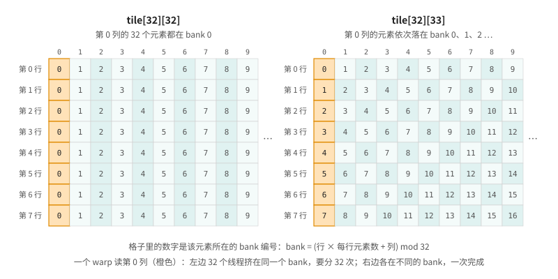

# 第 9 章 shared memory：矩阵转置与 bank conflict

上一章结尾留了一个问题：矩阵转置 `out[x][y] = in[y][x]` 没法让读和写同时合并。这一章用 shared memory 解决它，顺便认识 shared memory 特有的性能问题 bank conflict。完整程序是 [transpose.cu](code/ch09/transpose.cu)，它可以用命令行参数指定矩阵的边长。

## 9.1 朴素的转置

每个 block 负责矩阵里 32×32 的一块。block 是 32×8 个线程，每个线程处理同一列上相隔 8 行的 4 个元素，这是转置常用的分工方式：block 小一些，每个线程多干一点活。先写一个不转置、只拷贝的版本作为参照，它的读和写都是合并的，代表这种访问方式能达到的上限：

```cpp
{{#include code/ch09/transpose.cu:copy}}
```

朴素的转置只是把写的下标行列对调：

```cpp
{{#include code/ch09/transpose.cu:naive}}
```

一个 warp 是 `threadIdx.x` 从 0 到 31 的 32 个线程，它们读 `in` 同一行上相邻的 32 个元素，是合并的；写的时候 `x` 成了行号，32 个线程写到 `out` 的 32 个不同行，地址相隔整整一行。分别在 2048×2048 和 8192×8192 的矩阵上运行：

```text
2048×2048
copy (参照)          0.026 ms   1313 GB/s
transpose_naive        0.134 ms    251 GB/s
transpose_tiled<0>     0.079 ms    423 GB/s
transpose_tiled<1>     0.027 ms   1225 GB/s

8192×8192
copy (参照)          1.587 ms    338 GB/s
transpose_naive        2.021 ms    266 GB/s
transpose_tiled<0>     1.660 ms    323 GB/s
transpose_tiled<1>     1.679 ms    320 GB/s
```

后两行先不管。2048×2048 的矩阵每个只有 16 MB，输入和输出都能留在 L2 里，拷贝跑出了 1.3 TB/s 的 L2 带宽，朴素转置却只有它的五分之一。用 ncu 量一下写操作（第 8 章的 sector 指标，换成写的版本 `l1tex__t_sectors_pipe_lsu_mem_global_op_st.sum` 和 `l1tex__t_requests_pipe_lsu_mem_global_op_st.sum`），朴素转置每个写请求要动 32 个 sector，拷贝只要 4 个，和上一章分析的一样。

8192×8192 的矩阵有 256 MB，拷贝被显存带宽卡在 338 GB/s，朴素转置只慢了 20% 多一点，没有想象中那么糟。这是因为 L2 在帮忙：同一个 block 的各个 warp 写的是同一批 sector 的不同部分，它们先在 L2 里拼完整，再一起写回显存。不过 20% 仍然是值得拿回来的。

## 9.2 在 shared memory 里调换顺序

思路是把转置分两步做。第一步，block 按行把 32×32 的一块读进 shared memory，这一步读 global memory 是合并的；第二步，按列从 shared memory 里取数据，按行写到输出矩阵的对应位置，这一步写 global memory 也是合并的。行列的调换发生在 shared memory 里，那里没有 sector 的问题。

```cpp
{{#include code/ch09/transpose.cu:tiled}}
```

（模板参数 `PAD` 先当它是 0，下一节再说。）

两步之间的 `__syncthreads()` 必不可少。它让 block 里的所有线程在这里会合，等所有线程都执行到这一行，才一起往下走。第二步里每个线程读的是 `tile` 的一列，这一列是别的线程在第一步写进去的，没有这道同步，就会读到还没写的位置，正是第 5 章 racecheck 抓到的那种数据竞争。

使用 `__syncthreads()` 有一条硬性规定：block 里的所有线程都必须执行到同一个 `__syncthreads()`。如果把它放在只有一部分线程会进入的 `if` 里，结果是未定义的，可能卡死，也可能悄悄出错。compute-sanitizer 的 synccheck 工具（`--tool synccheck`）可以检查这类问题。

看结果里 `transpose_tiled<0>` 那一行：在 8192×8192 上，它几乎追上了拷贝；可在 2048×2048 上只有 423 GB/s，比朴素版本好，离拷贝的 1313 GB/s 还差得远。数据都在 L2 里时，瓶颈转移到了 shared memory 本身。

## 9.3 bank conflict

shared memory 被分成 32 个 **bank**，每个 bank 每个周期能读写一个 4 字节的字。地址连续的 4 字节字依次落在相邻的 bank 上：第 0 个字在 bank 0，第 1 个在 bank 1，……，第 32 个又回到 bank 0。一个 warp 访问 shared memory 时，如果 32 个线程访问的字分别在 32 个不同的 bank 上，一次就能完成；如果有几个线程访问同一个 bank 的不同字，这几次访问只能依次进行，这叫 **bank conflict**。（多个线程读同一个字不算冲突，硬件会把它广播给所有线程。）

再看 `transpose_tiled` 的第二步：`tile[threadIdx.x][threadIdx.y + j]`。一个 warp 里 `threadIdx.x` 从 0 到 31 变化，32 个线程读的是 `tile` 同一列的 32 个元素。`tile` 每行 32 个 `float`，同一列上下相邻的两个元素正好隔 32 个字，落在同一个 bank 上。32 个线程全挤在一个 bank 里，要分 32 次才能读完，这是最坏的 32 路冲突（图 9.1 左）。

<figure>

<figcaption>图 9.1：每行 32 个元素时同一列都在同一个 bank，每行 33 个元素时同一列依次落在不同的 bank</figcaption>
</figure>

解决办法简单得出奇：把 `tile` 声明成 32×33，每行多一个不用的元素。这样同一列上下相邻的元素隔 33 个字，第 r 行第 c 列落在 bank (r + c) mod 32，一列的 32 个元素正好分布在 32 个不同的 bank 上（图 9.1 右）。第一步按行写 `tile` 时，一行的 32 个元素本来就在不同的 bank 上，加了一列也不受影响。模板参数 `PAD` 就是这多出来的一列，`transpose_tiled<1>` 是加了 padding 的版本。

用 ncu 看两个版本读 shared memory 的情况（指标是 `l1tex__data_bank_conflicts_pipe_lsu_mem_shared_op_ld.sum` 和 `l1tex__data_pipe_lsu_wavefronts_mem_shared_cmd_read.sum`，wavefront 是 shared memory 实际处理的轮数），一并列出写 global memory 时每个请求的 sector 数：

```text
kernel                   写 global：每请求 sector 数   读 shared 的 bank conflict   读 shared 的 wavefront
copy                            4.0                0                0
transpose_naive                32.0                0                0
void transpose_tiled<0>         4.0        4,073,591        4,205,444
void transpose_tiled<1>         4.0              182          131,282
```

2048×2048 的矩阵有 419 万个元素，每个 warp 读一次 shared memory 取 32 个元素，一共是 13 万次读请求。加了 padding 以后，13 万次请求正好 13 万个 wavefront，一次完成；不加 padding 时是 420 万个 wavefront，每次请求分了 32 轮。回到 9.1 节的计时，加了 padding 的 `transpose_tiled<1>` 在 2048×2048 上跑到了 1225 GB/s，基本追上了拷贝。

## 9.4 优化有没有用，要看瓶颈在哪

把 9.1 节的结果再看一遍，两种矩阵大小给出了不同的结论：

- 2048×2048，数据在 L2 里：朴素转置比拷贝慢 5 倍，消除 bank conflict 又快了将近 3 倍，每一步优化都很关键。
- 8192×8192，数据在显存里：朴素转置只慢 20%，分块之后就接近拷贝，padding 已经看不出任何差别。

这不是说 bank conflict 在大矩阵上不存在，ncu 照样能数出几百万次冲突。只是这时 kernel 被显存带宽卡住，shared memory 那边多花的时间被等显存的时间盖住了。同一个优化，在一种情况下立竿见影，在另一种情况下毫无作用。所以优化之前要先弄清楚 kernel 卡在哪里，这正是第 12 章要讲的方法。

## 9.5 shared memory 还能做什么

矩阵转置用 shared memory 来调换访问顺序。更常见的用法是**数据复用**：同一份数据要被 block 里的很多线程反复读，就先合作读进 shared memory 一次，然后大家从 shared memory 里读。图像卷积里，每个像素的邻域被周围好多个线程用到；矩阵乘法里，A 的一行和 B 的一列要和很多元素相乘。第 11 章的归约则用 shared memory 让 block 里的线程交换部分结果。

使用 shared memory 时要记住几点：

- 一个 block 默认最多用 48 KB（第 7 章），用得越多，一个 SM 能同时驻留的 block 就越少，第 10 章会算这笔账。
- 合作读写 shared memory 时用 `__syncthreads()` 同步，并保证 block 里的所有线程都执行到它。
- 让一个 warp 的 32 个线程访问不同的 bank。二维数组按列访问时，加一列 padding 是最常用的办法。

## 9.6 回头看

shared memory 是 block 内线程共享的片上存储，可以用来在片上调换数据的访问顺序，让 global memory 的读和写都合并。它分成 32 个 bank，同一个 warp 的线程访问同一个 bank 的不同字时要依次处理；按列访问 32 列宽的二维数组时会出现最坏的 32 路冲突，加一列 padding 就能消除。矩阵转置的例子还说明，一项优化有多大作用取决于 kernel 的瓶颈：数据在 L2 里时，每一步优化都看得见；被显存带宽卡住时，有些优化就看不出效果。

## 9.7 练习

1. 把 `transpose_tiled` 的 `PAD` 换成 2、4、8，用 ncu 数 bank conflict。哪些值能消除冲突，哪些不能？用 bank = (行 × 每行元素数 + 列) mod 32 解释。
2. 去掉 `transpose_tiled` 里的 `__syncthreads()`，用 compute-sanitizer 的 racecheck 跑一遍，再看看结果检查能不能发现错误。
3. 把 block 改成 32×32（每个线程只处理 1 个元素，`ROWS` 改成 32），在两种矩阵大小上比较速度。结合第 3 章 resident.cu 的输出解释结果。
4. 写一个 3×3 均值滤波的 kernel：先不用 shared memory，每个线程直接从 global memory 读 9 个邻居；再写一个版本，block 先把自己负责的区域连同一圈边框读进 shared memory。在 8192×8192 的图像上比较两者的速度，再用 ncu 看看朴素版本读 global memory 时 L1 的命中率（指标 `l1tex__t_sector_hit_rate.pct`），解释为什么差距可能没有想象中大。
