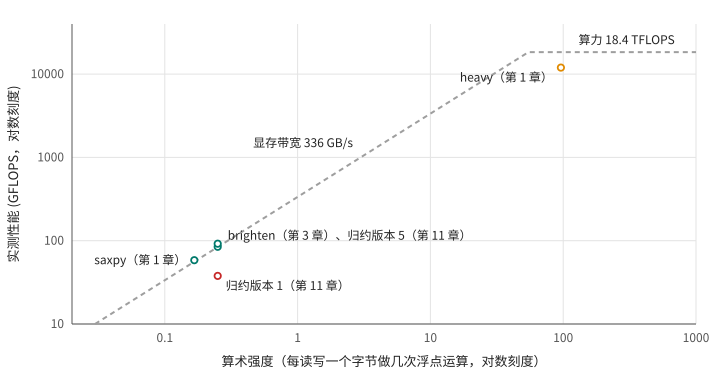

# 第 12 章 用 Nsight Compute 找瓶颈

第二部分的前几章，我们都是先猜一个原因，再设计实验验证：猜是访存不合并，就改成合并的看看；猜是 occupancy 不够，就人为限制它看看。这个办法能把道理讲清楚，但在真实的代码上效率太低。Nsight Compute 能直接读出 GPU 的硬件计数器，告诉你一个 kernel 离各项硬件上限还有多远、warp 都在等什么、时间花在哪一行代码上。第 6、8、9、11 章已经零星用过它，这一章把用法系统地讲一遍。

练习用的程序是 [cases.cu](code/ch12/cases.cu)，里面有四个 kernel，各代表一类典型的瓶颈：

```cpp
{{#include code/ch12/cases.cu:kernels}}
```

编译时带上 `-lineinfo`，后面才能把问题定位到源码行（第 4 章说过，它不影响性能）。

## 12.1 先找到该看的 kernel

真实的程序里有很多 kernel，优化之前要先知道时间主要花在哪个上面。这一步用 Nsight Systems：

```bash
nsys profile -o cases ./cases
nsys stats --report cuda_gpu_kern_sum cases.nsys-rep
```

```text
 ** CUDA GPU Kernel Summary (cuda_gpu_kern_sum):
 Time (%)  Total Time (ns)  Instances  Avg (ns)   Med (ns)   Min (ns)  Max (ns)  StdDev (ns)                           Name                         
 --------  ---------------  ---------  ---------  ---------  --------  --------  -----------  ------------------------------------------------------
     47.1          3824624          1  3824624.0  3824624.0   3824624   3824624          0.0  latency_bound(const float *, float *, unsigned long)  
     24.4          1978184          1  1978184.0  1978184.0   1978184   1978184          0.0  sync_bound(const float *, int, float *)               
     20.6          1673862          1  1673862.0  1673862.0   1673862   1673862          0.0  bandwidth_bound(const float *, float *, unsigned long)
      7.8           636771          1   636771.0   636771.0    636771    636771          0.0  compute_bound(float *)
```

按总时间排序，每个 kernel 被调用了几次、平均多久，一目了然。（这里每个 kernel 只调用了一次。）真实的程序里，常常是一两个 kernel 占了大部分时间，先盯住它们。第 13 章的时间线图也是 Nsight Systems 画的，它更擅长看整个程序：kernel 之间有没有空隙、拷贝和计算有没有重叠。看单个 kernel 内部，就轮到 Nsight Compute 了。

## 12.2 Speed of Light：离上限还有多远

Nsight Compute 的命令行工具是 `ncu`。它会把程序里的每个 kernel 单独重复运行若干遍，每遍收集一部分计数器。`--section` 选择要收集的内容，第一个要看的是 SpeedOfLight：

```bash
ncu --section SpeedOfLight --section WarpStateStats ./cases
```

`bandwidth_bound` 的报告是这样的：

```text
  bandwidth_bound(const float *, float *, unsigned long) (156, 1, 1)x(256, 1, 1), Context 1, Stream 7, Device 0, CC 12.0
    Section: GPU Speed Of Light Throughput
    ----------------------- ----------- ------------
    Metric Name             Metric Unit Metric Value
    ----------------------- ----------- ------------
    DRAM Frequency                  Ghz        11.99
    SM Frequency                    Ghz         1.54
    Elapsed Cycles                cycle      2536287
    Memory Throughput                 %        83.35
    DRAM Throughput                   %        83.35
    Duration                         ms         1.64
    L1/TEX Cache Throughput           %        31.59
    L2 Cache Throughput               %        26.44
    SM Active Cycles              cycle   2480793.92
    Compute (SM) Throughput           %        12.77
    ----------------------- ----------- ------------
```

“Speed of Light”的意思是理论上限，这一节的每个百分比都是“实际吞吐占该部件理论峰值的比例”。最重要的是两个汇总值：**Memory Throughput** 是显存、L2、L1 等各级存储中利用率最高的那一个；**Compute (SM) Throughput** 是 SM 内各个运算和发射单元中利用率最高的那一个。这里显存用到了 83%，算力只用了 13%，结论很清楚：这个 kernel 受显存带宽限制。83% 也基本到头了，第 1 章测出的最高带宽 336 GB/s 是理论值 384 GB/s 的 87% 左右。

注意报告里的 SM Frequency 是 1.54 GHz，而正常运行时是 2.8 GHz 左右。ncu 默认把 GPU 锁在基础频率上，让多次重复运行的结果可以比较。所以 ncu 报告的时长会比平时长，计算为主的 kernel 尤其明显：`compute_bound` 在 ncu 下是 1.04 ms，上面 nsys 量到的是 0.64 ms。要和平时的计时对照，可以加上 `--clock-control none`。

四个 kernel 的 Speed of Light 放在一起：

```text
kernel            Memory   DRAM   L1/TEX    L2   Compute(SM)
bandwidth_bound    83.3%  83.3%   31.6%  26.4%    12.8%
latency_bound      28.7%  28.7%   10.9%   9.1%     4.4%
compute_bound       0.2%   0.0%    0.2%   0.2%    98.9%
sync_bound         90.8%  22.6%   90.9%  11.2%    90.8%
```

四种典型的情况：

- **受带宽限制**（`bandwidth_bound`）：某一级存储的利用率很高。要提速只能少搬数据，或者换到更快的那一级存储。
- **受算力限制**（`compute_bound`）：Compute 接近 100%。要提速只能减少计算量，或者换用更快的指令（比如第 36 章会提到的快速数学函数）。
- **两样都不高**（`latency_bound`）：存储和计算都闲着，说明 kernel 没能给硬件喂饱足够多的工作，通常是并行度不够，或者依赖链太长。这种情况叫受延迟限制，是最常见、也最值得优化的一种。第 10 章的办法（提高 occupancy、增加指令级并行）就是对付它的。
- `sync_bound` 的显存只用了 22.6%，但 L1/TEX 和 Compute 都超过 90%。L1/TEX 这一项包括 shared memory，这个 kernel 忙于在 shared memory 里来回读写、执行大量的指令，正是第 11 章分析的情况。

## 12.3 warp 在等什么

Speed of Light 告诉你是哪一类瓶颈，WarpStateStats 进一步告诉你 warp 在等什么。第 6 章说过，每个周期调度器从准备好的 warp 里挑一个发射指令；没被挑中、或者还没准备好的 warp，都在“停顿”。ncu 统计了每发射一条指令，平均有多少个周期的停顿，以及停顿的原因。原始指标的名字很长（`smsp__average_warps_issue_stalled_<原因>_per_issue_active.ratio`），把四个 kernel 最主要的三项整理出来：

```text
bandwidth_bound  每发射一条指令平均等  161.4 个周期；最多的三项：long_scoreboard 156.1，wait 3.6，selected 1.0
latency_bound    每发射一条指令平均等   78.4 个周期；最多的三项：long_scoreboard 73.3，wait 3.6，selected 1.0
compute_bound    每发射一条指令平均等   11.4 个周期；最多的三项：not_selected 10.1，selected 1.0，math_pipe_throttle 0.3
sync_bound       每发射一条指令平均等   20.4 个周期；最多的三项：long_scoreboard 4.8，short_scoreboard 4.6，barrier 3.5
```

几个常见的停顿原因：

- **long_scoreboard**：在等 L1/TEX 返回的数据，也就是 global memory 或 local memory 的读取。访存为主的 kernel 里它总是最大的一项。两个拷贝 kernel 的区别不在停顿原因上，而在于有没有足够多的 warp 在同时等：`bandwidth_bound` 每个 warp 等得更久（161 个周期），因为显存已经满负荷，请求要排队；可它有 6 倍的 warp 在同时等，总的吞吐反而高得多。
- **short_scoreboard**：在等 shared memory 这类片上存储的结果。
- **barrier**：停在 `__syncthreads()`，等同一个 block 里别的 warp 到齐。
- **wait**：在等一条延迟固定的指令（比如乘加）的结果，依赖链长的代码里比较多。
- **not_selected**：warp 已经准备好了，只是这个周期调度器选了别的 warp。它是 `compute_bound` 最大的一项，说明准备好的 warp 多得是，调度器每个周期都有活可发，发射能力已经用满了。这是好事。
- **math_pipe_throttle**：运算单元忙不过来，指令在排队。

`latency_bound` 和 `bandwidth_bound` 的停顿原因几乎一样，单看这一节分不出来，要结合 Speed of Light 一起看：同样是在等显存，显存却只忙了 28.7%，问题就在于同时在等的请求太少。

## 12.4 时间花在哪一行

知道了瓶颈的类型，最后一步是找到对应的代码。`SourceCounters` 一节会按 SASS 指令统计执行次数和停顿采样数，加上 `-lineinfo` 编译出的行号信息，就能汇总到源码的每一行。命令行下可以先把结果存成报告文件，再按源码页面导出：

```bash
ncu --section SourceCounters --import-source yes -k sync_bound -o sync ./cases
ncu -i sync.ncu-rep --page source --csv --print-source cuda,sass > sync.csv
```

导出的表格里每一行源码都有一列 “Warp Stall Sampling (All Samples)”，即在这一行的指令上采样到 warp 停顿的次数。把 `sync_bound` 的整理出来：

```text
 行  停顿采样   占比   源码
 45      375    0.3%  __global__ void sync_bound(const float* in, int n, float* out) {
 47     4401    3.6%  int t = threadIdx.x, i = blockIdx.x * blockDim.x + t;
 48    36326   29.5%  s[t] = i < n ? in[i] : 0.0f;
 49       52    0.0%  __syncthreads();
 50    24839   20.2%  for (int stride = 1; stride < blockDim.x; stride *= 2) {
 51    52038   42.2%  if (t % (2 * stride) == 0) s[t] += s[t + stride];
 52      469    0.4%  __syncthreads();
 54     3946    3.2%  if (t == 0) atomicAdd(out, s[0]);
 55      365    0.3%  }
 84      435    0.4%  return __fAtomicAdd(address, val);
```

第 51 行的树形相加占了 42%，加上第 50 行的循环控制，块内归约一共占了六成多；第 48 行读输入占 30%。读输入是必需的，块内归约则是可以摊薄的开销，这正是第 11 章版本 3 的思路：让每个线程先累加很多元素，块内归约只做一次。（停顿采样记在等待者身上：`__syncthreads()` 的等待有时会被记在它后面的那条指令上，所以第 52 行本身的数字很小。）

在图形界面 `ncu-ui` 里打开同一个报告，源码页面会把这些数字直接标在每一行旁边，还能逐条对照 SASS，比命令行方便得多。

## 12.5 roofline：用一张图看全局

还有一种看问题的角度。一个 kernel 每读写一个字节要做几次浮点运算，叫它的**算术强度**（arithmetic intensity）。saxpy 每个元素读写 12 字节、做 2 次运算（一次乘加），算术强度是 1/6；第 1 章的 heavy 每个元素读写 8 字节、做 768 次运算，算术强度是 96。

一个 kernel 能达到的性能上限，是“算力峰值”和“显存带宽 × 算术强度”两者中较小的那个。以算术强度为横轴、性能为纵轴，这条上限是一条先斜后平的折线，形状像屋顶，所以这张图叫 **roofline**。把本书前面量过的几个 kernel 放上去：

<figure>

<figcaption>图 12.1：本书几个 kernel 在 roofline 图上的位置，虚线是这块 GPU 的性能上限</figcaption>
</figure>

斜线和平线在算术强度 55 左右相交（18.4 TFLOPS ÷ 336 GB/s）。算术强度低于 55 的 kernel，上限由显存带宽决定；高于 55 的，上限由算力决定。图上的 saxpy、brighten 和归约版本 5 都贴着斜线，已经跑满了带宽，再优化计算也没用，只能减少搬运的数据量；heavy 在平线下方不远处，达到了算力峰值的三分之二左右。第 1 章说它的指令发射速度达到了峰值的 85%，两个数字并不矛盾：算力峰值是按每条指令都是乘加（2 次运算）算的，而 heavy 的指令一半是乘法、只算 1 次运算，即使指令全速发射，也只能达到算力峰值的 75%。归约版本 1 离屋顶很远：它的算术强度和版本 5 一样，性能却只有一半不到，说明它的瓶颈不是带宽也不是算力，而是别的东西，12.2 节已经看到是 shared memory 和指令开销。

roofline 适合快速判断一个 kernel 还有多大的优化余地、往哪个方向优化。Nsight Compute 的图形界面在 Speed of Light 一节里会自动画出被分析 kernel 的 roofline 位置。

## 12.6 一个排查流程

把这一章的方法串起来：

1. 用 Nsight Systems（`nsys stats`）找到占时间最多的 kernel。
2. 用 `ncu --section SpeedOfLight` 判断它属于哪一类：带宽、算力，还是两样都没跑满。
3. 两样都没跑满时，用 WarpStateStats 和 Occupancy 两节找原因：是 warp 不够多，还是依赖链太长，还是卡在同步上。
4. 用 SourceCounters 找到停顿最多的代码行。
5. 改代码，重新测时间。计数器变好看不等于变快，以时间为准（第 11 章的版本 2 就是反例）。

不确定该收集哪些内容时，`ncu --set full` 会收集所有部分，代价是每个 kernel 要重复运行几十遍，比较慢；用 `-k` 和 `-c` 限定只分析某个 kernel 的前几次调用，可以快很多。

## 12.7 回头看

Nsight Systems 看整个程序，找出值得优化的 kernel；Nsight Compute 看单个 kernel，Speed of Light 判断瓶颈类型，warp 停顿原因说明在等什么，源码级的统计指出是哪一行。roofline 图则把算术强度和性能放在一起，一眼看出离上限还有多远。注意 ncu 默认锁定基础频率，它报告的时长不能直接和平时的计时比。第二部分到此结束，下一部分把视角从单个 kernel 扩大到整个程序：怎样让 CPU、数据拷贝和 GPU 计算同时忙起来。

## 12.8 练习

1. 用 `ncu --section SpeedOfLight --section Occupancy` 分析第 10 章 occupancy.cu 里驻留 8 个 warp 和 48 个 warp 的 `copy`，对照两者的 DRAM 利用率和理论 occupancy。
2. 用 SourceCounters 分析第 9 章 transpose.cu 里的 `transpose_tiled<0>`（矩阵边长用 2048），看停顿最多的是哪一行、主要的停顿原因是什么，和 bank conflict 的分析对照。
3. 计算第 3 章 mandelbrot 的算术强度：每个像素写 3 字节，迭代次数取一个平均值（比如 100 次，每次大约 7 次浮点运算），把它画到图 12.1 上。它属于哪一类？
4. 加上 `--clock-control none` 重新分析 `compute_bound`，报告里的 SM Frequency 和 Duration 变成了多少？
