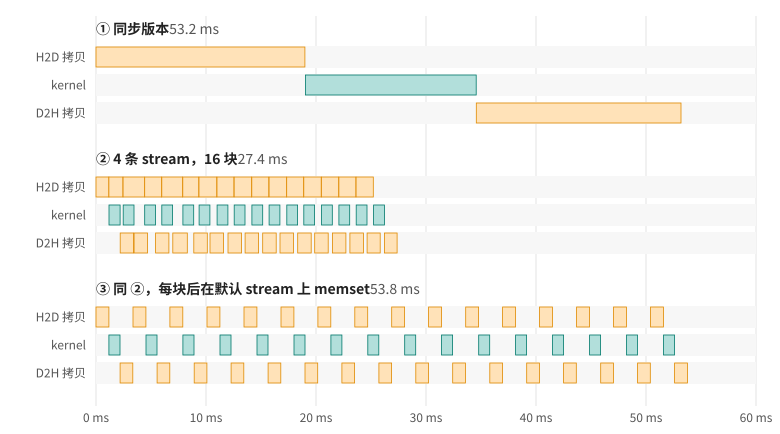

# 第 13 章 Stream：让拷贝和计算重叠起来

GPU 程序最常见的形状是这样的：数据在主机内存里，先拷到显存，跑一个 kernel，再把结果拷回来。本章就拿这样一个任务开刀：一个 256 MiB 的 `float` 数组，拷上去，每个元素做一段计算，再拷回来。先分别量一下三段各要多久：

```text
pinned     H2D   18.7 ms (14.4 GB/s)   kernel   15.7 ms   D2H   18.9 ms (14.2 GB/s)
```

三段加起来约 53 ms。想想这 53 ms 里 GPU 在干什么：前 18.7 ms 数据在 PCIe 上走，SM 全都闲着；中间 15.7 ms SM 在算，PCIe 闲着；最后 18.9 ms 又只有 PCIe 在忙。

GPU 上负责搬数据的是 copy engine，和执行 kernel 的 SM 是两套独立的硬件。设备属性 `asyncEngineCount` 给出 copy engine 的数量，本书用的 RTX 5060 Laptop GPU 有 2 个，一个可以负责往上拷，另一个负责往回拷。也就是说，往上拷、计算、往回拷这三件事，硬件上本来就可以同时进行。

这一章要把这 53 ms 压到 27 ms。一路上会碰到三件事：一个名字带 `Async`、却没有异步执行的调用；pinned memory；还有一行能让前面的努力全部白费的代码。本章的数字都来自同一个程序 [overlap.cu](code/ch13/overlap.cu)，你可以在自己的机器上编译运行：

```bash
nvcc -O2 -arch=native overlap.cu -o overlap && ./overlap
```

本书的测量都在一台笔记本上完成：RTX 5060 Laptop GPU，PCIe 4.0 x8，单向理论带宽约 16 GB/s。换一台机器，数字会不同，但本章的现象都能复现。

## 13.1 起点：一步一步来

最直接的写法就是三步：

```cpp
{{#include code/ch13/overlap.cu:serial}}
```

`cudaMemcpy` 要等拷贝完成才返回。kernel launch 本身是异步的，host 提交完就往下走，但 kernel 和后面那次 `cudaMemcpy` 进的是同一个队列（下一节就讲这个队列），所以拷回一定排在 kernel 算完之后。三段首尾相接，一段都省不掉。

kernel 本身没什么特别，每个元素迭代 140 次，计算量调到和一次拷贝差不多长；`launch` 是个小包装，把 kernel 放进指定的 stream：

```cpp
{{#include code/ch13/overlap.cu:kernel}}
```

用 Nsight Systems 跑一遍，可以看到 GPU 上每个操作实际的起止时间。图 13.1 的第一组就是这个版本：三段工作分在三条泳道上，首尾相接，任何时刻只有一条泳道在忙。另外两组是后面几节的版本，到时再回来看。

<figure>

<figcaption>图 13.1：三种提交方式下 copy engine 和 SM 的实际时间线（Nsight Systems 实测，带 profiler 时总时间略长）</figcaption>
</figure>

## 13.2 Stream 是一条工作队列

host 交给 GPU 的每个操作，不管是拷贝、kernel 还是 memset，都要放进一个队列里，CUDA 把这种队列叫作 stream。规则只有两条：

- 同一条 stream 里的操作按提交顺序执行，前一个做完，后一个才开始；
- 不同 stream 之间没有顺序约束，GPU 可以让它们同时进行。

上一节的代码没有指定 stream，用的是默认 stream（`launch` 的最后一个参数传的 `0` 就是它）。所有操作都在同一个队列里，自然只能一个接一个。

要让拷贝和计算重叠，首先得有能重叠的工作。整个数组的 H2D、kernel、D2H 之间是实打实的依赖：kernel 要用拷上来的数据，D2H 要拷 kernel 的结果。所以把数组切成若干块，第 2 块往上拷的时候，第 1 块可以在算，第 0 块可以往回拷。每一块内部的三步仍然有依赖，放进同一条 stream，顺序就自动排好了；不同块之间互不相干，放进不同的 stream，GPU 就知道它们可以同时进行。

```cpp
{{#include code/ch13/overlap.cu:streams}}
```

和同步版本相比，有这么几处不同：

- `cudaMemcpyAsync` 多了一个 stream 参数，它把拷贝放进队列就返回，不等拷贝完成；
- kernel launch 的第四个参数是 stream（第三个是动态 shared memory 的大小，这里是 0）；
- 同一块的三步之间没有任何同步调用，顺序由 stream 保证；
- 循环结束后，`cudaDeviceSynchronize()` 等所有 stream 里的工作做完。`g_submit_ms` 记下 host 走完提交循环花了多久，下一节会用到它。

16 块轮流放进 4 条 stream。为什么是 4 条，13.6 节再说。

## 13.3 第一次尝试：一点没快

先用普通 `malloc` 分配的主机内存来跑：

```text
   64.3 ms  1. 同步，pageable
   63.4 ms  3. 4 条 stream、16 块，pageable
           其中 host 花在提交上 63.4 ms
```

几乎没有变化。第三行给了线索：整个任务一共 63.4 ms，host 在提交循环里就待了 63.4 ms。那些名字带 `Async` 的调用并没有马上返回，host 一直被卡在里面，直到 GPU 把活干完。在 Nsight Systems 里看这次运行，16 块的拷贝和 kernel 一个接一个排开，没有任何两段在时间上重叠。

问题出在主机内存上。`malloc` 拿到的是可分页内存（pageable memory），操作系统随时可以把其中的页换到磁盘，或者挪到别的物理地址。copy engine 按物理地址做 DMA，搬运过程中页不能动，所以驱动没法直接对 pageable 内存发起 DMA。它的做法是绕一道：往上拷时，先用 CPU 把数据拷进驱动自己的一块锁页缓冲区，再从缓冲区 DMA 到显存；往回拷时反过来，先 DMA 进缓冲区，再由 CPU 拷到你的数组里。这道 CPU 拷贝由调用线程自己完成，往回拷时还得先等 DMA 结束。所以对 pageable 内存来说，`cudaMemcpyAsync` 在 host 看来基本是同步的：第 0 块的拷回调用不返回，host 就没法提交第 1 块，流水线还没开始就断了。

绕这一道也让拷贝本身变慢了。对比一下单独测的两行，pageable 内存的两个方向都比 pinned 慢，往回拷尤其明显：

```text
pageable   H2D   22.5 ms (11.9 GB/s)   kernel   15.5 ms   D2H   26.4 ms (10.2 GB/s)
pinned     H2D   18.7 ms (14.4 GB/s)   kernel   15.7 ms   D2H   18.9 ms (14.2 GB/s)
```

## 13.4 Pinned memory

解决办法是直接分配锁页内存（page-locked memory，常叫 pinned memory），让 copy engine 可以直接对它做 DMA：

```cpp
float* h_in;
CHECK(cudaMallocHost(&h_in, bytes));   // 用 cudaFreeHost 释放
```

代码别处一个字不改，只把主机数组换成 pinned 内存：

```text
   53.1 ms  2. 同步，pinned
   27.1 ms  4. 4 条 stream、16 块，pinned
           其中 host 花在提交上 0.1 ms
```

同步版本因为拷贝变快，从 64 ms 降到 53 ms；stream 版本降到 27.1 ms，差不多减半。提交循环只用了 0.1 ms，host 把 48 个操作交出去就自由了，剩下的 27 ms 它尽可以去做别的事，比如准备下一批数据。图 13.1 的第二组是这个版本：H2D、kernel、D2H 三条泳道同时都有活干。

pinned memory 也有代价，有两点要记住。

第一，分配很慢。程序开头打印了一行：

```text
cudaMallocHost 分配 256 MiB 用了 42.1 ms
```

分配这 256 MiB 花的时间，比把它拷上去、算完、再拷回来还长。驱动要把这段内存逐页锁定，再登记给 GPU。所以 pinned 缓冲区应该在程序开始时分配好，反复使用，不要每处理一批数据就分配一次。已经用 `malloc` 或 `new` 分配好的大数组，可以用 `cudaHostRegister` 原地锁定，用完再 `cudaHostUnregister`。它通常比 `cudaMallocHost` 快不少，但仍然不便宜，第 15 章有实测数字。

第二，锁住的页不能被换出，相当于从操作系统手里拿走了这部分物理内存。在内存很大的服务器上锁几个 GB 不成问题，在 16 GB 内存的笔记本上就可能逼得别的程序开始换页。通常只把参与传输的缓冲区做成 pinned，不要把整个程序的数据都锁住。

## 13.5 27 ms 卡在哪里

kernel 一共 15.7 ms，在图 13.1 的第二组里已经完全藏到了拷贝背后。那 27.1 ms 是由什么决定的？再看第二组的 H2D 泳道：从头到尾几乎没有空隙。现在的瓶颈在 PCIe。

可是单向拷 256 MiB 只要 18.7 ms，为什么总时间是 27 ms？因为现在两个方向在同时拷。PCIe 在协议上是全双工的，两个方向各有各的线路，但实际能不能同时跑满，要看主板、芯片组和驱动。用 [bidir.cu](code/ch13/bidir.cu) 单独测一下：

```text
只拷上去    18.7 ms  14.3 GB/s
只拷回来    18.8 ms  14.3 GB/s
同时双向    25.3 ms  每个方向 10.6 GB/s
```

在这台笔记本上，两个方向一起拷时各自掉到 10.6 GB/s，各拷 256 MiB 要 25 ms 左右。再加上流水线开头第一块的 H2D 和结尾最后一块的 kernel、D2H 没法和别的工作重叠，就是 27 ms。图上也看得出来：第一块 H2D 比后面的短一截，因为那时还没有 D2H 跟它抢带宽。

这个结论比“快了一倍”更有用：在这台机器上，只要每次计算前后数据都得完整地走一趟 PCIe，27 ms 就是底线，kernel 优化得再好，总时间也不会变短。要继续提速，只能少搬数据：让数据留在显存里连续做多步计算（第 29 章的分子动力学案例就是这么做的），或者让每次传输承载更多的计算。

## 13.6 切几块，开几条 stream

16 块、4 条 stream 是随手选的，换几个值试试。先固定 4 条 stream，改块数：

```text
  块数  4 条 stream，pinned
     1     53.1 ms
     2     36.7 ms
     4     31.4 ms
     8     28.5 ms
    16     27.1 ms
    32     26.7 ms
    64     26.9 ms
   256     29.9 ms
  1024     32.7 ms
```

只有 1 块时没有任何东西可以重叠，和同步版本一样。块数增加，没法重叠的首尾两段越来越短，总时间逼近 25 ms 的底线。但块切得太碎又会变慢：1024 块时每块只有 256 KiB，一共要提交 3072 个操作，每个操作都有几微秒的固定开销，小块拷贝也跑不满带宽。在这台机器上 16 到 64 块都差不多，每块几 MB 是比较稳妥的选择。

再固定 16 块，改 stream 的数量：

```text
stream 数  16 块，pinned
     1       53.5 ms
     2       31.1 ms
     3       27.1 ms
     4       27.1 ms
     8       27.1 ms
```

1 条 stream 时所有块排在同一个队列里，又退回了串行。2 条比 3 条慢，是 stream 的顺序规则在起作用：第 2 块和第 0 块在同一条 stream 里，第 2 块的 H2D 必须等第 0 块的 D2H 做完才能开始，于是 H2D 这条泳道时不时要停下来等。每块要经过三个阶段，至少要三条 stream，三个阶段才能各自一直有活干。多于 3 条没有坏处，也没有好处。

## 13.7 一行默认 stream 上的代码

现在往提交循环里加一行看起来无害的代码：每块之后把一个计数器清零。

```cpp
CHECK(cudaMemsetAsync(d_counter, 0, sizeof(int)));   // 没写 stream，进的是默认 stream
```

```text
   53.8 ms  5. 同 4，每块后加一次默认 stream 上的 memset
```

27 ms 又变回了 54 ms，和完全不用 stream 一样。图 13.1 的第三组是这个版本：每一块的 H2D、kernel、D2H 全部做完，下一块才开始。

原因是默认 stream 的一条特殊规则（叫 legacy default stream 语义）：默认 stream 上的操作，要等此前提交到所有普通 stream 的工作做完才开始；此后提交到普通 stream 的工作，又要等它做完才开始。它在所有 stream 之间插了一道栅栏。memset 本身几乎不花时间，代价是每块之后整条流水线都要排空一次。

会落进默认 stream 的东西比想象中多：没写 stream 参数的 kernel launch；`cudaMemcpy`、`cudaMemset` 这类同步接口；省略了 stream 参数的 `*Async` 调用（参数默认值就是 0）；还有没设置 stream 的库调用，比如没调用过 `cublasSetStream` 的 cuBLAS handle。项目一大，总会漏掉一个。有三种办法：

1. 所有调用都显式传 stream。这最干净，但只能靠代码审查来保证。
2. 创建 stream 时加上 `cudaStreamNonBlocking` 标志：

   ```cpp
   cudaStream_t s;
   CHECK(cudaStreamCreateWithFlags(&s, cudaStreamNonBlocking));
   ```

   这样的 stream 不和默认 stream 互相等待。程序里的第 6 种情况就是这么做的，时间又回到了 27.1 ms。代价是那个 memset 和你的 stream 之间也没有了顺序：如果后面的 kernel 确实要读清零后的计数器，就得自己用 event 建立依赖（第 14 章）。
3. 编译时加 `--default-stream per-thread`，每个 host 线程的默认 stream 就变成一条普通 stream，不再和别的 stream 互相等待。用这个选项重新编译 overlap.cu，第 5 种情况也回到 27 ms 左右。

## 13.8 回头看

从 53 ms 到 27 ms，代码只改了三处：把数据切块，分散到几条 stream 里；主机内存换成 pinned；避开默认 stream 的隐式同步。三个条件缺一个，重叠就不会发生，而且程序不报任何错，只是慢。

所以写完 stream 代码，第一件事是看时间线，而不是靠推测。Nsight Systems 的命令行就够用：

```bash
nsys profile -o overlap ./overlap
```

生成的 `overlap.nsys-rep` 用 Nsight Systems 的图形界面打开，就是图 13.1 那样的泳道图。哪里该重叠却没有重叠，一眼就能看出来。

## 13.9 练习

1. 把 `ITERS` 改成 500，让 kernel 成为最慢的一段（大约 55 ms）。运行之前先估计一下 stream 版本要多久，再跑一次对照。提示：现在决定总时间的是 kernel，再加上没法重叠的首尾两段。
2. 去掉 D2H，假设结果留在显存里给下一步用。stream 版本现在能快到多少？和 bidir.cu 测出的单向带宽对照一下。
3. 在 `run_streams` 的提交循环和 `cudaDeviceSynchronize()` 之间插入一段 20 ms 左右的 CPU 计算，总时间变了吗？换成 pageable 内存再试一次。
