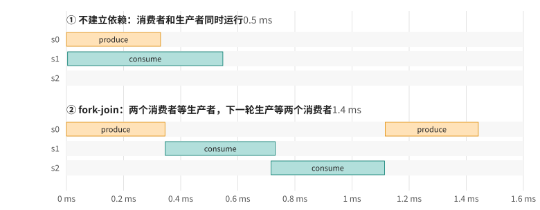

# 第 14 章 Event 与跨 stream 依赖

第 13 章的规则是：同一条 stream 里的操作按顺序执行，不同 stream 之间没有任何顺序。真实的程序往往介于两者之间：stream B 里的某一步必须等 stream A 里的某一步做完，但两条 stream 上的其他工作仍然可以同时进行。表达这种局部的先后关系，要用 event。这一章还会讨论 host 怎么等 GPU、怎么让紧急的工作插队，以及怎么在 stream 里安排一段 CPU 代码。

## 14.1 event 是 stream 里的一个记号

`cudaEventRecord(e, s)` 在 stream `s` 当前的末尾放一个记号。它本身不做任何事，GPU 执行到这个位置时，也就是 `s` 里在它之前的工作全部完成时，event 就算“完成”了。围绕这个记号能做三件事：

- **计时**：两个 event 完成的时间差就是它们之间那段工作在 GPU 上的耗时，用 `cudaEventElapsedTime` 读出来。本书从第 1 章起就一直这样计时。
- **让 host 等**：`cudaEventSynchronize(e)` 让 host 停下来，直到 `e` 完成；`cudaEventQuery(e)` 只是问一下完成了没有，马上返回。
- **让另一条 stream 等**：`cudaStreamWaitEvent(s2, e)` 让 `s2` 里此后提交的工作，等 `e` 完成以后才开始。

不用来计时的 event，最好用 `cudaEventCreateWithFlags(&e, cudaEventDisableTiming)` 创建，它不必记录时间戳，开销更小。

## 14.2 不建立依赖会怎样

[depend.cu](code/ch14/depend.cu) 里有一个生产者和一个消费者。生产者只开 26 个 block，先算一阵（模拟真实的计算），再把整个数组写成指定的值；消费者一个元素一个线程，读出数据，做一段计算，写到自己的输出数组里：

```cpp
{{#include code/ch14/depend.cu:kernels}}
```

先故意不建立任何依赖：生产者放在 stream `s0`，消费者放在 stream `s1`。程序最后在主机上逐个元素核对消费者的结果：

```cpp
{{#include code/ch14/depend.cu:race}}
```

```text
$ ./depend
不建立依赖：0 个结果是用旧数据算的
用 event 建立依赖：0 和 0 个结果是用旧数据算的
$ CUDA_MODULE_LOADING=EAGER ./depend
不建立依赖：479552 个结果是用旧数据算的
用 event 建立依赖：0 和 0 个结果是用旧数据算的
```

直接运行，结果全对；换成 EAGER 模式加载 kernel，100 万个结果里有 48 万个是用旧数据算的（这个数字每次运行略有不同）。

错误本来就在那里：两条 stream 之间没有顺序，消费者完全可以在生产者写完之前就去读。图 14.1 的上半部分是 EAGER 模式下的实际时间线：生产者只占了 26 个 block 的位置，GPU 上还有大量空位，消费者几乎和它同时开始，前面一大半 block 读到的都是还没写入的数据。

<figure>

<figcaption>图 14.1：生产者与消费者在三条 stream 上的实际时间线：不建立依赖，以及用 event 建立 fork-join 依赖（Nsight Systems 实测）</figcaption>
</figure>

那默认设置下为什么没出错？第 4 章讲过，CUDA 默认在 kernel 第一次启动时才加载它的代码。`consume` 是第一次启动，加载它的代码要等 GPU 上正在执行的工作告一段落，结果它被排到了生产者后面，竞争碰巧没有发生。换句话说，这个程序的正确性靠的是一个与它毫不相干的实现细节，换个环境、换个 CUDA 版本、或者这个 kernel 之前被调用过，错误就会冒出来。第 5 章说过，数据竞争最麻烦的地方就是它时有时无，这里又多了一个例子。

这个现象还有另一面：lazy loading 会让 kernel 第一次启动时失去和别的工作并发的机会。测量并发效果之前，先把每个 kernel 预热一遍。

## 14.3 用 event 建立依赖

正确的写法是让 `s1` 等 `s0` 上的生产者做完。depend.cu 的第二轮在此基础上做了一个常见的 fork-join：一个生产者，两个消费者分别在 `s1`、`s2` 上并行地读，两个都读完以后，`s0` 上才能开始下一轮生产，以免覆盖还在被读的数据：

```cpp
{{#include code/ch14/depend.cu:forkjoin}}
```

结果两个消费者都对了。`cudaStreamWaitEvent` 不会让 host 停下来，它只是往 `s1` 里插了一个“等待”，等待发生在 GPU 上，host 立刻返回，接着提交后面的工作。它等的是调用这一刻 event 最近一次被记录的位置；之后即使再次对同一个 event 调用 `cudaEventRecord`，也不影响已经插入的等待。

图 14.1 的下半部分是第二轮的时间线：两个消费者都等生产者结束才开始，第二轮生产又等两个消费者都结束才开始，依赖关系完全符合预期。但注意，两个消费者并没有同时运行，`s2` 上的那个几乎是等 `s1` 上的做完才开始。每个消费者有 4096 个 block，单独一个就能把所有 SM 占满，第二个只能等空出来的位置。第 13 章说过，stream 表达的是“可以并发”，能不能真的并发要看资源。在这里，两个 kernel 各自都能用满 GPU，排着队跑也没有损失。

## 14.4 host 怎么等

host 等 GPU 有几种粒度：`cudaDeviceSynchronize` 等所有 stream 的所有工作；`cudaStreamSynchronize` 只等一条 stream；`cudaEventSynchronize` 等到某条 stream 的某个位置。能等得越精确越好，等得太多，就浪费了 host 本可以用来提交后续工作的时间。不想停下来时，用 `cudaStreamQuery` 或 `cudaEventQuery` 问一下，返回 `cudaErrorNotReady` 表示还没完成（这不是错误）。

等的方式也可以选。[waiting.cu](code/ch14/waiting.cu) 启动一个大约 270 ms 的 kernel，用四种方式等它，记下这段时间里进程用掉了多少 CPU 时间；然后再做 1000 次“启动一个几微秒的 kernel，等它结束”，看每次要多久：

```cpp
{{#include code/ch14/waiting.cu:flags}}
```

```cpp
{{#include code/ch14/waiting.cu:event}}
```

```cpp
{{#include code/ch14/waiting.cu:wait}}
```

```text
spin   等 270 ms 的 kernel：CPU 用掉 271 ms；短 kernel 每次启动加等待   5.7 us
yield  等 270 ms 的 kernel：CPU 用掉 271 ms；短 kernel 每次启动加等待   5.8 us
block  等 270 ms 的 kernel：CPU 用掉   0 ms；短 kernel 每次启动加等待   7.9 us
event  等 270 ms 的 kernel：CPU 用掉   1 ms；短 kernel 每次启动加等待  10.1 us
```

默认情况下（spin），host 线程在等待期间一直空转查询 GPU 的状态，等多久就占满一个 CPU 核多久。`cudaDeviceScheduleYield` 在每次查询之间让出 CPU，但如果没有别的线程要运行，它还是会立刻被调度回来，效果和空转一样。`cudaDeviceScheduleBlockingSync` 让 host 线程真正睡下去，由驱动在 GPU 完成时唤醒它，CPU 几乎不占用。这几个设备标志要在 context 创建之前用 `cudaSetDeviceFlags` 设置，影响的是 `cudaDeviceSynchronize`、`cudaStreamSynchronize` 这类等待。

等 event 时用哪种方式，则由 event 自己决定：用 `cudaEventBlockingSync` 标志创建的 event，`cudaEventSynchronize` 会阻塞等待；不带这个标志的 event 照样空转，不受设备标志影响。如果用 `cudaEventSynchronize` 去测试设备标志，会发现三种设备标志下 CPU 都被占满，原因就在这里。

阻塞等待的代价是唤醒需要时间：短 kernel 每次多花两三微秒。所以，等待时间短、对延迟敏感的场合用默认的空转；host 线程需要把 CPU 留给别的工作时，比如一个进程里有多个线程分别给 GPU 喂数据，或者在笔记本上希望省电，用阻塞等待。

## 14.5 让紧急的工作插队

一个服务程序可能一边在 GPU 上跑大批量的后台计算，一边要尽快响应零星的小请求。GPU 被后台任务占满时，小请求的 kernel 要等多久？[priority.cu](code/ch14/priority.cu) 先启动一个 20000 个 block、大约七十毫秒的大 kernel，等它把所有 SM 占满，再提交一个只有 26 个 block 的小 kernel：

```cpp
{{#include code/ch14/priority.cu:create}}
```

```text
优先级范围：0（最低）到 -5（最高）
小 kernel 单独运行：   0.02 ms
小 kernel 放在普通 stream：从提交到完成   59.34 ms
小 kernel 放在高优先级 stream：从提交到完成    0.36 ms
```

小 kernel 单独运行只要 0.02 ms，可放在普通 stream 上要等将近 60 ms：大 kernel 的 block 还在源源不断地排队，GPU 每空出一个位置，就先给排在前面的大 kernel。放在高优先级 stream 上就不一样了，GPU 有空位时优先调度高优先级 stream 的 block，0.36 ms 就做完了。

注意优先级不是抢占：已经在 SM 上运行的 block 不会被打断，小 kernel 仍然要等当前这一批 block 各自跑完（这里每个大约 0.4 ms）。所以大 kernel 的单个 block 越短，高优先级工作的响应就越快。优先级的数值越小越高，范围用 `cudaDeviceGetStreamPriorityRange` 查询，这块 GPU 上是 0 到 −5。

## 14.6 在 stream 里安排一段 CPU 代码

有时 CPU 也要参与流水线：每块数据从 GPU 拷回来以后，CPU 要做一些后处理，比如统计、写文件。最简单的做法是等 GPU 把所有块都做完，再在主线程里逐块处理；但这样 CPU 处理的时候 GPU 闲着，GPU 计算的时候 CPU 闲着。

`cudaLaunchHostFunc` 可以把一个主机函数排进 stream：等 stream 里在它之前的工作都完成后，驱动在一个内部线程上调用它。[hostfunc.cu](code/ch14/hostfunc.cu) 把 16 块数据分到 4 条 stream 上，每块拷回来以后排一个回调，在回调里做后处理：

```cpp
{{#include code/ch14/hostfunc.cu:post}}
```

```cpp
{{#include code/ch14/hostfunc.cu:launch}}
```

```text
只算 GPU 部分                  26.4 ms
做法一：做完再统一处理         53.4 ms
做法二：每块完成就在回调里处理   33.1 ms
两种做法的结果相同
```

先做完再处理，总时间是 GPU 时间加 CPU 时间；用回调，CPU 在 GPU 计算后面几块的同时处理前面已经完成的块，总时间接近两者中较长的那个。

使用主机回调有几条规矩：回调函数里**不能调用任何 CUDA API**，否则可能死锁或出错，需要的话可以通知另一个线程去做；回调在执行期间会挡住它所在 stream 的后续工作，所以要短小；不同 stream 的回调执行顺序不确定，而且可能在同一个内部线程上依次执行，不要指望它们并行。

## 14.7 回头看

event 是 stream 里的一个记号，用来计时、让 host 等待、让另一条 stream 等待。`cudaStreamWaitEvent` 在 GPU 上建立 stream 之间的先后关系，不会挡住 host。没有建立依赖的程序可能碰巧是对的，比如被 lazy loading 意外地串行化了，但那只是运气。host 等 GPU 时默认空转占满一个 CPU 核，可以用设备标志或 event 标志改成阻塞等待，代价是几微秒的唤醒延迟。stream 优先级让紧急的工作在 GPU 空出位置时优先调度，但不会抢占正在运行的 block。`cudaLaunchHostFunc` 把 CPU 的工作排进 stream，让 CPU 后处理和 GPU 计算重叠。

## 14.8 练习

1. 把 depend.cu 里第二轮的两条 `cudaStreamWaitEvent(s1/s2, produced)` 删掉，用 EAGER 模式运行，看看结果；再把 `consume` 的 block 数减少到 100，画出时间线，两个消费者现在能同时运行了吗？
2. 用 `cudaEventQuery` 改写 waiting.cu 的等待部分：在 kernel 运行期间，主线程每隔 1 ms 查询一次，其余时间做一点 CPU 计算。CPU 时间和墙钟时间各是多少？
3. 在 priority.cu 里把大 kernel 每个 block 的计算量减少到十分之一（同时把 block 数增加到 10 倍），高优先级的小 kernel 的响应时间会变成多少？
4. 在 hostfunc.cu 的 `on_chunk_done` 里调用一次 `cudaMemcpy`，看看会发生什么。
