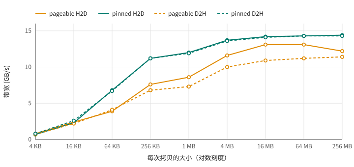

# 第 15 章 主机内存：pageable、pinned 与零拷贝

第 13 章已经看到，主机内存是 `malloc` 来的还是 `cudaMallocHost` 来的，决定了拷贝能不能异步、能跑多快。这一章把主机内存的各种形式和它们的代价完整地量一遍：拷贝的大小怎样影响带宽，锁页要花多少时间，kernel 能不能干脆直接读主机内存，以及二维数据怎么拷。

## 15.1 拷贝多大才划算

[transfer.cu](code/ch15/transfer.cu) 用同步的 `cudaMemcpy` 拷贝从 4 KB 到 256 MB 不等的数据，pageable 内存（`malloc`）和 pinned 内存（`cudaMallocHost`）两个方向各测一遍，记下每次拷贝的时间和折合的带宽：

```text
   大小    pageable H2D       pinned H2D        pageable D2H       pinned D2H
    4 KB       5.4 us   0.8       6.1 us   0.7       6.0 us   0.7       5.4 us   0.8
   16 KB       7.0 us   2.4       7.0 us   2.3       7.5 us   2.2       6.2 us   2.6
   64 KB      16.7 us   3.9       9.6 us   6.8      15.9 us   4.1       9.7 us   6.7
  256 KB      34.6 us   7.6      23.4 us  11.2      38.3 us   6.8      23.4 us  11.2
    1 MB     122.1 us   8.6      87.0 us  12.0     142.8 us   7.3      88.2 us  11.9
    4 MB     361.9 us  11.6     306.5 us  13.7     419.4 us  10.0     308.2 us  13.6
   16 MB    1284.6 us  13.1    1182.3 us  14.2    1544.0 us  10.9    1187.7 us  14.1
   64 MB    5123.9 us  13.1    4684.7 us  14.3    5984.8 us  11.2    4705.6 us  14.3
  256 MB   21977.0 us  12.2   18689.4 us  14.4   23631.5 us  11.4   18777.1 us  14.3
```

<figure>

<figcaption>图 15.1：主机与显存之间的拷贝带宽随拷贝大小变化</figcaption>
</figure>

最小的几档里，不管拷多少，一次拷贝都要 5 到 6 微秒。这是固定开销：驱动要准备命令、通知 copy engine、等它完成再通知 host。4 KB 的拷贝因此只能跑出 0.7 GB/s。pinned 内存要到 256 KB 左右才能达到峰值带宽的四分之三，16 MB 以上才接近 14.4 GB/s 的上限（PCIe 4.0 x8 的理论值约 16 GB/s）。

所以，大量的小拷贝是很浪费的。一万次 4 KB 的拷贝要 50 多毫秒，同样的数据攒成一次 40 MB 的拷贝只要 3 毫秒左右。如果程序需要把很多零散的小块数据送到 GPU，先在主机上把它们拼进一块连续的缓冲区再一次拷过去，通常快得多。

pageable 内存比 pinned 慢，原因在第 13 章讲过：驱动要先用 CPU 把数据拷进一块锁页的中转缓冲区。H2D 方向的差距不大，D2H 方向则差了将近四分之一。

## 15.2 锁页的代价

pinned 内存这么好，为什么不把所有主机内存都锁住？因为锁页本身很贵，锁住的内存也不能再被操作系统挪作他用。transfer.cu 的后半部分量了一下分配并锁定不同大小的内存要多久：

```text
分配并锁定        cudaMallocHost   cudaHostRegister
     1 MB           0.5 ms             0.1 ms
    16 MB           2.4 ms             0.4 ms
   256 MB          36.4 ms             5.2 ms
  1024 MB         149.7 ms            60.9 ms
```

`cudaMallocHost` 分配一块新的内存并锁定它，1 GB 要 150 ms。`cudaHostRegister` 把一块已经用 `malloc` 分配、而且已经写过（页已经真正分配出来了）的内存原地锁定，便宜一些，但 1 GB 也要 60 ms。和第 2 章的 context 初始化一样，这是一笔绝不能放在循环里反复付的开销：pinned 缓冲区应该在程序开始时准备好，一直重复使用。

另一个限制是容量。这台笔记本只有 14 GB 可用内存，锁住几个 GB，留给操作系统和其他程序的就少了，严重时会逼得系统频繁换页，整机变慢。通常只把参与传输的那几块缓冲区做成 pinned，大块的数据用流水线分批搬运（第 13 章），而不是整块锁住。

## 15.3 零拷贝：让 kernel 直接读主机内存

到目前为止，数据都是先拷进显存，kernel 再从显存里读。还有一种方式：kernel 直接读写主机内存，数据在访问时才经过 PCIe 传过来，叫**零拷贝**（zero-copy）。在 64 位系统上，`cudaMallocHost` 分配的 pinned 内存同时映射进了 GPU 的地址空间，同一个指针在主机和 kernel 里都能用：

```cpp
{{#include code/ch15/zerocopy.cu:alloc}}
```

[zerocopy.cu](code/ch15/zerocopy.cu) 用同一个 kernel 读 256 MB 的数据并求和，`in` 可以指向显存，也可以直接指向这块主机内存：

```cpp
{{#include code/ch15/zerocopy.cu:kernel}}
```

分三种访问方式，比较“先拷进显存再算”和“零拷贝直接读”的总时间：

```text
访问方式                  先拷进显存   零拷贝
顺序读一遍                   19.5 ms     19.9 ms
顺序读 10 遍                 26.4 ms    199.2 ms
每 4 KB 读一个 float         18.8 ms      0.3 ms
```

**只读一遍时，两者一样快。** 先拷贝的做法，时间基本都花在 256 MB 的拷贝上；零拷贝时 kernel 读主机内存的速度就是 PCIe 的速度，总时间相同，还省掉了一块 256 MB 的显存。

**反复读时，零拷贝慢得多。** 每读一遍都要重新从 PCIe 上走一次，10 遍就是 10 倍的传输量；而先拷进显存的做法只拷一次，后面 9 遍都在显存里读，每遍不到 1 毫秒。

**只读一小部分时，零拷贝快得多。** 每 4 KB 只读一个 `float`，零拷贝只传输真正用到的数据，0.3 ms 就完成了；先拷贝的做法却要把整整 256 MB 都搬过去。

所以零拷贝适合三种情况：数据只用一次；只用到其中很小、而且事先不知道是哪些的一部分；或者 kernel 要把少量结果（比如一个计数器、一个标志）直接写给 host 看。另外，在 CPU 和 GPU 共用同一块物理内存的平台上（比如 NVIDIA 的 Jetson 系列），根本不存在 PCIe 传输，零拷贝是最自然的用法。

## 15.4 write-combined 内存

`cudaHostAlloc` 还可以加一个 `cudaHostAllocWriteCombined` 标志：

```cpp
{{#include code/ch15/wc.cu:alloc}}
```

这种内存绕过 CPU 的缓存，CPU 对它的写入会在一个小缓冲区里攒成整块再送出去。理论上，它能让 H2D 拷贝少一些和 CPU 缓存打交道的开销。[wc.cu](code/ch15/wc.cu) 比较了它和普通 pinned 内存：

```text
普通 pinned    CPU 写   4.2 ms   CPU 读    6.6 ms   H2D 拷贝  4.7 ms
write-combined   CPU 写   3.9 ms   CPU 读  443.4 ms   H2D 拷贝  4.8 ms
```

在这台机器上，H2D 拷贝一点也没变快，CPU 读它却慢了 67 倍，因为每次读都绕过了缓存。只有在 CPU 只写不读、而且实测确实能加快传输的情况下才值得用它。

## 15.5 二维数据：pitch 和 cudaMemcpy2D

最后看一个常见的小问题。图像、矩阵这类二维数据，经常只需要拷其中的一块矩形区域；而在显存里，每行的起始地址最好对齐到一定的字节数，这样按行访问时每行的开头都落在 sector 和缓存行的边界上（第 8 章）。CUDA 为此提供了 `cudaMallocPitch` 和 `cudaMemcpy2D`。[pitch.cu](code/ch15/pitch.cu) 从一幅 1000×800 的主机图像里取出中间 300×200 的一块，拷进显存处理后再放回原处：

```cpp
{{#include code/ch15/pitch.cu:alloc}}
```

```text
每行 1200 字节的数据，cudaMallocPitch 给出的 pitch 是 1536 字节
0 个像素不对
```

每行只有 300 个 `float`，也就是 1200 字节，`cudaMallocPitch` 却把每行补到了 1536 字节，这个“每行实际占的字节数”叫 **pitch**。`cudaMemcpy2D` 分别接受源和目标的行宽，按行拷贝，所以既能从一幅大图里取出一块，也能在紧密排列和补齐过的布局之间转换。kernel 里定位一行时，要按 pitch 而不是按宽度计算：

```cpp
{{#include code/ch15/pitch.cu:kernel}}
```

三维数据有对应的 `cudaMalloc3D` 和 `cudaMemcpy3D`，用法类似。

## 15.6 回头看

主机和显存之间的每次拷贝都有 5 微秒左右的固定开销，小拷贝要尽量合并成大拷贝。pinned 内存拷得更快，还是异步拷贝的前提，但锁页很贵（1 GB 要一两百毫秒），应该一次分配、反复使用，而且不要锁住太多内存。零拷贝让 kernel 直接经 PCIe 读写主机内存，适合只用一次、只用一小部分、或者只写少量结果的数据，反复访问时则要先拷进显存。write-combined 内存在这台机器上没有好处。二维数据用 `cudaMallocPitch` 和 `cudaMemcpy2D` 处理行对齐和子区域拷贝。

## 15.7 练习

1. 写一个程序，分别用 10000 次 4 KB 的 `cudaMemcpyAsync` 和 1 次 40 MB 的 `cudaMemcpyAsync` 把同样的数据拷到显存，比较时间，和 15.1 节的估算对照。
2. 在 zerocopy.cu 里加一种访问方式：每 128 字节读一个 `float`（`step` 为 32）。零拷贝会比先拷贝快吗？（提示：PCIe 上传输的最小单位也不是 4 字节。）
3. 用 `cudaHostRegister` 把一块 `std::vector<float>` 的存储锁定，然后对它做异步拷贝，确认它和 `cudaMallocHost` 的内存一样快。用完记得 `cudaHostUnregister`。
4. 把 pitch.cu 里的 `cudaMallocPitch` 换成普通的 `cudaMalloc`（每行紧密排列），相应地改写 `cudaMemcpy2D` 和 kernel，结果应该不变。在一幅 8192×8192 的图像上比较两种布局下 kernel 的速度，看看行对齐有没有影响。
