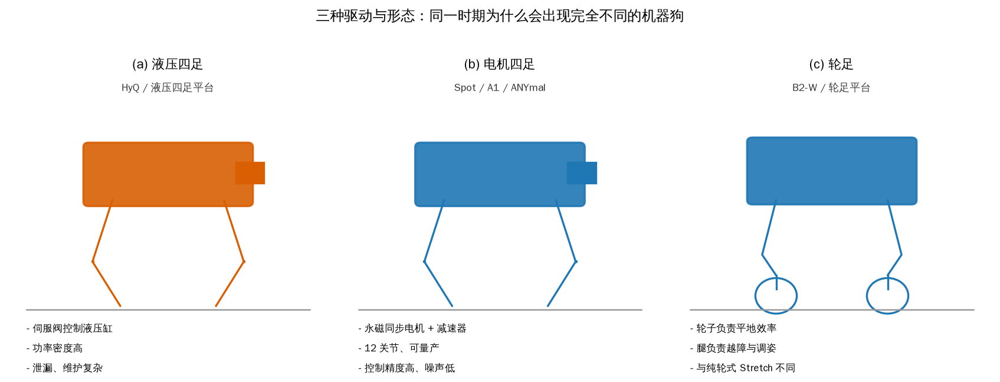
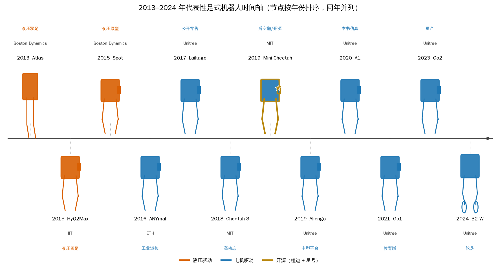
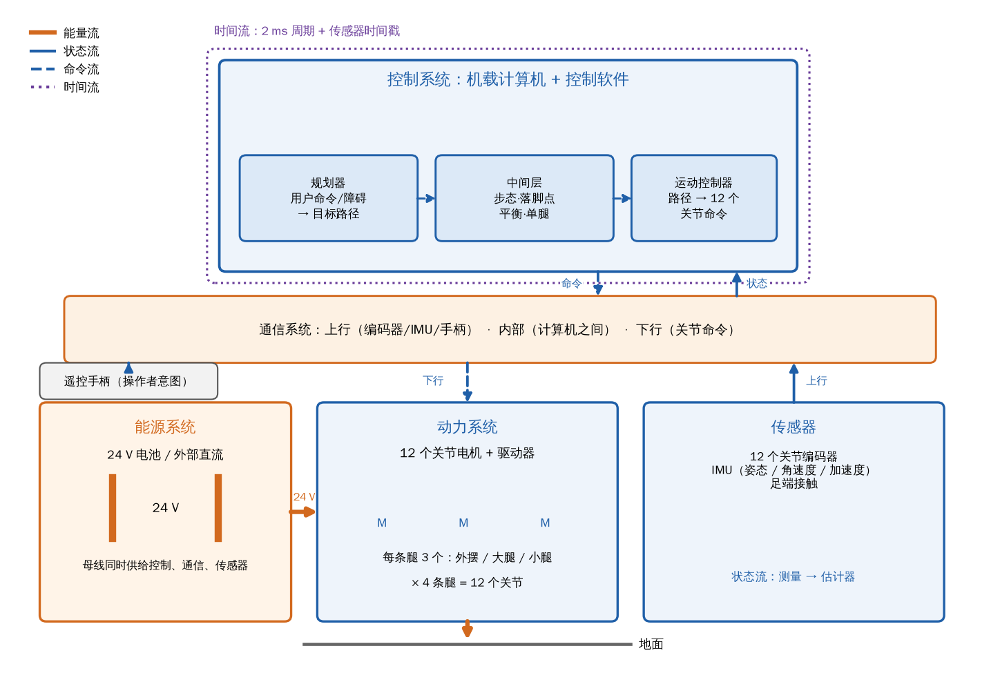
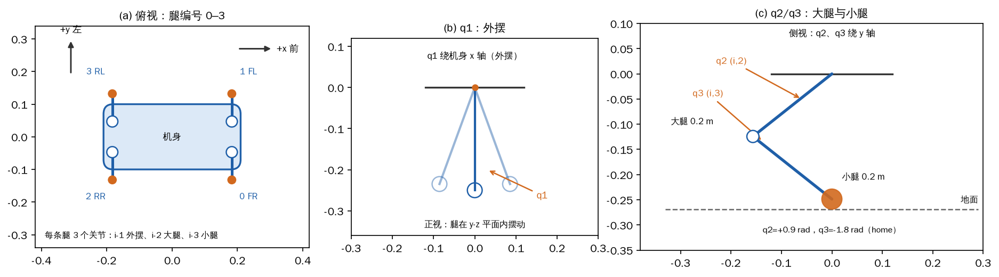
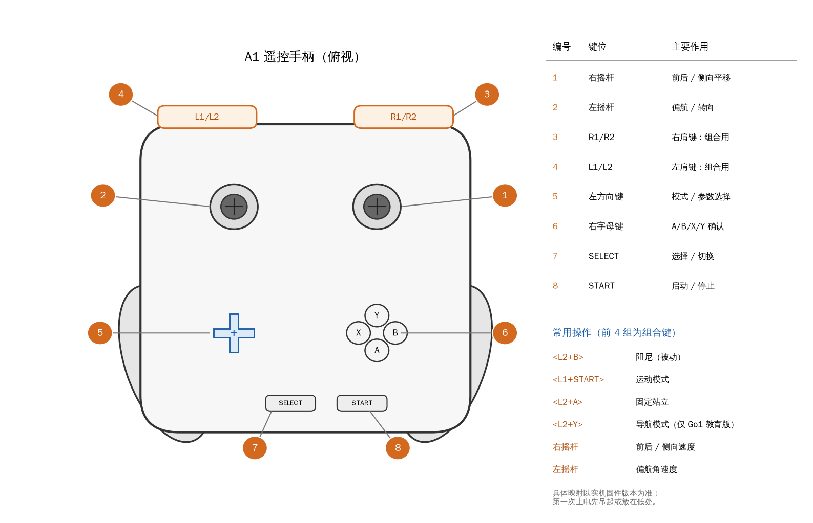
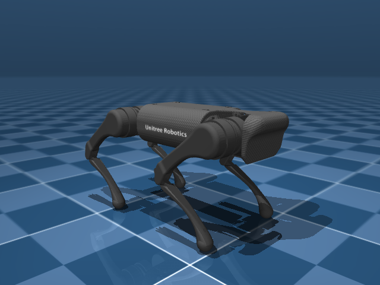

# 第 1 章 从一台四足机器人说起

把一个未上电的 A1 放在桌上，看到的是一副折叠起来的金属骨架：机身、四条腿、每条腿三个关节，十二根线缆从关节里引出来。接通 24 V 电源、切到阻尼模式，再让它站起来，这副骨架才变成一台“机器狗”。它能站、能走、能在被推一下之后自己找回来，这些行为背后是电机、计算机、通信链路和电池共同作用的结果，而不是某一个算法单独变出来的。

这本书要从这台机器讲到能写出行走控制器为止。路线是先把整机拆成几个可以分别讨论的部分，再逐章建立运动学、动力学、状态估计、平衡与步态，最后把它们组装成一个能跑的控制器。第 1 章不建动力学模型，也不推导控制律，只做三件事：交代四足机器人从哪里来，说明一台整机由哪几个系统组成，落实动手之前要准备的硬件、遥控手柄和代码。这三件事对应 1.1、1.2、1.3，最后 1.4 把本书的章节与原书逐节对上。

阅读时可以把 A1 当成一个具体的参照物。后面的公式、参数和代码大多以它为例；Go1 教育版在实机章节出现，仿真则统一使用 A1 的模型。两台机器都是十二个关节、每条腿三个自由度，这个共同点让书中的算法可以在两者之间迁移。

## 1.1 从实验室到产品：四足机器人六十年

<div class="qh-story">

<div class="qh-rail" aria-label="1.1 节时间尺"></div>

<section class="qh-scene" data-year="1960" data-label="1960s–1970s">
<div class="qh-badge">1960s–1970s</div>
<div class="qh-title">想法早就有了</div>

机器狗后空翻的视频看起来很新，这条线其实走了六十年：六十年代有液压步行卡车，七十年代有双足步行机器人，八十年代有人把“跑”拆成了三个问题。

<div class="qh-widget" data-widget="milestones"></div>

<details class="qh-full">
<summary>展开全文</summary>

网络上一段机器狗爬楼梯或后空翻的视频，很容易让人以为这个领域是最近几年突然出现的。实际的时间线要长得多：二十世纪六十年代就有液压驱动的四足步行卡车，七十年代日本做出了双足步行机器人，八十年代 Marc Raibert 在卡内基梅隆大学（CMU）把“跑”拆成了可以分别控制的三个问题。今天的产品是这条长链条上的一个截面，不是凭空掉下来的。

</details>
</section>

<section class="qh-scene" data-year="1980" data-label="1980s">
<div class="qh-badge">1980s</div>
<div class="qh-title">把奔跑看成受控的摔倒</div>

早期的机器一次抬一条腿，慢但不摔，解释不了四只脚同时离地。Raibert 换了问法：不要求每一步都稳，只管三个量——弹跳高度、前进速度、机身姿态。

<div class="qh-widget" data-widget="hopper"></div>

<details class="qh-full">
<summary>展开全文</summary>

早期步行机器大多走“静态稳定”的路子：每次只抬起一条腿，把重心移到另外三条腿围成的支撑三角形里，移动很慢但不会摔。这种方法能说明腿可以支撑身体，却解释不了奔跑时四只脚可能同时离地的事实。Raibert 的贡献在于换了一个问题：不再要求每一步都稳定，而是把奔跑看成“受控的摔倒”，用弹簧-质量模型描述弹跳，把控制拆成三部分——弹跳高度、前进速度、机身姿态。围绕这个想法，Raibert 的 Leg 实验室（1980 年在 CMU 成立，1986 年迁到 MIT）先后做了平面单腿、空间单腿和空间四足三代平台：先在导轨上把一条腿的弹跳调明白，再放开侧向自由度，最后把四条腿按对角或前后配对抽象成“虚拟腿”，再套用单腿的弹跳控制。今天四足机器人上的 Raibert 分解、落脚点修正和机身姿态控制，都能追溯到这套实验。

弹簧-质量模型是这套想法的数学骨架：把腿看成一根无质量的弹簧，触地时压缩、储存能量，离地时释放、把机身弹起。这样，奔跑就不再是“每条腿精确地按某个角度落地”，而是“在触地的半个周期里调整弹簧的刚度和落脚点”。控制量被压缩成三个：弹跳高度、前进速度、机身姿态。高度靠腿的伸缩和触地时机，速度靠落脚点相对髋部的偏移，姿态靠 Hip 力矩或摆动腿的角动量。三个人类可读的量，取代了几十个关节的逐点轨迹，这是四足控制第一次变得“可以调”。

</details>
</section>

<section class="qh-scene" data-year="1990" data-label="1990s–2005">
<div class="qh-badge">1990s–2005</div>
<div class="qh-title">卡住的不是想法，是零件</div>

液压又重又吵，电机力矩密度不够，计算机算不动整机动力学，电池背不动也跑不久。四样东西都要成熟，四足才走得出实验室。

<div class="qh-widget" data-widget="parts"></div>

<details class="qh-full">
<summary>展开全文</summary>

中间隔了这么久，主要不是想法不够，而是零件不够。液压系统能提供大力矩，但效率低、管路重；电机要做出足够大的力矩密度，得等永磁材料、功率器件和磁场定向控制成熟；计算机要实时算完整机动力学，得等嵌入式计算平台；电池要背得动、跑得久，得等能量密度上来。二十世纪九十年代的四足机器大多只能在实验室里走几步，直到 2005 年前后 BigDog 这类液压平台证明了野外行走的可能，2010 年以后电机、驱动和计算同时降价，四足才真正进入产品化阶段。

</details>
</section>

<section class="qh-scene" data-year="2005" data-label="2005–2015">
<div class="qh-badge">2005–2015</div>
<div class="qh-title">两条路线：液压和电机</div>

液压力气大、响应快，但会漏、吵、难维护；电机等到永磁同步电机、FOC 和行星减速器成熟才追上来。它们后来按需求分工，不是谁淘汰谁。

<div class="qh-figcap">图 1-2 液压四足、电机四足与轮足三种组合的对比示意；同一时期的不同外形来自不同的工程折中</div>

<div class="qh-widget" data-widget="forms"></div>

<div class="qh-fallback">



*图 1-2 液压四足、电机四足与轮足三种组合的对比示意；同一时期的不同外形来自不同的工程折中*

</div>

<details class="qh-full">
<summary>展开全文</summary>

与这条“动态平衡”路线并行的，是一条更工程化的路线。液压伺服、阀控缸、模型控制让机器能背负重物、在泥地里行走，Boston Dynamics 的 BigDog、LS3 和液压 Atlas 是代表。液压的功率密度高、响应快，但管路复杂、容易泄漏、效率低、噪声大，维护成本也高。电机路线则在永磁同步电机、磁场定向控制（field-oriented control，FOC）和行星减速器成熟之后追了上来：关节可以做得很紧凑，力矩和角度可以闭环，批量生产成本低，缺点是大转矩下的散热和峰值持续时间受限。两条路线后来在产品上合流：需要爆发力的场合仍会想到液压，需要量产、静音和精确控制的场合则转向电机。

图 1-2 把三种组合画在一起：左边是液压四足，中间是电机四足，右边是轮足。液压的优势是功率密度和抗冲击，代价是泄漏、维护和效率；电机的优势是控制精度、成本和批量一致性，代价是峰值力矩受减速器和散热限制；轮足把平地上的高效率交给轮子，把越障和调姿交给腿，代价是结构复杂、控制模式多。Stretch 常被归进“轮足”一类，严格说它是轮式底盘加机械臂，没有腿；本书把它当作“轮式”形态的例子，轮足则用宇树 B2-W 这类平台说明。这个区分不影响三条维度的结论，但读文献时要注意别把“轮式移动”和“轮足”混为一谈。

</details>
</section>

<section class="qh-scene" data-year="2013" data-label="2013–2024">
<div class="qh-badge">2013–2024</div>
<div class="qh-title">十二个节点，六支团队</div>

把代表性团队排在一起，地图就出来了。点一个节点看它的来历，用按钮筛选，下面的统计跟着变。

<div class="qh-reminder">这十二个节点是本章选的样本，不是全行业普查，百分比不能当市场份额。</div>

<div class="qh-figcap">图 1-1 2013–2024 年代表性足式机器人时间轴（Atlas 是双足，作为同一公司的对照列出）；节点按年份排序，同年并列，简笔轮廓代替产品照片</div>

<div class="qh-widget" data-widget="timeline"></div>

<script type="application/json" id="qh-timeline-data">
{{#include story/1_1_timeline.json}}
</script>

<div class="qh-fallback">



*图 1-1 2013–2024 年代表性足式机器人时间轴（Atlas 是双足，作为同一公司的对照列出）；节点按年份排序，同年并列，简笔轮廓代替产品照片*

</div>

<details class="qh-full">
<summary>展开全文</summary>

把代表性团队排在一起，能看到这幅地图的轮廓。Boston Dynamics 由 Raibert 创办，产品线覆盖双足 Atlas、四足 Spot 和轮式底盘加机械臂的 Stretch；Spot 在 2015 年公开原型，这一版由电池供电、液压驱动；2019 年转为商用产品时已改用电机驱动，并在多个场景做应用测试。另一个团队来自麻省理工学院，负责人是 Sangbae Kim，实验室名为 Biomimetic Robotics，2018 年发布 Cheetah 3，2019 年发布小型化的 Mini Cheetah；Mini Cheetah 是世界上第一款完成后空翻的四足机器人，该实验室公开了硬件设计，并在 2019 年底放出了控制算法。苏黎世联邦理工学院（ETH）另有一支 Robotic Systems 团队，代表平台是 ANYmal，在模型控制和工业巡检上积累很深。意大利技术研究院（IIT）走液压路线，团队名为 Dynamic Legged Systems，代表平台是 HyQ 系列。宾夕法尼亚大学的 GRASP 团队和 Ghost Robotics 这家公司合作，把多款四足平台推向商业化。宇树科技则从 2017 年公开零售 Laikago 开始，陆续发布 Aliengo、A1、Go1，用高功率密度关节电机和低成本量产打开市场。

下面的示例把这十二个机型节点整理成一条 2013–2024 年的时间轴，并统计电机驱动占比和开源机型数。这里要强调：这十二个节点是本章为了比较而选的样本，不是全行业普查；样本里液压机型只有三个，开源机型只有一个，所以百分比只说明这个样本的构成，不能当成市场份额。

<details class="qh-code">
<summary>看代码和运行结果</summary>

```python
{{#include code/ch01/1_1_timeline.py:machines}}
```

```python
{{#include code/ch01/1_1_timeline.py:stats}}
```

```console
{{#include code/ch01/1_1_timeline.out}}
```

</details>

图 1-1 的横轴不是等比例时间，而是按年份排序的节点序列，这样同一年发布的 Mini Cheetah 和 Aliengo 可以并排放下。颜色区分液压和电机，粗边和星号标出开源机型。十二个节点里九个是电机驱动，占 75.0%；三个是液压，占 25.0%；开源机型只有一个，即 Mini Cheetah。液压的三个节点都落在 2013–2015 年，其中 Spot 指 2015 年的液压原型，商用版已改用电机。这个结果和“电机路线成为主流”的直觉一致，但不能反过来说液压已经消失：HyQ 和 Atlas 代表的是另一类需求，在高爆发力、大负载的场合仍有价值。

</details>
</section>

<section class="qh-scene" data-year="2019" data-label="2019 前后">
<div class="qh-badge">2019 前后</div>
<div class="qh-title">比机型，别问谁更强</div>

同一时期的机器狗长得完全不同，因为目标不同。比较时看驱动、开放程度、形态三条维度；开放程度又分四层，先问“开放到哪一层”。

<div class="qh-widget" data-widget="openness"></div>

<details class="qh-full">
<summary>展开全文</summary>

这些机型可以用三条维度来比较，而不是简单地排一个“谁更强”。第一条是驱动方式：液压、电机直驱、电机加谐波或行星减速器的准直驱，决定了力矩密度、带宽、透明度和维护方式。第二条是开放程度：只公开论文、公开 SDK、公开控制算法、公开硬件设计，是四个不同的层级；Mini Cheetah 的硬件和控制算法公开，宇树提供 SDK 但整机硬件并不开源，Spot 是商业整机加开发者接口。第三条是形态：双足、四足、轮式、轮足，各自对应不同的地形和任务。把这三条放在一起，就能解释为什么同一时期会出现外形完全不同的机器狗——它们服务的目标不同，工程折中也就不同。

开放程度也不是简单的“开源/闭源”二分。最浅的一层是论文和视频，能看不能跑；再往上是 SDK，能调用接口但看不到控制内部；再往上是控制算法源码，能改控制器但硬件仍是黑盒；最深的是硬件图纸、物料清单和固件，能复制整机。Mini Cheetah 之所以在学术界影响大，是因为它把后两层往前推了一步；宇树提供 SDK 和部分例程，但没有公开整机硬件和底层固件；Spot 提供商业接口，核心控制不公开。读机型对比时，先问“开放到哪一层”，比只问“开不开源”更有意义。

</details>
</section>

<section class="qh-scene" data-year="2020" data-label="2017–2021">
<div class="qh-badge">2017–2021</div>
<div class="qh-title">宇树这条线和本书的 A1</div>

Laikago 之后，A1 把整机做小做便宜，Go1 压低价格并分出教育版。本书仿真用 A1，实机导航用 Go1 教育版，买错版本第 11 章就做不了。

<div class="qh-widget" data-widget="a1go1"></div>

<details class="qh-full">
<summary>展开全文</summary>

宇树路线在这张地图上有一个特殊位置。Laikago 在 2017 年公开零售，是第一款公开零售的高性能四足机器人；此后的 Aliengo 面向中型平台，A1 把整机做小、做便宜，Go1 进一步压低价格并分出教育版。支撑这条产品线的是高功率密度关节电机和低成本量产能力，而不是某一项单点算法。A1 的关节电机额定 24 V，模型给出的峰值力矩上限是 33.5 N·m；十二个关节、每条腿三个自由度，这些数字会贯穿全书。A1 是本书的仿真对象，Go1 教育版是原书实机导航的载体；两者在运动学结构上一致，差别主要在传感器和机载计算机。

A1 更小、更便宜，适合做单机控制和教学；它没有深度相机，做第 11 章的视觉或导航时会被传感器卡住。Go1 教育版在机载计算机和传感器上更完整，能跑建图、定位和导航；非教育版没有二次开发权限，买错版本会让第 11 章无法进行。本书的仿真统一用 A1 模型，所以 Go1 的机身尺寸、质量和传感器差异不会自动出现在仿真里；把仿真控制器迁到 Go1 时，至少要把质量、腿长、关节零位和电机方向重新核对一遍。

</details>
</section>

<section class="qh-scene" data-year="2024" data-label="今天">
<div class="qh-badge">今天</div>
<div class="qh-title">从能演示到能干活</div>

主要瓶颈已经从“能不能走”变成“能不能在真实环境里稳定地做完一件事”。本书把这段历史整理成驱动、控制、感知三条能力曲线。

<div class="qh-widget" data-widget="curves"></div>

<details class="qh-full">
<summary>展开全文</summary>

从“能演示”到“能干活”，中间隔着的不是一段更炫的视频，而是感知、可靠性和成本。Spot 在工地、工厂和园区做场景测试，ANYmal 在工业巡检里长时间运行，宇树的机器大量进入高校实验室和课程。这些应用暴露的问题很具体：楼梯和碎石路面的落脚点、雨雪和粉尘对传感器的影响、电池续航和更换时间、关节连续大转矩下的温升、故障后的安全停机、现场没有工程师时的远程维护。四足机器人今天的主要瓶颈已经从“能不能走”转到“能不能在真实环境里稳定地完成一件事”，这也是本书把控制与感知分开讲的原因。

本书不追新闻式的机型罗列，而把演进整理成三条能力曲线：驱动曲线看关节的力矩密度、带宽和效率；控制曲线看从位置控制到力矩控制、从准静态步态到动态步态、从模型控制到学习控制的变化；感知曲线看从本体感受（编码器、IMU、足端接触）到视觉、激光雷达和地图的变化。第 2–10 章讲控制，第 11 章讲感知与导航。第 1 章只建立“整机—系统—接口”的直觉，具体的模型从第 3 章开始搭。

</details>
</section>

</div>

## 1.2 整机解剖：动力、控制、通信、能源

把 A1 翻过来，能看到十二个关节电机、几块电路板、电池仓和一堆线缆。它们不是互不相干的零件：电机要电，计算机要数据，数据要链路，链路要时钟。工程上通常把这台机器分成动力、控制、通信、能源四个系统。动力负责执行，控制负责决策，通信负责连接，能源负责保障；四个词看起来像分类标签，真正有用的是它们之间的接口：谁给谁供能，谁向谁发命令，谁在什么时刻采样。



*图 1-3 动力、控制、通信、能源四个系统及其能量流、状态流、命令流和时间流*

图 1-3 里，控制系统在上方，通信系统像一条总线横在中间，动力系统在下方右侧，能源系统在下方左侧，传感器和遥控手柄是挂在总线上的外围设备。橙色实线是能量流，蓝色实线是状态流，蓝色虚线是命令流，紫色点线是时间流。画框图时最容易犯的错误，是把能量和信息画成同一条箭头；一旦混在一起，就看不出“电池电压跌落会让控制计算机复位”这类问题的传播路径。

动力系统的核心是十二个关节电机。四条腿各三个：外摆、大腿、小腿。外摆让腿在机身侧向摆动，大腿和小腿在矢状面内伸缩，三个转动自由度组合起来，足端就能在三维空间里到达一个范围。A1 的十二个关节按右前、左前、右后、左后排列，每条腿内部按 hip、thigh、calf 排列；这个顺序在仿真、协议和控制器里必须一致，否则第 3 章读出来的关节角会对错腿。图 1-4 把四条腿的编号、单腿的三个关节和 home 位姿画在一起，第 3.4.3 节还会回到这套编号。



*图 1-4 四条腿的编号与单腿三个关节；俯视、正视、侧视分别说明外摆、大腿和小腿*

关节电机要同时满足三件事：大转矩、较高转速、力矩和角度可精确控制。前两件事合起来就是功率密度，第三件事决定了它能不能做力矩源。普通直流电机加外置减速器可以做出大转矩，但间隙、摩擦和低带宽会让力控变得困难；液压能做大力矩，但阀和管路的非线性、泄漏和维护不适合小型量产平台。永磁同步电机配上 FOC、编码器和行星减速器，是目前折中得比较好的一种：电机本体高转速、低转矩，减速器把转速降下来、把转矩放大，编码器闭环让关节知道自己在什么位置。A1 的减速比是 9.1，额定电压 24 V，峰值力矩上限 33.5 N·m；这些数会在第 2 章展开。

先做一次静力学估算，看看“站着”需要多少力矩。四条腿对称支撑时，每条腿分担四分之一体重：

\\[ 4 f_z = m g \tag{1-1} \\]

其中 \\(m=12.453\\,\\mathrm{kg}\\) 是整机质量，\\(g=9.81\\,\\mathrm{m/s^2}\\)，\\(f_z\\) 是地面对单只足端的法向力。代入得总重力 122.16 N，每条腿 30.54 N。足端力到关节力矩的转换用单腿雅可比的转置：

\\[ \\boldsymbol{\\tau} = \\boldsymbol{J}^{\\mathsf{T}} \\boldsymbol{f} \tag{1-2} \\]

其中 \\(\\boldsymbol{J}\\) 是足端速度对关节角的雅可比，\\(\\boldsymbol{f}\\) 是足端所受的力，\\(\\boldsymbol{\\tau}\\) 是三个关节的力矩。用 A1 的 home 位姿 \\(q=[0,0.9,-1.8]\\) 代入，静止时单腿最大关节力矩是 4.785 N·m，出现在小腿关节；相对 33.5 N·m 的上限，余量 85.7%。也就是说，只是站着，关节远远没有用到它的能力。

再看一个很温和的加速：\\(a=0.5\\,\\mathrm{m/s^2}\\)。整机需要的水平力是 \\(m a=6.23\\,\\mathrm{N}\\)，四条腿平分，每条腿 1.56 N；总推力是重力与水平力的矢量和，122.32 N；单腿 30.58 N。把这个力和法向力一起代入式（1-2），单腿最大关节力矩变成 4.978 N·m，余量 85.1%。从 4.785 到 4.978，只增加了 0.193 N·m，说明在低速、小加速度的准静态场景里，力矩上限并不是瓶颈。

真正限制关节的是功率和热。把整机看成一个质点，在速度 \\(v\\) 下以加速度 \\(a\\) 前进，水平方向所需的机械功率下限是：

\\[ P_{\\min} = (m a) v \tag{1-3} \\]

取 \\(v=1\\,\\mathrm{m/s}\\)，得到 6.23 W。这个数看起来小得不成比例，因为它只计算了水平加速功，忽略了摆动腿的加减速、关节摩擦、减速器损耗、电子设备和上下起伏。换一个更接近动态场景的估算：每条腿承担 2.5 倍于静态分担的载荷、以 0.3 m/s 蹬伸，单腿关节机械功率约 22.91 W，四条腿合计 91.62 W；按 24 V 母线算，电流下限 3.82 A。这还没有算峰值持续时间、驱动器效率和电池内阻造成的电压跌落。A1 的电池和驱动器要能同时提供十二个关节的短时大电流，这就是“功率预算”而不是“力矩预算”的含义，也是第 2.4 节电源和第 10 章实机调试要反复检查的物理约束。

功率预算还有时间维度。关节电机的铜损与电流平方成正比，短时大电流产生的热量来不及散出去，线圈温度会快速上升；持续小电流虽然不触发峰值限制，却会让整机慢慢变热。厂商给的 33.5 N·m 是峰值，不是可以一直保留的额定值；真正的连续能力取决于散热面积、环境温度和允许温升。仿真里的力矩限幅只截断数值，不会模拟温度累积，所以第 2 章讲电机参数、第 10 章讲实机调试时，都要把“能出多大力”和“能出多久”分开看。

仿真示例把上述估算、系统框图和单腿示意放在同一个脚本里。下面的代码段只保留预算函数，省略了画图部分：

```python
{{#include code/ch01/1_2_system_budget.py:budget}}
```

```console
{{#include code/ch01/1_2_system_budget.out}}
```

这些数字是数量级估算，不是精确的逆动力学。它假设四条腿均分载荷、足端力竖直、机身水平、关节处于 home 位姿，忽略了加速时的载荷转移和腿的惯性力。真实情况里，前腿和后腿的法向力会随加速度重新分配，摆动腿的惯性也会产生额外力矩。用这些假设只是为了回答两个问题：静态力矩离上限有多远，动态功率会不会先撞墙。答案分别是“很远”和“可能”，这决定了后面章节的重点：第 5 章讲运动学和雅可比，第 6 章讲动力学，第 8 章讲足端力分配，第 10 章讲实机功率和热。

控制系统是另一条线。硬件是机载的多台计算机：一台负责运动控制，一台负责感知或图传，用户笔记本通过网线或 WiFi 接入。原书用“多台计算机”来描述这个形态，没有展开分工；本书在第 3 章会把机载运动控制计算机、感知计算机和用户上位机的角色分开。硬件只是载体，决定行为的是运行其上的软件。原书把控制软件分成规划器和运动控制器：规划器根据用户命令、障碍物信息生成目标路径，运动控制器把路径变成关节命令。这个两级划分是对的，但中间缺了一层：路径不能直接变成十二个关节的角度，中间还要经过步态与落脚点规划、平衡控制、单腿控制。本书把这一层补上，并在图 1-3 的控制系统框里画成“规划器 → 中间层 → 运动控制器”。第 8–10 章就是这三层的展开。

三层不是同一个频率。规划器通常几赫兹到几十赫兹，处理用户命令、地图和障碍物；步态与平衡控制在几百赫兹，决定支撑腿和摆动腿的切换、足端力和机身姿态；关节的电流环在控制器内部，频率可到几千赫兹以上。A1 的示例控制器用 2 ms 周期，也就是 500 Hz，这个频率足以让十二条腿的 PD 和力分配每周期更新一次，但不足以让规划器每周期重算全局路径。把不同频率的环放在同一张图上，才能解释为什么“控制器卡了一下”有时只是规划变慢，有时却会让整机抖动。

通信系统负责把这三层连起来。上行方向，十二个关节编码器、IMU、足端接触和遥控手柄把状态与操作者意图送给控制器；内部，机载计算机之间交换状态、地图和控制结果；下行，控制器把十二个关节的命令送回电机。物理层可以是 RS-485、CAN、以太网或 WiFi，A1 的关节总线用 RS-485，机载计算机之间用网线；协议细节放在第 2 章和第 3 章讲。这里要记住的是闭环的方向：感知—决策—执行，任何一段延迟或丢包都会让闭环变形。2 ms 的控制周期意味着控制器每两毫秒要完成一次“读状态—算命令—写命令”，所以时间戳和抖动不是软件工程的细节，而是控制性能的一部分。

实际调试中常见的通信问题有三类：丢帧、延迟抖动和时间戳错位。丢一帧关节状态，控制器会拿旧值继续算，短时间内看不出异常；连续丢帧会让估计器发散。延迟抖动让同一批数据到达的先后顺序变化，滤波器的时间更新和量测更新就会错位。时间戳错位更隐蔽，两个传感器用不同的时钟，融合后的姿态会慢慢漂移。排查时先看链路统计和周期分布，再看算法，不要一上来就改增益。

能源系统通常是一块 24 V 电池，也可以接外部直流电源。电池给动力、控制、通信、传感器供电，电压会随电流和内阻跌落；大转矩加速时，母线电流上升，电压下跌，驱动器可能触发欠压保护，控制计算机也可能复位。把能量流单独画出来，就是为了在框图上看清这条耦合路径。电池的能量（瓦时）决定能跑多久，电池的功率（瓦）决定能同时做多大的动作，两者不是一回事。

电池的放电能力常用 C 率表示：一块 24 V、10 Ah 的电池，1 C 就是 10 A，2 C 就是 20 A。四足机器人在站立时电流不大，在加速、跳越或摔倒后起身时会出现短时大电流；如果电池的 C 率不够，母线电压会被内阻拉低，驱动器触发欠压保护，控制计算机可能重启。电池管理系统（battery management system，BMS）会在过流、过温或单节电压过低时切断输出，这是保护，不是故障。做功率预算时，要把“电机需要多少瓦”“驱动器效率”“电池能放多少安”三件事分开算，再留出 20%–30% 的余量。

画系统框图时，把四条流分开：能量流从电池到驱动器、电机，最后通过足端作用到地面；状态流从编码器、IMU、足端传感器到估计器；命令流从控制器到电机；时间流是 2 ms 的控制周期和传感器时间戳。四条流的方向、单位和故障模式都不同，混在一起画，图好看但没用。图 1-3 用四种线型区分它们，读者可以对照检查自己画的图。

最后纠正一个术语。原书 1.3.2 的标题把遥控手柄也叫“控制器”，而 1.2 已经把“运动控制器”用于控制软件的一部分。同一个词指两个东西，读后续章节时很容易混淆。本书统一把手持设备称为“遥控手柄”，把“控制器”保留给控制软件或运行控制软件的那台计算机；提到原书标题时，会写成“控制器（遥控手柄）简介及操作”。

## 1.3 动手之前：硬件、遥控手柄与代码

读到这里，读者应该能在纸上画出四个系统和四条流，但还没让任何一行代码跑起来。1.3 把“动手”拆成三件事：一台可以用的机器或一套仿真环境，一个能操作机器的遥控手柄，一份能复现书中结果的代码。三件事的优先级不同：仿真和代码是必须的，实机是推荐的，单独关节电机是可选的。

### 1.3.1 硬件准备

本书的所有算法都能在仿真里跑，但真实机器的摩擦、间隙、延迟和噪声是仿真替代不了的。条件允许时，建议准备一台宇树 A1 或 Go1 教育版。A1 和 Go1 教育版都支持第 3–10 章的整机算法；A1 没有深度相机等传感器，所以第 11 章的感知与导航只有 Go1 教育版能做。Go1 的其他版本不支持二次开发，买或借的时候要确认是教育版，不能只看型号。这个限制不是软件开关，而是硬件接口和出厂权限的差异；具体检查方法放在第 3 章的网络与部署一节。

如果只做仿真，不买机器也完全可行：A1 的模型、参数和示例都在仓库里，第 3–10 章的算法可以全部跑通。实机带来的额外价值主要是三件事：验证传感器噪声和延迟、验证关节零位和方向、验证安全策略。A1 与 Go1 教育版的传感器差异要在选型时就确认：A1 适合控制算法，Go1 教育版适合把感知和导航也做完；如果计划做第 11 章，直接选 Go1 教育版，不要先买 A1 再想办法补相机。

第 2 章要单独操作一个关节电机，最好准备一个单独的关节电机、一个 USB 转 RS-485 模块和一台 24 V 直流电源。没有这套硬件不影响整机仿真：第 2 章的示例提供 `SimMotorBus` 纯软件路径，可以在没有电机的情况下把混合控制、报文编码和六种模式跑完。实机的好处是能听到电机啸叫、摸到温升、看到编码器零位和减速器间隙，这些是仿真给不了的。

计算机和操作系统的要求需要按时代更新。原书要求 Ubuntu 18.04、ROS 1 melodic 和 Gazebo 9；ROS 1 已经在 2025 年停止维护，继续照抄这套版本会让新读者卡在安装上。本书把 ROS 相关内容改写成 ROS 2 的术语（Humble 或 Jazzy），命令标注“需要 ROS 2 环境”，算法实践则统一用 Python + MuJoCo，不依赖 ROS。这样做的代价是原书的 ROS 节点图不能逐行照搬，好处是仿真和算法部分可以在普通 Linux、macOS 或 Windows 的 Python 环境里跑。第 3 章会给出 ROS 2 概念与原书 ROS 1 写法的对应关系。

网络方面，准备一台至少有两个 LAN 口的路由器：一个口接机器人或机器人旁边的交换机，另一个口接外网或上位机。机器人内部通常是 192.168.123.0/24 网段，Go1 的 WiFi 模块地址是 192.168.12.1；上位机要能和这两个网段通信，又不能让机器人把默认路由抢走。虚拟机装 Ubuntu 看起来省事，但网络桥接、USB 直通和实时性都容易出问题，实机调试时经常出现“ping 得通但收不到数据”的情况，所以不建议用虚拟机做唯一的开发环境。物理机直装 Ubuntu，或者用一台独立的迷你主机，出问题时更容易定位。

一个典型的连接是：路由器的 LAN1 接机器人或机器人旁的交换机，LAN2 接上位机，WAN 口接外网；上位机用有线连接，关掉无线的默认路由，避免机器人网段和家里或办公室的网段冲突。连接前先用 `ip addr` 看本机地址，用 `ip route` 看默认路由，再 `ping` 机器人的地址。不要把机器人直接连到只有 WiFi 的笔记本上，也不要在机器人行走时插拔网线；这些操作在实验室里很常见，但会让调试过程变得不可复现。

**【需要实机】** 购机、接线、上电属于实机步骤，本书没有在本地验证每一台机器的出厂状态。第一次上电必须把机器人吊起，或者放在离地面很近的软垫上；手边要有人随时能按阻尼组合键或断电；先做小角度、小增益、低速的动作，确认关节方向、零位和急停都正常，再放到地面上。仿真里摔一次只是重置，实机摔一次可能换一条腿。

### 1.3.2 遥控手柄简介及操作

A1 的遥控手柄有八个编号部位：1 右摇杆、2 左摇杆、3 R1/R2、4 L1/L2、5 左方向键、6 右字母键、7 SELECT、8 START。图 1-5 是重绘的俯视线稿，保留了编号和引线，右侧列出键位与作用。原书的图是产品照片，本书用线稿替代，不复制原图。



*图 1-5 A1 遥控手柄的八个编号部位与常用操作；线稿重绘，不连接硬件*

摇杆负责连续量：右摇杆给前后和侧向速度，左摇杆给偏航角速度。肩键和字母键负责离散的模式切换。原书只给了键位图，没有逐一说明每个组合的功能；后续实机章节会结合实际固件逐个验证。常用的四组是 `<L2+B>` 阻尼、`<L1+START>` 运动模式、`<L2+A>` 固定站立、`<L2+Y>` 导航。阻尼模式让关节进入低增益的被动状态，是第一次上电和出现异常时最先想到的“软急停”；固定站立把机身撑到一个固定高度；运动模式才接受摇杆的速度命令；导航模式需要上位机和地图，只有 Go1 教育版具备完整的传感器条件。Go1 教育版的手柄布局与 A1 不完全相同，后续实机章节会分别标注；本节以 A1 的八键布局为准。

```python
{{#include code/ch01/1_3_joystick_map.py:keys}}
```

```console
{{#include code/ch01/1_3_joystick_map.out}}
```

手柄的具体映射会随固件版本变化，不能把某一次实验的按键表当成永久标准。安全的做法是：第一次上电先用阻尼模式确认关节不发力，再用固定站立确认高度和姿态，然后才切运动模式；每次改固件或换机器，都重新确认一遍组合键。不要在机器人站立时弯腰去拔线，也不要在摇杆有输入时切模式。这些规则听起来琐碎，但实机事故大多发生在“就试一下”的瞬间。

**【需要实机】** 手柄配对、通道检查和组合键验证都需要实机。仿真里没有手柄，示例只画键位和打印映射，不打开任何硬件设备。读者如果没有机器，可以先记住八个位置和四组常用组合，等第 9、10 章上实机时再对照。

第一次上电的顺序可以固定成四步：先吊起或放在低处，切阻尼，确认十二个关节都能被手动缓慢转动且没有卡滞；再切固定站立，听有没有异常啸叫，看机身是否保持水平；然后小幅度推右摇杆，确认前后方向和侧向方向没有反；最后才切运动模式，在空旷地面上用最低速度走几米。任何一步出现异常，立即回阻尼、断电、检查，不要靠“再试一次”把问题盖过去。

### 1.3.3 配套示例代码与环境

原书的示例代码放在 `unitreerobotics` 组织下，主要入口是 `unitree_guide`，另外还有 `unitree_legged_sdk` 和 `unitree_mujoco` 两个仓库。`unitree_guide` 是原书配套的教学控制器，`unitree_legged_sdk` 提供 A1/Go1 的 UDP 通信接口，`unitree_mujoco` 提供 MuJoCo 仿真。读者需要对照时，可以按仓库名和文件路径去查，但本书不把原书代码复制进来，也不要求先装原书仓库才能读下去；这一步只取代码，不需要实机。链接如下：

- [unitreerobotics](https://github.com/unitreerobotics)：组织主页，里面有各仓库的入口。
- [unitree_guide](https://github.com/unitreerobotics/unitree_guide)：原书配套的控制程序，适合对照状态机和控制器结构。
- [unitree_legged_sdk](https://github.com/unitreerobotics/unitree_legged_sdk)：实机通信 SDK，A1 和 Go1 的接口不同，使用前先看对应版本的 README。
- [unitree_mujoco](https://github.com/unitreerobotics/unitree_mujoco)：宇树官方的 MuJoCo 仿真仓库。
- [mujoco_menagerie](https://github.com/google-deepmind/mujoco_menagerie)：MuJoCo 的模型集合，本书的 A1 模型来自其中的 `unitree_a1`。

本书的代码全部在 `src/code/` 下：`src/code/quadruped/` 是第 2–11 章共用的 Python 包，`src/code/chNN/` 是各章示例，`src/code/assets/` 放 Menagerie 的 A1 模型。示例不依赖 ROS，也不依赖原书仓库；运行方式是 `python3 scripts/check_examples.py chNN`，它会把标准输出写成同名的 `.out`，把图写到 `figs/`。C++ 示例用 `clang++` 编译，需要 Eigen；没有装 Eigen 不影响 Python 示例。

本机的实践环境是 Python 3.12、MuJoCo 3.17、numpy、scipy、matplotlib、osqp、clang++ 和 Menagerie 的 A1。下面的自检脚本把这些条件一次检查完：打印版本，加载 A1，列出十二个关节，数出执行器和总质量，渲染一张 640×480 的 PNG。任何一项失败都以非零码退出，方便在装环境的阶段就发现问题。

```python
{{#include code/ch01/1_3_env_check.py:check}}
```

```console
{{#include code/ch01/1_3_env_check.out}}
```



*图 1-6 MuJoCo 中的 A1 整机渲染；640×480 离屏图像，用自由相机从机身斜前方拍摄*

输出里的 `nq=19`、`nv=18` 是 MuJoCo 的自由度计数：浮动基座贡献 7 个位置量和 6 个速度量，十二个铰链各贡献 1 个，所以位置是 7+12=19，速度是 6+12=18。`nu=12` 是执行器数，每个关节一个位置执行器；不要把执行器数和传感器通道数混在一起，也不要把别的模型文件的数字直接套过来。总质量 12.453 kg 与 `A1Params` 一致。十二个关节按 FR、FL、RR、RL 排列，每条腿内部是 hip、thigh、calf；home 位姿是 `[0, 0.9, -1.8]`，对应站立高度 0.27 m。

渲染部分有一个实现细节：MuJoCo 3.17 里模型自带的 `track` 相机朝向不理想，直接用只能看到地面。示例改用 `MjvCamera` 自由相机，指定方位角 135°、仰角 -12°、距离 1.0 m，这样整机在画面里完整可见。相机只影响显示，不影响物理和状态读取。图 1-6 的像素标准差是 35.6，说明画面不是纯色；自检脚本用这个条件判断离屏渲染是否真的出图。

版本号不必和本书完全一致，但主版本要兼容：MuJoCo 3.x 的 API 与 2.x 有差异，numpy 2.x 对旧代码的标量转换更严格，osqp 1.x 的求解器设置与 0.x 不同。如果某一项版本差得远，先升级或降级到本书的区间，再跑示例；不要在没有自检通过的情况下直接进入第 2 章。

ROS 2 的内容不属于本章的必做项。如果读者要按原书的节点图复现，先把 ROS 2 环境装好，再用下面的命令检查；这些命令本书没有在本地验证，版本不同时输出会略有差异。

**【需要 ROS 2 环境】**

```text
source /opt/ros/jazzy/setup.bash
ros2 doctor
ros2 pkg list | grep -i unitree
```

ROS 1 到 ROS 2 的概念对应关系是：节点还是节点，话题还是话题，服务还是服务，参数还是参数；`catkin_make` 换成 `colcon build`，`rosrun` 换成 `ros2 run`，`rostopic` 换成 `ros2 topic`，launch 文件从 XML 改为 Python（ROS 2 也支持 XML 和 YAML）。原书的 ROS 1 melodic 已经停止维护，新读者不必为了复现一章的内容去装一个没有安全更新的发行版。

代码和仿真就绪之后，第 1 章的任务就完成了：知道机器从哪里来，知道一台整机由四个系统组成，知道四条数据流要分开画，知道 A1 能在 MuJoCo 里加载、渲染并读出十二个关节。下一章从关节电机本身开始，先把“力矩命令怎样变成磁场和电流”讲清楚，再回到整机。

## 1.4 与原书的对应

本章覆盖原书第 1 章的全部节和小节。原书这一章没有编号公式，也没有表格；下面的表只做位置对照，不重复原书内容。

| 原书节号 | 原书内容 | 本书位置 | 覆盖公式/表格 |
| --- | --- | --- | --- |
| 1.1 | 四足机器人发展现状 | 1.1 | 无 |
| 1.2 | 四足机器人的组成 | 1.2 | 无 |
| 1.3 | 课程准备 | 1.3 | 无 |
| 1.3.1 | 硬件准备 | 1.3.1 | 无 |
| 1.3.2 | 控制器（遥控手柄）简介及操作 | 1.3.2 | 无 |
| 1.3.3 | 配套示例代码 | 1.3.3 | 无 |

表中的“无”指原书该节没有编号公式或表格；本书在 1.2 新增的式（1-1）–（1-3）是为了做数量级估算，不对应原书公式。

原书的图 1.1 是宇树机型发展史，本书用图 1-1 的时间轴替代，节点用简笔轮廓，不使用原图；原书图 1.2 是 A1 手柄照片，本书用图 1-5 的线稿重绘，保留八个编号和引线；原书章首的无编号整机照片，本书用图 1-6 的 MuJoCo 渲染替代。图 1-2、图 1-3、图 1-4 是本书新增的示意图，分别说明驱动与形态的对比、四大系统框图和单腿三关节。

原书 1.3.2 把遥控手柄称为“控制器”，与 1.2 的“运动控制器”冲突；本书在 1.2 末尾统一为“遥控手柄”，把“控制器”留给控制软件或控制计算机。原书要求 Ubuntu 18.04、ROS 1 melodic 和 Gazebo 9，本书按 ROS 2 的术语改写，算法实践用 Python + MuJoCo；原书的 ROS 节点图不能逐行照搬，概念对应关系在 1.3.3 说明；图 1-2 用三种整机轮廓补上了原书章首照片的“整机外观”功能。
