# 第 2 章 关节电机：从磁场到力矩命令

A1 身上装了 12 个关节电机。整机控制算法不管算的是步态、足端力还是机身姿态，最后都要变成 12 组数字，经一条 RS-485 总线送进这些电机。电机的响应速度、力矩精度和通信可靠性，直接决定了上层算法能做到什么程度；如果关节连“稳住 1 N·m”都做不到，后面的全身控制就无从谈起。

本章沿着一条从物理到接口的路径展开：先看旋转磁场怎样产生力矩，再拆开关节看电机、减速器和编码器怎样装在一起；然后把驱动器的混合控制律写成五个量的公式，接着完成接线、上电、改 ID 和第一次试转；最后逐一验证六种控制模式，并把 34 字节命令帧、78 字节状态帧的每个字段讲清楚。A1 关节的 24 V 供电、33.5 N·m 峰值力矩和 9.1 减速比会反复出现，它们是后面所有换算的基准。

## 2.1 动力系统与永磁同步电机

从控制系统看，四足机器人对关节的要求可以概括成一句话：给定一个力矩，关节就输出这个力矩，别的都不问。满足这个要求的部件叫力矩源（torque source）。异步电机擅长长期恒速运行，转差和负载耦合在一起，精确的力矩控制要额外做磁链观测，低速时尤其困难；步进电机按脉冲数走角度，开环就能定位，但力矩随转速和负载变化，堵转时还会失步。这两类电机都不适合做四足的关节。永磁同步电机（permanent-magnet synchronous motor，PMSM）配上磁场定向控制（field-oriented control，FOC）之后，力矩、速度、位置三个量都能闭环，才成为关节的主流选择。

PMSM 的定子是三相对称绕组，转子表面或内部贴有永磁体。把三个绕组轴线记为 a、b、c，它们在空间上互差 \(120^\circ\)。每相绕组通电流后产生一个沿本相轴线的磁场，三个磁场按矢量相加得到气隙中的总磁场：

\[ \mathbf{B} = \mathbf{B}_a + \mathbf{B}_b + \mathbf{B}_c \]

永磁体在磁场中会尽量转到与磁场平行的方向，像指南针在地磁场里转到南北向一样。如果总磁场以某个电角速度旋转，转子就被拖着同步旋转；改变三相电流的幅值和相位，就改变了总磁场的大小和方向，也就改变了转子的目标角度。另一方面，永磁体受到的力矩与它和磁场方向的夹角 \(\delta\) 有关：两者平行时力矩为零，夹角越大，力矩越大，近似有

\[ T_e \propto \sin\delta \]

这两件事合起来就是 FOC 的物理基础：控制电流矢量，既能定角度，也能定力矩。

把三相电流写成对称正弦，即 \(i_a=I\cos\theta_e\)、\(i_b=I\cos(\theta_e-2\pi/3)\)、\(i_c=I\cos(\theta_e+2\pi/3)\)，再按各自轴线合成，可以得到总磁场幅值为 \(1.5I\)、方向为 \(\theta_e\) 的旋转矢量。也就是说，三路各自脉动的磁场，叠加后是一个幅值恒定、匀速旋转的圆。2.1 节的示例会直接验证这一点。

FOC 的价值体现在四个方面。第一，低速时仍能精确控制：电流矢量的大小和方向是主动给定的，不依赖反电动势的大小。第二，换向平滑：磁场连续旋转，没有刷式电机的换向火花和死区。第三，可以同时做力矩、速度、位置三个闭环，外层要哪个量就闭哪个量。第四，噪声和转矩脉动较小。代价是控制器必须知道四类输入：转子当前角度、角速度、期望力矩，以及三相电流的实时采样；输出则是六个功率 MOS 管的开关状态和占空比。FOC 的最终执行级是三相桥，线圈上得到的等效电压由开关占空比决定，而不是由上位机直接给一个模拟电压。

再往深一层，FOC 把电流矢量分解到两个正交方向：与转子磁链同向的直轴（d 轴）和超前 \(90^\circ\) 的交轴（q 轴）。直轴电流用来建立或削弱磁场，交轴电流用来产生力矩。对表贴式永磁体，通常令直轴电流为零，力矩近似正比于交轴电流，控制问题就退化成“把 \(i_q\) 控到目标值”。这也解释了为什么电机内部一定要有电流环：用户给的是力矩目标，电流环负责把它翻译成三相占空比并在毫秒级内跟踪。

对本书的读者来说，FOC、电流环和编码器都已经封装在关节驱动器里。上位机不需要生成三相 PWM，只需要给“前馈力矩 + 目标位置 + 目标速度 + 两个增益”，这就是 2.3 节要讲的混合控制。理解 FOC 的意义在于知道这些命令最终受什么限制：电流环有带宽，功率桥有电压上限，电机有反电动势，温度高了还要降额。命令里的力矩不是想给多少就有多少。

功率密度和热是同一枚硬币的两面。A1 关节采用 24 V 直流供电，峰值力矩 33.5 N·m，但这个大转矩主要来自 9.1 的减速器，电机本体仍然是高转速、低力矩的结构。峰值力矩只能维持很短时间，持续出力要看额定电流和散热条件；外壳温度、驱动器温度和电源电流上限，才是实机上真正的约束。

下面的示例用三相对称电流合成旋转磁场，在一个电周期内取 12 个时刻画出磁场矢量，并统计合成矢量的幅值误差和角度误差。

```python
{{#include code/ch02/2_1_foc_field.py}}
```

```console
{{#include code/ch02/2_1_foc_field.out}}
```

理想三相电流下，合成矢量的最大相对幅值误差为 \(4.44\times10^{-16}\)，最大角度误差为 \(8.88\times10^{-16}\) rad，已经落在双精度浮点的舍入量级；把每相电流量化到 12 位后，两项误差分别升到 \(1.25\times10^{-4}\) 和 \(1.41\times10^{-4}\) rad，仍小于万分之二。这说明“三相对称正弦 → 圆形旋转磁场”在数值上是成立的，实际驱动器的电流采样和 PWM 量化只会带来很小的纹波。

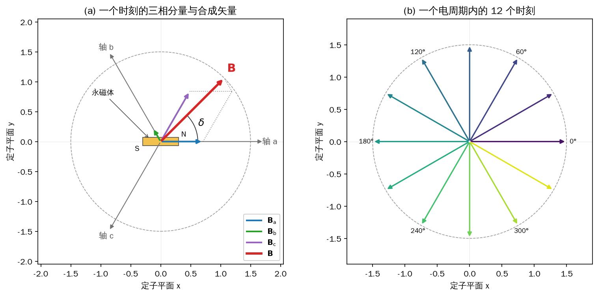

*图 2-1 FOC 的磁场矢量合成：左图是一个时刻的三相分矢量、虚线平行四边形与合成矢量，右图是一个电周期内 12 个时刻的合成矢量*

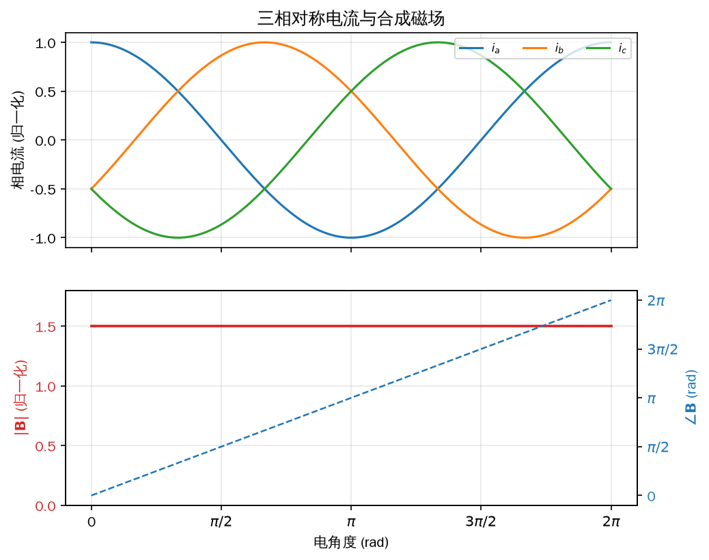

*图 2-2 三相电流与合成磁场：三路正弦电流互差 \(120^\circ\)，合成磁场幅值恒为 \(1.5I\)，角度随电角度线性增加*

图 2-1 左图的永磁体画在 \(0^\circ\)，合成磁场在 \(45^\circ\)，夹角 \(\delta\) 就是当前能产生力矩的相位差。右图的 12 根箭头每隔 \(30^\circ\) 电角度取一次，长度都落在半径 1.5 的圆上。图 2-2 下半部分的红线是合成磁场的幅值，它是一条水平线；蓝虚线是合成磁场的角度，从 0 线性增到 \(2\pi\)。角度和幅值分别对应“转到哪”和“磁场多强”，这正是 FOC 要独立控制的两个量。

本节只建立物理图像，不重写 FOC 的电流环。实际电机的开关频率、死区补偿、磁链观测和无感控制都有专门文献；对使用关节电机的读者，重要的是记住三件事：磁场由三相电流合成，力矩由磁场与永磁体的夹角决定，驱动器已经把这个过程封装成了力矩命令。

## 2.2 关节电机的机械与传感

A1 的关节不是“买一台电机，再外接一个减速器”的松散组合，而是把定子、转子、驱动板、编码器、行星减速器、交叉滚子轴承和输出盘塞进同一个圆柱壳体里的动力单元。这样做的直接好处是短、轻、同轴：电机的高转速经过一级减速后直接从输出盘输出，中间没有联轴器、同步带或外置轴承的间隙。对四足机器人来说，腿部的安装空间和重量都非常紧张，集成度本身就是性能。

电机本体适合高转速、低力矩，关节需要低转速、大力矩，两者之间靠行星减速器（planetary reducer）匹配。传动链是：太阳轮固定在转子轴端，行星轮同时与太阳轮和齿圈啮合，行星架带动输出轴。齿圈固定时，太阳轮转一圈，行星轮既自转又绕太阳轮公转，行星架只转过一个很小的角度。设转子角速度为 \(\omega_{\mathrm{rotor}}\)、输出角速度为 \(\omega_{\mathrm{out}}\)，理想情况下

\[ N = \frac{\omega_{\mathrm{rotor}}}{\omega_{\mathrm{out}}} = \frac{\tau_{\mathrm{out}}}{\tau_{\mathrm{rotor}}} \approx 9.1 \]

也就是说，转子转 9.1 圈，输出轴才转 1 圈；输出力矩放大约 9.1 倍，转速降为 1/9.1。实际传动有摩擦、搅油和轴承损失，输出力矩会略小于 \(9.1\tau_{\mathrm{rotor}}\)，回差和效率也要看加工与装配。

图 2-3 把 12 个零件沿轴向拆开。按图中编号，它们分别是：

- 1 端盖：封住输出端，给轴承和输出轴定位。
- 2 输出轴：与机器人连杆连接，把力矩送出去。
- 3 输出行星架：固定三个行星轮，把公转运动汇总到输出轴。
- 4 交叉滚子轴承：同时承受径向力、轴向力和弯矩，保证输出盘在受载时不偏摆。
- 5 行星轮：同时与太阳轮和齿圈啮合，是减速器的核心传动件。
- 6 齿圈：内圈带齿，固定在壳体上，给行星轮提供反作用。
- 7 太阳轮：装在转子轴端，是减速器的输入。
- 8 转子：贴有永磁体，跟随定子的旋转磁场转动。
- 9 驱动板：集成 MOS 管、电流采样和 FOC 控制电路，把命令变成三相电压。
- 10 定子线圈：三相对称绕组，通电后产生旋转磁场。
- 11 固定螺母：压紧转子或轴承，承受轴向预紧。
- 12 外壳：把定子、转子和减速器固定成一个整体，并参与散热。

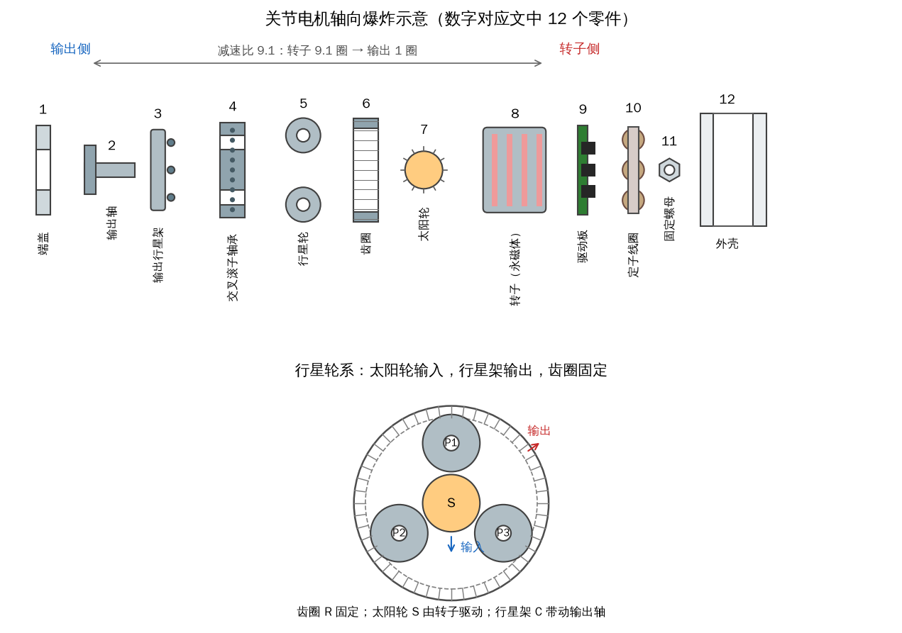

*图 2-3 关节电机爆炸示意：输出侧在左、转子侧在右，12 个零件按编号排列；下方放大太阳轮—行星轮—齿圈的传动链*

重绘图保留了“太阳轮—行星轮—齿圈—行星架”这条链，而不是只画一个写着“减速器”的方块。看这张图时要抓住两个界面：左边是输出侧，和腿的连杆相连；右边是转子侧，命令里的位置、速度、力矩都作用在这里。两者之间隔着 9.1 的减速比，后面所有换算都从这条分界线来。

编码器（encoder）装在转子一侧，测的是转子相对定子的绝对角度，不是输出轴的角度。按输出方式分，编码器有增量式、多圈绝对式和单圈绝对式；关节里用的是单圈绝对式。它上电就能读出转子在一圈内的绝对位置，不需要像增量编码器那样先找零，但“转了几圈”并不存在编码器里。

可以用一个改过的钟表来理解。每次看表，读到的是“当前是几点”，这个读数永远落在 0 到 24 点之间；如果从 23 点再过 2 小时，表盘先走到 24 点，日期加一天，然后从 0 点重新走到 1 点。为了算经过的时间，你可以把它记成“25 点”，但表盘本身只显示 1 点。单圈绝对编码器就是这样：一圈内的角度 \(\theta_0\) 是绝对的，范围 \([0,2\pi)\)；每转过 \(2\pi\)，驱动器把圈数 \(n\) 加一，于是读数可以写成

\[ \theta_{\mathrm{enc}} = \theta_0 + 2\pi n \]

断电之后 \(n\) 清零，只剩 \(\theta_0\)。举例来说，当前读数是 \(2.3\pi\)，说明上电后已经转过一整圈，圈数 \(n=1\)，当前位于 \(0.3\pi\)；此时断电、不转动、再上电，读数就变成 \(0.3\pi\)，圈数回到 0。读数差了 \(2\pi\)，但转子实际位置一点没变。

这个性质对控制有两个直接影响。第一，通电期间可以放心使用累计的多圈角度，轨迹跟踪和位置保持都靠它；一旦重新上电，圈数基准丢失，上层必须重新建立零位，不能把断电前的多圈角度当成绝对位置继续用。第二，编码器在减速器之前，读到和下发的角度、角速度都以转子为基准；如果要按输出端规划，必须乘或除以 9.1。这是 2.3 节换算和 2.6 节模式示例的共同前提。

下面的示例让转子从 0 转到 3 圈，按“单圈绝对 + 上电累计圈数”生成读数，并在 \(2.3\pi\) 处模拟一次断电重启。

```python
{{#include code/ch02/2_2_encoder_wrap.py}}
```

```console
{{#include code/ch02/2_2_encoder_wrap.out}}
```

断电前读数为 \(2.3000\pi\)，其中单圈部分 \(0.3000\pi\)、圈数 1；重启后读数变为 \(0.3000\pi\)，圈数为 0；两次读数相差 \(2\pi\)。继续转到 3 圈时，单圈读数回到 \(0\)，累计读数也回到 \(0\)，而输出轴角度是 \(6\pi/9.1=2.0714\) rad。这组数字把“单圈绝对、多圈临时”和“转子侧对输出侧”两件事放在了一起。

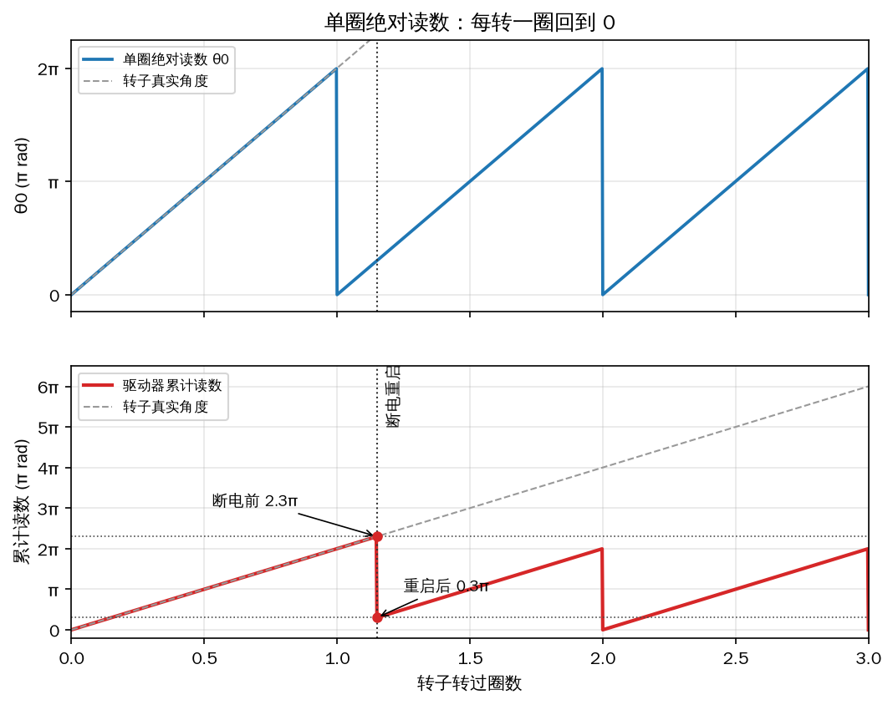

*图 2-4 单圈编码器的读数：上图是一圈内的绝对角度，每转一圈回到 0；下图是驱动器累计读数，断电重启时从 \(2.3\pi\) 跳回 \(0.3\pi\)*

拆解电机、更换编码器或重新标定零位都属于 **【需要实机】** 的操作。编码器零位与输出轴机械零位之间通常有安装偏差，装配后要用工装把输出轴固定在已知角度，再记录编码器读数，把这个偏置写进上层软件；只靠读数是无法知道机械零位在哪的。本书的示例只做数值模拟，不涉及拆装和标定。

## 2.3 混合控制律：五个量决定一个关节

关节驱动器内部已经把 FOC、电流环和编码器封装好了，上位机看到的是一个“力矩接口”。但机器人控制器通常不是只给力矩：站立时希望关节停在某个角度，行走时希望它按某个速度摆动，落地时又希望它表现得软一些。把这些需求统一起来，就是宇树关节电机的混合控制：每条命令带五个量——前馈力矩 \(\tau_{\mathrm{ff}}\)、期望位置 \(p_{\mathrm{des}}\)、期望速度 \(\omega_{\mathrm{des}}\)、位置刚度 \(k_p\)、速度刚度（阻尼）\(k_d\)。

驱动器把这五个量按下式合成转子力矩目标：

<!-- 原书式（2.1） -->
\[ \tau = \tau_{\mathrm{ff}} + k_p\left(p_{\mathrm{des}} - p\right) + k_d\left(\omega_{\mathrm{des}} - \omega\right) \tag{2-1} \]

式中 \(\tau\) 是转子输出力矩目标，单位 N·m；\(p\) 是当前转子角度，单位 rad；\(\omega\) 是当前转子角速度，单位 rad/s；\(p_{\mathrm{des}}\)、\(\omega_{\mathrm{des}}\) 是对应的目标值。\(k_p\) 的单位是 N·m/rad，\(k_d\) 的单位是 N·m·s/rad。

三项的分工很清楚。前馈项 \(\tau_{\mathrm{ff}}\) 不依赖任何误差，用来抵消重力、惯性力、摩擦力等已知载荷；位置项 \(k_p(p_{\mathrm{des}}-p)\) 像一根扭簧，把转子拉向目标角度，\(k_p\) 越大，同样的角度偏差产生的力矩越大，关节越“硬”；速度项 \(k_d(\omega_{\mathrm{des}}-\omega)\) 像阻尼器，转子转得比目标快时它往回拉，转得慢时它往前推，用来抑制超调和振荡。把某一项的系数设为零，式（2-1）就退化成一种更简单的模式，2.6 节的六种模式都是它的特例。

这里要区分“目标”和“增益”。\(\tau_{\mathrm{ff}}\)、\(p_{\mathrm{des}}\)、\(\omega_{\mathrm{des}}\) 是每个控制周期都可能变化的指令；\(k_p\)、\(k_d\) 是整定后相对稳定的参数。原书把五个量统称为“控制指令”，严格说后两个是增益，不是逐周期下发的指令。把它们分开看，调试时就不容易乱：先决定关节要多硬、多黏，再决定让它去哪、用多大力。

式（2-1）里的 \(p\)、\(\omega\) 是驱动器自己测到的转子状态，不是上位机算出来的输出端状态。如果上层按输出端角度规划，换算关系是

\[ p = N p_{\mathrm{out}},\qquad \omega = N \omega_{\mathrm{out}},\qquad p_{\mathrm{des}} = N p_{\mathrm{des,out}},\qquad \tau_{\mathrm{ff}} \approx \frac{\tau_{\mathrm{out}}}{N} \]

其中 \(N=9.1\)。把前两式代入式（2-1），得到用输出端量表示的形式：

\[ \tau = \tau_{\mathrm{ff}} + N k_p\left(p_{\mathrm{des,out}} - p_{\mathrm{out}}\right) + N k_d\left(\omega_{\mathrm{des,out}} - \omega_{\mathrm{out}}\right) \tag{2-2} \]

式（2-2）说明，如果直接把按输出端整定好的 \(k_p\)、\(k_d\) 填进命令，等效增益会被放大 9.1 倍。反过来，转子侧增益 \(k_p\) 对应的输出刚度是 \(9.1k_p\)；评估输出端响应时要把这个因子算进去。力矩的换算方向相反：输出端要 \(1\ \mathrm{N\cdot m}\)，转子侧前馈大约给 \(1/9.1\approx0.11\ \mathrm{N\cdot m}\)，还没算摩擦和效率。

还要强调，式（2-1）给出的是力矩目标，不是线圈电压。驱动器内部还有电流环，把 \(\tau\) 跟踪成电磁力矩；这个跟踪受母线电压、反电动势、电流上限和温度限制。高速时反电动势抬高，电压余量变小，同样的力矩目标可能达不到；堵转或大误差时电流迅速上升，电源和驱动器会保护。因此命令里的 \(\tau\) 只是“想要多大力”，不是“一定有多大力”。

增益不是越大越好。\(k_p\) 过大会让位置阶跃产生很大的瞬时力矩，引起超调、振荡，甚至触发过流或电源保护；\(k_d\) 过大虽然抑制振荡，但会让响应变慢、发热增加。整定的顺序建议是：先把 \(k_p\) 设得很小，确认方向、零位和编码器符号；再加一点 \(k_d\) 把振荡压住；然后逐步提高 \(k_p\) 直到跟踪够快但不过冲；最后加 \(\tau_{\mathrm{ff}}\) 补偿重力，让位置环不必靠稳态误差来支撑。每次只改一个参数，改完先做小幅测试。

下面的示例用一个单关节模型比较九组增益。模型是转动惯量 \(J=0.05\ \mathrm{kg\cdot m^2}\)、黏性阻尼 \(b=0.1\ \mathrm{N\cdot m\cdot s/rad}\)、恒负载 \(0.5\ \mathrm{N\cdot m}\)，目标是 1 rad 的位置阶跃，力矩上限取 A1 的 33.5 N·m。

```python
{{#include code/ch02/2_3_hybrid_pd.py}}
```

```console
{{#include code/ch02/2_3_hybrid_pd.out}}
```

结果可以分成三组看。\(k_d=0\) 时，系统只剩电机本身的黏性阻尼，\(k_p=5\) 的超调为 55.6%，调节时间 3.81 s，稳态误差 0.1000 rad；\(k_p=20\) 的超调升到 80.8%，\(k_p=80\) 更是达到 84.7%，而且初始力矩顶到 33.5 N·m 的上限。\(k_d=0.5\) 把超调压到 33.8%（\(k_p=20\)）和 56.1%（\(k_p=80\)），调节时间缩短到 0.56 s 和 0.60 s。\(k_d=2\) 时，\(k_p=5\) 变成过阻尼，响应要 1.53 s 才进入误差带；\(k_p=80\) 则只用了 0.15 s，超调 12.8%。

稳态误差一栏印证了式（2-1）的结构：只有比例项时，力矩必须靠位置误差来产生，恒负载 0.5 N·m 对应的误差就是 \(0.5/k_p\)，即 \(k_p=5\) 时 0.1 rad、\(k_p=20\) 时 0.025 rad、\(k_p=80\) 时约 0.0063 rad（仿真 0.0062）。加前馈 \(\tau_{\mathrm{ff}}=0.5\ \mathrm{N\cdot m}\) 可以把这项误差消掉，而不必继续加大 \(k_p\)。这也解释了为什么行走控制里前馈和 PD 要一起用。

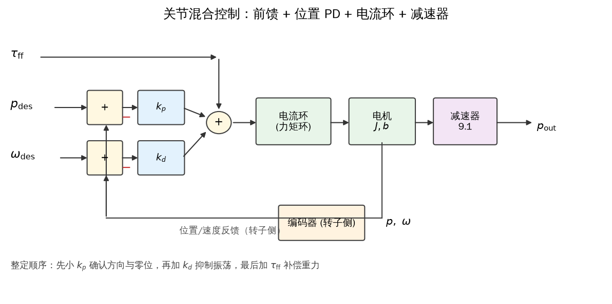

*图 2-5 关节混合控制框图：前馈力矩与位置/速度反馈相加，经电流环、电机和 9.1 减速器输出；编码器反馈的是转子侧 \(p,\omega\)*

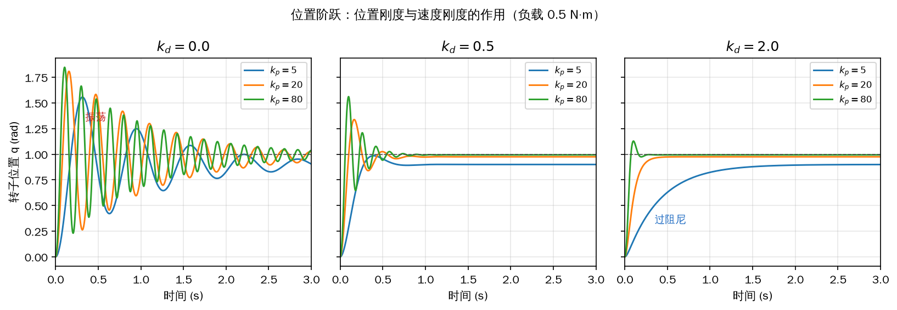

*图 2-6 九组增益下的位置阶跃：左列 \(k_d=0\) 明显振荡，中列 \(k_d=0.5\) 较快但仍有超调，右列 \(k_d=2\) 偏过阻尼*

图 2-5 里有一个容易忽略的细节：反馈取自减速器之前的转子，输出端的 \(p_{\mathrm{out}}\) 只是给上层看的。如果上层用输出端角度做轨迹，却把目标直接填进 \(p_{\mathrm{des}}\) 而不乘 9.1，关节输出只会转到目标的约 1/9；反过来，如果把输出端增益直接填进 \(k_p\)，等效刚度会大 9.1 倍。这两种错误在实机上都很常见。

本节示例的负载参数只是 A1 关节的近似值，真实关节还有库仑摩擦、齿隙、连杆惯量和通信延迟。增益整定是 **【需要实机】** 的工作：在悬挂架或空载台上，从小增益开始，逐项确认方向、零位、限位和温升，再把参数用到整机上。仿真能告诉你趋势，不能代替实机上的稳定性判断。

## 2.4 接线、上电与配置

A1 关节的电气接口有三个：中间是 24 V 直流电源，两侧各是一个 RS-485 接口。两个 RS-485 接口在壳体内部是并联的，所以可以把第一台的另一个口接到第二台，第二台再接到第三台，形成菊花链，不需要额外的分线器。RS-485 的固定波特率是 4.8 Mbit/s，数据格式 8N1（8 个数据位、无校验、1 个停止位）。计算机一般没有原生 RS-485，需要一根 USB 转 RS-485 的转接器。

上电顺序要固定下来：先接 24 V 电源和 RS-485 线，核对电源极性、A/B 线序和共地，确认无误后再给 24 V 上电。带电插拔通信线，插头抖动的瞬间可能在收发器上产生高压，轻则丢包，重则损坏接口。电源的电流上限要能覆盖峰值力矩对应的电流；如果电源只有 2 A，而关节在大误差下瞬间要 10 A，保护会直接把电断掉，表现成“电机突然不转”。上电后绿色指示灯开始闪烁，说明驱动器已经启动。

一条总线最多挂 3 台电机，因为协议给普通 ID 只留了 0、1、2 三个值。每台电机的 ID 必须唯一；命令帧里的 ID 与某台电机一致时，只有那一台执行，ID 为 0xBB 时所有电机都执行，但都不返回状态。总线两端可以各加一个 120 Ω 终端电阻，线缆尽量短、用双绞线，所有设备共地。4.8 Mbit/s 对 RS-485 来说很高，线长、终端匹配和转接器质量都会直接影响误码率。

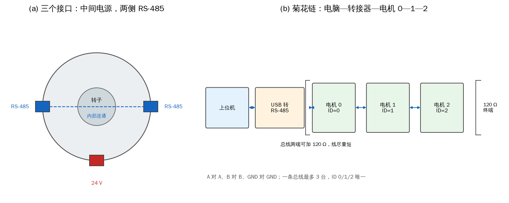

*图 2-7 关节电机的三个接口与菊花链拓扑：中间 24 V，两侧 RS-485 内部连通；一条总线最多 3 台，两端可加 120 Ω*

在 Linux 下，设备以文件形式出现在 `/dev` 目录。把转接器插上后，可以用下面的命令找串口名：

```text
cd /dev
ls | grep ttyUSB
```

如果输出 `ttyUSB0`，完整路径就是 `/dev/ttyUSB0`。也可以直接 `ls /dev/ttyUSB*`。编号会随插拔顺序、USB 端口和系统枚举变化，今天叫 `ttyUSB0`，明天可能叫 `ttyUSB1`；可以用 `dmesg | tail` 看内核识别日志，用 `lsusb` 确认转接器的厂商和型号，或者按序列号写一条 udev 规则，把名字固定成 `/dev/a1_motor`。普通用户访问串口需要 `dialout` 组权限：

```text
sudo usermod -aG dialout $USER
```

重新登录后生效。长期用 `sudo` 跑控制程序不是好习惯：程序会以 root 身份写总线，出错时更难排查。

下面的示例扫描 `/dev/ttyUSB*` 和 `/dev/ttyACM*`，打印设备名、权限和所属组，并生成一条 udev 规则模板。没有插转接器时，它只打印“未发现 USB 串口”，以 0 退出。

```python
{{#include code/ch02/2_4_serial_scan.py}}
```

```console
{{#include code/ch02/2_4_serial_scan.out}}
```

规则里的 `idVendor`、`idProduct`、`serial` 要用 `lsusb` 和 `udevadm info -a -n /dev/ttyUSB0` 查到的实际值替换。写好之后放到 `/etc/udev/rules.d/99-a1-motor.rules`，执行 `sudo udevadm control --reload-rules`，再重新插拔转接器，就会出现固定的符号链接。

每台电机出厂时都有一个 ID，多台串在同一条总线上时必须重新分配。修改 ID 的流程分三步：上位机用广播地址 0xBB 让总线上的所有电机进入“改 ID 模式”；此时输出轴变成电子棘轮，转动时有明显的顿挫，转一次对应 ID 0，转两次对应 ID 1，转三次对应 ID 2；转完后在终端输入 `a` 并回车，驱动器把 ID 写入。电子棘轮不是机械棘轮，它是驱动器主动生成的定位感，所以必须在通电、进入改 ID 模式之后才能感觉到。

原书的工具在 `unitree_actuator_sdk` 的 `ChangeID_Tools` 目录下，Linux 版可执行文件叫 `ChangeID`，运行时需要管理员权限：

```text
cd unitree_actuator_sdk/ChangeID_Tools/Linux
sudo ./ChangeID
```

程序会先问串口名，输入 `/dev/ttyUSB0` 后显示 `The motor ID is: BB`。这里的 `BB` 是广播地址，不是当前 ID，也不是可以分配给电机的值。输出轴的电子棘轮刚度较大，建议在输出盘上装两颗 M4 工装螺钉，用杠杆转；螺钉旋入深度不能超过 5 mm，否则会顶到减速器内部。一次只改一台，或者至少确保能分清正在转的是哪一台；三台同时进入改 ID 模式时，程序只看得到转动次数，看不出是哪台在动。改完重新上电，再逐台发命令验证。

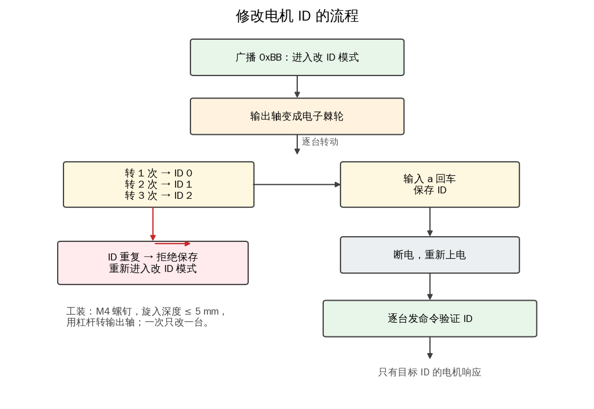

*图 2-8 修改 ID 的流程：广播进入改 ID 模式，按棘轮次数选 0/1/2，按 a 保存，断电重上电后逐台验证*

下面的示例用三台模拟电机走一遍这个过程。第一次故意让两台都转一次，制造重复 ID，保存被拒绝；第二次重新广播，三台分别转 1、2、3 次，保存成功。

```python
{{#include code/ch02/2_4_id_tool.py}}
```

```console
{{#include code/ch02/2_4_id_tool.out}}
```

第一次尝试里，M0 和 M1 都指向 ID 0，工具报“冲突”并拒绝保存，三台电机的 ID 保持原值；第二次广播把棘轮计数清零，M0、M1、M2 分别转 1、2、3 次，得到 0、1、2，保存成功。这个“先冲突再重来”的过程在实机上也会遇到：转错次数、或者在错误的时间按了 `a`，都必须重新进入改 ID 模式，不能在半途改计数。

软件层面，原书用 `unitree_actuator_sdk`，它提供 Linux（x86/x64、ARM32/ARM64）和 Windows（x64）下的 C、C++、Python、ROS 示例。本书不复制这套 SDK，而是用共用包 `quadruped.motor` 复现同样的协议：`MotorCmd` 和 `MotorState` 保存物理量，`encode_master_cmd`/`decode_servo_state` 负责 34/78 字节帧，`Rs485MotorBus` 把串口参数集中在 `MotorBusConfig` 里（端口、4.8 Mbit/s、8N1、超时、ID 列表）。换平台时只需要换串口后端，打包和解包的逻辑不变。原书的 ROS 示例基于 ROS 1；如果要在 ROS 2 里用，概念对应为节点、发布/订阅和服务，串口访问仍然由驱动节点负责，具体命令属于 **【需要 ROS 2 环境】**，本书没有在本地验证。

通信不稳定时，排查顺序是电源、线序、串口名、ID，最后才是算法。CRC 失败通常表现为“帧被丢弃”，先换短线、检查 A/B 是否接反、确认转接器真的支持 4.8 Mbit/s；不要一看到电机不动就去调增益。权限问题则表现为“打不开串口”，和通信质量无关，先看 `dialout` 组和 udev 规则。

接线、上电、改 ID 和串口权限都属于 **【需要实机】** 的步骤。没有硬件时，可以用 `2_4_serial_scan.py` 确认系统里有没有串口，用 `2_4_id_tool.py` 把广播、棘轮计数、冲突检测和保存的逻辑走通；逻辑对了，接上实机只是把 `SimMotorBus` 换成 `Rs485MotorBus`。

## 2.5 让电机转起来：Python 范例

第一次让关节转动，程序不需要很长。最小结构是：打开串口，声明命令和状态两个结构体，填好 `mode` 和五个控制量，发送，读回 78 字节状态，解析出位置、速度、力矩，最后关闭串口。原书的示例在 `unitree_actuator_sdk/script/check.py`，串口名在 Windows 下写成 `b'\\\\.\\COM4'` 这类字节串，在 Linux 下写成 `b'/dev/ttyUSB0'`；命令和状态分别对应 `MOTOR_send` 与 `MOTOR_recv`，字段布局在 `typedef.py` 里。Ctypes 的 `byref()` 只是把结构体地址传给打包函数，理解成“把这块内存交给打包函数”即可。

`mode` 有三个常用值：0 停转，5 开环缓慢转动，10 闭环伺服控制。0 和 5 不读取后面的五个控制量，适合第一次确认“能通信、能转、方向对”。10 才同时使用前馈、位置、速度、两个增益，并返回真实状态。第一次进入伺服模式，应该把目标位置设成当前角度，增益给小值，让关节先“扶住”而不是“冲过去”。

命令是持续的：电机收到一条命令后会一直执行，直到新命令到达。程序正常退出前必须显式发一条 `mode=0`，否则关节会保持最后的力矩或位置目标。更稳妥的做法是加一个看门狗：上位机每隔几十毫秒发一次命令，超过设定时间没有新命令，驱动器就切到零力矩或阻尼。调试时手边要有断电开关，程序异常、关节异响或温度飙升时先断电，再看日志。

状态帧固定 78 字节。解析顺序是：先看包头 `0xFE 0xEE`，再核对 `motorID`，然后算 CRC，任何一步失败都丢弃整帧，不要“凑合用”半帧数据。校验通过后再取温度、错误码、力矩、转速、位置和 IMU。温度用来做降额和保护，错误码用来区分过流、过压、编码器故障，`LW` 是滤波后的转速、有延迟，控制环里不要用它。`mode=5` 时原书说返回的状态全是 0，这是正常的：开环模式不上报真实状态，想看曲线必须切到 10。

平台差异主要在串口名和驱动。Windows 是 `COMx`，Linux 是 `/dev/ttyUSBx`；4.8 Mbit/s 需要转接器和线材都支持，很多便宜的 CH340 类适配器跑不到这个速率，表现是随机丢包或 CRC 失败。Python 的 `pyserial` 可以设置 `baudrate=4800000`，但设置成功不等于链路可靠，仍要用实际收发验证。

下面的示例用 `SimMotorBus` 复现原书流程：先以 `mode=5` 开环慢转 1 s，再切到 `mode=10` 用当前角度做位置保持，最后发 `mode=0` 停转。每条命令都经过 34 字节打包，每个状态都经过 78 字节打包，流程和真实总线一致。

```python
{{#include code/ch02/2_5_motor_python.py}}
```

```console
{{#include code/ch02/2_5_motor_python.out}}
```

开环段结束时转子到 1.2000 rad，速度 1.1953 rad/s（帧内按 1/128 量化），力矩为 0；切到伺服后，目标就是切换瞬间的角度，关节先被负载拉低约 0.05 rad，再稳定在 1.1497 rad，力矩 0.3984 N·m，温度从 25.00 °C 升到 25.25 °C。停转后力矩归零，位置保持不变。位置保持的稳态误差约 0.0503 rad，正好对应 \(k_p=8\) 时 \(0.4/8=0.05\) 的负载误差。 示例里的 78 字节编解码调用共用包；2.7 节会说明共用包状态布局与 T02 的差异，接实机时以 2.7 的逐字节实现为准。

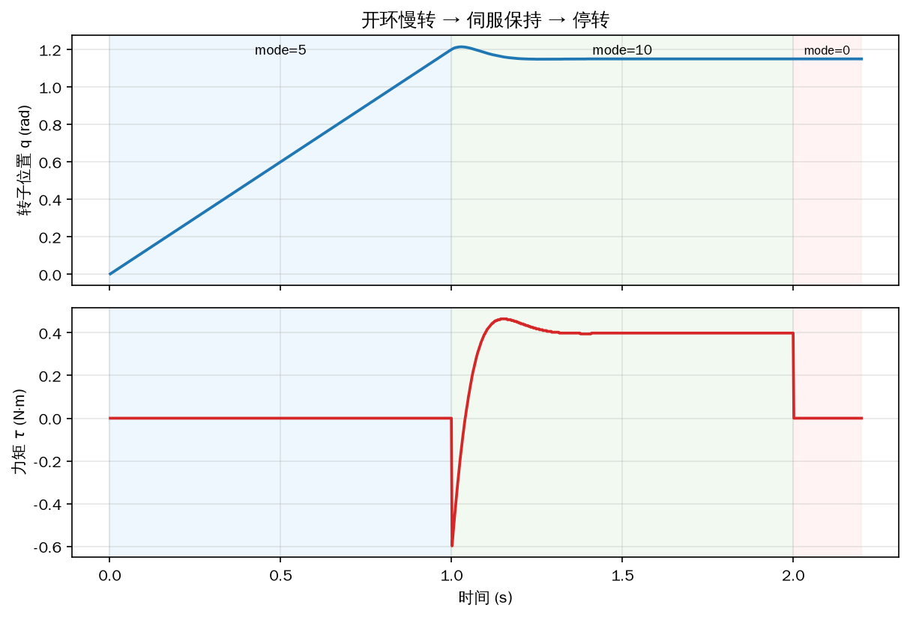

*图 2-9 开环慢转、伺服保持与停转：上图是转子位置，下图是力矩；切换瞬间速度误差让阻尼项产生一个负向尖峰*

图 2-9 的力矩在 1.0 s 处先向下冲到 -0.6 N·m，再回到 0.4 N·m。这是速度项在起作用：切换瞬间转子还在以 1.2 rad/s 正转，而 \(\omega_{\mathrm{des}}=0\)，\(k_d(\omega_{\mathrm{des}}-\omega)\) 给出负力矩，先把速度刹住，位置项再慢慢把误差补回来。如果没有这个负向尖峰，说明 \(k_d\) 太小或者符号反了。

`mode=5` 那一段的曲线在仿真里是真实位置，在实机上却会读到全 0。这是仿真和原书说法的一个差异：仿真为了让读者看到开环转动，返回了真实状态；实机固件在开环模式不上报状态。判断关节是否真的在转，要看编码器读数的变化或直接观察，不能只看终端打印。

示例带 `--port` 和 `--real` 两个参数：

```text
python3 2_5_motor_python.py --port /dev/ttyUSB0 --real
```

`--real` 路径会走 `Rs485MotorBus`，需要真实的 USB 转 RS-485 和 24 V 电源，属于 **【需要实机】**。本书的共用包只实现了打包/解包，`Rs485MotorBus.open()` 留作平台相关的扩展点；在接实机前要补上 `pyserial` 的打开、读写和超时处理，或者直接使用厂商 SDK。默认的模拟路径不需要硬件。

首次试转的安全清单很短：把关节架空或固定在台钳上，输出轴不带负载；确认命令里的 ID 是要转的那台；手放在电源开关上；先 `mode=5` 看方向和速度，再 `mode=10` 用小增益扶住；任何异常先发 `mode=0` 再断电。不要用加大力矩的办法去“试”一个不转的电机，那通常说明 ID、模式或接线有问题。

## 2.6 六种控制模式：同一公式的六个特例

式（2-1）只有五个量，改变它们的取值就能得到六种常用模式。把六种情况写在一起：

\[ \begin{array}{ll} \tau=\tau_{\mathrm{ff}}, & k_p=k_d=0\ \text{（力矩）}\\ \tau=k_p\left(p_{\mathrm{des}}-p\right), & \tau_{\mathrm{ff}}=0,\ \omega_{\mathrm{des}}=0,\ k_d=0\ \text{（位置）}\\ \tau=k_d\left(\omega_{\mathrm{des}}-\omega\right), & \tau_{\mathrm{ff}}=0,\ k_p=0\ \text{（速度）}\\ \tau=-k_d\,\omega, & \tau_{\mathrm{ff}}=0,\ k_p=0,\ \omega_{\mathrm{des}}=0\ \text{（阻尼）}\\ \tau=0, & \tau_{\mathrm{ff}}=k_p=k_d=0\ \text{（零力矩）}\\ \tau=\tau_{\mathrm{ff}}+k_p\left(p_{\mathrm{des}}-p\right)+k_d\left(\omega_{\mathrm{des}}-\omega\right), & \text{（混合）} \end{array} \tag{2-3} \]

六种模式不是六套算法，而是同一个 PD + 前馈控制律在不同参数下的特例。下面的示例让同一个关节模型依次运行六种模式，每种 1.5 s，每次从各自的初始条件重新开始。

```python
{{#include code/ch02/2_6_modes.py}}
```

```console
{{#include code/ch02/2_6_modes.out}}
```

**位置模式。** 取 \(k_p>0\)、\(k_d>0\)、\(\tau_{\mathrm{ff}}=0\)、\(\omega_{\mathrm{des}}=0\)，关节会稳定在 \(p_{\mathrm{des}}\)。示例取 \(k_p=20\)、\(k_d=1\)、目标 1 rad，稳态误差 0.0100 rad，最大力矩 20.00 N·m，超调 11.5%。目标突变时，位置误差乘以 \(k_p\) 会立刻变成大力矩，电流也跟着冲高；实机上要么给目标加斜坡，要么把一次大阶跃拆成很多小步。四足站立时小腿关节的力臂长、负载大，通常要给比大腿更高的 \(k_p\)，否则一压就软。

**速度模式。** 取 \(k_p=0\)、\(k_d>0\)、\(\tau_{\mathrm{ff}}=0\)，位置项消失，只剩速度误差的比例控制。示例取 \(k_d=1.5\)、目标 2 rad/s，转子稳定在 1.75 rad/s，误差 0.2500 rad/s，最大力矩 3.00 N·m。这个误差不是 bug：要让关节克服 0.2 N·m 的恒负载和 0.1 的黏性摩擦，速度环必须保留一个误差，\(k_d(2-\omega)=0.2+0.1\omega\) 的解就是 1.75。增大 \(k_d\) 能减小静差，但太大会引起速度超调和电流尖峰；加前馈或改用混合模式是更好的办法。

**阻尼模式。** 它是速度模式令 \(\omega_{\mathrm{des}}=0\) 的特例，力矩变成 \(\tau=-k_d\omega\)：外力转得越快，反向阻力越大；松手后速度被控到 0，关节停在当前位置。示例取 \(k_d=0.5\)，初始速度 4 rad/s，最大力矩 2.00 N·m，1.5 s 后速度回到 0。要注意，阻尼模式只反抗运动，不负责支撑重力；如果关节上有恒负载，它会以 \(-\tau_{\mathrm{load}}/k_d\) 的速度缓慢下滑。示例在阻尼和零力矩两组里关掉了恒负载，否则曲线会被下滑掩盖。阻尼模式适合柔顺交互、碰撞缓冲和安全默认态，手感与断电、零力矩都不同。

**力矩模式。** 取 \(k_p=k_d=0\)，只剩 \(\tau_{\mathrm{ff}}\)，关节输出一个恒定力矩。示例取 \(\tau_{\mathrm{ff}}=1.0\ \mathrm{N\cdot m}\)，负载 0.2 N·m，1.5 s 后转速到 7.559 rad/s，仍在上升。空载时它会一直加速，直到反电动势和电压限制让电流再也上不去；堵转时速度为零，电流和发热持续累积，很快会触发热保护。力矩模式必须“先小后大”，输出轴固定好、手边能断电，绝不能用大 \(T\) 去“顶”一个卡住的关节。

**零力矩模式。** 五个量全为 0，力矩目标为 0，电机尽量不产生力矩，适合拖动示教、检查卡滞。示例给 4 rad/s 的初速度，1.5 s 后还剩 0.220 rad/s，这是轴承和减速器的机械阻尼造成的，不是电机在主动刹车。零力矩模式仍然通电，电流环还在工作，不是机械离合，不能代替断电；长时间堵转或反复拖动仍可能发热。

**混合模式。** 五个量同时有效，是行走控制最常用的形式。示例取 \(\tau_{\mathrm{ff}}=0.2\)、\(k_p=20\)、\(k_d=1\)、目标 1 rad，前馈正好抵消 0.2 N·m 的恒负载，稳态误差 0.0000 rad，最大力矩 20.20 N·m，超调 12.6%。整定顺序建议是“重力前馈 → 位置跟踪 → 阻尼抑振”：先让前馈把静态负载担起来，再用 \(k_p\) 建立跟踪，最后用 \(k_d\) 压住振荡。通信延迟会额外产生 PD 力矩：位置和速度状态晚到几毫秒，误差就已经变了，增益越大越敏感，所以高增益必须配合高控制频率和低延迟。

参数范围是协议能表示的范围，不是安全范围。由 2.7 节的定点压缩可推出 \(|T|<128\ \mathrm{N\cdot m}\)、\(|W|<256\ \mathrm{rad/s}\)、\(|Pos|<823549\ \mathrm{rad}\)、\(0\le K_P<16\)、\(0\le K_W<32\)。A1 的峰值力矩只有 33.5 N·m，持续力矩还受额定电流和散热限制；把 \(T=100\) 填进命令，协议收得下，电机却可能瞬间过流。位置和速度的上限同理，别把“能表示”当成“能长期跑”。

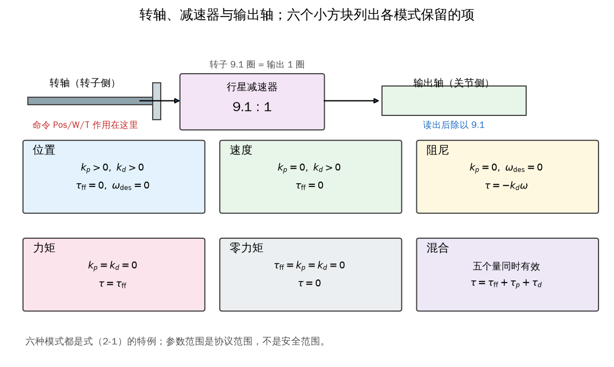

*图 2-10 转轴、减速器与输出轴的关系，以及六种模式各自保留的项；命令作用在转子侧，读数除以 9.1 才是输出侧*

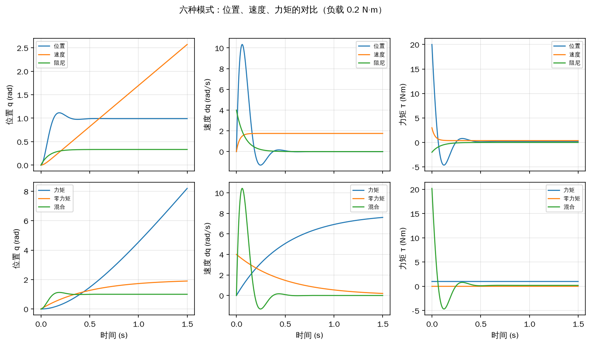

*图 2-11 六种模式的位置、速度、力矩对比：上排是位置/速度/阻尼，下排是力矩/零力矩/混合*

图 2-11 的上排里，位置模式的速度曲线先冲高再回零，力矩在起步时达到 20 N·m，随后落回负载值；速度模式的速度单调上升到 1.75 rad/s（稳态误差 0.25 rad/s），力矩在起步时最大，为 3.00 N·m（\(k_d\) 乘以 2 rad/s 的初始速度误差），之后随速度误差减小而下降，稳态约 0.38 N·m，正好与负载力矩 \(0.2+0.1\omega\) 在 \(\omega=1.75\) 时平衡；由 \(1.5(2-\omega)=0.2+0.1\omega\) 可直接解出 \(\omega=1.75\ \mathrm{rad/s}\)。阻尼模式的速度从 4 rad/s 指数衰减，力矩从 2 N·m 衰减到 0。下排里，力矩模式的位置和速度都持续增长，零力矩模式靠机械阻尼慢慢停下，混合模式则在前馈的帮助下几乎无静差地停在 1 rad。

六种模式的实机验证顺序不能跳：位置 → 速度 → 阻尼 → 力矩 → 零力矩 → 混合。先位置是为了确认方向、零位和编码器符号；再速度是确认速度环的方向和静差；阻尼是确认外力下的阻抗手感；力矩和零力矩要架空、轻载；最后才把五个量一起用。每一步都属于 **【需要实机】**，做完一步再进下一步，出问题时才能定位到是哪一项。

## 2.7 报文协议与移植：34 字节与 78 字节

物理层是 RS-485：A、B 两根差分线加一根 GND，4.8 Mbit/s，8 个数据位、无校验、1 个停止位。A 对 A、B 对 B、GND 对 GND，不能按线缆颜色猜，线序与接线见图 2-13；A/B 接反时接收器可能把逻辑整个翻过来，表现成“完全收不到正确数据”。RS-485 是半双工，同一时刻只有一个发送者，USB 转接器通常自动切换收发方向，自研板卡则要自己控制 DE/RE。总线建议手拉手，不要星形分支，两端可加 120 Ω，线用双绞线并尽量短，所有设备共地。

一次控制要发一条 34 字节的命令，电机回一条 78 字节的状态。命令的结构是“4 字节包头 + 26 字节数据体 + 4 字节 CRC”，状态是“4 字节包头 + 70 字节数据体 + 4 字节 CRC”。不发命令，电机不会主动回状态；广播地址 0xBB 也不会回状态，因为总线上有多台电机，同时回复会冲突。

**表 2-1 给电机发送命令的报文格式（原书表 2.1，数据原样引用）**

<!-- 原书表 T01 -->
| 报文 | 字节 | 变量名 | 说明 |
| --- | --- | --- | --- |
| 数据包头 COMHead | 1 | `start[0]` | 包头，固定为 0xFE |
| 数据包头 COMHead | 2 | `start[1]` | 包头，固定为 0xEE |
| 数据包头 COMHead | 3 | `motorID` | 电机编号，可以为 0、1、2、0xBB，0xBB 代表向所有电机广播 |
| 数据包头 COMHead | 4 | `reserved` | 预留位，可忽略 |
| 数据体 MasterComdV3 | 5 | `mode` | 电机运行模式，可为 0（停转）、5（开环缓慢转动）、10（闭环伺服控制） |
| 数据体 MasterComdV3 | 6 | `ModifyBit` | 电机内部控制参数修改位，为 0xFF |
| 数据体 MasterComdV3 | 7 | `ReadBit` | 电机内部控制参数发送位，为 0xFF |
| 数据体 MasterComdV3 | 8 | `reserved` | 预留位，可忽略 |
| 数据体 MasterComdV3 | 9–12 | `Modify` | 电机参数修改数据，可忽略 |
| 数据体 MasterComdV3 | 13–14 | `T` | 电机前馈力矩 $\tau_{\mathrm{ff}}$，×256 倍描述 |
| 数据体 MasterComdV3 | 15–16 | `W` | 电机角速度命令 $\omega_{\mathrm{des}}$，×128 倍描述 |
| 数据体 MasterComdV3 | 17–20 | `Pos` | 电机角度位置命令 $p_{\mathrm{des}}$，$\times\frac{16384}{2\pi}$ 倍描述 |
| 数据体 MasterComdV3 | 21–22 | `K_P` | 电机位置刚度 $k_{\mathrm{p}}$，×2048 倍描述 |
| 数据体 MasterComdV3 | 23–24 | `K_W` | 电机速度刚度 $k_{\mathrm{d}}$，×1024 倍描述 |
| 数据体 MasterComdV3 | 25 | `LowHzMotorCmdIndex` | 电机低频率控制命令的索引，可忽略 |
| 数据体 MasterComdV3 | 26 | `LowHzMotorCmdByte` | 电机低频率控制命令，可忽略 |
| 数据体 MasterComdV3 | 27–30 | `Res[0]` | 预留位，可忽略 |
| CRC 校验 | 31–34 | `CRCdata` | CRC 校验位 |

数据取自原书表 2.1。

命令帧的包头是 `0xFE`、`0xEE`、`motorID`、一个保留字节。`motorID` 可以取 0、1、2，也可以取 0xBB 表示广播。`mode` 取 0、5、10；`ModifyBit` 和 `ReadBit` 固定为 0xFF；`Modify` 是参数修改数据，普通控制用不到；`T`、`W`、`Pos`、`K_P`、`K_W` 是五个控制量的定点表示；`LowHzMotorCmdIndex`、`LowHzMotorCmdByte` 和 `Res[0]` 都是低频命令或预留，填 0 即可。最后 4 字节是 CRC。

**表 2-2 电机接收状态的报文格式（原书表 2.2，数据原样引用）**

<!-- 原书表 T02 -->
| 报文 | 字节 | 变量名 | 说明 |
| --- | --- | --- | --- |
| 数据包头 COMHead | 1 | `start[0]` | 包头，固定为 0xFE |
| 数据包头 COMHead | 2 | `start[1]` | 包头，固定为 0xEE |
| 数据包头 COMHead | 3 | `motorID` | 电机编号，可以为 0、1、2。不会为 0xBB，因为广播模式下电机不会返回状态 |
| 数据包头 COMHead | 4 | `reserved` | 预留位，可忽略 |
| 数据体 ServoComdV3 | 5 | `mode` | 电机当前的运行模式 |
| 数据体 ServoComdV3 | 6 | `ReadBit` | 表示电机内部控制参数是否修改成功，可忽略 |
| 数据体 ServoComdV3 | 7 | `Temp` | 电机当前平均温度 |
| 数据体 ServoComdV3 | 8 | `MError` | 电机报错信息 |
| 数据体 ServoComdV3 | 9–12 | `Read` | 读取电机内部控制参数，可忽略 |
| 数据体 ServoComdV3 | 13–14 | `T` | 当前电机输出力矩，×256 倍描述 |
| 数据体 ServoComdV3 | 15–16 | `W` | 当前电机实际转速，×128 倍描述 |
| 数据体 ServoComdV3 | 17–20 | `LW` | 也表示当前电机实际转速，但是已经过滤波，所以会有延迟，不推荐使用 |
| 数据体 ServoComdV3 | 21–22 | `W2` | 为关节编码器预留，可忽略 |
| 数据体 ServoComdV3 | 23–26 | `LW2` | 为关节编码器预留，可忽略 |
| 数据体 ServoComdV3 | 27–28 | `Acc` | 当前电机转动加速度，×1 倍描述 |
| 数据体 ServoComdV3 | 29–30 | `OutAcc` | 为关节编码器预留，可忽略 |
| 数据体 ServoComdV3 | 31–34 | `Pos` | 当前电机角度位置，$\times\frac{16384}{2\pi}$ 倍描述 |
| 数据体 ServoComdV3 | 35–38 | `Pos2` | 为关节编码器预留，可忽略 |
| 数据体 ServoComdV3 | 39–40 | `gyro[0]` | 电机控制板上 IMU 在 $x$ 轴的角速度，乘 $\frac{2000}{2^{15}}\cdot\frac{2\pi}{360}$ 后可以换算为 rad/s |
| 数据体 ServoComdV3 | 41–42 | `gyro[1]` | 电机控制板上 IMU 在 $y$ 轴的角速度 |
| 数据体 ServoComdV3 | 43–44 | `gyro[2]` | 电机控制板上 IMU 在 $z$ 轴的角速度 |
| 数据体 ServoComdV3 | 45–46 | `acc[0]` | 电机控制板上 IMU 在 $x$ 轴的线加速度，乘 $8\times\frac{9.80665}{2^{15}}$ 后可以换算为 $\mathrm{m/s^2}$ |
| 数据体 ServoComdV3 | 47–48 | `acc[1]` | 电机控制板上 IMU 在 $y$ 轴的线加速度 |
| 数据体 ServoComdV3 | 49–50 | `acc[2]` | 电机控制板上 IMU 在 $z$ 轴的线加速度 |
| 数据体 ServoComdV3 | 51–52 | `Fgyro[0]` | 为足端 IMU 预留，可忽略 |
| 数据体 ServoComdV3 | 53–54 | `Fgyro[1]` | 为足端 IMU 预留，可忽略 |
| 数据体 ServoComdV3 | 55–56 | `Fgyro[2]` | 为足端 IMU 预留，可忽略 |
| 数据体 ServoComdV3 | 57–58 | `Facc[0]` | 为足端 IMU 预留，可忽略 |
| 数据体 ServoComdV3 | 59–60 | `Facc[1]` | 为足端 IMU 预留，可忽略 |
| 数据体 ServoComdV3 | 61–62 | `Facc[2]` | 为足端 IMU 预留，可忽略 |
| 数据体 ServoComdV3 | 63–64 | `Fmag[0]` | 为足端 IMU 预留，可忽略 |
| 数据体 ServoComdV3 | 65–66 | `Fmag[1]` | 为足端 IMU 预留，可忽略 |
| 数据体 ServoComdV3 | 67–68 | `Fmag[2]` | 为足端 IMU 预留，可忽略 |
| 数据体 ServoComdV3 | 69 | `Ftemp` | 足端传感器温度，可忽略 |
| 数据体 ServoComdV3 | 70–71 | `Force16` | 足端力传感器高 16 位数据，可忽略 |
| 数据体 ServoComdV3 | 72 | `Force8` | 足端力传感器低 8 位数据，可忽略 |
| 数据体 ServoComdV3 | 73 | `FError` | 足端力传感器错误标识，可忽略 |
| 数据体 ServoComdV3 | 74 | `Res[0]` | 预留位，可忽略 |
| CRC 校验 | 75–78 | `CRCdata` | CRC 校验位 |

数据取自原书表 2.2。

状态帧的包头与命令相同，但 `motorID` 不会是 0xBB。`mode` 是当前模式，`ReadBit` 表示内部参数是否修改成功，`Temp` 是平均温度，`MError` 是错误码。最常用的是 `T`、`W`、`Pos`：当前力矩、当前转速、当前角度。`LW` 也是转速，但经过滤波、有延迟，控制环里不要用；`W2`、`LW2`、`Pos2` 是给关节编码器预留的；`Acc` 是转动加速度；`gyro[0..2]` 和 `acc[0..2]` 是驱动板 IMU 的三轴角速度和线加速度；后面的 `Fgyro`、`Facc`、`Fmag`、`Ftemp`、`Force16`、`Force8`、`FError` 是足端传感器预留，当前用不到。

IMU 原始值要乘比例才变成物理量。角速度按 ±2000 °/s、15 位数值折算：

\[ \omega_{\mathrm{imu}} = \mathrm{gyro}\cdot\frac{2000}{2^{15}}\cdot\frac{2\pi}{360}\ \mathrm{rad/s} \]

线加速度按 ±8 g 折算：

\[ a_{\mathrm{imu}} = \mathrm{acc}\cdot\frac{8\times9.80665}{2^{15}}\ \mathrm{m/s^2} \]

量程和零偏要按实际 IMU 校准，直接用这两个式子只能得到量级正确的值。

定点压缩的通式是：物理量 \(x\) 乘一个比例因子 \(S_x\)，强制取整成有符号整数，接收端再除以同一个因子：

\[ x_{\mathrm{int}} = \operatorname{int}\left(S_x x\right),\qquad \hat{x} = \frac{x_{\mathrm{int}}}{S_x} \tag{2-4} \]

`T` 和 `W` 用 2 字节有符号数，`Pos` 用 4 字节有符号数。比例因子分别是 \(S_T=256\)、\(S_W=128\)、\(S_{Pos}=16384/(2\pi)\)、\(S_{K_P}=2048\)、\(S_{K_W}=1024\)。对应的分辨率是 \(1/256=0.003906\ \mathrm{N\cdot m}\)、\(1/128=0.0078125\ \mathrm{rad/s}\)、\(2\pi/16384=3.835\times10^{-4}\ \mathrm{rad}\)、\(1/2048=4.883\times10^{-4}\)、\(1/1024=9.766\times10^{-4}\)。数值越大，被截掉的小数部分占比越小，但绝对误差仍受这个分辨率限制。

2 字节有符号数有 16 位，其中 1 位是符号位，只剩 15 位表示大小。前馈力矩乘 256 之后必须落在这 15 位里，所以

<!-- 原书式（2.2） -->
\[ \left|\tau_{\mathrm{ff}}\right| < \frac{2^{15}}{256} = 128 \tag{2-5} \]

同样可以推出 \(|W|<2^{15}/128=256\)、\(|Pos|<2^{31}/(16384/(2\pi))\approx823549\)、\(0\le K_P<2^{15}/2048=16\)、\(0\le K_W<2^{15}/1024=32\)。这里把下界写成 0，是因为速度、阻尼、力矩模式下 \(K_P\) 必须为 0；原书写的 \(0<K_P<16\) 会把合法的 0 排除掉。这些是协议范围，不是安全范围：A1 的峰值力矩 33.5 N·m，远小于 128 N·m 的协议上限。

多字节字段一律小端，低字节在前。示例命令取 \(T=0.5\)、\(W=1.2\)、\(Pos=3.0\)、\(K_P=10\)、\(K_W=1.0\)：\(T\) 乘 256 得 128，即 `0x0080`，字节 13、14 是 `80 00`；\(W\) 乘 128 得 153，即 `0x0099`，字节 15、16 是 `99 00`；\(Pos\) 乘 2607.59 得 7822，即 `0x1E8E`；\(K_P\) 乘 2048 得 20480，即 `0x5000`；\(K_W\) 乘 1024 得 1024，即 `0x0400`。如果只把 \(K_P\) 填 20，乘 2048 得 40960，超过 16 位有符号正数的上限，帧里会饱和成 32767，也就是 15.9995，而不是 20。

CRC 用的是多项式 `0x04C11DB7`、初值 `0xFFFFFFFF`、从最高位开始逐位处理、最后不做异或的 32 位 CRC。原书的例程按 32 位字处理：命令的前 28 字节正好是 7 个字，所以 `len=7`，第 29、30 两个字节（属于 `Res[0]`）不参与；状态帧按 18 个字计算，覆盖前 72 字节，T02 中 CRC 前的最后两个字节（第 73 字节 `FError`、第 74 字节 `Res[0]`）不参与。CRC 本身放在命令的第 31–34 字节、状态的第 75–78 字节。收发放错字节序、或者 CRC 覆盖范围算错，表现都是“电机不动”或“状态全 0”。

下面的示例构造一条 `mode=10` 的命令帧，打印 34 字节的十六进制和小端字段；再按 T02 逐字节合成一条 78 字节状态帧，解析出位置、速度、力矩、温度和 IMU；最后故意翻转 1 个 bit，验证 CRC 能检出并拒绝。

```python
{{#include code/ch02/2_7_packet.py}}
```

```console
{{#include code/ch02/2_7_packet.out}}
```

命令帧的十六进制以 `FE EE 00 00 0A FF FF 00` 开头，`0A` 就是 10；偏移 12–13 的 `80 00` 是 \(T=0.5\)，偏移 16–19 的 `8E 1E 00 00` 是 \(Pos=3.0\) 的定点值 7822，偏移 20–21 的 `00 50` 是 \(K_P=10\)。解码回来的 \(W=1.195312\) 与原始 1.2 差了 \(4.69\times10^{-3}\)，\(Pos=2.999699\) 差了 \(3.01\times10^{-4}\)，都小于各自的分辨率 \(7.812\times10^{-3}\) 和 \(3.835\times10^{-4}\)（向零截断，误差上界是一个分辨率；若改成四舍五入，上界才是半个分辨率）。状态帧解码出 \(q=1.234471\)、\(dq=-2.5\)、\(\tau=0.75\)、温度 42 °C，CRC 为 `0xA8DFFEF5`；翻转状态帧第 31 字节的 1 个 bit 后，CRC 校验失败，整帧被丢弃。翻转命令帧第 13 字节也一样。


*图 2-12 34 字节命令帧与 78 字节状态帧的字节布局；上方数字是字节编号，具体字段含义以表 2-1、表 2-2 为准*

共用包的 `encode_servo_state` 和 `decode_servo_state` 按表 T02 实现：`LW` 是偏移 16–19 的 4 字节 float（表内第 17–20 字节），`Pos` 在偏移 30–33（表内第 31–34 字节）。示例 `2_7_packet.py` 直接调用这两个函数，`src/code/tests/test_motor_layout.py` 按 T02 逐字段检查偏移。

移植到其他平台时，建议按四步走。第一步实现 CRC 和打包/解包，用本节示例的已知帧做单元测试，确认字节序、偏移和 CRC 范围都对。第二步用回环或模拟电机跑通收发的状态机，包括超时、丢帧和 CRC 失败。第三步接单台真实电机，用 `mode=5` 小步试转，确认 ID、方向、波特率和线序。第四步才挂到总线上控制多台，先低增益、开环，再逐步加闭环。不要一上来就接 12 个电机，那样出问题时无法判断是协议、接线还是控制参数。

通信周期也要心里有数。4.8 Mbit/s 下，一发一收共 112 字节，按每字节 10 bit 估算，线速时间约 \(112\times10/4.8\times10^6\approx233\ \mu s\)，加上驱动器处理、半双工切换和上位机调度，实际周期通常大于这个值。1 kHz 的控制周期在理论上可行，但余量不大；如果还要在一条总线上轮询 3 台电机，周期会成倍增加。需要更高频率时，先测实际往返时间，再决定控制周期，不要只看波特率。

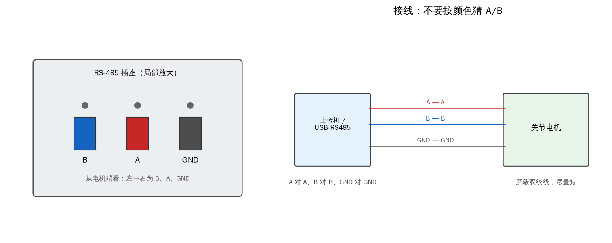

*图 2-13 RS-485 接口的 B、A、GND 线序与接线：A 对 A、B 对 B、GND 对 GND，屏蔽双绞线尽量短*

真实总线收发属于 **【需要实机】**。示例默认用回环和合成帧，不需要硬件；接上转接器后，把发送函数换成 `pyserial` 的 `write`，接收按 78 字节切帧，先验证 CRC 通过率，再谈控制。

## 2.8 与原书的对应

原书第 2 章从“四足机器人需要力矩源”讲到 RS-485 报文，共 22 个节和小节。本书按“磁场 → 结构 → 控制律 → 接线与配置 → 试转 → 六种模式 → 协议”的顺序重新组织成 8 节，内容逐项对应如下。原书的图 2.1–2.8 没有直接引用，分别用重绘示意图、仿真曲线或终端文本替代；表 2.1、表 2.2 原样排入 2.7 节，数据未改。

| 原书节号 | 原书内容 | 本书位置 | 覆盖公式/表格 |
| --- | --- | --- | --- |
| 2.1 | 四足机器人的动力系统 | 2.1 | 无 |
| 2.1.1 | 永磁同步电机概述 | 2.1（要点 1–4） | 无 |
| 2.1.2 | 永磁同步电机的 FOC 简介 | 2.1（要点 3–5） | 无 |
| 2.2 | 关节电机硬件概述 | 2.2 | 无 |
| 2.2.1 | 关节电机基本结构 | 2.2（要点 1–3） | 无 |
| 2.2.2 | 单圈绝对位置编码器 | 2.2（要点 4–6） | 无 |
| 2.3 | 关节电机的混合控制 | 2.3 | 式（2.1） |
| 2.4 | 关节电机的线路连接 | 2.4（要点 1–3） | 无 |
| 2.5 | 关节电机的配置 | 2.4（要点 4–7） | 无 |
| 2.5.1 | 查看串口名 | 2.4（要点 4） | 无 |
| 2.5.2 | 修改电机 ID | 2.4（要点 5） | 无 |
| 2.6 | Python 范例试运行 | 2.5 | 无 |
| 2.7 | 电机控制模式 | 2.6 | 无（六种模式均为式 2.1 特例） |
| 2.7.1 | 位置模式 | 2.6（要点 1） | 无 |
| 2.7.2 | 速度模式 | 2.6（要点 2） | 无 |
| 2.7.3 | 阻尼模式 | 2.6（要点 3） | 无 |
| 2.7.4 | 力矩模式 | 2.6（要点 4） | 无 |
| 2.7.5 | 零力矩模式 | 2.6（要点 5） | 无 |
| 2.7.6 | 混合模式 | 2.6（要点 6） | 无 |
| 2.8 | 移植到其他上位机平台 | 2.7 | 式（2.2） |
| 2.8.1 | 通信配置 | 2.7（要点 1） | 无 |
| 2.8.2 | 电机收发报文格式 | 2.7（要点 2–6） | 式（2.2）、T01、T02 |

图号的对应关系是：原书图 2.1 → 图 2-1，图 2.2 → 图 2-3，图 2.3 → 图 2-7，图 2.4 的终端截图由 2.4 节的命令代码块代替，图 2.5、图 2.6 → 图 2-8 的流程图，图 2.7 的转轴/输出轴关系在图 2-10 重绘，图 2.8 → 图 2-13。本书新增的图 2-2、2-4、2-5、2-6、2-9、2-11、2-12 分别用仿真或重绘补足三相电流、编码器读数、控制框图、增益响应、试转曲线、六模式对比和报文布局。
