# 第 3 章 控制框架：对象、状态机与仿真

第 2 章把 12 个关节电机拆到了磁场和报文一级，最后落到一条 34 字节的命令帧。把这条帧按时发出去，只解决了“单个关节听话”的问题；四足机器人要站、要走，还需要一个程序把 12 个关节组织成整机动作，并且在仿真和实机之间来回切换。这个程序就是本章要搭的框架。

框架要回答四个问题。第一，控制器从哪里拿到关节角和 IMU，又把命令写到哪里；第二，同一套算法怎样既能驱动 MuJoCo 里的模型，又能驱动 RS-485 上的真实电机；第三，站立、行走、导航这些差异很大的行为怎样拆成互不干扰的模块；第四，从“趴在地上”到“稳定站住”这条最短的闭环怎样在仿真里跑通。前三个问题分别对应接口、面向对象和有限状态机，第四个问题是一次完整的实践。

本章写出的代码是后面第 5–11 章的插座。平衡控制器、步态生成器、状态估计器和导航栈都会以状态或组件的形式接进来，接口一旦定错，后面每章都要返工。因此这里的重点不是把 A1 站起来的参数调到最好，而是把数据流、生命周期和切换顺序定清楚。

## 3.1 仿真与控制框架总览

四足控制程序的运行环境可以很复杂：仿真器可能跑在同一台机器上，也可能通过局域网连到另一台机器；实机上的运动控制程序跑在机载计算机里，命令还要经过主控板才能到电机。ROS（Robot Operating System，机器人操作系统）把这些进程组织成一张图：每个进程是一个节点（node）。节点之间的通信分三类：异步的数据流叫话题（topic），发布者只管发、订阅者只管收；一次请求加一次应答叫服务（service）；启动时读入的配置叫参数（parameter）。一个节点不需要知道另一个节点在哪台机器、用什么语言写，只需要知道话题名和消息类型。

在原书的 Gazebo 方案里，控制器和 Gazebo 正是两个节点。控制器订阅关节状态话题，拿到 12 个关节的角度、角速度、力矩和 IMU；算完之后把目标关节角或目标力矩发布到命令话题。Gazebo 里的机器人模型由 `unitree_ros` 提供，控制器只看见消息，看不见模型文件。这种拆分的好处是算法可以脱离仿真器测试：把话题换成录制的数据，控制器照样运行。

本书不在 ROS 上搭建全部算法，而是用 MuJoCo 加 Menagerie 的 A1 模型做验证。原因是接触动力学：四足机器人站立和小跑时，足端与地面的接触力决定了机身会不会打滑、会不会抖，MuJoCo 的接触求解器在这类问题上更稳，启动也只需要一个 XML 文件和 Python 进程。Gazebo 仍然是 ROS 生态里成熟的动力学仿真器，原书的 `unitree_gazebo` 启动方式、`unitree_guide` 控制器包都建立在它上面；本书保留 Gazebo 与 ROS 2 的概念和接口讲法，算法验证则全部放在 MuJoCo 里。这样读者以后接到 ROS 2 系统时，知道话题、节点、TF、参数服务器对应什么，不会被工具链挡在门外。

控制闭环本身很短。每个控制周期，控制器从仿真器或机器人读一次状态：

- 12 个关节的 \(q\)、\(\dot q\)、\(\tau\)，单位分别是 rad、rad/s、N·m；
- IMU 的姿态四元数、机身角速度和线加速度；
- 足端接触开关（仿真里有，实机上由足端开关或电流估计给出）。

然后算出 12 组新的 `JointCmd`，每组包含目标角 \(q_{\rm des}\)、目标角速度 \(\dot q_{\rm des}\)、前馈力矩 \(\tau_{\rm ff}\)、位置刚度 \(k_p\) 和速度刚度 \(k_d\)，再写回去。A1 的控制周期取 2 ms，也就是 500 Hz；这个频率足够覆盖关节速度环的带宽，又不会让 Python 层的计算成为瓶颈。读一次、算一次、写一次，就是本章所有示例的主循环。

ROS 1 在 2025 年已经停止维护，原书要求的 Ubuntu 18.04、ROS melodic 和 Gazebo 9 组合不该再作为新读者的起点。ROS 2 用 DDS 做自动发现，不再需要 `roscore`；构建工具从 `catkin_make` 换成 `colcon build`；启动、查看话题的命令也换了前缀。表 3-1 是常用命令的对照，本书后面的 ROS 2 命令都按右列写。

表 3-1 ROS 1 与 ROS 2 的常用命令对照

| 任务 | ROS 1 | ROS 2 | 说明 |
| --- | --- | --- | --- |
| 启动主节点 | `roscore` | 无 | DDS 自动发现，不需要中心节点 |
| 编译工作空间 | `catkin_make` | `colcon build` | 都需要先装好依赖 |
| 运行单个节点 | `rosrun pkg node` | `ros2 run pkg node` | 包名和可执行文件名不变 |
| 启动 launch 文件 | `roslaunch pkg file.launch` | `ros2 launch pkg file.launch.py` | ROS 2 的 launch 用 Python 写 |
| 查看话题 | `rostopic list` | `ros2 topic list` | 消息类型用 `ros2 topic type` |
| 查看话题频率 | `rostopic hz /topic` | `ros2 topic hz /topic` | 检查控制周期是否达标 |
| 参数配置 | 参数服务器 | 节点参数 + YAML | 启动时用 `--ros-args --params-file` |

下面这些命令需要先装好 ROS 2，本书没有在本地运行，只用来对照原书操作。

```text
# 【需要 ROS 2 环境】以下命令本书没有在本地验证
source /opt/ros/humble/setup.bash
colcon build --packages-select unitree_guide
ros2 run unitree_guide junior_ctrl
ros2 topic hz /joint_states
```

本书的程序分成五层，从上到下是：应用/状态层（有限状态机，决定现在做站立还是行走）、控制层（平衡控制器、步态生成器、单腿 PD）、模型层（运动学、动力学、A1 参数）、接口层（`MotorBus`、`A1Sim`）、硬件/仿真层（MuJoCo 模型或 RS-485 总线）。层与层之间只通过数据结构和函数签名耦合，任何一层都可以单独替换：把 `A1Sim` 换成 `Rs485MotorBus`，模型层和控制层不用改；把状态机里的 `Trotting` 换成另一个步态，接口层也不用改。这种分层不是为了画图好看，而是为了让“换机器人”和“换算法”成为两件独立的事。

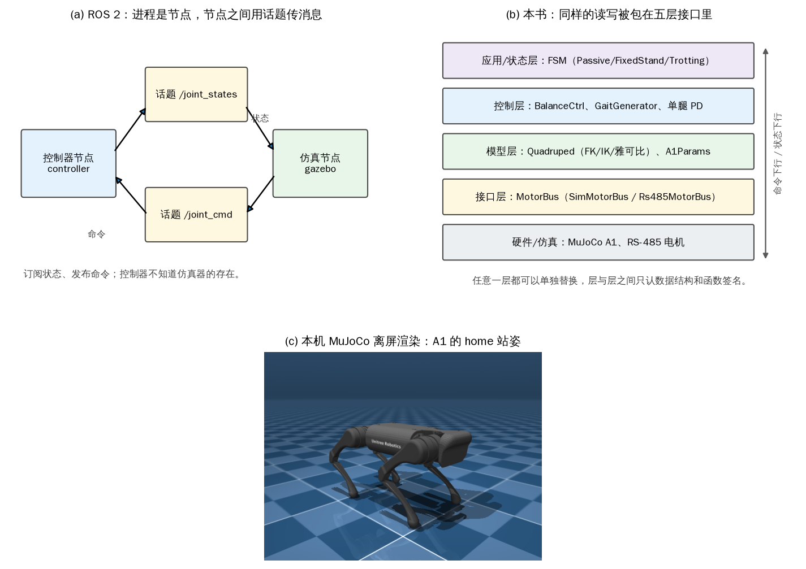

*图 3-1 (a) ROS 2 里控制器与仿真器是两个节点，靠话题交换状态和命令；(b) 本书把同样的读写包进五层接口；(c) 本机 MuJoCo 离屏渲染的 A1*

第一个示例只做三件事：加载模型、读模型、让它自由下落。加载后先看维度：A1 的浮动基座贡献 7 个位置自由度和 6 个速度自由度，12 个铰链关节再贡献 12 个位置和 12 个速度，所以 `nq=19`、`nv=18`；`nu=12` 是 12 个位置执行器。总质量 12.453 kg，12 个关节按“腿号 × 3 + 关节号”排列，顺序是右前、左前、右后、左后。

```python
{{#include code/ch03/3_1_mujoco_hello.py}}
```

```console
{{#include code/ch03/3_1_mujoco_hello.out}}
```

把机器人从 0.5 m 高处放开，12 个关节的力矩都给 0，1 s 后机身高度落到 0.0996 m，四个足端全部接触地面。此时四足法向力之和只有 101.5 N，小于整机重力 \(12.453\times9.81=122.2\) N。原因不是仿真算错了，而是 1 s 这个时刻机身还在折叠的腿上回弹，竖直加速度不为零，接触力不需要等于重力；等它静止下来，四个力之和会回到 122 N 附近。这个细节提醒一件事：看接触力时要同时看它是否已经稳定，单帧的力不能当作称重结果。

`nq/nv/nu` 和关节名看起来只是打印信息，实际决定了后面所有数组的下标。A1 的 12 个关节在 MuJoCo 里的顺序与电机总线一致，都是 FR、FL、RR、RL 四条腿各三个关节；如果这里弄错，后面站立时会出现“左前腿用右前腿的角度”的镜像错误，机器人会直接拧倒。示例把 `leg{i//3}` 和 `joint{i%3}` 一起打印出来，就是为了让这个映射在第一次接触模型时就固定下来。

MuJoCo 部分在本机运行，不需要 ROS；依赖只有 `mujoco`、`numpy` 和模型文件。模型默认从 `src/code/assets/menagerie/unitree_a1/scene.xml` 读取，也可以用环境变量 `QUADRUPED_A1_XML` 指向别处。第一次运行前确认模型存在，否则 `A1Sim` 会直接报 `FileNotFoundError`，而不是悄悄用一个空模型继续算。

## 3.2 面向对象三件事：抽象、继承、动态绑定

控制器有两套收发代码：仿真里通过 ROS 话题或 MuJoCo 的 `data` 读写，实机上通过 `unitree_legged_sdk` 的 UDP 接口读写。如果算法函数里直接出现 `ros::Publisher`、套接字文件描述符或 `data.qpos`，那么每换一个后端，就要把算法里所有调用点找出来改一遍。面向对象在这里不是语法练习，而是把“变化的部分”关进一个类里，让算法只面对稳定的接口。

### 3.2.1 核心思想1：数据抽象

数据抽象的做法是先定义一个只包含操作的接口，把实现细节放到派生类里。对控制器来说，它只需要两个操作：把 12 组命令发出去，把最新状态收回来。于是基类可以写成

```cpp
class IOInterface {
 public:
  virtual ~IOInterface() = default;
  virtual void send(const LowCmd& cmd) = 0;
  virtual void recv(LowState& state) = 0;
};
```

`= 0` 表示纯虚函数：基类只规定“必须能做这件事”，不规定怎么做。`LowCmd` 和 `LowState` 是纯数据结构，前者含 12 个关节的目标角、目标速度、前馈力矩、\(k_p\)、\(k_d\) 和模式，后者含 12 个关节的实测角度、角速度、力矩以及 IMU 的姿态、角速度和加速度。把它们定义成结构体而不是把数组直接塞进函数参数，是为了让“一帧命令”可以整体传递、复制和记录。

数据抽象带来的直接好处是算法层看不到通信细节。控制器写 `io.send(cmd)` 时，不需要知道这句话最终是写进 MuJoCo 的 `qfrc_applied`，还是打包成 34 字节的 RS-485 帧，还是塞进 DDS 消息。接口的实现可以做缓存、做重发、做超时检查，这些都不污染控制律。

### 3.2.2 核心思想2：继承

`IOROS` 和 `IOSDK` 都从 `IOInterface` 派生，各自实现 `send` 和 `recv`。它们的关系是“兄弟”，共同点是都承诺同一组操作；基类规定协议，派生类完成协议。图 3-2 用 UML 表示这层关系：空心三角指向基类，基类框里写纯虚函数，派生类框里写各自的实现。

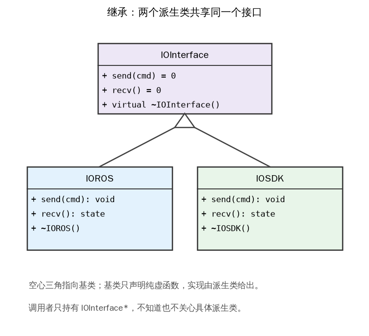

*图 3-2 `IOInterface` 与 `IOROS`、`IOSDK` 的 UML 继承关系：空心三角指向基类，基类只声明纯虚函数*

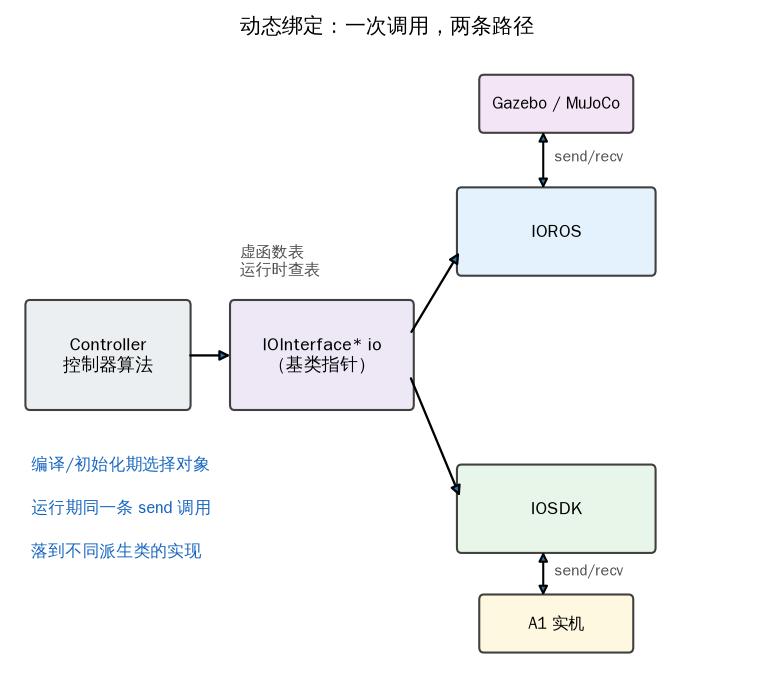

*图 3-3 控制器持有基类指针，运行期按虚函数表分派到 `IOROS` 或 `IOSDK`，再连到仿真或实机*

C++ 的继承有几个容易踩的坑，代码里逐条处理了。第一，基类的析构函数必须是 `virtual`。控制器用 `std::unique_ptr<IOInterface>` 持有对象，指针的静态类型是基类；如果析构函数不是虚函数，`delete` 时只会调用基类析构，派生类打开的套接字、申请的话题句柄都不会释放。第二，纯虚函数让基类不可实例化，编译期就挡住“创建一个 `IOInterface` 对象”这种没有意义的写法。第三，拷贝构造和拷贝赋值被删除，避免两个对象持有同一个通信句柄。第四，头文件里不写 `using namespace std;`，否则每个包含该头文件的源文件都被迫接受整个命名空间，大型项目里很容易撞名。

### 3.2.3 核心思想3：动态绑定

控制器持有一个 `IOInterface*`，初始化时让它指向 `IOROS` 或 `IOSDK`。之后同一句 `io->send(cmd)` 在运行期查到对象的虚函数表，落到对应派生类的实现。这就是动态绑定，也叫虚函数分派。切换发生在 `main` 的初始化处，控制律一行不用改。

```cpp
{{#include code/ch03/3_2_io_interface.cpp}}
```

```console
{{#include code/ch03/3_2_io_interface.out}}
```

输出把分派过程写得很直白。前半段每条日志都带 `IOROS`，说明 `send/recv` 落到了仿真后端；把 `io` 换成 `IOSDK` 对象后，同一个 `Controller::step` 打出 `IOSDK` 的日志。中间那行 `[IOROS] 释放话题与节点` 是 `unique_ptr` 赋值时旧对象被销毁的证据；如果基类析构函数不是虚函数，这行不会出现，派生类的清理被跳过。

这里有一个生命周期细节：`Controller` 不拥有 `IOInterface` 对象，它只保存裸指针；对象的所有权在 `main` 的 `unique_ptr` 上。换后端时，旧对象被销毁，`Controller` 里的指针就悬空了，所以示例调用 `set_io(io.get())` 重新绑定。更省事的写法是让 `Controller` 持有 `IOInterface&`，但引用一旦绑定就不能换；也可以让 `Controller` 持有 `unique_ptr` 并把所有权移进去。三种写法各有取舍，关键是不要出现“对象已经销毁、指针还在用”的状态。

Python 没有编译期宏，也没有虚函数表，但同样的结构可以用 `typing.Protocol` 表达。`Protocol` 是结构化类型：只要一个类有 `send` 和 `recv` 两个方法，它就满足协议，不需要显式继承。`SimMotorBus` 写 MuJoCo，`Rs485MotorBus` 打包 34 字节帧，控制器在构造函数里接收一个 `MotorBus`，这就是依赖注入。切换后端只改构造那一行，算法不变。

```python
class MotorBus(Protocol):
    def send(self, cmd: JointCmd) -> None: ...
    def recv(self) -> np.ndarray: ...

controller = Controller(SimMotorBus())
# 换成实机：controller = Controller(Rs485MotorBus(motor_id=0))
```

`Protocol` 的检查是“有没有这个方法”，不检查参数类型和返回类型；`@runtime_checkable` 只让 `isinstance` 能用于协议，也不会检查签名。真正的类型检查要靠 mypy 之类的工具。C++ 的纯虚函数则是编译期强制的：少实现一个函数，派生类仍然是抽象类，编译直接失败。两种语言表达的是同一个设计，约束强度不同。

```console
{{#include code/ch03/3_2_io_protocol.out}}
```


动态绑定有一次间接跳转的开销，在现代 CPU 上通常是几个纳秒，和 2 ms 周期相比可以忽略。真正拖慢控制回路的是另外几件事：在循环里 `new/delete`、构造大对象、打印日志、抛异常、加锁、动态扩容数组。这些操作的时间上界不确定，可能把 2 ms 变成 10 ms。示例里的日志只用于演示，真实控制器应该把日志降到低频线程或环形缓冲区里，控制回路只做确定性的计算。

最后说明与原书接口的差异。原书用一个 `sendRecv(const LowlevelCmd*, LowlevelState*)` 同时完成收发，本书拆成 `send` 和 `recv` 两个函数。拆开的好处是仿真后端可以先写命令、再推进物理、再读状态，实机后端也可以把发送和接收放在不同线程；代价是调用者要保证“一发一收”成对出现。两种设计没有对错，本书后续的 `MotorBus` 采用拆开的版本，因为 MuJoCo 的 `step()` 必须插在写命令和读状态之间。

## 3.3 有限状态机：把控制器拆成可切换的模块

站立、行走、导航对关节的要求完全不同：站立要让四条腿锁在固定角度，行走要让腿按相位摆动，导航还要接收上层速度指令。把这些逻辑全塞进一个 `while` 循环，用一堆 `if` 判断“现在是不是在走”，程序很快就会变得不可读。有限状态机（finite-state machine，FSM）换一种组织方式：把每种行为写成一个独立的状态类，同一时刻只有一个状态在运行，切换由明确的触发条件决定。

本章的控制器有五个状态：

- `Passive`：阻尼状态，关节只保留速度阻尼，机器人会慢慢趴下；这是开机默认态，也是故障时的安全态。
- `FixedStand`：固定站立，把 12 个关节从当前角度线性插值到站立目标，然后保持。
- `FreeStand`：自由站立，保持站立的同时可以调整机身高度、横滚、俯仰和偏航。
- `Trotting`：对角步态，四条腿按对角相位行走。
- `move_base`：导航状态，跟踪上层发布的速度或路径指令。

状态之间的切换由手柄组合键或键盘数字键触发。仿真里没有手柄，用数字键或脚本事件代替；实机上用 `L2` 加 `A/B/X/Y` 以及 `START`。表 3-2 是完整的 12 条边，图 3-4 把同样的信息画成状态图和编号表。

表 3-2 五个状态与十二条切换边

| 目的状态 | 触发键 | 来源状态 |
| --- | --- | --- |
| `FixedStand` | `<L2+A>` / `<2>` | `Passive` |
| `Passive` | `<L2+B>` / `<1>` | `FixedStand` |
| `FreeStand` | `<L2+X>` / `<3>` | `FixedStand` |
| `FixedStand` | `<L2+A>` / `<2>` | `FreeStand` |
| `move_base` | `<L2+Y>` / `<5>` | `FixedStand` |
| `FixedStand` | `<L2+A>` / `<2>` | `move_base` |
| `Trotting` | `<START>` / `<4>` | `FixedStand` |
| `FixedStand` | `<L2+A>` / `<2>` | `Trotting` |
| `Passive` | `<L2+B>` / `<1>` | `FreeStand` |
| `Trotting` | `<START>` / `<4>` | `FreeStand` |
| `Passive` | `<L2+B>` / `<1>` | `move_base` |
| `Passive` | `<L2+B>` / `<1>` | `Trotting` |

这张表有一个结构特征：`FixedStand` 是集散点。从 `FreeStand` 不能直接去 `move_base`，从 `Trotting` 也不能直接去 `move_base`，都要先回到固定站立。这样安排是因为行走和导航对机身高度、足端位置的要求不同，先站定再切换，状态内部需要初始化的量最少。`Passive` 则是所有状态的共同出口，任何状态按 `<1>` 都能回到阻尼。

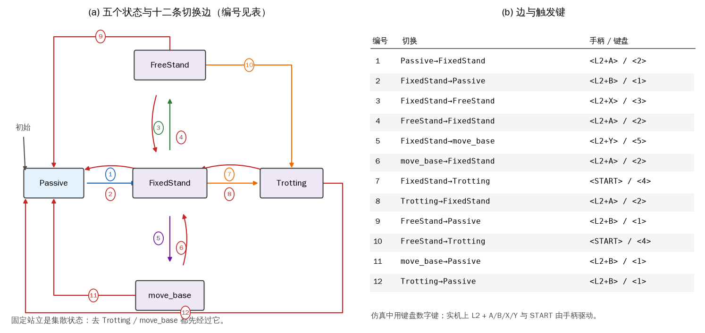

*图 3-4 (a) 五个状态与十二条切换边，边上的编号对应 (b) 的键位表；`FixedStand` 是集散状态，`Passive` 是所有状态的出口*

### 3.3.1 状态的四个成员函数

五个状态都继承同一个基类 `State`，基类规定四个成员函数。`enter()` 在进入状态时调用一次，用来记录初始角度、清零计数器、设定第一帧命令；`run()` 在每个 2 ms 周期调用，是状态的主要功能；`exit()` 在离开时调用一次，用来复位内部变量，避免下次进入时残留上次的值；`check_transition()` 在每个周期末尾调用，返回下一个状态的名字，或者返回 `None` 表示留在当前状态；原书把这个函数叫 `checkChange()`，本书沿用共用包的名字 `check_transition()`。

这四个函数的分工对应一条时间线：进入时做一次初始化，停留期间反复计算，离开时做一次收尾，每周期问一次“要不要走”。把“要不要走”放在 `run()` 之后，而不是之前，是为了让当前状态先完成这一周期的输出，再决定下一周期去哪。这个顺序在实机上很重要：如果先切走再发命令，最后一帧命令可能属于旧状态，机器人会在切换瞬间收到一个过期的目标。

基类还保存两类公共成员：状态名，以及指向 `CtrlComponents` 的指针。`CtrlComponents` 是 `main` 构造一次、所有状态共享的组件集合，包含低层命令 `low_cmd`、低层状态 `low_state`、状态估计器、机器人模型、平衡控制器、步态生成器和控制频率。状态只使用这些组件，不自己创建。这样做有两个好处：第一，估计器和模型只初始化一次，不会在每个状态里重复分配；第二，换机器人型号时只改 `main` 里的构造，状态代码不动。

### 3.3.2 组合成有限状态机

`FSM` 自己也只是一个类，内部保存一个状态字典和一个“当前状态”指针。它有两种模式：`NORMAL` 表示重复运行当前状态，`CHANGE` 表示下一周期要切换。核心逻辑可以压成十几行：

```python
def step(self):
    if self.mode == "NORMAL":
        cmd = self.states[self.current].run()
        nxt = self.states[self.current].check_transition()
        if nxt is not None and nxt != self.current:
            self.next_name = nxt
            self.mode = "CHANGE"
    else:
        self.states[self.current].exit()
        self.current = self.next_name
        self.states[self.current].enter()
        self.mode = "NORMAL"
        cmd = self.states[self.current].run()
    return cmd
```

注意切换是分两轮完成的。第一轮只执行 `run()` 和 `check_transition()`，发现要切走时把目标记在 `next_name` 里，模式改成 `CHANGE`，这一轮不会再调用新状态。第二轮才执行旧状态的 `exit()`、替换指针、执行新状态的 `enter()`，然后立刻执行一次新状态的 `run()`。这样旧状态的收尾和新状态的初始化都不会被跳过，也不会出现“同一周期里先 run 新状态、再 exit 旧状态”的乱序。

状态对象在启动时一次性构造，`FSM` 只切换指针，不在运行期 `new/delete`。这一点比“每次切换创建一个新状态对象”更重要：创建对象会分配内存、调用构造函数，时间不固定；更糟的是状态内部的积分器、滤波器状态会被清零，机器人每次切换都像刚上电。常驻对象让状态可以保留自己的历史，例如 `FixedStand` 的插值进度、`Trotting` 的步态相位。

安全默认态是设计的一部分，不是可选项。任何异常、通信超时、姿态超限，最终都应该回到 `Passive`，而不是停在 `Trotting`。`Passive` 下 \(k_p=0\)，只有 \(k_d\) 提供与关节速度相反的阻尼力矩，机器人会软下来趴在地上，不会继续执行一个已经失去意义的目标。实机上这条规则要在 `FSM` 之外再加一层：看门狗发现控制周期超时，直接绕过状态机写阻尼命令，不能等状态机自己反应过来。

示例用脚本模拟按键，完整输出在下面。第 3 周期按下 `<2>`，第 4 周期进入 `FixedStand`；第 7 周期按 `<3>` 请求 `FreeStand`，此时插值进度只有 0.20，被拒绝；第 14 周期再请求，进度 0.55，仍被拒绝；直到第 23 周期进度到 1.00，请求才被接受，第 24 周期执行 `FixedStand.exit()` 和 `FreeStand.enter()`；第 28 周期进入 `Trotting`，第 32 周期回到 `Passive`。开头还故意请求了一个不存在的 `Jump`，`FSM` 打印拒绝信息并保持原状态。

```console
{{#include code/ch03/3_3_fsm.out}}
```

输出里每一行 `当前状态` 都在 `step()` 之后打印，所以能看到“登记切换”的那一周期状态还没变，下一周期才变。这正是两阶段切换的外部表现。`check_transition()` 返回目标后，`FSM` 并不立即执行 `exit/enter`，而是等到下一次 `step()` 的开头；如果这一周期之后又来了新的按键，旧请求会被覆盖，最终只执行最后一次，不会出现两个状态同时收到 `enter()` 的情况。

示例里的 `FixedStand` 还演示了一个状态自己的门禁：插值没完成时拒绝去 `FreeStand` 和 `Trotting`。这个判断放在 `FixedStand.check_transition()` 里，而不是放在 `FSM` 里，因为只有状态自己知道“我准备好了没有”。`FSM` 只负责执行切换，不负责判断业务条件；这样增加新状态时，不需要改 `FSM` 的代码。

仿真中用数字键，实机上用组合键。组合键的读取属于 **【需要实机】**：手柄通过无线数传把按键送到主控板，控制器从低层状态里读到 `wireless_remote` 的字节，再映射成状态名。仿真里没有这段硬件，示例直接用脚本事件替代；两者的状态机逻辑完全相同，差别只在事件来源。

## 3.4 实践：从阻尼到固定站立

这一节把前两节的框架落到一次真实动作上：机器人先软下来趴在地上，再用 1.5 s 平滑地站起来。动作本身不复杂，但它把命令结构、关节编号、坐标系、插值和状态切换全部串了一遍。后面第 5 章的逆运动学、第 6 章的静力学、第 8 章的平衡控制，都是在这个动作的基础上加东西。

### 3.4.1 低层命令与状态

控制器每个周期发出去的是一个 `LowCmd`，里面是 12 个 `MotorCmd`。每个 `MotorCmd` 有六个物理量：模式 `mode`、目标角 `q_des`、目标角速度 `dq_des`、前馈力矩 `tau_ff`、位置刚度 `kp`、速度刚度 `kd`。收回来的是一个 `LowState`，含 12 个 `MotorState` 和一组 IMU 读数；`MotorState` 里有实测角 `q`、角速度 `dq`、力矩 `tau`、温度、错误码和模式。第 2 章讲过的混合控制律在这里原样适用：

\[ \tau_i = \tau_{{\rm ff},i} + k_{p,i}\,(q_{{\rm des},i}-q_i) + k_{d,i}\,(\dot q_{{\rm des},i}-\dot q_i) \tag{3-1} \]

区别只在于第 2 章的下标是“一台电机”，这里的下标是“整机的第 \(i\) 个关节”。减速比、转子侧角度这些量不再出现，因为总线上的数值已经是关节侧的量。

12 个关节的排列顺序是右前、左前、右后、左后，每条腿三个关节，依次是外摆、大腿、小腿。第 \(i\) 个关节与腿号、关节号的关系是

\[ i = 3\,l + j,\qquad l\in\{0,1,2,3\},\quad j\in\{0,1,2\} \tag{3-2} \]

其中 \(l\) 是腿号，\(j\) 是关节号。比如右后腿的小腿是 \(l=2\)、\(j=2\)，全局下标 \(i=8\)。代码里尽量写 `3 * leg + joint`，不要散落 12 个魔法数字；一旦腿的顺序改了，只需要改 `LegId` 的定义。

### 3.4.2 阻尼模式

阻尼模式是所有状态里最简单的一个：位置刚度设为零，只留速度刚度。协议模式仍取 `mode=10`（伺服模式），靠 \(k_p=0\) 把位置项关掉，而不是切到另一个固件模式。命令写成

\[ q_{{\rm des},i}=0,\quad \dot q_{{\rm des},i}=0,\quad k_{p,i}=0,\quad k_{d,i}=2.0,\quad \tau_{{\rm ff},i}=0 \tag{3-3} \]

代入式（3-1），力矩退化成 \(\tau_i=-k_{d,i}\dot q_i\)，方向始终与关节速度相反。关节被外力拖动时，驱动器吸收能量；外力撤掉，关节慢慢停下。机器人从站立姿态进入阻尼，四条腿会逐渐折叠，机身落到地面。这个过程没有位置目标，所以不会“突然发力去追一个角度”，是开机和故障时最安全的默认态。

原书仿真里给 12 个关节的 \(k_d\) 是 8，本书用 2.0。差别来自仿真接触模型和关节摩擦：MuJoCo 的 A1 模型本身带有关节阻尼和电枢惯量，\(k_d=8\) 会让趴下过程偏“黏”，足端落地时冲击也更大；2.0 更接近实机低速阻尼的手感，趴下过程约 0.5 s。外摆关节的负载比大腿、小腿小，如果需要更软的侧向，可以单独把外摆的 \(k_d\) 调到 1.0，其余保持 2.0。

阻尼模式只改一次命令，还是每周期都发？本书的做法是每周期都发。`enter()` 里设置一次参数，`run()` 每个周期返回同样的阻尼命令，`exit()` 不做额外操作。原因不是状态机需要，而是通信链路需要：如果只在进入时发一帧，之后总线空闲，实机的主控板可能在一段时间没有收到命令后进入保护，仿真里也看不出“命令是否持续”。保持每周期一发，链路的健康检查才有依据。

### 3.4.3 关节坐标系与零位

每个关节都要规定两件事：坐标系的轴向，以及角度为零时连杆在哪。A1 的 12 个关节坐标系都是右手系；在零位姿态下，三个轴的方向统一为 \(x\) 指向机头、\(y\) 指向机身左侧、\(z\) 竖直向上。外摆关节绕 \(x\) 轴转，大腿和小腿绕 \(y\) 轴转，正方向按右手定则。角度一律用弧度。

“零位”是一个数学约定，不等于“机械上到得了”。A1 的小腿关节有机械限位，完全伸直的零位会顶到限位块，实际控制时不能把 \(q_2=0\) 当作目标。图 3-5 画了一条腿的三个关节和转轴，图 3-6 画了四条腿的编号与机身坐标系，图 3-7 对比了零位姿态与真正的站立姿态。

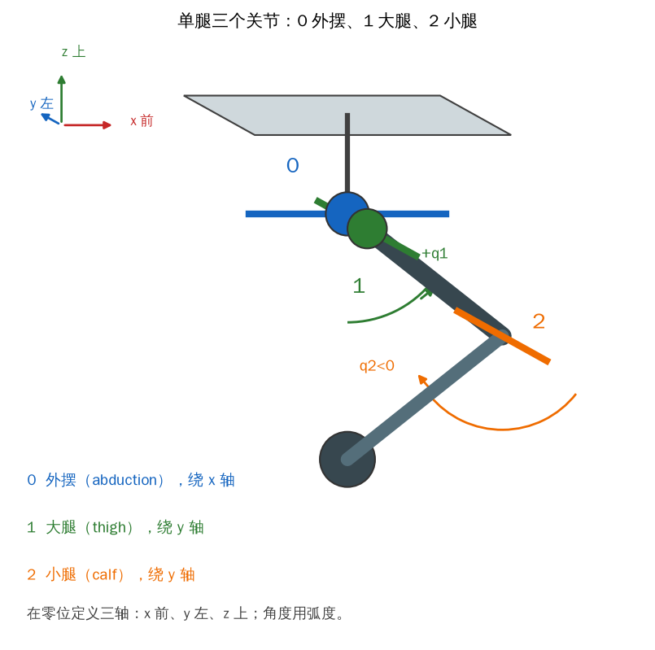

*图 3-5 单腿的三个关节：0 是外摆（绕 \(x\)），1 是大腿（绕 \(y\)），2 是小腿（绕 \(y\)）；角度正方向按右手定则*

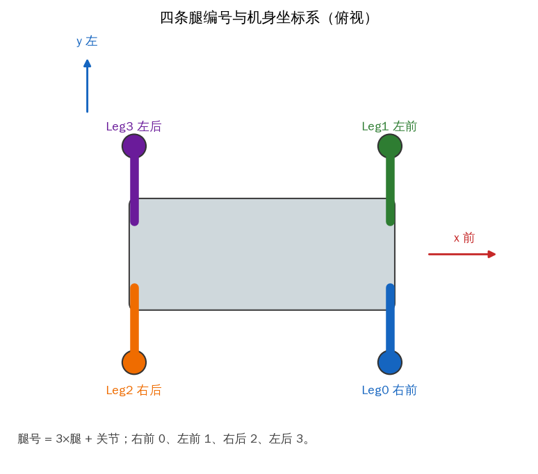

*图 3-6 俯视的四条腿编号：右前 0、左前 1、右后 2、左后 3；\(x\) 指向机头，\(y\) 指向左侧*

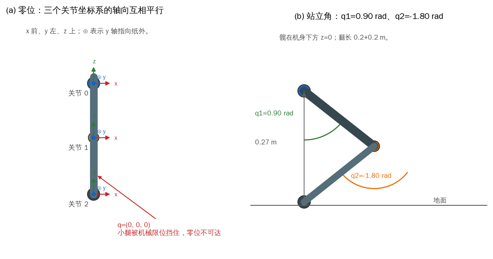

*图 3-7 (a) 零位时三个关节坐标系的轴向互相平行，但小腿受机械限位，零位不可达；(b) 实际站立角 \(q_1=0.90\)、\(q_2=-1.80\) rad*

站立高度由大腿和小腿的几何决定。忽略足端球的半径，髋关节到足端的竖直距离是

\[ h(q_1,q_2) = L_1\cos q_1 + L_2\cos(q_1+q_2) \tag{3-4} \]

其中 \(L_1=L_2=0.2\) m 是大腿和小腿的长度，\(q_1\)、\(q_2\) 是相对零位的角度。A1 的足端是一个半径 0.02 m 的球，MuJoCo 的接触 margin 再给 1 mm，所以机身高度还要加上 0.021 m。取 \(q_1=0.9\)、\(q_2=-1.8\)，有

\[ h = 0.2\cos 0.9 + 0.2\cos(-0.9) + 0.021 = 0.1243 + 0.1243 + 0.021 = 0.2696\ \text{m} \tag{3-5} \]

和 0.27 m 的目标只差 0.4 mm，这个姿态就是 Menagerie 模型 `home` 关键帧里的站姿。原书给的参考角是外摆 0、大腿 0.67、小腿 \(-1.30\) rad。把它代进式（3-4），竖直距离是 \(0.2\cos0.67+0.2\cos(-0.63)=0.1566+0.1616=0.318\) m，加足端半径约 0.339 m，明显高于 0.27 m。两组角都能让腿伸直，但对应的机身高度不同；原书的 0.67/\(-1.30\) 更接近 Go1 的腿长和站高，A1 的 Menagerie 模型用 0.9/\(-1.8\) 才能让足端落回 0.27 m。本书以模型为准，不去硬套原书的角度。

反过来说，站立角不该长期硬编码。给定目标高度 \(h\)，式（3-4）是一个关于 \(q_1\)、\(q_2\) 的约束，再给定足端在机身坐标系里的前后位置，就能用第 5 章的逆运动学解出两个角。硬编码只适合“先站住”这个阶段性目标；一旦要调高度、调机身俯仰，就必须走逆运动学。

### 3.4.4 固定站立

固定站立的核心是插值：进入状态时记录 12 个关节的当前角 \(q^{\rm start}\)，然后让目标角在 \(N\) 个控制周期内从当前值走到站立值 \(q^{\rm target}\)。设第 \(k\) 个周期的进度为 \(p_k\)，则

\[ p_{k+1} = \min\left(1,\ p_k + \frac{1}{N}\right),\qquad p_0 = 0 \tag{3-6} \]

\[ q_{{\rm des},i}(p) = (1-p)\,q_i^{\rm start} + p\,q_i^{\rm target} \tag{3-7} \]

\(N\) 是“控制周期数”，不是秒。控制频率为 \(f\) 时，插值持续时间约为 \(N/f\)。本书取 \(N=750\)，在 500 Hz 下正好 1.5 s。\(p\) 到 1 之后不再增加，关节锁在目标角上；下一次进入状态时 `enter()` 重新记录当前角，`exit()` 把 \(p\) 清零，所以从任何姿态进入都能从当前姿态平滑起步，不会跳变。

插值的目标角在四条腿上重复同一组值。站立时小腿的力臂最大，承受的负载也最大，因此小腿的 \(k_p\)、\(k_d\) 要比外摆和大腿高。本书仿真用的增益是外摆 \(k_p=100\)、\(k_d=4\)，大腿 \(k_p=800\)、\(k_d=10\)，小腿 \(k_p=1000\)、\(k_d=10\)。原书给的是外摆/大腿 180/8、小腿 300/15，数值不同，原因是本书的 PD 在 Python 层按 2 ms 周期计算，MuJoCo 的接触又调得比较硬；用原书的 300 去压小腿，站立时反而会出现高频抖动。增益没有跨平台通用值，换机器人或换仿真器都要重新调。

`enter()` 做三件事：把 12 个目标角先设成当前角，记录 \(q^{\rm start}\)，把 \(p\) 清零。第一件事是安全措施：如果插值因为异常没有启动，电机至少保持在当前角度，不会猛地跳向站立目标。`run()` 推进 \(p\)、算 12 个目标角、按式（3-1）发命令。`exit()` 只做状态收尾；本书共用包把插值进度的重置放在 `enter()` 里，效果和原书在 `exit()` 里清零一样，而且从任何路径重新进入都不会带着旧进度。

设计上 `check_transition()` 应在 \(p<1\) 时拒绝去 `FreeStand` 和 `Trotting`，避免“还没站稳就切走”，3.3 的独立示例就是这样写的。共用包的 `FixedStand` 目前把 `check_transition()` 留成空实现，外部 `FSM.request()` 仍然可以直接切换；实机上要在调用 `request()` 之前检查状态的 `done` 标志，或者把 3.3 的门禁搬进共用包。

示例从折叠姿态开始：机身高度 0.12 m，12 个关节角约为外摆 0、大腿 1.35、小腿 \(-2.55\)。先跑 0.5 s 阻尼，机身落到 0.1056 m，四个足端都接触；再切 `FixedStand`，用 1.5 s 插值到 0.9/\(-1.8\)，最后保持 0.5 s。

```console
{{#include code/ch03/3_4_stand.out}}
```

阻尼结束时 12 个关节的起始角在 \(-0.0229\) 到 \(1.3671\) rad 之间，小腿都在 \(-2.70\) rad 附近；这是因为折叠姿态下小腿已经压到限位附近，阻尼没有把它拉回零位。站立结束时机身高度 0.2675 m，比 0.27 m 低 2.5 mm，四个足端的法向力分别是 28.5、29.5、32.0、32.2 N，总和 122.2 N，正好等于整机重力。12 个关节与目标的最大偏差是 0.0165 rad，出现在 3 号关节（左前外摆）；按关节类型统计，外摆最大 0.0165 rad、大腿 0.0034 rad、小腿 0.0055 rad。外摆的 \(k_p\) 只有 100，四条腿的横向力又都压在外摆上，所以它的稳态误差最大；小腿虽然承受竖直方向的主要负载，但 \(k_p=1000\) 把误差压到了 0.0055 rad。

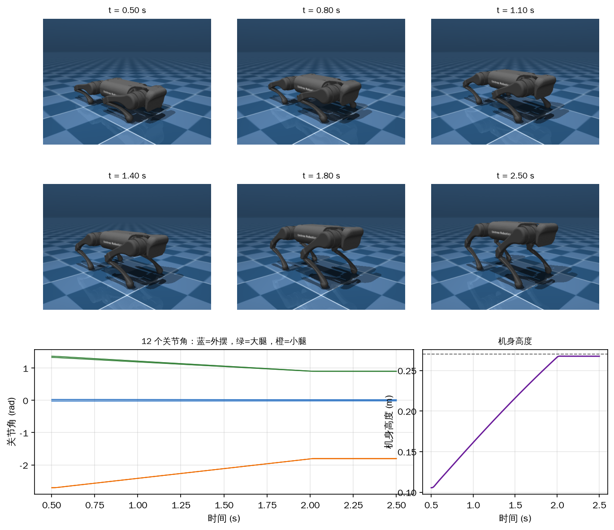

*图 3-8 上两行是 0.5、0.8、1.1、1.4、1.8、2.5 s 六个时刻的离屏渲染；下左是 12 个关节角，蓝外摆、绿大腿、橙小腿；下右是机身高度，虚线是 0.27 m*

六帧里 0.5 s 还是趴姿，0.8 s 机身开始抬起，1.4 s 已经接近站姿，2.5 s 稳定。关节曲线在前 1.5 s 是直线段，因为目标角按 \(p\) 线性变化；小腿从 \(-2.70\) 走到 \(-1.80\)，大腿从 1.35 走到 0.90，两条曲线在 2.0 s 附近变平，说明插值结束、进入保持。高度曲线在 1.5 s 前后有一个小的过冲，然后回到 0.2675 m，这是足端接触和 PD 共同作用的结果，不是插值公式的问题。

实机上做同样的动作属于 **【需要实机】**。仿真里机器人一开始就放在地面上，不需要吊架；实机第一次站起应该放在平整、空旷的地面，旁边有人能随时断电，先用较小的 \(k_p\) 和较慢的插值确认方向，再逐步加大。如果实机站起时向一侧倾倒，先检查外摆零位和腿号顺序，再检查 IMU 的安装方向，不要先怀疑增益。

## 3.5 构建与在仿真中验证

代码写完只是第一步，接下来要让它在一台干净的机器上编译、启动、跑通。原书用 CMake 的变量和 `catkin_make` 管理 A1/Go1、仿真/实机、amd64/arm64 这些组合；本书用 Python 的构造参数加环境变量做同样的事，编译负担更小，但“条件选择”的思想完全一样。

### 3.5.1 条件编译与配置

原书在 `CMakeLists.txt` 开头集中设置七个变量：`ROBOT_TYPE`（A1 或 Go1）、`PLATFORM`（amd64 或 arm64）、`CATKIN_MAKE`（是否在 ROS 工作空间里编译）、`SIMULATION`、`REAL_ROBOT`、`DEBUG`、`MOVE_BASE`。CMake 用 `if(${ROBOT_TYPE} STREQUAL "A1")` 判断型号，用 `add_definitions(-DROBOT_TYPE_A1)` 生成宏；C++ 源码再用 `#ifdef ROBOT_TYPE_A1` 包住对应的模型构造。宏定义了的代码参与编译，没定义的整体消失，所以最终可执行文件里只有一套后端。

这套机制的关键是“选择发生在编译之前”。C++ 的宏在预处理阶段展开，编译器看不到另一个分支，也就不会为它生成代码；代价是每换一次配置都要重新编译，而且宏名必须和 `CMakeLists.txt` 里的 `add_definitions` 完全一致。原书在 3.2.3 给出的实机宏名带两个下划线，3.6.6 的文字却少写了一个；按后者去编译就找不到宏，实机分支不会被编译进去。

```text
COMPILE_WITH_REAL_ROBOT   3.2.3 的写法（两个下划线）
COMPILE_WITH_REALROBOT    3.6.6 的写法（少一个下划线，编错分支）
```

这类错误在 C++ 里不会报错，只会让程序“看起来跑了，其实还在仿真后端”，排查起来很费时间。

本书把选择从编译期挪到运行期，用两个环境变量表达同样的配置：

```text
QUADRUPED_BACKEND=sim|real
QUADRUPED_ROBOT=a1|go1
```

Python 端用一个工厂函数读环境变量，再决定构造 `SimMotorBus` 还是 `Rs485MotorBus`：

```python
def make_bus(robot: str, backend: str):
    if backend == "sim":
        return SimMotorBus(A1Sim())
    if backend == "real":
        return Rs485MotorBus(MotorBusConfig(port="/dev/ttyUSB0"))
    raise ValueError(f"unknown backend: {backend}")
```

这样切换后端只改一行环境变量，不用重新编译。代价是错误从编译期推迟到运行期：拼错 `real` 不会在编译时报错，只会在启动时抛异常。为了弥补这一点，工厂函数对取值做白名单检查，启动脚本在进入控制循环之前先调用一次 `make_bus()`，让配置错误尽早暴露。

本章的示例为了少一层间接，直接在 `main` 里构造后端，没有读环境变量。共用包目前也没有 `python -m quadruped.sim` 这样的命令行入口，只有 `A1Sim` 类；大纲设想的 `python -m quadruped.sim --render` 需要额外补一个 `__main__.py`，这件事留给负责人统一处理。示例用 `3_5_headless_run.py` 达到同样效果：无窗口、离屏渲染、打印周期和高度。

还有一层缺口在实机侧：`Rs485MotorBus` 目前只完成了 34 字节命令帧和 78 字节状态帧的编解码，`open()`、`send()`、`recv()` 是留给具体串口库的扩展点，直接调用会抛 `NotImplementedError`。因此本章的“实机模式”讲的是配置和链路，真正跑起来之前还要补一个串口后端（例如 `pyserial`），把 12 个 `MotorCmd` 按电机 ID 分发到总线。这件事也留给负责人统一处理，本书后续章节不重复实现。

### 3.5.2 依赖项

原书要求 CMake 不低于 3.14、Eigen3、C++ 编译器、pthread；调试绘图还要 Python 2 加 matplotlib-cpp，通信还要 LCM。Python 2 在 2020 年已经停止维护，现代 Ubuntu 默认不提供，按原书去装 `python2` 很可能失败。本书把绘图改成 Python 3.12 加 matplotlib，不再依赖 Python 2 和 matplotlib-cpp；C++ 示例只依赖 Eigen3 和标准库，ROS 2 相关部分才需要 `rclcpp`。

检查依赖的命令如下：

```text
cmake --version
ls /usr/include/eigen3/Eigen/Dense
getconf GNU_LIBPTHREAD_VERSION
python3 --version
```

`cmake --version` 应不低于 3.14。Eigen3 在 Ubuntu 上通常装在 `/usr/include/eigen3`，头文件是 `<Eigen/Dense>`；原书让读者查找的目录并不是标准安装位置，照着找会误判成“没装”。查 pthread 用 `getconf`，能打印出版本就说明它已经随系统装好。Python 侧需要 `mujoco`、`numpy`、`scipy`、`matplotlib`、`osqp`，本书统一用 `build/venv` 里的解释器。

C++ 示例的编译命令是

```text
clang++ -std=c++17 -O2 -I/usr/include/eigen3 3_5_eigen_check.cpp -o eigen_check
```

ROS 2 工作空间的构建命令是 `colcon build`，需要先 `source /opt/ros/humble/setup.bash`；这部分 **【需要 ROS 2 环境】**，本书没有在本地运行。原书的 `catkin_make` 与 `colcon build` 做的是同一件事：读 `CMakeLists.txt`、找依赖、生成可执行文件。区别在包的组织和环境的叠加方式，命令本身不难迁移。

### 3.5.3 在仿真中验证

原书在 Gazebo 里验证的顺序是：`catkin_make` 编译，`roslaunch unitree_guide gazeboSim.launch rname:=a1` 启动仿真，另一个终端 `rosrun unitree_guide junior_ctrl` 启动控制器，然后按 `<2>` 站起、按 `<1>` 趴下。启动时终端可能打印 `[ERROR] Function setProcessScheduler failed.`，意思是程序没能把自己设成实时进程；日志级别是 ERROR，但在仿真阶段不影响控制，可以先忽略，实机上再按第 10 章的方法处理。

本书的对应流程是：

```text
export PYTHONPATH=src/code
MUJOCO_GL=egl build/venv/bin/python src/code/ch03/3_5_headless_run.py
```

`MUJOCO_GL=egl` 让 MuJoCo 用离屏 OpenGL，不需要显示器；如果机器没有 EGL，可以试 `osmesa`，再不行就装显卡驱动。ROS 2 下的等价启动是 `ros2 launch unitree_guide gazeboSim.launch.py` 加 `ros2 run unitree_guide junior_ctrl`，属于 **【需要 ROS 2 环境】**，本书没有在本地验证。

验证要按顺序来，每一步都有明确的判据，不通过就停在这一步：

1. 能加载模型：`nq=19`、`nv=18`、`nu=12`，总质量 12.453 kg。
2. 能读 12 个关节：名字、`q`、`dq` 都是有限值，顺序是 FR、FL、RR、RL。
3. 能发零力矩：12 个关节力矩为 0，仿真推进 0.2 s 不报错、不出 NaN。
4. 能阻尼：`kp=0`、`kd=2.0`，机身高度从 0.27 m 降到 0.10 m 附近。
5. 能站起：1.5 s 插值后 12 个角到 0/0.9/\(-1.8\)，机身高度回到 0.267 m 附近。
6. 能保持 10 s：高度波动小于 5 mm，四足接触不丢，关节误差不随时间增长。

第 6 步在验收时跑 10 s，本章的示例只跑 5 s（0.5 s 阻尼、1.5 s 站起、3 s 保持），因为 3 s 已经足够看出趋势。图 3-9 把这条验证链和关键命令画在一起。

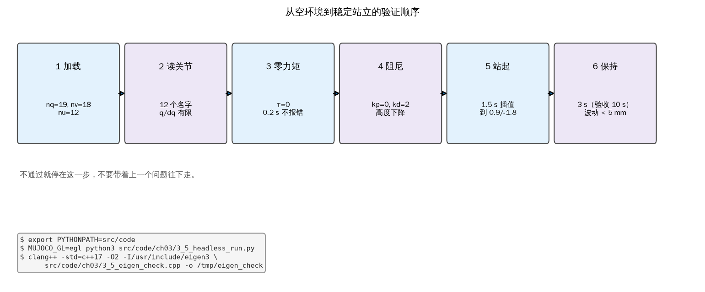

*图 3-9 从空环境到稳定站立的六步验证顺序，以及本机使用的命令；任一步不通过就停在那里*

Eigen 的检查单独跑一次，确认矩阵库的版本、正交性和线性方程求解都正常：

```cpp
{{#include code/ch03/3_5_eigen_check.cpp}}
```

```console
{{#include code/ch03/3_5_eigen_check.out}}
```

旋转矩阵由绕 \(z\) 的 0.30 rad、绕 \(y\) 的 \(-0.20\) rad、绕 \(x\) 的 0.10 rad 依次相乘得到。\(\|R^{\mathsf T}R-I\|_F=7.41\times10^{-17}\)，行列式为 1.0000，说明它确实是正交旋转而不是带缩放的普通矩阵。线性方程组 \(Ax=b\) 的解是 \([-0.3023,\ 0.7674,\ 0.7209]^{\mathsf T}\)，残差 \(2.22\times10^{-16}\)，落在双精度舍入量级。Eigen 的 `ldlt()` 适合这种对称矩阵；如果不是对称正定，应换成 `partialPivLu()` 或 `colPivHouseholderQr()`。

无窗口跑 5 s 站立的结果如下。仿真周期固定为 2 ms，墙钟周期是 Python 循环加 MuJoCo 步进的实际耗时，随机器负载变化，输出里的数值只代表本机的一次运行；正文不引用具体耗时，只看数量级。机身高度在最后 2 s 的均值是 0.2675 m，相对 0.27 m 的 RMS 偏差是 2.5 mm，四个足端始终接触。

```console
{{#include code/ch03/3_5_headless_run.out}}
```

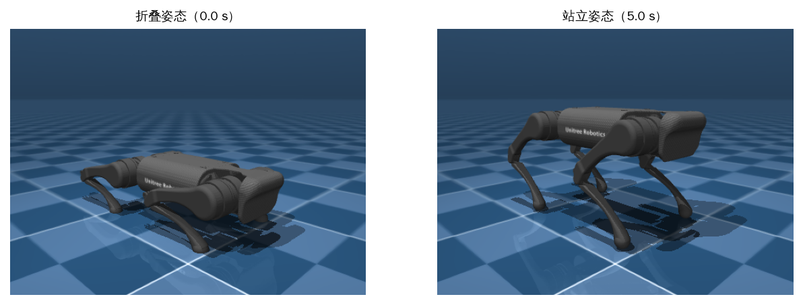

*图 3-10 同一相机角度下的折叠姿态（0.0 s）与站立姿态（5.0 s），由 `3_5_headless_run.py` 离屏渲染*

常见的构建/运行错误有四个。第一，`cmake` 找不到 Eigen，报 `Could not find Eigen3`：装 `libeigen3-dev`，或者在编译命令里显式加 `-I/usr/include/eigen3`。第二，架构选错：在 Jetson 上编了 amd64 的二进制，运行时报 `Exec format error`，先用 `uname -m` 确认是 `aarch64` 还是 `x86_64`。第三，Python 找不到 `quadruped`：没有设 `PYTHONPATH=src/code`，或者用了系统 Python 而不是 `build/venv/bin/python`。第四，MuJoCo 报 GL 后端不可用：设 `MUJOCO_GL=egl` 或 `MUJOCO_GL=osmesa`，远程无显示器的机器不要用 `glfw`。

还有一类错误不在命令里，而在版本上。MuJoCo 3.x 与 2.x 的 API 有差异，Menagerie 的模型也随版本更新；如果 `A1Sim` 报某个 sensor 或 actuator 找不到，先确认模型文件和 MuJoCo 版本，再检查 `assets/menagerie/unitree_a1` 是否完整。本书锁定 MuJoCo 3.17 和 `build/venv`，就是为了让示例的输出可复现；换版本后数值可能在小数点后第三位变化，属于正常现象。

## 3.6 实机网络与控制程序

仿真跑通之后，最后一步是把同一套控制器接到真实的 A1 或 Go1 上。这一步的难点不在算法，而在链路：机器内部有好几台计算机，用户计算机要加入同一个网段，控制器要知道命令经过哪几跳才到电机。本节按“机内局域网 → 控制链路 → 接入 → 三个命令 → 接互联网 → 切实机模式”的顺序讲。除示例脚本外，本节步骤都依赖真实机器人，标记为 **【需要实机】**；涉及 ROS 2 的命令标记为 **【需要 ROS 2 环境】**。以下步骤本书没有在本地验证，读者操作时以自己机器的实际输出为准。

### 3.6.1 机内局域网

A1 内部有三台计算机，通过一个内置交换机连成局域网。主控板地址是 `192.168.123.10`，负责普通模式和底层通信：它通过 RS-485 直接驱动 12 个关节电机，通过无线数传和遥控器通信。UP Board 地址是 `192.168.123.161`，负责运动模式，运行 `unitree_legged_sdk`；树莓派或 TX2 地址是 `192.168.123.12`，负责图传和 SLAM。用户计算机通过背部以太网口接入交换机，地址取 `192.168.123.xxx`，习惯上用 `192.168.123.162`。A1 标准版配树莓派，探索版配 TX2，两者的网络角色相同。注意不要把 UP Board 的 `.161` 和图传计算机的 `.12` 对调：有些资料把这两个地址写反，接错时 `ssh` 会登到另一台机器，现象是“文件传上去了但控制器没更新”。

Go1 的算力更强，教育版有五台计算机。主控板仍是 `192.168.123.10`，职责与 A1 相同；树莓派 4B 是 `192.168.123.161`，负责运动模式和 SDK；三台 Jetson Nano 分别是 `192.168.123.13`（头部相机）、`192.168.123.14`（左右相机）、`192.168.123.15`（主 Nano，AI 姿势识别和下方相机），都运行 `UnitreeCameraSdk`。WiFi 模块是 `192.168.12.1`，通过无线数传和手机 APP 通信，APP 在 `192.168.12.xxx` 网段。Go1 只有教育版开放完整的二次开发权限，标准版的机载计算机和接口可能被裁剪。

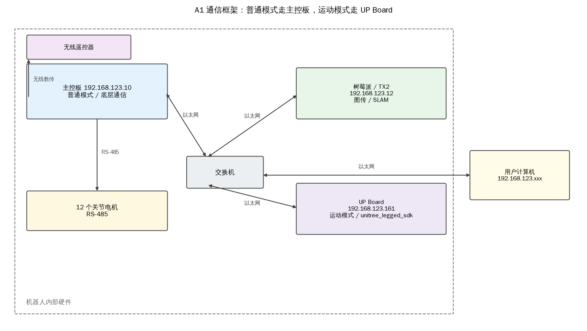

*图 3-11 A1 的普通模式链路（主控板 → RS-485 → 电机）与运动模式链路（UP Board → 交换机 → 主控板）*

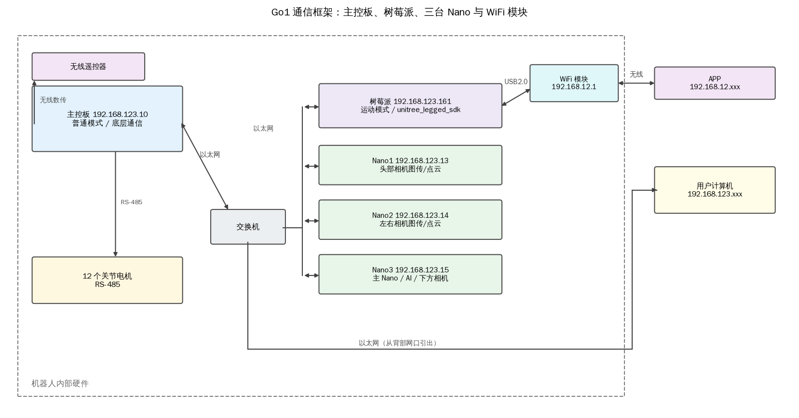

*图 3-12 Go1 的主控板、树莓派、三台 Nano 与 WiFi 模块；虚线内是机器人内部硬件，用户计算机通过背部网口接入*

### 3.6.2 控制链路

以 A1 的运动模式为例。控制程序跑在 UP Board 上，但 UP Board 和 12 个电机之间没有 RS-485 直连，命令不能直接到电机。实际路径是：UP Board 把 12 组关节命令用 `unitree_legged_sdk` 打包，经以太网送到交换机，再送到主控板；主控板把命令拆成 12 帧 RS-485 报文，分发给各个电机。状态沿反方向回来：电机 → RS-485 → 主控板 → 交换机 → UP Board。

这条链路上有两段协议转换，所以“控制周期 2 ms”不等于“电机每 2 ms 收到一帧”。2 ms 是控制器计算和收发的目标周期，实际延迟还包含以太网排队、主控板的转发和 RS-485 的半双工切换。做高频步态时，延迟会吃掉相位裕度；这也是原书反复强调“先确认链路，再调增益”的原因。

测试控制器有两种做法。第一种是把代码复制到 UP Board 上，在板端编译运行；好处是链路最短，坏处是每次改代码都要传文件、编译，调试效率低。第二种是把用户计算机接入机器人局域网，直接在用户计算机上运行控制器，通过 SDK 和主控板通信；这是推荐做法，前提是网口和机器人在同一网段、IP 不冲突。本书的示例都用第二种方式的前提来讲，但实际网络操作需要实机。

### 3.6.3 将用户计算机加入局域网

机器人背部开放了用户接口。A1 有 15 个编号接口，其中两个 RJ45 以太网口（④ 和 ⑫）都可以直接连交换机，两者等价；Go1 有一个 RJ45 网口（①）。图 3-13 是两块背板的接口编号示意，具体功能以随机附带的引脚说明为准。连接时用一根网线，一端接机器人背部任一以太网口，另一端接用户计算机；如果计算机唯一的网口已经被有线网络占用，可以用 USB 千兆网卡。

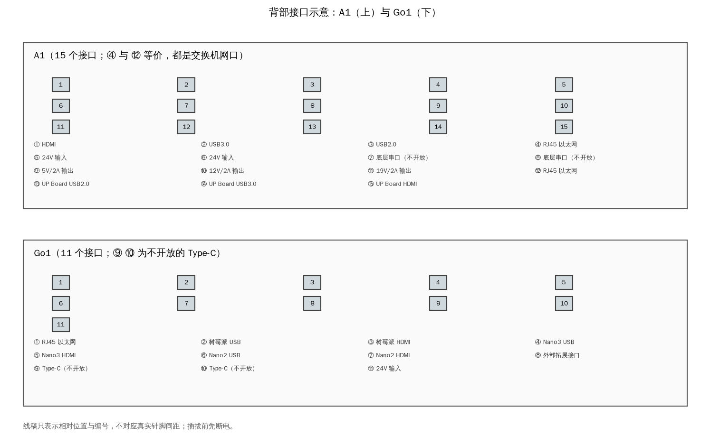

*图 3-13 A1（上，15 个接口）与 Go1（下，11 个接口）的背部接口编号；④ 和 ⑫ 是等价的交换机网口，⑦ ⑧ 是不开放的底层串口*

先用 `ip addr` 或 `ifconfig` 找到网口名、当前 IP 和子网掩码：

```text
ip addr show
# 或
ifconfig
```

输出里要关注三行：网口名（例如 `enp3s0` 或 `enx000ec6612921`）、`inet` 后面的地址、`/24` 或 `netmask` 后面的掩码。不同机器的网口名不同，后面的命令要替换成自己的。图 3-14 是一个示例输出，地址已经配成 `192.168.123.162/24`。

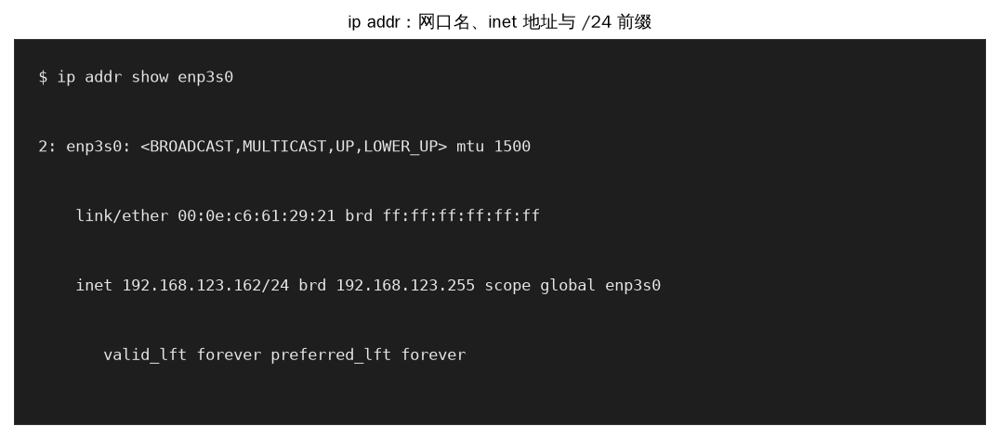

*图 3-14 `ip addr` 输出里的网口名、`inet 192.168.123.162/24` 和链路状态；设备名与 MAC 因机器而异*

临时配置地址用 `ip addr add`，不需要重启：

```text
sudo ip addr add 192.168.123.162/24 dev enp3s0
sudo ip link set enp3s0 up
ip addr show enp3s0
```

原书用的是 `ifconfig enx... down` 再 `up ... netmask`，效果相同，但 `ifconfig` 属于已废弃的 net-tools，很多新系统默认不装；`ip addr` 是 iproute2 的标准做法。配置完先 `ping 192.168.123.161`，能通再继续。

临时地址重启后会消失，要持久化就写 netplan。Ubuntu 18.04 之后用 `/etc/netplan/*.yaml`，新建一个 `60-robot.yaml`：

```text
network:
  version: 2
  ethernets:
    enp3s0:
      dhcp4: false
      addresses: [192.168.123.162/24]
      routes:
        - to: default
          via: 192.168.123.1
      nameservers:
        addresses: [192.168.123.1, 114.114.114.114]
```

保存后执行 `sudo netplan apply`。注意文件名以数字开头，数字小的先加载；不要和系统自带的 `50-cloud-init.yaml` 抢同一个网口。地址不能和机器人已有设备冲突：`.10` 是主控板，`.12` 是 A1 的图传计算机，`.13`–`.15` 是 Go1 的三台 Nano，`.161` 是运动控制计算机，`.1` 通常留给路由器。`.162` 是原书推荐给用户计算机的地址，本书沿用。

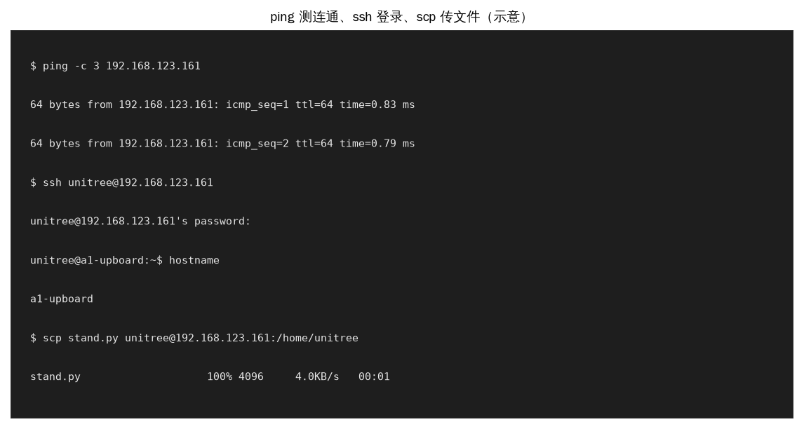

*图 3-15 先用 `ping` 确认链路，再用 `ssh` 登录，最后用 `scp` 传文件；IP、用户名和密码按自己的机器替换*

示例脚本根据输入生成 netplan 片段、期望路由和检查清单，并检查地址是否在 123 网段、是否和机器人设备冲突。它不执行任何网络修改，只做文本生成和校验。

```console
{{#include code/ch03/3_6_netplan.out}}
```

`3_6_netplan.py` 的输入是网口名、本机地址和机器人地址。地址检查做三件事：是否落在 `192.168.123.0/24` 内、是否等于某个已占用地址、是否是网络地址或广播地址。三项都通过才打印“可以用于用户计算机”。网段不对时，`ping` 会直接报 `Network is unreachable`，而不是超时；这两种错误要分开看：前者是路由/网段问题，后者是链路或防火墙问题。

### 3.6.4 三个 Linux 命令

`ping` 用来测连通和延迟。`ping -c 3 192.168.123.161` 只发三个包，输出里 `time=0.83 ms` 是往返时间，`ttl=64` 是默认生存时间。延迟在 1 ms 量级说明在同一交换机下；如果几十毫秒或大量丢包，先换网线、换网口，再查 IP 冲突。`ping` 不通不代表机器人没开机，也可能是用户计算机的网段配错、防火墙挡了 ICMP、或者网口没 `up`。

`ssh` 用来远程登录。A1 的 UP Board 和 Go1 的 Nano 用户名是 `unitree`，Go1 树莓派的用户名是 `pi`；原书给的 Go1 树莓派初始密码是 `123`，第一次登录后应立刻改掉。命令是

```text
ssh unitree@192.168.123.161     # A1 UP Board
ssh unitree@192.168.123.13      # Go1 头部 Nano1
ssh pi@192.168.123.161          # Go1 树莓派
```

登录成功后提示符会变成目标机器的用户名和主机名，之后执行的 `ls`、`vim`、`ip addr` 都作用在机器人上。远程编辑只能用 `nano` 或 `vim` 这类终端编辑器，不能用 `gedit`，因为 SSH 只转发字符，不转发图形界面。`exit` 退回本机。

`scp` 用来传文件，语法和 `cp` 类似，远端路径写成 `用户@主机:目录`：

```text
scp stand.py unitree@192.168.123.161:/home/unitree
scp -r config/ pi@192.168.123.161:/home/pi/
```

传文件夹加 `-r`。第一次连接会提示确认主机指纹，输入 `yes`；之后每次都要输密码。频繁传输可以配 SSH 公钥（`ssh-keygen` 生成，`ssh-copy-id` 复制），省去重复输入。传完后用 `ssh` 登录 `ls` 确认文件在，不要只看 `scp` 的进度条。

这三个命令都不需要 ROS，但都需要机器人通电并接入同一局域网，属于 **【需要实机】**。没有实机时，可以用两台 Linux 主机加一个交换机，把网段配成 `192.168.123.0/24` 练习；命令格式完全一样，只是 IP 换成两台主机的地址。

### 3.6.5 将机器人接入互联网

机载计算机要装软件时，联网比拷贝安装包省事；第 11 章还要用 `ntpdate` 校准时钟。交换机和路由器的区别要分清：交换机只负责局域网内转发，不找互联网路径；路由器有 LAN 口和 WAN 口，LAN 侧组建局域网，WAN 侧接上一层网络。家用路由器通常两者都有，所以既能当交换机用，也能让局域网里的机器上网。

连接方式是：用户计算机和机器人用网线接到路由器的 LAN 口；路由器的 WAN 口接到实验室路由器的 LAN 口，或者接到光猫。这样机器人和用户计算机在同一个 `192.168.123.0/24` 局域网里，路由器负责把去往互联网的包从 WAN 口转发出去。图 3-16 是拓扑。

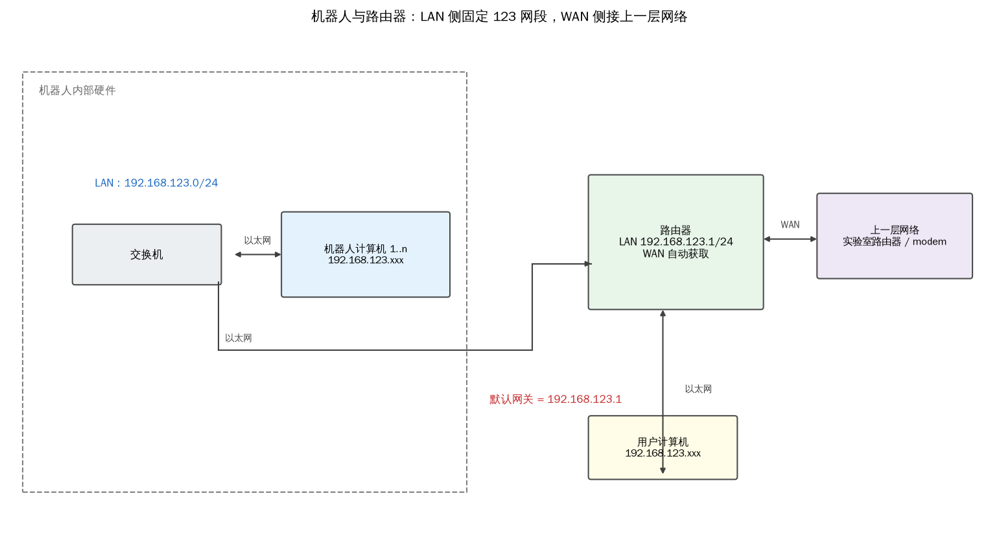

*图 3-16 机器人内部交换机接路由器 LAN 口，用户计算机也接 LAN 口；WAN 口接上一层网络，LAN 侧固定为 123 网段*

路由器要先配 LAN 口。浏览器打开路由器的管理地址：新路由器通常是 `192.168.0.1`，如果 LAN 口已经改成 123 网段，则是 `192.168.123.1`。把 LAN IP 设成 `192.168.123.1`、掩码 `255.255.255.0`，保存后用 `ping 192.168.123.1` 测路由器，用 `ping 192.168.123.161` 测机器人。WAN 口一般设成自动获取，具体看实验室网络是否要求静态地址或 PPPoE。

计算机要上网，除了 IP 和掩码，还需要默认网关。网关可以理解为“本网段里负责转发外网包的那台机器”，这里就是路由器的 LAN 地址 `192.168.123.1`。在机器人计算机上执行 `ip route` 或 `route -n`，看 `default` 那一行指向谁。表 T03 是原书的 `route` 输出，里面有两条 `default`：一条经 `192.168.123.1` 走 `eth0`，度量值 202；另一条经 `192.168.12.1` 走 `wlan1`，度量值 304。

<!-- 原书表 T03 -->

| Destination | Gateway | Genmask | Flags | Metric | Ref | Use | Iface |
| --- | --- | --- | --- | --- | --- | --- | --- |
| default | 192.168.123.1 | 0.0.0.0 | UG | 202 | 0 | 0 | eth0 |
| default | 192.168.12.1 | 0.0.0.0 | UG | 304 | 0 | 0 | wlan1 |
| 192.168.12.0 | 0.0.0.0 | 255.255.255.0 | U | 304 | 0 | 0 | wlan1 |
| 192.168.123.0 | 0.0.0.0 | 255.255.255.0 | U | 202 | 0 | 0 | eth0 |
| 224.0.0.0 | 0.0.0.0 | 240.0.0.0 | U | 0 | 0 | 0 | lo |

数据取自原书表 T03（原书无表题）。

两条 `default` 同时存在时，内核按度量值选路：202 小于 304，所以默认走 `eth0` 到 `192.168.123.1`，`wlan1` 那条是备份。度量值越小优先级越高，这和“跳数”不是一回事，是管理员或网络管理器给的成本。若默认网关不对，可以临时改：

```text
sudo ip route replace default via 192.168.123.1 dev eth0
```

`route add` 的旧写法需要 `sudo`，原书漏了这一点，普通用户执行会报 `Operation not permitted`。持久化仍然写到 netplan 的 `routes` 里，不要只改运行时表。

网关配好后，先 `ping 202.38.64.1` 测公网 IP，再 `ping www.baidu.com` 测域名。能通 IP 不能通域名，说明 DNS 没配好：域名只是 IP 的别名，路由器只认 IP，把域名翻译成 IP 要靠 DNS 服务器。可以依次测 `202.38.64.1`、`114.114.114.114`、`8.8.8.8`，哪个通用哪个；然后在 netplan 的 `nameservers` 或 `/etc/resolv.conf` 里加上。原书在网络接口配置文件里写 `dns-nameservers` 行，这依赖 `resolvconf` 服务；如果系统没装 `resolvconf`，或者 `resolv.conf` 被 NetworkManager 覆盖，那一行不会生效。现代系统更稳的做法是写 netplan，或者用 `systemd-resolved` 的 `resolvectl`。

图 3-17 把 `ip route` 的输出和表 T03 放在一起，方便对照列名。`ip route` 的写法比 `route -n` 新，列的顺序也不同，但语义一样：`default via ... dev ... metric ...` 对应 `Destination=default`、`Gateway=...`、`Iface=...`、`Metric=...`。

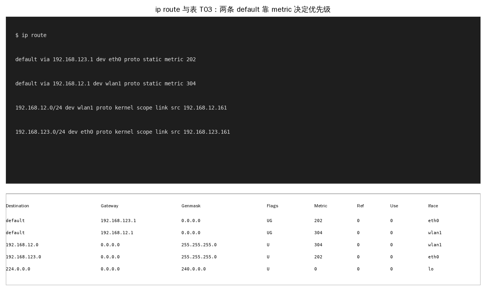

*图 3-17 上半是 `ip route` 的等价输出，下半是原书表 T03；两条 default 的度量值 202 与 304 决定优先级*

### 3.6.6 将代码切换为实机模式

原书的切换方式是改 `CMakeLists.txt`：`SIMULATION` 设为 `OFF`、`REAL_ROBOT` 设为 `ON`，重新 `catkin_make`。这样编译时不再定义仿真宏，而是定义实机宏，`main.cpp` 里的 `ioInter` 从 `IOROS` 变成 `IOSDK`。本书约定的切换是设 `QUADRUPED_BACKEND=real`，由工厂函数构造 `Rs485MotorBus`，不重新编译；两种方式的共同点是“只改一处，算法不动”。

实机运行的顺序如下，全部 **【需要实机】**，本书没有在本地验证：

1. 关闭 Gazebo、旧控制器等所有占用机器人接口的程序，避免两个进程同时发命令。
2. 用网线连接用户计算机和机器人背部以太网口，确认网口 `up`、IP 在 123 网段。
3. 用电池给机器人供电。剧烈动作时外接电源可能限流，电池更稳。
4. 机器人开机后会执行自带的开机程序，可能先站起或保持一个初始姿态；这是机器人厂商的程序，不是本章的控制器。
5. 启动本章的控制器。控制器默认进入 `Passive`，接管后机器人会先趴下；这是正常的，因为 `Passive` 的目标就是阻尼。
6. 打开遥控器，等数传信号灯常亮；按 `<L2+A>` 进入 `FixedStand`，机器人站起；按 `<L2+B>` 回 `Passive`，机器人趴下。
7. 先反复切换几次，确认没有突跳、没有单腿滞后，再考虑接入 `FreeStand` 和 `Trotting`。

第 4 步和第 5 步容易被误读成“机器人先站起、控制器又让它趴下”。这两件事分别属于厂商开机程序和用户控制器，时间上先后发生，不矛盾。第一次实机测试应把机器人放在空旷、平整的地面，周围不要有人或易碎物，手边能随时断电；先小角度、低刚度，确认方向正确后再加大。

如果切换到实机后机器人没有反应，按链路逐段查：`ping 192.168.123.10` 通不通，`ssh unitree@192.168.123.161` 能不能登录，控制器有没有打印“已连接”，SDK 初始化有没有报错，电机使能有没有打开。不要一上来就改控制参数，链路没通时改参数没有任何意义。

ROS 2 下的实机部署还要多一层环境配置。ROS 2 用 DDS 域隔离网络，跨机器通信要求两台机器在同一个 `ROS_DOMAIN_ID`、IP 可达、`ROS_LOCALHOST_ONLY` 没有设成 1。检查命令是

```text
# 【需要 ROS 2 环境】以下命令本书没有在本地验证
export ROS_DOMAIN_ID=42
ros2 topic list
ros2 topic hz /joint_states
ros2 run tf2_tools view_frames
```

`ros2 topic hz` 看实际周期，`view_frames` 生成 TF 树，确认 `base`、`odom`、`map` 之间的连接没有断。ROS 1 的 `ROS_MASTER_URI` 在 ROS 2 里不再需要，取而代之的是域号；这是从原书迁移时最容易漏掉的一步。

最后把本章的边界说清楚：这一章只完成了五个状态里的两个（`Passive` 和 `FixedStand`），`FreeStand`、`Trotting`、`move_base` 只搭了框架和切换逻辑，具体控制律分别在第 8、9、11 章实现。框架的价值在于，后面三章只需要往 `State` 的子类里填 `run()`，不需要再动接口、状态机和通信链路。

## 3.7 与原书的对应

原书第 3 章从 ROS/Gazebo 讲到实机网络，共 6 个一级节、18 个编号小节。本书保留“从框架到实机”的主线，把 Gazebo 换成 MuJoCo，把 ROS 1 换成 ROS 2 的讲法，把 C++ 宏换成 Python 的依赖注入；原书的每个小节都在下面表中给出位置。

| 原书节号 | 原书内容 | 本书位置 | 覆盖公式/表格 |
| --- | --- | --- | --- |
| 3.1 | ROS 与 Gazebo 简介 | 3.1 | 无 |
| 3.2 | 面向对象程序设计 | 3.2 | 无 |
| 3.2.1 | 数据抽象 | 3.2.1 | 无 |
| 3.2.2 | 继承 | 3.2.2 | 无 |
| 3.2.3 | 动态绑定 | 3.2.3 | 无 |
| 3.3 | 有限状态机 | 3.3 | 无 |
| 3.3.1 | 状态的成员函数 | 3.3.1 | 无 |
| 3.3.2 | 组合成为有限状态机 | 3.3.2 | 无 |
| 3.4 | 实践：让机器人站起来 | 3.4 | 无 |
| 3.4.1 | 机器人的关节控制 | 3.4.1 | 式（3-1）、（3-2） |
| 3.4.2 | 机器人的阻尼模式 | 3.4.2 | 式（3-3） |
| 3.4.3 | 机器人各个关节的坐标系与零角度点 | 3.4.3 | 式（3-4）、（3-5） |
| 3.4.4 | 机器人的固定站立模式 | 3.4.4 | 式（3-6）、（3-7） |
| 3.5 | 编译源代码 | 3.5 | 无 |
| 3.5.1 | 条件编译 | 3.5.1 | 无 |
| 3.5.2 | 编译的依赖项 | 3.5.2 | 无 |
| 3.5.3 | 在 Gazebo 中验证控制算法 | 3.5.3 | 无 |
| 3.6 | 实践：控制真实机器人并配置网络 | 3.6 | 无 |
| 3.6.1 | 机器人的局域网 | 3.6.1 | 无 |
| 3.6.2 | 机器人的控制程序 | 3.6.2 | 无 |
| 3.6.3 | 将用户计算机加入局域网 | 3.6.3 | 无 |
| 3.6.4 | 与网络相关的 Linux 功能 | 3.6.4 | 无 |
| 3.6.5 | 将机器人接入互联网 | 3.6.5 | T03 |
| 3.6.6 | 将代码切换为真实机器人模式 | 3.6.6 | 无 |

原书 19 幅编号插图都有对应的新图：图 3.1 → 图 3-2，3.2 → 图 3-3，3.3 → 图 3-4，3.4 → 图 3-5，3.5 → 图 3-6，3.6 → 图 3-7，3.7 → 图 3-9，3.8/3.9 → 图 3-10，3.10 → 图 3-11，3.11 → 图 3-12，3.12/3.13 → 图 3-13，3.14 → 图 3-14，3.15–3.17 → 图 3-15，3.18 → 图 3-16，3.19 → 图 3-17。本书新增图 3-1（ROS 2 节点与五层框架）、图 3-8（仿真站立序列）分别补足总体关系和全过程。表 T03 原样排在 3.6.5，数据未改。

与原书不一致的地方集中在两处。第一处是站立角：原书给 0.67/\(-1.30\) rad，本书的 Menagerie A1 模型用 0.90/\(-1.80\) rad 才能落到 0.27 m；把原书角度代入 A1 的腿长会得到约 0.339 m 的站高，说明那组值对应的是另一种腿长或站高，不能直接套。第二处是阻尼增益：原书仿真用 \(k_d=8\)，本书用 2.0，原因在 3.4.2 已说明。两处差异都不是抄错，而是模型和仿真器不同；正文以实际跑出的数值为准。

本书没有复刻原书的 Gazebo 截图、终端截图和产品接口照片。Gazebo 的两张姿态图用 MuJoCo 离屏渲染代替，终端截图用等价的文本图代替，接口照片用编号线稿代替，产品外观不在书中出现。
