# 第 4 章 刚体运动学：旋转、变换与欧拉角

四足机器人每一步都在回答两类几何问题：足端要落在世界里的哪个位置，机身要以什么姿态对着地面。这两个问题都写成“某个坐标系里的一个点或一组方向”，而坐标系本身会动。第 3 章把对象、状态机和仿真环境搭了起来，代码骨架已经能加载一台 A1、读关节角、推进仿真，但还没有一套统一的语言来描述“腿在哪、机身朝哪”。这一章补上这套语言。

这一章只讲几何，不讲力和质量。旋转矩阵、指数坐标、齐次变换矩阵和欧拉角四件工具会在后面的章节里反复出现：第 5 章用它们推单腿正逆解和雅可比，第 6 章用它们写整机运动学和角速度，第 7 章用它们从 IMU 读数还原姿态，第 8、9 章用它们把期望位姿和落脚点变成关节命令。这里把记号、推导和使用条件一次讲清，后面就不再重复。

符号约定先交代：矩阵用粗体大写字母，向量用粗体小写字母，字母上面加 `^` 表示单位向量；坐标系用 `{s}`（世界系，固定在地面）、`{b}`（机身系或物体系）、`{a}`、`{c}` 等表示。角度内部一律用弧度，只在显示和口述时换成角度。本章的示例都是纯数值计算，不需要真实机器人，也不需要 ROS 2。

## 4.1 平面旋转：从基到矩阵

先把问题降到二维。一块三角形构件放在桌面上，世界系 `{s}` 固定在桌面，物体系 `{b}` 固连在构件上，初始时刻两系重合。构件的一个顶点记作 \(P_0\)，它在 `{b}` 中的坐标是 \((x_b,y_b)\)。让构件绕原点逆时针转过 \(\theta\)，这个顶点到达 \(P\)，要问的是 \(P\) 在 `{s}` 中的坐标 \((x_s,y_s)\)。

这个问题里没有力、没有速度，只有“同一个点，换了一套尺子来量”。尺子就是基。

### 标准正交基与坐标

平面上取两个互相垂直的单位向量 \(\hat{\boldsymbol w}_1\)、\(\hat{\boldsymbol w}_2\)，它们构成一组标准正交基（orthonormal basis）。平面上任何向量 \(\boldsymbol v\) 都能唯一地写成这两根向量的线性组合：

<!-- 原书式（4.1） -->
\[ \boldsymbol v = a\,\hat{\boldsymbol w}_1 + b\,\hat{\boldsymbol w}_2 \tag{4-1} \]

图 4-1 是本节要解决的问题：灰色三角形是初始位置，蓝色三角形绕原点逆时针转了 30°，顶点 \(P_0\) 随之到达 \(P\)，同一批顶点在两套坐标架下读出两组数。系数 \(a\)、\(b\) 就是 \(\boldsymbol v\) 在这组基下的坐标。平常说的“向量 \((3,4)\)”，省略的正是“在 \(x\) 轴、\(y\) 轴单位向量这组基下，系数是 3 和 4”这句话。基并不唯一：把两根单位向量整体转 25°，又是另一组合法的标准正交基，同一个 \(\boldsymbol v\) 的坐标随之改变。图 4-2 把这件事画了出来：黑色箭头是同一个 \(\boldsymbol v\)，两个蓝色箭头是基向量 \(\hat{\boldsymbol w}_1\)、\(\hat{\boldsymbol w}_2\)，绿色是 \(a\hat{\boldsymbol w}_1\)，橙色是 \(b\hat{\boldsymbol w}_2\)，虚线补成一个平行四边形，说明 \(\boldsymbol v\) 等于两条边的矢量和。图上的数字是 \(a=1.6\)、\(b=1.0\)，于是 \(\boldsymbol v\) 在标准基下是 \((1.0275,1.5825)\)，在 \(\boldsymbol w\) 基下是 \((1.6,1.0)\)——两个坐标对，同一个箭头。

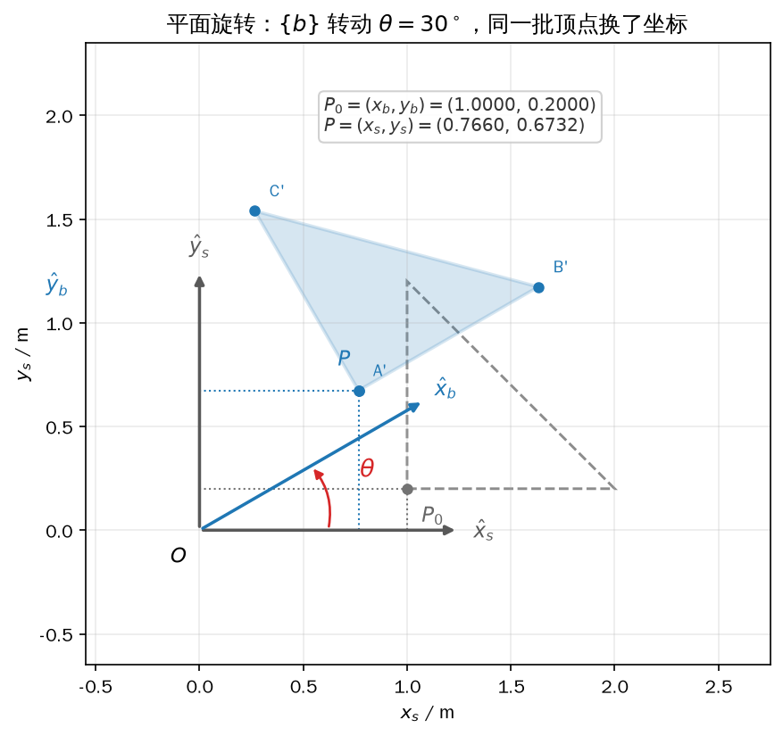

*图 4-1 物体系 `{b}` 随三角形逆时针转过 30°，顶点在 `{b}` 下的坐标不变，在 `{s}` 下的坐标由 \(R_{sb}\) 换出；灰色是初始位置，蓝色是转动之后*

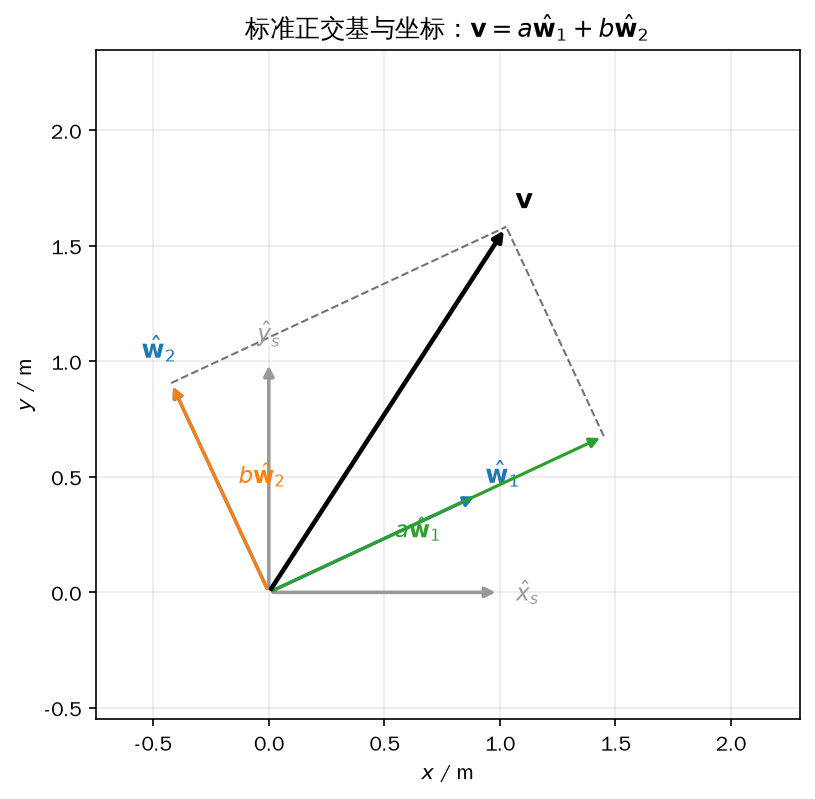

*图 4-2 同一个向量在两组标准正交基下的坐标不同：\(a,b\) 是 \(\boldsymbol w\) 基下的坐标，标准基下的两个分量是它的另一种写法*

### 从分解式到旋转矩阵

回到三角形。顶点 \(P\) 的位置向量 \(\overrightarrow{OP}\) 可以用 `{s}` 的基分解，也可以用 `{b}` 的基分解，两种分解描述的是同一个箭头，所以相等：

<!-- 原书式（4.2） -->
\[ \overrightarrow{OP}=x_s\hat{\boldsymbol x}_s+y_s\hat{\boldsymbol y}_s=x_b\hat{\boldsymbol x}_b+y_b\hat{\boldsymbol y}_b \tag{4-2} \]

把每组基向量按列拼成一个矩阵，坐标拼成列向量，式（4-2）就变成两个矩阵乘积相等：

<!-- 原书式（4.3） -->
\[ \overrightarrow{OP}=\begin{bmatrix}\hat{\boldsymbol x}_s&\hat{\boldsymbol y}_s\end{bmatrix}\begin{bmatrix}x_s\\y_s\end{bmatrix}=\begin{bmatrix}\hat{\boldsymbol x}_b&\hat{\boldsymbol y}_b\end{bmatrix}\begin{bmatrix}x_b\\y_b\end{bmatrix} \tag{4-3} \]

这一步是本节的关键：几何上的“同一个箭头”，翻译成了代数上的“两个矩阵乘列向量相等”。世界系的基最特殊，它的两根轴就是坐标轴本身：

<!-- 原书式（4.4） -->
\[ \hat{\boldsymbol x}_s=\begin{bmatrix}1\\0\end{bmatrix},\qquad \hat{\boldsymbol y}_s=\begin{bmatrix}0\\1\end{bmatrix},\qquad \begin{bmatrix}\hat{\boldsymbol x}_s&\hat{\boldsymbol y}_s\end{bmatrix}=\boldsymbol I \tag{4-4} \]

把式（4-4）代进式（4-3），左边就退化成 \([x_s\ y_s]^{\mathrm T}\)，右边仍然是基矩阵乘坐标。于是得到本节要的变换公式：

<!-- 原书式（4.5） -->
\[ \begin{bmatrix}x_s\\y_s\end{bmatrix}=\begin{bmatrix}\hat{\boldsymbol x}_b&\hat{\boldsymbol y}_b\end{bmatrix}\begin{bmatrix}x_b\\y_b\end{bmatrix}=\boldsymbol R_{sb}\begin{bmatrix}x_b\\y_b\end{bmatrix} \tag{4-5} \]

这里定义了 \(\boldsymbol R_{sb}=[\hat{\boldsymbol x}_b\ \hat{\boldsymbol y}_b]\)。它的两列不是随便填的数，而是 `{b}` 的两根轴在 `{s}` 里的方向。知道了两列，就等于知道了 `{b}` 相对 `{s}` 转了多少。

从图 4-1 可以直接读出这两列。\(\hat{\boldsymbol x}_b\) 与 \(\hat{\boldsymbol x}_s\) 的夹角是 \(\theta\)，模长为 1，所以它在 `{s}` 下是 \((\cos\theta,\sin\theta)\)；\(\hat{\boldsymbol y}_b\) 总比 \(\hat{\boldsymbol x}_b\) 超前 \(90^\circ\)，把它再逆时针转 \(90^\circ\) 就得到 \((-\sin\theta,\cos\theta)\)：

<!-- 原书式（4.6） -->
\[ \hat{\boldsymbol x}_b=\begin{bmatrix}\cos\theta\\\sin\theta\end{bmatrix},\qquad \hat{\boldsymbol y}_b=\begin{bmatrix}-\sin\theta\\\cos\theta\end{bmatrix} \tag{4-6} \]

把这两列并排写，就是二维旋转矩阵的标准形式：

<!-- 原书式（4.7） -->
\[ \boldsymbol R_{sb}=\begin{bmatrix}\cos\theta&-\sin\theta\\\sin\theta&\cos\theta\end{bmatrix} \tag{4-7} \]

式（4-7）有一个容易混淆的地方：它把 `{b}` 中的坐标换成 `{s}` 中的坐标，几何效果却是“构件绕原点逆时针转了 \(\theta\)”。两种说法并不矛盾。构件转了，同一个顶点相对 `{b}` 的数字没变（因为它跟着构件一起转），而相对 `{s}` 的数字变了；换坐标和转物体，本来就是同一个矩阵的两种解释。需要主动把一个点绕原点转 \(\theta\) 时，把这个点当成“在 `{b}` 里固定不动、让 `{b}` 转 \(\theta\)”即可，算的还是 \(R_{sb}\boldsymbol p_b\)。

### 下标语义与复合

\(R_{sb}\) 的两个下标有固定读法：第一个 \(s\) 是目标系，第二个 \(b\) 是源系，整个矩阵的作用是“从 \(b\) 读到 \(s\)”。两条变换首尾相接时，中间那个坐标系可以消掉：

\[ \boldsymbol R_{sb}\boldsymbol R_{bc}=\boldsymbol R_{sc} \]

这不是新公式，只是矩阵乘法的结合律加上“同一个点的坐标链式代入”。4.2 节会用三个坐标系把它推一遍。记法上有两个常见错误：把 \(R_{sb}\) 写成 \(R_{bs}\)（含义正好相反，是转置）；把 \(R_{sb}R_{bc}\) 写成 \(R_{bc}R_{sb}\)（顺序反了，结果一般不同）。后者在 4.2 的不可交换性里会看到具体数字。

### 旋转矩阵保持长度和夹角

\(R(\theta)\) 的两列是单位向量且互相垂直，所以 \(\boldsymbol R^{\mathrm T}\boldsymbol R=\boldsymbol I\)；又因为它不把平面翻面，\(\det\boldsymbol R=1\)。这两条性质保证旋转前后线段长度不变、两条线段的夹角不变。本节先用数值验证，严格的证明放到 4.2.2 对三维统一给出，二维是它的特例。

### 示例：转 30° 和 90°

`4_1_rotation2d.py` 把三角形的三个顶点 \((1.0,0.2)\)、\((2.0,0.2)\)、\((1.0,1.2)\) 分别转 30° 和 90°，打印旋转前后的坐标、长度误差、\(\boldsymbol R^{\mathrm T}\boldsymbol R\) 与行列式，并画图 4-1、图 4-2。核心只有一句 `(R2(theta) @ TRIANGLE.T).T`：顶点按行存放，转置后左乘旋转矩阵，再转回来。

```python
{{#include code/ch04/4_1_rotation2d.py:report}}
```

```python
{{#include code/ch04/4_1_rotation2d.py:invariants}}
```

```console
{{#include code/ch04/4_1_rotation2d.out}}
```

输出里的数字可以逐条核对。30° 时顶点 \(A\) 从 \((1.0000,0.2000)\) 走到 \((0.7660,0.6732)\)，手算 \(0.8660\times1-0.5\times0.2=0.766\)、\(0.5\times1+0.8660\times0.2=0.6732\)，与程序一致。90° 时 \(A\) 走到 \((-0.2000,1.0000)\)，相当于把 \((1,0.2)\) 的 \(x\) 分量搬到 \(y\) 上、\(y\) 分量取负搬到 \(x\) 上，这正是逆时针 90°。三组顶点的长度误差是 0（在双精度下恰好没有舍入），边长 \(AB\) 在旋转前后都是 1.0000 m。

两个不变量的数值是 \(\lVert\boldsymbol R^{\mathrm T}\boldsymbol R-\boldsymbol I\rVert_{\max}=7.44\times10^{-18}\)、\(\det\boldsymbol R=1.0000\)，说明式（4-7）确实是旋转而不是别的东西。复合部分给出的 \(R(20^\circ)R(10^\circ)\) 与 \(R(30^\circ)\) 的最大元素差是 0，两次旋转与一次旋转的顶点差是 \(2.22\times10^{-16}\) m，量级就是双精度的舍入误差。这个误差本身很小，但姿态积分要做几万次乘法，误差会累积；4.2.2 会提到定期正交化的做法。

图 4-1 里灰色虚线三角形是初始位置，蓝色实心是转过 30° 之后的位置，蓝色坐标架是 `{b}`，灰色是 `{s}`。顶点 \(P_0\) 到 \(P\) 的虚线投影给出两组坐标：投影到灰色轴上读到 \((1.0000,0.2000)\)，投影到蓝色轴上读到的是没有变的那组体坐标。图 4-2 则是同一个箭头的两种坐标写法，\(a=1.6\)、\(b=1.0\) 是 \(\boldsymbol w\) 基下的坐标，\((1.0275,1.5825)\) 是标准基下的坐标，两者相差一个 \(R(25^\circ)\)。

写这一类代码时有三个坑。第一，C++ 和 Python 的三角函数都吃弧度，`cos(30)` 算的是 30 rad，不是 30°；第二，式（4-7）的负号只在右上角，写成 \(\begin{bmatrix}\cos\theta&\sin\theta\\-\sin\theta&\cos\theta\end{bmatrix}\) 就是顺时针转；第三，别把“点的坐标”和“坐标系的方向”混在一个矩阵里——这一节只有旋转，平移要到 4.4 才进来。

## 4.2 三维旋转矩阵及其性质

平面上一个角度就够描述姿态，三维里不行：刚体可以绕三根轴以任意组合转动。仍然用“基”的观点，把二维的定义原样搬到三维——物体系 `{b}` 的三根轴在 `{s}` 中各有三个坐标，按列排成一个 \(3\times3\) 矩阵，就是三维旋转矩阵。

<!-- 原书式（4.8） -->
\[ \boldsymbol R_{sb}=\begin{bmatrix}\hat{\boldsymbol x}_b&\hat{\boldsymbol y}_b&\hat{\boldsymbol z}_b\end{bmatrix} \tag{4-8} \]

它的每一列是一个单位向量，三列两两正交，这给出六个标量约束（三个模长为 1、三个点积为 0）。九个元素减去六个约束，只剩三个独立参数，正好对应刚体的三个转动自由度。后面讲的轴-角、指数坐标、欧拉角、四元数，都只是给这三个自由度换一套参数化方式，信息量不会超过一个 \(3\times3\) 旋转矩阵。

### 右手系与正方向

本书所有坐标系都取右手系：\(x\) 轴叉乘 \(y\) 轴指向 \(z\) 轴，即 \(\hat{\boldsymbol z}=\hat{\boldsymbol x}\times\hat{\boldsymbol y}\)。转角的正方向也由右手定则规定：右手大拇指指向转轴的正向，四指弯曲的方向就是正转角的方向。图 4-3 用三张“转轴垂直纸面向外”的图把这条规则画清楚：纸面内的两根轴按右手系排布，带点的圆圈表示转轴指向读者，弧线箭头是正转方向。绕 \(x\) 轴正向转时，\(y\) 转向 \(z\)；绕 \(y\) 轴正向转时，\(z\) 转向 \(x\)；绕 \(z\) 轴正向转时，\(x\) 转向 \(y\)。这三句话就是下面三个矩阵的全部内容。

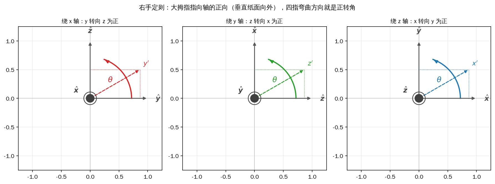

*图 4-3 三个基本旋转的正方向：转轴垂直纸面向外（带点的圆圈），弧线箭头由右手定则确定；虚线是转过 30° 之后的第二根轴*

### 三个基本旋转

先绕 \(x\) 轴转 \(\theta\)。\(x\) 轴上的单位向量不动，\(\hat{\boldsymbol x}'=(1,0,0)\)；\(\hat{\boldsymbol y}\) 和 \(\hat{\boldsymbol z}\) 在 \(yz\) 平面内转，按右手定则 \(y\) 转向 \(z\)，于是在 \(yz\) 平面里就是二维旋转：

\[ \hat{\boldsymbol y}'=\cos\theta\,\hat{\boldsymbol y}+\sin\theta\,\hat{\boldsymbol z},\qquad \hat{\boldsymbol z}'=-\sin\theta\,\hat{\boldsymbol y}+\cos\theta\,\hat{\boldsymbol z} \]

把三列拼起来：

<!-- 原书式（4.9） -->
\[ \boldsymbol R_x(\theta)=\begin{bmatrix}1&0&0\\0&\cos\theta&-\sin\theta\\0&\sin\theta&\cos\theta\end{bmatrix} \tag{4-9} \]

绕 \(y\) 轴和绕 \(z\) 轴同理，只是“谁转向谁”换了：

<!-- 原书式（4.10） -->
\[ \boldsymbol R_y(\theta)=\begin{bmatrix}\cos\theta&0&\sin\theta\\0&1&0\\-\sin\theta&0&\cos\theta\end{bmatrix},\qquad \boldsymbol R_z(\theta)=\begin{bmatrix}\cos\theta&-\sin\theta&0\\\sin\theta&\cos\theta&0\\0&0&1\end{bmatrix} \tag{4-10} \]

\(\boldsymbol R_y\) 的符号位置和另外两个不一样：右上角是 \(+\sin\theta\)，左下角是 \(-\sin\theta\)。原因是绕 \(+y\) 正向转时 \(z\) 轴转向 \(x\) 轴，而 \(z\) 在矩阵里是第三列、\(x\) 是第一列，投影到 \((1,3)\) 和 \((3,1)\) 两个位置就出现了这组符号。照抄 \(\boldsymbol R_x\) 的规律写 \(\boldsymbol R_y\)，得到的矩阵行列式仍是 1，但它描述的是绕 \(y\) 轴反向转，姿态会差一个 \(\theta\) 的符号，这类错误在 IMU 姿态解算里很难靠肉眼发现。

### 正交性：逆就是转置

式（4-8）的三列是标准正交基，所以任意两列的内积是 \(\delta_{ij}\)。矩阵 \(\boldsymbol R^{\mathrm T}\boldsymbol R\) 的第 \((i,j)\) 个元素正是第 \(i\) 列与第 \(j\) 列的内积，于是

\[ \boldsymbol R^{\mathrm T}\boldsymbol R=\boldsymbol I,\qquad \boldsymbol R\boldsymbol R^{\mathrm T}=\boldsymbol I \tag{4-11} \]

第二式对正方形成立：左逆存在就同时是右逆。式（4-11）有两个直接后果。其一，旋转保持内积，因而保持长度和夹角：\(\lVert\boldsymbol R\boldsymbol v\rVert^2=\boldsymbol v^{\mathrm T}\boldsymbol R^{\mathrm T}\boldsymbol R\boldsymbol v=\lVert\boldsymbol v\rVert^2\)。其二，求逆只需转置：

<!-- 原书式（4.14） -->
\[ \boldsymbol R_{sb}^{-1}=\boldsymbol R_{sb}^{\mathrm T} \tag{4-12} \]

从几何上看，\(\boldsymbol R_{sb}\) 把 \(b\) 系坐标读到 \(s\) 系，它的逆当然是把 \(s\) 系坐标读回 \(b\) 系，也就是 \(\boldsymbol R_{bs}\)：

<!-- 原书式（4.13） -->
\[ \boldsymbol R_{sb}^{-1}=\boldsymbol R_{bs} \tag{4-13} \]

两式合起来给出 \(\boldsymbol R_{bs}=\boldsymbol R_{sb}^{\mathrm T}\)。从行列式看，\(\det\boldsymbol R=1\neq0\) 也保证矩阵可逆，但工程上不用这个理由去求逆。工程代码里遇到旋转矩阵求逆，一律写转置，不要调用通用求逆：转置只搬数据，通用求逆要做 LU 分解，既慢又可能把严格正交的矩阵算成略微不正交的矩阵。

### 行列式与体积

旋转矩阵的行列式恒为 \(+1\)：

<!-- 原书式（4.11） -->
\[ \det(\boldsymbol R_{sb})=1 \tag{4-14} \]

证明只需两行：由式（4-11）取行列式得 \(\det(\boldsymbol R)^2=1\)，所以 \(\det\boldsymbol R=\pm1\)；正交矩阵的两类分别对应旋转（\(+1\)）和镜像（\(-1\)），右手系排除了后者。式（4-14）的几何含义是体积不变：行列式的绝对值等于线性变换对体积的放大倍数。原书用“每条边缩为三分之一”的对角矩阵举例：

<!-- 原书式（4.12） -->
\[ \boldsymbol A=\begin{bmatrix}\tfrac13&0&0\\0&\tfrac13&0\\0&0&\tfrac13\end{bmatrix},\qquad \det(\boldsymbol A)=\frac{1}{27} \tag{4-15} \]

单位立方体被它映射成边长 \(1/3\) 的小立方体，体积从 1 变成 \(1/27\)，与行列式一致。旋转矩阵的行列式是 1，单位立方体转个方向，体积仍是 1。

这里要补一句原书没有展开的话：\(\det=1\) 只说明体积不变，并不说明每个方向都不伸缩。矩阵 \(\begin{bmatrix}1&1\\0&1\end{bmatrix}\) 的行列式也是 1，但它把 \((0,1)\) 拉成 \((1,1)\)，长度从 1 变成 \(\sqrt2\)。旋转矩阵之所以连长度也保持，是因为它同时满足正交性式（4-11），体积不变只是正交性加上 \(\det=1\) 的一个推论。把这两件事分开记，才不会在“行列式为 1 的矩阵都能当旋转矩阵用”这种错误上栽跟头。

### 复合、结合律与不可交换

设空间里有三个坐标系 `{s}`、`{a}`、`{b}`，同一个点 \(P\) 在三个系里的坐标分别是 \(\boldsymbol p_s,\boldsymbol p_a,\boldsymbol p_b\)。从 \(b\) 读到 \(a\)、从 \(a\) 读到 \(s\) 分别是

<!-- 原书式（4.15） -->
\[ \boldsymbol p_a=\boldsymbol R_{ab}\boldsymbol p_b,\qquad \boldsymbol p_s=\boldsymbol R_{sa}\boldsymbol p_a \tag{4-16} \]

而直接从 \(b\) 读到 \(s\) 是

<!-- 原书式（4.16） -->
\[ \boldsymbol p_s=\boldsymbol R_{sb}\boldsymbol p_b \tag{4-17} \]

把第一式代入第二式：

<!-- 原书式（4.17） -->
\[ \boldsymbol p_s=\boldsymbol R_{sa}\boldsymbol R_{ab}\boldsymbol p_b \tag{4-18} \]

原书式（4.17）在转写稿里只剩编号、公式体缺失，这一行是按上下文（把 \(\boldsymbol p_a=\boldsymbol R_{ab}\boldsymbol p_b\) 代入 \(\boldsymbol p_s=\boldsymbol R_{sa}\boldsymbol p_a\)）补出的。同一个 \(\boldsymbol p_s\)、同一个任意的 \(\boldsymbol p_b\)，比较式（4-17）与式（4-18）就得到

<!-- 原书式（4.18） -->
<!-- 原书式（4.19） -->
\[ \boldsymbol R_{sb}=\boldsymbol R_{sa}\boldsymbol R_{ab} \tag{4-19} \]

这一步说明两个旋转矩阵相乘仍是旋转矩阵（封闭性），也说明下标可以“消去”：

<!-- 原书式（4.20） -->
\[ \boldsymbol R_{sa}\boldsymbol R_{ab}=\boldsymbol R_{sb} \tag{4-20} \]

下标消去是记忆和检查下标的好办法，但它不是证明：真正让式（4-19）成立的是矩阵乘法的结合律和旋转矩阵对乘法的封闭性。有的转写版本把原书式（4.18）里的 \(\boldsymbol R_{ab}\) 写成了 \(\boldsymbol R_{sb}\)，那样两边比较的对象就不对了；按“先 \(b\to a\)、再 \(a\to s\)”的顺序，第二个因子只能是 \(\boldsymbol R_{ab}\)。

同一个约定也管矩阵乘坐标向量。\(\boldsymbol R_{sb}\boldsymbol p_b\) 里第一个 \(b\) 说明“从 \(b\) 系出发”，第二个 \(b\) 说明“作用在 \(b\) 系的坐标上”，两个 \(b\) 对上以后，结果就落在 \(s\) 系：

<!-- 原书式（4.21） -->
\[ \boldsymbol R_{sb}\boldsymbol p_b=\boldsymbol R_{s\not b}\boldsymbol p_{\not b}=\boldsymbol p_s \tag{4-21} \]

也就是说，\(\boldsymbol R_{sb}\) 的第二个下标必须和被乘向量的下标一致，乘完以后这一对下标一起消失，只剩下左边的 \(s\)。如果下标对不上，矩阵仍可以硬乘，但得到的三个数不再是同一个点在某个坐标系下的坐标。

三个以上坐标系连乘时，加括号的顺序不影响结果：

<!-- 原书式（4.22） -->
\[ (\boldsymbol R_{ab}\boldsymbol R_{bc})\boldsymbol R_{cd}=\boldsymbol R_{ab}(\boldsymbol R_{bc}\boldsymbol R_{cd})=\boldsymbol R_{ad} \tag{4-22} \]

但交换两个因子的顺序通常会得到不同的矩阵：

<!-- 原书式（4.23） -->
\[ \boldsymbol R_{ac}=\boldsymbol R_{ab}\boldsymbol R_{bc}\neq\boldsymbol R_{bc}\boldsymbol R_{ab} \tag{4-23} \]

这不是代数上的小脾气，而是几何事实：先绕 \(x\) 转 30° 再绕 \(y\) 转 60°，与先绕 \(y\) 转 60° 再绕 \(x\) 转 30°，终点姿态不一样。图 4-4 把两种顺序的终点画在同一组坐标架里。示例算出的最大元素差是 0.4330，两个终点之间的相对旋转角是 29.7419°，转轴为 \((0.4871,-0.2260,-0.8436)\)——差得相当大，绝不是舍入误差。这也是 4.6 节必须先约定欧拉角顺序的原因：只说“横滚 10°、俯仰 20°”，不说顺序，姿态是没有定义的。

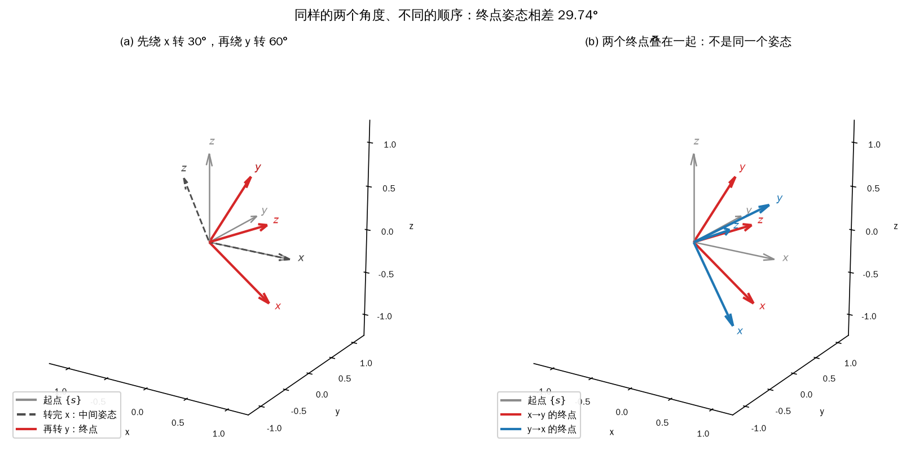

*图 4-4 同样两个角度、两种顺序：左图是一条完整的 x→y 路径，右图把两个终点叠在一起；两组三根轴的指向明显不同*

### 示例：验算性质与顺序

`4_2_rotation3d.py` 构造三个 90° 的基本旋转，检查它们与式（4-9）、（4-10）的符号是否一致；再构造 \(\boldsymbol R=\boldsymbol R_x(30^\circ)\boldsymbol R_y(60^\circ)\boldsymbol R_z(45^\circ)\)，逐条验证正交性、行列式、逆等于转置，最后比较两种旋转顺序。

```python
{{#include code/ch04/4_2_rotation3d.py:properties}}
```

```python
{{#include code/ch04/4_2_rotation3d.py:order}}
```

```console
{{#include code/ch04/4_2_rotation3d.out}}
```

输出里 \(\boldsymbol R_y(90^\circ)\) 的第 \((1,3)\) 个元素是 \(+1\)、第 \((3,1)\) 个是 \(-1\)，\(\boldsymbol R_x(90^\circ)\) 和 \(\boldsymbol R_z(90^\circ)\) 的对应位置则是 \(0\)，符号规律与式（4-9）、（4-10）一致。正交性两项分别是 \(1.11\times10^{-16}\) 和 \(4.53\times10^{-17}\)，\(\det\boldsymbol R=1.000000\)；把整个矩阵取负得到 \(\det(-R)=-1.000000\)，那是镜像而不是旋转，这个对照说明“行列式为 1”确实是旋转的一个必要条件。逆与转置的最大差是 \(1.11\times10^{-16}\)，用负角度按相反顺序重算的逆与转置相差 \(5.55\times10^{-17}\)，三者一致。

顺序部分：\(\boldsymbol R_x(30^\circ)\boldsymbol R_y(60^\circ)\) 与 \(\boldsymbol R_y(60^\circ)\boldsymbol R_x(30^\circ)\) 的最大元素差是 0.4330，相对旋转角 29.7419°，与库函数 `so3_rotation_error` 给出的值完全相同。作为对照，对测试向量 \((0.3,-0.7,1.1)\) 先作用 \(\boldsymbol R_{ab}\) 再作用 \(\boldsymbol R_{sa}\)，与直接作用 \(\boldsymbol R_{sb}\) 的差为 0，说明式（4-19）的复合在这一组数据上精确成立。

实际写代码时还有一件事：反复相乘的旋转矩阵会慢慢失去正交性。单次误差在 \(10^{-16}\) 量级，但如果按 1 kHz 的频率做姿态积分，一小时就是 \(3.6\times10^6\) 次乘法，误差会累积到肉眼可见。工程上的做法是每隔一段时间（例如几百个周期）用 SVD 或 Gram-Schmidt 把矩阵拉回正交：取 \(\boldsymbol R=\boldsymbol U\boldsymbol V^{\mathrm T}\) 是最省事的一种，它的结果离原矩阵最近，且严格正交。本章的示例都只做几次乘法，不需要这一步；第 6 章做角速度积分时会再提到。

## 4.3 绕任意轴旋转：叉乘、指数映射与对数

旋转矩阵有九个元素、三个自由度，直接填九个数字既麻烦又容易破坏正交性。更自然的描述是“绕某根轴转多少度”，也就是轴-角表示（axis-angle）：单位向量 \(\hat{\boldsymbol\omega}\) 给方向，标量 \(\theta\) 给大小。本节要回答两个互逆的问题：给定 \((\hat{\boldsymbol\omega},\theta)\) 怎么写出 \(\boldsymbol R\)；给定 \(\boldsymbol R\) 怎么反解出 \((\hat{\boldsymbol\omega},\theta)\)。

思路不是硬凑矩阵元素，而是把旋转看成一个过程：让点绕固定轴以 1 rad/s 的角速度匀速转动，转满 \(\theta\) 秒。这样点的位置满足一个一阶线性微分方程，方程的解是矩阵指数；把矩阵指数展开、利用叉乘矩阵幂的周期性，就得到只含一次叉乘、一次平方和两个三角函数的闭式，即罗德里格斯公式。反过来解这个闭式，就是矩阵对数。

### 叉乘及其矩阵形式

两个三维向量的叉乘（cross product）结果仍是向量：

<!-- 原书式（4.24） -->
\[ \boldsymbol c=\boldsymbol a\times\boldsymbol b,\qquad \lVert\boldsymbol c\rVert=\lVert\boldsymbol a\rVert\,\lVert\boldsymbol b\rVert\sin\theta \tag{4-24} \]

方向垂直于 \(\boldsymbol a,\boldsymbol b\) 张成的平面，指向由右手定则确定：四指从 \(\boldsymbol a\) 弯向 \(\boldsymbol b\)，大拇指指向 \(\boldsymbol c\)。模长等于以 \(\boldsymbol a,\boldsymbol b\) 为邻边的平行四边形面积。交换两个因子，右手会翻面，所以

<!-- 原书式（4.25） -->
\[ \boldsymbol a\times\boldsymbol b=-\boldsymbol b\times\boldsymbol a \tag{4-25} \]

这条反交换律是叉乘和普通乘法最不一样的地方。右手系三根基向量的叉乘按循环顺序排列：

<!-- 原书式（4.26） -->
\[ \boldsymbol i\times\boldsymbol j=\boldsymbol k,\qquad \boldsymbol j\times\boldsymbol k=\boldsymbol i,\qquad \boldsymbol k\times\boldsymbol i=\boldsymbol j \tag{4-26} \]

逆着循环顺序就多一个负号：

<!-- 原书式（4.27） -->
\[ \boldsymbol j\times\boldsymbol i=-\boldsymbol k \tag{4-27} \]

同一根基向量与自己叉乘得零向量：

<!-- 原书式（4.28） -->
\[ \boldsymbol i\times\boldsymbol i=\boldsymbol j\times\boldsymbol j=\boldsymbol k\times\boldsymbol k=\boldsymbol 0 \tag{4-28} \]

设 \(\boldsymbol a\)、\(\boldsymbol b\) 在同一组右手基 \(\boldsymbol i,\boldsymbol j,\boldsymbol k\) 下写成

<!-- 原书式（4.29） -->
\[ \begin{cases} \boldsymbol a=a_x\boldsymbol i+a_y\boldsymbol j+a_z\boldsymbol k\\ \boldsymbol b=b_x\boldsymbol i+b_y\boldsymbol j+b_z\boldsymbol k \end{cases}\tag{4-29} \]

把两个和式逐项相乘，先不合并同类项，按 \(\boldsymbol a\) 的三个分量分成三组：

<!-- 原书式（4.30） -->
\[ \begin{aligned} \boldsymbol a\times\boldsymbol b ={}&(a_x\boldsymbol i+a_y\boldsymbol j+a_z\boldsymbol k)\times(b_x\boldsymbol i+b_y\boldsymbol j+b_z\boldsymbol k)\\ ={}&a_xb_x(\boldsymbol i\times\boldsymbol i)+a_xb_y(\boldsymbol i\times\boldsymbol j)+a_xb_z(\boldsymbol i\times\boldsymbol k)\\ &+a_yb_x(\boldsymbol j\times\boldsymbol i)+a_yb_y(\boldsymbol j\times\boldsymbol j)+a_yb_z(\boldsymbol j\times\boldsymbol k)\\ &+a_zb_x(\boldsymbol k\times\boldsymbol i)+a_zb_y(\boldsymbol k\times\boldsymbol j)+a_zb_z(\boldsymbol k\times\boldsymbol k) \end{aligned}\tag{4-30} \]

用式（4-26）到（4-28）换掉九个基向量叉乘：三个同向项为零，剩下六项两两合并到同一根基向量上：

<!-- 原书式（4.31） -->
\[ \boldsymbol a\times\boldsymbol b =(a_yb_z-a_zb_y)\boldsymbol i+(a_zb_x-a_xb_z)\boldsymbol j+(a_xb_y-a_yb_x)\boldsymbol k \tag{4-31} \]

把这组分量按 \(x,y,z\) 排成一列，再写成矩阵乘向量，就是叉乘的矩阵形式：

<!-- 原书式（4.32） -->
\[ \boldsymbol a\times\boldsymbol b=\begin{bmatrix}0&-a_z&a_y\\a_z&0&-a_x\\-a_y&a_x&0\end{bmatrix}\begin{bmatrix}b_x\\b_y\\b_z\end{bmatrix}=[\boldsymbol a]_\times\boldsymbol b \tag{4-32} \]

方括号加下标 \(\times\) 是“把向量变成叉乘矩阵”的记号，读作“\(\boldsymbol a\) 的叉乘矩阵”。它把叉乘从“两个向量出一个向量”改写成“矩阵乘向量”，这是后面所有推导能从几何变成代数的原因。注意矩阵里的元素是 \(\boldsymbol a\) 的分量、乘的是 \(\boldsymbol b\)，别写反。

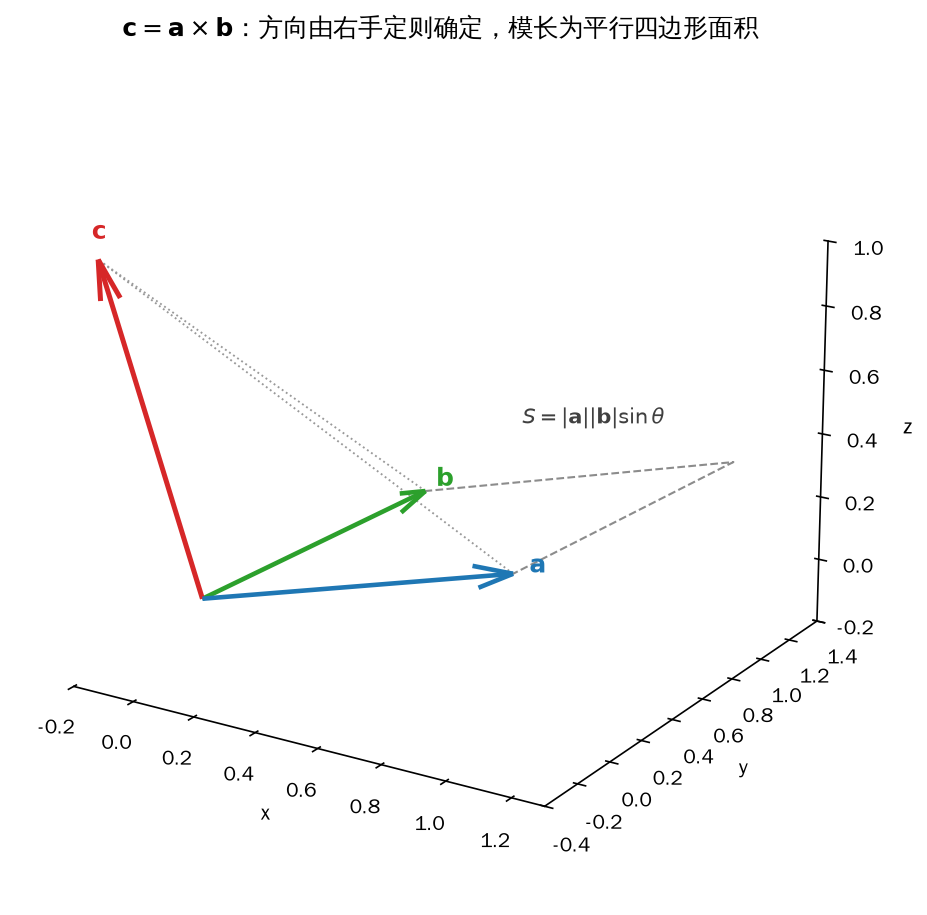

*图 4-5 叉乘 \(\boldsymbol c=\boldsymbol a\times\boldsymbol b\) 垂直于 \(\boldsymbol a,\boldsymbol b\) 张成的平面，方向由右手定则给出，模长等于平行四边形的面积*

图 4-5 画的是叉乘的方向和模长：红色箭头 \(\boldsymbol c\) 垂直于 \(\boldsymbol a,\boldsymbol b\) 张成的平面，虚线平行四边形把它和面积联系起来。注意图上的 \(\boldsymbol c\) 并不是“最长的那根”，它的模长只等于面积 1.0448，方向由右手定则决定——这两件事经常被初学者混为一谈。

叉乘矩阵是反对称矩阵：

<!-- 原书式（4.33） -->
\[ [\boldsymbol a]_\times=-[\boldsymbol a]_\times^{\mathrm T} \tag{4-33} \]

对角元全为 0，非对角元成对反号。反对称矩阵只有三个独立元素，恰好装下 \(\boldsymbol a\) 的三个分量，这也解释了为什么叉乘能用一个 \(3\times3\) 矩阵表示而不多不少。反交换律写成矩阵形式是

<!-- 原书式（4.34） -->
\[ [\boldsymbol a]_\times\boldsymbol b=-[\boldsymbol b]_\times\boldsymbol a \tag{4-34} \]

第 6 章推动力学要反复用二重向量积的展开法则（常按英文首字母叫 BAC-CAB 法则）：

<!-- 原书式（4.35） -->
\[ \boldsymbol a\times(\boldsymbol b\times\boldsymbol c)=(\boldsymbol a\cdot\boldsymbol c)\boldsymbol b-(\boldsymbol a\cdot\boldsymbol b)\boldsymbol c \tag{4-35} \]

用 \(\boldsymbol b\times\boldsymbol c=[\boldsymbol b]_\times\boldsymbol c\) 和 \(\boldsymbol a^{\mathrm T}\boldsymbol c=\boldsymbol a\cdot\boldsymbol c\) 把它翻译成矩阵语言：

<!-- 原书式（4.36） -->
\[ [\boldsymbol a]_\times[\boldsymbol b]_\times\boldsymbol c=(\boldsymbol a^{\mathrm T}\boldsymbol c)\boldsymbol b-(\boldsymbol a^{\mathrm T}\boldsymbol b)\boldsymbol c \tag{4-36} \]

这两个点积都是标量，必须先用括号算出来再乘向量；直接把 \([\boldsymbol a]_\times[\boldsymbol b]_\times\) 当成某个“点积矩阵”是常见的错误，两个叉乘矩阵相乘得到的是九个元素的矩阵，不是标量。

### 绕轴旋转的线速度

设点 \(P\) 绕经过原点的单位轴 \(\hat{\boldsymbol\omega}\) 转动，角速度为 \(\dot\alpha\)。把 \(P\) 投影到轴上得到 \(A\)，则 \(P\) 在垂直于轴、以 \(A\) 为圆心的平面内做圆周运动，半径是 \(|AP|\)。圆周运动的速度大小等于角速度乘半径：

<!-- 原书式（4.37） -->
\[ \lVert\boldsymbol v_\omega\rVert=\dot\alpha\,|AP| \tag{4-37} \]

**表 4-1 原书表 T04（原书摘录，实为式 4.37 的排版，不是数据表）**

<!-- 原书表 T04 -->
|\boldsymbol v_\omega|=\dot\alpha\cdot|AP|=|\dot\alpha\hat{\boldsymbol\omega}|\cdot|OP|\cdot\sin\angle AOP\tag{4.37}

数据取自原书表 T04（PDF 第 57 页）。原书把这条带编号的公式排成了表格样式，抽取时被当成“表”；本书原样保留以便对照，下面按正常公式重排。把 \(|AP|=|OP|\sin\angle AOP\) 代进去，并用角速度向量 \(\boldsymbol\omega=\dot\alpha\hat{\boldsymbol\omega}\)、位置向量 \(\boldsymbol p=\overrightarrow{OP}\) 改写：

<!-- 原书式（4.38） -->
\[ \lVert\boldsymbol v_\omega\rVert=\lVert\boldsymbol\omega\rVert\,\lVert\boldsymbol p\rVert\sin\angle AOP \tag{4-38} \]

**表 4-2 原书表 T05（原书摘录，实为式 4.38 的排版，不是数据表）**

<!-- 原书表 T05 -->
| \pmb { v } _ { \omega } | = | \pmb { \omega } | \ \cdot \ | \pmb { p } | \ \cdot \ \sin \angle A O P\tag{4.38}

数据取自原书表 T05（PDF 第 57 页）。式（4-38）的右端正好是叉乘模长的公式，方向也吻合：\(\boldsymbol v_\omega\) 在旋转平面内，垂直于半径 \(AP\)，因而同时垂直于 \(\hat{\boldsymbol\omega}\) 和 \(\boldsymbol p\)。两个条件合起来就是

<!-- 原书式（4.39） -->
\[ \boldsymbol v_\omega=\boldsymbol\omega\times\boldsymbol p=[\boldsymbol\omega]_\times\boldsymbol p \tag{4-39} \]

图 4-6 把这三根向量画在一起：\(A\) 是 \(P\) 在轴上的投影，\(AP\) 与轴垂直（图上用直角符号标出），\(\boldsymbol v\) 沿圆周切线，同时垂直于 \(\boldsymbol p\) 和转轴。

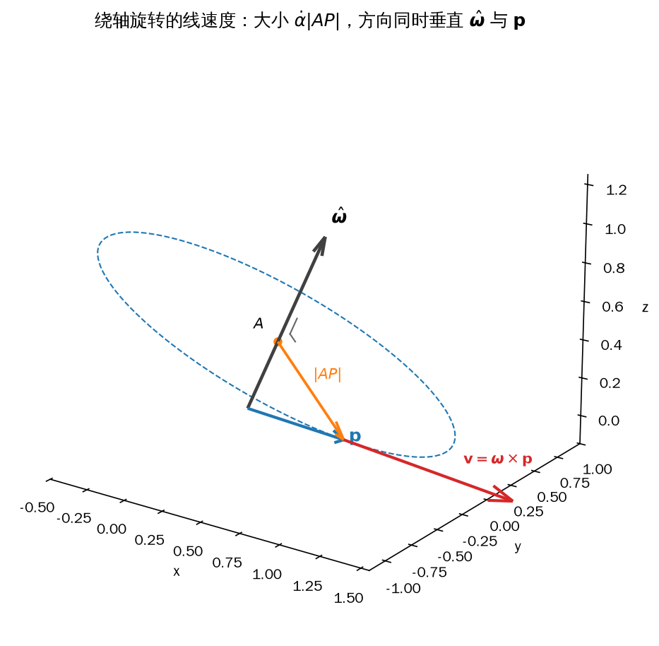

*图 4-6 点 \(P\) 绕单位轴 \(\hat{\boldsymbol\omega}\) 转动：半径 \(AP\) 与轴垂直，速度 \(\boldsymbol v=\boldsymbol\omega\times\boldsymbol p\) 沿切线方向，大小等于 \(\dot\alpha|AP|\)*

把旋转矩阵的三列看成固连在 `{b}` 上的三根单位向量，它们随 `{b}` 以角速度 \(\boldsymbol\omega\) 转动。对每一列用式（4-39）求导，再把 \([\boldsymbol\omega]_\times\) 提到矩阵外面：

<!-- 原书式（4.40） -->
\[ \dot{\boldsymbol R}_{sb}=[\boldsymbol\omega_s]_\times\boldsymbol R_{sb} \tag{4-40} \]

两边右乘 \(\boldsymbol R_{sb}^{\mathrm T}\)：

<!-- 原书式（4.41） -->
\[ [\boldsymbol\omega_s]_\times=\dot{\boldsymbol R}_{sb}\boldsymbol R_{sb}^{\mathrm T} \tag{4-41} \]

式（4-41）的右端一定是反对称矩阵——转置一下取负就能验证，而反对称矩阵只有三个独立元素，正好对应角速度的三个分量。式（4-40）和式（4-41）是把姿态与角速度连起来的两座桥：已知姿态轨迹可以反求角速度，已知角速度可以积分出姿态。这里的 \(\boldsymbol\omega_s\) 是角速度在 `{s}` 下的坐标；要机体系下的角速度，再左乘 \(\boldsymbol R_{sb}^{\mathrm T}\) 即可。第 6 章的角速度项和姿态积分都从这里出发。

### 一阶线性微分方程与矩阵指数

先看最简单的标量方程。设 \(\dot x(t)=ax(t)\)，\(a\) 为常数，初值 \(x(0)=x_0\)：

<!-- 原书式（4.42） -->
\[ \dot x(t)=ax(t) \tag{4-42} \]

它的解是指数函数：

<!-- 原书式（4.43） -->
\[ x(t)=\mathrm e^{at}x_0 \tag{4-43} \]

把式（4-43）代回式（4-42）的左右两端，就是下面这三行：

<!-- 原书式（4.44） -->
\[ \begin{cases} \dot x(t)=ax(t)\\ \left(\mathrm e^{at}x_0\right)'=a\mathrm e^{at}x_0\\ a\mathrm e^{at}x_0=a\mathrm e^{at}x_0 \end{cases}\tag{4-44} \]

最后一行是同一个式子，说明前面的代入没有矛盾；关键在于指数函数的导数会把系数 \(a\) 提到前面。要知道这个性质从哪里来，可以把 \(\mathrm e^{at}\) 写成幂级数：

<!-- 原书式（4.45） -->
\[ \mathrm e^{at}=\sum_{n=0}^{\infty}\frac{a^nt^n}{n!} =1+at+\frac{a^2t^2}{2!}+\frac{a^3t^3}{3!}+\cdots \tag{4-45} \]

级数在任意有限 \(t\) 上收敛，所以可以逐项求导。常数项导数为零，其余每一项用幂函数求导公式，再约去一个 \(n\)：

<!-- 原书式（4.46） -->
\[ \begin{aligned} \left(\mathrm e^{at}\right)' &=\left(\sum_{n=0}^{\infty}\frac{a^nt^n}{n!}\right)' =\sum_{n=1}^{\infty}\frac{n\,a^nt^{n-1}}{n!}\\ &=a\sum_{n=1}^{\infty}\frac{a^{n-1}t^{n-1}}{(n-1)!} \end{aligned}\tag{4-46} \]

令 \(m=n-1\) 重新编号，求和又回到从零开始，级数正是 \(a\mathrm e^{at}\)：

<!-- 原书式（4.47） -->
\[ \left(\mathrm e^{at}\right)'=a\sum_{m=0}^{\infty}\frac{a^mt^m}{m!}=a\,\mathrm e^{at} \tag{4-47} \]

把标量 \(a\) 换成方阵 \(\boldsymbol A\)，级数照抄，只是每一项都变成矩阵幂：

<!-- 原书式（4.48） -->
\[ \mathrm e^{\boldsymbol A t}=\boldsymbol I+t\boldsymbol A+\frac{t^2}{2!}\boldsymbol A^2+\frac{t^3}{3!}\boldsymbol A^3+\cdots \tag{4-48} \]

这个级数对任何方阵都收敛，且 \(\left(\mathrm e^{\boldsymbol A t}\right)'=\boldsymbol A\mathrm e^{\boldsymbol A t}\) 与标量情形一样成立。于是向量方程 \(\dot{\boldsymbol x}=\boldsymbol A\boldsymbol x\) 在初值 \(\boldsymbol x_0\) 下的解是

<!-- 原书式（4.49） -->
\[ \boldsymbol x(t)=\mathrm e^{\boldsymbol A t}\boldsymbol x_0 \tag{4-49} \]

对角矩阵最容易算，对角元各自取指数即可：

<!-- 原书式（4.50） -->
\[ \mathrm e^{\boldsymbol D t}=\begin{bmatrix}\mathrm e^{d_1t}&0&\cdots&0\\0&\mathrm e^{d_2t}&\cdots&0\\\vdots&\vdots&\ddots&\vdots\\0&0&\cdots&\mathrm e^{d_nt}\end{bmatrix} \tag{4-50} \]

若 \(\boldsymbol A=\boldsymbol P\boldsymbol D\boldsymbol P^{-1}\) 可对角化，则

<!-- 原书式（4.51） -->
\[ \mathrm e^{\boldsymbol A t}=\boldsymbol P\,\mathrm e^{\boldsymbol D t}\boldsymbol P^{-1} \tag{4-51} \]

这三条性质够用了，但有一条必须记清：\(\mathrm e^{\boldsymbol A}\mathrm e^{\boldsymbol B}=\mathrm e^{\boldsymbol A+\boldsymbol B}\) 只在 \(\boldsymbol A\boldsymbol B=\boldsymbol B\boldsymbol A\) 时成立，矩阵一般不交换，所以不能把指数的加法随便拆开。另一个常用性质是 \(\left(\mathrm e^{\boldsymbol A}\right)^{-1}=\mathrm e^{-\boldsymbol A}\)，它对任何方阵都成立。叉乘矩阵虽然也能对角化（它的特征值是 \(0,\pm\mathrm j\)），但没必要：下面用幂的周期性直接算，比求特征向量省事得多。

### 罗德里格斯公式

现在把 \(P\) 绕 \(\hat{\boldsymbol\omega}\) 的旋转等效成“以 1 rad/s 转了 \(\theta\) 秒”。单位角速度下 \(\boldsymbol\omega=\hat{\boldsymbol\omega}\)，由式（4-39）：

<!-- 原书式（4.52） -->
\[ \dot{\boldsymbol p}(t)=[\hat{\boldsymbol\omega}]_\times\boldsymbol p(t) \tag{4-52} \]

这是 \(\dot{\boldsymbol x}=\boldsymbol A\boldsymbol x\) 的形式，解由式（4-49）给出。令 \(t=\theta\)：

<!-- 原书式（4.53） -->
\[ \boldsymbol p(\theta)=\mathrm e^{[\hat{\boldsymbol\omega}]_\times\theta}\boldsymbol p_0 \tag{4-53} \]

与旋转矩阵的定义 \(\boldsymbol p(\theta)=\boldsymbol R\boldsymbol p_0\) 对照，就得到轴-角表示下的旋转矩阵：

<!-- 原书式（4.54） -->
\[ \mathrm{Rot}(\hat{\boldsymbol\omega},\theta)=\mathrm e^{[\hat{\boldsymbol\omega}]_\times\theta}=\sum_{n=0}^{\infty}\frac{[\hat{\boldsymbol\omega}]_\times^n\theta^n}{n!} \tag{4-54} \]

这个级数不能直接算，但 \([\hat{\boldsymbol\omega}]_\times\) 的幂有很好的周期性。对任意向量 \(\boldsymbol a\)，\([\hat{\boldsymbol\omega}]_\times\boldsymbol a=\hat{\boldsymbol\omega}\times\boldsymbol a\) 垂直于轴，模长是 \(|\boldsymbol a|\sin\angle\)；再叉乘一次，相当于在垂直平面内转 \(90^\circ\)、模长不变。转四次回到原方向，于是

<!-- 原书式（4.55） -->
\[ [\hat{\boldsymbol\omega}]_\times^3=-[\hat{\boldsymbol\omega}]_\times,\qquad [\hat{\boldsymbol\omega}]_\times^4=-[\hat{\boldsymbol\omega}]_\times^2,\qquad [\hat{\boldsymbol\omega}]_\times^5=[\hat{\boldsymbol\omega}]_\times,\ \ldots \tag{4-55} \]

把式（4-55）代进式（4-54），奇次项都含 \([\hat{\boldsymbol\omega}]_\times\)，偶次项（除单位矩阵外）都含 \([\hat{\boldsymbol\omega}]_\times^2\)：

<!-- 原书式（4.56） -->
\[ \mathrm{Rot}(\hat{\boldsymbol\omega},\theta)=\boldsymbol I+\left(\theta-\frac{\theta^3}{3!}+\frac{\theta^5}{5!}-\cdots\right)[\hat{\boldsymbol\omega}]_\times+\left(\frac{\theta^2}{2!}-\frac{\theta^4}{4!}+\frac{\theta^6}{6!}-\cdots\right)[\hat{\boldsymbol\omega}]_\times^2 \tag{4-56} \]

两个括号分别是正弦和 \(1-\cos\theta\) 的泰勒级数：

<!-- 原书式（4.57） -->
\[ \sin\theta=\theta-\frac{\theta^3}{3!}+\frac{\theta^5}{5!}-\cdots,\qquad \cos\theta=1-\frac{\theta^2}{2!}+\frac{\theta^4}{4!}-\cdots \tag{4-57} \]

代回去就得到罗德里格斯公式（Rodrigues' formula）：

<!-- 原书式（4.58） -->
\[ \mathrm{Rot}(\hat{\boldsymbol\omega},\theta)=\boldsymbol I+\sin\theta\,[\hat{\boldsymbol\omega}]_\times+(1-\cos\theta)\,[\hat{\boldsymbol\omega}]_\times^2 \tag{4-58} \]

图 4-7(a) 用 \(z\) 轴和 \(x\) 轴上的向量把式（4-55）画了出来：\(K\boldsymbol a\)、\(K^2\boldsymbol a\)、\(K^3\boldsymbol a\) 依次转过 \(90^\circ\)，第四步回到 \(\boldsymbol a\)；图 4-7(b) 是指数映射本身，同一个点从 \(\theta=0\) 沿圆弧被送到 \(\theta=\pi\)。

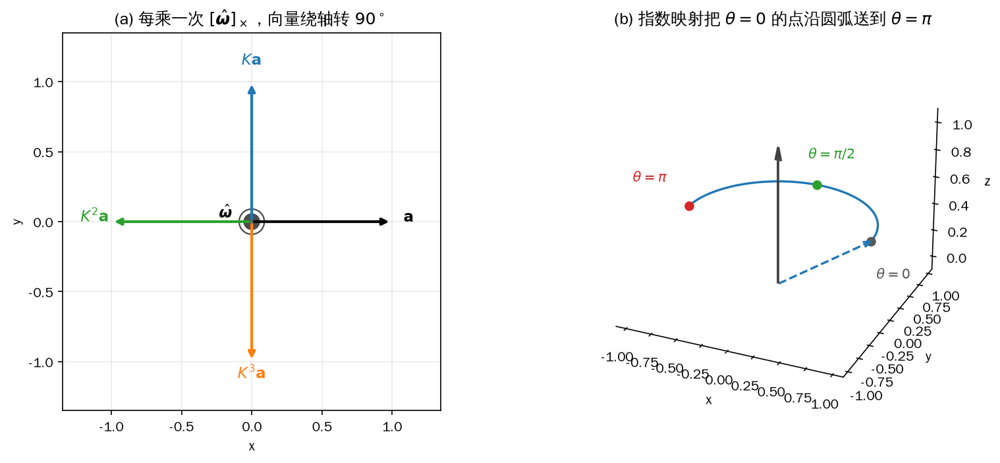

*图 4-7 (a) 每乘一次 \([\hat{\boldsymbol\omega}]_\times\)，向量在垂直于轴的平面内转 \(90^\circ\)；(b) 指数映射把 \(\theta=0\) 的初始点沿圆弧送到 \(\theta=\pi\)，中途经过 \(\theta=\pi/2\)*

式（4-58）的代价很低：一次叉乘矩阵、一次矩阵平方、两次三角函数调用。它也把自由度说清楚了——轴方向两个参数（单位向量的球面坐标）、转角一个参数，正好三个。写代码时注意 \(\theta\) 用弧度，且 \(\hat{\boldsymbol\omega}\) 必须是单位向量；如果直接把一个模长不为 1 的 \(\boldsymbol\omega\) 代进去，式（4-58）会同时把角度和轴都算错。示例里用 \(\boldsymbol\omega=(0.2,-0.3,0.5)\) 试了一下，错误写法与正确结果的最大差是 0.1979，远不是舍入误差。

### 矩阵对数与指数坐标

已知 \(\boldsymbol R\) 求 \((\hat{\boldsymbol\omega},\theta)\) 叫矩阵对数。把 \(\hat{\boldsymbol\omega}=(\omega_1,\omega_2,\omega_3)\) 代入式（4-58）展开，九个元素可以写成

<!-- 原书式（4.59） -->
\[ \boldsymbol R=\begin{bmatrix}c+\omega_1^2(1-c)&\omega_1\omega_2(1-c)-\omega_3s&\omega_1\omega_3(1-c)+\omega_2s\\ \omega_1\omega_2(1-c)+\omega_3s&c+\omega_2^2(1-c)&\omega_2\omega_3(1-c)-\omega_1s\\ \omega_1\omega_3(1-c)-\omega_2s&\omega_2\omega_3(1-c)+\omega_1s&c+\omega_3^2(1-c)\end{bmatrix} \tag{4-59} \]

其中 \(c=\cos\theta\)、\(s=\sin\theta\)。矩阵的迹（对角元之和）把交叉项全部消掉：

<!-- 原书式（4.60） -->
\[ \operatorname{tr}(\boldsymbol R)=3\cos\theta+(\omega_1^2+\omega_2^2+\omega_3^2)(1-\cos\theta) \tag{4-60} \]

轴是单位向量，平方和为 1，所以 \(\operatorname{tr}(\boldsymbol R)=1+2\cos\theta\)，转角可以直接反解：

<!-- 原书式（4.61） -->
\[ \theta=\arccos\frac{\operatorname{tr}(\boldsymbol R)-1}{2} \tag{4-61} \]

写代码时先把 \((\operatorname{tr}\boldsymbol R-1)/2\) 限幅到 \([-1,1]\)：浮点误差会让一个严格正交的矩阵算出 \(1+10^{-16}\)，`acos` 收到越界参数会直接返回 `NaN`，后面整条姿态链路都会坏掉。再取非对角元之差，含 \(\cos\theta\) 的项抵消，只剩 \(\sin\theta\) 乘轴分量：

<!-- 原书式（4.62） -->
\[ \omega_1=\frac{r_{32}-r_{23}}{2\sin\theta},\qquad \omega_2=\frac{r_{13}-r_{31}}{2\sin\theta},\qquad \omega_3=\frac{r_{21}-r_{12}}{2\sin\theta} \tag{4-62} \]

式（4-61）、（4-62）就是最常见的 \(\log:\mathrm{SO}(3)\to\mathbb{R}^3\) 实现，返回值 \(\hat{\boldsymbol\omega}\theta\) 叫指数坐标。它有两个必须单独处理的角度。\(\theta=0\) 时 \(\sin\theta=0\)，但此时根本没有转，指数坐标就是零向量，不必求轴。\(\theta=\pi\) 时 \(\sin\theta\) 也是 0，式（4-62）除零；此时式（4-58）退化成只含 \([\hat{\boldsymbol\omega}]_\times^2\) 的对称矩阵：

<!-- 原书式（4.63） -->
\[ \boldsymbol R=\boldsymbol I+2[\hat{\boldsymbol\omega}]_\times^2=\begin{bmatrix}1-2\omega_2^2-2\omega_3^2&2\omega_1\omega_2&2\omega_1\omega_3\\2\omega_1\omega_2&1-2\omega_1^2-2\omega_3^2&2\omega_2\omega_3\\2\omega_1\omega_3&2\omega_2\omega_3&1-2\omega_1^2-2\omega_2^2\end{bmatrix} \tag{4-63} \]

从左上角元素出发，用平方和为 1 消去另外两个分量：

<!-- 原书式（4.64） -->
\[ r_{11}=1-2\omega_2^2-2\omega_3^2=2\omega_1^2-1 \tag{4-64} \]

于是

<!-- 原书式（4.65） -->
\[ \omega_1=\pm\sqrt{\frac{r_{11}+1}{2}},\qquad \omega_2=\frac{r_{12}}{2\omega_1},\qquad \omega_3=\frac{r_{13}}{2\omega_1} \tag{4-65} \]

取正号并有理化，得到工程上常用的形式：

<!-- 原书式（4.66） -->
\[ \omega_1=\frac{r_{11}+1}{\sqrt{2(r_{11}+1)}},\qquad \omega_2=\frac{r_{12}}{\sqrt{2(r_{11}+1)}},\qquad \omega_3=\frac{r_{13}}{\sqrt{2(r_{11}+1)}} \tag{4-66} \]

正负两个解对应方向相反的两根轴，但转角都是 \(\pi\)，两个解描述的姿态相同，取哪个都不影响 \(\boldsymbol R\)。式（4-65）还有一个隐含前提 \(\omega_1\neq0\)：若转轴落在 \(yz\) 平面内，\(r_{11}=-1\)，分母为零。完整的实现不能死守第一列，而应看 \((r_{11},r_{22},r_{33})\) 哪个最大，从对应的对角元解出最大的那个分量，再用另外两个非对角元求剩下的分量；共用包的 `so3_log` 就是按这个思路写的。

还有一处语义要强调：轴-角表示中的轴是“在旋转矩阵右侧那个向量的坐标系里”的轴。同一个数值向量 \(\hat{\boldsymbol\omega}\)，\(\boldsymbol R\boldsymbol p_s\) 表示绕 `{s}` 中的这根轴转，\(\boldsymbol R\boldsymbol p_b\) 表示绕 `{b}` 中的同一组数字所代表的轴转。写控制器时如果发现“姿态转的方向对、但轴不对”，先检查轴是在哪个系里给的。

### 示例：exp、log 与 scipy 对照

`4_3_so3.py` 按式（4-32）、（4-58）、（4-61）、（4-62）自己实现了一遍 `skew`、`so3_exp`、`so3_log`，再拿共用包和 scipy 做基准。对数用 \(\theta=\mathrm{atan2}(\lVert\mathrm{vee}\rVert/2,(\operatorname{tr}\boldsymbol R-1)/2)\) 而不是 \(\arccos\)：两者在数学上等价，但 \(\arccos\) 在 \(\theta\) 接近 0 或 \(\pi\) 时会把自变量的误差放大成 \(\sqrt{\epsilon}\) 量级的角误差，`atan2` 不会。

```python
{{#include code/ch04/4_3_so3.py:algebra}}
```

```python
{{#include code/ch04/4_3_so3.py:roundtrip}}
```

```console
{{#include code/ch04/4_3_so3.out}}
```

叉乘部分：\(\boldsymbol a=(1,0,0.3)\)、\(\boldsymbol b=(0.2,1,0.1)\)，叉乘结果 \((-0.3000,-0.0400,1.0000)\)，模长 1.0448，与 \(\lVert\boldsymbol a\rVert\lVert\boldsymbol b\rVert\sin\theta\) 算出的 1.0448 一致；反对称性、反交换、BAC-CAB 的误差都在 \(10^{-17}\) 量级。

线速度部分：转轴 \((0.3509,0.2506,0.9023)\)，位置 \((1.0000,-0.5500,0.2000)\)，半径 \(|AP|=1.0898\)，与 \(|p|\sin\angle AOP\) 相同；速度 \((0.5464,0.8321,-0.4436)\)，模长 1.0898，与半径相等（因为角速度是 1 rad/s）；速度与半径的夹角是 \(90.00^\circ\)，说明 \(\boldsymbol v\) 确实沿切线。

幂与指数映射部分：以 \(z\) 轴为转轴、\(\boldsymbol a\) 沿 \(x\) 轴，四次幂依次是 \((1,0,0)\)、\((0,1,0)\)、\((-1,0,0)\)、\((0,-1,0)\)，第四步回到起点；\([\hat{\boldsymbol\omega}]_\times^3+[\hat{\boldsymbol\omega}]_\times\) 与 \([\hat{\boldsymbol\omega}]_\times^4+[\hat{\boldsymbol\omega}]_\times^2\) 的最大元素都是 0。指数映射把 \(\theta=0\) 的 \((0.9000,0,0.4500)\) 送到 \(\theta=\pi\) 的 \((-0.9000,0,0.4500)\)，高度不变，正好是绕 \(z\) 轴转了半圈。

往返测试用 100 组随机旋转：\(\log\to\exp\) 的最大旋转误差是 \(3.42\times10^{-15}\) rad，与 `scipy.spatial.transform.Rotation.from_rotvec` 的最大元素差是 \(5.55\times10^{-16}\)，说明两份实现在双精度意义下等价。共用包自身的 \(\log\to\exp\) 往返误差是 \(2.76\times10^{-13}\) rad，略大一点，原因是它在 \(\theta\) 上用 `acos`，在 \(\pi\) 附近精度会掉；这不影响控制使用，但如果要做高精度标定，可以换成 `atan2` 版本。

特殊角度：\(\theta=0\) 时 \(\operatorname{tr}\boldsymbol R=3\)、对数为零向量；\(\theta=\pi/2\) 时迹为 1、对数 \((0,0,1.5708)\)；\(\theta=\pi\) 时迹为 \(-1\)、对数 \((0,0,3.1416)\)。最后一行把转轴换成 \(+y\)、令 \(r_{11}=-1\)，用来验证式（4-65）失效的那个分支：程序仍然返回 \((0,3.1416,0)\)，因为实现里换了一列来解。

## 4.4 二维刚体运动与齐次坐标

4.1 只让构件绕原点转，原点不动。真实的平面刚体会一边转一边跑：机身在地面上有 \(x,y\) 两个平移，还有一个转角 \(\theta\)，一共三个自由度。图 4-8 是标准的分解：初始时 `{b}` 与 `{s}` 重合，先把 `{b}` 的原点沿 \(\overrightarrow{OO'}\) 移到 \(O'\)，再绕 \(O'\) 转过 \(\theta\)，就得到一般的平面刚体运动。

把平移加进式（4-2），同一个顶点 \(P\) 在两套基下的分解就多了一项：

<!-- 原书式（4.67） -->
\[ \overrightarrow{OP}=x_s\hat{\boldsymbol x}_s+y_s\hat{\boldsymbol y}_s=x_b\hat{\boldsymbol x}_b+y_b\hat{\boldsymbol y}_b+\overrightarrow{OO'} \tag{4-67} \]

问题在于平移项 \(\overrightarrow{OO'}\) 对旋转项是“加法”，而矩阵乘法只能表达“乘法”。要把两步并成一次乘法，就得把坐标升一维。

### 齐次坐标：点补 1，向量补 0

二维点和二维向量都写成两个数，但它们在平移下的行为不同：点有位置，平移会改变它；向量只有方向和大小，整体平移不改变它。齐次坐标（homogeneous coordinates）用第三个分量把这种区别编码进去：点补 1，向量补 0。

\[ \boldsymbol p=\begin{bmatrix}x\\y\end{bmatrix}\ \longrightarrow\ \begin{bmatrix}x\\y\\1\end{bmatrix},\qquad \boldsymbol v=\begin{bmatrix}v_x\\v_y\end{bmatrix}\ \longrightarrow\ \begin{bmatrix}v_x\\v_y\\0\end{bmatrix} \]

补 1 之后，平移项在矩阵乘法里就能“乘得进去”；补 0 之后，平移列乘 0 消失，向量只受旋转影响。这个约定在三维里完全一样，只是多一个分量、矩阵大一圈。

<!-- 原书式（4.68） -->
\[ \begin{bmatrix}x_s\\y_s\\1\end{bmatrix}=\begin{bmatrix}\hat{\boldsymbol x}_b&\hat{\boldsymbol y}_b&\overrightarrow{OO'}\\0&0&1\end{bmatrix}\begin{bmatrix}x_b\\y_b\\1\end{bmatrix} \tag{4-68} \]

把 \(\hat{\boldsymbol x}_b,\hat{\boldsymbol y}_b\) 用式（4-6）代入，平移向量写成两个分量 \(t_x,t_y\)：

<!-- 原书式（4.69） -->
\[ \begin{bmatrix}x_s\\y_s\\1\end{bmatrix}=\begin{bmatrix}\cos\theta&-\sin\theta&t_x\\\sin\theta&\cos\theta&t_y\\0&0&1\end{bmatrix}\begin{bmatrix}x_b\\y_b\\1\end{bmatrix}=\boldsymbol T_{sb}\begin{bmatrix}x_b\\y_b\\1\end{bmatrix} \tag{4-69} \]

这个 \(3\times3\) 矩阵就是二维齐次变换矩阵，记作 \(\boldsymbol T_{sb}\)。它一次完成旋转和平移，所以能描述任意平面刚体运动。按块来看，它由四块组成：

<!-- 原书式（4.70） -->
\[ \boldsymbol T_{sb}=\begin{bmatrix}\boldsymbol R_{sb}&\boldsymbol p_{sb}\\ \boldsymbol 0_{1\times2}&1\end{bmatrix} \tag{4-70} \]

左上 \(2\times2\) 是旋转，右上 \(2\times1\) 是平移，左下是一行 0，右下是 1。三维里这个结构原封不动，只是每块都变大：旋转 \(3\times3\)、平移 \(3\times1\)、底行 \(1\times4\)。

### 逆与复合

\(\boldsymbol T_{sb}\) 的逆有解析式，不必调用通用求逆。把“先转再移”倒过来就是“先反移再反转”：

\[ \boldsymbol T_{sb}^{-1}=\begin{bmatrix}\boldsymbol R_{sb}^{\mathrm T}&-\boldsymbol R_{sb}^{\mathrm T}\boldsymbol p_{sb}\\ \boldsymbol 0_{1\times2}&1\end{bmatrix} \tag{4-71} \]

注意旋转块的逆是转置，而平移列不是简单取负：要先把 \(\boldsymbol p_{sb}\) 转到 `{b}` 系里，再取负。验证方法很直接，把两个矩阵乘起来，左上得 \(\boldsymbol R\boldsymbol R^{\mathrm T}=\boldsymbol I\)，右上得 \(-\boldsymbol R\boldsymbol R^{\mathrm T}\boldsymbol p+\boldsymbol p=\boldsymbol 0\)，底行不动，结果是单位矩阵。

复合与旋转矩阵一样，中间坐标系消去：

\[ \boldsymbol T_{sb}\boldsymbol T_{bc}=\boldsymbol T_{sc} \tag{4-72} \]

这条规则就是“先 \(b\to c\)、再 \(c\to s\)”。二维的逆、封闭性、结合律与不可交换性，与 4.5 节的三维版本逐条对应，那里一并推导，这里不重复。

### 示例：点与向量的区别

`4_4_se2.py` 构造 \(\boldsymbol T_{sb}\)（\(\theta=30^\circ\)、平移 \((0.8,0.5)\)），用同一个矩阵分别变换一个点和一个向量，再复合一个 \(T_{bc}\)，最后比较解析逆与 `numpy.linalg.inv`。

```python
{{#include code/ch04/4_4_se2.py:pointvec}}
```

```python
{{#include code/ch04/4_4_se2.py:compose}}
```

```console
{{#include code/ch04/4_4_se2.out}}
```

点 \(p_b=(1.0000,0.2000)\) 变换后是 \((1.5660,1.1732)\)，与 \(\boldsymbol R\boldsymbol p_b+\boldsymbol p_{sb}\) 完全一致；向量 \(v_b=(1.0000,0)\) 变换后是 \((0.8660,0.5000)\)，第三分量是 0，说明它只转了 \(30^\circ\)、没有被平移 \(0.9434\) m 带走。这就是“点补 1、向量补 0”的直接效果，代码里写 `np.append(v, 0.0)` 还是 `1.0` 决定了结果，很容易在重构时改错。

复合部分：\(\boldsymbol T_{sb}\boldsymbol T_{bc}\) 与“先算 \(\boldsymbol R_{sb}\boldsymbol R_{bc}\)、再算 \(\boldsymbol p_{sb}+\boldsymbol R_{sb}\boldsymbol p_{bc}\)”的直接构造最大元素差是 0；解析逆与通用求逆的最大差是 \(1.11\times10^{-16}\)，\(\boldsymbol T\boldsymbol T^{-1}\) 与单位矩阵的最大差也是 \(1.11\times10^{-16}\)。解析逆的旋转块与 \(\boldsymbol R^{\mathrm T}\) 差为 0，说明转置那一步没有引入误差。

图 4-8 里灰色虚线三角形是初始位置，绿色是运动之后的构件，绿色坐标架的原点在 \(O'\)，红色虚线箭头是 \(\overrightarrow{OO'}\)，橙色弧是 \(\theta\)。从图上看得很清楚：三角形每个顶点都先被平移带到 \(O'\) 附近，再绕 \(O'\) 转过去；如果只写 \(2\times2\) 的旋转矩阵，无论怎么调角度都摆不出这个位置。

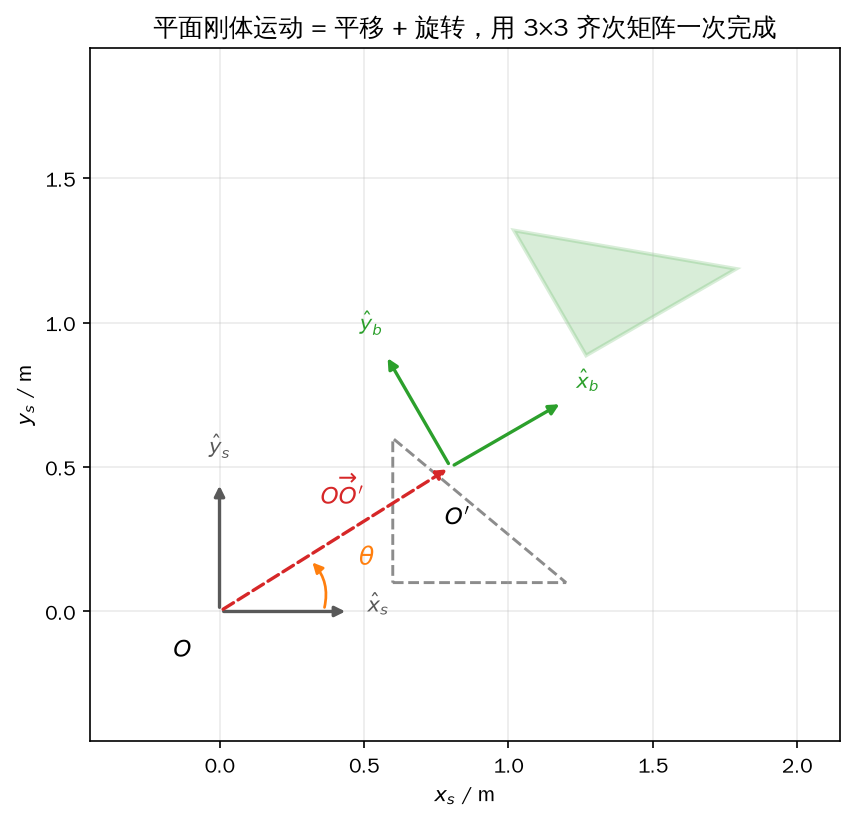

*图 4-8 平面刚体运动分解为平移 \(\overrightarrow{OO'}\) 和绕 \(O'\) 的旋转 \(\theta\)，用 \(3\times3\) 齐次矩阵一次完成*

三个常见错误值得写在这里。其一，点的齐次坐标补了 0，平移整段消失，点看起来“只转没动”；其二，把 \(\boldsymbol T^{-1}\) 当成 \(\boldsymbol T^{\mathrm T}\)——齐次变换矩阵一般不是正交矩阵，只有旋转块能转置；其三，复合顺序写反，\(\boldsymbol T_{bc}\boldsymbol T_{sb}\) 的下标接不上，结果既不是 \(T_{sc}\) 也不是 \(T_{cs}\)，而是一个没有几何意义的矩阵。

## 4.5 三维刚体运动与齐次变换矩阵

三维刚体运动和二维完全平行，只是每块都长大一岁：旋转从 \(2\times2\) 变成 \(3\times3\)，平移从 \(2\times1\) 变成 \(3\times1\)，齐次矩阵从 \(3\times3\) 变成 \(4\times4\)。这个 \(4\times4\) 矩阵叫齐次变换矩阵（homogeneous transformation matrix），它的集合记作 \(\mathrm{SE}(3)\)。点是三维的、平移是三维的，一个矩阵同时装下两者，代价是坐标补一维。

### 结构与记号

三维点和三维向量的齐次坐标分别是四维：

\[ \boldsymbol p=\begin{bmatrix}x\\y\\z\end{bmatrix}\ \longrightarrow\ \begin{bmatrix}x\\y\\z\\1\end{bmatrix},\qquad \boldsymbol v=\begin{bmatrix}v_x\\v_y\\v_z\end{bmatrix}\ \longrightarrow\ \begin{bmatrix}v_x\\v_y\\v_z\\0\end{bmatrix} \]

齐次变换矩阵按块写成

<!-- 原书式（4.86） -->
\[ \boldsymbol T=\begin{bmatrix}\boldsymbol R&\boldsymbol p\\ \boldsymbol 0_{1\times3}&1\end{bmatrix} \tag{4-73} \]

左上 \(3\times3\) 是旋转，右上 \(3\times1\) 是平移，底行固定是 \([0\ 0\ 0\ 1]\)。十六个元素里，旋转块受六个正交约束，平移块三个自由，底行四个常数，真正独立的参数是六个——刚体位姿的六个自由度。

### 三条性质：可逆、封闭、结合但不交换

先看逆。\(\mathrm{SE}(3)\) 的元素一定可逆，而且逆有解析式，不必调用通用求逆：

<!-- 原书式（4.71） -->
\[ \boldsymbol T^{-1}=\begin{bmatrix}\boldsymbol R&\boldsymbol p\\ \boldsymbol 0_{1\times3}&1\end{bmatrix}^{-1}=\begin{bmatrix}\boldsymbol R^{\mathrm T}&-\boldsymbol R^{\mathrm T}\boldsymbol p\\ \boldsymbol 0_{1\times3}&1\end{bmatrix} \tag{4-74} \]

几何意义是“先反向旋转，再把平移转回去取负”。把两个矩阵乘起来验证：

<!-- 原书式（4.72） -->
\[ \boldsymbol T\boldsymbol T^{-1}=\begin{bmatrix}\boldsymbol R&\boldsymbol p\\ \boldsymbol 0&1\end{bmatrix}\begin{bmatrix}\boldsymbol R^{\mathrm T}&-\boldsymbol R^{\mathrm T}\boldsymbol p\\ \boldsymbol 0&1\end{bmatrix}=\begin{bmatrix}\boldsymbol R\boldsymbol R^{\mathrm T}&-\boldsymbol R\boldsymbol R^{\mathrm T}\boldsymbol p+\boldsymbol p\\ \boldsymbol 0&1\end{bmatrix}=\boldsymbol I \tag{4-75} \]

四块分别是 \(\boldsymbol I\)、\(\boldsymbol 0\)、\(\boldsymbol 0\)、1。注意右上角不是简单的 \(-\boldsymbol p\)：平移要先用 \(\boldsymbol R^{\mathrm T}\) 转到源系，再取负；写成 \(-\boldsymbol p\) 是常见错误。

再看封闭性。两个 \(\mathrm{SE}(3)\) 相乘，结果仍是 \(\mathrm{SE}(3)\)：

\[ \begin{bmatrix}\boldsymbol R_1&\boldsymbol p_1\\ \boldsymbol 0&1\end{bmatrix}\begin{bmatrix}\boldsymbol R_2&\boldsymbol p_2\\ \boldsymbol 0&1\end{bmatrix}=\begin{bmatrix}\boldsymbol R_1\boldsymbol R_2&\boldsymbol R_1\boldsymbol p_2+\boldsymbol p_1\\ \boldsymbol 0&1\end{bmatrix} \]

左上仍是两个旋转矩阵的乘积，仍是旋转；右上仍是三维向量；底行不变。三个以上连乘，加括号的顺序不影响结果：

<!-- 原书式（4.73） -->
\[ (\boldsymbol T_{ab}\boldsymbol T_{bc})\boldsymbol T_{cd}=\boldsymbol T_{ab}(\boldsymbol T_{bc}\boldsymbol T_{cd})=\boldsymbol T_{ad} \tag{4-76} \]

但交换顺序一般会得到不同的位姿：

<!-- 原书式（4.74） -->
\[ \boldsymbol T_{ac}=\boldsymbol T_{ab}\boldsymbol T_{bc}\neq\boldsymbol T_{bc}\boldsymbol T_{ab} \tag{4-77} \]

“先转后移”和“先移后转”在几何上是两件不同的事，矩阵乘法把这种不同如实记了下来。还有一条最容易混：齐次变换矩阵不是正交矩阵，\(\boldsymbol T^{-1}\neq\boldsymbol T^{\mathrm T}\)，只有旋转块满足转置等于逆。把“旋转矩阵逆等于转置”直接套到 \(\mathrm{SE}(3)\) 上，是姿态代码里最隐蔽的 bug 之一——它不报错，只是结果慢慢偏。

### 三种作用：状态量、换系、运动

同一个 \(\boldsymbol T\)，在三种语境下的几何解释不同，数学形式却一样。

第一种是描述位姿。图 4-9 里有三个局部系 `{a}`、`{b}`、`{c}`，其中 `{a}` 与世界系 `{s}` 重合。它们在 `{s}` 中的旋转矩阵为

<!-- 原书式（4.75） -->
\[ \boldsymbol R_{sa}=\boldsymbol I,\qquad \boldsymbol R_{sb}=\begin{bmatrix}0&0&1\\0&-1&0\\1&0&0\end{bmatrix},\qquad \boldsymbol R_{sc}=\begin{bmatrix}-1&0&0\\0&0&1\\0&1&0\end{bmatrix} \tag{4-78} \]

原点坐标为

<!-- 原书式（4.76） -->
\[ \boldsymbol p_{sa}=\begin{bmatrix}0\\0\\0\end{bmatrix},\qquad \boldsymbol p_{sb}=\begin{bmatrix}-2\\-2\\0\end{bmatrix},\qquad \boldsymbol p_{sc}=\begin{bmatrix}0\\2\\1\end{bmatrix} \tag{4-79} \]

拼起来就是三个位姿：

<!-- 原书式（4.77） -->
\[ \boldsymbol T_{sa}=\begin{bmatrix}\boldsymbol R_{sa}&\boldsymbol p_{sa}\\ \boldsymbol 0&1\end{bmatrix},\quad \boldsymbol T_{sb}=\begin{bmatrix}\boldsymbol R_{sb}&\boldsymbol p_{sb}\\ \boldsymbol 0&1\end{bmatrix},\quad \boldsymbol T_{sc}=\begin{bmatrix}\boldsymbol R_{sc}&\boldsymbol p_{sc}\\ \boldsymbol 0&1\end{bmatrix} \tag{4-80} \]

一个 \(\boldsymbol T\) 同时回答“原点在哪”和“轴朝哪”，所以能完整描述一个坐标系的位姿；把它固连在刚体上，它描述的就是刚体位姿。位姿不一定相对世界系：要描述 `{c}` 相对 `{b}` 的位姿，就用 \(\boldsymbol R_{bc}\) 和 \(\boldsymbol p_{bc}\) 拼 \(\boldsymbol T_{bc}\)。

\(\boldsymbol R_{bc}\) 的三列是 `{c}` 的三根轴在 `{b}` 中的方向：

<!-- 原书式（4.78） -->
\[ \boldsymbol R_{bc}=\begin{bmatrix}0&1&0\\0&0&-1\\-1&0&0\end{bmatrix} \tag{4-81} \]

\(\boldsymbol p_{bc}\) 是 \(\overrightarrow{O_bO_c}\) 在 `{b}` 下的坐标。\(p_{sc}-p_{sb}\) 是同一个向量在 `{s}` 下的坐标，要变到 `{b}` 下，左乘 \(\boldsymbol R_{sb}^{\mathrm T}\) 就够了——它是向量，补 0，平移块不参与：

<!-- 原书式（4.79） -->
\[ \boldsymbol p_{bc}=\boldsymbol R_{sb}^{\mathrm T}\left(\boldsymbol p_{sc}-\boldsymbol p_{sb}\right) \tag{4-82} \]

代入数字：\(\boldsymbol p_{sc}-\boldsymbol p_{sb}=(2,4,1)\)，\(\boldsymbol R_{sb}^{\mathrm T}\) 就是上面那个对称矩阵，乘得 \(\boldsymbol p_{bc}=(1,-4,2)\)。这里不能写 \(\boldsymbol T_{sb}^{\mathrm T}\)：齐次矩阵的转置会把底行搬到最右列，第四个分量不再是 0。正确的写法是先分析出 \(\boldsymbol T_{bs}=\boldsymbol T_{sb}^{-1}\)，再用解析逆公式。拼出

<!-- 原书式（4.80） -->
\[ \boldsymbol T_{bc}=\begin{bmatrix}\boldsymbol R_{bc}&\boldsymbol p_{bc}\\ \boldsymbol 0&1\end{bmatrix} \tag{4-83} \]

代回去恰好满足 \(\boldsymbol T_{sb}\boldsymbol T_{bc}=\boldsymbol T_{sc}\)，示例里的最大元素差是 0。

第二种作用是换参考系。向量和点补的分量不同，结果也不同。设同一个向量在 `{b}`、`{s}` 下的坐标分别是 \(\boldsymbol\nu_b\)、\(\boldsymbol\nu_s\)。向量补 0，平移块乘 0 消失：

<!-- 原书式（4.81） -->
\[ \begin{bmatrix}\boldsymbol\nu_s\\0\end{bmatrix}=\begin{bmatrix}\boldsymbol R_{sb}&\boldsymbol p_{sb}\\ \boldsymbol 0&1\end{bmatrix}\begin{bmatrix}\boldsymbol\nu_b\\0\end{bmatrix}=\begin{bmatrix}\boldsymbol R_{sb}\boldsymbol\nu_b\\0\end{bmatrix} \tag{4-84} \]

所以向量换系只需要左乘旋转矩阵，不必动用齐次矩阵；用 \(4\times4\) 去乘一个三维向量在维度上也不合法。点补 1，平移块生效：

<!-- 原书式（4.82） -->
<!-- 原书式（4.83） -->
\[ \begin{bmatrix}\boldsymbol p_s\\1\end{bmatrix}=\begin{bmatrix}\boldsymbol R_{sb}&\boldsymbol p_{sb}\\ \boldsymbol 0&1\end{bmatrix}\begin{bmatrix}\boldsymbol p_b\\1\end{bmatrix}=\begin{bmatrix}\boldsymbol R_{sb}\boldsymbol p_b+\boldsymbol p_{sb}\\1\end{bmatrix} \tag{4-85} \]

去掉齐次分量就是最常用的换系公式：

\[ \boldsymbol p_s=\boldsymbol R_{sb}\boldsymbol p_b+\boldsymbol p_{sb} \tag{4-86} \]

它与几何上的向量加法一致：先把 \(\overrightarrow{O_bP}\) 转到 `{s}` 的方向，再与 \(\overrightarrow{O_sO_b}\) 相加。

<!-- 原书式（4.84） -->
\[ \overrightarrow{O_sP}=\overrightarrow{O_sO_b}+\overrightarrow{O_bP}\ \Longrightarrow\ \boldsymbol p_s=\boldsymbol p_{sb}+\boldsymbol R_{sb}\boldsymbol p_b \tag{4-87} \]

坐标系换系则是位姿的复合：

<!-- 原书式（4.85） -->
\[ \boldsymbol T_{sc}=\boldsymbol T_{sb}\boldsymbol T_{bc} \tag{4-88} \]

已知 `{c}` 相对 `{b}`、`{b}` 相对 `{s}`，直接相乘即可，不需要逐项推平移和旋转。

第三种作用是运动。设算子 \(\boldsymbol T=[\boldsymbol R\ \boldsymbol p;\ \boldsymbol 0\ 1]\)，\(\boldsymbol R\) 的指数坐标是 \(\hat{\boldsymbol\omega}\theta\)。对向量：

<!-- 原书式（4.87） -->
\[ \begin{bmatrix}\widetilde{\boldsymbol v}_s\\0\end{bmatrix}=\boldsymbol T\begin{bmatrix}\boldsymbol v_s\\0\end{bmatrix}=\begin{bmatrix}\boldsymbol R\boldsymbol v_s\\0\end{bmatrix} \tag{4-89} \]

向量只被旋转，不被平移；效果是绕 `{s}` 中的 \(\hat{\boldsymbol\omega}\) 轴转 \(\theta\)。对点：

<!-- 原书式（4.88） -->
\[ \begin{bmatrix}\widetilde{\boldsymbol p}_s\\1\end{bmatrix}=\boldsymbol T\begin{bmatrix}\boldsymbol p_s\\1\end{bmatrix}=\begin{bmatrix}\boldsymbol R\boldsymbol p_s+\boldsymbol p\\1\end{bmatrix} \tag{4-90} \]

先转后移，因为矩阵乘法优先于加法。原书写成 \(\widetilde{\boldsymbol p}_s=\boldsymbol T\boldsymbol p_s\)，省略了齐次分量，严格说维度对不上，读的时候要自己补上。

对位姿，左乘和右乘是两件不同的事（下面两式里的 \(\boldsymbol p_s,\boldsymbol p_b\) 都按补了 1 的齐次坐标理解）。左乘：

<!-- 原书式（4.89） -->
\[ \boldsymbol p_s'=\boldsymbol T_{sb'}\boldsymbol p_b=\boldsymbol T\boldsymbol T_{sb}\boldsymbol p_b=\boldsymbol T\boldsymbol p_s \tag{4-91} \]

因为 \(\boldsymbol p_s\) 已经是 `{s}` 下的坐标，\(\boldsymbol T\) 的转轴和平移都在 `{s}` 里定义，所以左乘等于“在左下标 `{s}` 中运动”。右乘：

<!-- 原书式（4.90） -->
\[ \boldsymbol p_s''=\boldsymbol T_{sb''}\boldsymbol p_b=\boldsymbol T_{sb}\boldsymbol T\boldsymbol p_b=\boldsymbol T_{sb}\boldsymbol p_b'' \tag{4-92} \]

先把 \(P\) 在 `{b}` 中运动得到 \(\boldsymbol p_b''\)，再换到 `{s}`，所以右乘等于“在右下标 `{b}` 中运动”。记法是：对 \(\boldsymbol T_{sb}\) 左乘，动的是 \(s\)；右乘，动的是 \(b\)。第 6 章生成机身姿态命令、第 9 章规划落脚点时，写错乘侧不会报错，只会让机器人往错误的方向走。

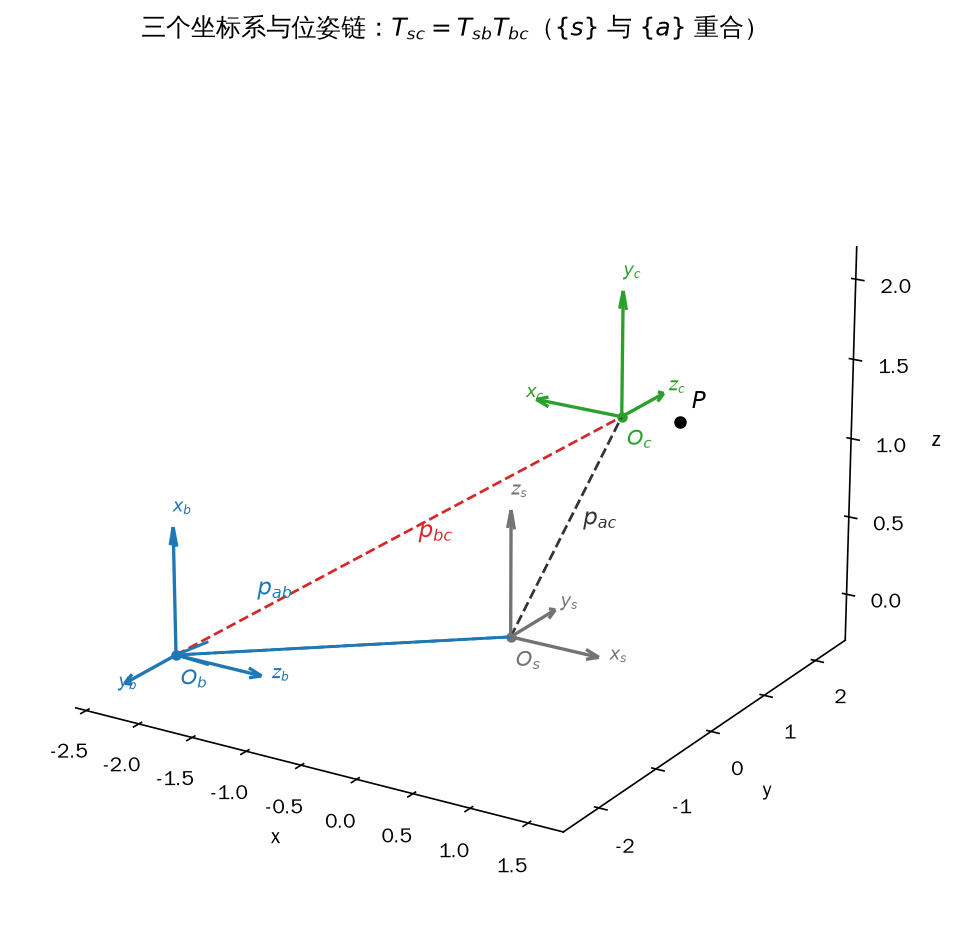

*图 4-9 三个坐标系与位姿链：`{s}` 与 `{a}` 重合，蓝色是 `{b}`、绿色是 `{c}`，虚线分别是 \(p_{ab}\)、\(p_{bc}\)、\(p_{ac}\)，\(P\) 是空间中的任意一点*

### 示例：位姿链与随机验证

`4_5_se3.py` 按图 4-9 的数字构造 \(\boldsymbol T_{sb}\)、\(\boldsymbol T_{sc}\)，由两者反推 \(\boldsymbol T_{bc}\)，验证位姿链，变换一个点和一个向量，再用 100 组随机变换检查解析逆。

```python
{{#include code/ch04/4_5_se3.py:chain}}
```

```python
{{#include code/ch04/4_5_se3.py:random}}
```

```console
{{#include code/ch04/4_5_se3.out}}
```

\(\boldsymbol T_{sb}\) 的旋转角是 \(180.0000^\circ\)、平移范数 \(2.8284\) m，旋转块的行列式为 1、正交性误差为 0。由 \(\boldsymbol R_{sb}^{\mathrm T}\boldsymbol R_{sc}\) 和 \(\boldsymbol R_{sb}^{\mathrm T}(\boldsymbol p_{sc}-\boldsymbol p_{sb})\) 得到的 \(\boldsymbol p_{bc}=(1.0000,-4.0000,2.0000)\)，与式（4-82）手算一致；\(\boldsymbol T_{sb}\boldsymbol T_{bc}\) 与 \(\boldsymbol T_{sc}\) 的最大差是 0。

点和向量的对比很直观：\(\boldsymbol p_b=(1,-4,2)\) 经 \(\boldsymbol T_{sb}\) 变成 \((0,2,1)\)，正好是 \(\boldsymbol p_{sc}\)，说明“先到 `{b}` 再到 `{c}`”与“直接到 `{s}`”是同一个点；向量 \((1,0,0)\) 只变成 \((0,0,1)\)，第四分量保持 0，平移没有参与。

100 组随机变换的结果是：解析逆的 \(\lVert\boldsymbol T\boldsymbol T^{-1}-\boldsymbol I\rVert_{\max}=1.78\times10^{-15}\)，与通用求逆的最大元素差 \(2.22\times10^{-15}\)，逆变换的旋转角误差 \(7.64\times10^{-16}\) rad。解析逆不仅是“够准”，它的乘法次数固定为 9 次，不随矩阵内容变化；通用求逆要做带主元的分解，慢一个量级，还会在接近奇异时给出很差的数。4.7 节会用 Eigen 把这件事再演示一遍。

求 \(\boldsymbol T_{ca}\) 这类“反向”位姿时，推荐的写法是先写出正向的 \(\boldsymbol T_{ac}\)，再调用解析逆。比如已知 \(\boldsymbol T_{sc}\) 和 \(\boldsymbol T_{sb}\)，要求 \(\boldsymbol T_{bc}\)，就写 \(\boldsymbol T_{bc}=\boldsymbol T_{sb}^{-1}\boldsymbol T_{sc}\)，把 \(\boldsymbol T_{sb}^{-1}\) 用式（4-74）展开，而不要逐元素去解方程。这样写出来的代码与公式一一对应，下标也能自检；逐元素求逆既难读，又容易把平移的坐标系搞错。

## 4.6 欧拉角：Y-P-R 的用法与陷阱

旋转矩阵有九个数字，人读起来费劲；三个角度就直观得多。欧拉角（Euler angles）把姿态拆成绕三根轴的连续转动，每个角都有明确的物理含义：横滚角（roll）绕 \(x\) 轴，俯仰角（pitch）绕 \(y\) 轴，偏航角（yaw）绕 \(z\) 轴。四足机器人行走时，roll 和 pitch 描述机身倾斜，yaw 描述航向，第 6 章的机身姿态命令、第 7 章的 IMU 读数都用这组词。

欧拉角有一个不能省的约定：先转哪根、后转哪根。同一个姿态，换一个顺序会得到三个完全不同的角，4.2 节的不可交换性已经说明了这一点。本书统一采用 Y-P-R 顺序：初始时物体系 `{b}` 与世界系 `{s}` 重合，先绕当前 `{b}` 的 \(z\) 轴转 yaw，再绕转完之后的新 \(y\) 轴转 pitch，最后绕再转完之后的新 \(x\) 轴转 roll。三步都是绕“当前物体系”的轴，不是绕世界系的固定轴。

### 三步右乘

因为每一步都绕当前物体系的轴，新转动要乘在当前姿态的右边。从 \(\boldsymbol R_{sb}=\boldsymbol I\) 出发：

<!-- 原书式（4.91） -->
\[ \begin{aligned} \boldsymbol R_{sb'}&=\boldsymbol R_{sb}\boldsymbol R_z(\mathrm{yaw})=\boldsymbol R_z(\mathrm{yaw})\\ \boldsymbol R_{sb''}&=\boldsymbol R_{sb'}\boldsymbol R_y(\mathrm{pitch})=\boldsymbol R_z(\mathrm{yaw})\boldsymbol R_y(\mathrm{pitch})\\ \boldsymbol R_{sb'''}&=\boldsymbol R_{sb''}\boldsymbol R_x(\mathrm{roll})=\boldsymbol R_z(\mathrm{yaw})\boldsymbol R_y(\mathrm{pitch})\boldsymbol R_x(\mathrm{roll}) \end{aligned} \tag{4-93} \]

最终

\[ \boldsymbol R=\boldsymbol R_z(\mathrm{yaw})\,\boldsymbol R_y(\mathrm{pitch})\,\boldsymbol R_x(\mathrm{roll}) \tag{4-94} \]

这里有一个容易绕晕的地方：名字 Y-P-R 与写法 \(R_zR_yR_x\) 的顺序是一致的，都是 yaw、pitch、roll；但矩阵作用到向量上时从最右边开始，所以真正先转的是 \(R_x\)（roll），最后才是 \(R_z\)（yaw）。换句话说，三个角的名字按时间顺序排，矩阵按作用顺序倒着写。代码里如果按名字从左往右写成 \(R_xR_yR_z\)，得到的姿态完全不同，而且不会报错。

图 4-10 的 (a)(b)(c) 三个面板把三步画了出来：灰色虚线是每一步之前的姿态，彩色是这一步之后的姿态。(a) 只动 \(z\)，(b) 的转轴已经跟着 yaw 转过去了，(c) 的转轴又跟着 pitch 转了一次——这就是“绕当前物体系的轴”的直观含义。

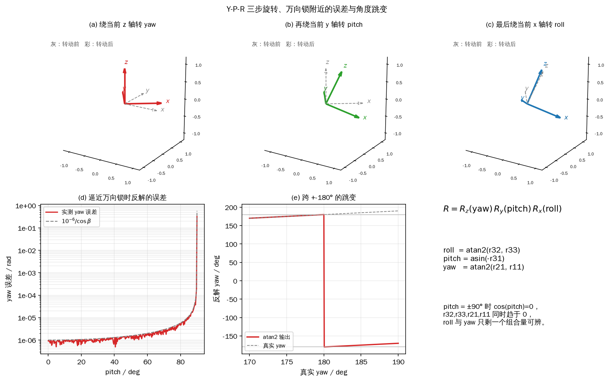

*图 4-10 (a)(b)(c) 依次绕当前 \(z\)、\(y\)、\(x\) 轴转 yaw、pitch、roll；(d) pitch 逼近 \(90^\circ\) 时反解误差随 \(1/\cos\beta\) 放大；(e) yaw 跨过 \(\pm180^\circ\) 时的跳变*

### 展开与反解

把式（4-10）的三个基本旋转代进式（4-94），乘开就是九个元素。记 \(\alpha=\mathrm{yaw}\)、\(\beta=\mathrm{pitch}\)、\(\gamma=\mathrm{roll}\)，并简写 \(c_\alpha=\cos\alpha\)、\(s_\alpha=\sin\alpha\)：

<!-- 原书式（4.92） -->
\[ \boldsymbol R=\begin{bmatrix} c_\alpha c_\beta & c_\alpha s_\beta s_\gamma-s_\alpha c_\gamma & c_\alpha s_\beta c_\gamma+s_\alpha s_\gamma\\ s_\alpha c_\beta & s_\alpha s_\beta s_\gamma+c_\alpha c_\gamma & s_\alpha s_\beta c_\gamma-c_\alpha s_\gamma\\ -s_\beta & c_\beta s_\gamma & c_\beta c_\gamma \end{bmatrix} \tag{4-95} \]

反解的思路是挑“只含一个未知角”的元素。第三行第一列只含 \(\beta\)；第一列的第二、三行元素 \(r_{21},r_{11}\) 都带 \(c_\beta\)，相除就把 \(c_\beta\) 消掉；第三行的第二、三列元素 \(r_{32},r_{33}\) 也都带 \(c_\beta\)，同样相除：

<!-- 原书式（4.93） -->
\[ \sin\beta=-r_{31},\qquad \tan\gamma=\frac{r_{32}}{r_{33}},\qquad \tan\alpha=\frac{r_{21}}{r_{11}} \tag{4-96} \]

这三条都要求 \(c_\beta\neq0\)，否则分母为零。满足条件时，用 `atan2` 和 `asin` 写成代码可以直接用的形式：

<!-- 原书式（4.95） -->
\[ \mathrm{roll}=\mathrm{atan2}(r_{32},r_{33}),\qquad \mathrm{pitch}=\mathrm{asin}(-r_{31}),\qquad \mathrm{yaw}=\mathrm{atan2}(r_{21},r_{11}) \tag{4-97} \]

用 `atan2(y,x)` 而不是 `atan(y/x)`，是因为前者吃两个参数、能分辨象限，返回 \((-\pi,\pi]\) 的完整一圈；`asin` 的值域是 \([-\pi/2,\pi/2]\)，正好把 pitch 限制在这个区间。四足机器人行走时 pitch 不会超过 \(\pm90^\circ\)，所以这个限制不是问题。用 `asin` 前要先把 \(-r_{31}\) 限幅到 \([-1,1]\)：浮点误差会让它变成 \(-1.0000000002\)，直接传进去会得到 `NaN`，姿态估计随即发散。

### 多解与万向锁

欧拉角不是一一对应的。同一个 \(\boldsymbol R\) 至少还有另一组解：

<!-- 原书式（4.94） -->
\[ \mathrm{roll}=\gamma+\pi,\qquad \mathrm{pitch}=\pi-\beta,\qquad \mathrm{yaw}=\alpha+\pi \tag{4-98} \]

再加上 \(2\pi\) 的整数倍，解就更多了。这组解与原来的 \((\gamma,\beta,\alpha)\) 描述同一个姿态，因为“翻过来、再从另一侧转回去”在三维里是同一件事。但两个 \(\pi\) 的平移必须成对出现：只给 roll 加 \(\pi\)、yaw 不动，得到的是另一个姿态，不是同一组解的等价写法；用代码验证时这一点很容易踩坑。

真正麻烦的是万向锁（gimbal lock）。当 \(\beta=\pm90^\circ\) 时 \(c_\beta=0\)，式（4-95）的第三行变成 \((0,\ 0,\ \pm1)\) 一类，\(r_{32},r_{33},r_{21},r_{11}\) 同时趋于 0，roll 和 yaw 只剩下一个组合量可辨，式（4-97）的 `atan2(0,0)` 没有定义。物理解释是：pitch 转到 \(90^\circ\) 时，物体系的 \(x\) 轴被转到与世界系 \(z\) 轴共线（方向相反），绕 roll 和绕 yaw 变成绕同一条直线转，两个角自然分不开。

工程上有三条应对。第一，控制目标姿态不要设在奇异点附近，俯仰指令留出几度的余量。第二，姿态误差不要在欧拉角上相减，改用旋转矩阵或四元数：\(\boldsymbol R_{\mathrm{err}}=\boldsymbol R_{\mathrm{des}}^{\mathrm T}\boldsymbol R\)，再把误差转成轴-角或小角度近似，这样在奇异点附近仍然连续。第三，确实需要显示欧拉角时，在奇异点附近做特殊处理：固定 roll 为 0，把可辨的组合量全部塞给 yaw，至少保证显示不跳。

### 单位与角度回绕

内部计算一律用弧度，只有在显示、日志和人机界面里才换成角度。`atan2` 的返回值在 \((-\pi,\pi]\)，所以 yaw 从 \(179^\circ\) 继续增大时会跳到 \(-179^\circ\)，数值上差 \(358^\circ\)，物理上只差 \(2^\circ\)。如果控制器直接对 yaw 做差分或低通滤波，这个跳变会被当成一次巨大的角速度冲击，轻则航向抖动，重则触发保护。处理办法是做角度回绕（unwrap）：把差值折算到 \((-\pi,\pi]\) 再累加，或者干脆用旋转矩阵/四元数做误差，从根上避开这个不连续。

### 示例：往返、逼近奇异点与跳变

`4_6_euler.py` 先随机生成 1000 组姿态做 \(\boldsymbol R\to\mathrm{rpy}\to\boldsymbol R\) 往返；再固定 roll 和 yaw、让 pitch 从 \(60^\circ\) 逼近 \(90^\circ\)，给姿态矩阵加 \(10^{-6}\) rad 的测量噪声，统计反解出的 roll/yaw 误差；最后打印 yaw 跨过 \(\pm180^\circ\) 时的输出。

```python
{{#include code/ch04/4_6_euler.py:roundtrip}}
```

```python
{{#include code/ch04/4_6_euler.py:gimbal}}
```

```console
{{#include code/ch04/4_6_euler.out}}
```

1000 组随机姿态的往返最大误差是 \(1.07\times10^{-14}\) rad，三个角的最大绝对误差同量级，说明在远离奇异点时这套公式是可靠的。

万向锁部分的数字很能说明问题：pitch 从 \(60^\circ\) 走到 \(89.9999^\circ\)，条件数 \(1/\cos\beta\) 从 2.0 涨到 \(5.73\times10^5\)，roll 和 yaw 的误差分别从 \(1.99\times10^{-6}\) rad 和 \(1.90\times10^{-6}\) rad 一路涨到 \(5.67\times10^{-1}\) rad。输入噪声只有 \(10^{-6}\) rad，误差却被放大了五个多数量级——这不是实现写得不好，而是欧拉角参数化本身在奇异点附近病态。图 4-10(d) 把实测误差和对 \(1/\cos\beta\) 的估计画在一起，两条线在双对数坐标下平行，斜率为 1。

角度回绕部分：yaw 输入从 \(178^\circ\) 走到 \(180^\circ\)，`atan2` 输出先是 \(178^\circ\)、\(179^\circ\)、\(179.9^\circ\)、\(180^\circ\)，一旦越过 \(180^\circ\) 就跳到 \(-179.9^\circ\)，再继续走是 \(-179^\circ\)、\(-178^\circ\)。图 4-10(e) 把这条折线画了出来：红色是 `atan2` 的输出，灰色虚线是真实 yaw，两者只在 \(\pm180^\circ\) 处分开。用 `wrap_angle` 把差值折回 \((-\pi,\pi]\) 就能接上，这也是第 7 章航向估计里必须做的一步。

用欧拉角时记住三件事：顺序必须写清楚（本书是 Y-P-R，矩阵为 \(R_zR_yR_x\)）；反解只在 \(|\mathrm{pitch}|<90^\circ\) 时可靠；跨 \(\pm\pi\) 的角度要先回绕再相减。姿态运算的主体仍然是旋转矩阵，欧拉角主要承担“人读”和“发指令”两种角色，IMU 输出的四元数到第 7 章再处理。

## 4.7 实践：在 C++/Eigen 中做矩阵运算

前面的公式最终要落到控制器的 C++ 代码里。机器人领域最常用的矩阵库是 Eigen：开源、纯头文件、表达式模板做得成熟，固定尺寸矩阵在编译期就能展开循环。Ubuntu 下装 `libeigen3-dev`，头文件在 `/usr/include/eigen3`；包含写 `#include <Eigen/Dense>`，编译时加 `-I/usr/include/eigen3`。有些老代码写 `#include <eigen3/Eigen/Dense>`，那是把安装路径也写进了 include，换平台就会失败，本书统一用前一种。

Eigen 的名字来自“特征值”，但它是一个通用稠密矩阵库，本节只用其中与 \(3\times3\)、\(4\times4\) 小矩阵相关的部分。

### 声明、赋值与“默认不清零”

固定尺寸类型把行数和列数写在模板参数里：

```cpp
Eigen::Matrix<double, 3, 3> M;   // 3x3 double
Eigen::Matrix<double, 3, 1> v;   // 3x1 column vector
```

写全太长，实际工程通常用 `using Mat3 = Eigen::Matrix3d;`、`using Vec3 = Eigen::Vector3d;` 之类的别名统一写法，原书在 `mathTypes.h` 里就是这么做的。本节示例为了自包含，直接写 Eigen 的全名；读者在自己的工程里可以照旧用别名，两者是同一个类型。

这里有一条和很多教材相反的事实：固定尺寸矩阵默认构造**不初始化元素**。`Eigen::Matrix3d M;` 之后直接读 `M(0,0)` 得到的是栈上的残留值，可能是 0，也可能是任意数。使用前必须显式赋值或 `setZero()`。动态尺寸的 `MatrixXd` 也一样，`resize()` 只分配内存、不写 0。示例里专门声明了 `Matrix3d Z; Z.setZero();` 再打印，就是为了把这条规矩写进肌肉记忆。

最常用的赋值是逗号初始化，按行填：

<!-- 原书式（4.96） -->
\[ \boldsymbol M=\begin{bmatrix}1&2&3\\4&5&6\\7&8&9\end{bmatrix},\qquad \boldsymbol v=\begin{bmatrix}1\\2\\3\end{bmatrix} \tag{4-99} \]

```cpp
M << 1, 2, 3,
     4, 5, 6,
     7, 8, 9;
v << 1, 2, 3;
```

换行只是为了对齐，编译器不关心；元素个数必须与尺寸严格一致，少一个多一个都会报错。特殊矩阵有快捷写法：`setIdentity()`、`setZero()`、`setOnes()`，以及把向量放上对角线的 `asDiagonal()`：

<!-- 原书式（4.97） -->
\[ \boldsymbol M=\begin{bmatrix}1&0&0\\0&2&0\\0&0&3\end{bmatrix} \tag{4-100} \]

对应 `M = Vec3(1,2,3).asDiagonal();`。动态尺寸用 `MatrixXd M; M.resize(3,3);`，但固定尺寸在编译期就知道大小、没有堆分配，能确定维度时优先用固定尺寸。

### 元素、行列与分块

单个元素用圆括号读写，行列都从 0 开始：`M(0,1) = 5;`、`double x = v(2);`。这一点和 MATLAB 不同，移植公式时最容易差一。

`rows()`、`cols()` 返回尺寸；`row(i)`、`col(j)` 取出整行整列，可以直接赋值，例如 `M.col(0) = v;`。分块用 `block(i, j, rows, cols)`，四个参数是左上角行号、列号、块的行数、块的列数，同样从 0 开始、包含起始行列。用两块拼一个 \(6\times6\) 矩阵：

<!-- 原书式（4.98） -->
\[ \boldsymbol M_6=\begin{bmatrix}\boldsymbol 0_{3\times3}&\boldsymbol I_3\\2\boldsymbol I_3&\boldsymbol 0_{3\times3}\end{bmatrix} \tag{4-101} \]

```cpp
MatrixXd M6 = MatrixXd::Zero(6, 6);
M6.block<3, 3>(0, 3).setIdentity();
M6.block<3, 3>(3, 0) = Vector3d(2, 2, 2).asDiagonal();
```

向量截取用 `segment(start, length)`，起始下标从 0 开始、包含该元素：

<!-- 原书式（4.99） -->
\[ \boldsymbol v_6=\begin{bmatrix}0&10&20&30&0&0\end{bmatrix}^{\mathrm T} \tag{4-102} \]

```cpp
VectorXd v6 = VectorXd::Zero(6);
v6.segment<3>(1) = Vector3d(10, 20, 30);
```

`block` 和 `segment` 返回的是**视图**，不是拷贝：对返回值赋值会直接改原矩阵，把视图赋给另一个矩阵则可能触发 Eigen 的别名（aliasing）问题。拼齐次变换矩阵时这一点特别好用——`T.block<3,3>(0,0) = R;` 就是把旋转块写进去，不需要临时变量。

### 常用运算与“不要调 inverse”

Eigen 的运算符与数学写法几乎一一对应：`A * B`、`A.transpose()`、`A.inverse()`、`A.ldlt().solve(b)`。前三个是表达式，只有在赋值或打印时才真正计算；`solve` 用分解法解方程，不显式求逆。

旋转矩阵和齐次变换矩阵的逆有解析式（式 4-12、4-67），一律自己写，不要调用 `.inverse()`。解 \(\boldsymbol A\boldsymbol x=\boldsymbol b\) 时也不要先算 \(\boldsymbol A^{-1}\) 再乘 \(\boldsymbol b\)，用 `A.ldlt().solve(b)`（对称正定）或 `A.colPivHouseholderQr().solve(b)`（一般方阵）。这不是“风格”问题：通用求逆的乘法次数多一个量级，数值稳定性还差，遇到接近奇异的矩阵会放大误差。

### 工具函数清单

原书 4.7.4 列了 12 个函数，本书在此基础上补了 `rotToQuat` 和 `adjoint`（四元数反解与旋量变换在后续章节要用），一共 14 个。共用包 `quadruped/rotation.py` 里是一份 Python 实现，本节示例 `4_7_eigen.cpp` 里是一份 C++/Eigen 实现，函数名不同、数学相同，对照如下：

| 原书函数 | 本书 C++ | 本书 Python | 对应公式 |
| --- | --- | --- | --- |
| `rotx`、`roty`、`rotz` | `rotX`、`rotY`、`rotZ` | `Rx`、`Ry`、`Rz` | 式（4-9）、（4-10） |
| `skew` | `skew` | `skew` | 式（4-32） |
| `rpyToRotMat` | `rpyToRot` | `rpy_to_R` | 式（4-93）–（4-95） |
| `rotMatToRPY` | `rotToRpy` | `R_to_rpy` | 式（4-97） |
| `quatToRotMat` | `quatToRot` | `quat_to_R` | 第 7 章 |
| （原书无） | `rotToQuat` | `R_to_quat` | 第 7 章 |
| `rotMatToExp` | —（4.3 示例用 Python 实现） | `so3_log` | 式（4-61）、（4-62） |
| （原书无） | —（4.3 示例用 Python 实现） | `so3_exp` | 式（4-58） |
| `homoMatrix` | `makeT` | `make_T` | 式（4-73） |
| `homoMatrixInverse` | `invT` | `inv_T` | 式（4-74） |
| `homoVec` | `homoVec` | `np.append(v, 1.0)` | 式（4-85） |
| `noHomoVec` | `noHomoVec` | `v4[:3]` | 式（4-84） |
| （原书无） | `adjoint` | `adjoint` | 第 6 章 |

原书的函数名是 `rotx`、`roty`、`rotz`、`skew`、`rpyToRotMat`、`rotMatToRPY`、`quatToRotMat`、`rotMatToExp`、`homoMatrix`、`homoMatrixInverse`、`homoVec`、`noHomoVec`，数学定义与上表相同，只是命名风格不同。本书没有复制原书代码，而是按式（4-9）到（4-74）重写了一遍；对照阅读时按“作用”而不是“名字”去对。

原书的函数签名有两处值得改：参数写成 `double&`、`Vec3&` 这类非 const 引用，调用时不能传字面量和临时对象，`rotx(M_PI/2)` 会编译失败，本书的实现按值或 `const&` 传参；`homoVec` 只补 1，按点处理，向量要补 0 时得另写一个重载，否则平移会莫名其妙地作用到方向上。

### 示例：同一套运算的两种实现

`4_7_eigen.cpp` 用 Eigen 做声明、赋值、分块、拼 SE(3)、解析逆、解方程、四元数互转、伴随矩阵和随机验证；`4_7_numpy.py` 用 numpy 做同样的事，方便对照。编译命令是

```console
clang++ -std=c++17 -O2 -I/usr/include/eigen3 4_7_eigen.cpp -o 4_7_eigen
```

`-std=c++17` 就够用，本书的检查脚本用 `-std=c++20`，两者都能编译；Eigen 是头文件库，不需要链接任何 `-l` 选项。

numpy 版本把同一串操作写了一遍，输出格式与 C++ 版本对齐，便于逐行比对：

```python
{{#include code/ch04/4_7_numpy.py:numpy}}
```

```cpp
{{#include code/ch04/4_7_eigen.cpp:matrix}}
```

```cpp
{{#include code/ch04/4_7_eigen.cpp:inverse}}
```

```console
{{#include code/ch04/4_7_eigen.out}}
```

输出里 \(\boldsymbol M_6\) 的右上块是单位矩阵、左下块是 \(2\boldsymbol I\)，\(v_6\) 的第 2–4 个元素是 10、20、30，其余为 0，与式（4-101）、（4-102）一致。由 block 拼出的 \(\boldsymbol T\) 左上 \(3\times3\) 块是旋转、右上角是 \((0.4,-0.2,0.7)\)，底行是 \([0\ 0\ 0\ 1]\)。四元数往返的误差是 \(5.55\times10^{-17}\)，伴随矩阵作用在旋量 \([\boldsymbol v;\boldsymbol\omega]\) 上的结果与 \([\boldsymbol R\boldsymbol v+\boldsymbol p\times\boldsymbol R\boldsymbol\omega;\ \boldsymbol R\boldsymbol\omega]\) 完全相同，说明 `adjoint` 的块结构没有写错。

数值部分：\(\lVert\boldsymbol R^{\mathrm T}\boldsymbol R-\boldsymbol I\rVert_{\max}=2.78\times10^{-17}\)、\(\det\boldsymbol R=1.0000\)、\(\lVert\boldsymbol R^{-1}-\boldsymbol R^{\mathrm T}\rVert_{\max}=1.11\times10^{-16}\)，旋转矩阵的三条性质在浮点下都成立。\(\lVert\boldsymbol T\boldsymbol T^{-1}-\boldsymbol I\rVert_{\max}=2.78\times10^{-17}\)，解析逆与通用求逆的最大元素差 \(1.11\times10^{-16}\)，两者算出的结果在双精度下无法区分。

差别在代价上。解析逆只需要算一次 \(\boldsymbol R^{\mathrm T}\boldsymbol p\)，9 次乘法；Eigen 的 `Matrix4d::inverse()` 走带主元的 LU 分解，再回代四次，乘法次数约 100，是前者的十倍以上。本节不打印实际耗时（微秒读数每次运行都不同，示例输出需要可复现），但这个十倍的比例在任何机器上都成立；矩阵越小、调用越频繁，这个比例越值得在意。3×3 方程组的解是 \((1.0732,2.2927,4.0976)\)，残差为 0，`ldlt().solve()` 与显式逆的结果相同。

100 组随机变换的结果是：\(\lVert\boldsymbol T\boldsymbol T^{-1}-\boldsymbol I\rVert_{\max}=2.00\times10^{-15}\)，解析逆与通用逆的最大元素差 \(2.22\times10^{-15}\)。numpy 对照给出的量级相同（\(1.78\times10^{-15}\)），差异来自随机数生成器和求逆算法的不同，不影响结论。

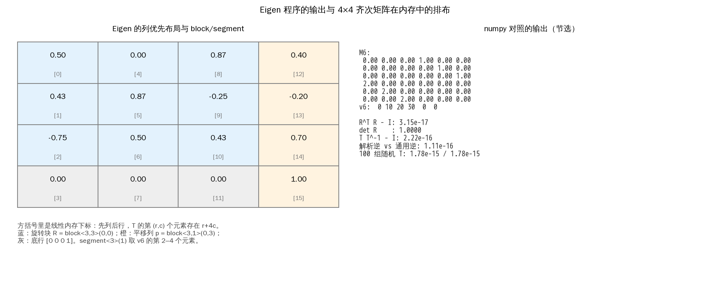

*图 4-11 左：\(4\times4\) 齐次矩阵在 Eigen 里按列优先存放，方括号是线性内存下标，蓝、橙、灰分别对应旋转块、平移列和底行；右：numpy 对照程序的输出节选，末位数值与 C++ 版本可能不同*

图 4-11 的左栏值得对着代码看一遍：Eigen 默认列优先（column-major），\(T\) 的第 \((r,c)\) 个元素存在 `r + 4c` 的位置，所以打印出来是行对齐、内存里是一列一列排。`block<3,3>(0,0)` 取的是前三个列块的前三行，正好是旋转；`block<3,1>(0,3)` 取第四列的前三行，正好是平移。搞清楚这一点，读 Eigen 的报错（尤其是“YOU_MIXED_MATRICES_OF_DIFFERENT_SIZES”一类）会快很多。

本节的内容与原书 4.7 一一对应，但代码全部重写：原书用 `Mat3`/`Vec3` 别名和 `mathTools.h`，本书用 `Eigen::Matrix3d` 和 `quadruped/rotation.py` 的对照实现；原书 4.7.3 把 `M = M.inverse()` 列为常用写法，本书明确标为“只用于一般矩阵”，旋转矩阵和齐次矩阵必须走解析式。

## 4.8 与原书的对应

本章按“二维 → 三维 → 任意轴 → 二维刚体 → 三维刚体 → 欧拉角 → Eigen”的顺序重排，原书第 4 章的 7 节、15 个小节全部覆盖，公式编号逐条对应如下。原书的插图没有直接引用，图 4-1 到图 4-9 是重绘或用自己的示例输出生成的，图 4-10、图 4-11 是本书新增的。

| 原书节号 | 原书内容 | 本书位置 | 覆盖公式 |
| --- | --- | --- | --- |
| 4.1 | 二维平面旋转矩阵 | 4.1 | 式（4.1）、（4.2）、（4.3）、（4.4）、（4.5）、（4.6）、（4.7） |
| 4.1.1 | 标准正交基与坐标 | 4.1（标准正交基一节） | 式（4.1） |
| 4.1.2 | 坐标系之间的坐标变换 | 4.1（从分解式到旋转矩阵、下标语义两节） | 式（4.2）–（4.7） |
| 4.2 | 三维空间旋转矩阵 | 4.2 | 式（4.8） |
| 4.2.1 | 关于坐标轴的三维旋转矩阵 | 4.2（右手系与正方向、三个基本旋转） | 式（4.9）、（4.10） |
| 4.2.2 | 三维旋转矩阵的性质 | 4.2（正交性、行列式与体积、复合三节） | 式（4.11）–（4.23） |
| 4.3 | 绕任意转轴的旋转与指数坐标 | 4.3 | 式（4.24）–（4.66） |
| 4.3.1 | 向量积及其矩阵形式 | 4.3（叉乘及其矩阵形式） | 式（4.24）–（4.36） |
| 4.3.2 | 绕转轴旋转的线速度 | 4.3（绕轴旋转的线速度） | 式（4.37）–（4.41），T04、T05 |
| 4.3.3 | 求解一阶线性常微分方程 | 4.3（一阶线性微分方程与矩阵指数） | 式（4.42）–（4.51） |
| 4.3.4 | 轴-角表示法的旋转矩阵 | 4.3（罗德里格斯公式） | 式（4.52）–（4.58） |
| 4.3.5 | 矩阵对数与指数坐标 | 4.3（矩阵对数与指数坐标） | 式（4.59）–（4.66） |
| 4.4 | 二维平面刚体运动 | 4.4 | 式（4.67）–（4.70） |
| 4.5 | 三维空间刚体运动 | 4.5 | 式（4.71）–（4.90） |
| 4.5.1 | 齐次变换矩阵的特性 | 4.5（三条性质一节） | 式（4.71）–（4.74） |
| 4.5.2 | 齐次变换矩阵的作用 | 4.5（三种作用一节） | 式（4.75）–（4.90） |
| 4.6 | 欧拉角 | 4.6 | 式（4.91）–（4.95） |
| 4.7 | 实践：在 C++ 中进行矩阵运算 | 4.7 | 式（4.96）–（4.99） |
| 4.7.1 | 矩阵和向量的声明与赋值 | 4.7（声明、赋值与“默认不清零”） | 式（4.96）、（4.97） |
| 4.7.2 | 矩阵和向量的元素与分块操作 | 4.7（元素、行列与分块） | 式（4.98）、（4.99） |
| 4.7.3 | 常用矩阵计算 | 4.7（常用运算与“不要调 inverse”） | 无新增编号 |
| 4.7.4 | 后续会用到的计算函数 | 4.7（工具函数清单） | 无新增编号 |

有两处原书内容需要说明。其一，原书式（4.17）在转写稿中只剩编号、公式体缺失，按上下文它应是把 \(\boldsymbol p_a=\boldsymbol R_{ab}\boldsymbol p_b\) 代入 \(\boldsymbol p_s=\boldsymbol R_{sa}\boldsymbol p_a\) 的结果，本书在 4.2 的复合一节按这个推导补全并标注；紧接着的式（4.18）转写稿把第二个矩阵写成了 \(\boldsymbol R_{sb}\)，本书按 \(\boldsymbol R_{ab}\) 处理。其二，`notes/tables/tables.md` 里的 T04、T05 不是数据表，而是式（4.37）、（4.38）被抽取脚本误判成表格的产物，本书在 4.3.2 原样排入并注明，公式符号一个未改。

原书图 4.1 到图 4.11 与本书图的对应关系是：图 4.1 → 图 4-1，图 4.2 → 图 4-2，图 4.3、图 4.4 的三个子图 → 图 4-3，图 4.5 的行列式缩放示意并入 4.2 的文字与式（4.15），图 4.6 的分步旋转 → 图 4-4，图 4.7 → 图 4-5，图 4.8 → 图 4-6，图 4.9 → 图 4-7，图 4.10 → 图 4-8，图 4.11 → 图 4-9；新增图 4-10（Y-P-R 三步旋转、万向锁误差与角度跳变）和图 4-11（Eigen 输出与内存布局）。章首的产品照没有复刻，那一页只承担装饰作用，本书用文字交代研究对象是宇树 A1。

公式之外，原书在这一章有几处笔误或转写错误，本书按正确的数学处理，没有沿用：式（4.9）前的 \(\boldsymbol R_s(\theta)\) 应为 \(\boldsymbol R_x(\theta)\)；式（4.45）、（4.46）、（4.48）、（4.50）、（4.51）的转写把 \(t\) 认成了别的字母；式（4.52）多写了一个 \(\alpha\)，应为 \([\hat{\boldsymbol\omega}]_\times\)；式（4.63）的下标把 \(\times\) 转成了字母 x。式（4.65）、（4.66）默认 \(\omega_1\neq0\)，本书在 4.3.5 补了 \(\omega_1=0\) 时换一列求解的分支。式（4.69）的平移列在原书中两个分量都印成了 \(\overrightarrow{OO'}\)，本书写成 \(t_x,t_y\)。

仿真与公式的对照结果都写在正文里：4.1 的长度误差为 0、4.2 的两种旋转顺序相差 \(29.74^\circ\)、4.3 的 \(\log\to\exp\) 往返误差 \(3.42\times10^{-15}\) rad、4.5 的位姿链误差为 0、4.6 的万向锁误差按 \(1/\cos\beta\) 放大、4.7 的解析逆与通用逆相差 \(10^{-16}\) 量级。这些数字都能由 `src/code/ch04/` 下的示例复现，没有需要真实机器人或 ROS 2 的步骤。
