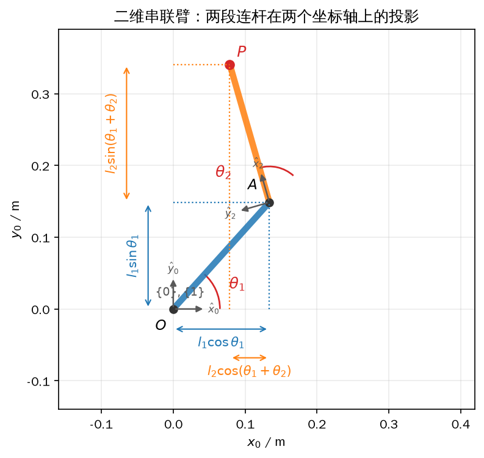
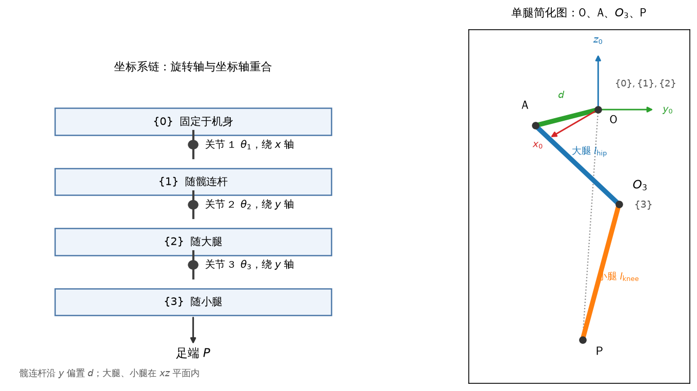
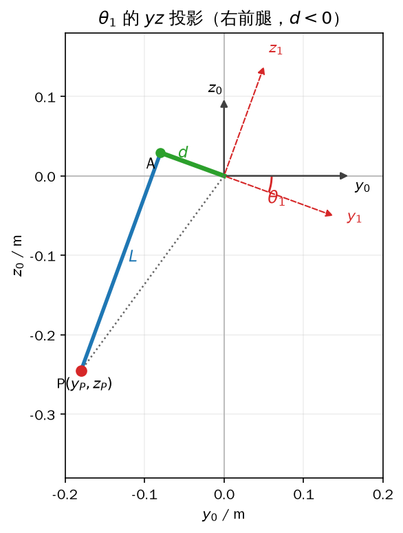
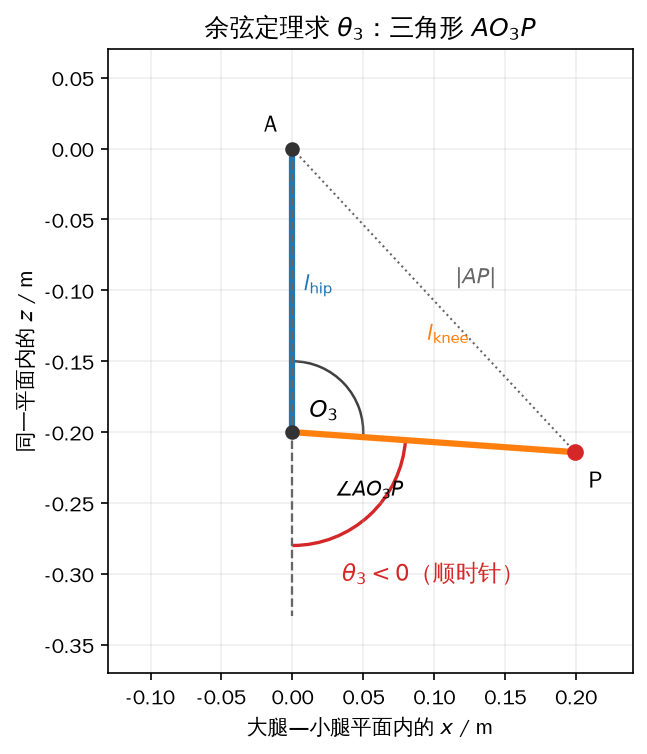
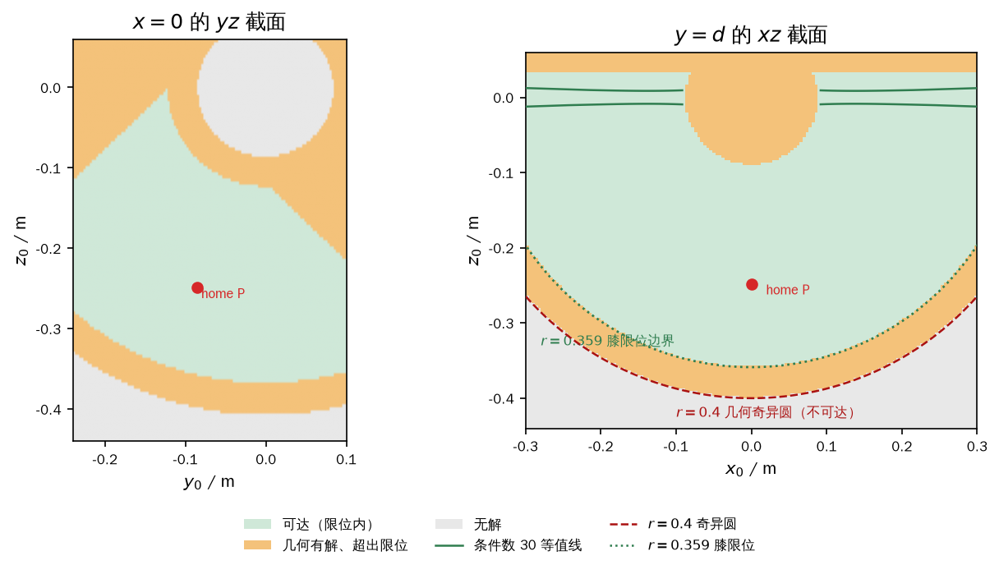
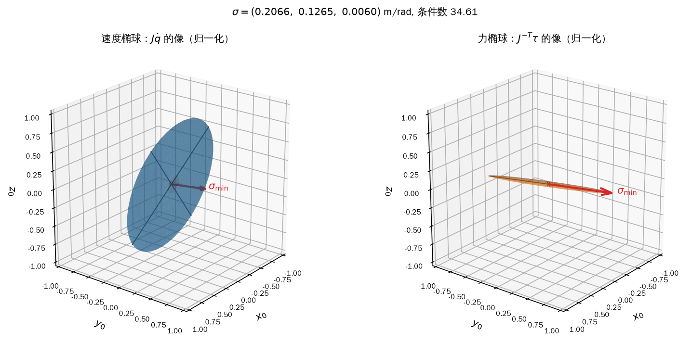
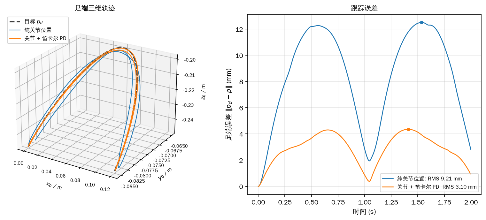
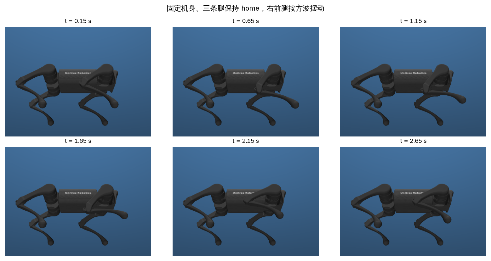
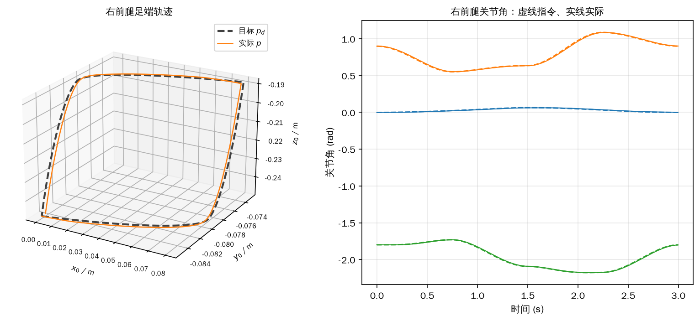

# 第 5 章 单腿运动学与静力学：从关节角到足端力

第 4 章准备了旋转矩阵、齐次变换、指数坐标和欧拉角，这一章把它们全部用在一条腿上。四足机器人能直接下发的只有 12 个关节角，真正想控制的却是四个足端在空间中的位置、速度和力。两者之间的桥梁由三组映射组成：关节角与足端位置的正/逆运动学、关节角速度与足端速度的雅可比、关节力矩与足端力的静力学。把这三种映射写清楚，后面的站立、步态和平衡控制才有可用的接口。

这一章把一条腿看成三转动关节的开链，足端只取一个点。它没有腕部，也没有可以独立指定的足端姿态，所以“位姿”在这里退化成“位置”。全章的数值都用宇树 A1 的右前腿：大腿和小腿各 0.2 m，足端球半径 0.02 m，髋侧向偏置 0.08505 m，关节限位取自 Menagerie 模型。顺序是正向运动学（5.1）、逆向运动学（5.2）、雅可比与静力学（5.3）、摆动腿的笛卡尔 PD（5.4），最后在固定机身的单腿台上跑一遍（5.5）。

本章的示例都在普通 PC 上运行，不需要真实机器人。5.5.4 的实机单腿测试是例外：它必须把机器人吊起来，属于 **【需要实机】** 的步骤。仿真里的“吊起”用固定机身位姿的测试台代替，代码会明确标注这一点。

## 5.1 正向运动学：几何法与齐次变换法

所谓正向运动学，英文写作 forward kinematics，回答的是：三个关节角已知时，足端落在腿基座系 `{0}` 的哪一点。刚体的完整位姿有六个自由度，三个位置加三个姿态；一条腿只有三个关节，最多只能独立指定其中三个量。四足机器人的足端在支撑时近似为一个点接触，姿态由地面和摩擦力决定，不需要也无能力任意指定。因此本章的“正运动学”只算三维位置，不算三个姿态角。这是自由度数目直接限制出来的结论，不是偷懒。

### 5.1.1 二维平面的串联机械臂

先把问题降到二维，建立投影的直觉。平面内有一段两连杆串联臂：基座在 O，第一段长 \(l_1\)，第二段长 \(l_2\)，两个转动关节的角度分别是 \(\theta_1\) 和 \(\theta_2\)。坐标系 `{0}` 固定在基座，`{1}` 固定在第一段连杆上、原点仍在 O，`{2}` 固定在第二段连杆上、原点在肘关节。末端 P 在 `{0}` 中的坐标就是把两段有向线段分别向 \(x\)、\(y\) 轴投影再相加：

<!-- 原书式（5.1） -->
\[ \begin{cases} x_P=l_1\cos\theta_1+l_2\cos(\theta_1+\theta_2),\\[2pt] y_P=l_1\sin\theta_1+l_2\sin(\theta_1+\theta_2). \end{cases} \tag{5-1} \]

式（5-1）里的 \(\theta_1+\theta_2\) 值得停一下：第二段连杆的绝对方位角不是 \(\theta_2\)，而是两个关节角之和。这个“和角”在二维里可以手工写出来，到了三维、关节更多时就会变得难以维护。原书转写稿在式（5.1）的第二行把 \(y_P\) 误写成了 \(\sin\theta_P\)，这里按投影关系写回 \(y_P\)；同一段正文里的“γ 坐标”也是 \(y\) 的转写错误。

齐次变换法把“和角”交给矩阵乘法。二维齐次变换是 \(3\times3\) 矩阵，左上 \(2\times2\) 是旋转，右上 \(2\times1\) 是平移，最后一行是 \([0\ 0\ 1]\)。`{1}` 相对 `{0}` 只有绕 \(z\) 轴的 \(\theta_1\)，`{2}` 相对 `{1}` 有绕 \(z\) 轴的 \(\theta_2\)，再加上沿 `{1}` 的 \(x\) 轴平移 \(l_1\)：

<!-- 原书式（5.2） -->
\[ T_{01}= \begin{bmatrix} \cos\theta_1&-\sin\theta_1&0\\ \sin\theta_1&\cos\theta_1&0\\ 0&0&1 \end{bmatrix},\qquad T_{12}= \begin{bmatrix} \cos\theta_2&-\sin\theta_2&l_1\\ \sin\theta_2&\cos\theta_2&0\\ 0&0&1 \end{bmatrix}. \tag{5-2} \]

按“下标消去”的规则，从 `{2}` 到 `{0}` 的总变换是 \(T_{02}=T_{01}T_{12}\)。把矩阵乘开，再用 \(\cos(\theta_1+\theta_2)\)、\(\sin(\theta_1+\theta_2)\) 的和角公式合并，得到

<!-- 原书式（5.3） -->
\[ T_{02}=T_{01}T_{12}= \begin{bmatrix} \cos(\theta_1+\theta_2)&-\sin(\theta_1+\theta_2)&l_1\cos\theta_1\\ \sin(\theta_1+\theta_2)&\cos(\theta_1+\theta_2)&l_1\sin\theta_1\\ 0&0&1 \end{bmatrix}. \tag{5-3} \]

末端 P 在 `{2}` 中的坐标是常量，因为 P 固连在第二段连杆的末端、沿 `{2}` 的 \(x\) 轴量出 \(l_2\)：

<!-- 原书式（5.4） -->
\[ \boldsymbol p_2=\begin{bmatrix}l_2\\0\end{bmatrix}. \tag{5-4} \]

把 \(\boldsymbol p_2\) 补成齐次坐标 \((l_2,0,1)^{\mathrm T}\)，左乘 \(T_{02}\)，取前两行，就得到 P 在 `{0}` 中的坐标：

<!-- 原书式（5.5） -->
\[ \begin{bmatrix}\boldsymbol p_0\\1\end{bmatrix} =T_{02}\begin{bmatrix}\boldsymbol p_2\\1\end{bmatrix} =\begin{bmatrix} l_2\cos(\theta_1+\theta_2)+l_1\cos\theta_1\\ l_2\sin(\theta_1+\theta_2)+l_1\sin\theta_1\\ 1 \end{bmatrix}. \tag{5-5} \]

式（5-5）与式（5-1）逐项相同。矩阵法没有引入新的几何，只是把“先转 \(\theta_1\)、再转 \(\theta_2\)、再平移”这件事写成了可复用的乘法；到了三维，旋转轴不同、平移列不同，套路不变。图 5-1 把式（5-1）的两个投影画了出来：蓝色和橙色分别是两段连杆，虚线是它们向 \(x\)、\(y\) 轴的投影。



*图 5-1 两段连杆、三个坐标系和式（5-1）的两组投影；\(\theta_1\) 在基座处、\(\theta_2\) 在肘关节处，均以逆时针为正*

### 5.1.2 三维空间的机器人单腿

现在把同样的做法搬到 A1 的一条腿上。三个关节从机身向外依次是机身-髋关节（外摆/内收）、大腿关节（俯仰）和膝关节。每个关节后面接一段连杆：髋连杆、大腿、小腿。坐标系这样放：`{0}` 与机身固连，作为单腿计算的基座；`{1}` 随髋连杆绕 \(x\) 轴转 \(\theta_1\)；`{2}` 随大腿绕 \(y\) 轴转 \(\theta_2\)；`{3}` 随小腿再绕 \(y\) 轴转 \(\theta_3\)。三个旋转轴分别与所在坐标系的 \(x\)、\(y\)、\(y\) 轴重合，这样可以直接套第 4 章的绕坐标轴旋转公式。

坐标系的原点不必落在连杆的质心，只要落在旋转轴上、并保证与连杆相对静止即可。原点沿轴滑动的唯一后果是改变齐次变换矩阵的平移列，旋转块不受影响。为了让矩阵最简单，把 `{0}`、`{1}`、`{2}` 的原点都放在髋关节轴线与大腿关节轴线的交点 O；零位时三个坐标系的轴方向一致。这样 \(\overrightarrow{O_0O_1}\) 和 \(\overrightarrow{O_1O_2}\) 都是零向量，\(T_{01}\)、\(T_{12}\) 没有平移。髋连杆的横向偏置不在这两段里，它体现在 \(T_{23}\) 的平移列中：\(T_{23}\) 的平移是从 `{2}` 的原点 O 到 `{3}` 的原点 \(O_3\) 的坐标，既有 O 到 A 的侧向偏置 \(d\)，也有 A 到 \(O_3\) 的大腿长度 \(-l_t\)。

按上面的取法，\(T_{01}\) 是绕 \(x\) 轴转 \(\theta_1\)：

<!-- 原书式（5.6） -->
\[ T_{01}= \begin{bmatrix} 1&0&0&0\\ 0&\cos\theta_1&-\sin\theta_1&0\\ 0&\sin\theta_1&\cos\theta_1&0\\ 0&0&0&1 \end{bmatrix}. \tag{5-6} \]

\(T_{12}\) 是绕 \(y\) 轴转 \(\theta_2\)，原点重合所以平移为零：

<!-- 原书式（5.7） -->
\[ T_{12}= \begin{bmatrix} \cos\theta_2&0&\sin\theta_2&0\\ 0&1&0&0\\ -\sin\theta_2&0&\cos\theta_2&0\\ 0&0&0&1 \end{bmatrix}. \tag{5-7} \]

\(T_{23}\) 的旋转部分与 \(T_{12}\) 同形，平移列是 `{3}` 原点相对 `{2}` 原点的坐标。用 \(d\) 表示带符号的侧向偏置：右腿向 \(-y\) 偏，左腿向 \(+y\) 偏；\(l_t\) 和 \(l_c\) 分别是大腿和小腿的长度。于是

<!-- 原书式（5.8） -->
\[ T_{23}= \begin{bmatrix} \cos\theta_3&0&\sin\theta_3&0\\ 0&1&0&d\\ -\sin\theta_3&0&\cos\theta_3&-l_t\\ 0&0&0&1 \end{bmatrix}. \tag{5-8} \]

<!-- 原书式（5.9） -->
\[ d=\begin{cases} -0.08505\ \mathrm{m}, & \text{右前腿、右后腿},\\ +0.08505\ \mathrm{m}, & \text{左前腿、左后腿}, \end{cases}\qquad l_t=l_c=0.20\ \mathrm{m}. \tag{5-9} \]

足端 P 取足端球的球心，在小腿坐标系 `{3}` 中是常量。球心沿 `{3}` 的 \(z\) 轴负方向伸出 \(l_c\)：

<!-- 原书式（5.10） -->
\[ \begin{bmatrix}\boldsymbol p_3\\1\end{bmatrix} =\begin{bmatrix}0\\0\\-l_c\\1\end{bmatrix}. \tag{5-10} \]

三个相邻变换连乘，再作用到 \(\boldsymbol p_3\) 上，就得到足端在 `{0}` 中的位置。先算 \(T_{23}\boldsymbol p_3\)，它给出 \([-l_c\sin\theta_3,\ d,\ -l_t-l_c\cos\theta_3]^{\mathrm T}\)；再左乘 \(T_{12}\)，把 \(y\) 分量保留为 \(d\)，把 \(x\)、\(z\) 分量换成含 \(\theta_2+\theta_3\) 的形式；最后左乘 \(T_{01}\)，让 \(y\)、\(z\) 再混入 \(\theta_1\)。合并之后：

<!-- 原书式（5.11） -->
\[ \begin{bmatrix}\boldsymbol p_0\\1\end{bmatrix} =T_{01}T_{12}T_{23}\begin{bmatrix}\boldsymbol p_3\\1\end{bmatrix} =\begin{bmatrix} -l_c\sin(\theta_2+\theta_3)-l_t\sin\theta_2\\ d\cos\theta_1+\sin\theta_1\bigl(l_t\cos\theta_2+l_c\cos(\theta_2+\theta_3)\bigr)\\ d\sin\theta_1-\cos\theta_1\bigl(l_t\cos\theta_2+l_c\cos(\theta_2+\theta_3)\bigr)\\ 1 \end{bmatrix}. \tag{5-11} \]

式（5-11）是本章出现次数最多的公式。它的结构与原书用 \(l_1,l_2,l_3\) 写出的版本完全等价：把原书的 \(l_1\) 换成 \(d\)、\(l_2\) 换成 \(-l_t\)、\(l_3\) 换成 \(-l_c\) 即可逐项对应。本书不用 \(l_1,l_2,l_3\) 这套记号，是因为 5.1.1 已经用 \(l_1,l_2\) 表示二维连杆长度，沿用会把两套含义混在一起。看式（5-11）的第一行，\(x_P\) 只含 \(\theta_2,\theta_3\)；第二、三行才含 \(\theta_1\)。这个“变量只出现在部分方程里”的结构，正是 5.2 节能按 \(\theta_1\to\theta_3\to\theta_2\) 解耦的依据。

A1 的尺寸和关节限位如下：\(l_t=l_c=0.20\) m，足端球半径 \(r=0.02\) m，右前腿 \(d=-0.08505\) m；\(\theta_1\in[-0.8029,0.8029]\)，\(\theta_2\in[-1.0472,4.1888]\)，\(\theta_3\in[-2.6965,-0.9163]\) rad。Menagerie 的 home 关节角是 \([0,0.9,-1.8]\)，代入式（5-11）得到 \(P=(0,-0.0851,-0.2486)\) m，距腿基座原点 0.2628 m；球心再往下 0.02 m 才是与地面的接触点。本章的 \(P\) 一律指球心，和共用包 `Leg.fk` 的返回值一致；如果要用接触点，只需把 \(l_c\) 换成 \(l_c+r\)，其他公式不变。

图 5-2 左边是坐标系链，右边是轴测示意图。O 是髋关节轴线与大腿关节轴线的交点，A 是大腿关节，\(O_3\) 是膝关节，P 是足端球心；\(d\) 是 O 到 A 的侧向偏置，\(l_{\rm hip}=l_t\) 是 A 到 \(O_3\) 的大腿长度，\(l_{\rm knee}=l_c\) 是 \(O_3\) 到 P 的小腿长度。图上把 `{0}`、`{1}`、`{2}` 画在 O，把 `{3}` 画在 \(O_3\)，与式（5-6）到（5-10）的原点取法一致。



*图 5-2 左：`{0}` 到 `{3}` 的坐标系链，三个关节轴分别绕 \(x\)、\(y\)、\(y\)；右：O、A、\(O_3\)、P 四个特征点与三段尺寸，\(d<0\) 对应右腿*

下面的示例用两组完全独立的实现算同一个 \(P\)：一组是式（5-11）展开后的几何投影，另一组是 \(T_{01}T_{12}T_{23}\) 的 \(4\times4\) 矩阵乘法。五组关节角覆盖了外摆正负、大腿前后和膝盖弯曲的不同组合：

```python
{{#include code/ch05/5_1_fk.py:fk_formulas}}
```

```console
{{#include code/ch05/5_1_fk.out}}
```

五组结果的最大分量差是 \(5.55\times10^{-17}\) m，已经到双精度的舍入极限；`Leg.fk` 与这两个实现的最大差也是同一量级。数值上完全一致，说明矩阵的平移列、旋转顺序和符号都没有写错。home 位形的球心在 \(z=-0.2486\) m，最低点在 \(-0.2686\) m，和 A1 站立时约 0.27 m 的机身高度对得上：球心高度 0.2486 m 加球半径 0.02 m 约等于 0.2686 m，剩余几毫米来自接触和机身姿态。

用式（5-11）时有三个容易出错的点。第一，\(\theta_3\) 的零位不是“腿伸直”，在 A1 上 \(\theta_3=0\) 会让小腿与大腿共线，但关节限位把 \(\theta_3\) 限制在 \([-2.6965,-0.9163]\)，正常站立时膝盖始终是弯的。第二，\(d\) 是带符号的量，右腿取负、左腿取正；如果只按 \(|d|\) 代入，左右腿的足端会同时偏向同一侧。第三，坐标原点必须真的落在两条关节轴的交点上；把原点沿轴挪动不会改变旋转块，但会改变平移列，代进式（5-11）之前要先把那段平移补回去。示例里的 `Leg` 构造函数把这几个量显式存下来，就是为了避免在公式和代码之间反复猜符号。

## 5.2 逆向运动学：解耦求 θ1、θ3、θ2

逆向运动学（inverse kinematics）是正问题的反面：足端在 `{0}` 中的坐标 \((x_P,y_P,z_P)\) 已知，求三个关节角。高自由度机械臂可以用 Paden-Kahan 子问题或数值迭代，但三自由度腿有一个更省事的结构：三个未知量可以按 \(\theta_1\to\theta_3\to\theta_2\) 的顺序逐个解出来，不需要联立三个非线性方程。这个顺序不是随意的：\(\theta_1\) 只靠腿在 \(yz\) 平面的投影就能定，\(\theta_3\) 只靠大腿和小腿构成的三角形就能定，最后 \(\theta_2\) 在 \(\theta_1,\theta_3\) 都已知后变成一个平面方位角。

先求 \(\theta_1\)。把整条腿投影到 \(yz\) 平面，如图 5-3。髋关节的侧向偏置在 `{1}` 中是常量 \(d\)，大腿加小腿在这个平面内的投影长度记作 \(L\)；足端在 `{1}` 的 \(yz\) 坐标因此是 \((d,-L)\)。把这对坐标用绕 \(x\) 轴的二维旋转转到 `{0}`：

<!-- 原书式（5.12） -->
\[ \begin{bmatrix}y_P\\z_P\end{bmatrix} = \begin{bmatrix} \cos\theta_1&-\sin\theta_1\\ \sin\theta_1&\cos\theta_1 \end{bmatrix} \begin{bmatrix}d\\-L\end{bmatrix}. \tag{5-12} \]

展开成两个标量方程：

<!-- 原书式（5.13） -->
\[ \begin{cases} y_P=d\cos\theta_1+L\sin\theta_1,\\ z_P=d\sin\theta_1-L\cos\theta_1. \end{cases} \tag{5-13} \]

这里只有 \(d\) 是常量，\(L\) 随足端位置变化；原书把 \((d,-L)\) 整体说成“常量”是不准确的。下一步把两式都除以 \(\cos\theta_1\)，把 \(L\) 挪到 \(\tan\theta_1\) 旁边。这个操作默认 \(\cos\theta_1\neq0\)，也就是腿不在 \(yz\) 平面内“横躺”的奇异方向；A1 的正常工作范围满足这个条件。

<!-- 原书式（5.14） -->
\[ \begin{cases} \dfrac{y_P}{\cos\theta_1}=d+L\tan\theta_1,\\[6pt] \dfrac{z_P}{\cos\theta_1}=d\tan\theta_1-L. \end{cases} \tag{5-14} \]

两式相除，左边的 \(\cos\theta_1\) 消掉：

<!-- 原书式（5.15） -->
\[ \frac{y_P}{z_P}=\frac{d+L\tan\theta_1}{d\tan\theta_1-L}. \tag{5-15} \]

交叉相乘，把含 \(\tan\theta_1\) 的项归到一边：

<!-- 原书式（5.16） -->
\[ y_P d\tan\theta_1-y_P L=z_P d+z_P L\tan\theta_1. \tag{5-16} \]

解出正切：

<!-- 原书式（5.17） -->
\[ \tan\theta_1=\frac{z_P d+y_P L}{y_P d-z_P L}. \tag{5-17} \]

因为拿到的是“分子/分母”的分式，可以直接用 `atan2` 求覆盖整圈的角度：

<!-- 原书式（5.18） -->
\[ \theta_1=\operatorname{atan2}\bigl(z_P d+y_P L,\ y_P d-z_P L\bigr). \tag{5-18} \]

\(L\) 由投影平面内的勾股关系 \(y_P^2+z_P^2=d^2+L^2\) 解出：

<!-- 原书式（5.19） -->
\[ L=\sqrt{y_P^2+z_P^2-d^2}. \tag{5-19} \]

式（5.18）给出的是其中一个分支。把 \(d=\rho\cos\beta\)、\(L=\rho\sin\beta\)（\(\rho=\sqrt{y_P^2+z_P^2}\)）代入，可以把它写成更直观的“方位角减偏置角”：

\[ \theta_1=\operatorname{atan2}(z_P,y_P)+\arccos\!\left(\frac{d}{\rho}\right). \tag{5-18a} \]

另一个分支是 \(\operatorname{atan2}(z_P,y_P)-\arccos(d/\rho)\)，两者相差 \(2\arccos(d/\rho)\)，一般情况下不是简单的 \(\pi\)。对 A1 的关节限位，\(\theta_1\) 只能落在 \([-0.8029,0.8029]\)，另一个分支通常在限位外，所以本书的 `Leg.ik` 默认取式（5-18a）。靠近工作空间边界时两个分支都可能落进限位，轨迹控制应把上一时刻的关节角作为参考，选离它近的那个，避免足端突然跳到另一侧；共用包的 `Leg.ik` 用可选参数 `q_ref` 做这件事。

图 5-3 画的是右前腿的一个位形。注意 \(d<0\)，所以 A 点在 \(y_1\) 轴的负方向；\(\theta_1\) 是 \(y_1\) 相对 \(y_0\) 的夹角，图上的弧按逆时针为正。\(L\) 是 A 到 P 的实线长度，O 到 P 的虚线是 \(\rho\)。



*图 5-3 右前腿的 \(yz\) 投影：\(d<0\) 时 A 落在 \(y_1\) 的负方向，\(L\) 随足端位置变化，\(\theta_1\) 由式（5-18）给出*

求 \(\theta_3\) 换一个平面：取大腿和小腿共同所在的平面，如图 5-4。这个平面内的两条线段长度就是真实的大腿长 \(l_t\) 和小腿长 \(l_c\)，余弦定理可以直接用。设 A 为大腿关节，\(O_3\) 为膝关节，P 为足端；三角形 \(AO_3P\) 的三边是 \(l_t\)、\(l_c\) 和 \(|AP|\)。膝关节内角 \(\angle AO_3P\) 满足

<!-- 原书式（5.20） -->
\[ \cos\angle AO_3P= \frac{l_t^2+l_c^2-|AP|^2}{2l_t l_c}. \tag{5-20} \]

反余弦得到内角：

<!-- 原书式（5.21） -->
\[ \angle AO_3P= \arccos\!\left(\frac{l_t^2+l_c^2-|AP|^2}{2l_t l_c}\right). \tag{5-21} \]

腿完全伸直时内角是 \(\pi\)，膝关节角为 0；膝盖弯下去，内角变小，所以关节角的大小是 \(\pi\) 减去内角：

<!-- 原书式（5.22） -->
\[
|\theta_3|=\pi-\angle AO_3P.
\tag{5-22} \]

A1 的小腿从零位向 \(\overrightarrow{O_3P}\) 方向转是顺时针，按本书的符号约定为负，因此

<!-- 原书式（5.23） -->
\[ \theta_3=-|\theta_3|=-\pi+\angle AO_3P =-\pi+\arccos\!\left(\frac{l_t^2+l_c^2-|AP|^2}{2l_t l_c}\right). \tag{5-23} \]

式（5.20）里的 \(|AP|\) 还没算。看三角形 OAP：O 是髋关节轴线与大腿关节轴线的交点，A 在侧向偏置上，\(\angle OAP\) 始终是直角，\(|OA|=|d|\)，\(|OP|=\sqrt{x_P^2+y_P^2+z_P^2}\)。于是

<!-- 原书式（5.24） -->
\[
|AP|=\sqrt{x_P^2+y_P^2+z_P^2-d^2}.
\tag{5-24} \]

式（5.24）的根号下必须非负，否则目标点连“腿长球”都没进，直接无解。A1 的 \(\theta_3\) 限位是 \([-2.6965,-0.9163]\)，内角 \(\angle AO_3P\) 落在 \([0,\pi]\) 内，`acos` 的值域正好够用；如果换一台膝盖能反向弯的机器，`acos` 只能给出半边，必须像 \(\theta_1\) 那样补分支判断。

把式（5.21）代进式（5.23）可以写成更紧凑的形式。令

\[ c_3=\frac{r^2-l_t^2-l_c^2}{2l_t l_c},\qquad r=\sqrt{x_P^2+(z_P')^2}, \tag{5-23a} \]

其中 \(z_P'\) 是目标转到 `{1}` 后的 \(z\) 分量；因为内角 \(\alpha\) 满足 \(\cos\alpha=-c_3\)，所以 \(\alpha=\pi-\arccos(c_3)\)，代进式（5.23）得

\[ \theta_3=-\arccos(c_3). \tag{5-23b} \]

`Leg.ik` 里的 `knee=-1` 就是这条分支；`knee=+1` 取 \(+\arccos(c_3)\)，是几何上的另一个膝方向，在 A1 的限位外。代码在开根号或 `acos` 之前先检查定义域，超界时抛出 `ValueError`，不会把 `nan` 继续传给电机。



*图 5-4 三角形 \(AO_3P\)：内角 \(\angle AO_3P\) 由余弦定理求出，小腿关节角 \(\theta_3\) 从向下延长线量起，顺时针为负*

最后求 \(\theta_2\)。此时 \(\theta_1,\theta_3\) 已知，式（5-11）的三个方程里只剩 \(\theta_2\) 一个未知量。先把 \(x_P\) 按 \(\sin\theta_2\)、\(\cos\theta_2\) 合并：

<!-- 原书式（5.25） -->
\[ \begin{aligned} x_P &=-l_c\sin(\theta_2+\theta_3)-l_t\sin\theta_2\\ &=-(l_t+l_c\cos\theta_3)\sin\theta_2-l_c\sin\theta_3\cos\theta_2. \end{aligned} \tag{5-25} \]

再把 \(y_P\)、\(z_P\) 原样写出：

<!-- 原书式（5.26） -->
\[ y_P=d\cos\theta_1+\sin\theta_1\bigl(l_t\cos\theta_2+l_c\cos(\theta_2+\theta_3)\bigr), \tag{5-26} \]

<!-- 原书式（5.27） -->
\[ z_P=d\sin\theta_1-\cos\theta_1\bigl(l_t\cos\theta_2+l_c\cos(\theta_2+\theta_3)\bigr). \tag{5-27} \]

式（5.26）两边乘 \(\sin\theta_1\)，式（5.27）两边乘 \(\cos\theta_1\)：

<!-- 原书式（5.28） -->
\[ y_P\sin\theta_1=d\sin\theta_1\cos\theta_1+\sin^2\theta_1\bigl(l_t\cos\theta_2+l_c\cos(\theta_2+\theta_3)\bigr), \tag{5-28} \]

<!-- 原书式（5.29） -->
\[ z_P\cos\theta_1=d\sin\theta_1\cos\theta_1-\cos^2\theta_1\bigl(l_t\cos\theta_2+l_c\cos(\theta_2+\theta_3)\bigr). \tag{5-29} \]

两式相减，\(d\sin\theta_1\cos\theta_1\) 抵消，剩下 \(\sin^2\theta_1+\cos^2\theta_1=1\)：

<!-- 原书式（5.30） -->
\[ y_P\sin\theta_1-z_P\cos\theta_1 =l_t\cos\theta_2+l_c\cos(\theta_2+\theta_3). \tag{5-30} \]

把 \(\cos(\theta_2+\theta_3)\) 展开并合并同类项：

<!-- 原书式（5.31） -->
\[ \begin{aligned} y_P\sin\theta_1-z_P\cos\theta_1 &=(l_t+l_c\cos\theta_3)\cos\theta_2-l_c\sin\theta_3\sin\theta_2\\ &=m_1\sin\theta_2-m_2\cos\theta_2, \end{aligned} \tag{5-31} \]

其中 \(m_1=-l_c\sin\theta_3\)、\(m_2=-(l_t+l_c\cos\theta_3)\)。式（5.31）的左边与式（5.25）的左边都可以由已知量算出，把两式相除就能消掉 \(\theta_2\) 的二次项。

在相除之前先确认左边不为零。假设 \(y_P\sin\theta_1-z_P\cos\theta_1=0\)，在 \(y_P\neq0\) 时移项得

<!-- 原书式（5.32） -->
\[ \frac{z_P}{y_P}=\frac{\sin\theta_1}{\cos\theta_1}=\tan\theta_1. \tag{5-32} \]

把式（5.32）代入式（5.17），交叉相乘：

<!-- 原书式（5.33） -->
\[ \begin{gathered} \frac{z_P}{y_P}=\frac{z_P d+y_P L}{y_P d-z_P L},\\ y_P z_P d-z_P^2 L=y_P z_P d+y_P^2 L,\\ L\bigl(y_P^2+z_P^2\bigr)=0. \end{gathered} \tag{5-33} \]

\(L>0\) 且 \(y_P^2+z_P^2>0\)，式（5.33）无解，所以式（5.31）的左边不为零，可以作为分子。把式（5.31）除以式（5.25）：

<!-- 原书式（5.34） -->
\[ \frac{a_1}{a_2} =\frac{m_1\sin\theta_2-m_2\cos\theta_2} {m_1\cos\theta_2+m_2\sin\theta_2}, \tag{5-34} \]

其中

<!-- 原书式（5.35） -->
\[ \begin{cases} a_1=y_P\sin\theta_1-z_P\cos\theta_1,\\ a_2=x_P,\\ m_1=-l_c\sin\theta_3,\\ m_2=-(l_t+l_c\cos\theta_3). \end{cases} \tag{5-35} \]

式（5.34）的分子分母同除以 \(\cos\theta_2\)，整理后解出 \(\tan\theta_2\)：

<!-- 原书式（5.36） -->
\[ \frac{a_1}{a_2}=\frac{m_1\tan\theta_2-m_2}{m_1+m_2\tan\theta_2}, \qquad \tan\theta_2=\frac{a_1m_1+a_2m_2}{a_2m_1-a_1m_2}. \tag{5-36} \]

再用 `atan2` 取整圈：

<!-- 原书式（5.37） -->
\[ \theta_2=\operatorname{atan2}\bigl(a_1m_1+a_2m_2,\ a_2m_1-a_1m_2\bigr). \tag{5-37} \]

式（5.36）在 \(a_2=0\) 时是“无穷大”的极限，`atan2` 仍然能给出 \(\pm\pi/2\) 附近的结果，所以代码不需要为 \(x_P=0\) 单独写分支。示例里的 `ik` 用的是等价的平面形式：先把目标转到 `{1}`，令 \(\gamma=\operatorname{atan2}(-x_P,-z_P')\)，则 \(\theta_2=\gamma-\operatorname{atan2}(l_c\sin\theta_3,\ l_t+l_c\cos\theta_3)\)。两种写法在代数上相同，前者更适合对照原书公式，后者少算几个中间量。

到这里三个角都解出来了。逆解的多解性有两个来源：膝关节的 \(\pm\) 分支，以及外摆角 \(\theta_1\) 的两个分支。A1 的膝关节限位只允许 \(-\arccos(c_3)\)，外摆角在大多数工作空间内也只有一个分支落在限位内；靠近边界时两个分支都可能合法，必须用连续性挑选。工作空间外的点则连几何解都没有，或者解出的角超限，代码要明确返回失败，不能把 `nan` 或超限角当成正常结果发下去。

下面的示例在 \(20\times20\times10\) 的网格上做 IK→FK 往返：网格覆盖 \(x\in[-0.22,0.22]\)、\(y\in[-0.18,0]\)、\(z\in[-0.38,-0.12]\) m，共 4000 点。每个点先解 IK，再把解代回 FK，统计几何有解、限位内、无解和限位外的比例；最后打印一个目标点的两个膝分支。

```python
{{#include code/ch05/5_2_ik.py:ik}}
```

```console
{{#include code/ch05/5_2_ik.out}}
```

结果是：几何有解 3658 点（91.45%），其中关节限位内 3054 点（76.35%），无解 342 点（8.55%），几何有解但超出限位 604 点（15.10%）。最大 IK→FK 往返误差 \(1.67\times10^{-16}\) m，和 `Leg.ik` 的最大差 \(6.66\times10^{-16}\) rad，说明解耦公式、分支和角度回绕都写对了。网格内最大的雅可比条件数是 5.36，位置在 \(q=(-0.1733,1.1184,-0.9165)\)，已经贴着膝关节上限；这个数不大，说明在这块工作空间里逆解是良态的。

膝分支的对比很直观：目标 \(P=(0.0292,-0.0406,-0.3007)\) m 由 \(q=(0.15,0.65,-1.50)\) 生成，`knee=-1` 还原出原来的三个角，全部在限位内；`knee=+1` 给出 \(q_3=+1.50\)，超过上限 \(-0.9163\)，所以 A1 不能取。共用包的 `Leg.ik(p, knee=+1)` 会把 \(+1.50\) 回绕成 \(-4.78\)，仍然在限位外；打印原始分支角比打印回绕后的角更容易看出它为什么不可用。

图 5-5 是两个工作空间截面。左图固定 \(x=0\)，画 \(yz\) 平面的可达区；右图固定 \(y=d\)，画 \(xz\) 平面。绿色是限位内可达，橙色是几何有解但超出关节限位，灰色是无解；深绿色等值线是条件数 30 的边界。右图还画了两个圆：\(r=0.4\) m 是两条连杆完全伸直时的几何奇异圆，A1 的膝关节限位使它不可达；\(r=0.359\) m 是膝关节到限位时的实际外边界。灰色和橙色区域说明“几何上够得着”和“关节转得到”是两件事，规划足端轨迹时不能只查前者。



*图 5-5 左：\(x=0\) 的 \(yz\) 截面；右：\(y=d\) 的 \(xz\) 截面。绿色为限位内可达，橙色为几何有解但超限，灰色为无解；红色虚线是 \(r=0.4\) m 的几何奇异圆，绿色点线是 \(r=0.359\) m 的膝限位边界*

还要区分两类“奇异”。一类是腿伸直，\(r\to0.4\) m，雅可比的两个转动列趋于共线；A1 的膝限位把 \(r\) 卡在 0.359 m，所以这一类在 A1 上不会真正发生。另一类是膝盖折得很深，足端靠近髋部，\(\theta_3\) 接近下限 \(-2.6965\)，此时大腿和小腿的转动几乎互相抵消，雅可比也会变得病态。5.3 节会给出一个限位内的具体位形，条件数 34.6；那还没有到不可逆，但已经足以让逆速度解对噪声敏感。工作空间图上的橙色区域和深绿等值线，就是把这种“能解但不好用”的位置标出来。

逆解写完后，正/逆运动学的接口就齐了：`fk(q)` 给位置，`ik(p, knee=-1, q_ref=...)` 给关节角。工程上还要加三样东西：角度单位统一用弧度；所有反三角函数的输入先夹到 \([-1,1]\)；失败时返回明确的错误而不是一个看起来正常的数组。示例里的 `_canonical` 会把等价的角度加上 \(2\pi\) 的整数倍，挑一个最接近关节限位的表示；这一步不是数学推导的一部分，但没有它，同一个物理角度可能以 \(q_3-2\pi\) 的形式出现，限位检查就会误判。

## 5.3 一阶微分运动学与单腿静力学

正/逆运动学处理的是位置，关节角的一阶导数是角速度，足端位置的一阶导数是线速度。把式（5-11）对时间求导，就得到“关节角速度 \(\to\) 足端速度”的线性映射；这个映射的矩阵叫雅可比矩阵（Jacobian matrix），记作 \(\boldsymbol J\)。对三自由度腿，\(\boldsymbol J\) 是 \(3\times3\) 方阵：

\[ \dot{\boldsymbol p}_0=\boldsymbol J(\boldsymbol q)\,\dot{\boldsymbol q}. \tag{5-42a} \]

线性是这里最关键的性质。位置关系 \(p=f(q)\) 是非线性的，不能写成矩阵乘；速度关系是线性的，可以写成矩阵乘，也可以求逆。5.4 节把足端误差变成关节力矩，靠的正是这个矩阵的转置。

### 5.3.1 雅可比矩阵

先列求导需要的基本关系。对 \(\sin\theta_i\)、\(\cos\theta_i\) 用链式法则，对复合角 \(\theta_2+\theta_3\) 多乘一个 \(\dot\theta_2+\dot\theta_3\)：

<!-- 原书式（5.38） -->
\[ \begin{cases} \dfrac{\mathrm d}{\mathrm dt}\sin\theta_i=\cos\theta_i\,\dot\theta_i,\qquad \dfrac{\mathrm d}{\mathrm dt}\cos\theta_i=-\sin\theta_i\,\dot\theta_i,\qquad i=1,2,3,\\[6pt] \dfrac{\mathrm d}{\mathrm dt}\sin(\theta_2+\theta_3)=\cos(\theta_2+\theta_3)\,(\dot\theta_2+\dot\theta_3),\\[6pt] \dfrac{\mathrm d}{\mathrm dt}\cos(\theta_2+\theta_3)=-\sin(\theta_2+\theta_3)\,(\dot\theta_2+\dot\theta_3). \end{cases} \tag{5-38} \]

对式（5-11）的三个分量逐项求导。为少写重复的括号，记

\[ B=l_t\cos\theta_2+l_c\cos(\theta_2+\theta_3),\qquad D=l_t\sin\theta_2+l_c\sin(\theta_2+\theta_3). \tag{5-38a} \]

\(x_P\) 不含 \(\theta_1\)，只有两项：

<!-- 原书式（5.39） -->
\[ \dot x_P=-B\,\dot\theta_2-l_c\cos(\theta_2+\theta_3)\,\dot\theta_3. \tag{5-39} \]

\(y_P\) 对 \(\theta_1\) 的导数来自 \(d\cos\theta_1\) 和 \(\sin\theta_1 B\) 两项，对 \(\theta_2,\theta_3\) 的导数则进入 \(B\) 的导数：

<!-- 原书式（5.40） -->
\[ \begin{aligned} \dot y_P={}&\bigl(-d\sin\theta_1+\cos\theta_1 B\bigr)\dot\theta_1\\ &-\sin\theta_1 D\,\dot\theta_2 -\sin\theta_1 l_c\sin(\theta_2+\theta_3)\,\dot\theta_3. \end{aligned} \tag{5-40} \]

\(z_P\) 的结构相同，只是 \(\sin\) 和 \(\cos\) 互换、符号相反：

<!-- 原书式（5.41） -->
\[ \begin{aligned} \dot z_P={}&\bigl(d\cos\theta_1+\sin\theta_1 B\bigr)\dot\theta_1\\ &+\cos\theta_1 D\,\dot\theta_2 +\cos\theta_1 l_c\sin(\theta_2+\theta_3)\,\dot\theta_3. \end{aligned} \tag{5-41} \]

原书转写稿在式（5.39）到（5.41）的位置整段是乱码，这三条是按式（5.11）逐项求导复原的结果；本书没有沿用原书的残缺形式，读者可以拿式（5.39）到（5.41）直接对式（5.11）求导核对。把三个速度分量按 \(\dot\theta_1,\dot\theta_2,\dot\theta_3\) 的系数排成矩阵：

<!-- 原书式（5.42） -->
\[ \begin{bmatrix}\dot x_P\\\dot y_P\\\dot z_P\end{bmatrix} = \underbrace{ \begin{bmatrix} 0&-B&-l_c\cos(\theta_2+\theta_3)\\ -d\sin\theta_1+\cos\theta_1 B&-\sin\theta_1 D&-\sin\theta_1 l_c\sin(\theta_2+\theta_3)\\ d\cos\theta_1+\sin\theta_1 B&\cos\theta_1 D&\cos\theta_1 l_c\sin(\theta_2+\theta_3) \end{bmatrix}}_{\boldsymbol J(\boldsymbol q)} \begin{bmatrix}\dot\theta_1\\\dot\theta_2\\\dot\theta_3\end{bmatrix}. \tag{5-42} \]

在关节限位内，\(\boldsymbol J\) 通常可逆，于是两边左乘 \(\boldsymbol J^{-1}\) 得到逆速度关系：

<!-- 原书式（5.43） -->
\[ \begin{bmatrix}\dot\theta_1\\\dot\theta_2\\\dot\theta_3\end{bmatrix} =\boldsymbol J^{-1} \begin{bmatrix}\dot x_P\\\dot y_P\\\dot z_P\end{bmatrix}. \tag{5-43} \]

“通常可逆”需要打个折扣。矩阵可逆只要求三个奇异值都非零；数值上能不能用，还要看最大奇异值和最小奇异值的比，也就是条件数。A1 的关节限位允许膝盖折得很深，这时大腿和小腿的转动对足端速度的贡献几乎抵消，最小奇异值很小，条件数会升到几十甚至更大。接近这种位形时，\(\boldsymbol J^{-1}\) 会把编码器噪声和期望速度的微小误差放大成很大的关节速度。实际控制器要么限幅，要么用阻尼最小二乘

\[ \dot{\boldsymbol q} =\boldsymbol J^{\mathrm T}\bigl(\boldsymbol J\boldsymbol J^{\mathrm T}+\lambda^2\boldsymbol I\bigr)^{-1} \dot{\boldsymbol p}_0, \tag{5-43a} \]

其中 \(\lambda>0\) 是阻尼系数。\(\lambda\to0\) 时它退化成式（5.43）；\(\lambda\) 增大后，解不再精确跟踪足端速度，但关节速度不会爆掉。轨迹控制里还可以先检查条件数，超过阈值就降低期望速度。

### 5.3.2 单腿静力学

静力学从功率平衡来。腿做准静态运动时动能不变，三个关节输入给腿的功率，与足端对地面做功的功率相等：

<!-- 原书式（5.44） -->
\[ \tau_1\dot\theta_1+\tau_2\dot\theta_2+\tau_3\dot\theta_3 =F_x\dot x_P+F_y\dot y_P+F_z\dot z_P. \tag{5-44} \]

左边是三个关节的输出功率，右边是足端力 \(\boldsymbol F=(F_x,F_y,F_z)^{\mathrm T}\) 在足端速度上的功率。\(\boldsymbol F\) 的方向约定为“足端对地面”的力，通常是压力和摩擦力的合力，方向大致向下；如果要用“地面对足端”的反作用力，符号要反过来。把式（5.44）写成向量点积，再代入式（5.42）：

\[ \boldsymbol\tau^{\mathrm T}\dot{\boldsymbol q} =\boldsymbol F^{\mathrm T}\boldsymbol J\dot{\boldsymbol q}. \tag{5-45a} \]

这个等式对任意关节角速度都成立，所以两边的系数向量必须相等：

<!-- 原书式（5.45） -->
\[ \boldsymbol\tau=\boldsymbol J^{\mathrm T}\boldsymbol F. \tag{5-45} \]

写成三个分量就是静力学的正向公式：

<!-- 原书式（5.46） -->
\[ \begin{bmatrix}\tau_1\\\tau_2\\\tau_3\end{bmatrix} =\boldsymbol J^{\mathrm T} \begin{bmatrix}F_x\\F_y\\F_z\end{bmatrix}. \tag{5-46} \]

反过来，已知关节力矩求足端对外力：

<!-- 原书式（5.47） -->
\[ \begin{bmatrix}F_x\\F_y\\F_z\end{bmatrix} =\boldsymbol J^{-\mathrm T} \begin{bmatrix}\tau_1\\\tau_2\\\tau_3\end{bmatrix}. \tag{5-47} \]

\(\boldsymbol J^{-\mathrm T}\) 表示先转置再求逆，也等于先求逆再转置；它不是“对 \(\boldsymbol J^{\mathrm T}\) 求逆后还叫 \(\boldsymbol J^{\mathrm T}\)”。式（5.47）和式（5.43）在同一批奇异位形上会一起变坏：速度端要求很大的关节速度，力端则会把很小的力矩误差放大成很大的足端力。这也是为什么 5.4 节的笛卡尔增益不能无限加大。

坐标系不能混。式（5.42）的 \(\boldsymbol J\) 默认在腿基座系 `{0}`，式（5.46）的 \(\boldsymbol F\) 也必须用 `{0}` 表示。如果力是在世界系 `{s}` 中给的，而 \(\boldsymbol R_{s0}\) 是 `{0}` 到 `{s}` 的旋转，那么 \(\boldsymbol J_s=\boldsymbol R_{s0}\boldsymbol J\)，且

\[ \boldsymbol\tau=\boldsymbol J_s^{\mathrm T}\boldsymbol F_s =\boldsymbol J^{\mathrm T}\bigl(\boldsymbol R_{s0}^{\mathrm T}\boldsymbol F_s\bigr). \tag{5-47a} \]

先旋转再乘转置，和先乘转置再旋转，结果一样；但把世界系的力直接代进 `{0}` 的 \(\boldsymbol J^{\mathrm T}\)，力矩方向会错。第 8 章把四条腿的足端力分配到关节力矩时，会反复用到这条关系。

下面的示例在一个折叠位形 \(\boldsymbol q=(0.10,-0.20,-2.60)\) 上做三件事：用解析式（5.42）和中心差分算 \(\boldsymbol J\) 并比较；用 \(\boldsymbol J^{\mathrm T}\boldsymbol F\) 和虚功 \(W=\boldsymbol F^{\mathrm T}\boldsymbol p(\boldsymbol q)\) 的数值梯度比较；画速度椭球和力椭球，标出最小奇异值方向。

```python
{{#include code/ch05/5_3_jacobian.py:jacobian}}
```

```console
{{#include code/ch05/5_3_jacobian.out}}
```

解析 \(\boldsymbol J\) 与中心差分的最大元素差是 \(2.12\times10^{-11}\)，对 \(h=10^{-6}\) 的差分已经很小；如果差到 \(10^{-6}\) 量级，通常是某个复合角的链式法则漏了 \(\dot\theta_3\)，或者 \(d\) 的符号写反。该位形的奇异值是 \((0.2066,0.1265,0.0060)\)，条件数 34.61；最小奇异方向几乎沿 \(y_0\)，也就是说这个折叠姿态下足端沿 \(y\) 方向的速度最难产生。9×9×9 的关节角网格里最大条件数是 81.42，出现在 \(q=(-0.2007,2.8798,-2.6965)\)，膝关节已经贴到下限。原书说“在 A1 与 Go1 的关节限位下，\(\boldsymbol J\) 始终可逆”；从数值上看，奇异值确实没有到 0，所以“可逆”这句话不算错，但“始终可逆”很容易被读成“始终良态”，这两件事不是一回事。控制代码应该把条件数当成一个可检查的量，而不是假设它永远很小。

力取 \(\boldsymbol F=(10,-5,-30)^{\mathrm T}\) N，算出 \(\boldsymbol\tau=(2.436,3.057,3.851)^{\mathrm T}\) N·m。用虚功的数值梯度对照，最大差 \(5.48\times10^{-10}\)；再取一组关节速度 \(\dot{\boldsymbol q}=(0.7,-0.4,0.2)\)，功率差 \(| \boldsymbol\tau^{\mathrm T}\dot{\boldsymbol q}-\boldsymbol F^{\mathrm T}\boldsymbol J\dot{\boldsymbol q}|=2.22\times10^{-16}\) W。两个检查说明式（5.46）的转置和符号都对。



*图 5-6 左：单位关节速度球经 \(\boldsymbol J\) 映射出的速度椭球；右：单位关节力矩球经 \(\boldsymbol J^{-\mathrm T}\) 映射出的力椭球。两者都按最长半轴归一化显示，红色箭头是最小奇异值方向；实际半轴数值见标题*

图 5-6 的两个椭球是同一组奇异值的两面。\(\boldsymbol J=\boldsymbol U\boldsymbol\Sigma\boldsymbol V^{\mathrm T}\) 时，速度椭球的半轴是 \(\sigma_i\)，方向是 \(\boldsymbol U\) 的列；力椭球的半轴是 \(1/\sigma_i\)，方向相同。速度椭球在某个方向很扁，力椭球就在同一方向很长：沿这个方向足端很难动，但一旦动起来能输出很大的力。图上的红色箭头沿 \(\sigma_{\min}\)，速度椭球在这里最短，力椭球在这里最长。实际控制里，如果期望足端沿这个方向运动，应该降低速度或加阻尼；如果是要用力，这个方向反而最“有劲”，但也要注意关节力矩会不会先到上限。

静力学的正/逆公式在代码里就是两行：`tau_from_force(q, f)` 返回 \(\boldsymbol J^{\mathrm T}\boldsymbol f\)，`force_from_tau(q, tau)` 解 \(\boldsymbol J^{\mathrm T}\boldsymbol f=\boldsymbol\tau\)。后者在奇异位形附近会把很小的力矩误差放大，示例用 `np.linalg.solve`，失败时退回最小二乘；工程上还应加条件数检查和力矩限幅。式（5.47）的用途不是“从电机力矩反推地面力”这么简单，它还要和接触检测、摩擦锥、关节摩擦一起用，否则反推出来的力可能包含很大的模型误差。

## 5.4 摆动腿的控制：位置 + 笛卡尔 PD

摆动腿（swing leg）的任务是让足端从离地点沿一条给定轨迹走到落脚点，同时把速度控制在期望值附近。轨迹生成器给出的是足端目标位置 \(\boldsymbol p_d(t)\) 和目标速度 \(\dot{\boldsymbol p}_d(t)\)，控制器要做的是让实际的 \(\boldsymbol p(t)\)、\(\dot{\boldsymbol p}(t)\) 跟上它们。最直接的做法是每 2 ms 用逆解把 \(\boldsymbol p_d\) 变成 \(\boldsymbol q_d\)，把 \(\dot{\boldsymbol p}_d\) 用式（5.43）变成 \(\dot{\boldsymbol q}_d\)，再把这两组量发给关节的位置/速度环。这个做法在腿速不高时能用，但它只对“关节角”负责：足端偏了，控制器并不知道偏的是 \(x\)、\(y\) 还是 \(z\)，只能靠调关节增益去间接修正。足端负载、摩擦和连杆惯量一变，同一组关节增益的跟踪误差就会变。

更直观的办法是在关节前馈之上再加一层足端修正力。设当前足端位置和速度为 \(\boldsymbol p\)、\(\dot{\boldsymbol p}\)，定义

<!-- 原书式（5.48） -->
\[ \boldsymbol f_d =K_{\mathrm p}\bigl(\boldsymbol p_d-\boldsymbol p\bigr) +K_{\mathrm d}\bigl(\dot{\boldsymbol p}_d-\dot{\boldsymbol p}\bigr). \tag{5-48} \]

\(K_{\mathrm p}\)、\(K_{\mathrm d}\) 是对角正定矩阵，对角元分别是足端的位置刚度和阻尼。\(\boldsymbol f_d\) 的物理意义是“足端对外输出的修正力”：足端在 \(x\) 方向落后于目标时，\(K_{\mathrm p}\) 项产生沿 \(+x\) 的力，把足端往前推。把这个力用式（5.46）转成关节力矩：

\[ \boldsymbol\tau_{\rm ff}=\boldsymbol J^{\mathrm T}\boldsymbol f_d, \tag{5-48a} \]

再和关节位置环的前馈叠加。最终每个关节收到的是“目标角 \(\boldsymbol q_d\)、目标角速度 \(\dot{\boldsymbol q}_d\)、前馈力矩 \(\boldsymbol\tau_{\rm ff}\)”三组量，关节内部的 PD 负责快速跟踪，笛卡尔 PD 负责修正足端误差。这样调参时看到的是“足端差几毫米”，而不是“三个关节各差多少弧度”。

稳定性主要由两组增益共同决定。关节内部的 \(k_{\mathrm p}\)、\(k_{\mathrm d}\) 决定关节环的带宽，笛卡尔的 \(K_{\mathrm p}\)、\(K_{\mathrm d}\) 决定足端修正的强弱。\(K_{\mathrm p}\) 太大而 \(K_{\mathrm d}\) 太小，足端会在目标附近来回冲；\(K_{\mathrm d}\) 太大，修正力被速度误差压住，响应变慢。2 ms 的控制周期下，可以先从 \(K_{\mathrm p}\) 几百 N/m、\(K_{\mathrm d}\) 十几 N·s/m 开始，确认不抖后再往上加。目标速度 \(\dot{\boldsymbol p}_d\) 不能突变：摆线两端的速度为零，如果轨迹拼接时速度从零跳到非零，\(K_{\mathrm d}\) 项会立刻产生一个冲击力矩，看起来像“腿被踢了一下”。

下面的示例把机身固定在高处，让右前腿跟踪两段摆线：先从 \(x_0\) 走到 \(x_0+0.12\) m，再走回来，每段 1 s，抬高 0.05 m，并叠加一个零端点的侧向小鼓包。第一组只发关节位置，第二组加关节速度前馈和式（5.48）的笛卡尔 PD。两组用同一组关节增益：\(k_{\mathrm p}=[40,80,100]\)、\(k_{\mathrm d}=[1.5,2,2]\)；笛卡尔增益 \(K_{\mathrm p}=1500\)、\(K_{\mathrm d}=30\)。

```python
{{#include code/ch05/5_4_swing_leg.py:cartesian_pd}}
```

```console
{{#include code/ch05/5_4_swing_leg.out}}
```

纯关节位置控制的 RMS 误差是 9.21 mm、最大 12.50 mm；加上笛卡尔 PD 后降到 3.10 mm 和 4.35 mm，分别是原来的 33.7% 和 34.8%。误差最大的时刻在 1.4–1.6 s，正好是第二段摆动中足端速度较大的位置；这说明残余误差主要来自腿的惯性、关节摩擦和 2 ms 采样，而不是稳态重力下垂。如果想要更小，可以继续加 \(K_{\mathrm p}\)，但会先遇到力矩饱和或高频抖动；更根本的办法是加第 10.7 节的多刚体动力学前馈，把惯性项和科氏项补上。



*图 5-7 左：目标轨迹与两种控制器的实际足端轨迹；右：两种方案的足端误差范数，圆点是各自的最大误差。轨迹为两段摆线加侧向鼓包，机身固定，腿在重力场中运动*

图 5-7 的轨迹只在 \(x\)、\(z\) 方向有较大位移，\(y\) 方向只有 2 cm 的鼓包；这是为了把摆动的主要分量放在矢状面内，便于看清相位。实际步态里 \(y\) 方向的摆动由落脚点横向偏移决定，9 章的摆线生成器会给出完整的三维 \(\boldsymbol p_d\)。本节的控制律不关心轨迹怎么来，只要求 \(\boldsymbol p_d\)、\(\dot{\boldsymbol p}_d\) 连续、可微，并且逆解在关节限位内。

实现时有几个细节。\(\boldsymbol p\)、\(\dot{\boldsymbol p}\) 由当前关节角经 `fk` 和 `jacobian` 实时算，不要用上一周期的缓存；\(\boldsymbol q_d\) 由 `ik` 算，\(\dot{\boldsymbol q}_d\) 由 `solve(J, v_d)` 算，不要先求 `inv(J)` 再乘；\(\boldsymbol f_d\) 算出后先限幅，再乘 \(\boldsymbol J^{\mathrm T}\)，否则接近奇异时前馈力矩会瞬间顶到电机上限。式（5.48）里的 \(K_{\mathrm p}\)、\(K_{\mathrm d}\) 是足端坐标系的矩阵，如果足端误差是在世界系里算的，要先把它转到 `{0}`，或者把 \(\boldsymbol J\) 转到同一个系，不能一半在 `{0}`、一半在世界系。

本节只用了静力学近似：把 \(\boldsymbol f_d\) 乘 \(\boldsymbol J^{\mathrm T}\) 当成关节力矩，忽略了腿本身的惯性。腿速不高、腿的质量相对机身不大时，这个近似够用；高速摆动时，腿的动能和科氏力不能忽略，单靠式（5.48）会让相位滞后。第 10 章会把这条控制律放进整机动力学里，用动力学前馈补上这部分。

## 5.5 实践：让一条腿动起来

单腿测试的作用是把前面四节的公式串成一条能跑的链路，同时把整机调试时混在一起的问题分开。整机站不稳，可能是步态相位错了、估计器漂了、足端打滑，也可能是某条腿的符号反了；单腿台上只有一条腿在动，另外三条固定，出现问题时容易定位。原书在有限状态机里加了 `SwingTest` 状态（有的转写版本写作 `State_RLTest`），从 `FixedStand` 进入，退出再回 `FixedStand`，只让右前腿按手柄或键盘的指令摆动。原书用键盘 `<2>` 或手柄 `<L2+A>` 进入 `FixedStand`，再用 `<9>` 或 `<L1+A>` 进入 `SwingTest`。本书的示例不依赖 FSM，直接把三条腿的目标角固定在 home，把右前腿的轨迹写死；状态转移和 `FixedStand` 的插值在第 3 章已经实现，套在外面即可。

### 5.5.1 机器人运动学与静力学计算

共用包把一条腿封装成 `Leg` 类。构造函数接收腿号 `LegId`、髋安装偏置 `hip_offset`、带符号的侧向偏置 `thigh_offset`、大腿长 `l_thigh`、小腿长 `l_calf`、足端球半径 `foot_radius`，以及可选的关节限位 `q_min/q_max`。方法与前四节一一对应：

- `fk(q)`：式（5-11），返回足端球心在腿基座系 `{0}` 中的坐标；
- `ik(p, knee=-1, q_ref=None)`：5.2 节的解耦逆解，`knee=-1` 是 A1 的膝分支，`q_ref` 用于在边界处保持外摆分支连续；
- `jacobian(q)`：式（5.42），返回 \(3\times3\) 的 \(\boldsymbol J\)；
- `foot_velocity(q, dq)`：式（5.42）的正向，返回 \(\boldsymbol J\dot{\boldsymbol q}\)；
- `tau_from_force(q, f)`：式（5.46），返回 \(\boldsymbol J^{\mathrm T}\boldsymbol f\)；
- `force_from_tau(q, tau)`：式（5.47），解 \(\boldsymbol J^{\mathrm T}\boldsymbol f=\boldsymbol\tau\)。

整机 `Quadruped` 持有四个 `Leg`，关节向量按 FR、FL、RR、RL 的顺序拼成 12 维，每条腿三个角。`fk_all(q)` 返回四个足端在机身系中的坐标，已经把各髋的安装偏置加上；`ik_all(p, frame="body")` 做相反的变换；`feet_in_world(q, base)` 用机身位姿把四个足端转到世界系；`body_jacobian(q, leg, R_sb=None)` 默认给机体系的雅可比，传入机身旋转才转到世界系。第 6 章的整机运动学直接复用这些接口，不需要再写一遍单腿公式。原书把这套计算写成 `QuadrupedLeg` 的 `calcPEe2H(q)`、`calcPEe2B(q)`、`calcQ(pEe, frame)`、`calcVEe(q, qd)`、`calcQd(...)`、`calcJaco(q)`、`calcTau(q, force)`，并用 `FrameType::HIP`/`BODY` 区分 `{0}` 和机身系；子类 `A1Leg`/`Go1Leg` 只是预置腿长。本书的 `Leg` 用 `fk/ik/jacobian/foot_velocity/tau_from_force` 表达同一组映射，`Quadruped` 对应 `QuadrupedRobot`。名字少了，坐标系参数反而要更小心：`ik` 收到的点默认在 `{0}`，如果拿到的是机身系的点，要先减去髋安装偏置。

`JointCmd` 是给电机的五元组：`q_des`、`dq_des`、`kp`、`kd`、`tau_ff`，长度都是 12，标量会自动广播。本章的单腿测试对三条固定腿发 `q_des=home`、`dq_des=0`、`tau_ff=0`，对右前腿发逆解得到的 `q_des`、逆速度得到的 `dq_des`、以及式（5.48a）的 `tau_ff`。这正好对应第 2 章混合控制律的三项：位置误差、速度误差和前馈力矩。

### 5.5.2 命令的逆归一化

手柄摇杆输出的是 \([-1,1]\) 的归一化数，足端目标却是米。把前者线性映射到后者的区间，叫命令的逆归一化（inverse normalization）。设输入 \(x\in[x_{\min},x_{\max}]\)，输出 \(y\in[y_{\min},y_{\max}]\)，映射是

\[ y=y_{\min}+\frac{x-x_{\min}}{x_{\max}-x_{\min}}\bigl(y_{\max}-y_{\min}\bigr). \tag{5-49} \]

函数签名写成 `rescale(x, x_min, x_max, y_min, y_max)`，默认输入区间是 \([-1,1]\)，所以最常见的调用只传三个输出参数。原书的 `invNormalize(value, min, max, minLim=-1, maxLim=1)` 做的是同一件事，只是参数顺序和默认值不同；本书没有复制原书代码，而是按式（5-49）重写。示例把摇杆的三个轴映射到 \(x\in[-0.08,0.08]\)、\(y\in[-0.05,0.05]\)、\(z\in[-0.06,0]\) m：中位对应区间中点，推到底对应端点，映射单调、线性。

```python
{{#include code/ch05/5_5_leg_test.py:rescale}}
```

输出里三个轴的端点值分别是 \((-0.080,0,0.080)\)、\((-0.050,0,0.050)\)、\((-0.060,-0.030,0)\)，和上面的区间一致。实际使用时要注意两点：输入必须落在 `[x_min,x_max]` 内，超出时要么夹紧要么报错；`y_min`、`y_max` 的顺序要和物理方向一致，否则摇杆往前推、足端往后走。区间中点不一定是“零位移”，比如 \(z\) 轴映射到 \([-0.06,0]\)，中位是 \(-0.03\) m，这是相对 home 的下蹲量，不是故障。

### 5.5.3 计算关节命令

示例把机身固定在 0.62 m 高，四条腿都离地；三条腿保持 home，右前腿在矢状面里走一个圆角方波：向前 0.08 m、向上 0.06 m、向后 0.08 m、向下回起点，每段 0.75 s，总共 3 s，再叠加一个 6 mm 的侧向鼓包。每一段用 smoothstep 插值，段首段尾的速度为零，避免目标速度突变。控制器就是 5.4 节的“关节位置 + 速度前馈 + 笛卡尔 PD”。原书把“由足端目标算关节角”和“由足端力算关节力矩”分别放在 `_positionCtrl` 和 `_torqueCtrl` 两个函数里，并把目标速度设为零，所以操作时会有明显滞后；本书的 `bench_loop` 把两者放在一个循环里，同时算 `q_d`、`q̇_d` 和前馈力矩，滞后小一些，但链路是同一套。本节用的参数是：关节增益 \(k_{\mathrm p}=[60,150,200]\)、\(k_{\mathrm d}=[2,3,3]\)，笛卡尔增益 \(K_{\mathrm p}=500\)、\(K_{\mathrm d}=15\)。

```python
{{#include code/ch05/5_5_leg_test.py:bench_loop}}
```

```console
{{#include code/ch05/5_5_leg_test.out}}
```

12 个关节的指令跟踪误差（最大/RMS）如下：右前腿髋 3.72/2.90 mrad、大腿 12.30/6.27 mrad、小腿 8.04/4.54 mrad；另外三条腿的最大误差都小于 0.05 mrad，说明固定腿确实保持住了。足端跟踪 RMS 1.38 mm、最大 2.21 mm；三条固定腿的足端漂移在末时刻都是 0.00 mm（打印精度 0.01 mm）。这些数和 5.4 节的 3.10 mm 比更小，是因为这里的方波速度在段内更平缓、峰值更低，而且 \(K_{\mathrm p}\) 从 1500 降到了 500，力矩没有顶到限幅。



*图 5-8 固定机身（相当于吊架约束）、三条腿保持 home，右前腿按“前→上→后→下”的方波摆动；六帧分别取 0.15、0.65、1.15、1.65、2.15、2.65 s*



*图 5-9 左：右前腿足端的目标与实际三维轨迹；右：三个关节角的指令（虚线）与实际（实线）。关节角在 3 s 内平滑变化，没有跳变*

图 5-8 的六帧能看出右前腿在前、上、后、下四个阶段的姿态；图 5-9 的关节角曲线没有尖峰，说明目标速度在段边界处确实降到了零。若曲线在段边界出现尖峰，先查轨迹拼接处的速度，而不是先调增益；若足端在整段上都滞后，先查 \(K_{\mathrm p}\) 和关节 \(k_{\mathrm p}\)，再查逆解是不是取错了膝分支。

### 5.5.4 在仿真与实机上进行试验

仿真里“吊起”可以用固定机身位姿的约束实现：示例每个控制周期把机身的 `qpos`、`qvel` 前六维写回初始值，相当于一个刚性吊架。也可以把 `base_pos` 抬高、关掉重力或加等式约束，效果类似；本书选固定位姿，是因为它不改变腿的重力负载，仍然能测到关节下垂和跟踪误差。**仿真不需要真实机器人，也不需要 ROS 2。**

实机单腿测试是 **【需要实机】** 的步骤，而且必须先把机器人吊起来。吊架要能承受整机重量，吊点尽量在机身重心正上方，机身离地留出一条腿完全伸展的高度；上电前确认急停可用，先从小增益、小幅度开始，确认三条固定腿不抽动、右前腿方向正确，再加大幅度。测试结束先回 `FixedStand`，等机身稳定后再退出程序、断电。原书用 ROS1 的 `roslaunch unitree_guide gazeboSim.launch user_debug:=true` 让机器人在 Gazebo 里挂在初始位置；ROS 2 中对应的 launch 参数写法如下，包名和参数名以实际工作空间为准，本书没有在本地验证：

```text
# 【需要 ROS 2 环境】原书是 ROS1 的 roslaunch unitree_guide gazeboSim.launch user_debug:=true
ros2 launch unitree_guide gazebo_sim.launch.py user_debug:=true
```

这条命令只负责把仿真里的机器人挂起来，不替代实机的物理吊架。实机上没有 `user_debug` 这个开关，必须真的用吊带或吊架把机身吊住；否则右前腿一摆，整机会因为反作用力和重心偏移而摔倒。

## 5.6 与原书的对应

本章按“正解 → 逆解 → 雅可比与静力学 → 摆动腿控制 → 单腿实践”的顺序展开，原书第 5 章的 5 节、8 个小节都能在本书找到对应位置。原书没有第 5 章的表格，`notes/tables/tables.md` 里也没有这一章的条目，所以本章不引用原书表。原书的编号公式 5.1–5.48 在本书中全部出现，48 条都加了 `<!-- 原书式（…） -->` 标记，方便逐条对照。

| 原书节号 | 原书内容 | 本书位置 | 覆盖公式 |
| --- | --- | --- | --- |
| 5.1 | 正向运动学 | 5.1 | 式（5.1）–（5.11） |
| 5.1.1 | 二维平面的串联机械臂 | 5.1（二维投影与齐次变换两段） | 式（5.1）–（5.5） |
| 5.1.2 | 三维空间的机器人单腿 | 5.1（A1 单腿的坐标系与 \(T_{03}\)） | 式（5.6）–（5.11） |
| 5.2 | 逆向运动学 | 5.2 | 式（5.12）–（5.37） |
| 5.3 | 一阶微分运动学与单腿静力学 | 5.3 | 式（5.38）–（5.47） |
| 5.3.1 | 雅可比矩阵 | 5.3（逐项求导、\(\boldsymbol J\)、逆速度） | 式（5.38）–（5.43） |
| 5.3.2 | 单腿静力学 | 5.3（功率平衡、\(\boldsymbol\tau=\boldsymbol J^{\mathrm T}\boldsymbol F\)） | 式（5.44）–（5.47） |
| 5.4 | 摆动腿的控制 | 5.4 | 式（5.48） |
| 5.5 | 实践：让腿动起来 | 5.5 | 无新增编号 |
| 5.5.1 | 机器人运动学与静力学计算 | 5.5（腿与整机的封装） | 复用式（5.11）、（5.42）、（5.43）、（5.46） |
| 5.5.2 | 命令的逆归一化 | 5.5（命令的逆归一化） | 式（5-49），原书无编号 |
| 5.5.3 | 计算关节命令 | 5.5（单腿测试） | 复用式（5.48）、（5.46） |
| 5.5.4 | 在仿真与实机上进行试验 | 5.5（仿真与实机的差别） | 无新增编号 |

有三处转写问题需要交代。第一，原书式（5.14）的编号在转写稿中被单独排成一行，公式本体反而没有编号；本书按上下文把它补成“式（5.13）两边同除以 \(\cos\theta_1\)”的结果，并在式（5.14）前标了原书编号。第二，原书式（5.39）到（5.41）所在的整段在转写稿中是乱码，三条速度分量完全缺失；本书按式（5.11）逐项求导重建，推导写在 5.3 节，读者可以直接对式（5.11）求导核对。第三，原书式（5.1）的第二行把 \(y_P\) 写成了 \(\sin\theta_P\)，式（5.3）的最后一行退化成两行，式（5.4）的向量被排成 \(l_2^{l_2}\)；这些都在本书中按正确的数学写回，没有沿用。

图的对应关系是：原书图 5.1（二维串联臂）对应本书图 5-1；原书图 5.2（单腿连接关系）和图 5.3（单腿简化图）合并为本书图 5-2 的双面板；原书图 5.4（\(\theta_1\) 的 \(yz\) 投影）对应图 5-3；原书图 5.5（\(\theta_3\) 的大腿—小腿三角形）对应图 5-4；图 5-5、5-6、5-7 是本书新增的仿真图；原书 5.5 的两张代码截图（`invNormalize` 签名和 `roslaunch` 命令）由本书图 5-8 的仿真运行和 5.5 节的文字、代码块替代；章首的产品照没有复刻，研究对象在开头用文字交代。原书的 ROS1/Gazebo 流程在本书里换成 MuJoCo 的 `A1Sim`，实机步骤仍按“先吊起、再上电、先小增益”的原则写，ROS 2 命令只作为对照，标了 **【需要 ROS 2 环境】** 并注明没有本地验证。

最后是仿真结果与原书说法的几处差异。原书说“在 A1 与 Go1 的关节限位下，雅可比矩阵 \(\boldsymbol J\) 始终可逆”；本书在 5.3 节算到 \(\boldsymbol q=(0.10,-0.20,-2.60)\) 时条件数 34.61，在 9×9×9 网格里最大 81.42，说明限位内确实存在很病态的折叠位形。奇异值没有到 0，所以“可逆”仍然成立，但把它当成“始终良态”会在逆速度和逆静力里放大噪声；本书明确把条件数和阻尼最小二乘写进 5.3 节。原书说 \(\theta_1\) 的第二个解总在限位外；本书的网格显示多数点确实如此，但靠近工作空间边界时两个外摆分支都可能落进 \([-0.8029,0.8029]\)，所以 `Leg.ik` 增加了 `q_ref` 参数来保持分支连续。原书把足端当成一个接触点；本书的 \(P\) 是足端球心，接触点还要沿小腿方向加 0.02 m 的半径，这样做是为了和 Menagerie 模型、`Leg.fk` 的返回值以及仿真里的足端球完全对齐。

本章的数值都能由 `src/code/ch05/` 下的五个示例复现：正解的最大分量差 \(5.55\times10^{-17}\) m，逆解网格的成功率 76.35%、最大往返误差 \(1.67\times10^{-16}\) m，雅可比与差分的最大差 \(2.12\times10^{-11}\)，笛卡尔 PD 把摆动腿的 RMS 误差从 9.21 mm 降到 3.10 mm，单腿台的足端 RMS 误差 1.38 mm。示例不需要真实机器人；只有 5.5.4 的实机吊起测试标了 **【需要实机】**。
