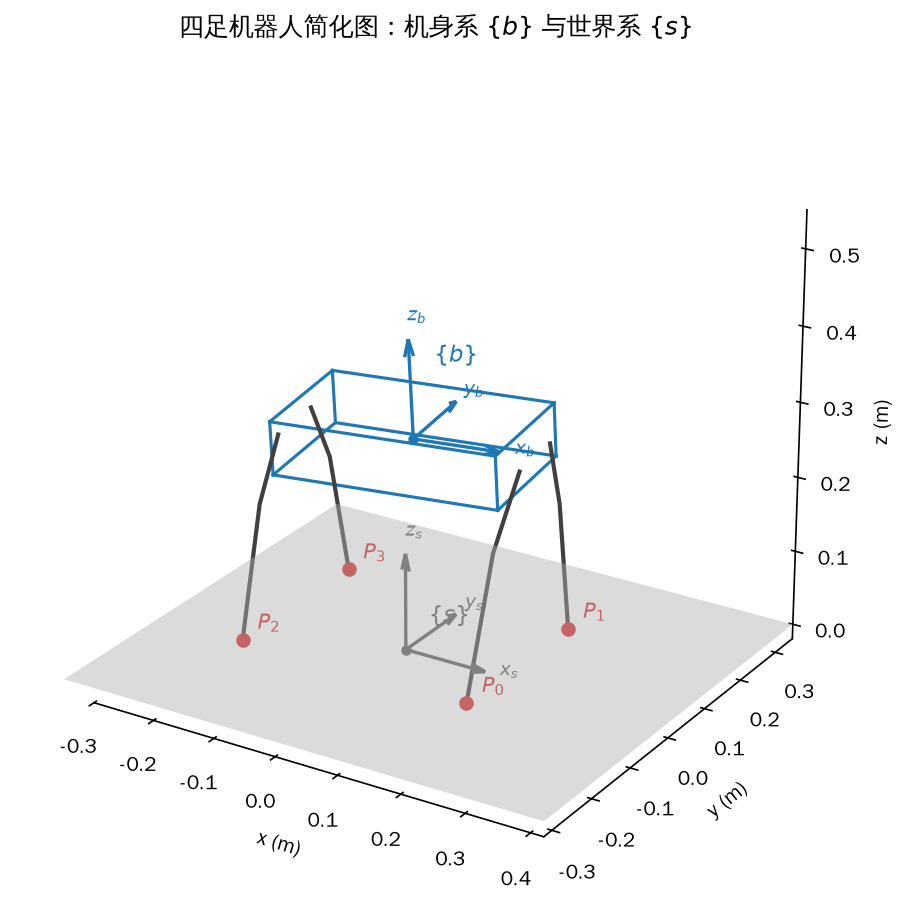
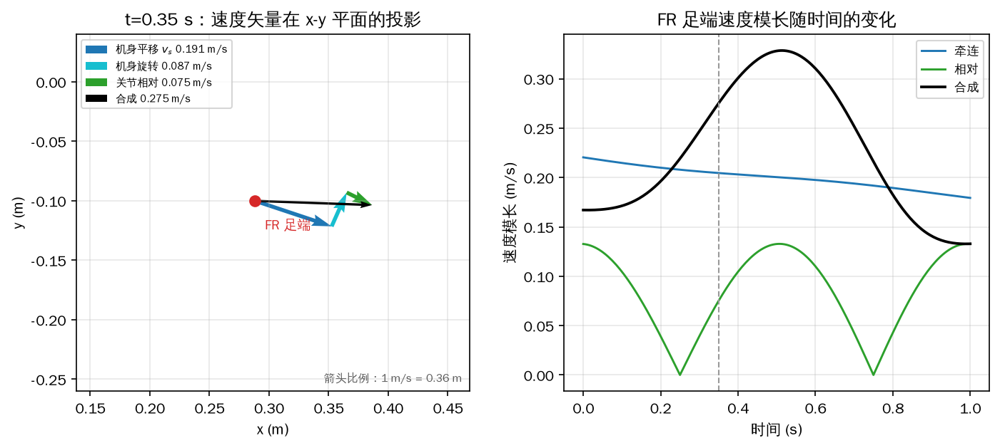
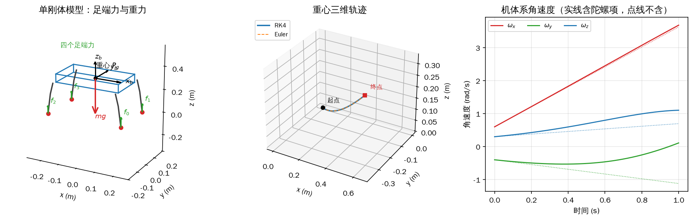
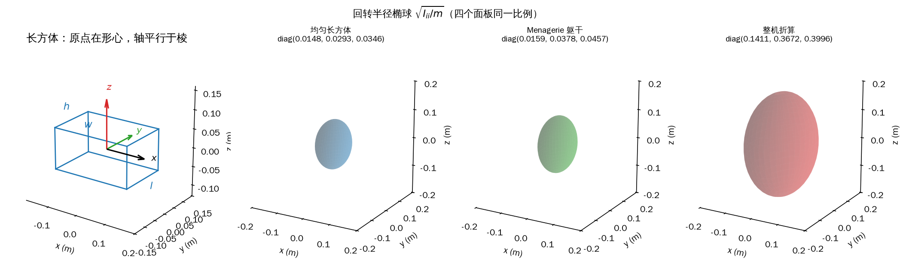
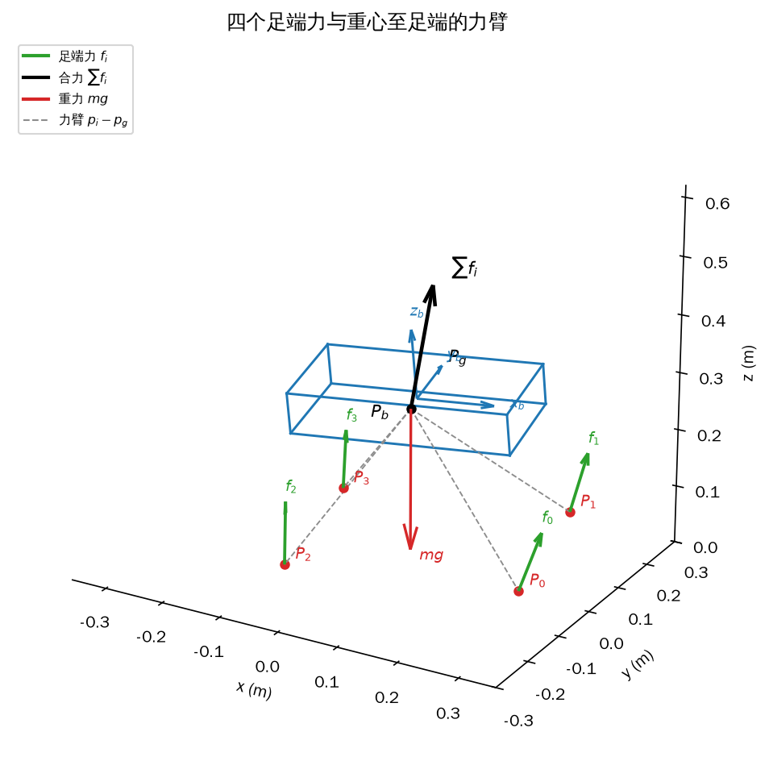
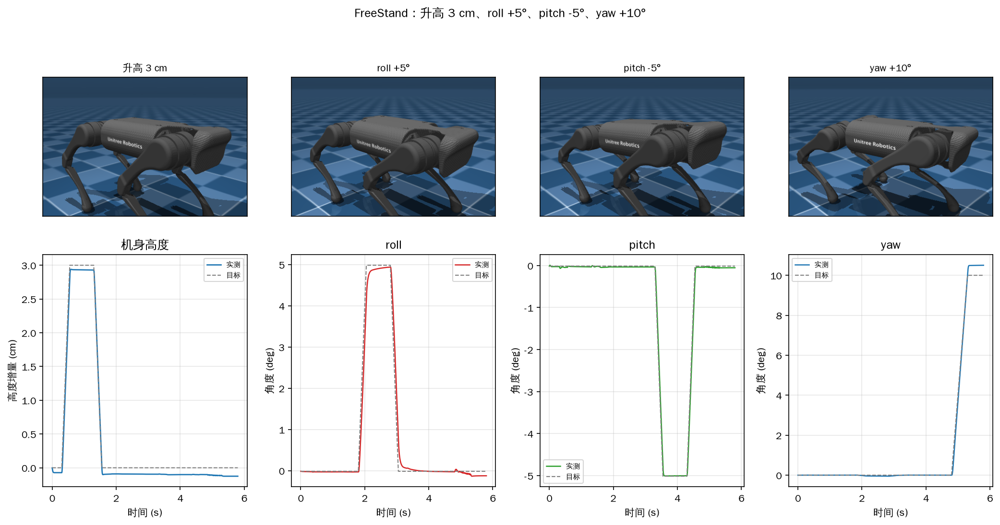

# 第 6 章 整机运动学与动力学：单刚体模型

第 5 章把一条腿从三个关节角算到足端位置，又反过来从足端位置解出关节角，还给出了足端力与关节力矩的静力学关系。那些公式只描述一条腿，而且默认腿的基座不动。真实的四足机器人不是这样：四条腿的基座都挂在同一副机身上，机身会平移、会倾斜、会转动，四个足端却常常踩在地上不动。把单腿的结论拼成整机模型，需要一套描述“机身怎么动、足端怎么不动”的运动学，以及一套描述“地面力怎么让机身动起来”的动力学。

这一章沿着两条链路展开。第一条是几何链路：给定期望的机身位姿，算出四个足端在机身系中的目标位置，再对每条腿做逆解，得到 12 个关节角。第二条是力学链路：给定四个足端受到的地面力，合成出作用在机身上的合力与合力矩，再由牛顿—欧拉方程算出机身的加速度和角加速度。两条链路在“足端”这个点上会合：运动学把足端位置映射成关节角，静力学把足端力映射成关节力矩。

为了让问题可解，本章采用单刚体（single rigid body，SRB）简化：把整台机器人看成一个刚体，四条腿只负责把地面反力传到机身，腿相对机身的摆动不进入动力学。这个假设在低速、平地、小步幅时够用，也是后面模型预测控制和全身控制最常用的基础模型；速度高、腿摆得猛、或者需要精确估计反作用力矩时，它就会失真。6.2.1 节和 10.7 节会分别从建模和实验两个角度说明边界。

记号先统一。世界系记作 \(\{s\}\)，固定在地面上；机身系记作 \(\{b\}\)，原点在机身上，\(x\) 轴指向头部、\(y\) 轴指向左侧、\(z\) 轴向上。向量用粗体小写，矩阵用粗体大写，\(\boldsymbol I\) 是单位阵，\([\boldsymbol a]_\times\) 是由向量 \(\boldsymbol a\) 构成的反对称矩阵。角度内部一律用弧度，长度用米，质量用千克，力用牛顿，力矩用牛·米。本章的示例只依赖 Python、NumPy 和 MuJoCo，不需要 ROS 2，也不需要真实机器人；只有 6.5 节最后一段提到实机验证时，才标出【需要实机】。

## 6.1 四足机器人的运动学：机身动，足端不动

先看一个不迈步的动作。机器人四脚站在地上，把两条前腿的膝关节各收小一点，前机身会下沉，整机绕横轴低头，看起来像鞠躬。操作者没有直接命令“俯仰角”，只改了关节角；俯仰是四个足端被地面挡住之后，机身为了容纳腿的新长度而被迫产生的运动。反过来，如果希望机身抬高 2 cm、横滚 3°，也可以先决定机身的新位姿，再反算四条腿应该缩到多长。四足机器人站立时，12 个关节共同构成了一个并联的位姿机构，机身的三个平移和三个转动都能在小范围内调整。

运动学要回答的就是这两个方向的问题：已知机身位姿和 12 个关节角，四个足端在世界系的哪里、速度是多少；已知四个足端应该踩在哪里、机身应该在哪，12 个关节角该取多少。前一个方向用于状态估计、碰撞检查和可视化，后一个方向用于站立、调姿和落脚控制。

### 6.1.1 机身位姿与足端位置

先定义机身系 \(\{b\}\)。原点取在机身的形心，也就是躯干这个长方体的几何中心；对密度均匀的机身，形心和重心重合。A1 的躯干由电池、电控、外壳等组成，密度并不均匀，按 Menagerie 模型算出的整机重心相对躯干原点偏移约 \((-0.0113,\,0.0016,\,-0.0196)\) m。6.1 节只关心几何，用形心作原点最方便；6.2 节推导动力学时要把原点移到重心，届时再用这个偏移量做平移。

\(\{b\}\) 的 \(x\) 轴指向机器人头部，\(y\) 轴指向左侧，\(z\) 轴按右手系取 \(x\times y\)，指向机身正上方。这里有一个容易读错的地方：本书的 \(\{b\}\) 不是固连在机身上的动坐标系，而是“当前时刻与机身位姿重合、随后固定不动的瞬时惯性系”。每次计算时重新取一个与机身当前位姿重合的 \(\{b\}\)，用完就丢掉；下一时刻的 \(\{b\}\) 是另一个坐标系。这样定义有两个好处。第一，\(\{b\}\) 是惯性系，牛顿第二定律在它里面成立，6.2 节的积分可以直接写。第二，关节冻结时整机可以看成一个刚体，机身上任意一点的速度可以直接套刚体公式，6.1.3 节的牵连速度就是这么来的。如果把 \(\{b\}\) 固连在机身上，关节冻结时足端在 \(\{b\}\) 中的坐标不变，速度恒为零，反而算不出机身运动带来的那部分速度。

四个足端按第 3 章的编号记为 \(P_0,P_1,P_2,P_3\)，它们在 \(\{b\}\) 中的坐标记作 \(\boldsymbol p_{b0},\boldsymbol p_{b1},\boldsymbol p_{b2},\boldsymbol p_{b3}\)。这些坐标由第 5 章的单腿正运动学给出：先由三个关节角算出足端在髋关节系 \(\{0\}\) 中的位置，再加上髋关节安装点在 \(\{b\}\) 中的平移。机身姿态一变，四个足端的坐标都要重算，不能把初始值一直用下去。

再定义世界系 \(\{s\}\)。在地面上取一个固定点 \(X\) 作原点，坐标轴取一组右手直角系。\(X\) 可以任意选，但为了计算方便，通常取 \(X=P_0\)，并让 \(\{s\}\) 的三根轴与初始时刻的 \(\{b\}\) 平行。这样初始时刻 \(\boldsymbol R_{sb}=\boldsymbol I\)，第 \(i\) 个足端在世界系中的坐标就是它在 \(\{b\}\) 中的初始坐标减去 \(P_0\) 的初始坐标：

<!-- 原书式（6.1） -->
\[ \boldsymbol p_{si}=\boldsymbol R_{sb}\left[\boldsymbol p_{bi}(0)-\boldsymbol p_{b0}(0)\right]=\boldsymbol p_{bi}(0)-\boldsymbol p_{b0}(0),\qquad i=0,1,2,3 \tag{6-1} \]

式（6-1）只在初始时刻成立。此后 \(\{s\}\) 固定不动，\(\{b\}\) 随机身运动，\(\boldsymbol R_{sb}\) 不再等于单位阵，足端世界坐标要用一般位姿下的变换来算。

机身的位姿用 \(4\times4\) 齐次变换矩阵 \(\boldsymbol T_{sb}\) 描述。左上角 \(3\times3\) 是 \(\boldsymbol R_{sb}\)，右上角 \(3\times1\) 是 \(\{b\}\) 原点在 \(\{s\}\) 中的位置 \(\boldsymbol p_{sb}\)，最后一行固定为 \([0\;0\;0\;1]\)。初始时刻 \(\boldsymbol p_{sb}(0)=-\boldsymbol p_{b0}(0)\)，因为 \(\{s\}\) 的原点就是 \(P_0\)，而 \(P_0\) 在 \(\{b\}\) 中的坐标是 \(\boldsymbol p_{b0}(0)\)：

<!-- 原书式（6.2） -->
\[ \boldsymbol T_{sb}(0)=\begin{bmatrix}\boldsymbol R_{sb}&\boldsymbol p_{sb}(0)\\ \boldsymbol 0&1\end{bmatrix}=\begin{bmatrix}\boldsymbol I_{3\times3}&-\boldsymbol p_{b0}(0)\\ \boldsymbol 0&1\end{bmatrix} \tag{6-2} \]

一般位姿下，机身相对初始位置平移 \(\boldsymbol p_d\)，姿态用偏航角 \(\alpha\)、俯仰角 \(\beta\)、横滚角 \(\gamma\) 表示。按第 4 章的欧拉角约定，旋转矩阵是 \(\boldsymbol R_z(\alpha)\boldsymbol R_y(\beta)\boldsymbol R_x(\gamma)\)，也就是先绕 \(x\) 转 \(\gamma\)、再绕 \(y\) 转 \(\beta\)、最后绕 \(z\) 转 \(\alpha\)。平移分量要把初始的 \(-\boldsymbol p_{b0}(0)\) 和后来的位移 \(\boldsymbol p_d\) 相加：

<!-- 原书式（6.3） -->
\[ \boldsymbol T_{sb}=\begin{bmatrix}\boldsymbol R_z(\alpha)\boldsymbol R_y(\beta)\boldsymbol R_x(\gamma)&-\boldsymbol p_{b0}(0)+\boldsymbol p_d\\ \boldsymbol 0&1\end{bmatrix} \tag{6-3} \]

式（6-3）把“机身怎么摆”压缩成 6 个数：三个欧拉角加三个平移。控制器给定这 6 个数，就能算出四个足端应该在 \(\{b\}\) 中的哪里。做法是用 \(\boldsymbol T_{sb}\) 的逆把世界系中的固定足端坐标变回 \(\{b\}\)：

<!-- 原书式（6.4） -->
\[ \begin{bmatrix}\boldsymbol p_{bi}\\1\end{bmatrix}=\boldsymbol T_{bs}\begin{bmatrix}\boldsymbol p_{si}\\1\end{bmatrix}=\boldsymbol T_{sb}^{-1}\begin{bmatrix}\boldsymbol p_{si}\\1\end{bmatrix},\qquad i=0,1,2,3 \tag{6-4} \]

展开以后就是 \(\boldsymbol p_{bi}=\boldsymbol R_{sb}^{\mathrm T}(\boldsymbol p_{si}-\boldsymbol p_{sb})\)。齐次变换的逆不要调用通用矩阵求逆，按第 4 章的公式，旋转块取转置、平移块取 \(-\boldsymbol R_{sb}^{\mathrm T}\boldsymbol p_{sb}\) 即可。得到 \(\boldsymbol p_{bi}\) 后，减去第 \(i\) 条腿的髋关节安装点在 \(\{b\}\) 中的偏移，就得到该腿基座系 \(\{0\}\) 下的足端坐标，再代入第 5 章的单腿逆运动学，解出三个关节角。12 个角写进关节位置命令，就完成了“目标机身位姿 → 四个足端目标 → 12 个关节目标”的整机姿态控制链路。

这条链路成立的前提是四个足端在世界系中真的不动。式（6-1）把 \(\boldsymbol p_{si}\) 写成常量，等价于假设足端与地面之间没有滑动。实际地面会下陷、橡胶足端会滚动、腿会弯，\(\boldsymbol p_{si}\) 会有一个小漂移 \(\Delta\boldsymbol p_{si}\)。把式（6-4）改写成 \(\boldsymbol p_{bi}=\boldsymbol R_{sb}^{\mathrm T}(\boldsymbol p_{si}+\Delta\boldsymbol p_{si}-\boldsymbol p_{sb})\)，漂移就原样进入足端目标，再进入关节角。小幅漂移可以被关节位置环吸收，大幅打滑会让机身实际位姿偏离目标；第 7 章的状态估计器会把支撑足的异常位移当作噪声或故障处理。

还有两个工程约束。第一，目标位姿必须落在四条腿的共同工作空间内，抬高、倾斜、偏航都有上限；A1 的髋关节外摆约 \(\pm46^\circ\)，膝关节范围约 \(-155^\circ\) 到 \(-52^\circ\)，超出范围时逆解会报错或跳到另一个分支。第二，12 个关节都有位置和速度上限，目标角要留出余量，不能让膝关节顶到限位。6.5 节的示例会从小幅度开始，并保持目标连续。

### 6.1.2 刚体上一点的速度与加速度

式（6-4）只给位置。要算速度，先看刚体上任意一点 \(P\) 的运动。设 \(\{b\}\) 原点处对应的刚体点记作 \(O'\)，刚体上 \(P\) 点的位置是 \(\boldsymbol p_P\)，\(O'\) 的位置是 \(\boldsymbol p_{O'}\)。机身当前在 \(\{b\}\) 中的平移速度是 \(\boldsymbol v_b\)，角速度是 \(\boldsymbol\omega_b\)。\(\{b\}\) 是瞬时惯性系，所以 \(\boldsymbol v_b\)、\(\boldsymbol\omega_b\) 既是机身原点处的速度，也是 \(\{b\}\) 原点处刚体点的速度。

\(P\) 点的运动可以拆成两部分：跟随 \(O'\) 的平移，以及绕通过 \(O'\) 的转轴旋转。旋转产生的线速度用叉乘写，等于角速度叉乘相对位置：

<!-- 原书式（6.5） -->
\[ \dot{\boldsymbol p}_P=\boldsymbol v_b+[\boldsymbol\omega_b]_\times\left(\boldsymbol p_P-\boldsymbol p_{O'}\right) \tag{6-5} \]

对式（6-5）两边求导。\(\boldsymbol v_b\) 的导数是平移加速度 \(\dot{\boldsymbol v}_b\)；角速度的导数是角加速度 \(\dot{\boldsymbol\omega}_b\)；相对位置 \(\boldsymbol p_P-\boldsymbol p_{O'}\) 的导数是两点速度之差：

<!-- 原书式（6.6） -->
\[ \ddot{\boldsymbol p}_P=\dot{\boldsymbol v}_b+[\dot{\boldsymbol\omega}_b]_\times\left(\boldsymbol p_P-\boldsymbol p_{O'}\right)+[\boldsymbol\omega_b]_\times\left(\dot{\boldsymbol p}_P-\dot{\boldsymbol p}_{O'}\right) \tag{6-6} \]

\(O'\) 在 \(\{b\}\) 的原点，所以 \(\dot{\boldsymbol p}_{O'}=\boldsymbol v_b\)。把式（6-5）代入式（6-6），方括号里的速度差就是 \([\boldsymbol\omega_b]_\times(\boldsymbol p_P-\boldsymbol p_{O'})\)，于是

<!-- 原书式（6.7） -->
\[ \ddot{\boldsymbol p}_P=\dot{\boldsymbol v}_b+[\dot{\boldsymbol\omega}_b]_\times\left(\boldsymbol p_P-\boldsymbol p_{O'}\right)+[\boldsymbol\omega_b]_\times[\boldsymbol\omega_b]_\times\left(\boldsymbol p_P-\boldsymbol p_{O'}\right) \tag{6-7} \]

式（6-7）的三项分别是平移加速度、切向加速度和向心加速度。向心项的方向从 \(P\) 指向转轴，大小等于 \(\lVert\boldsymbol\omega_b\rVert^2\) 乘 \(P\) 到转轴的垂直距离。把 \(O'\) 就取在 \(\{b\}\) 原点，\(\boldsymbol p_{O'}=\boldsymbol 0\)，式（6-5）和式（6-7）简化为

<!-- 原书式（6.8） -->
\[ \dot{\boldsymbol p}_P=\boldsymbol v_b+[\boldsymbol\omega_b]_\times\boldsymbol p_P \tag{6-8} \]

<!-- 原书式（6.9） -->
\[ \ddot{\boldsymbol p}_P=\dot{\boldsymbol v}_b+[\dot{\boldsymbol\omega}_b]_\times\boldsymbol p_P+[\boldsymbol\omega_b]_\times[\boldsymbol\omega_b]_\times\boldsymbol p_P \tag{6-9} \]

这两式看起来只是把 \(\boldsymbol p_{O'}\) 删掉，实际上依赖一个前提：参考点 \(O'\) 必须就是 \(\{b\}\) 的原点。如果换一个参考点，式（6-5）到（6-7）里的偏移项不能丢；很多推导错误都来自“把原点以外的点当成原点”。

还有一个容易混淆的地方：\(\dot{\boldsymbol p}_P\) 是“\(P\) 点位置在 \(\{b\}\) 中的坐标对时间求导”，它等于 \(P\) 点的速度，是因为 \(\{b\}\) 在当前瞬间是惯性系且与机身重合。如果 \(\{b\}\) 是固连在机身上的动系，坐标导数还要补上坐标系旋转的项，不能直接当速度用。本章后面的所有求导都按瞬时惯性系理解。

### 6.1.3 机器人足端速度

足端的速度由两部分叠加。第一部分是牵连速度：把四条腿的所有关节看成冻结，整台机器人就是一个刚体，足端随这个刚体一起平移和旋转。直接套式（6-8），把 \(\boldsymbol p_P\) 换成足端相对机身原点的位置 \(\boldsymbol p_{b/B}\)：

<!-- 原书式（6.10） -->
\[ \boldsymbol v_{be}=\boldsymbol v_b+[\boldsymbol\omega_b]_\times\boldsymbol p_{b/B} \tag{6-10} \]

这里 \(\boldsymbol v_{be}\) 是在 \(\{b\}\) 中表示的牵连速度。式（6-10）再次说明了瞬时惯性系的作用：如果 \(\{b\}\) 固连在机身上，关节冻结时足端在 \(\{b\}\) 中的坐标不变，坐标导数恒为零，就得不到“机身旋转带着足端走”这一项。式（6-10）算的不是坐标导数，而是真实的速度，只是用 \(\{b\}\) 这组瞬时基向量来表示。

第二部分是相对速度：机身不动、只有三个关节转动时，足端在 \(\{b\}\) 中的速度。第 5 章的雅可比矩阵给出

<!-- 原书式（6.11） -->
\[ \boldsymbol v_{bj}=\boldsymbol J\dot{\boldsymbol\theta} \tag{6-11} \]

其中 \(\boldsymbol J\) 是该腿的 \(3\times3\) 雅可比矩阵，\(\dot{\boldsymbol\theta}=[\dot\theta_1\;\dot\theta_2\;\dot\theta_3]^{\mathrm T}\) 是三个关节的角速度。把牵连和相对两部分相加，再左乘 \(\boldsymbol R_{sb}\) 旋转到世界系，得到足端在世界系中的速度：

<!-- 原书式（6.12） -->
\[ \boldsymbol v_{sf}=\boldsymbol R_{sb}\left(\boldsymbol v_{be}+\boldsymbol v_{bj}\right)=\boldsymbol R_{sb}\boldsymbol v_b+\boldsymbol R_{sb}\left([\boldsymbol\omega_b]_\times\boldsymbol p_{b/B}+\boldsymbol J\dot{\boldsymbol\theta}\right)=\boldsymbol v_s+\boldsymbol R_{sb}\left([\boldsymbol\omega_b]_\times\boldsymbol p_{b/B}+\boldsymbol J\dot{\boldsymbol\theta}\right) \tag{6-12} \]

式（6-12）把 \(\boldsymbol R_{sb}\boldsymbol v_b\) 记成 \(\boldsymbol v_s\)，也就是机身在世界系中的平移速度。第一项是机身平移，第二项是机身旋转，第三项是关节转动；前两项合起来就是牵连速度的世界系版本，第三项是相对速度的世界系版本。

控制中真正方便的量不是 \(\boldsymbol v_{sf}\)，而是“世界系下足端相对机身的速度”：

<!-- 原书式（6.13） -->
\[ \boldsymbol v_{sB}=\boldsymbol v_{sf}-\boldsymbol v_s=\boldsymbol R_{sb}\left([\boldsymbol\omega_b]_\times\boldsymbol p_{b/B}+\boldsymbol J\dot{\boldsymbol\theta}\right) \tag{6-13} \]

式（6-13）里仍然保留了 \([\boldsymbol\omega_b]_\times\boldsymbol p_{b/B}\)。即使 12 个关节完全冻结，只要机身绕自身转动，足端相对机身原点也会有速度；不能把相对速度简单理解成“关节速度旋转一下”。当足端处于支撑相且不滑动时，\(\boldsymbol v_{sf}=\boldsymbol 0\)，于是 \(\boldsymbol v_{sB}=-\boldsymbol v_s\)。这条关系是第 7 章状态估计的出发点之一：用支撑腿的关节速度和机身角速度反推机身平移速度。如果足端打滑，\(\boldsymbol v_{sf}\neq\boldsymbol 0\)，式（6-13）就要多加一个滑移速度 \(\boldsymbol v_{\rm slip}\)，支撑腿反推机身速度的关系也不再成立。

### 示例：解析速度与有限差分

`6_1_kinematics.py` 给出一段 1 s 的机身轨迹：世界系平移速度固定为 \((0.18,-0.06,0.02)\) m/s，机体系角速度固定为 \((0.12,-0.08,0.25)\) rad/s，初始姿态是横滚 \(0.03\) rad、俯仰 \(-0.04\) rad、偏航 \(0.10\) rad。四条腿的 12 个关节各自按正弦摆动，频率 1 Hz，三个关节的幅值分别是 \(0.05\)、\(0.10\)、\(0.08\) rad，四条腿之间依次错开 \(90^\circ\)。机身运动和关节摆动叠加，四个足端在世界系里画出一条复杂的曲线。示例没有把 \(\{s\}\) 的原点放在 \(P_0\)，而是放在初始机身正下方，坐标轴与地面平行，这样画图和读位置更直观；式（6-12）、（6-13）对任意世界系都成立，式（6-1）的 \(X=P_0\) 只是 6.1.1 节为了让初始 \(\boldsymbol p_{si}\) 写成常量而选的一种方便约定。

代码先用式（6-12）算每个时刻的解析速度，再对足端位置函数做中心差分：

```python
{{#include code/ch06/6_1_kinematics.py:trajectory}}
```

```python
{{#include code/ch06/6_1_kinematics.py:velocity}}
```

```python
{{#include code/ch06/6_1_kinematics.py:check}}
```

```console
{{#include code/ch06/6_1_kinematics.out}}
```

1001 个时刻、4 条腿、差分步长 \(h=10^{-5}\) s，解析速度与差分的最大差是 \(9.11\times10^{-11}\) m/s，相对足端最大速度 \(0.3705\) m/s 只有 \(2.46\times10^{-10}\)。中心差分的截断误差是 \(O(h^2)\)，这个量级说明式（6-12）和程序里的正运动学、雅可比、旋转矩阵是一致的。如果某条腿的雅可比符号写反，误差会立刻升到 \(10^{-1}\) 量级，不会藏在这个精度里。

图 6-1 画的是简化后的整机与两个坐标系。蓝色长方体是机身，四条三段折线是腿，红色圆点是四个足端；\(\{b\}\) 的原点在机身中心，\(\{s\}\) 固定在地面上。图上机身是倾斜的，四个足端仍然踩在地面上，用来提示“机身位姿变了，\(\boldsymbol p_{bi}\) 要重算，但 \(\boldsymbol p_{si}\) 不变”。



*图 6-1 机身系 \(\{b\}\) 在当前时刻与机身位姿重合，世界系 \(\{s\}\) 固定在地面；四个足端用 \(P_0\) 到 \(P_3\) 标出*

图 6-2 取 \(t=0.35\) s 的 FR 腿，把速度拆成三段箭头。机身平移 \(\boldsymbol v_s\) 的模长是 0.191 m/s，机身旋转项 \([\boldsymbol\omega_b]_\times\boldsymbol p_{b/B}\) 旋转到世界系后的模长是 0.087 m/s，关节转动项 \(\boldsymbol J\dot{\boldsymbol\theta}\) 旋转到世界系后的模长是 0.075 m/s；三者按矢量相加，合成速度 \((0.2750,-0.0099,-0.0076)\) m/s，模长 0.2753 m/s。右图是这三项和合成速度的模长随时间的变化：牵连项在 0.19 到 0.22 m/s 之间缓慢变化，相对项在 0 到 0.14 m/s 之间起伏，合成项在 0.13 到 0.33 m/s 之间波动。相对项在 0.25 s 和 0.75 s 附近接近零，因为那时刻三个关节的正弦速度恰好同时过零；这并不表示足端不动，机身还在带着它走。



*图 6-2 左：\(t=0.35\) s 时 FR 足端的速度矢量链，箭头按 1 m/s = 0.36 m 缩放；右：三项速度模长随时间的变化*

如果足端打滑，式（6-12）和式（6-13）都要加滑移项。设足端相对地面的滑移速度在世界系中为 \(\boldsymbol v_{{\rm slip},i}\)，则 \(\boldsymbol v_{sf}=\boldsymbol v_s+\boldsymbol R_{sb}([\boldsymbol\omega_b]_\times\boldsymbol p_{b/B}+\boldsymbol J\dot{\boldsymbol\theta})+\boldsymbol v_{{\rm slip},i}\)，式（6-13）变成 \(\boldsymbol v_{sB}=\boldsymbol R_{sb}(\cdots)+\boldsymbol v_{{\rm slip},i}\)。示例里的差分是对“足端位置”求导，它自动包含滑移；解析式没有滑移项，所以两者一致只说明这段轨迹没有滑移。工程上判断是否打滑，通常看支撑足足端速度的估计值是否长期偏离零，或者看足端力是否接近摩擦锥边界。

## 6.2 单刚体动力学：牛顿 + 欧拉 + 动能

6.1 节的所有量都是位置、速度和角度，没有出现力。只靠运动学，机器人能“摆出”一个姿态，却不知道自己需要多大的关节力矩，也无法判断这个姿态在重力下能不能站住。要让机身真正动起来，必须把地面的足端力和机身的加速度联系起来，这就是动力学。

### 6.2.1 为什么可以简化

如果不考虑连杆在外力下的形变，整台机器人是一个由 13 个刚体（躯干加 12 个连杆）通过 12 个转动关节连接起来的多刚体系统。多刚体动力学有成熟的算法，Featherstone 的递归算法用得最广，开源库 RBDL 就是它的一个实现。那套方法要用旋量（spatial vector）、关节空间惯量矩阵等工具，推导量比本章大得多。本章不展开多刚体动力学，只建立一个够用的简化模型。

简化的出发点是：12 个电机、电池和电控都集中在躯干里，腿主要是连杆、关节壳体和足端。于是把整台机器人看成一个刚体，质量 \(m\) 和惯性张量 \(\boldsymbol I_b\) 取整机值，四条腿只作为传力机构，把地面反力传到机身。腿的质量和惯量被折算进整机的 \(m\) 和 \(\boldsymbol I_b\)，不再作为独立自由度；腿相对机身的运动不产生反作用力矩。

这个说法有一半是对的，有一半需要修正。按 Menagerie 的 A1 模型，躯干质量 4.713 kg，四条腿合计 7.740 kg，整机 12.453 kg；腿占总质量的 62.2%，并不是“腿很轻”。单刚体模型仍然能用，原因不是腿没有质量，而是低速站立和小步幅行走时，腿相对机身的运动速度低、摆动惯量小，腿的动量变化对机身反作用力的贡献比地面反力小一个量级。速度提高、步幅加大、或者做腾空跳跃时，摆动腿的惯性力和惯性力矩会明显进入机身方程，单刚体模型就会低估姿态波动。这个边界在 10.7 节会用实验数据再说明一次。

因此，本章把 \(m\) 取整机质量，把 \(\boldsymbol I_b\) 取“整机折算到机身系”的惯性张量，而不是只取躯干那一块。6.3 节会看到，这两个口径差了将近一个数量级：Menagerie 的躯干惯量只有 \(\mathrm{diag}(0.01585,0.03780,0.04565)\) kg·m²，而把 13 个刚体按平行轴定理合到整机重心，得到的是 \(\mathrm{diag}(0.1411,0.3672,0.3996)\) kg·m²，和原书式（6.32）的 \(0.1320/0.3475/0.3775\) 在 7% 以内。控制器里如果拿躯干惯量去配整机质量，姿态环会明显偏硬。

### 6.2.2 单刚体动力学

先定义质量和重心。设刚体的密度分布为 \(\rho(x,y,z)\)，质量是密度在体积 \(B\) 上的三重积分：

<!-- 原书式（6.14） -->
\[ m=\int_z\int_y\int_x\rho(x,y,z)\,\mathrm dx\,\mathrm dy\,\mathrm dz=\int_B\rho\,\mathrm dV \tag{6-14} \]

后一个等号是简写，\(\int_B\) 表示在刚体体积上积分，\(\rho\) 的自变量省略。在刚体上建立 \(\{b\}\)，刚体内每一点的坐标记作 \(\boldsymbol p_b=[x\;y\;z]^{\mathrm T}\)。如果

<!-- 原书式（6.15） -->
\[ \int_B\rho\boldsymbol p_b\,\mathrm dV=\boldsymbol 0_{3\times1} \tag{6-15} \]

那么 \(\{b\}\) 的原点就是刚体的重心，也叫质心。式（6-15）是一阶矩为零的写法。把原点放在重心有两个直接好处：重力的作用线穿过原点，不产生力矩；质量、惯性张量的积分中所有含 \(\boldsymbol p_b\) 一次方的项都消失。由式（6-15）还可以推出 \(\int_B\rho[\boldsymbol p_b]_\times\mathrm dV=\boldsymbol 0\) 和 \(\int_B\rho\boldsymbol p_b^{\mathrm T}\mathrm dV=\boldsymbol 0\)，后面化简时反复用到。

如果建模时 \(\{b\}\) 的原点在形心而不是重心，设重心在 \(\{b\}\) 中的坐标为 \(\boldsymbol p_g\)，可以先做平移 \(\boldsymbol p_b\leftarrow\boldsymbol p_b-\boldsymbol p_g\)，再套下面的公式；也可以保留一阶矩项，但方程会多出几项。工程上统一把动力学用的 \(\{b\}\) 原点放在重心，运动学用的形心系只在 6.1 节出现，两者用 \(\boldsymbol p_g\) 换算。

牛顿第二定律 \(\boldsymbol F=m\boldsymbol a\) 只在惯性系中成立。6.1 节把 \(\{b\}\) 定义成瞬时惯性系，就是为了这里能用它。把刚体切成无数微元，每个微元受的力是 \(\rho\ddot{\boldsymbol p}_b\mathrm dV\)，对整个刚体积分，合外力等于

<!-- 原书式（6.16） -->
\[ \boldsymbol f_b=\int_B\rho\ddot{\boldsymbol p}_b\,\mathrm dV=\int_B\rho\left(\dot{\boldsymbol v}_b+[\dot{\boldsymbol\omega}_b]_\times\boldsymbol p_b+[\boldsymbol\omega_b]_\times[\boldsymbol\omega_b]_\times\boldsymbol p_b\right)\mathrm dV \tag{6-16} \]

\(\dot{\boldsymbol v}_b\)、\(\dot{\boldsymbol\omega}_b\)、\(\boldsymbol\omega_b\) 描述的是整个刚体的运动，对刚体内每一点都相同，可以提到积分号外：

<!-- 原书式（6.17） -->
\[ \boldsymbol f_b=\dot{\boldsymbol v}_b\int_B\rho\,\mathrm dV+[\dot{\boldsymbol\omega}_b]_\times\int_B\rho\boldsymbol p_b\,\mathrm dV+[\boldsymbol\omega_b]_\times[\boldsymbol\omega_b]_\times\int_B\rho\boldsymbol p_b\,\mathrm dV \tag{6-17} \]

第一项的积分是 \(m\)，后两项的积分是重心定义式（6-15）给出的零向量，于是后两项消失，得到质心的平动方程：

<!-- 原书式（6.18） -->
\[ \boldsymbol f_b=m\dot{\boldsymbol v}_b \tag{6-18} \]

式（6-18）只说明“合外力决定质心加速度”，不说明外力作用在哪里。足端力偏离质心产生的力矩由转动方程处理，不能把足端力直接搬到质心上再加一个“等效力”。

转动方程从力矩的定义开始。刚体在重心处受到的合力矩等于每个微元的力臂叉乘微元力，再积分：

<!-- 原书式（6.19） -->
\[ \boldsymbol\tau_b=\int_B[\boldsymbol p_b]_\times\mathrm d\boldsymbol f=\int_B\rho[\boldsymbol p_b]_\times\left(\dot{\boldsymbol v}_b+[\dot{\boldsymbol\omega}_b]_\times\boldsymbol p_b+[\boldsymbol\omega_b]_\times[\boldsymbol\omega_b]_\times\boldsymbol p_b\right)\mathrm dV \tag{6-19} \]

这里用 \(\boldsymbol\tau_b\) 表示力矩，避免和质量的标量 \(m\) 混淆；原书把力矩记作 \(\boldsymbol m_b\)。式（6-19）展开成三项。第一项是 \(\int_B\rho[\boldsymbol p_b]_\times\mathrm dV\,\dot{\boldsymbol v}_b\)，由重心定义为零。第二项用叉乘的反交换律 \([\dot{\boldsymbol\omega}_b]_\times\boldsymbol p_b=-[\boldsymbol p_b]_\times\dot{\boldsymbol\omega}_b\)，把角加速度提到积分号外，括号里的积分定义为惯性张量 \(\boldsymbol I_b\)：

<!-- 原书式（6.20） -->
\[ \int_B\rho[\boldsymbol p_b]_\times[\dot{\boldsymbol\omega}_b]_\times\boldsymbol p_b\,\mathrm dV=\left(\int_B-\rho[\boldsymbol p_b]_\times[\boldsymbol p_b]_\times\mathrm dV\right)\dot{\boldsymbol\omega}_b=\boldsymbol I_b\dot{\boldsymbol\omega}_b \tag{6-20} \]

第三项用二重向量积展开 \([\boldsymbol\omega_b]_\times[\boldsymbol\omega_b]_\times\boldsymbol p_b=\boldsymbol\omega_b(\boldsymbol\omega_b^{\mathrm T}\boldsymbol p_b)-\boldsymbol p_b(\boldsymbol\omega_b^{\mathrm T}\boldsymbol\omega_b)\)。两个点积都是标量，可以交换次序，整理后提出与积分变量无关的 \(\boldsymbol\omega_b\)：

<!-- 原书式（6.21） -->
\[ \int_B\rho[\boldsymbol p_b]_\times[\boldsymbol\omega_b]_\times[\boldsymbol\omega_b]_\times\boldsymbol p_b\,\mathrm dV=[\boldsymbol\omega_b]_\times\left(\int_B-\rho[\boldsymbol p_b]_\times[\boldsymbol p_b]_\times\mathrm dV\right)\boldsymbol\omega_b=[\boldsymbol\omega_b]_\times\boldsymbol I_b\boldsymbol\omega_b \tag{6-21} \]

三项合并，就是旋转刚体的欧拉方程：

<!-- 原书式（6.22） -->
\[ \boldsymbol\tau_b=\boldsymbol I_b\dot{\boldsymbol\omega}_b+[\boldsymbol\omega_b]_\times\boldsymbol I_b\boldsymbol\omega_b \tag{6-22} \]

第一项 \(\boldsymbol I_b\dot{\boldsymbol\omega}_b\) 是产生角加速度需要的力矩；第二项 \([\boldsymbol\omega_b]_\times\boldsymbol I_b\boldsymbol\omega_b=\boldsymbol\omega_b\times(\boldsymbol I_b\boldsymbol\omega_b)\) 是陀螺项，也叫陀螺力矩。即使角速度大小不变，只要刚体在转、且惯性张量各向异性，这一项也可能不为零。6.4 节会讨论什么时候可以把它删掉。

式（6-22）成立需要四个条件，缺一不可：刚体质量不变；\(\{b\}\) 的原点在重心；\(\{b\}\) 在当前瞬间是惯性系；\(\boldsymbol I_b\) 是在固连于刚体的轴系中表达的常量。最后一条容易误解：\(\{b\}\) 是瞬时惯性系，但它的三根轴在当前瞬间与机身的固连轴重合，所以 \(\boldsymbol I_b\) 取机身系中的常量张量；换一个时刻，新的 \(\{b\}\) 轴仍然与机身重合，\(\boldsymbol I_b\) 的数值不变。世界系中的惯性张量则会随姿态变化，6.3 节给出变换公式。

### 6.2.3 单刚体动能

动能可以从微元积分得到，也可以用来检查前面的方程。速度为 \(\boldsymbol v\) 的微元，质量是 \(\rho\mathrm dV\)，动能是

<!-- 原书式（6.23） -->
\[ \mathrm dK=\frac12\rho\left(v_x^2+v_y^2+v_z^2\right)\mathrm dV=\frac12\rho\boldsymbol v^{\mathrm T}\boldsymbol v\,\mathrm dV \tag{6-23} \]

把式（6-8）的微元速度 \(\boldsymbol v=\boldsymbol v_b+[\boldsymbol\omega_b]_\times\boldsymbol p_b\) 代入，对整个刚体积分：

<!-- 原书式（6.24） -->
\[ K=\frac12\int_B\rho\left(\boldsymbol v_b+[\boldsymbol\omega_b]_\times\boldsymbol p_b\right)^{\mathrm T}\left(\boldsymbol v_b+[\boldsymbol\omega_b]_\times\boldsymbol p_b\right)\mathrm dV \tag{6-24} \]

展开后有四项：\(\boldsymbol v_b^{\mathrm T}\boldsymbol v_b\) 项、两个交叉项、以及含 \(\boldsymbol\omega_b\) 二次方的项。两个交叉项都含 \(\int_B\rho\boldsymbol p_b\mathrm dV\)，由式（6-15）为零；平动和转动在重心处解耦。第一项定义为平动动能：

<!-- 原书式（6.25） -->
\[ K_{\mathrm m}=\frac12\int_B\rho\boldsymbol v_b^{\mathrm T}\boldsymbol v_b\,\mathrm dV=\frac12m\boldsymbol v_b^{\mathrm T}\boldsymbol v_b \tag{6-25} \]

第四项定义为转动动能。利用 \([\boldsymbol\omega_b]_\times^{\mathrm T}=-[\boldsymbol\omega_b]_\times\)，先把转置去掉：

<!-- 原书式（6.26） -->
\[ K_{\mathrm t}=\frac12\int_B\rho\boldsymbol p_b^{\mathrm T}[\boldsymbol\omega_b]_\times^{\mathrm T}[\boldsymbol\omega_b]_\times\boldsymbol p_b\,\mathrm dV=-\frac12\int_B\rho\boldsymbol p_b^{\mathrm T}[\boldsymbol\omega_b]_\times[\boldsymbol\omega_b]_\times\boldsymbol p_b\,\mathrm dV \tag{6-26} \]

再用二重向量积展开，把 \([\boldsymbol\omega_b]_\times[\boldsymbol\omega_b]_\times\boldsymbol p_b\) 换成 \(\boldsymbol\omega_b(\boldsymbol\omega_b^{\mathrm T}\boldsymbol p_b)-\boldsymbol p_b(\boldsymbol\omega_b^{\mathrm T}\boldsymbol\omega_b)\)：

<!-- 原书式（6.27） -->
\[ K_{\mathrm t}=-\frac12\int_B\rho\boldsymbol p_b^{\mathrm T}\left[\left(\boldsymbol\omega_b^{\mathrm T}\boldsymbol p_b\right)\boldsymbol\omega_b-\left(\boldsymbol\omega_b^{\mathrm T}\boldsymbol\omega_b\right)\boldsymbol p_b\right]\mathrm dV \tag{6-27} \]

两个点积都是标量，交换次序后把公共的 \(\boldsymbol\omega_b^{\mathrm T}\) 和 \(\boldsymbol\omega_b\) 提到积分号外，括号里正好是惯性张量的定义：

<!-- 原书式（6.28） -->
\[ K_{\mathrm t}=-\frac12\int_B\rho\boldsymbol\omega_b^{\mathrm T}\left[\left(\boldsymbol p_b^{\mathrm T}\boldsymbol\omega_b\right)\boldsymbol p_b-\left(\boldsymbol p_b^{\mathrm T}\boldsymbol p_b\right)\boldsymbol\omega_b\right]\mathrm dV=\frac12\boldsymbol\omega_b^{\mathrm T}\boldsymbol I_b\boldsymbol\omega_b \tag{6-28} \]

总动能是两项之和：\(K=K_{\mathrm m}+K_{\mathrm t}=\frac12m\boldsymbol v_b^{\mathrm T}\boldsymbol v_b+\frac12\boldsymbol\omega_b^{\mathrm T}\boldsymbol I_b\boldsymbol\omega_b\)。平动项和转动项没有交叉，是因为原点取在重心；如果原点不在重心，动能里会出现 \(\boldsymbol v_b^{\mathrm T}[\boldsymbol\omega_b]_\times\boldsymbol p_g\) 这样的耦合项。式（6-28）还说明 \(\boldsymbol I_b\) 是转动动能的二次型矩阵。动能非负，所以 \(\boldsymbol I_b\) 对称半正定；真实三维刚体的质量不在一个平面上，通常还是正定的。二次型可以看成“按惯性张量加权的长度平方”，后面做能量法、优化控制时经常把它当代价函数的一部分。

### 示例：常力常力矩下的单刚体

`6_2_srb_dynamics.py` 取 \(m=12.453\) kg、\(\boldsymbol I_b=\mathrm{diag}(0.1320,0.3475,0.3775)\) kg·m²，初始速度 \((0.45,-0.25,0.10)\) m/s，初始角速度 \((0.6,-0.4,0.3)\) rad/s。世界系施加常力 \((5,-3,128)\) N，机体系施加常力矩 \((0.40,-0.25,0.15)\) N·m，持续 1 s。状态量是位置、速度、四元数和机体系角速度，共 13 维。四元数按 \(\dot{\boldsymbol q}=\frac12\boldsymbol q\otimes[0,\boldsymbol\omega_b]\) 积分，每一步归一化；姿态用四元数而不是欧拉角，是为了避免俯仰角接近 \(\pm90^\circ\) 时的奇异。

```python
{{#include code/ch06/6_2_srb_dynamics.py:deriv}}
```

```python
{{#include code/ch06/6_2_srb_dynamics.py:integrators}}
```

```console
{{#include code/ch06/6_2_srb_dynamics.out}}
```

示例同时跑了两种积分：显式欧拉，步长 1 ms；四阶龙格—库塔（RK4），步长 0.1 ms，作为参考。1 s 后参考解的位置是 \((0.6508,-0.3705,0.3343)\) m，速度 \((0.8515,-0.4909,0.5686)\) m/s，角速度 \((3.6846,0.1114,1.1040)\) rad/s；欧拉解的位置差 \(3.31\times10^{-4}\) m、速度差 \(1.11\times10^{-13}\) m/s、角速度差 \(1.54\times10^{-3}\) rad/s、姿态差 \(1.70\times10^{-3}\) rad。速度几乎完全一致，因为常力下速度是线性的；位置和姿态的误差来自欧拉法对加速度和角速度的积分，量级与 \(O(\Delta t)\) 相符。把步长减半，位置误差大约减半；如果发现误差不按一阶缩小，先检查四元数有没有归一化、角速度是不是在机体系里积分。

图 6-3 左边是单刚体模型：一个长方体代表机身，四个足端画了向上的地面力 \(f_i\)，重心处画了重力 \(mg\)，机体系 \(\{b\}\) 的原点放在重心。中间是重心的三维轨迹，蓝色实线是 RK4，橙色虚线是欧拉，两条线几乎重合；右边是机体系三个角速度分量，实线含陀螺项，点线是删去陀螺项的积分结果。这个例子转得比较快，末态角速度约 3.7 rad/s，陀螺项的最大模长达到 1.00 N·m，比施加的常力矩 0.495 N·m 还大；删去陀螺项后，1 s 的姿态差 0.389 rad，约 \(22^\circ\)。所以在高转速下不能随手删掉式（6-22）的第二项，正常行走时角速度小得多，这一项通常只有百分之几到十几的力矩占比，6.4 节会给出取舍。



*图 6-3 左：单刚体模型与受力；中：常力常力矩下的重心轨迹；右：机体系角速度，点线是不含陀螺项的对照*

这里有一个数值细节：四元数积分后必须归一化。显式欧拉对 \(\dot{\boldsymbol q}=\frac12\boldsymbol q\otimes[0,\boldsymbol\omega_b]\) 只做一阶近似，几步之后 \(\lVert\boldsymbol q\rVert\) 会偏离 1；不归一化的话，由四元数算出的旋转矩阵不再正交，姿态误差会以完全错误的量级增长。示例每一步都除以范数，所以误差仍然按积分阶数收敛。工程上还可以用旋转矩阵加 SVD 正交化，或者用李群上的指数映射做积分，精度更高，代价是每步多算几次三角函数。

## 6.3 刚体的惯性张量

6.2 节把惯性张量定义成 \(\boldsymbol I_b=\int_B-\rho[\boldsymbol p_b]_\times[\boldsymbol p_b]_\times\mathrm dV\)。这个定义在推导里很紧凑，但要用它算数，得先展开成具体的 \(3\times3\) 矩阵。令 \(\boldsymbol p_b=[p_x\;p_y\;p_z]^{\mathrm T}\)，先写出 \([\boldsymbol p_b]_\times\)，再做矩阵乘法、取负号：

<!-- 原书式（6.29） -->
\[ \boldsymbol I_b=-\int_B\rho[\boldsymbol p_b]_\times[\boldsymbol p_b]_\times\,\mathrm dV=\int_B\rho\begin{bmatrix}p_y^2+p_z^2&-p_xp_y&-p_xp_z\\-p_xp_y&p_x^2+p_z^2&-p_yp_z\\-p_xp_z&-p_yp_z&p_x^2+p_y^2\end{bmatrix}\mathrm dV=\begin{bmatrix}I_{xx}&I_{xy}&I_{xz}\\I_{xy}&I_{yy}&I_{yz}\\I_{xz}&I_{yz}&I_{zz}\end{bmatrix} \tag{6-29} \]

六个独立分量写成积分就是

<!-- 原书式（6.30） -->
\[ \left\{\begin{aligned}I_{xx}&=\int_B\rho\left(p_y^2+p_z^2\right)\mathrm dV\\I_{yy}&=\int_B\rho\left(p_x^2+p_z^2\right)\mathrm dV\\I_{zz}&=\int_B\rho\left(p_x^2+p_y^2\right)\mathrm dV\\I_{xy}&=-\int_B\rho p_xp_y\,\mathrm dV,\quad I_{xz}=-\int_B\rho p_xp_z\,\mathrm dV,\quad I_{yz}=-\int_B\rho p_yp_z\,\mathrm dV\end{aligned}\right. \tag{6-30} \]

对角元 \(I_{xx}\) 是绕 \(x\) 轴转动的转动惯量，只与质量元到 \(x\) 轴的距离平方 \(p_y^2+p_z^2\) 有关；\(I_{yy}\)、\(I_{zz}\) 同理。非对角元叫惯性积，带负号，反映质量分布相对三根坐标轴的不对称程度。矩阵对称是因为积分变量可以交换，\(p_xp_y=p_yp_x\)，所以 \(I_{xy}=I_{yx}\)。九个元素只有六个独立，加上对称性，惯性张量比一般 \(3\times3\) 矩阵少三个自由度。

对形状不规则、密度不均匀的物体，式（6-30）只能做数值积分。对形状规则、密度均匀的物体，有闭式解。最常用的是长方体：把原点放在长方体的形心，三根坐标轴分别平行于三条棱，设 \(x\) 方向边长 \(l\)、\(y\) 方向边长 \(w\)、\(z\) 方向边长 \(h\)。这时惯性积全为零，惯性张量是对角矩阵：

<!-- 原书式（6.31） -->
\[ \boldsymbol I_b=\frac1{12}\begin{bmatrix}m(w^2+h^2)&0&0\\0&m(l^2+h^2)&0\\0&0&m(l^2+w^2)\end{bmatrix} \tag{6-31} \]

三个对角元的对应关系要记清楚：绕 \(x\) 轴转时，参与的是 \(y\) 和 \(z\) 两个方向的尺寸，所以 \(I_{xx}=m(w^2+h^2)/12\)；绕 \(y\) 轴是 \(m(l^2+h^2)/12\)；绕 \(z\) 轴是 \(m(l^2+w^2)/12\)。把 \(l\) 和 \(w\) 的位置写反，或者把 \(I_{xx}\) 写成 \(m(l^2+h^2)/12\)，是最常见的抄公式错误；代入数值前先用量纲和“长边贡献大”检查一遍。

长方体公式常被拿来估算机身。A1 的躯干外形大约 \(0.25\times0.16\times0.11\) m，质量 4.713 kg，代入式（6-31）得到 \(\mathrm{diag}(0.014807,0.029299,0.034601)\) kg·m²。原书式（6.32）给出 A1 的整机简化惯量：

<!-- 原书式（6.32） -->
\[ \boldsymbol I_b=\begin{bmatrix}0.1320&0&0\\0&0.3475&0\\0&0&0.3775\end{bmatrix}\ \mathrm{kg\cdot m^2} \tag{6-32} \]

这三个数和长方体估算不是一个口径。原书的 \(0.1320/0.3475/0.3775\) 是**整机简化模型**的等效惯量，已经把四条腿、电池、电控折算进去；Menagerie 躯干块的惯量只有 \(\mathrm{diag}(0.01585,0.03780,0.04565)\)，两者相差约 8 到 9 倍。把原书的数当成“躯干惯量”，或者把 Menagerie 的躯干惯量配上整机质量，都会让姿态动力学明显不对。本书在 6.4 节和后续控制器里用整机质量 \(m=12.453\) kg 配整机等效惯量；如果要用 Menagerie 的躯干惯量，就必须同时只用躯干质量，不能混用。

式（6-32）的数不是随手写的。把 A1 的 13 个刚体按各自的质心和姿态，用平行轴定理全部移到整机重心，再求和，得到 \(\mathrm{diag}(0.1411,0.3672,0.3996)\) kg·m²，和原书的三个数分别差 \(+6.9\%\)、\(+5.7\%\)、\(+5.9\%\)。差异来自姿态、连杆质量和原书取值的舍入；量级和口径是对的。这个核对也说明：单刚体模型里的 \(\boldsymbol I_b\) 应该是整机值，不是躯干值。

把零件惯量搬到另一个点要用平行轴定理。设刚体绕自身质心的惯性张量是 \(\boldsymbol I_C\)，质心到新原点 \(O\) 的向量是 \(\boldsymbol d\)，则绕 \(O\) 的惯性张量是

\[ \boldsymbol I_O=\boldsymbol I_C+m\left(\boldsymbol d^{\mathrm T}\boldsymbol d\,\boldsymbol I-\boldsymbol d\boldsymbol d^{\mathrm T}\right) \tag{6-33} \]

式（6-33）的第二项是一个 \(3\times3\) 矩阵：\(\boldsymbol d^{\mathrm T}\boldsymbol d\) 是标量，乘单位阵；\(\boldsymbol d\boldsymbol d^{\mathrm T}\) 是外积矩阵。它的对角元是 \(m(d_y^2+d_z^2)\) 等，正好是“把质量集中在质心、到新轴距离平方”的贡献；非对角元是 \(-m d_xd_y\) 等，会改变惯性积。把连杆从质心移到髋轴、把四条腿从各自质心移到整机重心，用的都是这一式。

以 A1 的 FR 腿为例。髋关节壳体 0.696 kg、大腿 1.013 kg、小腿 0.226 kg，按 home 位姿的关节角把三者绕髋轴原点求和，得到

\[ \boldsymbol I_{\rm leg}=\begin{bmatrix}0.020392&-0.002468&-0.003088\\-0.002468&0.019980&-0.004823\\-0.003088&-0.004823&0.012827\end{bmatrix}\ \mathrm{kg\cdot m^2} \]

单看 \(I_{xx}\)，一条腿绕髋轴是 0.02039 kg·m²，比 Menagerie 躯干的 \(I_{xx}=0.01585\) 还大。四条腿总质量 7.740 kg，占整机 62.2%。这两个数再次说明“腿可以忽略”不是指质量小，而是指低速时腿的惯性力对机身影响小；做高动态动作时，腿的摆动惯量不能丢。

最后看世界系中的惯性张量。\(\{b\}\) 固连在机身上（当前瞬间与机身重合），\(\{b\}\) 中的 \(\boldsymbol I_b\) 是常量；世界系 \(\{s\}\) 不随机身转动，同一个刚体在 \(\{s\}\) 中的惯性张量会随姿态改变。求 \(\boldsymbol I_s\) 最省事的办法是利用转动动能与坐标系无关：

<!-- 原书式（6.33） -->
\[ K_{s\mathrm t}=K_{b\mathrm t},\qquad \frac12\boldsymbol\omega_s^{\mathrm T}\boldsymbol I_s\boldsymbol\omega_s=\frac12\boldsymbol\omega_b^{\mathrm T}\boldsymbol I_b\boldsymbol\omega_b \tag{6-34} \]

把 \(\boldsymbol\omega_b=\boldsymbol R_{bs}\boldsymbol\omega_s=\boldsymbol R_{sb}^{\mathrm T}\boldsymbol\omega_s\) 代入右边，得到 \(\frac12\boldsymbol\omega_s^{\mathrm T}(\boldsymbol R_{sb}\boldsymbol I_b\boldsymbol R_{sb}^{\mathrm T})\boldsymbol\omega_s\)。这个等式对任意 \(\boldsymbol\omega_s\) 都成立，两个二次型矩阵必须相等：

<!-- 原书式（6.34） -->
\[ \boldsymbol I_s=\boldsymbol R_{sb}\boldsymbol I_b\boldsymbol R_{sb}^{\mathrm T} \tag{6-35} \]

式（6-35）是惯性张量的相似变换。\(\boldsymbol I_b\) 是常量，\(\boldsymbol I_s\) 随 \(\boldsymbol R_{sb}\) 变；6.4 节的动力学方程里凡是世界系中的转动惯量，都要写成 \(\boldsymbol R_{sb}\boldsymbol I_b\boldsymbol R_{sb}^{\mathrm T}\)，不能直接把 \(\boldsymbol I_b\) 的数值拿到世界系里用。

数值上还有两点。第一，CAD 或 URDF 导出的惯性张量，非对角元通常远小于对角元；A1 整机求和后的最大非对角元是 0.00966 kg·m²，约为 \(I_{xx}\) 的 6.8%，置零对低速控制影响不大。第二，置零、截断、单位换算之后要检查正定性：\(\boldsymbol I_b\) 的特征值必须全部大于零。负特征值会让二次型动能变负，QP 求解器会报“矩阵不正定”，MuJoCo 会直接拒绝加载模型。

### 示例：从长方体到整机惯量

`6_3_inertia.py` 用长方体公式算 A1 躯干，和 Menagerie 的躯干惯量逐项对比；再用平行轴定理把 FR 腿的三个连杆移到髋轴；最后把 13 个刚体移到整机重心，和原书式（6-32）对比。

```python
{{#include code/ch06/6_3_inertia.py:box}}
```

```python
{{#include code/ch06/6_3_inertia.py:parallel}}
```

```console
{{#include code/ch06/6_3_inertia.out}}
```

长方体近似给出 \(\mathrm{diag}(0.014807,0.029299,0.034601)\)，Menagerie 躯干给出 \(\mathrm{diag}(0.015853,0.037800,0.045654)\)，三个对角元分别高 7.1%、29.0%、31.9%。\(I_{xx}\) 接近，说明 \(x\) 方向的尺寸和质量分布估得比较准；\(I_{yy}\)、\(I_{zz}\) 高 30% 左右，说明真实躯干的质量比均匀长方体更靠外，可能是电池和外壳把质量推到了 \(y\)、\(z\) 方向的边缘。用长方体公式做初步估算可以，但不要把 30% 的差异当成程序错误。

FR 腿绕髋轴的惯性张量是上文那个对称矩阵，对角元 \((0.020392,0.019980,0.012827)\)。它比躯干 \(I_{xx}\) 大 1.286 倍，这个对比很直观：一条腿绕髋轴的转动惯量已经和整个躯干绕 \(x\) 轴的转动惯量同级，四条腿合起来不可能“没有惯量”。整机 13 个刚体求和得到 \(\mathrm{diag}(0.141070,0.367186,0.399641)\)，和原书式（6-32）的 \(0.1320/0.3475/0.3775\) 只差几个百分点；最大非对角元 0.009661，特征值 \(0.140709/0.367181/0.400006\) 全为正，矩阵正定。

图 6-4 左边是长方体的几何：原点在形心，\(x\parallel l\)、\(y\parallel w\)、\(z\parallel h\)；右边三个椭球分别是均匀长方体、Menagerie 躯干、整机折算的“回转半径椭球”，半轴取 \(\sqrt{I_{ii}/m}\)，四个面板用同一比例。长方体椭球最扁，整机椭球最大，说明整机质量分布比躯干更展开；三个椭球的形状差异正好对应表里三个对角元的差异。用回转半径而不是直接用 \(1/\sqrt{I_{ii}}\) 画图，是因为回转半径的量纲是米，能和机身尺寸放在同一张图上比较。



*图 6-4 左：长方体的 \(l,w,h\) 与三轴对应；右三幅：均匀长方体、Menagerie 躯干、整机折算的回转半径椭球（同一比例）*

## 6.4 四足机器人的动力学简化方程

6.2 节得到两个方程：平动 \(\boldsymbol f_b=m\dot{\boldsymbol v}_b\)，转动 \(\boldsymbol\tau_b=\boldsymbol I_b\dot{\boldsymbol\omega}_b+[\boldsymbol\omega_b]_\times\boldsymbol I_b\boldsymbol\omega_b\)。把它们并排写成一组，就是单刚体的动力学方程：

<!-- 原书式（6.35） -->
\[ \left\{\begin{aligned}\boldsymbol f_b&=m\dot{\boldsymbol v}_b\\\boldsymbol\tau_b&=\boldsymbol I_b\dot{\boldsymbol\omega}_b+[\boldsymbol\omega_b]_\times\boldsymbol I_b\boldsymbol\omega_b\end{aligned}\right. \tag{6-36} \]

式（6-36）被称为单刚体的“精确”方程，精确是相对于后面的简化而言的：它没有丢掉欧拉方程里的陀螺项，但仍然忽略了四条腿的质量、惯量和关节动力学。它描述的是“一个质量 12.453 kg、惯量 \(\boldsymbol I_b\) 的刚体”，不是完整的 13 刚体系统。

式（6-36）的第二式含角速度的二次项 \([\boldsymbol\omega_b]_\times\boldsymbol I_b\boldsymbol\omega_b\)，对控制来说是非线性的。四足机器人正常行走时角速度不大，原书直接把这一项删掉，得到解耦的线性方程：

<!-- 原书式（6.36） -->
\[ \left\{\begin{aligned}\boldsymbol f_b&=m\dot{\boldsymbol v}_b\\\boldsymbol\tau_b&=\boldsymbol I_b\dot{\boldsymbol\omega}_b\end{aligned}\right. \tag{6-37} \]

删掉陀螺项以后，平动只由合力决定，转动只由合力矩和角加速度决定，两者不再通过角速度耦合；线性二次调节器、线性模型预测控制这些工具可以直接用。代价是高速旋转时模型不准。什么时候能删？不能只看“正常行走”四个字，要看你自己的角速度和惯量。若 \(\lVert\boldsymbol\omega_b\rVert\approx1\) rad/s，A1 的惯量差异约 0.2 kg·m²，陀螺项量级约 0.2 N·m；站立时一条腿的法向力约 30 N，力臂 0.2 m，力矩量级 6 N·m，陀螺项占 3% 左右，删掉可以接受。若角速度到 3.7 rad/s，6.2 节的例子里陀螺项最大 1.00 N·m，比施加的 0.495 N·m 常力矩还大，这时删掉就会差出 \(22^\circ\) 的姿态。跳跃、快速偏航、摔倒恢复这些工况，老老实实保留式（6-36）的第二项。

式（6-36）是在 \(\{b\}\) 中写的。\(\{b\}\) 和 \(\{s\}\) 都是惯性系，力学规律相同，只需把力和力矩旋转到世界系。定义世界系下的合力 \(\boldsymbol f_s\)、合力矩 \(\boldsymbol\tau_s\)、机身速度 \(\boldsymbol v_s\)、角速度 \(\boldsymbol\omega_s\)，并把 \(\boldsymbol I_s\) 用式（6-35）换掉：

<!-- 原书式（6.37） -->
\[ \left\{\begin{aligned}\boldsymbol f_s&=m\dot{\boldsymbol v}_s\\\boldsymbol\tau_s&=\boldsymbol I_s\dot{\boldsymbol\omega}_s=\boldsymbol R_{sb}\boldsymbol I_b\boldsymbol R_{sb}^{\mathrm T}\dot{\boldsymbol\omega}_s\end{aligned}\right. \tag{6-38} \]

式（6-38）里的 \(\boldsymbol v_s\)、\(\boldsymbol\omega_s\) 都取在重心处，力和力矩也关于重心。实际控制器更常用这个形式，因为足端位置、重力、接触力都在世界系里测量或规划。

接下来把四条腿的足端力代进去。世界系中取重力加速度 \(\boldsymbol g=[0\;0\;-9.81]^{\mathrm T}\) m/s²；支撑腿的数量 \(n=\sum_i c_i\) 可以是 0 到 4。机器人正常工作时只有一部分足端与地面接触，用接触集 \(c_i\in\{0,1\}\) 表示：\(c_i=1\) 表示第 \(i\) 条腿触地，\(c_i=0\) 表示腾空，\(i=0,1,2,3\)。只有触地的足端能施加地面力，腾空足的力必须为零。第 \(i\) 个足端受到的地面力记作 \(\boldsymbol f_{is}\)，方向是地面对足端的作用力，向上为正；它与支撑力、摩擦力的合力是同一个三维向量。足端力除了提供合力，还对重心产生力矩，力臂是从重心 \(P_g\) 指向足端 \(P_i\) 的向量 \(\boldsymbol p_{gi}\)。重力 \(m\boldsymbol g\) 作用在重心，力臂为零，不产生力矩。于是

<!-- 原书式（6.38） -->
\[ \left\{\begin{aligned}m\boldsymbol g+\sum_{i=0}^{3}c_i\boldsymbol f_{is}&=m\dot{\boldsymbol v}_s\\\sum_{i=0}^{3}c_i\left[\boldsymbol p_{gi}\right]_\times\boldsymbol f_{is}&=\boldsymbol R_{sb}\boldsymbol I_b\boldsymbol R_{sb}^{\mathrm T}\dot{\boldsymbol\omega}_s\end{aligned}\right. \tag{6-39} \]

这里把求和下标改成从 0 到 3，和腿的编号一致；原书写成 \(i=1,\dots,n\)、足端力用 \((i-1)\) 作下标，是为了从 1 开始求和，读的时候容易错一位。\(c_i\) 可以直接乘进求和，腾空腿的 \(c_i=0\)，它的力自动不进入方程；代码里也可以显式把腾空足的力设为零，两种写法等价。

力臂 \(\boldsymbol p_{gi}\) 不能直接用机身原点到足端的向量。机身原点在形心，重心在 \(P_g\)，两者差一个常向量 \(\boldsymbol p_{bg}\)。在 \(\{b\}\) 中，机身原点到足端的向量是正运动学给出的 \(\boldsymbol p_{bi}\)，机身原点到重心的向量是 \(\boldsymbol p_{bg}\)，所以

<!-- 原书式（6.39） -->
\[ \boldsymbol p_{gi}=\boldsymbol R_{sb}\left(\boldsymbol p_{bi}-\boldsymbol p_{bg}\right) \tag{6-40} \]

式（6-40）就是原书图 6.3 的几何关系：先在世界系里把“机身中心到足端”减去“机身中心到重心”，或者先在 \(\{b\}\) 里相减再整体旋转，结果一样。A1 的 \(\boldsymbol p_{bg}\approx(-0.0113,0.0016,-0.0196)\) m，量级只有一两厘米，但它乘上几十牛的足端力就是零点几牛·米的力矩，对姿态控制不是可以随手丢的项。

把式（6-39）的左端写成矩阵乘足端力向量，得到编程时最常用的形式：

<!-- 原书式（6.40） -->
\[ \begin{bmatrix}\boldsymbol I&\boldsymbol I&\boldsymbol I&\boldsymbol I\\\left[\boldsymbol p_{g0}\right]_\times&\left[\boldsymbol p_{g1}\right]_\times&\left[\boldsymbol p_{g2}\right]_\times&\left[\boldsymbol p_{g3}\right]_\times\end{bmatrix}\begin{bmatrix}\boldsymbol f_{0s}\\\boldsymbol f_{1s}\\\boldsymbol f_{2s}\\\boldsymbol f_{3s}\end{bmatrix}=\begin{bmatrix}m\left(\dot{\boldsymbol v}_s-\boldsymbol g\right)\\\boldsymbol R_{sb}\boldsymbol I_b\boldsymbol R_{sb}^{\mathrm T}\dot{\boldsymbol\omega}_s\end{bmatrix} \tag{6-41} \]

左边是 \(6\times12\) 矩阵，前三行是四个 \(3\times3\) 单位阵，后三行是四个力臂的反对称矩阵，乘出来正好是合力和合力矩；右边是 \(6\times1\) 的期望值，重力移到了右边，所以第一块是 \(m(\dot{\boldsymbol v}_s-\boldsymbol g)\)。某个足端腾空时，把对应的三列力设为零，方程仍然成立；不需要为不同的接触状态写不同的矩阵。

式（6-41）看起来已经能“解出足端力”，实际上不能直接求逆。对四足支撑，未知量是 12 个力分量，方程只有 6 个，矩阵是 \(6\times12\)，有无穷多组解；三足支撑是 9 个未知量、6 个方程，仍然欠定；两足支撑更少。要选出一组物理上可执行的力，必须再加约束：足端只能受压不能受拉，法向力非负；切向力要落在摩擦锥内，\(\lVert f_t\rVert\le\mu f_z\)；关节力矩有上限；摆动足的力为零。把这些写成不等式，就是一个二次规划（quadratic programming，QP），第 8 章会具体实现。直接对 \(6\times12\) 矩阵做伪逆，得到的解可能包含负的法向力或超出摩擦锥的切向力，机器人会打滑或把腿拉离地面。

式（6-41）还缺姿态和速度。\(\boldsymbol R_{sb}\)、\(\boldsymbol v_s\)、\(\boldsymbol\omega_s\) 不在本章的方程里，需要第 7 章的状态估计器从 IMU、关节编码器和足端接触算出来。没有这些量，动力学方程无法闭合；有了它们，才能从期望加速度反推足端力，再经单腿静力学得到 12 个关节力矩。

### 示例：足端力到机身加速度

`6_4_dynamics.py` 给定四个世界系足端力和接触集，先按式（6-39）算合力和合力矩，再按式（6-41）算线加速度和角加速度；然后用 MuJoCo 建一个同质量、同惯量的自由刚体，在同样的四个点施加同样的力，读出基座的加速度做对照。用自由刚体而不是整台 A1，是为了把“腿关节动力学”排除掉，单独验证“四个点力 → 合力/合力矩 → 刚体加速度”这条映射；整台 A1 的关节会动，读出的基座加速度还会包含腿的反作用，不适合直接对照式（6-41）。

```python
{{#include code/ch06/6_4_dynamics.py:srb}}
```

```python
{{#include code/ch06/6_4_dynamics.py:compare}}
```

```console
{{#include code/ch06/6_4_dynamics.out}}
```

第一组四个足端力是 \((14,-4,38)\)、\((8,3,35)\)、\((-2,5,34)\)、\((3,-2,36)\) N，接触集全为 1。合力 \((23,2,143)\) N，合力矩 \((3.3653,-8.4070,-1.6693)\) N·m；线加速度 \((1.8469,0.1606,1.6732)\) m/s²，机体系角加速度 \((13.7023,-25.8062,-2.7779)\) rad/s²。MuJoCo 给出同样的加速度，最大误差 \(2.22\times10^{-16}\) m/s² 和 \(2.49\times10^{-14}\) rad/s²，就是双精度的舍入。这个对照说明式（6-41）的符号、力臂顺序、单位阵位置都是对的；如果足端力方向取反，合力和合力矩整体反号，线加速度中由足端力贡献的部分和角加速度也反号；重力项不参与这个反号。

第二组只让 0、2 两条腿支撑，接触集 \((1,0,1,0)\)，摆动足的力置零，初始角速度 \((0.8,-0.5,0.4)\) rad/s。合力 \((12,1,72)\) N，合力矩 \((-7.4246,-6.4777,-0.7622)\) N·m。由于只有两个接触点，绕两接触点连线的力矩无法由法向力产生，角加速度的 \(x\) 分量达到 \(-63.9\) rad/s²，数值很大；这不是方程出错，而是两点支撑的力臂几何本来就接近奇异。MuJoCo 仍然给出同样的 \(-63.9022,-14.5625,0.4142\) rad/s²，误差 \(1.42\times10^{-14}\) rad/s²。实际控制器遇到两足支撑，会靠摩擦力和摆动腿的惯性来补，不会让这个奇异方向自由发散。

图 6-5 画的是第一组力的几何：四个红色圆点是足端，绿色箭头是地面力，黑色箭头是四个力的合力，红色箭头是重力，灰色虚线是重心到足端的力臂。力臂从重心 \(P_g\) 出发，不是从机身几何中心 \(P_b\) 出发；图中两个点分开画，就是这个原因。合力的方向主要向上，但 \(x\) 分量 23 N 让机身产生 \(1.85\) m/s² 的横向加速度；如果要让机身只向上走，四个力的横向分量必须相互抵消。



*图 6-5 四个足端力 \(f_i\)（绿）、合力 \(\sum f_i\)（黑）、重力 \(mg\)（红）和力臂 \(p_i-p_g\)（灰虚线）；足端力按 1 N = 3 mm 缩放*

这一节结束时，动力学链路只完成了一半：从足端力能算出机身加速度，但还没有从期望加速度反求足端力。后者是一个带约束的优化问题，第 8 章用 QP 解；解出足端力以后，第 5 章的 \(\boldsymbol\tau=\boldsymbol J^{\mathrm T}\boldsymbol f\) 把力变成 12 个关节力矩。本章的 6.4 节只负责把方程写对，不负责求解。

## 6.5 实践：原地姿态控制（FreeStand）

这一节把 6.1 节的链路做成一个能跑的状态：机器人四脚站在固定的落脚点上，操作者用摇杆改变机身高度、横滚、俯仰和偏航，机器人不迈步，只改变机身相对四个足端的位姿。这个状态在原书里叫 `FreeStand`，对应第 3 章有限状态机里的一个节点。从 `FixedStand` 按键盘 `<3>` 或手柄 `<L2+X>` 进入；键盘用 `<WASD>` 模拟左摇杆、`<IJKL>` 模拟右摇杆，空格把摇杆值清零。退出 `FreeStand` 后，按状态机的按键切回 `FixedStand`、`Passive`，或者进入 `Trotting`。

任务本身不复杂：四个足端在世界系中固定，给定目标机身位姿 \(\boldsymbol R_{sb}^{\rm des}\)、\(\boldsymbol p_{sb}^{\rm des}\)，用式（6-4）把四个固定足端变回 \(\{b\}\)，得到 \(\boldsymbol p_{bi}^{\rm des}=\boldsymbol R_{sb}^{{\rm des}\,\mathrm T}(\boldsymbol p_{si}-\boldsymbol p_{sb}^{\rm des})\)，再对每条腿做逆解，得到 12 个目标关节角。控制器只做关节位置控制，\(\boldsymbol q_{\rm des}\) 写进命令，\(\boldsymbol k_p\)、\(\boldsymbol k_d\) 用站立值，小腿的增益高一些，不加前馈力矩。位置环跟踪关节角，关节角再通过腿的几何把机身推到目标位姿。

为什么只选四个自由度？手柄有两个摇杆，每个摇杆两个轴，最多同时给四个连续命令。机身的完整位姿有六个自由度，水平和高度三个平移加三个转动；操作者不可能用两个摇杆同时精确控制六个。原书的取舍是保留高度和三个欧拉角，放弃水平 \(x/y\) 平移。站立时水平位置由四条腿的几何和地面摩擦自然保持，操作者不需要直接命令它。这个取舍也带来一个限制：如果地面摩擦不够，机身会在水平方向慢慢漂移，操作者无法用摇杆把它拉回来。

进入 `FreeStand` 时，程序必须先把四个足端在世界系中的位置固定下来。`enter()` 用当前的 12 个关节角做正运动学，加上当前机身位姿，算出四个足端的世界坐标；之后无论机身怎么动，这四个坐标都不再更新。这一步是 6.1 节“足端不动”假设的程序实现。如果进入时四个足端没有全部着地，或者地面不平，记录下来的坐标就有一两个是错的，后续姿态控制会一直带着这个偏差。

目标位姿不能一步跳过去。摇杆给出的是连续量，程序里通常把摇杆值积分成目标角/高度，或者至少做一阶低通；如果直接把目标从 0 跳到 3 cm，关节位置环会输出很大的加速度，机身会过冲、足端会打滑。6.5 节的示例用一个简单的斜率限制：高度最大变化 0.12 m/s，角度最大变化 0.35 rad/s，目标在 0.2 到 0.5 s 内平滑地走到新值。这个细节在实机上比在仿真里更重要，因为真实电机的力矩上限和足端摩擦都更紧。

### 6.5.1 整机类与接口

原书用一个 `QuadrupedRobot` 基类封装整机运动学与静力学，A1 和 Go1 各自派生 `A1Robot`、`Go1Robot`，在构造函数里填机型参数。基类的 8 个公有函数如下：

1. `getQ`：输入是四个足端位置 `vecP` 和坐标系标记 `frame`；坐标系可取髋关节系（`HIP`）或机身系（`BODY`），输出 12 个关节角。它对应第 5 章的单腿逆解，把四条腿拼起来。
2. `getQd`：输入是足端位置、足端速度和坐标系标记；输出 12 个关节角速度。内部要用雅可比矩阵的逆或伪逆；原书签名没有传当前关节角，实际实现通常用位置反解出的构型，或者用上一次的关节角。
3. `getTau`：输入 12 个关节角和四个足端力；输出 12 个关节力矩，本质是 \(\boldsymbol\tau=\boldsymbol J^{\mathrm T}\boldsymbol f\) 的整机版本。
4. `getFootPosition`：输入底层状态 `state`、腿编号 `id` 和坐标系标记；输出第 `id` 条腿的足端位置。这里的 `state` 是 `LowlevelState`，含 12 个关节角；坐标系同样只能是髋关节系或机身系。
5. `getFootVelocity`：输入底层状态和腿编号；输出该腿的足端速度，用当前关节角和角速度做正微分运动学。
6. `getFeet2BPositions`：输入底层状态和坐标系标记；输出四个足端相对机身中心的位置。坐标系还可以是世界系（`GLOBAL`）。
7. 第七个函数是 `getFeet2BVelocities`：输入底层状态和坐标系标记；输出四个足端相对机身中心的速度。世界系下按式（6-13）计算，包含机身旋转和关节转动两部分。
8. `getJaco`：输入底层状态和腿编号；输出该腿的 \(3\times3\) 雅可比矩阵。

构造函数里的成员变量有：`_Legs`（四条 `QuadrupedLeg`）、`_feetPosNormalStand`（四个中性站立足端在 \(\{b\}\) 中的坐标，9.2 节用）、`_robVelLimitX`、`_robVelLimitY`（机身系 \(x\)、\(y\) 方向的速度区间）、`_robVelLimitYaw`（绕 \(z\) 的角速度区间）、`_mass`（简化模型质量）、`_Ib`（简化模型在 \(\{b\}\) 中的惯性张量）。前五个是运动学/规划参数，后两个是 6.2、6.3 节的动力学参数。

本书的共用包没有逐字照搬这套类名，而是拆成 `A1Params` 和 `Quadruped` 两层。`A1Params.from_menagerie()` 从 MJCF 读几何、质量、惯量和关节限位；`Quadruped.fk_all(q)` 返回四个足端在 \(\{b\}\) 中的坐标，`Quadruped.ik_all(p, frame="body")` 做四条腿的逆解，`Quadruped.body_jacobian(q, leg, R_sb=None)` 返回机体系或世界系的雅可比，`Leg.tau_from_force(q, f)` 做 \(\boldsymbol J^{\mathrm T}\boldsymbol f\)。世界系的足端位置用 `Quadruped.feet_in_world(q, base)`，式（6-13）的相对速度在示例里按 \(\boldsymbol R_{sb}([\boldsymbol\omega_b]_\times\boldsymbol p_{b/B}+\boldsymbol J\dot{\boldsymbol\theta})\) 组合，没有单独封装成一个函数。

用这些接口时要注意三个语义问题。第一，`getTau` 和 `tau_from_force` 的力方向必须和调用者约定一致：本书把 \(\boldsymbol f_i\) 定义为“地面对足端”，第 8 章的 `BalanceCtrl.to_joint_torque` 用 \(\boldsymbol\tau_i=-\boldsymbol J_i^{\mathrm T}\boldsymbol R^{\mathrm T}\boldsymbol f_i\)；如果某个函数内部已经把符号翻过一次，调用者再翻一次就会得到反向力矩。第二，`FrameType::HIP` 的原点是髋关节轴，轴向在零位时与 \(\{b\}\) 平行；本书的 `frame="leg"` 也是这个意思，但字符串没有编译期检查，传错不会报错。第三，`getQd` 需要当前构型才能选对逆解分支，示例里把上一时刻的关节角作为 `q_ref` 传进去，避免膝关节在奇异位形附近跳支。

### 6.5.2 FreeStand 状态

原书的 `FreeStand` 在 `State_FreeStand.cpp` 里，类声明在 `State_FreeStand.h`。它继承第 3 章的状态基类，实现 `enter`、`run`、`exit` 三个接口。`enter()` 做两件事：用当前的 12 个关节角和机身位姿算出进入瞬间的 \(\boldsymbol p_{b0}(0)\)（也就是式（6-2）里的平移项），存到 `_initVecOX`；用式（6-1）算四个足端的世界坐标，存到 `_initVecXP` 的四列。`_initVecXP` 就是这一节所有目标位姿的共同参考，后面不再更新。

`_calcOP()` 根据操作者给定的目标欧拉角和目标高度，按式（6-3）构造 \(\boldsymbol T_{sb}\)，存到 `Tsb`，再求逆得到 `Tbs`；然后用式（6-4）把 `_initVecXP` 的四列变回 \(\{b\}\)，得到四个足端目标，存到 `vec0P` 的四列。`_calcCmd()` 对 `vec0P` 的每一列做逆运动学，得到 12 个目标角，写进 `_lowCmd` 对应关节的 `q_des`。`_lowCmd` 是底层命令结构体，包含目标位置、目标速度、前馈力矩和刚度；本章的 `FreeStand` 只填目标位置，其余字段用底层默认值。

整个流程是：摇杆 → 目标欧拉角/高度 → `_calcOP` 算 `Tsb/Tbs/vec0P` → `_calcCmd` 算 12 个关节角 → `_lowCmd` → 关节电机位置环。目标欧拉角的顺序必须和式（6-3）一致，先横滚 \(\gamma\)、再俯仰 \(\beta\)、最后偏航 \(\alpha\)，矩阵是 \(\boldsymbol R_z(\alpha)\boldsymbol R_y(\beta)\boldsymbol R_x(\gamma)\)。如果代码里用了别的顺序，操作者压一个轴会同时看到另外两个轴的转动，调参会非常痛苦。键盘上的空格键通常只把摇杆值清零，不清空目标位姿；机器人会停在当前目标，而不是回到初始位姿。原书没有把这个行为写清楚，读源码时要以 `enter` 里目标量的初始化方式为准。

`FreeStand` 只用关节位置控制，不直接控制足端力。这个选择在平地、防滑、足端全部着地时够用；一旦足端打滑、地面下陷、或者某条腿接近伸直，位置环会输出很大的力矩，机身实际位姿和目标位姿的偏差会积累。第 8 章的平衡控制器会在关节位置环外面加一层足端力 QP，把“固定足端”从几何假设变成力约束；第 10 章的行走控制器则进一步把落脚点变成时变量。

### 示例：四个调姿动作

`6_5_free_stand.py` 用 `A1Sim` 让 A1 先站定 1.5 s，进入 `KinematicStand`，记录四个足端的世界坐标；然后依次给“升高 3 cm”“roll +5°”“pitch \(-5^\circ\)”“yaw +10°”四个目标，每个保持 1 s。两个动作之间回到标称位姿并保持 0.5 s，这样每一个面板都是单轴动作，不会把前一个动作的残差带进下一个。目标用 6.5 节开头说的斜率限制平滑过去。共用包里的 `FreeStand` 已经带了第 8 章的 QP 力前馈；为了把本章的运动学链路单独隔离，示例实现了一个只做逆解和关节 PD 的 `KinematicStand`，不引入足端力优化。

```python
{{#include code/ch06/6_5_free_stand.py:controller}}
```

```console
{{#include code/ch06/6_5_free_stand.out}}
```

站立高度是 0.2689 m，姿态接近水平（roll \(-0.015^\circ\)、pitch \(-0.014^\circ\)、yaw \(0.001^\circ\)）。升高 3 cm 的目标是 0.2989 m，实测 0.2982 m，差 \(-0.70\) mm；三个姿态角的误差都小于 0.02°；四足法向力之和 122.17 N，与 \(mg=12.453\times9.81=122.16\) N 一致。roll +5° 的实测是 4.93°，误差 \(-0.05^\circ\)，高度只掉了 0.93 mm；pitch \(-5^\circ\) 的实测是 \(-5.00^\circ\)，误差 \(+0.01^\circ\)，高度掉 1.01 mm。yaw +10° 的实测是 10.50°，误差 \(+0.50^\circ\)，高度掉 1.25 mm；四足法向力从 25.82 N 到 35.50 N，分布不再对称，因为机身绕 \(z\) 转时四条腿的力臂变了。

足端滑移一栏值得单独看。升高、roll、pitch 三个动作的足端最大滑移分别是 1.97 mm、0.78 mm、1.24 mm，基本在接触柔度和关节跟踪误差的量级；yaw +10° 的滑移是 5.54 mm，明显更大。原因是 A1 的足端是球形点接触，绕竖直轴的力矩只能靠四个切向摩擦力的力偶提供，点接触本身不能传递扭矩；机身转 10° 时，四个足端要各自贡献一点切向力，摩擦裕度比纯竖直支撑时小。慢速斜坡目标把这个问题压到了 5.5 mm；如果直接把 10° 作为阶跃目标，滑移会更大，机身可能转过目标再慢慢被拉回来。结束时水平位置相对进入点只漂了 \((-3.3,-0.0)\) mm，说明四个固定足端在小幅调姿中基本保持住了。实机上做偏航调姿，建议先把目标速度限制在 0.2 rad/s 以下，并确认地面干净、足端橡胶没有磨平。

图 6-6 上排是四个动作的离屏渲染：升高时四条腿伸得更直，roll 时机身向一侧倾，pitch 时低头/抬头，yaw 时机身绕竖直轴转过一个角度；下排是高度和三个欧拉角的时间曲线，灰色虚线是目标，彩色实线是实测。四个目标都经过了斜率限制，曲线是斜坡加平台，没有阶跃；实测在平台段与目标基本重合，yaw 的平台略高 0.5°，与表中的误差一致。



*图 6-6 上排：升高 3 cm、roll +5°、pitch \(-5^\circ\)、yaw +10° 四个动作的仿真渲染；下排：高度和三个欧拉角的实测（实线）与目标（虚线）*

实机调姿【需要实机】。在真机上跑这套流程之前，先在仿真里确认三个符号：roll 正方向是不是操作者期望的方向，pitch 正方向是不是抬头，yaw 正方向是不是逆时针；再确认四个足端在进入时都着地，目标高度和角度都留了关节限位余量。实机的地面摩擦、足端磨损、IMU 安装角都会让同样的目标产生不同的误差，不要直接把仿真里的 5°、10° 当成安全上限。本章的示例没有使用第 7 章的估计器，机身形位姿在仿真里取自真值；实机上要用估计器的输出，估计误差会直接进入 `enter` 记录的足端坐标。

## 6.6 与原书的对应

本章覆盖原书第 6 章的 5 节、8 个小节和 40 条编号公式，没有原书表格。逐节对应关系如下：

| 原书节号 | 原书内容 | 本书位置 | 覆盖公式 |
| --- | --- | --- | --- |
| 6.1 | 四足机器人的运动学 | 6.1 | 6.1–6.13（逐条见下） |
| 6.1.1 | 机器人姿态与足端位置 | 6.1（要点 1–3） | 6.1、6.2、6.3、6.4 |
| 6.1.2 | 刚体上一点的速度与加速度 | 6.1（要点 4） | 6.5、6.6、6.7、6.8、6.9 |
| 6.1.3 | 机器人足端速度 | 6.1（要点 5–6） | 6.10、6.11、6.12、6.13 |
| 6.2 | 四足机器人的动力学 | 6.2 | 6.14–6.28（逐条见下） |
| 6.2.1 | 四足机器人动力学简化模型 | 6.2（要点 1） | 无 |
| 6.2.2 | 单刚体动力学 | 6.2（要点 2–4） | 6.14、6.15、6.16、6.17、6.18、6.19、6.20、6.21、6.22 |
| 6.2.3 | 单刚体动能 | 6.2（要点 5–6） | 6.23、6.24、6.25、6.26、6.27、6.28 |
| 6.3 | 刚体的惯性张量 | 6.3 | 6.29、6.30、6.31、6.32、6.33、6.34 |
| 6.4 | 四足机器人的动力学简化方程 | 6.4 | 6.35、6.36、6.37、6.38、6.39、6.40 |
| 6.5 | 实践：机器人的原地姿态控制 | 6.5 | 无 |
| 6.5.1 | QuadrupedRobot 类 | 6.5（要点 1–5） | 无 |
| 6.5.2 | FreeStand 状态 | 6.5（要点 2–6） | 无 |

> 覆盖说明：原书式（6.32）的数值在 6.3 节原样引用为 \(0.1320/0.3475/0.3775\)，但正文明确标注它是“整机简化模型”的惯量，与 Menagerie 的躯干惯量 \(\mathrm{diag}(0.01585,0.03780,0.04565)\) 口径不同，不能混用。原书图 6.1–6.3 对应本书图 6-1、图 6-4、图 6-5；原书章首的无编号题图由本书图 6-1 承担。原书 6.5.1 的 `QuadrupedRobot` 类在本书中拆成 `A1Params` 和 `Quadruped` 两层，接口映射见 6.5.1 节；原书 6.5.2 的 `State_FreeStand.cpp` 流程在 6.5.2 节和示例 `6_5_free_stand.py` 中复现。原书 6.2.1 说“腿的重量占比很低”，但按 Menagerie 的 A1 模型四条腿占总质量 62.2%，本书在 6.2.1 节保留单刚体简化的同时修正了这个说法，并在 6.3 节的整机惯量求和里给出定量依据。

从这一章往下，第 7 章会用 IMU 和支撑腿运动学估计 \(\boldsymbol R_{sb}\)、\(\boldsymbol v_s\)、\(\boldsymbol\omega_s\)，补上 6.4 节方程缺的状态量；第 8 章会把式（6-41）的欠定方程加上摩擦锥、单侧接触和力矩上限，做成 QP；第 9、10 章会让足端位置随时间变化，把固定足端的 `FreeStand` 扩展成行走。本章的公式和示例是这些后续内容的共同底座。
