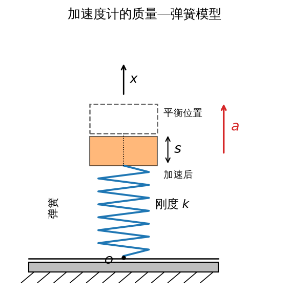
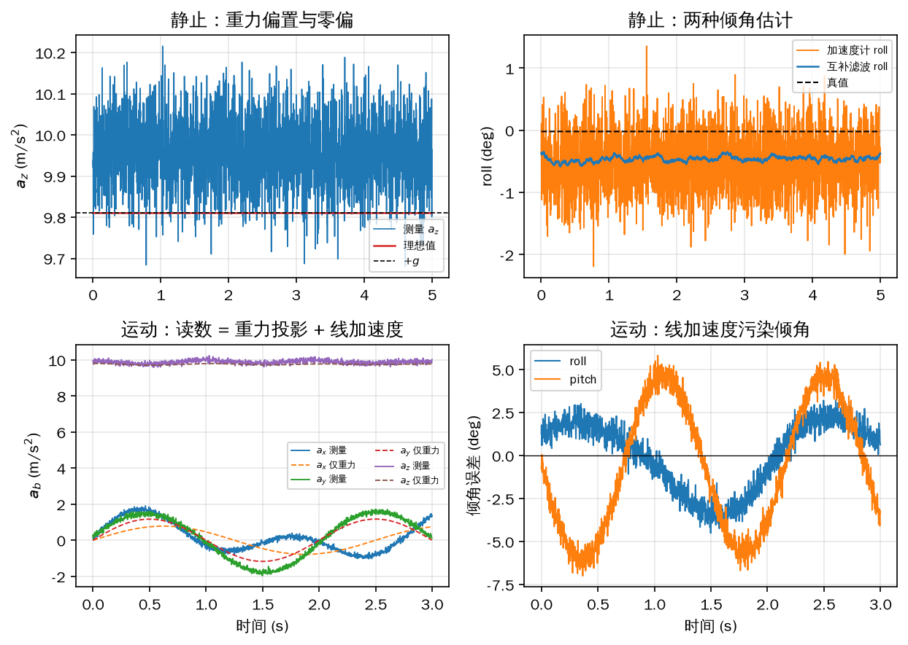
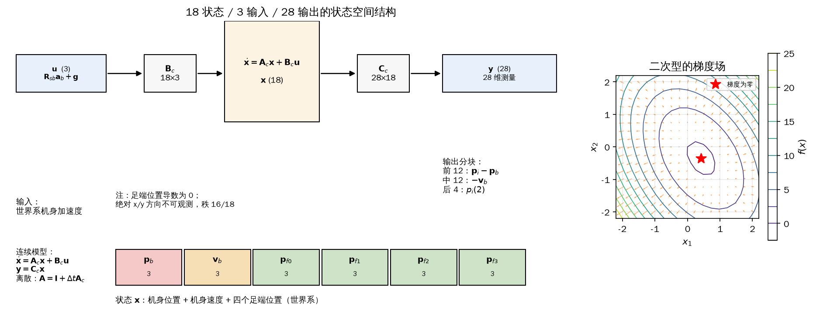
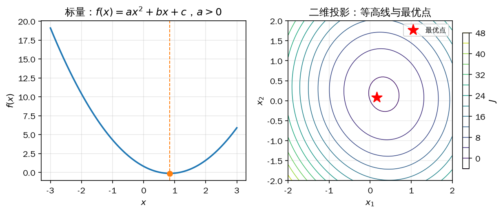
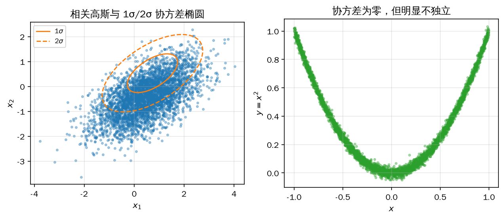
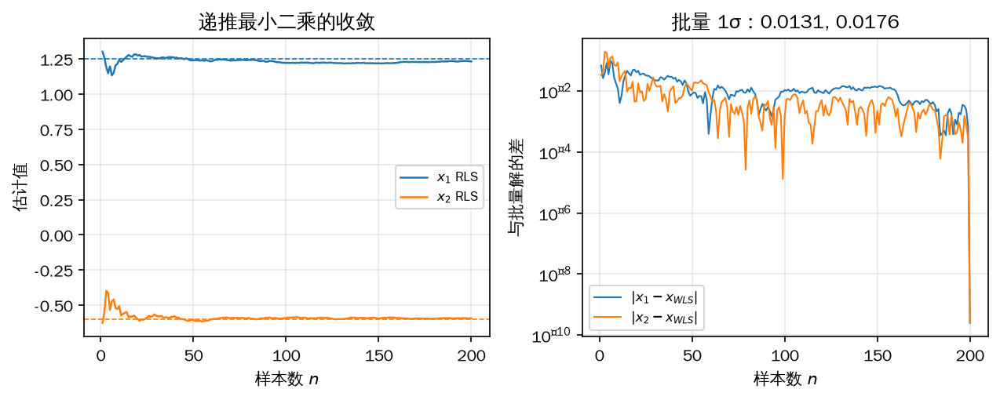
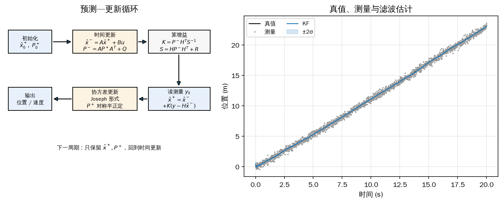
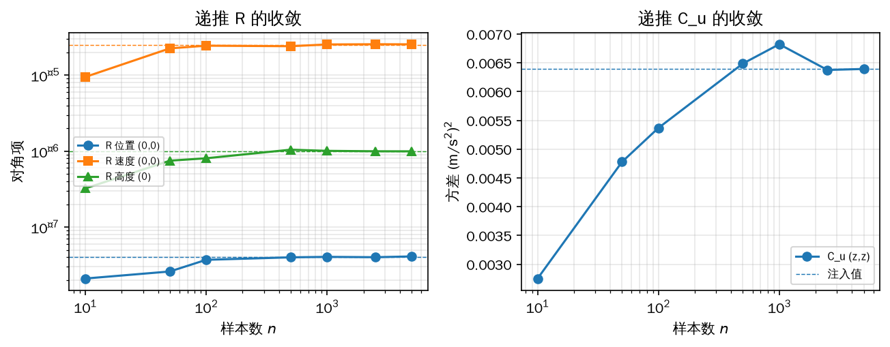
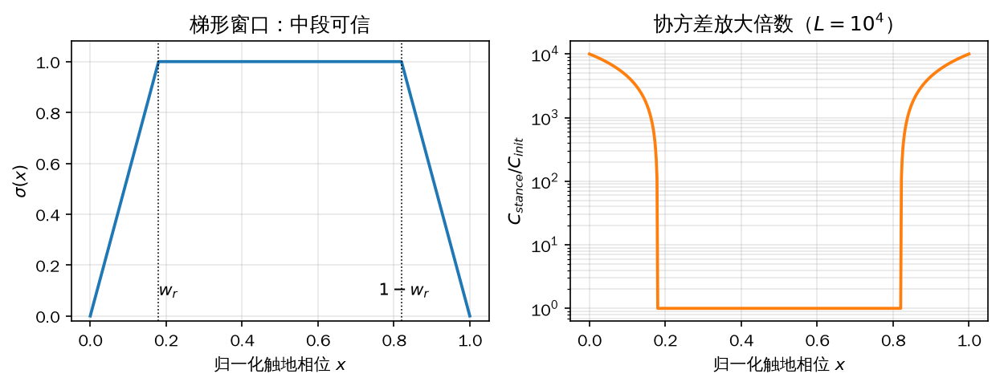
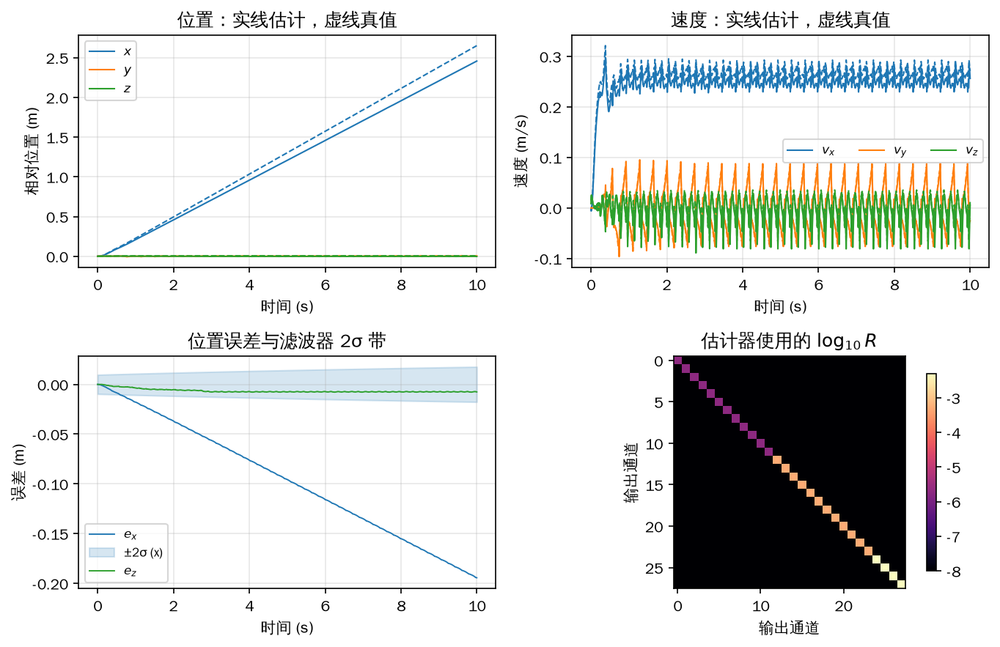

# 第 7 章 状态估计：让机器人知道自己在哪

第 6 章把四足机器人写成了一个刚体：给定四个足端力，就能算出机身的加速度和角加速度；给定机身位姿和关节角，就能算出足端在哪里。那些方程默认机身的绝对位置、速度和姿态是已知的。真机上恰好相反：12 个关节角能从编码器直接读到，机身角速度和比力能从 IMU 读到，唯独“我在世界系的哪里、往哪个方向走了多快”没有传感器直接给出。没有卫星定位或动捕时，这四个量只能靠推算。

推算的起点是“支撑足踩在地上不动”。一条腿在支撑相时，足端相对机身的位置由关节角决定，机身相对足端的位移又能从 IMU 的加速度积分出来；把这两条信息放进一个带不确定性的滤波器，就能在只有 IMU 和编码器的情况下估计机身位置与速度。这套东西叫状态估计器（state estimator）。它不改变控制律，却决定了控制律拿到的位姿可不可信；第 8 章的平衡控制、第 9 章的落脚点、第 11 章的导航都直接吃它的输出。

本章按“传感器 → 模型 → 数学工具 → 估计理论 → 工程实现”的顺序展开。7.1 先说明 IMU 的两个传感器到底测什么，尤其是加速度计的重力偏置；7.2 把机身和四个足端拼成 18 状态、28 输出的状态空间模型；7.3–7.6 补上矩阵求导、二次型、概率和最小二乘这四件工具；7.7 用它们推出离散卡尔曼滤波；7.8 讨论怎样测量噪声协方差、怎样处理足端腾空；7.9 把估计器写成一个每 2 ms 跑一次的类，并在小跑中与 MuJoCo 真值对照。全程只用 Python、NumPy 和本书的 `quadruped` 包，不需要 ROS 2；真实 IMU 的标定和真实传感器的 `R` 测量标为【需要实机】。

## 7.1 IMU：加速度计、陀螺仪与姿态

IMU 是惯性测量单元（inertial measurement unit），里面至少有一个三轴加速度计和一个三轴陀螺仪。陀螺仪测的是机体系下的角速度 \(\boldsymbol\omega_b\)，单位 rad/s；加速度计测的不是“坐标加速度”，而是质量块相对壳体的弹簧形变。这个区别决定了后面所有符号约定，先把它讲清楚。

### 7.1.1 质量—弹簧模型

把加速度计的一个轴简化成图 7-1：壳体内有一根刚度 \(k\) 的弹簧，末端挂一个质量 \(m\) 的块。壳体沿 \(x\) 轴以加速度 \(a\) 运动时，质量块因惯性相对壳体向反方向移动 \(s\)，弹簧被压缩，对质量块施加 \(-ks\) 的恢复力。式中的 \(s\) 是沿 \(x\) 轴正方向的有符号位移，壳体向上加速时 \(s<0\)；图 7-1 标的是压缩量 \(|s|\)。在惯性系里对质量块用牛顿第二定律，质量块的加速度是壳体加速度与相对加速度之和 \(a+\ddot s\)，于是

\[ m\left(a+\ddot s\right)=-ks \tag{7-1} \]

<!-- 原书式（7.1） -->
\[ m a=-k s \tag{7-2} \]

式（7-2）是式（7-1）在 \(|\ddot s|\ll|a|\) 时的准静态形式，也就是工作频率远低于质量—弹簧谐振频率的频段。MEMS 加速度计的谐振频率通常在 kHz 以上，控制周期 2 ms 对应的 500 Hz 远低于它，所以这个近似成立；如果传感器受到高频冲击，质量块会振荡，读数会滞后并振铃，这是安装减振和低通滤波要解决的问题。

<!-- 原书式（7.2） -->
\[ a_{\mathrm{out}}=-\frac{k}{m}s \tag{7-3} \]

<!-- 原书式（7.3） -->
\[ s=\frac{m}{k}\left(g-a\right) \tag{7-4} \]

<!-- 原书式（7.4） -->
\[ a_{\mathrm{out}}=-\frac{k}{m}s=a-g \tag{7-5} \]

式（7-3）说明读数与弹簧压缩量成正比，比例系数是 \(k/m\)；式（7-4）把重力加进力平衡，其中 \(g=-9.81\ \mathrm{m/s^2}\) 表示重力沿坐标轴负方向；代回式（7-3）得到式（7-5）。静止时 \(a=0\)，读数 \(a_{\mathrm{out}}=-g=+9.81\ \mathrm{m/s^2}\)，方向竖直向上。初学者常把这条读数当成“重力加速度本身”，于是把符号弄反；正确的说法是：加速度计测的是“弹簧力除以质量”，静止时弹簧力平衡重力，所以读数与重力方向相反。

### 7.1.2 三轴模型与重力偏置

真实的加速度计有三个正交轴，每个轴一套弹簧—质量块。设机体系 \(\{b\}\) 下的坐标加速度为 \(\boldsymbol a_b\)，世界系重力向量为 \(\boldsymbol g=[0,\,0,\,-9.81]^{\mathrm T}\)，则三个轴的位移向量满足

<!-- 原书式（7.5） -->
\[ \boldsymbol s=\frac{m}{k}\left(\boldsymbol R_{bs}\boldsymbol g-\boldsymbol a_b\right) \tag{7-6} \]

其中 \(\boldsymbol R_{bs}=\boldsymbol R_{sb}^{\mathrm T}\) 把世界系的重力转到机体系。读数就是

<!-- 原书式（7.6） -->
\[ \boldsymbol a_{\mathrm{out}}=-\frac{k}{m}\boldsymbol s=\boldsymbol a_b-\boldsymbol R_{bs}\boldsymbol g=\boldsymbol a_b-\boldsymbol R_{sb}^{\mathrm T}\boldsymbol g \tag{7-7} \]

反过来解出世界系机身加速度：

<!-- 原书式（7.7） -->
\[ \boldsymbol a_s=\boldsymbol R_{sb}\boldsymbol a_b=\boldsymbol R_{sb}\boldsymbol a_{\mathrm{out}}+\boldsymbol g \tag{7-8} \]

式（7-8）是 7.2 节状态方程的输入来源：先拿陀螺积分或 IMU 内部融合得到 \(\boldsymbol R_{sb}\)，再把加速度计读数旋转到世界系并加回重力 \(\boldsymbol g\)，得到 \(\boldsymbol a_s\)。为避免和坐标加速度 \(\boldsymbol a_b\) 混淆，7.2 节把机体系加速度计读数记作 \(\boldsymbol a_b^{\mathrm{m}}\)，它就是这里的 \(\boldsymbol a_{\mathrm{out}}\)。注意 \(\boldsymbol a_{\mathrm{out}}\) 里同时含“真正的线加速度”和“重力在机体系的投影”，两者不可分；单看一个静止时刻，只能由重力投影反推倾角，一旦机体加速，倾角就会被线加速度污染。

### 7.1.3 陀螺仪、噪声与安装

陀螺仪的输出可以写成 \(\boldsymbol\omega_m=\boldsymbol\omega_b+\boldsymbol b_g+\boldsymbol n_g\)：\(\boldsymbol b_g\) 是零偏，随温度和时间缓慢漂移；\(\boldsymbol n_g\) 是零均值白噪声。陀螺的短期角度变化很准，但把 \(\boldsymbol\omega_m\) 直接积分，零偏会随时间线性积累成角度误差。加速度计没有这种长期漂移，却在机体加速时给出错误的倾角。两者正好互补：陀螺积分做预测，加速度计做低频修正，这就是 7.1 节示例里的互补滤波，也是大多数 IMU 内部融合的基本结构。

真实 IMU 还有量化噪声、轴间非正交、安装角偏差和带宽限制。安装角偏差等价于一个常值旋转 \(\boldsymbol R_{\mathrm{mis}}\)：控制器以为读的是 \(\boldsymbol R_{sb}\)，实际拿到的是 \(\boldsymbol R_{sb}\boldsymbol R_{\mathrm{mis}}\)。这个误差不会自己消失，会原样进入姿态、足端世界坐标和 TF 树，在第 11 章会被放大成整条链路的外参错误。所以 IMU 的 `frame_id` 必须与本书的 \(\{b\}\) 定义一致，安装时要标定三个安装角。真实 IMU 的零偏标定和温度补偿【需要实机】，本书没有在本地验证；仿真中 `A1Sim` 的加速度计和陀螺仪本身是理想传感器，示例用 `IMU` 类叠加零偏和白噪声来模拟真实器件。

### 7.1.4 示例：静止 5 s 估零偏，再看运动时的污染

`7_1_imu.py` 分两段。静态段让 A1 在 `FixedStand` 里站定 5 s，每个 2 ms 周期读一次 MuJoCo 的理想加速度、角速度和姿态，再经 `IMU` 类叠加零偏 \(\boldsymbol b_a=[0.120,-0.085,0.150]^{\mathrm T}\ \mathrm{m/s^2}\)、\(\boldsymbol b_g=[0.009,-0.006,0.011]^{\mathrm T}\ \mathrm{rad/s}\) 和白噪声（加速度 \(\sigma=0.08\ \mathrm{m/s^2}\)，陀螺 \(\sigma=0.0025\ \mathrm{rad/s}\)）。静止段用读数均值减去理想值估计零偏，用加速度计读数直接算 roll/pitch，再跑一个 \(\alpha=0.98\) 的互补滤波。运动段用一段解析规定的机身轨迹，让世界系线加速度峰值达到 0.9 m/s²，观察加速度计倾角怎样被污染。

```python
{{#include code/ch07/7_1_imu.py:static_test}}
```

```console
{{#include code/ch07/7_1_imu.out}}
```

静止 5 s 共 2500 个样本。加速度计零偏估计为 \([0.1189,-0.0856,0.1489]^{\mathrm T}\)，三轴误差约 \(10^{-3}\ \mathrm{m/s^2}\)；陀螺零偏误差约 \(10^{-4}\ \mathrm{rad/s}\)。去均值后的白噪声标准差是 0.079/0.078/0.081，与设置的 0.08 相符。静止时 \(z\) 轴均值 9.9589 m/s²，比 \(g\) 高出的部分正是 \(z\) 轴零偏 0.15 减去少量姿态投影，这就是“静止读数约 \(+g\)”的直接证据。

倾角误差更能说明问题。加速度计单独算 roll/pitch 的 RMSE 是 0.0116/0.0143 rad；互补滤波降到 0.0078/0.0125 rad。改善不算大，因为静止时加速度计本来就没有线加速度污染，互补滤波的主要作用是把陀螺的高频噪声压下去；纯陀螺积分 5 s 后漂了 \(0.044/-0.030\) rad，说明零偏不修正时积分不可长期使用。运动段加速度计倾角最大误差 0.122 rad（约 7°），RMSE 0.035/0.065 rad，约为静止时的 3–5 倍；这部分误差不是噪声，而是 0.9 m/s² 的线加速度被误当成重力方向，滤波无法区分。

```python
{{#include code/ch07/7_1_imu.py:motion_test}}
```



*图 7-1 加速度计的一维质量—弹簧模型：壳体向上加速时质量块相对壳体向下位移 \(s\)，弹簧压缩，读数与 \(s\) 成正比*



*图 7-2 上排：静止 5 s 的 \(z\) 轴读数与两种倾角估计；下排：运动时读数等于重力投影加线加速度，加速度计倾角被线加速度污染*

图 7-1 只画了一个轴，三个轴正交安装就得到三轴加速度计。图 7-2 的左上角把“测量”“理想值”“\(+g\)”画在一起：测量围绕 9.96 波动，理想值是 9.81，两者之差就是零偏；右上角中互补滤波的 roll 比真值低约 0.5°，这是陀螺零偏没有被补偿的稳态误差。下排右图的倾角误差在机体加速时明显变大，提醒我们：加速度计可以修正姿态，但前提是机体加速度相对重力足够小，或者用陀螺短时接管。

## 7.2 状态空间模型：18 个状态、28 个输出

估计器需要一个把“想估计的量”和“能测到的量”分开写的模型。状态空间（state space）就是干这个的：状态 \(\boldsymbol x\) 放所有想知道的量，输入 \(\boldsymbol u\) 放已知的激励，输出 \(\boldsymbol y\) 放传感器能直接给出的量。本节先写连续时间模型，再用前向欧拉离散成每 2 ms 跑一次的递推。

### 7.2.1 连续状态空间模型

时间连续、定常的线性系统写成

<!-- 原书式（7.8） -->
\[ \begin{cases}\dot{\boldsymbol x}(t)=\boldsymbol A_c\boldsymbol x(t)+\boldsymbol B_c\boldsymbol u(t)\\ \boldsymbol y(t)=\boldsymbol C_c\boldsymbol x(t)\end{cases} \tag{7-9} \]

其中 \(\boldsymbol A_c\) 是系统矩阵，\(\boldsymbol B_c\) 是输入矩阵，\(\boldsymbol C_c\) 是输出矩阵。本书的模型不含 \(\boldsymbol D\boldsymbol u\) 直通项：输出只由当前状态决定，传感器读数不会瞬间改变状态。定常的意思是三个矩阵不随时间变；本节的模型确实满足，因为足端触地假设和 IMU 安装关系都不随 \(t\) 改。

状态向量按“机身位置、机身速度、四个足端位置”排列，每个量三维，共 18 维：

<!-- 原书式（7.9） -->
\[ \boldsymbol x=\begin{bmatrix}\boldsymbol p_b\\ \boldsymbol v_b\\ \boldsymbol p_0\\ \boldsymbol p_1\\ \boldsymbol p_2\\ \boldsymbol p_3\end{bmatrix},\qquad \boldsymbol p_b,\boldsymbol v_b,\boldsymbol p_i\in\mathbb R^3 \tag{7-10} \]

这里所有位置和速度都在世界系 \(\{s\}\) 下表示。\(\boldsymbol p_b\) 是机身原点位置，\(\boldsymbol v_b\) 是机身原点速度，\(\boldsymbol p_i\) 是第 \(i\) 号足端球心的位置。把足端也放进状态，是因为“足端触地不动”这条约束必须由滤波器自己维护：只靠 IMU 积分，机身位置会随时间平方发散；把足端位置作为状态、把“足端相对机身的位置”作为测量，滤波器才能用关节编码器把漂移拉回来。

对状态求导。假设四个足端都与地面稳定接触，每个足端的世界系速度为零；机身位置导数等于速度，速度导数等于世界系加速度：

<!-- 原书式（7.10） -->
\[ \dot{\boldsymbol x}=\begin{bmatrix}\dot{\boldsymbol p}_b\\ \dot{\boldsymbol v}_b\\ \dot{\boldsymbol p}_0\\ \dot{\boldsymbol p}_1\\ \dot{\boldsymbol p}_2\\ \dot{\boldsymbol p}_3\end{bmatrix}=\begin{bmatrix}\boldsymbol v_b\\ \boldsymbol R_{sb}\boldsymbol a_b^{\mathrm{m}}+\boldsymbol g\\ \boldsymbol 0_{3\times1}\\ \boldsymbol 0_{3\times1}\\ \boldsymbol 0_{3\times1}\\ \boldsymbol 0_{3\times1}\end{bmatrix} \tag{7-11} \]

把式（7-11）整理成式（7-9）的形式。\(\boldsymbol p_b\) 的导数由 \(\boldsymbol v_b\) 给出，所以 \(\boldsymbol A_c\) 的右上角是单位阵；\(\boldsymbol v_b\) 的导数不含 \(\boldsymbol x\)，只由输入给出；四个足端位置的导数为零。于是

<!-- 原书式（7.11） -->
\[ \dot{\boldsymbol x}=\begin{bmatrix}\boldsymbol 0_{3\times3}&\boldsymbol I_3&\boldsymbol 0_{3\times12}\\ \boldsymbol 0_{3\times3}&\boldsymbol 0_{3\times3}&\boldsymbol 0_{3\times12}\\ \boldsymbol 0_{12\times3}&\boldsymbol 0_{12\times3}&\boldsymbol 0_{12\times12}\end{bmatrix}\boldsymbol x+\begin{bmatrix}\boldsymbol 0_{3\times3}\\ \boldsymbol I_3\\ \boldsymbol 0_{12\times3}\end{bmatrix}\left(\boldsymbol R_{sb}\boldsymbol a_b^{\mathrm{m}}+\boldsymbol g\right) \tag{7-12} \]

输入定义为

\[ \boldsymbol u=\boldsymbol R_{sb}\boldsymbol a_b^{\mathrm{m}}+\boldsymbol g \tag{7-13} \]

其中 \(\boldsymbol a_b^{\mathrm{m}}\) 是机体系加速度计读数（式（7-7）的 \(\boldsymbol a_{\mathrm{out}}\)），\(\boldsymbol u\) 就是式（7-8）的世界系机身加速度，单位 m/s²。\(\boldsymbol A_c\) 的 18 个特征值全为零，这是一个纯积分型系统：位置积分速度，速度积分加速度，足端保持不变。纯积分系统的极点落在原点，本身不收敛，靠测量更新把误差拉回来；这也解释了为什么估计器不能长时间没有测量。

输出侧只放能直接测的量。IMU 给姿态 \(\boldsymbol R_{sb}\)、机体系角速度 \(\boldsymbol\omega_b\) 和加速度读数；12 个关节编码器加正向运动学给足端在机体系下相对机身的位置 \(\boldsymbol p_{bfBi}\)；乘姿态得到世界系下足端相对机身的位置：

<!-- 原书式（7.12） -->
\[ \boldsymbol p_{sfBi}=\boldsymbol R_{sb}\boldsymbol p_{bfBi},\qquad i=0,1,2,3 \tag{7-14} \]

足端相对机身的速度由第 6 章式（6-13）给出：机体系下 \(\boldsymbol\omega_b\times\boldsymbol p_{bfBi}+\boldsymbol J_i\dot{\boldsymbol\theta}_i\)，再旋转到世界系。因为假设足端触地、世界系绝对速度为零，足端相对机身的速度就等于 \(-\boldsymbol v_b\)。四个触地足端的高度都等于地面高度，取地面为 \(z=0\)，四个高度也是输出。把这三组量拼起来：

<!-- 原书式（7.13） -->
\[ \boldsymbol y=\begin{bmatrix}\boldsymbol R_{sb}\boldsymbol p_{bfB0}\\ \vdots\\ \boldsymbol R_{sb}\boldsymbol p_{bfB3}\\ \boldsymbol R_{sb}\left(\boldsymbol\omega_b\times\boldsymbol p_{bfB0}+\boldsymbol J_0\dot{\boldsymbol\theta}_0\right)\\ \vdots\\ \boldsymbol R_{sb}\left(\boldsymbol\omega_b\times\boldsymbol p_{bfB3}+\boldsymbol J_3\dot{\boldsymbol\theta}_3\right)\\ p_{sz0}\\ p_{sz1}\\ p_{sz2}\\ p_{sz3}\end{bmatrix}\in\mathbb R^{28} \tag{7-15} \]

前 12 维是四个足端相对机身的位置，接着 12 维是四个足端相对机身的速度，最后 4 维是四个足端的世界系高度。式（7-15）里 \(p_{szi}\) 表示 \(\boldsymbol p_i\) 的第 3 个分量；本书代码从 0 开始编号，所以是下标 2，阅读代码时不要把“2”当成第二个分量。

把式（7-15）写成 \(\boldsymbol y=\boldsymbol C_c\boldsymbol x\)。前 4 个块行是 \(\boldsymbol p_i-\boldsymbol p_b\)，中间 4 个块行在触地假设下是 \(-\boldsymbol v_b\)，最后 4 行只取 \(\boldsymbol p_i\) 的 \(z\) 分量：

<!-- 原书式（7.14） -->
\[ \boldsymbol C_c=\begin{bmatrix}-\boldsymbol I_3&\boldsymbol 0&\boldsymbol I_3&\boldsymbol 0&\boldsymbol 0&\boldsymbol 0\\ -\boldsymbol I_3&\boldsymbol 0&\boldsymbol 0&\boldsymbol I_3&\boldsymbol 0&\boldsymbol 0\\ -\boldsymbol I_3&\boldsymbol 0&\boldsymbol 0&\boldsymbol 0&\boldsymbol I_3&\boldsymbol 0\\ -\boldsymbol I_3&\boldsymbol 0&\boldsymbol 0&\boldsymbol 0&\boldsymbol 0&\boldsymbol I_3\\ \boldsymbol 0&-\boldsymbol I_3&\boldsymbol 0&\boldsymbol 0&\boldsymbol 0&\boldsymbol 0\\ \boldsymbol 0&-\boldsymbol I_3&\boldsymbol 0&\boldsymbol 0&\boldsymbol 0&\boldsymbol 0\\ \boldsymbol 0&-\boldsymbol I_3&\boldsymbol 0&\boldsymbol 0&\boldsymbol 0&\boldsymbol 0\\ \boldsymbol 0&-\boldsymbol I_3&\boldsymbol 0&\boldsymbol 0&\boldsymbol 0&\boldsymbol 0\\ \boldsymbol 0&\boldsymbol 0&[0\,0\,1]&\boldsymbol 0&\boldsymbol 0&\boldsymbol 0\\ \boldsymbol 0&\boldsymbol 0&\boldsymbol 0&[0\,0\,1]&\boldsymbol 0&\boldsymbol 0\\ \boldsymbol 0&\boldsymbol 0&\boldsymbol 0&\boldsymbol 0&[0\,0\,1]&\boldsymbol 0\\ \boldsymbol 0&\boldsymbol 0&\boldsymbol 0&\boldsymbol 0&\boldsymbol 0&[0\,0\,1]\end{bmatrix}\in\mathbb R^{28\times18} \tag{7-16} \]

式（7-16）的每个块列对应式（7-10）的一个三维分块：第 1 列块是 \(\boldsymbol p_b\)，第 2 列块是 \(\boldsymbol v_b\)，第 3–6 列块是四个足端位置。最后四行只有 \(z\) 分量，所以每个块行是一个行向量 \([0\;0\;1]\) 放在对应足端的位置上。

### 7.2.2 离散状态空间模型

数字控制器每 2 ms 采一次，输入和输出只在采样时刻有定义。把连续模型离散成

<!-- 原书式（7.15） -->
\[ \begin{cases}\boldsymbol x(k)=\boldsymbol A\boldsymbol x(k-1)+\boldsymbol B\boldsymbol u(k-1)\\ \boldsymbol y(k)=\boldsymbol C\boldsymbol x(k)\end{cases} \tag{7-17} \]

其中 \(k\) 是采样序号，\((k-1)\) 是上一时刻。用一阶前向差分近似导数：

<!-- 原书式（7.16） -->
\[ \dot{\boldsymbol x}(k-1)\approx\frac{\boldsymbol x(k)-\boldsymbol x(k-1)}{\Delta t},\qquad \boldsymbol x(k)=\boldsymbol x(k-1)+\Delta t\,\dot{\boldsymbol x}(k-1) \tag{7-18} \]

把连续方程代入：

<!-- 原书式（7.17） -->
\[ \boldsymbol x(k)=\boldsymbol x(k-1)+\Delta t\left(\boldsymbol A_c\boldsymbol x(k-1)+\boldsymbol B_c\boldsymbol u(k-1)\right)=\left(\boldsymbol I+\Delta t\boldsymbol A_c\right)\boldsymbol x(k-1)+\Delta t\boldsymbol B_c\boldsymbol u(k-1) \tag{7-19} \]

<!-- 原书式（7.18） -->
\[ \boldsymbol A=\boldsymbol I+\Delta t\boldsymbol A_c,\qquad \boldsymbol B=\Delta t\boldsymbol B_c,\qquad \boldsymbol C=\boldsymbol C_c \tag{7-20} \]

本书取 \(\Delta t=0.002\ \mathrm{s}\)，也就是 500 Hz。离散化是一阶近似，\(\Delta t\) 越大误差越大；离散化误差、模型简化误差和未建模的输入噪声最后都归到过程噪声协方差 \(\boldsymbol Q\) 里，所以 \(\boldsymbol Q\) 不能取得任意小。7.2 节示例会在 2 s 的开环预测里量出这个误差：一步位置误差上界 \(0.5|a|\Delta t^2=8\times10^{-7}\) m，1000 步后累积到 0.8 mm。

### 7.2.3 可观测性与绝对位置

模型建好后要检查可观测性：只凭输出序列，能不能唯一确定 18 个状态。构造可观测性矩阵

\[ \mathcal O=\begin{bmatrix}\boldsymbol C\\ \boldsymbol C\boldsymbol A\\ \vdots\\ \boldsymbol C\boldsymbol A^{17}\end{bmatrix}\in\mathbb R^{504\times18} \tag{7-21} \]

如果 \(\mathcal O\) 的秩等于 18，所有状态都可观测；秩小于 18 时，零空间里的方向无论怎么积分都不影响输出，滤波器无法把它们分开。

`7_2_state_space.py` 构造 \(\boldsymbol A_c,\boldsymbol B_c,\boldsymbol C_c\)，按式（7-20）离散化，打印维数、特征值、可观测性矩阵的秩，再用一段精确积分的轨迹做一步预测和开环预测。运行结果如下。

```python
{{#include code/ch07/7_2_state_space.py:build_matrices}}
```

```console
{{#include code/ch07/7_2_state_space.out}}
```

\(\boldsymbol A_c\) 的 18 个特征值全为零，\(\boldsymbol A\) 的 18 个特征值全为 1，符合纯积分系统的预期。可观测性矩阵是 \(504\times18\)，秩只有 16，缺 2 维；奇异值在 \(10^{-16}\) 量级处有两个零方向。把零空间向量归一化后可以看到，它们都是“机身位置和四个足端位置同时加同一个 \(x\)/\(y\) 平移”：输出里的相对位置 \(\boldsymbol p_i-\boldsymbol p_b\) 不变，速度不变，高度也不变，状态方程同样不变。也就是说，绝对 \(x\)/\(y\) 位置在没有外部参考时不可观测；\(z\) 位置因为四个足端高度是绝对量，反而可观测。

这个结论比“模型可估计”更重要。它说明估计器输出的 \(x\)/\(y\) 只是“以起点为原点、靠足端不滑移传播出来的相对位置”，不是全球坐标。短时间小跑，支撑足不打滑，相对位置够用；长时间打滑、上下坡、足端滚动，误差会累积。第 11 章的导航之所以需要激光或外部定位，根子就在这里，而不是滤波器参数没调好。反过来，如果只做原地站立或短时平衡，绝对 \(x\)/\(y\) 漂移不影响控制，估计器的速度、姿态和高度已经够用。

```python
{{#include code/ch07/7_2_state_space.py:check_rank}}
```

```python
{{#include code/ch07/7_2_state_space.py:trajectory}}
```



*图 7-3 左：18 状态、3 输入、28 输出的状态空间结构；右：7.3 节二次型的梯度场，箭头为梯度方向，星号为梯度零点*

图 7-3 左边把式（7-12）和式（7-16）画成一条链：输入 \(\boldsymbol u\) 经 \(\boldsymbol B_c\) 进入积分器，状态 \(\boldsymbol x\) 经 \(\boldsymbol C_c\) 变成 28 维输出；下面一排是状态的六个三维分块。右边是 7.3 节会用到的二次型梯度场，提前放在这里，方便和状态结构对照。图中“积分”箭头表示 \(\dot{\boldsymbol x}\) 到 \(\boldsymbol x\) 的关系，不是额外的状态。

## 7.3 矩阵微积分：后面推导要用的五条公式

7.4 节要对二次型求最小值，7.6 节要对加权残差求导，7.7 节要对协方差的迹求导。这三步都用到矩阵对向量、矩阵对矩阵的导数。本节只列后面真正用到的几条，并把布局约定说死，避免同一个符号在不同推导里转置来转置去。

本书统一用分母布局（denominator layout）：标量对列向量 \(\boldsymbol x\in\mathbb R^n\) 求导，结果按 \(\boldsymbol x\) 的分量排成行向量；标量对矩阵 \(\boldsymbol A\in\mathbb R^{m\times n}\) 求导，结果是与 \(\boldsymbol A\) 同形状的矩阵，第 \((i,j)\) 个元素是 \(\partial f/\partial A_{ij}\)。在这个约定下，\(\partial(\boldsymbol a^{\mathrm T}\boldsymbol x)/\partial\boldsymbol x=\boldsymbol a^{\mathrm T}\)，而不是 \(\boldsymbol a\)。

二次型 \(\boldsymbol x^{\mathrm T}\boldsymbol A\boldsymbol x\) 对 \(\boldsymbol x\) 求导：

<!-- 原书式（7.19） -->
\[ \frac{\partial\left(\boldsymbol x^{\mathrm T}\boldsymbol A\boldsymbol x\right)}{\partial\boldsymbol x}=\boldsymbol x^{\mathrm T}\boldsymbol A^{\mathrm T}+\boldsymbol x^{\mathrm T}\boldsymbol A \tag{7-22} \]

<!-- 原书式（7.20） -->
\[ \frac{\partial\left(\boldsymbol x^{\mathrm T}\boldsymbol A\boldsymbol x\right)}{\partial\boldsymbol x}=2\boldsymbol x^{\mathrm T}\boldsymbol A\quad(\boldsymbol A=\boldsymbol A^{\mathrm T}) \tag{7-23} \]

式（7-22）的两项来自乘积法则：\(\boldsymbol x^{\mathrm T}\boldsymbol A\boldsymbol x\) 对第一个 \(\boldsymbol x\) 求导得 \(\boldsymbol x^{\mathrm T}\boldsymbol A^{\mathrm T}\)，对第二个得 \(\boldsymbol x^{\mathrm T}\boldsymbol A\)。\(\boldsymbol A\) 对称时两项相同，才有式（7-23）。\(\boldsymbol A\) 非对称时不能随手写成 \(2\boldsymbol x^{\mathrm T}\boldsymbol A\)，这是后面检查代码时最容易犯的错。

线性项和矩阵—向量乘积：

<!-- 原书式（7.21） -->
\[ \frac{\partial\left(\boldsymbol a^{\mathrm T}\boldsymbol x\right)}{\partial\boldsymbol x}=\boldsymbol a^{\mathrm T},\qquad \frac{\partial\left(\boldsymbol A\boldsymbol x\right)}{\partial\boldsymbol x}=\boldsymbol A \tag{7-24} \]

第二式的结果是 \(\boldsymbol A\) 本身，不是 \(\boldsymbol A^{\mathrm T}\)；第一式的结果是 \(\boldsymbol a^{\mathrm T}\)，不是 \(\boldsymbol a\)。这两个转置位置必须记牢，因为 7.6 节把行向量梯度转成列向量正规方程时，全靠它们。

迹的导数。设 \(\boldsymbol A\in\mathbb R^{m\times n}\)、\(\boldsymbol B\in\mathbb R^{n\times m}\)，则

<!-- 原书式（7.22） -->
\[ \frac{\partial\,\mathrm{Tr}\left(\boldsymbol A\boldsymbol B\right)}{\partial\boldsymbol A}=\boldsymbol B^{\mathrm T} \tag{7-25} \]

<!-- 原书式（7.23） -->
\[ \frac{\partial\,\mathrm{Tr}\left(\boldsymbol A\boldsymbol B\boldsymbol A^{\mathrm T}\right)}{\partial\boldsymbol A}=\boldsymbol A\left(\boldsymbol B+\boldsymbol B^{\mathrm T}\right)=2\boldsymbol A\boldsymbol B\quad(\boldsymbol B=\boldsymbol B^{\mathrm T}) \tag{7-26} \]

式（7-26）的中间形式对任意 \(\boldsymbol B\) 都成立，只有 \(\boldsymbol B\) 对称时才能化简成 \(2\boldsymbol A\boldsymbol B\)。卡尔曼增益推导里的 \(\boldsymbol B\) 是协方差矩阵，天然对称，所以可以化简；如果哪天把非对称的加权矩阵塞进去，就必须用 \(\boldsymbol A(\boldsymbol B+\boldsymbol B^{\mathrm T})\)。

使用这些公式的前提是维数能乘、矩阵可逆或对称的条件写清楚。式（7-22）要求 \(\boldsymbol A\) 是方阵；式（7-25）要求 \(\boldsymbol A\boldsymbol B\) 是方阵；式（7-26）要求 \(\boldsymbol A\boldsymbol B\boldsymbol A^{\mathrm T}\) 有意义。不满足这些条件时，公式本身不成立，不能靠“转置一下”补救。

### 7.3.1 示例：解析梯度与中心差分

`7_3_matrix_calc.py` 用中心差分检查上面三条公式。取随机 \(4\times4\) 矩阵 \(\boldsymbol A\)、随机向量 \(\boldsymbol b,\boldsymbol x\)，令 \(f(\boldsymbol x)=\boldsymbol x^{\mathrm T}\boldsymbol A\boldsymbol x+\boldsymbol b^{\mathrm T}\boldsymbol x\)，解析梯度是 \(\boldsymbol x^{\mathrm T}(\boldsymbol A+\boldsymbol A^{\mathrm T})+\boldsymbol b^{\mathrm T}\)；再对每个分量做步长 \(10^{-6}\) 的中心差分。迹的两条公式也用同样方法检查，并额外用非对称 \(\boldsymbol B\) 演示“误用 \(2\boldsymbol A\boldsymbol B\)”会差多少。

```python
{{#include code/ch07/7_3_matrix_calc.py}}
```

```console
{{#include code/ch07/7_3_matrix_calc.out}}
```

二次型梯度的最大绝对误差 \(6.58\times10^{-10}\)，迹 \(\mathrm{Tr}(\boldsymbol A\boldsymbol B)\) 的误差 \(1.48\times10^{-10}\)，\(\mathrm{Tr}(\boldsymbol A\boldsymbol B\boldsymbol A^{\mathrm T})\) 的误差 \(3.57\times10^{-10}\)，都在中心差分的截断误差量级。非对称 \(\boldsymbol B\) 那一组，正确公式 \(\boldsymbol A(\boldsymbol B+\boldsymbol B^{\mathrm T})\) 的误差 \(4.41\times10^{-10}\)，误用 \(2\boldsymbol A\boldsymbol B\) 的误差 3.30；这不是数值精度问题，是公式用错了。图 7-3 右栏的梯度场就是二次型的几何版本：等高线越密的地方梯度越大，箭头指向函数上升方向，星号是梯度零点，也是 7.4 节要找的最小值。

## 7.4 二次规划：从抛物线到正规方程

二次规划（quadratic programming，QP）是一类目标函数为二次、约束为线性的优化问题。本节先看无约束情形，因为卡尔曼滤波的测量更新本质上就是一个以协方差为权重的二次型最小化；带约束的 QP 留到第 8 章分配足端力时再讲。

标量情形最直观。函数

\[ f(x)=ax^2+bx+c,\qquad a>0 \tag{7-27} \]

是一条开口向上的抛物线，最小值在斜率为零处：

<!-- 原书式（7.24） -->
\[ \frac{\mathrm df}{\mathrm dx}=2ax+b=0,\qquad x^*=-\frac{b}{2a} \tag{7-28} \]

\[ a>0\ \Longrightarrow\ f''(x)=2a>0 \tag{7-29} \]

二阶导为正，驻点就是全局极小。式（7-29）单独列出是为了强调 \(a>0\) 的条件：\(a<0\) 时抛物线开口向下，驻点是最大值；\(a=0\) 时退化成直线，没有极值。图 7-4 左栏画出了 \(a=1.3\)、\(b=-2.2\)、\(c=0.8\) 的抛物线和顶点 \(x=0.846\)。

向量情形把标量换成向量。令

<!-- 原书式（7.25） -->
\[ J(\boldsymbol x)=\frac12\boldsymbol x^{\mathrm T}\boldsymbol Q\boldsymbol x+\boldsymbol c^{\mathrm T}\boldsymbol x+d,\qquad \boldsymbol Q=\boldsymbol Q^{\mathrm T}\succ0 \tag{7-30} \]

\(\boldsymbol Q\succ0\) 表示正定：对任意非零 \(\boldsymbol v\)，\(\boldsymbol v^{\mathrm T}\boldsymbol Q\boldsymbol v>0\)。它对应标量里的 \(a>0\)，保证二次型有唯一的全局最小。对式（7-30）用式（7-23）和式（7-24）求梯度：

<!-- 原书式（7.26） -->
\[ \frac{\partial J}{\partial\boldsymbol x}=\boldsymbol x^{\mathrm T}\boldsymbol Q+\boldsymbol c^{\mathrm T}=0 \tag{7-31} \]

转置得 \(\boldsymbol Q\boldsymbol x+\boldsymbol c=0\)，解出

<!-- 原书式（7.27） -->
\[ \boldsymbol x^*=-\boldsymbol Q^{-1}\boldsymbol c \tag{7-32} \]

如果目标写成 \(J=\boldsymbol x^{\mathrm T}\boldsymbol A\boldsymbol x+\boldsymbol b^{\mathrm T}\boldsymbol x\)（没有 \(1/2\)），梯度是 \(2\boldsymbol A\boldsymbol x+\boldsymbol b\)，解是 \(\boldsymbol x^*=-\frac12\boldsymbol A^{-1}\boldsymbol b\)。两种写法只差一个系数，本书在卡尔曼推导里统一用带 \(1/2\) 的形式，所以增益里不出现 \(1/2\)。读原书式（7.27）时要注意它对应的是不带 \(1/2\) 的写法。

正定性决定解的性质。\(\boldsymbol Q\) 正定时等高线是同心椭圆，唯一最小值在椭圆中心；半正定时某些方向是平的，最小值可能不唯一；不定时存在下降方向，目标函数无下界，闭式解即使能算出来也不是最小值。工程上不要假设“随便一个对称矩阵都正定”，协方差矩阵天然半正定，数值上还可能因为舍入出现小负特征值，必要时做特征值截断或加一个小正则。

### 7.4.1 数值实现与卡尔曼的关系

理论解 \(\boldsymbol x^*=-\boldsymbol Q^{-1}\boldsymbol c\) 只适合写推导。代码里不要显式求 \(\boldsymbol Q^{-1}\)：求逆的计算量约为解线性方程的三倍，条件数大时精度更差。用 Cholesky（\(\boldsymbol Q\) 正定）或 LDLT 分解解 \(\boldsymbol Q\boldsymbol x=-\boldsymbol c\)，残差和稳定性都更好。带约束时不能套闭式解，要调用 OSQP、quadprog 之类的求解器。

卡尔曼滤波的测量更新可以写成“在预测附近找 \(\boldsymbol x\)，使模型误差和测量误差的加权平方和最小”：

\[ \hat{\boldsymbol x}_k=\arg\min_{\boldsymbol x}\left(\boldsymbol x-\hat{\boldsymbol x}_k^-\right)^{\mathrm T}\left(\boldsymbol P_k^-\right)^{-1}\left(\boldsymbol x-\hat{\boldsymbol x}_k^-\right)+\left(\boldsymbol y_k-\boldsymbol H\boldsymbol x\right)^{\mathrm T}\boldsymbol R^{-1}\left(\boldsymbol y_k-\boldsymbol H\boldsymbol x\right) \tag{7-33} \]

对 \(\boldsymbol x\) 求梯度并令零，得到的就是 7.7 节的卡尔曼增益和更新式。\(\boldsymbol P_k^-\) 大表示不信任预测，二次型在预测附近很平，最优解会被测量拉过去；\(\boldsymbol R\) 大表示不信任测量，测量项的权重大，最优解更靠近预测。这就是“\(\boldsymbol P^-\) 大增益大、\(\boldsymbol R\) 大增益小”的数学来源，不是经验口诀。

`7_4_qp.py` 随机生成一个 \(5\times5\) 对称正定 \(\boldsymbol Q\) 和向量 \(\boldsymbol c\)，用三种方法求 \(J=\frac12\boldsymbol x^{\mathrm T}\boldsymbol Q\boldsymbol x+\boldsymbol c^{\mathrm T}\boldsymbol x\) 的最小点：闭式解、NumPy 解方程、OSQP。代码不打印耗时，因为耗时随机器负载变化、不可复现；改打印 OSQP 的迭代次数和三种解的梯度残差。

```python
{{#include code/ch07/7_4_qp.py:vector_case}}
```

```console
{{#include code/ch07/7_4_qp.out}}
```

三种解的最大偏差 \(5.55\times10^{-17}\)，梯度残差都在 \(10^{-15}\) 量级，OSQP 迭代 50 次。这个例子说明：无约束时闭式解和数值解是一回事；有约束时只有数值解。第 8 章的足端力分配会加上摩擦锥和单侧接触，那时就不能再用 \(\boldsymbol x^*=-\boldsymbol Q^{-1}\boldsymbol c\)，但“把代价写成二次型、把约束写成线性不等式”的思路完全一样。



*图 7-4 左：\(f(x)=ax^2+bx+c\) 的抛物线与顶点 \(x=-b/(2a)\)；右：二维二次型的等高线，星号为最优点*

## 7.5 概率理论：期望、协方差、白噪声与条件概率

传感器有噪声，模型有误差，同一时刻重复测量不会得到同一个数。概率论把这些“不确定的数”写成随机变量，用期望描述中心、用协方差描述离散程度。卡尔曼滤波只用到其中很少几条性质：期望的线性、协方差的定义、白噪声的假设和条件期望的记号。本节按这四条展开，不追求测度论上的严格。

### 7.5.1 期望与方差

随机变量 \(x\) 的期望 \(E(x)\) 是大量重复实验的平均值，描述分布的中心。期望是线性的：

<!-- 原书式（7.28） -->
\[ E(x+y)=E(x)+E(y) \tag{7-34} \]

这条性质不要求 \(x,y\) 独立，也不要求同分布；只要期望存在就成立。它后面会被用来对状态方程两边取期望，把随机递推变成均值递推。

方差描述随机变量偏离期望的离散程度：

<!-- 原书式（7.29） -->
\[ \sigma_x^2=E\left[(x-\bar x)^2\right],\qquad \bar x=E(x) \tag{7-35} \]

方差非负，标准差 \(\sigma_x\) 与随机变量同量纲。期望是线性的，方差不具有这种线性：\(E[(x+y)^2]=E(x^2)+2E(xy)+E(y^2)\)，只有交叉项 \(E(xy)=0\) 时才等于两个方差之和，例如二者零均值且不相关。这个差别是后面协方差交叉项能不能消掉的关键。

### 7.5.2 独立与不相关

两个随机变量的协方差定义为

<!-- 原书式（7.30） -->
\[ C_{xy}=E\left[(x-\bar x)(y-\bar y)\right] \tag{7-36} \]

如果 \(x,y\) 独立，联合分布可分解，协方差为零；但反过来不成立。协方差为零只说明“没有线性相关”，不能排除二次、周期等非线性依赖。图 7-5 右栏就是反例：\(x\) 在 \([-1,1]\) 上均匀分布，\(y=x^2\) 加一点小噪声，\(x\) 与 \(y\) 的协方差接近零，但 \(y\) 完全由 \(x\) 决定。只有联合高斯分布时，零协方差才等价于独立；本书的噪声假设是高斯白噪声，所以可以放心用“不相关”推“独立”，换成非高斯噪声时不能这样推。

### 7.5.3 向量随机变量

向量随机变量的期望按分量求，协方差矩阵定义为

<!-- 原书式（7.31） -->
\[ \boldsymbol C_{xy}=E\left[(\boldsymbol x-\bar{\boldsymbol x})(\boldsymbol y-\bar{\boldsymbol y})^{\mathrm T}\right] \tag{7-37} \]

<!-- 原书式（7.32） -->
\[ \boldsymbol C_x=E\left[(\boldsymbol x-\bar{\boldsymbol x})(\boldsymbol x-\bar{\boldsymbol x})^{\mathrm T}\right] \tag{7-38} \]

<!-- 原书式（7.33） -->
\[ \boldsymbol C_x=\begin{bmatrix}E[(x_1-\bar x_1)^2]&E[(x_1-\bar x_1)(x_2-\bar x_2)]&\cdots&E[(x_1-\bar x_1)(x_n-\bar x_n)]\\ E[(x_2-\bar x_2)(x_1-\bar x_1)]&E[(x_2-\bar x_2)^2]&\cdots&E[(x_2-\bar x_2)(x_n-\bar x_n)]\\ \vdots&\vdots&&\vdots\\ E[(x_n-\bar x_n)(x_1-\bar x_1)]&E[(x_n-\bar x_n)(x_2-\bar x_2)]&\cdots&E[(x_n-\bar x_n)^2]\end{bmatrix} \tag{7-39} \]

式（7-39）展开后，对角线是各分量的方差，非对角线是分量之间的协方差。自协方差 \(\boldsymbol C_x\) 一定对称半正定：对称来自乘法交换，半正定来自对任意 \(\boldsymbol a\) 有 \(\boldsymbol a^{\mathrm T}\boldsymbol C_x\boldsymbol a=E[(\boldsymbol a^{\mathrm T}(\boldsymbol x-\bar{\boldsymbol x}))^2]\ge0\)。互协方差 \(\boldsymbol C_{xy}\) 一般不是方阵，更不是对称阵；正确关系是 \(\boldsymbol C_{xy}^{\mathrm T}=\boldsymbol C_{yx}\)。原书说“同理可证 \(\boldsymbol C_{xy}\) 是对称矩阵”，这句话只在 \(\boldsymbol x=\boldsymbol y\) 时成立，本书按正确关系写。

### 7.5.4 白噪声

白噪声指不同时刻的噪声向量互相独立、均值为零的随机序列。若 \(\boldsymbol v_k\) 是白噪声，则

<!-- 原书式（7.34） -->
\[ E\left(\boldsymbol v_k\boldsymbol v_j^{\mathrm T}\right)=\boldsymbol R\,\delta_{kj},\qquad \delta_{kj}=\begin{cases}1,&k=j\\0,&k\neq j\end{cases} \tag{7-40} \]

\(\delta_{kj}\) 是 Kronecker 符号。不同时刻不相关，意味着每一时刻的噪声可以单独处理，不用记历史；这就是卡尔曼滤波只用当前测量、内存 O(1) 的前提。如果 \(\boldsymbol v_k\) 的各分量也独立，\(\boldsymbol R\) 是对角阵，对角元是各通道方差；四足机器人上同一 IMU 的三轴、同一腿的三个编码器往往相关，\(\boldsymbol R\) 不能简单写成对角阵，非对角项要保留。

真实噪声很少严格白、严格零均值。零偏让均值不为零，温漂让方差随时间变，摩擦和量化让不同时刻相关。白噪声假设是为了让推导可做；工程上用 \(\boldsymbol Q\)、\(\boldsymbol R\) 的调试来吸收这些偏差，7.8 节会讲怎样测、怎样调。

### 7.5.5 条件概率与条件期望

如果 \(x,y\) 不独立，已知 \(y\) 的取值会改变 \(x\) 的分布。把“已知 \(y=y_1\) 时 \(x\) 的期望”记为 \(E\{x\mid y_1\}\)，它是对 \(x\) 的最优均方估计：在所有只依赖 \(y_1\) 的函数里，条件期望使 \(E[(x-g(y_1))^2]\) 最小。卡尔曼滤波的先验 \(\hat{\boldsymbol x}_k^-=E\{\boldsymbol x_k\mid\boldsymbol y_1,\ldots,\boldsymbol y_{k-1}\}\) 和后验 \(\hat{\boldsymbol x}_k^+=E\{\boldsymbol x_k\mid\boldsymbol y_1,\ldots,\boldsymbol y_k\}\) 就是条件期望的记号：先验只用旧测量，后验再加上当前测量。

对联合高斯分布，条件期望是线性的：

\[ E\{\boldsymbol y\mid\boldsymbol x\}=\bar{\boldsymbol y}+\boldsymbol C_{yx}\boldsymbol C_{xx}^{-1}\left(\boldsymbol x-\bar{\boldsymbol x}\right) \tag{7-41} \]

这条式子在 7.7 节会以“卡尔曼增益”的形式反复出现：\(\boldsymbol C_{yx}\boldsymbol C_{xx}^{-1}\) 就是“用 \(\boldsymbol x\) 预测 \(\boldsymbol y\) 时，新信息该占多大权重”。7.5 节示例用样本矩验证了它：在 \(x=1.2\) 处，公式给出 \(E[y\mid x]=-0.1095\)，样本邻域均值是 \(-0.1124\)，两者相差在采样误差内。

### 7.5.6 示例：协方差椭圆与零协方差反例

`7_5_probability.py` 生成三组二维样本：相关系数约 0.58 的高斯样本、独立均匀样本、以及 \(y=x^2\) 的反例。对高斯样本计算样本协方差，做特征分解，画 1σ 和 2σ 协方差椭圆；对反例计算 \(\mathrm{Cov}(x,y)\) 和 \(\mathrm{Corr}(x^2,y)\)，说明“协方差为零”与“独立”不是一回事。

```python
{{#include code/ch07/7_5_probability.py:main}}
```

```console
{{#include code/ch07/7_5_probability.out}}
```

相关高斯样本的协方差是 \([[1.016,0.456],[0.456,0.604]]\)，相关系数 0.5817；特征值 0.310 和 1.311，椭圆的长轴方向就是最大特征值对应的特征向量。独立均匀样本的非对角项 \(0.0023\)，在 \(1/\sqrt{n}\approx0.016\) 的采样误差内，可以认为零。反例的 \(\mathrm{Cov}(x,y)=-0.00051\)，但 \(\mathrm{Corr}(x^2,y)=0.998\)，说明 \(y\) 与 \(x\) 的平方几乎完全相关，只是与 \(x\) 的一次项不相关。把这三个样本放在一起看，就能理解为什么卡尔曼滤波只对高斯噪声给出“最优”的强结论，对非高斯噪声只能给出线性最小方差估计。



*图 7-5 左：相关系数 0.58 的高斯样本与 1σ/2σ 协方差椭圆；右：\(y=x^2\) 的零协方差反例，协方差为零但明显不独立*

## 7.6 最小二乘：从批量到递推

7.5 节把噪声写成了随机变量，这一节回答“有了带噪测量，怎样估一个未知量”。先把状态当成固定常量 \(\boldsymbol x\)，测量模型写成

<!-- 原书式（7.35） -->
\[ \boldsymbol y_k=\boldsymbol H\boldsymbol x+\boldsymbol v_k,\qquad \boldsymbol v_k\sim(0,\boldsymbol R) \tag{7-42} \]

这里用 \(\boldsymbol H\) 而不是 \(\boldsymbol C\)，是为了和 7.7 节的卡尔曼滤波统一：卡尔曼的测量矩阵记 \(\boldsymbol H\)，状态矩阵记 \(\boldsymbol A\)。\(\boldsymbol R\) 是测量噪声协方差，若各通道独立就是对角阵：

<!-- 原书式（7.36） -->
\[ \boldsymbol R=E\left(\boldsymbol v\boldsymbol v^{\mathrm T}\right)=\mathrm{diag}\left(\sigma_1^2,\ldots,\sigma_m^2\right) \tag{7-43} \]

### 7.6.1 加权最小二乘

定义残差

<!-- 原书式（7.37） -->
\[ \boldsymbol\epsilon_y=\boldsymbol y-\boldsymbol H\hat{\boldsymbol x} \tag{7-44} \]

普通最小二乘让残差平方和最小：

<!-- 原书式（7.38） -->
\[ J_{\mathrm{LS}}=\boldsymbol\epsilon_y^{\mathrm T}\boldsymbol\epsilon_y=\sum_{i=1}^{m}\epsilon_{yi}^2 \tag{7-45} \]

它把所有测量一视同仁。真实传感器精度不同：编码器角度很准，关节速度由差分得到、噪声大得多；高度是人为设的常数，几乎不该信。加权最小二乘按方差给权重：

<!-- 原书式（7.39） -->
\[ J_{\mathrm{WLS}}=\sum_{i=1}^{m}\frac{\epsilon_{yi}^2}{\sigma_i^2}=\boldsymbol\epsilon_y^{\mathrm T}\boldsymbol R^{-1}\boldsymbol\epsilon_y=\left(\boldsymbol y-\boldsymbol H\hat{\boldsymbol x}\right)^{\mathrm T}\boldsymbol R^{-1}\left(\boldsymbol y-\boldsymbol H\hat{\boldsymbol x}\right) \tag{7-46} \]

方差小的通道权重大，方差大的通道权重小，这就是“按可信度加权”。把式（7-46）展开：

\[ J_{\mathrm{WLS}}=\boldsymbol y^{\mathrm T}\boldsymbol R^{-1}\boldsymbol y-2\hat{\boldsymbol x}^{\mathrm T}\boldsymbol H^{\mathrm T}\boldsymbol R^{-1}\boldsymbol y+\hat{\boldsymbol x}^{\mathrm T}\boldsymbol H^{\mathrm T}\boldsymbol R^{-1}\boldsymbol H\hat{\boldsymbol x} \tag{7-47} \]

对 \(\hat{\boldsymbol x}\) 求导。第一项与 \(\hat{\boldsymbol x}\) 无关，导数为零；第二项用式（7-24）得 \(-2\boldsymbol y^{\mathrm T}\boldsymbol R^{-1}\boldsymbol H\)；第三项用式（7-22），并注意 \(\boldsymbol H^{\mathrm T}\boldsymbol R^{-1}\boldsymbol H\) 对称：

<!-- 原书式（7.40） -->
\[ \frac{\partial J_{\mathrm{WLS}}}{\partial\hat{\boldsymbol x}}=-2\boldsymbol y^{\mathrm T}\boldsymbol R^{-1}\boldsymbol H+2\hat{\boldsymbol x}^{\mathrm T}\boldsymbol H^{\mathrm T}\boldsymbol R^{-1}\boldsymbol H \tag{7-48} \]

令其为零，转置，得到正规方程：

<!-- 原书式（7.41） -->
\[ \boldsymbol H^{\mathrm T}\boldsymbol R^{-1}\boldsymbol H\hat{\boldsymbol x}=\boldsymbol H^{\mathrm T}\boldsymbol R^{-1}\boldsymbol y,\qquad \hat{\boldsymbol x}=\left(\boldsymbol H^{\mathrm T}\boldsymbol R^{-1}\boldsymbol H\right)^{-1}\boldsymbol H^{\mathrm T}\boldsymbol R^{-1}\boldsymbol y \tag{7-49} \]

式（7-49）要求 \(\boldsymbol H\) 列满秩、\(\boldsymbol R\) 正定，否则 \(\boldsymbol H^{\mathrm T}\boldsymbol R^{-1}\boldsymbol H\) 不可逆或病态。批量求解时把 \(n\) 组测量竖着拼成 \(\bar{\boldsymbol H}\) 和 \(\bar{\boldsymbol y}\)，式中的 \(\boldsymbol H,\boldsymbol y\) 指拼叠后的矩阵和向量；示例里每组 \(\boldsymbol H\) 相同，正规方程等价于 \(n\boldsymbol H^{\mathrm T}\boldsymbol R^{-1}\boldsymbol H\)。批量解要把所有测量都存下来，内存和计算量随样本数增长；机器人每 2 ms 来一组测量，不能这样存。

### 7.6.2 递推最小二乘

递推最小二乘（recursive least squares，RLS）只保留当前估计 \(\hat{\boldsymbol x}_{k-1}\) 和协方差 \(\boldsymbol P_{k-1}\)。新测量到来时，用“测量减预测”的新息修正：

<!-- 原书式（7.42） -->
\[ \begin{cases}\boldsymbol y_k=\boldsymbol H\boldsymbol x+\boldsymbol v_k\\ \hat{\boldsymbol x}_k=\hat{\boldsymbol x}_{k-1}+\boldsymbol K_k\left(\boldsymbol y_k-\boldsymbol H\hat{\boldsymbol x}_{k-1}\right)\end{cases} \tag{7-50} \]

\(\boldsymbol K_k\) 是待定的增益。定义估计误差 \(\boldsymbol e_k=\boldsymbol x-\hat{\boldsymbol x}_k\)，代入式（7-50）：

<!-- 原书式（7.43） -->
\[ \boldsymbol e_k=\boldsymbol e_{k-1}-\boldsymbol K_k\left(\boldsymbol H\boldsymbol x+\boldsymbol v_k-\boldsymbol H\hat{\boldsymbol x}_{k-1}\right)=\left(\boldsymbol I-\boldsymbol K_k\boldsymbol H\right)\boldsymbol e_{k-1}-\boldsymbol K_k\boldsymbol v_k \tag{7-51} \]

误差由两部分组成：旧误差经 \((\boldsymbol I-\boldsymbol K\boldsymbol H)\) 传播，新测量噪声经 \(-\boldsymbol K\) 注入。增益大，旧误差压得快，但噪声注入也多；增益小，噪声进得少，但旧误差消得慢。

选 \(\boldsymbol K_k\) 的目标是让误差平方和的期望最小：

<!-- 原书式（7.44） -->
\[ J_k=E\left(\sum_{i=1}^{n}e_{ki}^2\right)=\mathrm{Tr}\left(\boldsymbol P_k\right),\qquad \boldsymbol P_k=E\left(\boldsymbol e_k\boldsymbol e_k^{\mathrm T}\right) \tag{7-52} \]

把式（7-51）代入 \(\boldsymbol P_k\) 的定义并展开：

<!-- 原书式（7.45） -->
\[ \begin{aligned}\boldsymbol P_k&=\left(\boldsymbol I-\boldsymbol K_k\boldsymbol H\right)\boldsymbol P_{k-1}\left(\boldsymbol I-\boldsymbol K_k\boldsymbol H\right)^{\mathrm T}\\ &\quad-\left(\boldsymbol I-\boldsymbol K_k\boldsymbol H\right)E\left(\boldsymbol e_{k-1}\boldsymbol v_k^{\mathrm T}\right)\boldsymbol K_k^{\mathrm T}-\boldsymbol K_kE\left(\boldsymbol v_k\boldsymbol e_{k-1}^{\mathrm T}\right)\left(\boldsymbol I-\boldsymbol K_k\boldsymbol H\right)^{\mathrm T}\\ &\quad+\boldsymbol K_kE\left(\boldsymbol v_k\boldsymbol v_k^{\mathrm T}\right)\boldsymbol K_k^{\mathrm T}\end{aligned} \tag{7-53} \]

旧误差只依赖 \(k-1\) 时刻以前的测量，与当前测量噪声 \(\boldsymbol v_k\) 独立，且两者都零均值，所以两个交叉项为零：

<!-- 原书式（7.46） -->
\[ E\left(\boldsymbol e_{k-1}\boldsymbol v_k^{\mathrm T}\right)=E\left(\boldsymbol v_k\boldsymbol e_{k-1}^{\mathrm T}\right)=\boldsymbol 0 \tag{7-54} \]

于是

<!-- 原书式（7.47） -->
\[ \boldsymbol P_k=\left(\boldsymbol I-\boldsymbol K_k\boldsymbol H\right)\boldsymbol P_{k-1}\left(\boldsymbol I-\boldsymbol K_k\boldsymbol H\right)^{\mathrm T}+\boldsymbol K_k\boldsymbol R\boldsymbol K_k^{\mathrm T} \tag{7-55} \]

对 \(\mathrm{Tr}(\boldsymbol P_k)\) 关于 \(\boldsymbol K_k\) 求导，用式（7-26）并注意 \(\boldsymbol P_{k-1},\boldsymbol R\) 对称：

<!-- 原书式（7.48） -->
\[ \frac{\partial\,\mathrm{Tr}(\boldsymbol P_k)}{\partial\boldsymbol K_k}=-2\left(\boldsymbol I-\boldsymbol K_k\boldsymbol H\right)\boldsymbol P_{k-1}\boldsymbol H^{\mathrm T}+2\boldsymbol K_k\boldsymbol R=0 \tag{7-56} \]

移项：

\[ \boldsymbol K_k\left(\boldsymbol R+\boldsymbol H\boldsymbol P_{k-1}\boldsymbol H^{\mathrm T}\right)=\boldsymbol P_{k-1}\boldsymbol H^{\mathrm T} \tag{7-57} \]

<!-- 原书式（7.49） -->
\[ \boldsymbol K_k=\boldsymbol P_{k-1}\boldsymbol H^{\mathrm T}\left(\boldsymbol R+\boldsymbol H\boldsymbol P_{k-1}\boldsymbol H^{\mathrm T}\right)^{-1} \tag{7-58} \]

这就是递推最小二乘的增益，也是卡尔曼增益的原型。它自动平衡“信任旧估计”和“信任新测量”：\(\boldsymbol P_{k-1}\) 大（旧估计不确定）时增益大；\(\boldsymbol R\) 大（测量噪声大）时增益小。

计算流程从初值开始。若完全不了解状态，取 \(\hat{\boldsymbol x}_0\) 任意、\(\boldsymbol P_0\) 很大；若很确定，取 \(\boldsymbol P_0\) 很小。第一组测量时

<!-- 原书式（7.50） -->
\[ \boldsymbol K_1=\boldsymbol P_0\boldsymbol H^{\mathrm T}\left(\boldsymbol R+\boldsymbol H\boldsymbol P_0\boldsymbol H^{\mathrm T}\right)^{-1} \tag{7-59} \]

<!-- 原书式（7.51） -->
\[ \hat{\boldsymbol x}_1=\hat{\boldsymbol x}_0+\boldsymbol K_1\left(\boldsymbol y_1-\boldsymbol H\hat{\boldsymbol x}_0\right) \tag{7-60} \]

<!-- 原书式（7.52） -->
\[ \boldsymbol P_1=\left(\boldsymbol I-\boldsymbol K_1\boldsymbol H\right)\boldsymbol P_0\left(\boldsymbol I-\boldsymbol K_1\boldsymbol H\right)^{\mathrm T}+\boldsymbol K_1\boldsymbol R\boldsymbol K_1^{\mathrm T} \tag{7-61} \]

之后 \(k=2,3,\ldots\) 重复。\(\boldsymbol P_0=\infty\boldsymbol I\) 在程序里用一个很大的数代替，表示“初始估计完全不可信”；数值太大会让第一组测量的增益接近 1，更新很猛，但不会溢出，因为 \(\boldsymbol K\) 的分子分母同阶。

### 7.6.3 状态向量和协方差随时间的变化

前面的 \(\boldsymbol x\) 是固定常量。机器人的状态会动，要在状态方程里加过程噪声：

<!-- 原书式（7.53） -->
\[ \boldsymbol x_k=\boldsymbol A\boldsymbol x_{k-1}+\boldsymbol B\boldsymbol u_{k-1}+\boldsymbol w_{k-1} \tag{7-62} \]

\(\boldsymbol w_{k-1}\) 是零均值白噪声，协方差 \(\boldsymbol Q\)，用来吸收模型误差、离散化误差和未建模输入。对两边取期望，利用 \(E(\boldsymbol w)=0\)：

<!-- 原书式（7.54） -->
\[ \bar{\boldsymbol x}_k=E(\boldsymbol x_k)=\boldsymbol A\bar{\boldsymbol x}_{k-1}+\boldsymbol B\boldsymbol u_{k-1} \tag{7-63} \]

状态的协方差定义为

<!-- 原书式（7.55） -->
\[ \boldsymbol P_k=E\left[\left(\boldsymbol x_k-\bar{\boldsymbol x}_k\right)\left(\boldsymbol x_k-\bar{\boldsymbol x}_k\right)^{\mathrm T}\right] \tag{7-64} \]

把式（7-62）和式（7-63）相减，得到 \(\boldsymbol x_k-\bar{\boldsymbol x}_k=\boldsymbol A(\boldsymbol x_{k-1}-\bar{\boldsymbol x}_{k-1})+\boldsymbol w_{k-1}\)，代入定义并展开：

<!-- 原书式（7.56） -->
\[ \begin{aligned}\left(\boldsymbol x_k-\bar{\boldsymbol x}_k\right)\left(\boldsymbol x_k-\bar{\boldsymbol x}_k\right)^{\mathrm T}&=\boldsymbol A\left(\boldsymbol x_{k-1}-\bar{\boldsymbol x}_{k-1}\right)\left(\boldsymbol x_{k-1}-\bar{\boldsymbol x}_{k-1}\right)^{\mathrm T}\boldsymbol A^{\mathrm T}\\ &\quad+\boldsymbol A\left(\boldsymbol x_{k-1}-\bar{\boldsymbol x}_{k-1}\right)\boldsymbol w_{k-1}^{\mathrm T}+\boldsymbol w_{k-1}\left(\boldsymbol x_{k-1}-\bar{\boldsymbol x}_{k-1}\right)^{\mathrm T}\boldsymbol A^{\mathrm T}+\boldsymbol w_{k-1}\boldsymbol w_{k-1}^{\mathrm T}\end{aligned} \tag{7-65} \]

旧状态误差与当前过程噪声不相关，两个交叉项的期望为零；最后一项的期望是 \(\boldsymbol Q\)。于是

<!-- 原书式（7.57） -->
\[ \boldsymbol P_k=\boldsymbol A\boldsymbol P_{k-1}\boldsymbol A^{\mathrm T}+\boldsymbol Q \tag{7-66} \]

式（7-63）传播均值，式（7-66）传播协方差，两者合起来就是卡尔曼滤波的时间更新。注意 \(\boldsymbol Q\) 不是“输入噪声的协方差”本身，而是输入噪声经 \(\boldsymbol B\) 映射后的 \(\boldsymbol B\boldsymbol C_u\boldsymbol B^{\mathrm T}\) 再加上建模和离散化误差；7.8 节会把这两部分分开。

### 7.6.4 示例：批量 WLS 与递推 RLS

`7_6_ls.py` 用同一个带噪测量序列跑两遍。测量模型是 \(\boldsymbol y=\boldsymbol H\boldsymbol x+\boldsymbol v\)，\(\boldsymbol H\) 为 \(3\times2\)，\(\boldsymbol R=\mathrm{diag}(0.04,0.09,0.16)\)，真值 \(\boldsymbol x=[1.25,-0.60]^{\mathrm T}\)，共 200 组测量。批量 WLS 按式（7-49）组装正规方程；递推 RLS 从 \(\hat{\boldsymbol x}_0=0\)、\(\boldsymbol P_0=10^6\boldsymbol I\) 开始，按式（7-58）到式（7-61）逐组更新。

```python
{{#include code/ch07/7_6_ls.py:recursive_ls}}
```

```console
{{#include code/ch07/7_6_ls.out}}
```

普通最小二乘（只用测量均值）给出 \([1.2413,-0.5923]^{\mathrm T}\)，批量 WLS 给出 \([1.2331,-0.5933]^{\mathrm T}\)，递推 RLS 与批量解的差 \(2.61\times10^{-10}\)，协方差差 \(1.00\times10^{-13}\)。两者在数学上等价，差异只来自有限的初始协方差和浮点舍入。前 5 组的新息范数是 1.624、0.194、0.563、0.445、0.744，第一组最大，因为初值完全不对；之后迅速下降，说明增益把新测量的话语权用在了该用的地方。

```python
{{#include code/ch07/7_6_ls.py:main}}
```



*图 7-6 左：两个状态的递推估计随样本数的收敛；右：与批量 WLS 解的差（对数坐标），200 组后降到 \(10^{-10}\) 量级*

数值实现上，式（7-58）不要写成 `inv(R + H P H.T)`。用 Cholesky 解 \((\boldsymbol R+\boldsymbol H\boldsymbol P\boldsymbol H^{\mathrm T})\boldsymbol K^{\mathrm T}=\boldsymbol P\boldsymbol H^{\mathrm T}\)，既快又稳；\(\boldsymbol P\) 每步做一次 \((\boldsymbol P+\boldsymbol P^{\mathrm T})/2\)，防止舍入破坏对称。式（7-61）用 Joseph 形式而不是 \((\boldsymbol I-\boldsymbol K\boldsymbol H)\boldsymbol P\)，原因是后者在 \(\boldsymbol K\) 不是最优、或 \(\boldsymbol P\) 已经接近奇异时会失去对称半正定，Joseph 形式对任意 \(\boldsymbol K\) 都保持半正定。

## 7.7 离散卡尔曼滤波器：预测—更新两步循环

7.6 节的 RLS 估计固定常量，7.6.3 节给出了状态随时间的传播。把两者接起来，就是离散卡尔曼滤波器（discrete Kalman filter）。它的模型是

<!-- 原书式（7.58） -->
\[ \begin{cases}\boldsymbol x_k=\boldsymbol A\boldsymbol x_{k-1}+\boldsymbol B\boldsymbol u_{k-1}+\boldsymbol w_{k-1}\\ \boldsymbol y_k=\boldsymbol H\boldsymbol x_k+\boldsymbol v_k\end{cases} \tag{7-67} \]

<!-- 原书式（7.59） -->
\[ \boldsymbol w_k\sim(0,\boldsymbol Q),\qquad \boldsymbol v_k\sim(0,\boldsymbol R),\qquad E\left(\boldsymbol w_k\boldsymbol v_j^{\mathrm T}\right)=0\ \ \forall k,j \tag{7-68} \]

过程噪声和测量噪声都零均值、白、互不相关。卡尔曼滤波要解决的问题是：已知 \(\boldsymbol Q,\boldsymbol R\) 和测量 \(\boldsymbol y_1,\ldots,\boldsymbol y_k\)，求 \(\boldsymbol x_k\) 的最优估计。

### 7.7.1 先验、后验与时间更新

用条件期望定义先验和后验：

<!-- 原书式（7.60） -->
\[ \hat{\boldsymbol x}_k^-=E\left\{\boldsymbol x_k\mid\boldsymbol y_1,\ldots,\boldsymbol y_{k-1}\right\},\qquad \hat{\boldsymbol x}_k^+=E\left\{\boldsymbol x_k\mid\boldsymbol y_1,\ldots,\boldsymbol y_k\right\} \tag{7-69} \]

先验只用 \(k\) 时刻以前的测量，后验再加上 \(\boldsymbol y_k\)。两者的协方差分别是

<!-- 原书式（7.61） -->
\[ \boldsymbol P_k^-=E\left[\left(\boldsymbol x_k-\hat{\boldsymbol x}_k^-\right)\left(\boldsymbol x_k-\hat{\boldsymbol x}_k^-\right)^{\mathrm T}\right],\qquad \boldsymbol P_k^+=E\left[\left(\boldsymbol x_k-\hat{\boldsymbol x}_k^+\right)\left(\boldsymbol x_k-\hat{\boldsymbol x}_k^+\right)^{\mathrm T}\right] \tag{7-70} \]

从 \(\hat{\boldsymbol x}_{k-1}^+\) 到 \(\hat{\boldsymbol x}_k^-\) 只前进了一步时间，没有新测量，直接套用 7.6.3 节的均值递推：

<!-- 原书式（7.62） -->
\[ \hat{\boldsymbol x}_k^-=\boldsymbol A\hat{\boldsymbol x}_{k-1}^++\boldsymbol B\boldsymbol u_{k-1} \tag{7-71} \]

<!-- 原书式（7.63） -->
\[ \boldsymbol P_k^-=\boldsymbol A\boldsymbol P_{k-1}^+\boldsymbol A^{\mathrm T}+\boldsymbol Q \tag{7-72} \]

这两式是时间更新（time update）。注意 \(\boldsymbol P_k^-\) 一定不小于 \(\boldsymbol A\boldsymbol P_{k-1}^+\boldsymbol A^{\mathrm T}\)，因为加了半正定的 \(\boldsymbol Q\)；不确定性只会在预测中变大，不会自己变小。

### 7.7.2 测量更新

拿到 \(\boldsymbol y_k\) 后，先验和后验针对的是同一个 \(\boldsymbol x_k\)，所以可以把先验当成“旧估计”、把 \(\boldsymbol y_k\) 当成“新测量”，直接套用 7.6.2 节的 RLS 公式，只需把 \(\boldsymbol P_{k-1}\) 换成 \(\boldsymbol P_k^-\)：

<!-- 原书式（7.64） -->
\[ \begin{cases}\boldsymbol K_k=\boldsymbol P_k^-\boldsymbol H^{\mathrm T}\left(\boldsymbol R+\boldsymbol H\boldsymbol P_k^-\boldsymbol H^{\mathrm T}\right)^{-1}\\ \hat{\boldsymbol x}_k^+=\hat{\boldsymbol x}_k^-+\boldsymbol K_k\left(\boldsymbol y_k-\boldsymbol H\hat{\boldsymbol x}_k^-\right)\\ \boldsymbol P_k^+=\left(\boldsymbol I-\boldsymbol K_k\boldsymbol H\right)\boldsymbol P_k^-\left(\boldsymbol I-\boldsymbol K_k\boldsymbol H\right)^{\mathrm T}+\boldsymbol K_k\boldsymbol R\boldsymbol K_k^{\mathrm T}\end{cases} \tag{7-73} \]

这就是测量更新（measurement update）。\(\boldsymbol K_k\) 叫卡尔曼增益，\(\boldsymbol y_k-\boldsymbol H\hat{\boldsymbol x}_k^-\) 叫新息（innovation）。新息为零说明测量与预测一致，不修正；新息大说明模型或测量有一个错了，增益决定听谁的。

<!-- 原书式（7.69） -->
\[ \boldsymbol P_k^+=\left(\boldsymbol I-\boldsymbol K_k\boldsymbol H\right)\boldsymbol P_k^-\left(\boldsymbol I-\boldsymbol K_k\boldsymbol H\right)^{\mathrm T}+\boldsymbol K_k\boldsymbol R\boldsymbol K_k^{\mathrm T} \tag{7-74} \]

式（7-74）就是原书式（7.69）。原书转写稿在这一行只剩编号、没有公式体（原书缺失），本书按 Joseph 形式补全：它和式（7-73）的第三行是同一个式子，单独列出是为了强调“即使 \(\boldsymbol K_k\) 不是最优增益，这个形式也保持 \(\boldsymbol P_k^+\) 对称半正定”。工程上如果因为数值问题临时改增益、或者做增益限幅，仍然应该用 Joseph 形式更新协方差，否则 \(\boldsymbol P\) 可能失去正定性，下一轮增益就会出错。

增益的直觉可以直接从式（7-73）读出来。\(\boldsymbol P_k^-\) 大，\(\boldsymbol P_k^-\boldsymbol H^{\mathrm T}\) 大，增益大，更信测量；\(\boldsymbol R\) 大，分母大，增益小，更信预测。极端情况下 \(\boldsymbol R\to0\)，增益让 \(\boldsymbol H\hat{\boldsymbol x}_k^+\) 直接贴合测量；\(\boldsymbol P_k^-\to0\)，\(\boldsymbol K\to0\)，估计完全信模型。

### 7.7.3 计算流程

把式（7-71）到（7-73）排成每周期执行一次的流程：

1. 初始化 \(\hat{\boldsymbol x}_0^+\)、\(\boldsymbol P_0^+\)。完全不了解时取 \(\boldsymbol P_0^+\) 很大，很确定时取小。
2. \(k=1\)：用式（7-71）、（7-72）算先验；用式（7-73）第一行算 \(\boldsymbol K_1\)；读传感器组装 \(\boldsymbol y_1\)；用式（7-73）后两行算后验。
3. \(k=2,3,\ldots\)：把上一时刻的后验当作初值，重复第 2 步。

写成公式，第 2 步的时间更新是

<!-- 原书式（7.65） -->
\[ \begin{cases}\hat{\boldsymbol x}_k^-=\boldsymbol A\hat{\boldsymbol x}_{k-1}^++\boldsymbol B\boldsymbol u_{k-1}\\ \boldsymbol P_k^-=\boldsymbol A\boldsymbol P_{k-1}^+\boldsymbol A^{\mathrm T}+\boldsymbol Q\end{cases} \tag{7-75} \]

\(k=1\) 时是

<!-- 原书式（7.66） -->
\[ \begin{cases}\hat{\boldsymbol x}_1^-=\boldsymbol A\hat{\boldsymbol x}_0^++\boldsymbol B\boldsymbol u_0\\ \boldsymbol P_1^-=\boldsymbol A\boldsymbol P_0^+\boldsymbol A^{\mathrm T}+\boldsymbol Q\end{cases} \tag{7-76} \]

增益是

<!-- 原书式（7.67） -->
\[ \boldsymbol K_k=\boldsymbol P_k^-\boldsymbol H^{\mathrm T}\left(\boldsymbol R+\boldsymbol H\boldsymbol P_k^-\boldsymbol H^{\mathrm T}\right)^{-1},\qquad \boldsymbol K_1=\boldsymbol P_1^-\boldsymbol H^{\mathrm T}\left(\boldsymbol R+\boldsymbol H\boldsymbol P_1^-\boldsymbol H^{\mathrm T}\right)^{-1} \tag{7-77} \]

\(k=1\) 的测量更新是

<!-- 原书式（7.68） -->
\[ \begin{cases}\hat{\boldsymbol x}_1^+=\hat{\boldsymbol x}_1^-+\boldsymbol K_1\left(\boldsymbol y_1-\boldsymbol H\hat{\boldsymbol x}_1^-\right)\\ \boldsymbol P_1^+=\left(\boldsymbol I-\boldsymbol K_1\boldsymbol H\right)\boldsymbol P_1^-\left(\boldsymbol I-\boldsymbol K_1\boldsymbol H\right)^{\mathrm T}+\boldsymbol K_1\boldsymbol R\boldsymbol K_1^{\mathrm T}\end{cases} \tag{7-78} \]

每次循环只保存 \(\hat{\boldsymbol x}\) 和 \(\boldsymbol P\)，不保存历史测量，内存 O(1)，计算量主要是 \(28\times28\) 线性方程的一次求解。500 Hz 下这套运算在机载计算机上只占很小一部分，真正的开销在正向运动学和 28 维测量的组装。

### 7.7.4 示例：一维匀速模型

`7_7_kf.py` 用最简的匀速模型把两步循环跑通。状态是 \([p,v]^{\mathrm T}\)，\(\boldsymbol A=\begin{bmatrix}1&\Delta t\\0&1\end{bmatrix}\)，\(\boldsymbol H=[1\;0]\)，只测位置；过程噪声由未建模加速度 \(\sigma_a=0.5\ \mathrm{m/s^2}\) 映射成 \(\boldsymbol Q\)，测量噪声 \(\sigma_y=0.30\ \mathrm{m}\)，采样 10 ms，跑 20 s。代码同时算“直接取测量”“一阶低通”和“卡尔曼滤波”三种估计，比较位置 RMSE。

```python
{{#include code/ch07/7_7_kf.py:run_kf}}
```

```console
{{#include code/ch07/7_7_kf.out}}
```

直接取测量的位置 RMSE 是 0.2962 m，接近测量噪声 0.30；一阶低通降到 0.1170 m；卡尔曼滤波降到 0.0477 m，比低通好一倍多。速度没有直接测量，卡尔曼滤波靠位置序列的差分和模型约束估计，RMSE 0.1196 m/s。稳态增益 \(K_p=0.0181\)、\(K_v=0.0165\)，末时刻位置 2σ 为 0.0807 m；误差落在 ±2σ 带内的样本占 91.5%，低于高斯理论的 95%，原因是前 1 s 的初值误差和过程噪声模型不完全匹配，稳态段会更高。



*图 7-7 左：预测—更新循环；右：真值、测量、卡尔曼估计与 ±2σ 带*

图 7-7 左栏把式（7-75）到（7-78）画成流程：初始化 → 时间更新 → 算增益 → 读测量 → 协方差更新 → 输出，下一周期只保留 \(\hat{\boldsymbol x}^+,\boldsymbol P^+\)。右栏是滤波结果：测量点很散，滤波线贴着真值，±2σ 带在初始阶段较宽，稳态后收窄到约 0.08 m。这个例子只有二维状态，但和 18 维估计器用的是同一套公式；维数变大只改变矩阵尺寸，不改变循环结构。

## 7.8 协方差测量与参数调试

卡尔曼滤波需要三个协方差：过程噪声 \(\boldsymbol Q\)、测量噪声 \(\boldsymbol R\)、初始后验 \(\boldsymbol P_0^+\)。\(\boldsymbol R\) 的物理意义最直接，可以在机器人静止时测；\(\boldsymbol Q\) 含不可测的建模和离散化误差，只能测一部分、调一部分；\(\boldsymbol P_0^+\) 通常取大值，表示“初始一无所知”。

### 7.8.1 平均值与协方差的递推公式

设前 \(n\) 个样本的均值是 \(\bar{\boldsymbol x}_n\)，前 \(n-1\) 个是 \(\bar{\boldsymbol x}_{n-1}\)。把第 \(n\) 个样本单独拿出来：

<!-- 原书式（7.70） -->
\[ \bar{\boldsymbol x}_n=\frac1n\sum_{i=1}^{n}\boldsymbol x_i,\qquad \bar{\boldsymbol x}_{n-1}=\frac1{n-1}\sum_{i=1}^{n-1}\boldsymbol x_i \tag{7-79} \]

<!-- 原书式（7.71） -->
\[ \bar{\boldsymbol x}_n=\frac1n\left(\boldsymbol x_n+(n-1)\bar{\boldsymbol x}_{n-1}\right)=\bar{\boldsymbol x}_{n-1}+\frac{\boldsymbol x_n-\bar{\boldsymbol x}_{n-1}}{n} \tag{7-80} \]

新样本与旧均值的偏差按 \(1/n\) 修正旧均值；\(n\) 越大，新样本影响越小。由定义还得到

<!-- 原书式（7.72） -->
\[ n\bar{\boldsymbol x}_n=\sum_{i=1}^{n}\boldsymbol x_i,\qquad \sum_{i=1}^{n}\left(\boldsymbol x_i-\bar{\boldsymbol x}_n\right)=\boldsymbol 0 \tag{7-81} \]

第二式“偏差和为零”是下面消交叉项的关键。样本协方差用 \(1/n\) 定义：

<!-- 原书式（7.73） -->
\[ \boldsymbol C_n=\frac1n\sum_{i=1}^{n}\left(\boldsymbol x_i-\bar{\boldsymbol x}_n\right)\left(\boldsymbol x_i-\bar{\boldsymbol x}_n\right)^{\mathrm T},\qquad \boldsymbol C_{n-1}=\frac1{n-1}\sum_{i=1}^{n-1}\left(\boldsymbol x_i-\bar{\boldsymbol x}_{n-1}\right)\left(\boldsymbol x_i-\bar{\boldsymbol x}_{n-1}\right)^{\mathrm T} \tag{7-82} \]

把 \(\boldsymbol x_i-\bar{\boldsymbol x}_n\) 写成 \((\boldsymbol x_i-\bar{\boldsymbol x}_{n-1})-\frac1n(\boldsymbol x_n-\bar{\boldsymbol x}_{n-1})\)，展开：

<!-- 原书式（7.74） -->
\[ \begin{aligned}\left(\boldsymbol x_i-\bar{\boldsymbol x}_n\right)\left(\boldsymbol x_i-\bar{\boldsymbol x}_n\right)^{\mathrm T}&=\left(\boldsymbol x_i-\bar{\boldsymbol x}_{n-1}\right)\left(\boldsymbol x_i-\bar{\boldsymbol x}_{n-1}\right)^{\mathrm T}\\ &\quad-\frac1n\left(\boldsymbol x_i-\bar{\boldsymbol x}_{n-1}\right)\left(\boldsymbol x_n-\bar{\boldsymbol x}_{n-1}\right)^{\mathrm T}-\frac1n\left(\boldsymbol x_n-\bar{\boldsymbol x}_{n-1}\right)\left(\boldsymbol x_i-\bar{\boldsymbol x}_{n-1}\right)^{\mathrm T}\\ &\quad+\frac1{n^2}\left(\boldsymbol x_n-\bar{\boldsymbol x}_{n-1}\right)\left(\boldsymbol x_n-\bar{\boldsymbol x}_{n-1}\right)^{\mathrm T}\end{aligned} \tag{7-83} \]

对 \(i=1,\ldots,n\) 求和，交叉项里的 \(\sum(\boldsymbol x_i-\bar{\boldsymbol x}_{n-1})=\boldsymbol 0\)，只剩两项。再除以 \(n\)：

<!-- 原书式（7.75） -->
\[ \boldsymbol C_n=\frac1n\sum_{i=1}^{n-1}\left(\boldsymbol x_i-\bar{\boldsymbol x}_{n-1}\right)\left(\boldsymbol x_i-\bar{\boldsymbol x}_{n-1}\right)^{\mathrm T}+\frac{n-1}{n^2}\left(\boldsymbol x_n-\bar{\boldsymbol x}_{n-1}\right)\left(\boldsymbol x_n-\bar{\boldsymbol x}_{n-1}\right)^{\mathrm T} \tag{7-84} \]

第一项等于 \(\frac{n-1}{n}\boldsymbol C_{n-1}\)，所以

<!-- 原书式（7.76） -->
\[ \boldsymbol C_n=\frac{n-1}{n}\boldsymbol C_{n-1}+\frac{n-1}{n^2}\left(\boldsymbol x_n-\bar{\boldsymbol x}_{n-1}\right)\left(\boldsymbol x_n-\bar{\boldsymbol x}_{n-1}\right)^{\mathrm T} \tag{7-85} \]

初始化 \(\bar{\boldsymbol x}_1=\boldsymbol x_1\)、\(\boldsymbol C_1=\boldsymbol 0\)，从第二个样本开始递推。式（7-85）用 \(1/n\) 而不是 \(1/(n-1)\)，是有偏估计，但递推形式简单，且与卡尔曼滤波里的协方差定义一致；样本量大时两者只差 \(n/(n-1)\)，对 \(\boldsymbol R\) 的影响可以忽略。本书共用包的 `AvgCov` 为了和 NumPy 的 `cov` 对齐，用的是 \(1/(n-1)\)；两种写法收敛到同一个值，代码注释里已说明。

### 7.8.2 测量四足机器人传感器的协方差

<!-- 原书式（7.77） -->
测量模型是 \(\boldsymbol y_k=\boldsymbol H\boldsymbol x_k+\boldsymbol v_k\)。机器人静止时状态是常量 \(\boldsymbol x_0\)，测量均值是

<!-- 原书式（7.78） -->
\[ \bar{\boldsymbol y}=\boldsymbol H\bar{\boldsymbol x}+\bar{\boldsymbol v}=\boldsymbol H\boldsymbol x_0 \tag{7-86} \]

因为噪声零均值，\(\bar{\boldsymbol v}=0\)。测量值的协方差按式（7-82）展开：

<!-- 原书式（7.79） -->
\[ \boldsymbol C_y=\frac1n\sum_{k=1}^{n}\left[\boldsymbol H\left(\boldsymbol x_k-\boldsymbol x_0\right)+\boldsymbol v_k\right]\left[\boldsymbol H\left(\boldsymbol x_k-\boldsymbol x_0\right)+\boldsymbol v_k\right]^{\mathrm T} \tag{7-87} \]

静止时 \(\boldsymbol x_k=\boldsymbol x_0\)，含 \(\boldsymbol H(\boldsymbol x_k-\boldsymbol x_0)\) 的项全为零，交叉项也为零：

<!-- 原书式（7.80） -->
\[ \boldsymbol C_y=\frac1n\sum_{k=1}^{n}\boldsymbol v_k\boldsymbol v_k^{\mathrm T}=\boldsymbol R \tag{7-88} \]

<!-- 原书式（7.81） -->
\[ \boldsymbol x_k=\boldsymbol A\boldsymbol x_{k-1}+\boldsymbol B\boldsymbol u_{k-1}+\boldsymbol w_{k-1} \tag{7-89} \]

<!-- 原书式（7.82） -->
\[ \boldsymbol x_k=\boldsymbol A\boldsymbol x_{k-1}+\boldsymbol B\left(\boldsymbol u_{k-1}+\boldsymbol o_{k-1}\right)=\boldsymbol A\boldsymbol x_{k-1}+\boldsymbol B\boldsymbol u_{k-1}+\boldsymbol B\boldsymbol o_{k-1} \tag{7-90} \]

输入噪声经 \(\boldsymbol B\) 进入状态，对应过程噪声的一部分：

<!-- 原书式（7.83） -->
\[ \boldsymbol Q_u=\frac1n\sum_{i=1}^{n}\boldsymbol B\left(\boldsymbol o_i-\bar{\boldsymbol o}_n\right)\left(\boldsymbol o_i-\bar{\boldsymbol o}_n\right)^{\mathrm T}\boldsymbol B^{\mathrm T}=\boldsymbol B\boldsymbol C_u\boldsymbol B^{\mathrm T} \tag{7-91} \]

\(\boldsymbol C_u\) 是输入噪声的协方差，可以直接用静止数据测。\(\boldsymbol Q_u\) 只是 \(\boldsymbol Q\) 的一部分；完整的 \(\boldsymbol Q\) 还要加建模误差、离散化误差和足端打滑，不能拿 \(\boldsymbol Q_u\) 代替。工程上先把 \(\boldsymbol Q_u\) 填进去，再根据估计曲线加一个对角项 \(\boldsymbol Q_{\mathrm{dig}}\)。

### 7.8.3 比例不变性与 Q/R 调参

给 \(\boldsymbol Q\)、\(\boldsymbol R\)、\(\boldsymbol P_0^+\) 同时乘一个正数 \(a\)，滤波器的状态估计不变，只有协方差整体缩放。证明从 \(k=1\) 开始：

<!-- 原书式（7.84） -->
\[ \boldsymbol P_1^{-\prime}=\boldsymbol A\left(a\boldsymbol P_0^+\right)\boldsymbol A^{\mathrm T}+a\boldsymbol Q=a\left(\boldsymbol A\boldsymbol P_0^+\boldsymbol A^{\mathrm T}+\boldsymbol Q\right)=a\boldsymbol P_1^- \tag{7-92} \]

<!-- 原书式（7.85） -->
\[ \boldsymbol K_1^{\prime}=a\boldsymbol P_1^-\boldsymbol H^{\mathrm T}\left(a\boldsymbol R+a\boldsymbol H\boldsymbol P_1^-\boldsymbol H^{\mathrm T}\right)^{-1}=\boldsymbol P_1^-\boldsymbol H^{\mathrm T}\left(\boldsymbol R+\boldsymbol H\boldsymbol P_1^-\boldsymbol H^{\mathrm T}\right)^{-1}=\boldsymbol K_1 \tag{7-93} \]

分子分母的 \(a\) 约掉，增益不变，后验估计也不变，后验协方差变成 \(a\) 倍。对 \(k=2,3,\ldots\) 归纳，所有时刻都成立。所以真正影响估计的是 \(\boldsymbol Q\) 与 \(\boldsymbol R\) 的比值，不是它们的绝对大小；调试时不要同时大改两者，否则分不清是谁在起作用。

调参的经验可以总结成四句话：\(\boldsymbol Q\) 小信模型，\(\boldsymbol Q\) 大信测量；\(\boldsymbol R\) 小信测量，\(\boldsymbol R\) 大信模型。\(\boldsymbol Q\) 太小，模型误差（足端打滑、离散化、未建模的腿动力学）压不住，估计会偏离真值甚至发散；\(\boldsymbol Q\) 太大，等价于缩小 \(\boldsymbol R\)，估计跟着测量噪声抖。建议先给一个偏大的 \(\boldsymbol Q\) 保证不发散，再逐步减小到估计不抖；每次只改一个方向或一个对角块，并记录曲线。

本节的估计器把 \(\boldsymbol Q\) 写成 \(\boldsymbol B\boldsymbol C_u\boldsymbol B^{\mathrm T}+\mathrm{diag}(\boldsymbol Q_{\mathrm{dig}})\)，\(\boldsymbol Q_{\mathrm{dig}}\) 的前 6 项对应机身位置/速度，取小值；后 12 项对应四个足端位置，取较大值。原因是足端触地抖动、球面滚动和打滑都直接落在足端位置上，而机身位置/速度由积分传播，模型相对可信。这个分块策略和原书 `_Qdig` 的用法一致。

### 7.8.4 足端腾空与窗口函数

7.2 节的模型假设四个足端始终触地。小跑时对角腿交替腾空，腾空腿的“位置不变、速度为零、高度为零”三条全不成立。处理办法不是改模型，而是把该腿对应的协方差临时放大，让滤波器“忽略”这部分模型和测量：在 \(\boldsymbol Q\) 里把该足端位置块设大，在 \(\boldsymbol R\) 里把该足端的位置、速度、高度块设大。计算机里不能用真正的无穷大，用 \(L=10^6\) 之类的数代替；太大容易造成数值病态，太小起不到忽略作用。本书包的 `Estimator` 选择只放大 \(\boldsymbol R\) 的对应块，\(\boldsymbol Q\) 保持名义值；放大 \(\boldsymbol Q\) 等价于进一步降低模型权重，两种做法选一种即可，同时放大会让 \(\boldsymbol S\) 的条件数变差。

足端刚触地或即将离地时，即使接触开关闭合，位置也会抖动。稳定支撑段噪声小，触地开始/结束段噪声大。用归一化触地相位 \(x\in[0,1]\) 构造梯形窗：

<!-- 原书式（7.86） -->
\[ \sigma(x)=\begin{cases}\dfrac{x}{w_r},&x<w_r\\[2pt]1,&w_r\le x\le1-w_r\\[2pt]\dfrac{1-x}{w_r},&x>1-w_r\end{cases} \tag{7-94} \]

\(w_r\) 是两端过渡区宽度。设稳定触地时的名义协方差为 \(\boldsymbol C_{\mathrm{init}}\)，整个触地周期的协方差为

<!-- 原书式（7.87） -->
\[ \boldsymbol C_{\mathrm{stance}}=\left[1+\left(1-\sigma\right)L\right]\boldsymbol C_{\mathrm{init}} \tag{7-95} \]

\(\sigma=1\) 时等于名义值，\(\sigma=0\) 时放大到 \((1+L)\) 倍。图 7-9 左栏是 \(\sigma(x)\)，右栏是放大倍数；中段平台用名义协方差，两端迅速放大，相当于“只在触地中段相信这条腿”。

腾空腿的世界坐标不要直接用估计器的足端状态；估计器假设它不动，输出没有意义。用正向运动学算足端相对机身的位置 \(\boldsymbol p_{ib}\)（即 7.2 节的 \(\boldsymbol p_{bfBi}\)），再乘姿态加机身位置：

<!-- 原书式（7.88） -->
\[ \boldsymbol p_{is}=\boldsymbol p_b+\boldsymbol R_{sb}\boldsymbol p_{ib} \tag{7-96} \]

速度同理：

<!-- 原书式（7.89） -->
\[ \boldsymbol v_{is}=\boldsymbol v_b+\boldsymbol v_{sfBi} \tag{7-97} \]

\(\boldsymbol v_{sfBi}\) 是式（6-13）的世界系足端相对机身速度。式（7-96）和（7-97）对支撑腿也成立，只是支撑腿还可以直接用估计器的足端状态；对腾空腿，必须走正向运动学这条路。

### 7.8.5 示例：静止 10 s 测 R 与 C_u

`7_8_covariance.py` 让 A1 在 `FixedStand` 里站定 10 s，每 2 ms 采一组 28 维输出和 3 维输入，用式（7-80）、（7-85）递推均值和协方差。仿真传感器本身没有噪声，为了验证统计过程，代码按实机量级注入已知白噪声：足端位置 \(\sigma=2\times10^{-4}\) m、速度 \(5\times10^{-3}\) m/s、高度 \(10^{-3}\) m、加速度计 \(0.08\ \mathrm{m/s^2}\)。实机上直接采原始读数，不需要注入这一步。

```python
{{#include code/ch07/7_8_covariance.py:RecursiveCov}}
```

```console
{{#include code/ch07/7_8_covariance.out}}
```

5000 个样本后，\(\boldsymbol R\) 的三个对角块均值分别是 \(4.08\times10^{-8}\)、\(2.49\times10^{-5}\)、\(1.01\times10^{-6}\)，与注入的 \(4.0\times10^{-8}\)、\(2.5\times10^{-5}\)、\(1.0\times10^{-6}\) 相差不到 3%。\(\boldsymbol R\) 的条件数 729，来自位置、速度、高度三个块的量级差异；这也是为什么代码里 \(\boldsymbol R\) 的 0 对角项要加小正数、后 4 个高度项要给大值，否则矩阵奇异或病态。\(\boldsymbol C_u\) 的总方差约 \(0.01\)，其中纯加速度计噪声 \(6.39\times10^{-3}\) 与注入的 \(6.40\times10^{-3}\) 相符，多出来的部分是静止站立时控制器仍有机身微动。实机上这个“微动”也会存在，所以测 \(\boldsymbol C_u\) 时要等启动瞬态过去，并接受它略大于纯传感器噪声。

```python
{{#include code/ch07/7_8_covariance.py:main}}
```



*图 7-8 左：\(\boldsymbol R\) 的三个对角项随样本数的收敛（对数纵轴）；右：\(\boldsymbol C_u\) 的 \(z\) 轴方差收敛到注入值附近*



*图 7-9 左：式（7-94）的梯形窗，中段 \(\sigma=1\)，两端线性降到 0；右：式（7-95）的协方差放大倍数（\(L=10^4\)，对数纵轴）*

真实传感器 \(\boldsymbol R\) 的测量【需要实机】：把机器人切到固定站立，等十几秒让终端统计稳定，记录 28 维协方差；编码器角度和角速度噪声在不同腿姿态下不同，只有固定站立姿态的值接近实际工作时的值。仿真用同一套递推代码，但注入噪声不能代替实机标定。

## 7.9 实践：完成状态估计器

前面八节把模型、公式和参数都准备好了，这一节把它们落成代码。估计器的状态顺序是 \([\boldsymbol p_b,\boldsymbol v_b,\boldsymbol p_{f0},\ldots,\boldsymbol p_{f3}]\)，输入是 \(\boldsymbol u=\boldsymbol R_{sb}\boldsymbol a_b^{\mathrm{m}}+\boldsymbol g\)，输出是 28 维；每 2 ms 执行一次“时间更新 → 算增益 → 读测量 → 测量更新”。本书的 `quadruped.estimator.Estimator` 就是按这个顺序写的，下面的示例直接用它，不再另写一份。

### 7.9.1 Estimator 类

构造函数做三件事：确定维数（18 状态、28 输出、3 输入），把 \(\boldsymbol R_0\)、\(\boldsymbol C_u\)、\(\boldsymbol Q_{\mathrm{dig}}\) 存成成员，构造 \(\boldsymbol A,\boldsymbol B,\boldsymbol H\) 并离散化。`_build_F` 把式（7-20）写成 `F = I + dt*A`、`G = dt*B`；`_build_H` 按式（7-16）填 28×18 的测量矩阵；`reset` 用 IMU 姿态、关节角和接触开关初始化状态，水平原点取 0，高度用“触地足的球心在地面”反推，速度取 0，不读仿真真值。

`step(base, joints, contact, dt)` 是主循环。它先算 \(\boldsymbol u\)，做时间更新：

\[ \hat{\boldsymbol x}_k^-=\boldsymbol F\hat{\boldsymbol x}_{k-1}^++\boldsymbol G\boldsymbol u_{k-1},\qquad \boldsymbol P_k^-=\boldsymbol F\boldsymbol P_{k-1}^+\boldsymbol F^{\mathrm T}+\boldsymbol Q \tag{7-98} \]

其中 \(\boldsymbol Q=\boldsymbol G\boldsymbol C_u\boldsymbol G^{\mathrm T}+\mathrm{diag}(\boldsymbol Q_{\mathrm{dig}})\)。然后组装测量 \(\boldsymbol y\) 和对角 \(\boldsymbol R\)：支撑腿用名义值，腾空腿的三个块放大到 \(10^6\)。测量更新不显式求逆，而是解

<!-- 原书式（7.90） -->
\[ \boldsymbol S\boldsymbol w=\boldsymbol v,\qquad \boldsymbol S=\boldsymbol H\boldsymbol P_k^-\boldsymbol H^{\mathrm T}+\boldsymbol R \tag{7-99} \]

```python
{{#include code/ch07/7_9_estimator.py:boot}}
```

```python
# 时间更新
u = R_sb @ base.acc_b + g
x = F @ x + G @ u
P = F @ P @ F.T + Q
# 测量更新：解 S K^T = P H^T，不显式求逆
S = H @ P @ H.T + np.diag(R)
K = np.linalg.solve(S, P @ H.T).T
x = x + K @ (y - H @ x)
IKH = np.eye(18) - K @ H
P = IKH @ P @ IKH.T + K @ np.diag(R) @ K.T
```

`getPosition`、`getVelocity` 返回状态的前 3 维和后 3 维；`getFootPos(i)` 在传入估计后的机身状态和关节角时，用式（7-96）做正向运动学，支撑腿和腾空腿都能用；`getFeetVel` 用式（7-97）。代码里还保留了原书的命名 `getPosition/getVelocity/getFootPos/getFeetPos/getFeetVel`，方便和原书 `Estimator.cpp` 对照。

### 7.9.2 AvgCov 类

`AvgCov` 把 7.8.1 节的递推均值和协方差封装起来，构造参数是 `dim`、`name`、`print_min`、`print_period`、`start_count`、`scale`：`dim` 是向量维数，`name` 用于终端显示，`print_min=False` 时不自动打印，`print_period` 控制打印间隔，`start_count` 是跳过前多少个样本（等启动瞬态过去），`scale` 是显示放大倍数。`update(x)`（别名 `measure`）按 7.8.1 节的递推结构更新；本书包的实现用 \(1/(n-1)\)，与原书的 \(1/n\) 只差一个系数。

在估计器里，`R_check = AvgCov(28, "R")`、`u_check = AvgCov(3, "u")`，每个周期把 \(\boldsymbol y\) 和 \(\boldsymbol u\) 送进去；`start_covariance(start_count=5000, print_period=1000)` 对应原书“等 5000 个周期（约 10 s）再统计、每 1000 个周期打印一次”。测完后 `stop_covariance()` 返回测得的 \(\boldsymbol R\) 和 \(\boldsymbol C_u\)，直接填回 `R0`、`Cu` 即可。

### 7.9.3 测量 R 与 C_u

操作步骤和原书一致：启动控制程序，10 s 内切到固定站立；等终端显示的协方差稳定（十几秒）；停止程序，记录 \(\boldsymbol R\) 的 28×28 和 \(\boldsymbol C_u\) 的 3×3。预期 \(\boldsymbol R\) 的左上 12×12（足端位置）很小，中间 12×12（足端速度）大几个数量级，右下 4×4（足端高度）接近零；\(\boldsymbol C_u\) 的三个对角项明显大于 \(\boldsymbol R\) 的位置项。真实传感器的这一步【需要实机】，本书没有在本地验证；仿真的 7.8 节示例只验证递推公式和数据结构，不能当作实机精度。

### 7.9.4 修改 Estimator 的代码

把测得的 \(\boldsymbol R\) 填进 `R0` 时要做两处修正：第一，测得的对角项可能为 0（高度通道尤其如此），求逆前必须加一个小正数，否则 \(\boldsymbol S\) 奇异；第二，后 4 个高度项给较大的值，因为“足端高度恒为零”是人为假设，真实足端有弹性、会振动，不能完全相信。\(\boldsymbol C_u\) 只反映 IMU 输入噪声，还要在 \(\boldsymbol Q\) 上加建模/离散化项；`Qdig` 前 6 项小、后 12 项大，理由在 7.8.3 节已经说明。

卡尔曼增益的计算转化为解线性方程。令 \(\boldsymbol S=\boldsymbol R+\boldsymbol H\boldsymbol P_k^-\boldsymbol H^{\mathrm T}\)，则

<!-- 原书式（7.91） -->
\[ \boldsymbol K_k=\boldsymbol P_k^-\boldsymbol H^{\mathrm T}\boldsymbol S^{-1} \tag{7-100} \]

状态更新写成

<!-- 原书式（7.92） -->
\[ \hat{\boldsymbol x}_k^+=\hat{\boldsymbol x}_k^-+\boldsymbol P_k^-\boldsymbol H^{\mathrm T}\boldsymbol S^{-1}\left(\boldsymbol y_k-\boldsymbol H\hat{\boldsymbol x}_k^-\right) \tag{7-101} \]

协方差更新的 Joseph 形式写成

<!-- 原书式（7.93） -->
\[ \begin{aligned}\boldsymbol P_k^+&=\left(\boldsymbol I-\boldsymbol P_k^-\boldsymbol H^{\mathrm T}\boldsymbol S^{-1}\boldsymbol H\right)\boldsymbol P_k^-\left(\boldsymbol I-\boldsymbol P_k^-\boldsymbol H^{\mathrm T}\boldsymbol S^{-1}\boldsymbol H\right)^{\mathrm T}\\ &\quad+\boldsymbol P_k^-\boldsymbol H^{\mathrm T}\boldsymbol S^{-1}\boldsymbol R\left(\boldsymbol S^{\mathrm T}\right)^{-1}\boldsymbol H\left(\boldsymbol P_k^-\right)^{\mathrm T}\end{aligned} \tag{7-102} \]

代码里不出现 `inv()`：先 `S = H @ P @ H.T + diag(R)`，再 `Kt = solve(S, P @ H.T)`，`K = Kt.T`；Joseph 形式用 `IKH @ P @ IKH.T + K @ diag(R) @ K.T`。\(\boldsymbol S\) 是对称正定的，NumPy 的 `solve` 走 LU，Eigen 版本可以用 `lu().solve()` 或 `ldlt().solve()`。式（7-99）到（7-102）就是原书 7.10.4 节四个 `_S.lu().solve(...)` 的数学形式，对应关系是：`_Sy` 对应 \(\boldsymbol S^{-1}(\boldsymbol y-\boldsymbol H\hat{\boldsymbol x}^-)\)，`_Sc` 对应 \(\boldsymbol S^{-1}\boldsymbol H\)，`_SR` 对应 \(\boldsymbol S^{-1}\boldsymbol R\)，`_STC` 对应 \((\boldsymbol S^{\mathrm T})^{-1}\boldsymbol H\)。

### 7.9.5 示例：10 s 小跑与真值对比

`7_9_estimator.py` 用 `TrottingController` 跑 10 s 小跑，速度指令 0.25 m/s。控制器每个周期只读 `read_sensors()`，估计器用 IMU 姿态、关节角、关节速度和实际接触开关更新；MuJoCo 的机身位置/速度只用于打分和画图，不进入控制回路。估计器把进入小跑时的位置声明为原点，所以比较时把真值也减去同一个初值，只比漂移。

```python
{{#include code/ch07/7_9_estimator.py:main}}
```

```console
{{#include code/ch07/7_9_estimator.out}}
```

10 s 后位置 RMSE 为 \(x=0.1114\) m、\(y=0.0011\) m、\(z=0.0068\) m，水平合成 0.0788 m；速度 RMSE 三轴 0.0138 m/s。最大误差出现在 \(x\)：末时刻漂移 \(-0.1944\) m，和共用包在 10 s 小跑中记录的约 0.2 m 漂移一致。\(y\) 几乎没有漂移，因为这次小跑主要沿 \(x\) 前进，横向打滑小；\(z\) 有 \(-6.5\) mm 的平均偏置，来自足端球心接触高度与“地面为零”的模型差异，属于系统误差而不是随机噪声。

足端腾空处理按 MuJoCo 实际接触统计：98.1% 的周期至少一条腿腾空，1.9% 四足同时触地。腾空周期的 \(\boldsymbol P\) 迹最大 \(1.03\times10^{-2}\)，触地周期最大 \(5.35\times10^{-3}\)，没有出现协方差爆炸或 NaN；说明把腾空腿的 \(\boldsymbol R\) 块放大到 \(10^6\) 确实让滤波器忽略了不可信的量。全过程 \(\boldsymbol P\) 的最大元素 \(5.0\times10^{-4}\)，对称性误差 0。

误差落在 ±2σ 带内的比例：\(x\) 0%、\(y\) 100%、\(z\) 0%。这不是滤波器坏了，而是 7.2.3 节讲的可观测性在起作用：\(x\) 的绝对位置不可观测，\(\boldsymbol P\) 收缩得很快，但漂移不受 \(\boldsymbol P\) 约束，所以 \(x\) 的 2σ 带不能当精度承诺；\(z\) 的 0% 是 6.5 mm 系统偏置，\(\boldsymbol P\) 只描述随机误差，不含模型偏置。工程上看估计器是否可信，不能只看 \(\boldsymbol P\)，还要看支撑足是否打滑、接触高度模型是否准确、以及有没有外部参考。



*图 7-10 左上：位置估计与真值（虚线），已对齐起点；右上：速度；左下：位置误差与 ±2σ 带，\(x\) 的漂移超出 2σ 说明绝对位置不可观测；右下：估计器使用的 \(\log_{10}\boldsymbol R\)*

每周期运算量：组装 28 维 \(\boldsymbol y\)，解一次 28×28 线性方程，更新 18 维状态，不显式求逆。代码没有打印耗时，因为耗时随机器和负载变化、不可复现；在 2 ms 周期内，这套运算远小于正向运动学和 QP 的开销。实机估计器调试【需要实机】：仿真里的 0.2 m 漂移不是实机精度，真实 IMU 的零偏、足端打滑和地面坡度会让漂移更大或更小，必须用实机数据重新测 \(\boldsymbol R\)、\(\boldsymbol C_u\)，并重新调 \(\boldsymbol Q\)。

## 7.10 与原书的对应

本章覆盖原书第 7 章的 10 节、21 个小节和 93 条编号公式，没有原书表格。逐节对应关系如下：

| 原书节号 | 原书内容 | 本书位置 | 覆盖公式 |
| --- | --- | --- | --- |
| 7.1 | IMU | 7.1 | 7.1、7.2、7.3、7.4、7.5、7.6、7.7 |
| 7.2 | 状态空间模型 | 7.2 | 7.8–7.18（逐条见下） |
| 7.2.1 | 连续状态空间模型 | 7.2（要点 1–4） | 7.8、7.9、7.10、7.11、7.12、7.13、7.14 |
| 7.2.2 | 离散状态空间模型 | 7.2（要点 5–6） | 7.15、7.16、7.17、7.18 |
| 7.3 | 矩阵微积分 | 7.3 | 7.19、7.20、7.21、7.22、7.23 |
| 7.4 | 二次规划 | 7.4 | 7.24、7.25、7.26、7.27 |
| 7.5 | 概率理论 | 7.5 | 7.28–7.34（逐条见下） |
| 7.5.1 | 期望与方差 | 7.5（要点 1） | 7.28、7.29 |
| 7.5.2 | 独立事件 | 7.5（要点 2） | 7.30 |
| 7.5.3 | 向量随机变量 | 7.5（要点 3） | 7.31、7.32、7.33 |
| 7.5.4 | 噪声及其协方差矩阵 | 7.5（要点 4） | 7.34 |
| 7.5.5 | 条件概率 | 7.5（要点 5） | 无新增编号 |
| 7.6 | 最小二乘估计 | 7.6 | 7.35–7.57（逐条见下） |
| 7.6.1 | 加权最小二乘估计 | 7.6（要点 1–2） | 7.35、7.36、7.37、7.38、7.39、7.40、7.41 |
| 7.6.2 | 递推最小二乘估计 | 7.6（要点 3–4） | 7.42、7.43、7.44、7.45、7.46、7.47、7.48、7.49、7.50、7.51、7.52 |
| 7.6.3 | 状态向量和协方差随时间的变化 | 7.6（要点 5–6） | 7.53、7.54、7.55、7.56、7.57 |
| 7.7 | 离散卡尔曼滤波器 | 7.7 | 7.58–7.69（逐条见下） |
| 7.7.1 | 离散卡尔曼滤波器的理论推导 | 7.7（要点 1–5） | 7.58、7.59、7.60、7.61、7.62、7.63、7.64 |
| 7.7.2 | 离散卡尔曼滤波器的计算流程 | 7.7（要点 6–7） | 7.65、7.66、7.67、7.68、7.69 |
| 7.8 | 协方差的测量 | 7.8 | 7.70–7.83（逐条见下） |
| 7.8.1 | 平均值与协方差的递推公式 | 7.8（要点 1） | 7.70、7.71、7.72、7.73、7.74、7.75、7.76 |
| 7.8.2 | 测量四足机器人传感器的协方差 | 7.8（要点 2–3） | 7.77、7.78、7.79、7.80、7.81、7.82、7.83 |
| 7.9 | 离散卡尔曼滤波器的参数调试 | 7.8（要点 4–7） | 7.84–7.89（逐条见下） |
| 7.9.1 | 协方差的比值 | 7.8（要点 4） | 7.84、7.85 |
| 7.9.2 | 协方差矩阵 Q 与 R | 7.8（要点 5） | 无新增编号 |
| 7.9.3 | 足端的腾空与触地 | 7.8（要点 6–7） | 7.86、7.87、7.88、7.89 |
| 7.10 | 实践：完成状态估计器 | 7.9 | 7.90–7.93（逐条见下） |
| 7.10.1 | Estimator 类 | 7.9（要点 1） | 无新增编号 |
| 7.10.2 | AvgCov 类 | 7.9（要点 2） | 无新增编号 |
| 7.10.3 | 测量 R 与 C_u | 7.9（要点 3） | 无新增编号 |
| 7.10.4 | 修改 Estimator 类的代码 | 7.9（要点 4–6） | 7.90、7.91、7.92、7.93 |

> 覆盖说明：原书式（7.69）在转写稿中只剩编号、没有公式体，本书在 7.7.2 节按 Joseph 形式补全并标为式（7-74），注明“原书缺失”。原书 7.5.3 节说互协方差 \(\boldsymbol C_{xy}\) 对称，这只在 \(\boldsymbol x=\boldsymbol y\) 时成立，本书 7.5.3 节按 \(\boldsymbol C_{xy}^{\mathrm T}=\boldsymbol C_{yx}\) 写。原书 7.2 节声明要校核可观测性但没有给出结果，本书 7.2.3 节算出秩为 16，指出绝对 \(x\)/\(y\) 不可观测，并用 7.9 节的 0.194 m 漂移做了验证。原书 7.10.3 节“R 后 4 项为零”在仿真的球心模型下改成了接触高度 0.021 m，正文和代码都按本书模型写。原书图 7.1–7.3 对应本书图 7-1、图 7-4、图 7-9；其余图为新增。
