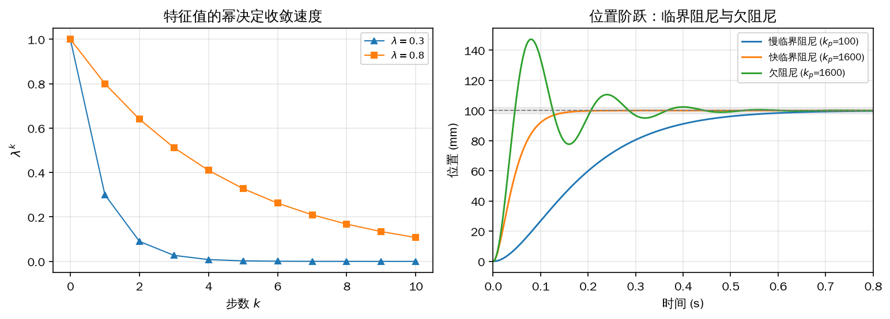
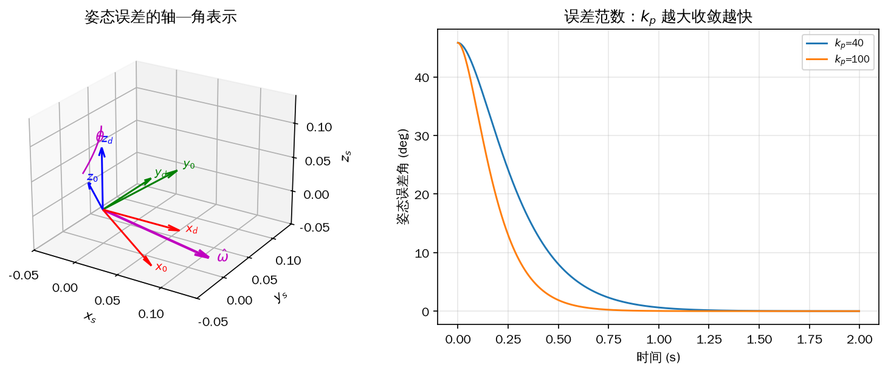
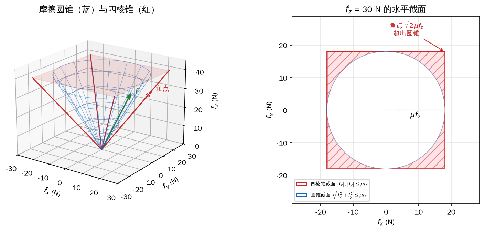
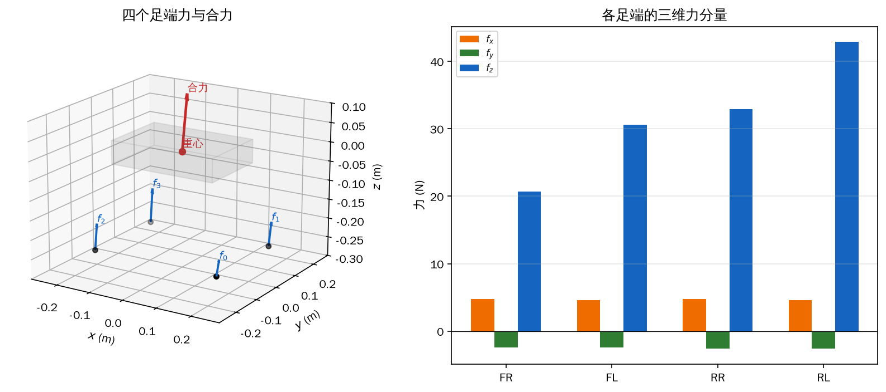
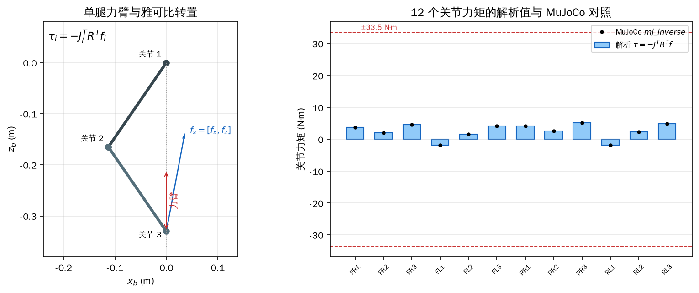
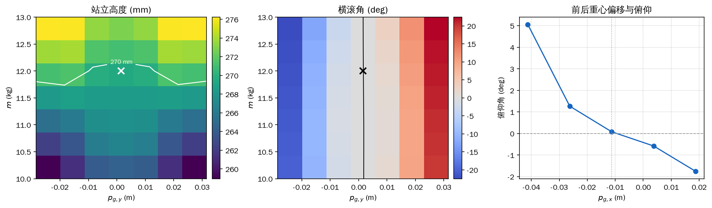
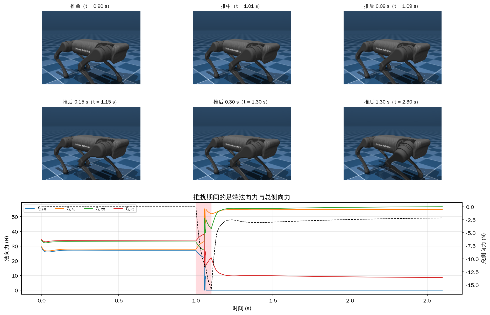

# 第 8 章 平衡控制：用足端力稳住机身

第 6 章把整台机器人压缩成一个刚体，得到式（6-40）：四个足端的地面反力合起来决定机身的线加速度和角加速度。第 7 章补上了状态估计，让控制器能拿到机身姿态、速度和四个足端在世界系中的位置。公式和状态都齐了，但前面几章的站立与调姿仍然在控制足端位置：给定机身目标位姿，反算四个足端应该在哪里，再解 12 个关节角。这个做法把足端当成固定支点，地面高低一变，支点就跟着变，机身姿态只能靠关节位置环硬扛。

换一个角度，把“足端在哪里”改成“地面给足端多大的力”。机身受到四个反力的合力和合力矩，想让它产生多大的加速度，就分配多大的力；腿的长度由机身与地面的相对位置被动决定，地面高一点，腿就短一点，不需要重新规定足端坐标。力控制在崎岖地面上更自然，也更接近真实四足动物站立时的行为。代价是控制器不能再直接写出关节角，而要经过一层优化：四个足端共有 12 个力分量，机身只有 6 个动力学方程，解不唯一，还要满足摩擦、单侧接触和力上限。这一层优化就是二次规划（quadratic programming，QP）。

本章按“位姿外环 → 摩擦约束 → QP 力分配 → 关节力矩 → 模型参数 → 代码”的顺序展开。8.1 只回答“机身需要多大的加速度”，8.2 说明足端力允许落在什么范围，8.3 把两者接成一个 QP，8.4 把世界系力换成 12 个关节力矩，8.5 讨论简化模型里那几个调出来的质量属性，8.6 把整条链路写成一个可运行的平衡控制器并用侧向推扰检验。这是全书第一次把优化放进实时回路，重点不是把 QP 当成黑箱调用，而是弄清为什么必须用它、每一项权重在买什么、求解失败时怎样退回安全状态。

## 8.1 机身位姿反馈：先算出“要多大的加速度”

把式（6-40）再写一遍。设第 \(i\) 个足端受到的地面力为 \(\boldsymbol f_{is}\)，从机身重心指向该足端的向量为 \(\boldsymbol p_{gi}\)，机身的质量为 \(m\)、机体系惯量为 \(\boldsymbol I_b\)、姿态为 \(\boldsymbol R_{sb}\)，世界系重力为 \(\boldsymbol g\)。忽略欧拉方程中的陀螺项，力与力矩平衡写成

\[ \sum_{i=0}^{3}\boldsymbol f_{is}=m\left(\dot{\boldsymbol v}_s-\boldsymbol g\right),\qquad \sum_{i=0}^{3}\boldsymbol p_{gi}\times\boldsymbol f_{is}=\boldsymbol R_{sb}\boldsymbol I_b\boldsymbol R_{sb}^{\mathrm T}\dot{\boldsymbol\omega}_s . \]

左边是四个足端力的合力与对重心的合力矩，右边是机身质量乘线加速度、惯量乘角加速度。只要四个力选得合适，就能让机身产生指定的 \(\dot{\boldsymbol v}_s\) 和 \(\dot{\boldsymbol\omega}_s\)。8.1 节把这两个加速度当成外环的输出：由当前位姿与目标位姿的误差算出“需要多大”，暂时不管“怎样得到”。8.2 和 8.3 再负责把加速度变成四个具体的力。

### 位置环：离散二阶模型与 PD

8.1.1 节先看位置环。设机身在世界系中的位置为 \(\boldsymbol p\)，速度 \(\boldsymbol v=\dot{\boldsymbol p}\)，加速度 \(\boldsymbol a=\ddot{\boldsymbol p}\)。控制器以固定周期 \(\Delta t\) 运行，在一个周期内把加速度看成常值，位置和速度按泰勒展开截断到二阶：

<!-- 原书式（8.1） -->
\[ \boldsymbol p_{k+1}=\boldsymbol p_k+\Delta t\,\boldsymbol v_k+\frac{\Delta t^2}{2}\boldsymbol a_k,\qquad \boldsymbol v_{k+1}=\boldsymbol v_k+\Delta t\,\boldsymbol a_k . \tag{8-1} \]

目标位置记作 \(\boldsymbol r\)，目标速度记作 \(\dot{\boldsymbol r}\)。本书讨论的平衡控制不预设目标加速度，取 \(\ddot{\boldsymbol r}=0\)，于是目标本身按

\[ \boldsymbol r_{k+1}=\boldsymbol r_k+\Delta t\,\dot{\boldsymbol r}_k \tag{8-2} \]

推进。定义位置偏差 \(\Delta\boldsymbol p_k=\boldsymbol r_k-\boldsymbol p_k\)、速度偏差 \(\Delta\dot{\boldsymbol p}_k=\dot{\boldsymbol r}_k-\boldsymbol v_k\)。把式（8-1）和式（8-2）代进偏差的定义，目标位置项与当前位移项相消，只剩偏差自身的递推：

<!-- 原书式（8.2） -->
\[ \Delta\boldsymbol p_{k+1}=\Delta\boldsymbol p_k+\Delta t\,\Delta\dot{\boldsymbol p}_k-\frac{\Delta t^2}{2}\boldsymbol a_k,\qquad \Delta\dot{\boldsymbol p}_{k+1}=\Delta\dot{\boldsymbol p}_k-\Delta t\,\boldsymbol a_k . \tag{8-3} \]

把位置偏差和速度偏差摞成一个 6 维状态，式（8-4）就是线性状态空间模型：

<!-- 原书式（8.3） -->
\[ \begin{bmatrix}\Delta\boldsymbol p_{k+1}\\ \Delta\dot{\boldsymbol p}_{k+1}\end{bmatrix} = \begin{bmatrix}\boldsymbol I_{3}&\Delta t\,\boldsymbol I_{3}\\ \boldsymbol 0&\boldsymbol I_{3}\end{bmatrix} \begin{bmatrix}\Delta\boldsymbol p_{k}\\ \Delta\dot{\boldsymbol p}_{k}\end{bmatrix} - \begin{bmatrix}\frac{\Delta t^2}{2}\boldsymbol I_{3}\\ \Delta t\,\boldsymbol I_{3}\end{bmatrix}\boldsymbol a_k . \tag{8-4} \]

系统矩阵是分块上三角，\(x,y,z\) 三个方向之间没有耦合项，可以只拿一轴来分析。以 \(x\) 为例：

<!-- 原书式（8.4） -->
\[ \begin{bmatrix}\Delta x_{k+1}\\ \Delta\dot x_{k+1}\end{bmatrix} = \begin{bmatrix}1&\Delta t\\0&1\end{bmatrix} \begin{bmatrix}\Delta x_k\\ \Delta\dot x_k\end{bmatrix} - \begin{bmatrix}\frac{\Delta t^2}{2}\\ \Delta t\end{bmatrix}a_k . \tag{8-5} \]

控制量取 PD 形式，比例项拉回位置，微分项压住速度：

<!-- 原书式（8.5） -->
\[ a_k=k_{\mathrm p}\Delta x_k+k_{\mathrm d}\Delta\dot x_k,\qquad k_{\mathrm p}>0,\ k_{\mathrm d}>0 . \tag{8-6} \]

注意符号。偏差的定义是“目标减当前”，所以偏差的二阶导数是 \(-a_k\)；把式（8-6）代入式（8-5）时，控制量前面带负号，闭环才是负反馈。把代入后的两项合并，得到

<!-- 原书式（8.6） -->
\[ \begin{bmatrix}\Delta x_{k+1}\\ \Delta\dot x_{k+1}\end{bmatrix} = \begin{bmatrix} 1-\frac{\Delta t^2}{2}k_{\mathrm p} & \Delta t-\frac{\Delta t^2}{2}k_{\mathrm d}\\[4pt] -\Delta t\,k_{\mathrm p} & 1-\Delta t\,k_{\mathrm d} \end{bmatrix} \begin{bmatrix}\Delta x_k\\ \Delta\dot x_k\end{bmatrix} . \tag{8-7} \]

记这个 \(2\times2\) 矩阵为 \(\boldsymbol A\)，则 \(\boldsymbol x_{k+1}=\boldsymbol A\boldsymbol x_k\)，从而 \(\boldsymbol x_k=\boldsymbol A^k\boldsymbol x_0\)。把 \(\boldsymbol A\) 对角化为 \(\boldsymbol P\boldsymbol D\boldsymbol P^{-1}\)，其中 \(\boldsymbol D\) 的对角元是两个特征值 \(\lambda_1,\lambda_2\)：

<!-- 原书式（8.7） -->
\[ \boldsymbol x_k=\boldsymbol A^k\boldsymbol x_0 =\left(\boldsymbol P\boldsymbol D\boldsymbol P^{-1}\right)^k\boldsymbol x_0 =\boldsymbol P\begin{bmatrix}\lambda_1^k&0\\0&\lambda_2^k\end{bmatrix}\boldsymbol P^{-1}\boldsymbol x_0 . \tag{8-8} \]

严格说，式（8-8）假设 \(\boldsymbol A\) 可以对角化；临界阻尼时两个特征值相等，\(\boldsymbol A\) 可能只能做 Jordan 分解，这时要用 Jordan 标准形或对“两个特征值略微不等”的情形取极限。结论不变：只要两个特征值的模都小于 1，状态仍然收敛；临界阻尼附近 \(\lambda^k\) 的衰减仍然可以用同一个特征值估计。

式（8-8）把收敛问题变成了两个标量幂的衰减问题。只要 \(|\lambda_1|,|\lambda_2|<1\)，状态最终回到零；如果两个特征值都是 \((0,1)\) 内的实数，\(\lambda^k\) 单调下降，位置和速度无振荡地收敛；如果特征值是负数或一对共轭复数，状态仍会收敛，但过程中会交替变号或转圈，机身会抖。平衡控制器不希望机身抖，所以目标是把两个特征值都放在 \((0,1)\) 内。

特征值由定义 \(\boldsymbol A\boldsymbol v=\lambda\boldsymbol v\) 给出。因为 \(\boldsymbol v\ne\boldsymbol 0\)，矩阵 \(\boldsymbol A-\lambda\boldsymbol I\) 必须奇异：

<!-- 原书式（8.8） -->
\[ \boldsymbol A\boldsymbol v=\lambda\boldsymbol v,\qquad \left(\boldsymbol A-\lambda\boldsymbol I\right)\boldsymbol v=\boldsymbol 0,\qquad \left|\boldsymbol A-\lambda\boldsymbol I\right|=0 . \tag{8-9} \]

把式（8-7）的矩阵代进行列式：

<!-- 原书式（8.9） -->
\[ \begin{vmatrix} 1-\frac{\Delta t^2}{2}k_{\mathrm p}-\lambda & \Delta t-\frac{\Delta t^2}{2}k_{\mathrm d}\\[4pt] -\Delta t\,k_{\mathrm p} & 1-\Delta t\,k_{\mathrm d}-\lambda \end{vmatrix}=0 . \tag{8-10} \]

展开、合并同类项，得到一个标准二次方程

<!-- 原书式（8.10） -->
\[ a\lambda^2+b\lambda+c=0, \tag{8-11} \]

其中

\[ a=1,\qquad b=-2+\frac{\Delta t^2}{2}k_{\mathrm p}+\Delta t\,k_{\mathrm d},\qquad c=1+\frac{\Delta t^2}{2}k_{\mathrm p}-\Delta t\,k_{\mathrm d}. \]

两个根由求根公式给出：

<!-- 原书式（8.11） -->
\[ \lambda_{1,2}=\frac{-b\pm\sqrt{b^2-4ac}}{2a}. \tag{8-12} \]

判别式 \(b^2-4ac\) 的符号决定根是实数还是共轭复数。要让根落在实轴上，需要判别式非负；要让收敛尽量快，又希望根尽量小。把这两个要求合在一起，取临界情况，即判别式恰好为零：

<!-- 原书式（8.12） -->
\[ b^2-4ac=0 \quad\Longrightarrow\quad \left[\frac{\Delta t^2}{2}k_{\mathrm p}+\Delta t\,k_{\mathrm d}\right]^2-4\Delta t^2k_{\mathrm p}=0 . \tag{8-13} \]

上式可以分解成两个括号的乘积。因为 \(k_{\mathrm p},k_{\mathrm d}>0\)，含 \(+2\Delta t\sqrt{k_{\mathrm p}}\) 的那个括号恒为正，只能令另一个括号为零：

\[ \frac{\Delta t^2}{2}k_{\mathrm p}+\Delta t\,k_{\mathrm d}-2\Delta t\sqrt{k_{\mathrm p}}=0 . \]

解出 \(k_{\mathrm d}\)：

<!-- 原书式（8.13） -->
\[ k_{\mathrm d}=2\sqrt{k_{\mathrm p}}-\frac{\Delta t}{2}k_{\mathrm p}. \tag{8-14} \]

这就是平衡控制器最常用的一条整定公式：先选 \(k_{\mathrm p}\)，再按式（8-14）算 \(k_{\mathrm d}\)，闭环就落在临界阻尼附近。判别式为零时两个根相等，把式（8-14）代回求根公式，二次项恰好抵消：

<!-- 原书式（8.14） -->
<!-- 原书式（8.15） -->
\[ \lambda_1=\lambda_2 =1-\frac{\Delta t^2}{4}k_{\mathrm p}-\frac{\Delta t}{2}k_{\mathrm d} =1-\Delta t\sqrt{k_{\mathrm p}} . \tag{8-15} \]

<!-- 原书式（8.16） -->
\[ 1-\Delta t\sqrt{k_{\mathrm p}}>0 \quad\Longrightarrow\quad k_{\mathrm p}<\frac{1}{\Delta t^2}. \tag{8-16} \]

控制器以 500 Hz 运行时 \(\Delta t=0.002\ \mathrm s\)，式（8-16）给出 \(k_{\mathrm p}<250000\)。实际可用的 \(k_{\mathrm p}\) 远小于这个上限，稳定性通常不是瓶颈，真正要权衡的是收敛速度与执行器负担：\(k_{\mathrm p}\) 越大，式（8-15）的特征值越小，收敛越快；但同样大的位置误差会变成更大的期望加速度，QP 要给出更大的力，关节力矩更容易饱和，也更容易激起腿和接触的高频模态。

三个方向可以各取一套增益。把式（8-6）按轴展开，写成矩阵形式：

<!-- 原书式（8.17） -->
\[ \begin{bmatrix}a_x\\a_y\\a_z\end{bmatrix} = \begin{bmatrix}k_{\mathrm px}&0&0\\0&k_{\mathrm py}&0\\0&0&k_{\mathrm pz}\end{bmatrix} \begin{bmatrix}\Delta x\\ \Delta y\\ \Delta z\end{bmatrix} + \begin{bmatrix}k_{\mathrm dx}&0&0\\0&k_{\mathrm dy}&0\\0&0&k_{\mathrm dz}\end{bmatrix} \begin{bmatrix}\Delta\dot x\\ \Delta\dot y\\ \Delta\dot z\end{bmatrix} +\boldsymbol a_{\mathrm{ff}} . \tag{8-17} \]

\(\boldsymbol K_{\mathrm p}=\mathrm{diag}(k_{\mathrm px},k_{\mathrm py},k_{\mathrm pz})\) 和 \(\boldsymbol K_{\mathrm d}=\mathrm{diag}(k_{\mathrm dx},k_{\mathrm dy},k_{\mathrm dz})\) 都是正定对角阵。竖直方向通常取得比水平方向硬，因为重力一直在竖直方向做功，高度误差不能留太大；水平方向要软一些，给落脚点和摩擦留余地。前馈项 \(\boldsymbol a_{\mathrm{ff}}\) 可以放重力补偿或轨迹前馈。没有前馈时，PD 必须靠一个非零的位置误差去“顶住”重力或持续扰动，稳态误差不会自动消失；有前馈时，PD 只负责修正残差，同样的增益下误差更小。前馈不能随便加大，它和反馈共用同一个 QP 和同一套力矩上限。

### 姿态环：旋转矩阵不能拆成三个独立通道

8.1.2 节的姿态环不能像位置环那样拆轴。位置误差可以写成三个独立的标量，姿态不行。横滚、俯仰、偏航是人为选的坐标，三者之间存在耦合和奇异点；把三个欧拉角分别做 PD，在大角度或跨过奇异点时会出现“压一个轴、另外两个轴跟着转”的现象。姿态误差要直接在旋转矩阵上定义。

单轴位置环的反馈量可以展开成目标与当前值之差：

<!-- 原书式（8.18） -->
\[ a_x=k_{\mathrm p}\left(r_x-x\right)+k_{\mathrm d}\left(\dot r_x-\dot x\right)+a_{\mathrm{ff},x}. \tag{8-18} \]

姿态环要做的第一件事，是把“位置差”换成“从当前姿态到目标姿态的旋转”。设当前姿态为 \(\boldsymbol R_{sb}\)，目标姿态为 \(\boldsymbol R_d\)。找一个旋转 \(\boldsymbol R\)，使得把它左乘当前姿态后得到目标姿态：

\[ \boldsymbol R\,\boldsymbol R_{sb}=\boldsymbol R_d . \]

因为 \(\boldsymbol R_{sb}\) 是正交矩阵，\(\boldsymbol R_{sb}^{-1}=\boldsymbol R_{sb}^{\mathrm T}\)，所以

<!-- 原书式（8.19） -->
\[ \boldsymbol R=\boldsymbol R_d\boldsymbol R_{sb}^{-1} =\boldsymbol R_d\boldsymbol R_{sb}^{\mathrm T}. \tag{8-19} \]

左乘的含义是：这个旋转是在世界系 \(\{s\}\) 中施加的。把 \(\boldsymbol R\) 写成轴角形式 \(\hat{\boldsymbol\omega}\theta\)，其中 \(\hat{\boldsymbol\omega}\) 是单位旋转轴，\(\theta\in[0,\pi]\) 是旋转角。这个三维向量就是姿态误差 \(\boldsymbol e_R\)。它没有欧拉角奇异，范数就是两个姿态之间的最短旋转角。实现时用旋转矩阵的对数映射（SO(3) 的 `log`）取出 \(\boldsymbol e_R\)：\(\theta=0\) 附近用泰勒展开，\(\theta\) 接近 \(\pi\) 时旋转轴的方向在数值上很敏感，需要单独处理。

只考虑姿态偏差时，反馈角加速度沿误差轴、大小与误差角成正比：

<!-- 原书式（8.20） -->
\[ \dot{\boldsymbol\omega}=k_{\mathrm p}\theta\,\hat{\boldsymbol\omega} =k_{\mathrm p}\boldsymbol e_R . \tag{8-20} \]

这里的 \(k_{\mathrm p}\) 是标量，三个转动方向的刚度相同。若希望三个方向分别调刚度，可以把标量换成对角矩阵，但那时就不再是“沿误差轴”的等比缩放，几何意义会弱一些。角速度误差可以直接取 \(\boldsymbol\omega_d-\boldsymbol\omega\)，不需要再经过旋转矩阵。姿态阻尼项写成

<!-- 原书式（8.21） -->
\[ \dot{\boldsymbol\omega}=\boldsymbol K_{\mathrm d}\left(\boldsymbol\omega_d-\boldsymbol\omega\right),\qquad \boldsymbol K_{\mathrm d}=\mathrm{diag}(k_{\mathrm dx},k_{\mathrm dy},k_{\mathrm dz}) . \tag{8-21} \]

把比例项和阻尼项叠加，得到姿态 PD：

<!-- 原书式（8.22） -->
\[ \dot{\boldsymbol\omega} =k_{\mathrm p}\boldsymbol e_R+\boldsymbol K_{\mathrm d}\left(\boldsymbol\omega_d-\boldsymbol\omega\right) =k_{\mathrm p}\theta\,\hat{\boldsymbol\omega}+\boldsymbol K_{\mathrm d}\left(\boldsymbol\omega_d-\boldsymbol\omega\right). \tag{8-22} \]

式（8-22）和位置环的式（8-17）合起来，就是机身需要的 6 维加速度指令：三个线加速度、三个角加速度。8.2 和 8.3 把这 6 个量分配到四个足端力上。

姿态环没有位置环那样简单的一维闭式特征值，增益只能按“先小后大”的顺序试。\(k_{\mathrm p}\) 太小，姿态回不来，推一下要晃很久；\(k_{\mathrm p}\) 太大，角加速度指令很猛，QP 会给出很大的差动力，机身反而容易出现高频抖动。工程上先按临界阻尼的直觉取 \(\boldsymbol K_{\mathrm d}\approx 2\sqrt{k_{\mathrm p}}\,\boldsymbol I\)，再在实机上微调；仿真里先确认符号、量级和奇异点处理是否正确。

### 位置环与姿态环的代码

`8_1_pose_pd.py` 只模拟式（8-1）的二阶模型，不接 MuJoCo。位置环取三组增益：慢临界阻尼 \(k_{\mathrm p}=100\)、快临界阻尼 \(k_{\mathrm p}=1600\)、以及 \(k_{\mathrm p}=1600\) 但 \(k_{\mathrm d}=20\) 的欠阻尼组。每组都做 0.1 m 阶跃，统计超调、2% 调节时间和最后 0.2 s 的稳态误差；再用 0.5 Hz、幅值 0.05 m 的正弦目标算跟踪误差。姿态环用式（8-22）在 SO(3) 上积分，初始误差 0.8 rad，统计误差范数和最大角速度。

```python
{{#include code/ch08/8_1_pose_pd.py:position_loop}}
```

```python
{{#include code/ch08/8_1_pose_pd.py:attitude_loop}}
```

```console
{{#include code/ch08/8_1_pose_pd.out}}
```

慢临界阻尼组的特征值是 0.98，0.1 m 阶跃要 0.578 s 才进入 2% 带；快临界阻尼组的特征值是 0.92，调节时间降到 0.140 s。两条曲线都没有超调，和“两个特征值都是 \((0,1)\) 内实数”的结论一致。欠阻尼组把 \(k_{\mathrm d}\) 从 78.4 降到 20，特征值变成一对共轭复数，超调 47.25%，虽然 0.416 s 就进入 2% 带，但中间来回摆，平衡控制器不应该选这一组。正弦跟踪的 RMS 误差是 0.287 mm，最大误差 0.406 mm；这是纯二阶模型、没有延迟和噪声的理想值，实机会差一个量级。

姿态环从 0.8 rad 开始，终止误差 \(7.86\times10^{-8}\) rad，1% 调节时间 0.672 s，最大角速度 2.953 rad/s。这个收敛比位置环慢，是因为 0.8 rad 的初始误差很大，P 项一开始就给出 80 rad/s² 的角加速度，角速度先冲上去再被 D 项压下来。把 \(k_{\mathrm p}\) 从 40 提到 100，曲线明显更陡，说明姿态环同样遵循“增益越大、收敛越快”，但上限由力矩和腿的带宽决定。



*图 8-1 左：\(\lambda=0.3\) 与 \(\lambda=0.8\) 的指数衰减，横轴是步数；右：三组增益下的位置阶跃，灰色带是 2% 误差带*



*图 8-2 左：当前姿态（灰）、目标姿态（黑）、旋转轴 \(\hat{\boldsymbol\omega}\) 与转角 \(\theta\)；右：两种姿态增益下的误差角范数*

实机整定【需要实机】。先在仿真里确认三个符号：给正的 \(x\) 目标，机身是否向 \(+x\) 加速；给正的横滚目标，机身是否绕 \(+x\) 转；姿态误差的旋转轴是否指向目标方向。确认后再上实机，从很小的 \(k_{\mathrm p}\) 开始，每次只加 20%–30%，观察是否出现高频抖动或关节力矩饱和。式（8-14）给出的 \(k_{\mathrm d}\) 只是临界阻尼的起点，实机的延迟、滤波和接触柔度都会改变阻尼比，最终值通常要往上或往下调 10%–30%。

## 8.2 足端力控制与摩擦四棱锥

足端力控制直接把“地面给足端多大的力”作为指令。设第 \(i\) 个足端受到的地面力在世界系中写成 \(\boldsymbol f_{is}=[f_x\ f_y\ f_z]^{\mathrm T}\)，其中 \(f_z\) 是法向支撑力，\(f_x,f_y\) 是切向摩擦力。足端与地面保持接触、不滑动时，法向力必须压向地面而不能拉离，切向力不能超过最大静摩擦。把静摩擦系数记作 \(\mu\)，这三个条件写成

<!-- 原书式（8.23） -->
\[
|f_x|\le\mu f_z,\qquad |f_y|\le\mu f_z,\qquad f_z\ge0 .
\tag{8-23} \]

原书在这里用的是严格不等号，表示“接触且未达到滑动边界”；QP 只能处理非严格约束，所以实现时把等号也当作可行。边界上的力在物理上正好是临界滑动，数值上允许它出现，但控制器不应长期停留在边界，否则一点扰动就会滑。

式（8-23）的两个绝对值不等式可以拆成四个半空间：\(f_x-\mu f_z\le0\)、\(-f_x-\mu f_z\le0\)、\(f_y-\mu f_z\le0\)、\(-f_y-\mu f_z\le0\)，再加上 \(f_z\ge0\)。写成矩阵不等式就是

<!-- 原书式（8.24） -->
\[ \begin{bmatrix} 1&0&\mu\\ -1&0&\mu\\ 0&1&\mu\\ 0&-1&\mu\\ 0&0&1 \end{bmatrix} \boldsymbol f_{is}\ge\boldsymbol 0 . \tag{8-24} \]

这五行的每一行定义一个半空间，五个半空间的交集是一个以原点为顶点、沿 \(+z\) 张开的四棱锥，通常叫摩擦四棱锥（friction pyramid）。四条斜棱满足 \(|f_x|=\mu f_z\) 或 \(|f_y|=\mu f_z\)；\(f_z\) 没有上界，图 8-3 为了画图在某个高度截了一个正方形截面，那个截面不是约束，只是可视化用的切片。

真实的摩擦可行域是一个二次锥 \(\sqrt{f_x^2+f_y^2}\le\mu f_z\)。把它直接放进优化就是二阶锥约束（SOCP），每步的求解代价比线性约束高。式（8-24）用四个平面把圆锥围起来，得到的是一个线性锥。这里有一个容易被说反的几何关系：在同样的 \(f_z\) 下，四棱锥的水平截面是半宽 \(\mu f_z\) 的正方形，圆锥的截面是半径 \(\mu f_z\) 的圆；正方形把圆包在里面，四个角落在圆外。因此四棱锥是圆锥的**外近似**，不是内接，也不是保守近似。角点处 \(|f_x|=|f_y|=\mu f_z\)，水平合力是 \(\sqrt2\,\mu f_z\)，比圆锥允许的最大值高 41.4%。如果直接按式（8-24）求解，控制器在某些方向上会以为摩擦力比真实值更大，打滑时仍然要求很大的切向力。

工程上的处理不是把 \(\mu\) 调大，而是把 \(\mu\) 调小留裕量，或者增加对角约束把正方形切掉四个角，得到一个内接八边形。前者简单，后者更接近圆锥。本书示例用前者：仿真取 \(\mu=0.6\)，实机把测量值乘 0.7–0.8 再用。若实机经常出现“力分配不可行”，先检查 \(\mu\) 是否取太大、\(f_{\max}\) 是否太紧、接触状态是否误判，再考虑换 SOCP；单纯增大 \(\mu\) 只会让控制器更敢用力，不会让地面更滑。

接触状态决定用哪一组约束。触地足端用式（8-24）的不等式；腾空足端不能受力，三个分量都必须为零：

<!-- 原书式（8.25） -->
\[ \boldsymbol I_3\,\boldsymbol f_{is}=\boldsymbol 0 . \tag{8-25} \]

触地/腾空由步态或接触开关给出，误判的后果很直接：把腾空足当成触地，控制器会命令一个踩空的力，机身得到反向力矩；把触地足当成腾空，支撑腿突然不发力，机身会往那一侧塌。第 9 章的步态会给出相位，实机上还要用足端接触开关或关节力矩观测做校验。单刚体 QP 本身不判断接触，它只相信传进来的 `contact` 数组。

### 摩擦约束的代码与结果

`8_2_friction.py` 在四棱锥内均匀采样 1000 个力，再在力空间的一个盒子里均匀采样 1000 个力，分别用式（8-23）和式（8-24）判断。图 8-3 左边画三维的圆锥与四棱锥，右边画 \(f_z=30\) N 处的水平截面。

```python
{{#include code/ch08/8_2_friction.py:constraints}}
```

```console
{{#include code/ch08/8_2_friction.out}}
```

在四棱锥内采样的 1000 个力全部满足线性约束，其中 778 个也满足圆锥；剩下 222 个（22.20%）落在正方形四角、圆锥之外。反向的比例是 0：只要圆锥可行，就一定满足四棱锥，因为四棱锥把圆锥整个包住。这个 22.20% 与正方形面积减去内切圆面积的比例 \(1-\pi/4=21.46\%\) 很接近，采样误差和随机涨落解释了剩下的差别。盒子采样里圆锥可行但四棱锥不可行的仍然是 0，四棱锥可行但圆锥不可行的占 23.60%，结论一样。



*图 8-3 左：圆锥（蓝）与四棱锥（红），绿箭头是锥内的一个可行力，红虚线指向四棱锥的角点；右：\(f_z=30\) N 的水平截面，正方形是四棱锥，圆是圆锥，阴影是四棱锥多出来的四个角*

摩擦系数测量【需要实机】。把机器人放在待测地面上，用一条腿缓慢增加水平推力，记录足端开始滑动时的水平力与法向力，两者的比值就是 \(\mu\)。橡胶足端在干燥水泥地上大约 0.6–0.8，在瓷砖、金属板或有水的地面上会低很多；同一块地面，清理过的和有灰尘的也不一样。仿真统一取 0.6，实机建议先按测量值的 0.7 倍使用，再根据推扰实验慢慢加。\(\mu\) 是模型参数，不是控制增益；把它调大不会提高真实摩擦，只会让 QP 更大胆。

## 8.3 用二次规划分配四个足端力

把式（6-40）写成矩阵形式。四个足端力拼成 \(12\times1\) 的向量

\[ \boldsymbol f=\begin{bmatrix}\boldsymbol f_{0s}^{\mathrm T}&\boldsymbol f_{1s}^{\mathrm T}&\boldsymbol f_{2s}^{\mathrm T}&\boldsymbol f_{3s}^{\mathrm T}\end{bmatrix}^{\mathrm T}. \]

动力学方程只有 6 行，未知数有 12 个，行数少于列数，解是一个 6 维仿射子空间。伪逆可以从中挑一个范数最小的解，但伪逆只能处理等式，处理不了式（8-24）的不等式，也表达不了“腾空足的力严格为零”之外的接触逻辑。更重要的问题是，伪逆给出的最小范数解不看摩擦：它可能让某个足端出现负的法向力，或者让两个足端互相“顶牛”产生很大的内力。平衡控制器需要的是一个在可行域内、按工程偏好挑出来的解，这正是 QP 的用武之地。

### 一般形式：从线性方程组到二次规划

8.3.1 节先看一个抽象问题。要解的线性方程组是

<!-- 原书式（8.26） -->
\[ \boldsymbol A\boldsymbol x-\boldsymbol b=\boldsymbol 0, \tag{8-26} \]

对未知数的等式约束是

<!-- 原书式（8.27） -->
\[ \boldsymbol C_e\boldsymbol x+\boldsymbol c_e=\boldsymbol 0, \tag{8-27} \]

不等式约束是

<!-- 原书式（8.28） -->
\[ \boldsymbol C_i\boldsymbol x+\boldsymbol c_i\ge\boldsymbol 0. \tag{8-28} \]

式（8-26）和式（8-27）形式一样，角色不同：前者是“希望尽量满足”的方程，后者是“必须满足”的硬约束。式（8-26）行数少于未知数，一般没有唯一解；式（8-27）和式（8-28）把可行域切成一个凸集。代价函数取

<!-- 原书式（8.29） -->
\[ J=\left(\boldsymbol A\boldsymbol x-\boldsymbol b\right)^{\mathrm T}\boldsymbol S\left(\boldsymbol A\boldsymbol x-\boldsymbol b\right) +\boldsymbol x^{\mathrm T}\boldsymbol W\boldsymbol x . \tag{8-29} \]

第一项惩罚方程残差，第二项惩罚解的绝对值。\(\boldsymbol S,\boldsymbol W\) 是正定矩阵，通常取对角阵，方便逐项调权重；\(\boldsymbol W\) 正定也保证 \(\boldsymbol G\) 正定，最优解唯一。若 \(\boldsymbol W=0\) 且 \(\boldsymbol A\) 行不满秩，解可能不唯一。两项的目标相反：要让残差小，解往往要变大；要让解小，残差就压不下去。QP 找的是两者加权和的最小值，权重决定了妥协点。\(\boldsymbol S\) 的某个对角元加大，对应的方程会被更认真地满足；\(\boldsymbol W\) 的某个对角元加大，对应的未知数会被更狠地压向零。

求解器通常要求标准形式。以 OSQP 为例，它接受

<!-- 原书式（8.30） -->
\[ \min_{\boldsymbol x}\ \frac12\boldsymbol x^{\mathrm T}\boldsymbol G\boldsymbol x+\boldsymbol g_0^{\mathrm T}\boldsymbol x \quad\text{s.t.}\quad \boldsymbol C_E^{\mathrm T}\boldsymbol x+\boldsymbol c_E=\boldsymbol 0,\quad \boldsymbol C_I^{\mathrm T}\boldsymbol x+\boldsymbol c_I\ge\boldsymbol 0 . \tag{8-30} \]

把式（8-29）展开：

<!-- 原书式（8.31） -->
\[ \begin{aligned} J&=\boldsymbol x^{\mathrm T}\boldsymbol A^{\mathrm T}\boldsymbol S\boldsymbol A\boldsymbol x -2\boldsymbol b^{\mathrm T}\boldsymbol S\boldsymbol A\boldsymbol x +\boldsymbol b^{\mathrm T}\boldsymbol S\boldsymbol b +\boldsymbol x^{\mathrm T}\boldsymbol W\boldsymbol x\\ &=\boldsymbol x^{\mathrm T}\left(\boldsymbol A^{\mathrm T}\boldsymbol S\boldsymbol A+\boldsymbol W\right)\boldsymbol x -2\boldsymbol b^{\mathrm T}\boldsymbol S\boldsymbol A\boldsymbol x +\boldsymbol b^{\mathrm T}\boldsymbol S\boldsymbol b . \end{aligned} \tag{8-31} \]

最后一项 \(\boldsymbol b^{\mathrm T}\boldsymbol S\boldsymbol b\) 与 \(\boldsymbol x\) 无关，去掉它不改变最优解；整体乘 \(1/2\) 也不改变最优解。于是得到等效代价

<!-- 原书式（8.32） -->
\[ J'=\frac12\boldsymbol x^{\mathrm T}\left(\boldsymbol A^{\mathrm T}\boldsymbol S\boldsymbol A+\boldsymbol W\right)\boldsymbol x -\boldsymbol b^{\mathrm T}\boldsymbol S\boldsymbol A\boldsymbol x . \tag{8-32} \]

对照式（8-30），系数映射为

<!-- 原书式（8.33） -->
\[ \boldsymbol G=\boldsymbol A^{\mathrm T}\boldsymbol S\boldsymbol A+\boldsymbol W,\qquad \boldsymbol g_0=-\boldsymbol A^{\mathrm T}\boldsymbol S\boldsymbol b,\qquad \boldsymbol C_E=\boldsymbol C_e^{\mathrm T},\qquad \boldsymbol C_I=\boldsymbol C_i^{\mathrm T},\qquad \boldsymbol c_I=\boldsymbol c_i . \tag{8-33} \]

注意 \(\boldsymbol g_0\) 这里是列向量，写成 \(\boldsymbol g_0^{\mathrm T}\boldsymbol x\)；原书用行向量 \(-\boldsymbol b^{\mathrm T}\boldsymbol S\boldsymbol A\) 左乘 \(\boldsymbol x\)，两种写法等价，但填求解器时要看清接口要的是行还是列。

一个自然的问题：式（8-26）和式（8-27）长得一样，为什么不把动力学方程也塞进等式约束？理论上可以，但等式约束的个数不能超过未知数个数，而且这些等式还必须线性无关。四条腿全部腾空时，每个足端三个“力为零”的等式，共 12 个，已经等于未知数个数；再把 6 个动力学方程作为硬等式加进去就超定了。把动力学放进代价函数，约束个数随接触状态在 0 到 12 之间变化，问题规模不变，求解器接口也稳定。代价是动力学只能被“尽量满足”，残差不会严格为零；只要 \(\boldsymbol S\) 足够大，残差可以压到力矩噪声以下。

### 机器人问题：矩阵、代价与约束

8.3.2 节把抽象 QP 套到机器人上。把式（6-40）写成 \(\boldsymbol A\boldsymbol f=\boldsymbol b_d\)。\(\boldsymbol A\) 是 \(6\times12\)：

<!-- 原书式（8.34） -->
\[ \boldsymbol A= \begin{bmatrix} \boldsymbol I_3&\boldsymbol I_3&\boldsymbol I_3&\boldsymbol I_3\\ \left[\boldsymbol p_{g0}\right]_\times&\left[\boldsymbol p_{g1}\right]_\times&\left[\boldsymbol p_{g2}\right]_\times&\left[\boldsymbol p_{g3}\right]_\times \end{bmatrix},\qquad \boldsymbol b_d= \begin{bmatrix} m\left(\dot{\boldsymbol v}_s-\boldsymbol g\right)\\ \boldsymbol R_{sb}\boldsymbol I_b\boldsymbol R_{sb}^{\mathrm T}\dot{\boldsymbol\omega}_s \end{bmatrix}. \tag{8-34} \]

上三行把四个力相加，下三行把每个力对重心的力矩相加；\(\left[\cdot\right]_\times\) 是叉乘矩阵，\(\boldsymbol p_{gi}\) 是重心到第 \(i\) 个足端的向量，必须和 \(\boldsymbol A\) 的力矩参考点一致。若把 \(\boldsymbol p_{gi}\) 换成“机身几何中心到足端”，而 \(\boldsymbol b_d\) 的惯量又是绕重心的，力矩就会多出一项 \(\boldsymbol p_{\text{偏移}}\times\sum\boldsymbol f_i\)，机身在加速时会莫名俯仰。这个坑在 8.6 的代码里要特别小心。

代价函数取三项：

<!-- 原书式（8.35） -->
\[ J=\left(\boldsymbol A\boldsymbol f-\boldsymbol b_d\right)^{\mathrm T}\boldsymbol S\left(\boldsymbol A\boldsymbol f-\boldsymbol b_d\right) +\boldsymbol f^{\mathrm T}\alpha\boldsymbol W\boldsymbol f +\left(\boldsymbol f-\boldsymbol f_{\mathrm{prev}}\right)^{\mathrm T}\beta\boldsymbol U\left(\boldsymbol f-\boldsymbol f_{\mathrm{prev}}\right). \tag{8-35} \]

第一项让动力学残差小，第二项让力小、省电，第三项让相邻两周期的力接近、抑制突变。\(\boldsymbol f_{\mathrm{prev}}\) 是上一周期解出的力，\(\alpha,\beta>0\) 是两个标量系数，\(\boldsymbol W,\boldsymbol U\) 通常取单位阵或对角阵。第三项在接触切换、噪声尖峰和求解器偶尔给出不同解时特别有用：没有它，两个几乎等价的解可能相差几十牛，力矩会跟着跳。

把式（8-35）展开、丢掉与 \(\boldsymbol f\) 无关的常数、整体乘 \(1/2\)，得到

<!-- 原书式（8.36） -->
\[ J'=\frac12\boldsymbol f^{\mathrm T}\left(\boldsymbol A^{\mathrm T}\boldsymbol S\boldsymbol A+\alpha\boldsymbol W+\beta\boldsymbol U\right)\boldsymbol f +\left(-\boldsymbol b_d^{\mathrm T}\boldsymbol S\boldsymbol A-\boldsymbol f_{\mathrm{prev}}^{\mathrm T}\beta\boldsymbol U\right)\boldsymbol f . \tag{8-36} \]

这就是要填给 OSQP 的二次项矩阵和一次项。\(\boldsymbol S\) 是 \(6\times6\)，\(\boldsymbol W,\boldsymbol U\) 是 \(12\times12\)，维数必须对齐。示例把 \(\boldsymbol S\) 取成 \(1000\boldsymbol I_6\)，\(\alpha\) 和 \(\beta\) 只有 \(10^{-3}\) 量级，三个权重的量级差很大；这不是随便写的，而是因为动力学残差的单位是牛和牛·米，力的单位也是牛，两者要通过力矩臂（约 0.2 m）和惯量（约 0.1 kg·m²）换算。调权重时先看残差和力量的量级，再决定谁该大；不要在一堆没归一化的量上盲目试。

约束按接触状态拼。设当前有 \(m\) 个足端触地、\(n=4-m\) 个腾空。每个腾空足端贡献 3 个等式，把对应的三个力置零。以足端 0、1、3 腾空为例，等式约束是

<!-- 原书式（8.37） -->
\[ \begin{bmatrix} \boldsymbol I_3&\boldsymbol 0&\boldsymbol 0&\boldsymbol 0\\ \boldsymbol 0&\boldsymbol I_3&\boldsymbol 0&\boldsymbol 0\\ \boldsymbol 0&\boldsymbol 0&\boldsymbol 0&\boldsymbol I_3 \end{bmatrix}\boldsymbol f=\boldsymbol 0_{9\times1}. \tag{8-37} \]

每个触地足端贡献 5 个不等式，用式（8-24）的 \(\boldsymbol F_\mu\)。以足端 0、2、3 触地、足端 1 腾空为例，不等式是

<!-- 原书式（8.38） -->
\[ \begin{bmatrix} \boldsymbol F_\mu&\boldsymbol 0&\boldsymbol 0&\boldsymbol 0\\ \boldsymbol 0&\boldsymbol 0&\boldsymbol F_\mu&\boldsymbol 0\\ \boldsymbol 0&\boldsymbol 0&\boldsymbol 0&\boldsymbol F_\mu \end{bmatrix}\boldsymbol f\ge\boldsymbol 0_{15\times1}. \tag{8-38} \]

式（8-37）和式（8-38）用的是两组不同的接触状态，不能同时套在同一个时刻。实际代码按 `contact` 数组逐足端拼块：触地加 5 行摩擦、腾空加 3 行等式；若还要限制最大法向力，再给每个触地足端加一行 \(f_z\le f_{\max}\)。四足全触地时等式 0 个、不等式 20 个；四足全腾空时等式 12 个、不等式 0 个，此时 \(\boldsymbol f=0\) 是唯一可行解，动力学残差无法消除，机器人处于自由落体，QP 给出零力是符合物理的。

### 求解器、权重与数值

原书用 QuadProg++，它要求把问题整理成式（8-30）的形式，约束矩阵按转置传入。本书用 OSQP：它直接吃稀疏矩阵，支持热启动，接口是

\[ \min_{\boldsymbol x}\ \frac12\boldsymbol x^{\mathrm T}\boldsymbol P\boldsymbol x+\boldsymbol q^{\mathrm T}\boldsymbol x \quad\text{s.t.}\quad \boldsymbol l\le\boldsymbol C\boldsymbol x\le\boldsymbol u . \]

把式（8-36）的 \(\boldsymbol P,\boldsymbol q\) 和拼好的 \(\boldsymbol C\) 传进去，摩擦约束的下界取 0、上界取 \(+\infty\)，\(f_{\max}\) 那一行的下界取 \(-\infty\)、上界取 \(f_{\max}\)。OSQP 只需要 \(\boldsymbol P\) 的上三角，稀疏结构在接触状态不变时可以复用；接触状态一变，约束矩阵的行数变了，才需要重新 `setup`。热启动把上一周期的解作为初值，对 500 Hz 的回路很有帮助。

数值上有几条经验。第一，\(\boldsymbol P\) 的条件数不要太大：\(\boldsymbol S\) 和 \(\alpha,\beta\) 的量级差控制在 \(10^5\) 以内，必要时把整个目标乘一个常数归一化，最优解不变。第二，\(\boldsymbol S\) 太小，动力学残差会让机身“发软”，高度和姿态都跟不上；\(\boldsymbol S\) 太大，\(\boldsymbol P\) 病态，求解器迭代变多，接触切换时容易报 `unbounded` 或 `infeasible`。第三，每个周期都要看求解状态：状态 1 是 solved，2 是 solved inaccurate，其他值都不能直接用。第四，解出来后检查 \(f_z\) 是否略小于 0、是否超过 \(f_{\max}\)，数值误差可能让解越过边界几个毫牛，做一次小截断。第五，求解失败或接触数小于 2 时，退回“重力均分”保底：把 \(m(-g_z+a_{z,\mathrm{des}})\) 平均分给支撑足，切向力置零。这个保底不保证姿态，只保证机器人不会因为一个 NaN 力矩直接趴下。

### QP 的代码与结果

`8_3_qp_force.py` 显式组装 \(\boldsymbol A,\boldsymbol b_d,\boldsymbol P,\boldsymbol q,\boldsymbol C\)，用 OSQP 求解，再用 scipy 的 SLSQP 解同一个问题做对照，最后调用共用包的 `BalanceCtrl.solve_force` 比较三者的解。图中的四个箭头是足端力，红色箭头是合力，原点处的红点是重心。

```python
{{#include code/ch08/8_3_qp_force.py:assemble}}
```

```python
{{#include code/ch08/8_3_qp_force.py:solve}}
```

```console
{{#include code/ch08/8_3_qp_force.out}}
```

例子取 \(m=12.45\) kg、\(\boldsymbol I=\mathrm{diag}(0.1320,0.3475,0.3775)\)、\(\boldsymbol a_{\mathrm{des}}=[1.5,-0.8,0.4]^{\mathrm T}\)、\(\dot{\boldsymbol\omega}_{\mathrm{des}}=[1.0,-0.5,0.3]^{\mathrm T}\)。需求力是 \([18.675,-9.960,127.115]^{\mathrm T}\) N，需求力矩是 \([0.132,-0.174,0.113]^{\mathrm T}\) N·m。OSQP 给出的总力是 \([18.675,-9.960,127.114]^{\mathrm T}\) N，总力矩是 \([0.131,-0.175,0.113]^{\mathrm T}\) N·m，动力学残差 \(7.9\times10^{-4}\)，约束违反 0。SLSQP 从重力均分的可行点出发，16 次迭代收敛，两个解的最大差 \(2.7\times10^{-7}\) N，说明 QP 的最优解是可信的。共用包的 `BalanceCtrl` 与手写 QP 的最大差 \(2.5\times10^{-4}\) N，差异来自求解器容差和正则项，量级可以接受。

四个法向力是 20.67、30.60、32.95、42.88 N。它们不是均分的：\(\dot{\boldsymbol\omega}_{\mathrm{des}}\) 的 \(x\) 分量要求一个绕 \(x\) 的力矩，前后足的力臂不同，后左足的力最大，前右足的力最小。总法向力 127.1 N 比 \(mg=122.1\) N 多出约 5 N，对应 \(\boldsymbol a_{\mathrm{des}}\) 的 \(z\) 分量 0.4 m/s²。水平合力 18.7 N 和 \(-10.0\) N 远小于 \(\mu f_z\)，摩擦约束没有起作用；如果加大水平加速度或减小 \(\mu\)，最优解会贴着摩擦边界走，QP 的约束才真正“咬住”。



*图 8-4 左：四个足端力（蓝）与合力（红），红点是重心；右：四个足端的三维力分量*

OSQP 的迭代次数是 100，SLSQP 是 16。这里不打印墙钟时间：同一台机器上每次运行的毫秒数都会变，写进书里没有可比性；看迭代次数和残差更能说明问题。OSQP 的 100 次是默认的 ADMM 迭代，接触状态不变时热启动会明显减少；SLSQP 是通用非线性求解器，迭代少但每次迭代的矩阵运算更重，不适合 500 Hz 实时回路。原书的 QuadProg++ 是稠密 active-set，问题规模 12 个变量、20 多个约束时也够快；本书选 OSQP 是为了稀疏、热启动和 Python 接口。

8.3 节没有实机步骤，求解器就在本机运行。实机上唯一要额外注意的是求解时间：如果某一周期求解超过 2 ms，下一周期的力矩就会晚到。工程上可以给 QP 设一个迭代上限，超时就用上一周期的解或重力均分，绝不能因为求解器卡住而让关节保持一个过期的力矩。

## 8.4 简化逆向动力学：足端力 → 关节力矩

QP 给出的是世界系足端力，电机只接受关节力矩。中间要过一道单腿静力学：把足端力通过雅可比转置映射成三个关节力矩。完整的逆动力学要考虑每条腿各连杆的质量、惯量、质心位置和关节加速度，理论推导超出本书范围；平衡控制器用一个更轻的近似——假设腿的动能在一个控制周期内变化很小，关节做功的功率等于足端力做功的功率。

设第 \(i\) 条腿的关节角速度为 \(\dot{\boldsymbol q}_i\)，足端在机体系中的速度为 \(\boldsymbol v_{ib}=\boldsymbol J_i\dot{\boldsymbol q}_i\)，机体系足端力为 \(\boldsymbol f_{ib}\)。关节功率是 \(\boldsymbol\tau_i^{\mathrm T}\dot{\boldsymbol q}_i\)，足端功率是 \(\boldsymbol f_{ib}^{\mathrm T}\boldsymbol v_{ib}=\boldsymbol f_{ib}^{\mathrm T}\boldsymbol J_i\dot{\boldsymbol q}_i\)。令两者相等，对任意 \(\dot{\boldsymbol q}_i\) 都成立，得到

\[ \boldsymbol\tau_i=\boldsymbol J_i^{\mathrm T}\boldsymbol f_{ib}. \]

这里的 \(\boldsymbol f_{ib}\) 是“足端对外界的作用力”还是“外界对足端的作用力”，决定了符号。QP 解出的是地面对足端的作用力 \(\boldsymbol f_{is}\)；关节电机要输出的是与这个外力平衡的力矩，所以取负：

<!-- 原书式（8.39） -->
\[ \boldsymbol\tau_i=-\boldsymbol J_i^{\mathrm T}\boldsymbol f_{ib} =-\boldsymbol J_i^{\mathrm T}\boldsymbol R_{bs}\boldsymbol f_{is} =-\boldsymbol J_i^{\mathrm T}\boldsymbol R_{sb}^{\mathrm T}\boldsymbol f_{is}. \tag{8-39} \]

坐标系链要一步步走：世界系力 \(\boldsymbol f_{is}\) 先左乘 \(\boldsymbol R_{sb}^{\mathrm T}\) 变到机体系，得到 \(\boldsymbol f_{ib}\)；再左乘 \(\boldsymbol J_i^{\mathrm T}\) 变到关节空间。\(\boldsymbol J_i\) 必须是“关节角速度 → 机体系足端速度”的雅可比，和 8.3 的 \(\boldsymbol p_{gi}\) 用同一个机身系。若第 5 章的雅可比定义在腿基座系 \(\{0\}\)，而髋关节还有外摆安装偏置，就要先补一次从 \(\{0\}\) 到 \(\{b\}\) 的旋转和平移，否则力矩方向会整体偏一个角度。漏掉 \(\boldsymbol R_{sb}^{\mathrm T}\) 更常见：机身水平时看不出问题，一倾斜，世界系的竖直力被当成机体系的竖直力，重力补偿方向就错了。

符号可以用虚功再确认一遍。设关节虚位移为 \(\delta\boldsymbol q_i\)，足端虚位移为 \(\boldsymbol J_i\delta\boldsymbol q_i\)。外力 \(\boldsymbol f_{ib}\) 做的虚功是 \(\boldsymbol f_{ib}^{\mathrm T}\boldsymbol J_i\delta\boldsymbol q_i\)；关节力矩做的虚功是 \(\boldsymbol\tau_i^{\mathrm T}\delta\boldsymbol q_i\)。若 \(\boldsymbol\tau_i\) 是电机为了平衡外力而输出的力矩，它做的功与外力的功符号相反，于是 \(\boldsymbol\tau_i=-\boldsymbol J_i^{\mathrm T}\boldsymbol f_{ib}\)。实机第一次验证时，把机器人吊起来，给一个很小的向下力，看膝关节力矩是不是朝“把腿往上抬”的方向；符号反了，机器人一落地就会往一边倒。

这个近似忽略了腿的惯性力和重力。腿的质量相对机身小、触地时腿的速度变化小，所以低速平地站立的误差可以接受；腿摆得快、腿质量大、或者机器人正在跳跃时，误差会明显变大。8.5 节会通过调单刚体模型的质量和重心补偿一部分，但补偿不了腿的科氏力和关节摩擦。需要更高精度时，要用完整的逆动力学或全身控制（whole-body control，WBC），那是 10.7.3 节的内容。

摆动腿不承担支撑，QP 给它的力是零，但“零足端力”不等于“零关节力矩”。摆动腿要克服自身重力、跟踪笛卡尔轨迹，它的足端力由 5.4 节的笛卡尔 PD 给出，同样用式（8-39）转成关节力矩；只是这个力不进入机身的 QP，而是直接加到摆动腿的关节上。平衡控制器在四足全触地时不需要区分支撑和摆动，所有腿都走同一条链路；一旦有腿腾空，就要把支撑腿的 QP 力矩和摆动腿的跟踪力矩分开算。

力矩上限是硬约束。A1 的关节力矩上限约 \(\pm33.5\) N·m，式（8-39）算出的 \(\boldsymbol\tau_i\) 要逐个和它比较并限幅。限幅之后，足端实际得到的力不再等于 QP 的解，平衡会退化；如果经常饱和，说明 QP 要的力太大，应该把 \(f_{\max}\) 设得更保守，或者把位姿增益调软，而不是把限幅放宽。QP 本身没有把关节力矩上限写进约束，这是单刚体 QP 的一个缺口；更完整的做法是在 QP 里加力矩不等式，但那样约束矩阵会随关节角变化，实时性更差。

### 逆动力学的代码与结果

`8_4_inverse_dynamics.py` 在固定位形 \(q=[0,0.6,-1.2]\) rad 下给四个足端一组世界系力，用式（8-39）算 12 个关节力矩；再用 MuJoCo 的 `mj_inverse` 做对照。外部力通过 `mj_applyFT` 施加在足端球心，比较“有外力”和“无外力”两次逆动力学的关节力矩差，正好隔离出式（8-39）这一项。

```python
{{#include code/ch08/8_4_inverse_dynamics.py:mapping}}
```

```console
{{#include code/ch08/8_4_inverse_dynamics.out}}
```

解析解和 MuJoCo 的最大绝对误差是 \(8.88\times10^{-16}\) N·m，最大相对误差 \(1.72\times10^{-16}\)，就是双精度舍入。这个结果说明：在“腿静止、无关节加速度、只考虑外力”的条件下，单腿静力学和完整逆动力学完全一致。差别来自被忽略的腿惯性、重力和关节摩擦，而不是式（8-39）本身。示例里最大力矩 5.16 N·m，只占 \(\pm33.5\) N·m 的 15.40%；这是站立工况，推扰或跳跃时力矩会大得多。



*图 8-5 左：一条腿的力臂与雅可比转置，蓝色箭头是足端力；右：12 个关节力矩的解析值与 MuJoCo `mj_inverse` 对照，红虚线是 \(\pm33.5\) N·m 上限*

力矩方向验证【需要实机】。把机器人吊起，足端离地，逐个关节给一个小力矩，观察腿往哪个方向动；再把一个已知重物挂在足端，比较式（8-39）算出的力矩和电机实际需要输出的力矩。整个过程要限制电流、限制速度，旁边有人扶住机身。符号正确之前不要落地，落地后一个反向力矩就能让机器人侧翻。

## 8.5 简化模型的质量属性：调出来的 `m、p_g、I_b`

到 8.4 节为止，模型已经被简化了两次：整机被压成一个刚体，腿的惯性、重力和关节摩擦被静力学近似丢掉；欧拉方程里的陀螺项也没有保留。简化换来的是 6 个动力学方程和一个 12 维 QP，代价是模型和真实机器人之间有系统偏差。最直接的补偿办法不是加更多方程，而是调单刚体模型的三个质量属性：等效质量 \(m\)、重心位置 \(\boldsymbol p_g\)、等效惯量 \(\boldsymbol I_b\)。这三个量都不是 CAD 里一查就能用的整机参数。

先看质量。直觉上，单刚体模型的质量应该等于整机质量，或者至少等于躯干质量；实际介于两者之间。做一个思想实验：假设四条腿没有重量，只有躯干中心 \(C\) 处有质量 \(m_C\)。此时单刚体模型的质量就是 \(m_C\)，静止站立时四个足端各承担 \(m_Cg/4\)，由 8.4 节的静力学算出关节力矩。保持这些关节力矩不变，在足端 \(A\) 点再加一个质量 \(m_A\)：这部分额外重力 \(m_Ag\) 由地面直接承担，关节力矩产生的足端力仍然是 \(m_Cg/4\)，关节不需要额外出力。若把质量 \(m_B\) 加在腿上的 \(B\) 点，情况就不同了：这部分重力不能全部由地面直接承担，有一部分要通过关节力矩传到机身，等效到单刚体模型里大约是 \(r m_B\)，其中 \(r\in(0,1)\) 与腿的姿态和关节角有关。质量越靠近躯干，\(r\) 越大；越靠近足端，\(r\) 越小。于是等效质量落在“躯干质量”和“整机质量”之间，具体值只能通过实验确定。

质量整定的操作很简单，但要先把刚度调软，让偏差显现出来。把式（8-17）的位置刚度 \(\boldsymbol K_{\mathrm p}\) 适当减小，让机器人用平衡控制器站立，记录实际高度与目标高度的差。若实际高度高于目标，说明 QP 给出的法向力偏大，模型质量取得太大，应减小 \(m\)；若实际高度低于目标，说明模型质量太小，应增大 \(m\)。这个符号关系不是从“质量大就站得高”来的，而是从闭环平衡来的：模型质量大，QP 为同样的 \(a_{\mathrm{des}}\) 算出更大的力，机身被推得更高；模型质量小，力不够，机身下沉。调的时候一次改 0.2–0.5 kg，等高度稳定后再改下一次，不要和增益同时调。

重心整定类似，只是把位置刚度换成姿态刚度。把式（8-22）的 \(k_{\mathrm p}\) 适当减小，让机器人站立，观察俯仰。若机器人低头（机头下沉），说明后腿的力偏大、模型重心偏后，应把 \(\boldsymbol p_g\) 向前移；若抬头，说明前腿力偏大、模型重心偏前，应把 \(\boldsymbol p_g\) 向后移。低头/抬头的方向容易记反，可以用一个极端例子检查：把模型重心放到机身最后面，QP 会以为后足要承担更多重量，后足力增大，机身绕 \(y\) 轴抬头还是低头，取决于 \(x\) 轴指向机头、\(z\) 轴向上的右手系。实际调试时不要靠记，直接在仿真里把 \(\boldsymbol p_g\) 往一个方向挪 1 cm，看俯仰往哪边变，记住这个方向，再到实机上用。

惯量不能像质量、重心那样用静态站立实验调。静态时 \(\dot{\boldsymbol\omega}=0\)，式（8-34）的力矩方程里惯量项为零，机器人的平衡只依赖质量和重心；惯量要等机身有角加速度时才起作用。原书的方法是用 CAD 算整机在站立姿态下的惯量 \(\boldsymbol I_w\)，再称整机质量 \(m_w\)，按质量比例缩放：

<!-- 原书式（8.40） -->
\[ \boldsymbol I_b=\boldsymbol I_w\frac{m}{m_w}. \tag{8-40} \]

这个式子假设模型和整机的质量分布形状相似，只是总质量不同。腿的姿态一变，质量分布就变，\(\boldsymbol I_w\) 和 \(\boldsymbol I_b\) 都跟着变；本章只要求在一个固定站姿下调到大致可用，行走时还要再修。更严格的做法是用动态辨识实验拟合惯量，或者直接用 WBC 考虑所有连杆的质量属性。式（8-40）是一个工程近似，不是物理定律。

这三个参数都与关节角有关。同样的 \(m\)，腿伸直和腿折叠时，等效质量不一样；同样的 \(\boldsymbol p_g\)，腿往前迈和往后蹬时，等效重心也不一样。本章的整定只在固定站姿下有效，第 9、10 章行走时，支撑腿的相位和落脚点在变，参数还要跟着调。把这一点记住，就不会把某一组参数当成“整机常数”。

术语要纠正。代码里的 `mass` 应理解为“单刚体等效质量”，不是整机总质量；`Ib` 是等效惯量，不是 CAD 算出的整机惯量；`p_g` 是等效重心，不是几何中心。原书 8.6.1 节把 `_mass` 解释成“机器人的总质量”，和 8.5 节的讨论冲突；本书在代码接口上保留 `mass` 这个短名字，但文档和正文一律按“等效质量”理解。读别人的代码时，看到 `mass` 先问一句：它是称重得到的，还是整定得到的？

### 质量与重心的参数扫描

`8_5_mass_id.py` 在 MuJoCo 里做一次参数扫描：等效质量 \(m\in[10,13]\) kg，横向重心偏移 \(p_{g,y}\in[-0.03,0.03]\) m，共 \(7\times7\) 组；每组从同一个初始站姿开始，用纯力矩平衡控制器站 0.8 s，取最后 0.2 s 的平均高度和横滚角。控制器只用 `read_sensors` 和第 7 章的估计器，仿真真值只用于打分。为了放大模型误差，位置和姿态刚度都取得比正常站立软，关节 PD 关掉，QP 力矩直接驱动关节。

```python
{{#include code/ch08/8_5_mass_id.py:stand}}
```

```console
{{#include code/ch08/8_5_mass_id.out}}
```

高度热图随 \(m\) 增大而变亮：\(m=10\) kg 时平均高度约 259 mm，\(m=13\) kg 时约 276 mm，目标 270 mm 的等值线落在 \(m\approx12.0\) kg 附近。最优组合是 \(m=12.000\) kg、\(p_{g,y}=+0.0016\) m，对应高度 0.2695 m、横滚 \(-0.0212^\circ\)。整机质量是 12.453 kg，等效质量比它低 3.64%；这不是说称重错了，而是单刚体模型把腿的质量部分地“丢”给了地面，等效质量本来就该比整机小。重心 y 的最优值和 Menagerie 模型算出的整机重心 \(y=+0.0016\) m 完全一致，说明横向重心不需要额外补偿；换一台机器人或换一个站姿，这个值会变。

横滚热图几乎只随 \(p_{g,y}\) 变化，和 \(m\) 关系不大：\(p_{g,y}\) 从 \(-0.028\) m 变到 \(+0.032\) m，横滚从约 \(-20^\circ\) 变到 \(+20^\circ\)，中间过零。也就是说，横向重心偏 1 cm，横滚大约偏 7°；这个灵敏度可以用来整定 \(p_{g,y}\)：站不稳时先看横滚，横滚往哪边倒，就把模型重心往相反方向挪。高度和横滚对两个参数近似解耦，所以可以先调 \(m\) 把高度调准，再调 \(p_{g,y}\) 把横滚调平。

俯仰扫描单独做：固定 \(m=12.0\) kg，把 \(p_{g,x}\) 从 \(-0.0413\) m 挪到 \(+0.0187\) m，俯仰从 \(+5.06^\circ\) 变到 \(-1.76^\circ\)，零交叉在 \(p_{g,x}\approx-0.0096\) m，与整机重心的 \(x\) 坐标 \(-0.0113\) m 相差约 1.7 mm。这里要说明一个坐标轴的问题：横向偏移 \(p_{g,y}\) 激起的是横滚（绕 \(x\)），前后偏移 \(p_{g,x}\) 才激起俯仰（绕 \(y\)）。原书和有些资料在讲“重心整定”时只说“低头/抬头”，没有强调是哪个轴；读者若拿 \(p_{g,y}\) 去调俯仰，会发现几乎没反应。本书的示例把两个轴分开扫，就是为了避免这个混淆。



*图 8-6 左：站立高度随 \(m\) 和 \(p_{g,y}\) 的变化，白线是 270 mm 等值线，白叉是最优组合；中：横滚角，黑线是零度等值线；右：前后重心 \(p_{g,x}\) 与俯仰角*

质量整定和重心整定【需要实机】。实机步骤和仿真不同：先把机器人吊起或放在支架上，确认四个足端都着地，再把位置刚度降到正常值的一半左右，给一个固定的高度目标，等 5–10 s 稳定后记录实际高度；改 \(m\) 后重复。重心整定同理，把姿态刚度降到一半，观察俯仰，改 \(p_{g,x}\)，不要一次改太多。惯量估算不需要实机，在 CAD 里按站立姿态算 \(\boldsymbol I_w\)，称重得到 \(m_w\)，再用式（8-40）缩放。实机的足端橡胶会压缩，接触点比仿真低几毫米，这会直接进入高度误差；整定前先量一下足端压缩量，或者把目标高度按压缩量修正。

## 8.6 实践：BalanceCtrl 与 BalanceTest

8.6.1 节先把前面几节串起来，得到一个完整的平衡控制器：位姿 PD 给出 \(\boldsymbol a_{\mathrm{des}},\dot{\boldsymbol\omega}_{\mathrm{des}}\)，QP 给出四个世界系足端力，单腿静力学给出 12 个关节力矩。共用包 `quadruped.balance` 里的 `BalanceCtrl` 把这套链路封装成四个方法：`desired_acceleration` 负责式（8-17）和式（8-22），`solve_force` 负责式（8-34）到式（8-38），`to_joint_torque` 负责式（8-39），`step` 把三步串起来。成员变量和原书 `BalanceCtrl` 的对应关系如下。

`mass` 是单刚体等效质量 \(m\)，不是整机质量；`inertia` 是等效惯量 \(\boldsymbol I_b\)，对应原书的 `_Ib`；`gravity` 是世界系重力向量，默认 \([0,0,-9.81]^{\mathrm T}\)，符号不能反；`S`、`W`、`U` 分别是动力学残差、力大小、力变化量的权重矩阵；`w_force` 和 `w_delta` 对应原书的 \(\alpha,\beta\)；`fric_mu` 是摩擦系数 \(\mu\)，`f_max` 是单足法向力上限；`x_prev` 是上一周期的力 \(\boldsymbol f_{\mathrm{prev}}\)，每次求解后更新。`w_dynamics` 是 \(\boldsymbol S\) 的标量简写：不传 `S` 时按 \(\boldsymbol S=w_{\mathrm{dynamics}}\boldsymbol I_6\) 组装 P，显式传入 `S` 时以 `S` 为准、`w_dynamics` 不再起作用。示例用 `w_dynamics=1000`，等价于式（8-36）的 \(\boldsymbol S=1000\boldsymbol I_6\)。原书用 `_S`、`_W`、`_alpha`、`_U`、`_beta`、`_Fprev`、`_fricRatio`、`_fricMat`，本书的命名更短，含义相同；`_fricMat` 就是式（8-24）的 \(5	imes3\) 矩阵，每个触地足端都用它。

原书还有一个 `calF` 方法，参数是 `ddPcd`（期望线加速度）、`dWbd`（期望角加速度）、`rotM`（机身姿态）、`feetPos2B`（重心到足端的向量，世界系）、`contact`（四个足端的接触标志）。本书的 `solve_force` 参数顺序不同，但含义一一对应；`feetPos2B` 的名字容易让人以为是机体系，实际是世界系，读代码时要注意。`contact` 是 1/0 的布尔数组，触地足端加摩擦锥，腾空足端加零力等式，这一点和 8.3 节一致。

### BalanceTest 状态：五个步骤

8.6.2 节的 `State_BalanceTest` 在原书里是有限状态机的一个状态，从 `FixedStand` 进入，用键盘 `<0>` 或手柄 `<L1+X>` 触发。它把手柄输入、状态估计和 `BalanceCtrl` 串起来，每个控制周期按固定顺序执行五步。顺序不能乱：先算加速度，再算力，最后算力矩；反过来就没有输入。

第一步，读传感器并跑估计器。IMU 给出姿态四元数和角速度，关节编码器给出 12 个角度和角速度，足端接触开关给出四个布尔量。估计器输出机身位置、速度和姿态，控制器的所有反馈都用估计值，不读仿真真值。第二步，按式（8-17）算期望线加速度：目标位置来自手柄，目标速度取零，前馈可以放重力补偿。第三步，按式（8-22）算期望角加速度：目标姿态由手柄的横滚、俯仰、偏航给定，目标角速度取零。第四步，把重心到四个足端的向量、姿态、期望加速度传给 `solve_force`，得到四个世界系力；注意 QP 解的是“地面对足端”的力，如果底层接口要的是“足端对地面”的力，要取负号。第五步，用式（8-39）把世界系力转成机体系力，再转成 12 个关节力矩，写进 `LowCmd` 的 `tau` 字段。

原书的 `State_BalanceTest` 只开放 \(x,y,z\) 位置和偏航四个自由度，横滚、俯仰目标保持水平，因为手柄只有两个摇杆。本书的示例提供 `set_pose(height, roll, pitch, yaw)` 接口，把高度和三个姿态角都做成可改的目标；本节的推扰实验固定为目标高度和水平姿态，单独测试姿态环时再给非零的 roll/pitch/yaw。实际手柄映射可以按需要改，原则是每次只让操作者改一个自由度，别让一个摇杆同时改高度和偏航。进入状态前先在 `FixedStand` 里站稳，进入后先给零目标保持 1–2 s，确认四个足端力都在合理范围，再给小幅指令。

示例里的 `BalanceTest` 类比原书状态机多了一层“软关节 PD”：QP 力矩作为前馈，关节 PD 用逆运动学得到的目标角把腿形拉住。纯力矩也能站，但对模型误差和接触变化更敏感；加一层软 PD 后，QP 负责机身的力，关节 PD 负责腿的几何，两者分工更清楚。软 PD 的刚度不能太大，否则它会和 QP“抢”机身姿态，把 QP 的力抵消掉；示例取 \(k_{\mathrm p}=[30,60,80]\)、\(k_{\mathrm d}=[1.5,2,2]\)，比固定站立的增益软很多。

### PyPlot 的替代：把绘图移出实时回路

8.6.3 节讨论原书的 `PyPlot`。原书用 matplotlib-cpp 在 C++ 里画图。`PyPlot` 类封装了四个接口：`addPlot` 建一张有若干条曲线的图，参数是图名 `plotName`、曲线条数 `curveCount`、每条曲线的标签 `labelVec`；`addFrame` 往图里追加一帧，参数是图名、横坐标 `x` 和数据 `value`；`showPlot` 显示指定的图；`showPlotAll` 显示所有图。它把多个图放在同一个 `PyPlot` 实例下，横轴都用时间，几张图的时间轴自然对齐。原书建议在 `CtrlComponents.h` 的 `geneObj` 里统一 `addPlot`，不要自己新建实例；把 `showPlotAll` 放在状态机的 `exit` 或 `main` 结尾，避免在控制循环中间弹窗。

这个方案在调试时好用，但有一个硬限制：`showPlotAll` 会阻塞程序，图窗不关，控制循环就停。实机上这意味着机器人保持最后一帧力矩，非常危险。原书也提醒要把机器人置于安全状态再显示，但没有说明阻塞发生在哪个线程、会不会卡住 ROS 回调。本书的做法是把绘图彻底移出实时回路：C++ 示例只把变量写进 CSV，Python 的 `plotting.py` 在实验结束后读 CSV 画图；本章的示例直接在 Python 里跑仿真，每个周期把数据追加到列表，实验结束再 `savefig`。这样控制回路里没有任何绘图调用，也不会因为图窗阻塞。若要在实机上边跑边看，可以用 ROS 2 的 `ros2 bag` 记录话题，再离线用 `PlotJuggler` 或 Python 画；不要在图窗里等。

原书在 `src/test.cpp` 里放了一个最小示例，`CMakeLists.txt` 把 `test.cpp` 和 `main.cpp` 分别编成 `myTest` 和 `junior_ctrl` 两个可执行文件；用 `catkin_make` 编译后执行 `rosrun`（包名 `unitree_guide`、节点名 `myTest`）就能看到图。这是 ROS 1 的流程，Noetic 在 2025 年已停止维护；ROS 2 的对应做法是给测试节点单独建一个可执行目标，用 `colcon build` 编译、`ros2 run` 运行，本书没有在本地验证这些 ROS 2 命令。matplotlib-cpp 还依赖本机的 Python 解释器和 matplotlib，图窗不弹时先查解释器路径、matplotlib 安装和头文件包含路径，不要先怀疑控制算法。

### 推扰测试：比“站着不动”更有说服力

站立不动只能说明控制器在零扰动下能维持，不能说明它抗扰。推扰测试在机身上施加一个短促的侧向力，记录机身姿态、足端力和恢复时间，才能看出 QP 和位姿环的带宽。原书没有给出具体的推扰实验，本书补一个：站立 1 s，在 \(t=1.0\) s 到 \(1.1\) s 沿 \(y\) 轴施加 30 N，然后观察 1.5 s。30 N 大约是机体重量的四分之一，0.1 s 的冲量是 3 N·s，足以让机身产生几毫米到十几毫米的侧移。

`8_6_balance.py` 用 `A1Sim` 和上面的 `BalanceTest` 跑这个场景。仿真里用 `data.xfrc_applied` 给 trunk 施加外力，时间一到就清零；控制器不知道有这个力，只能从 IMU 和估计器看到姿态变化。程序记录 roll、pitch、高度、四个足端力和 12 个关节力矩，保存推扰前后 6 帧渲染图和力曲线。

```python
{{#include code/ch08/8_6_balance.py:controller}}
```

```console
{{#include code/ch08/8_6_balance.out}}
```

推扰把 roll 推到最大 0.5207°，1.5 s 后稳态 roll 是 \(+0.0526^\circ\)；从推扰结束算起，回到稳态 \(\pm0.1^\circ\) 用了 0.620 s。最大 pitch 只有 0.1481°，最低高度 0.2678 m，比目标低 2.2 mm。侧向力主要激起横滚，前后俯仰是耦合出来的小量，这和“推 \(y\) 轴、主要看 roll”的预期一致。

四个足端力的峰值（范数）是 29.22、55.63、56.85、38.19 N。静态站立时每个足端约 30 N，推扰期间 FL 与 RR 两个对角足端的法向力冲到 55 N 以上，FR 一度降到接近 0，载荷明显转移。图 8-7 下边的曲线能看到这个转移：粉色区间是 30 N 作用的 0.1 s，蓝线（FR）在推扰中掉到 0，橙线（FL）和绿线（RR）冲到 55 N 左右，红线（RL）在 20–35 N 之间。推扰结束后，FR 的法向力没有回到 30 N，而是长期接近 0，另外三条腿分担重量；这不是求解失败，而是机身侧移后重心落到了新的支撑三角形里，QP 按最小力原则把 FR 卸载了。接触开关仍然报告四个足端触地，但法向力可以接近零；这说明“接触”与“受力”不是一回事，安全判断不能只看接触数。

最大关节力矩 8.9633 N·m，占 \(\pm33.5\) N·m 的 26.76%，离饱和还有余量。整个 2.6 s 内 QP 没有失败，安全检查没有触发；结束位置相对起点偏移 \([-2.81,+2.04]\) mm，说明机身没有完全回到原点，残留了几毫米的侧移。这是摩擦、接触柔度和关节跟踪误差共同造成的，不是控制器发散；实机上这个残差会更大，必要时加一个慢速的积分项或重新规划落脚点。



*图 8-7 上两排：推扰前后的 6 帧仿真渲染；下：四个足端的法向力（左轴）和总侧向力（右轴，黑虚线），粉色区间是 30 N 侧向力作用的 0.1 s*

安全逻辑写在 `safety_ok` 里：QP 状态不是 1 或 2、接触足端少于 2 个、横滚或俯仰超过 30°、关节力矩超过 \(\pm33.5\) N·m，任意一条触发就返回零力矩命令，相当于切回 `Passive`。这四条是底线，不是全部；实机上还应该加通信超时、关节温度、足端打滑检测和急停按钮。零力矩命令不是“安全落地”，只是让机器人不再主动发力，重力和地面会接管；如果此时机器人站得很高，可能会直接趴下，所以真正的安全策略要结合支撑高度和周围环境。

仿真和实机的差异在这一节最明显。仿真的足端是刚体球，接触模型很硬，摩擦系数固定；实机的橡胶足端会压缩、会滚动、会打滑，地面有灰尘和水，摩擦系数随时变。仿真里 \(f_{\max}=90\) N 很宽裕，实机要按关节力矩上限和足端橡胶的承载能力留余量；仿真里 \(k_{\mathrm p}=100\) 响应很快，实机可能要降到 50–70，给滤波延迟和接触柔度留相位裕度。推扰实验在实机上【需要实机】，必须有人保护、有急停、有限幅，先从 10 N、0.05 s 开始，确认机器人能回正再加到 30 N。

两个容易忽略的细节。第一，`x_prev` 的初始化：第一次调用时如果它是未初始化的随机值，式（8-35）的第三项会把力往一个无意义的方向拉。示例在 `enter` 里把它清零。第二，`contact` 的更新时机：QP 用的是当前周期的接触状态，如果接触开关有延迟，最好用上一周期的状态做保守判断，宁可把触地足当成触地，也不要把腾空足当成触地。

## 8.7 与原书的对应

本章覆盖原书第 8 章的 6 节、7 个小节和 40 条编号公式，没有原书表格。逐节对应关系如下。

| 原书节号 | 原书内容 | 本书位置 | 覆盖公式 |
| --- | --- | --- | --- |
| 8.1 | 机身位姿反馈控制 | 8.1 | 8.1–8.22（逐条见下） |
| 8.1.1 | 机身位置反馈控制系统 | 8.1（位置环、整定、代码） | 8.1、8.2、8.3、8.4、8.5、8.6、8.7、8.8、8.9、8.10、8.11、8.12、8.13、8.14、8.15、8.16、8.17 |
| 8.1.2 | 机身姿态反馈控制系统 | 8.1（姿态环） | 8.18、8.19、8.20、8.21、8.22 |
| 8.2 | 足端力控制 | 8.2 | 8.23、8.24、8.25 |
| 8.3 | 求解机器人动力学方程 | 8.3 | 8.26–8.38（逐条见下） |
| 8.3.1 | 二次规划求解线性方程组 | 8.3（一般形式、标准形、代码） | 8.26、8.27、8.28、8.29、8.30、8.31、8.32、8.33 |
| 8.3.2 | 二次规划求解机器人动力学方程 | 8.3（机器人矩阵、约束、示例） | 8.34、8.35、8.36、8.37、8.38 |
| 8.4 | 四足机器人的简化逆向动力学 | 8.4 | 8.39 |
| 8.5 | 四足机器人简化模型的质量属性 | 8.5 | 8.40 |
| 8.6 | 实践：通过控制足端力来控制机器人位姿 | 8.6 | 无 |
| 8.6.1 | BalanceCtrl 类 | 8.6（成员与方法） | 无 |
| 8.6.2 | State_BalanceTest 状态类 | 8.6（五步流程、推扰） | 无 |
| 8.6.3 | PyPlot 类 | 8.6（绘图替代） | 无 |

> 覆盖说明：原书图 8.1–8.3 对应本书图 8-1、8-3、8-6；章首无编号题图由 8-7 承担。原书 `_mass` 与 8.5 节的“等效质量”术语冲突，本书在 8.5 节统一为“单刚体等效质量”，代码字段仍用 `mass` 以保持接口简单。原书 8.1 节把式（6.40）误写成式（6.10），本书按式（6.40）叙述；原书式（8.18）把加速度写成三阶导，本书按物理量改为 \(\ddot x\)。原书把摩擦四棱锥说成圆锥的简化，但没有说明它是外近似；本书在 8.2 节给出几何关系，示例也验证了“圆锥可行一定四棱锥可行，反之不然”。原书 8.6.2 节第 4 步只一句话带过 `calF` 返回值与 `_forceFeetGlobal` 的负号，本书在 8.6 节明确写成“QP 解的是地面对足端的力，底层接口若要足端对地面的力则取负”。原书 8.6.2 节只开放三个位置和偏航，本书示例开放高度和三个姿态角，手柄映射可以按需改。

从这一章往下，第 9 章会把“四个足端一直触地”扩展成“按相位抬起和落下”，第 10 章会把 QP 放进行走回路，让落脚点、支撑三角形和机身速度一起变。本章的位姿 PD、摩擦四棱锥、QP 力分配和 \(J^{\mathrm T}\) 力矩映射，是后面两章的共同底座；质量、重心、惯量的整定也不会一次结束，行走时还要回来再调。
