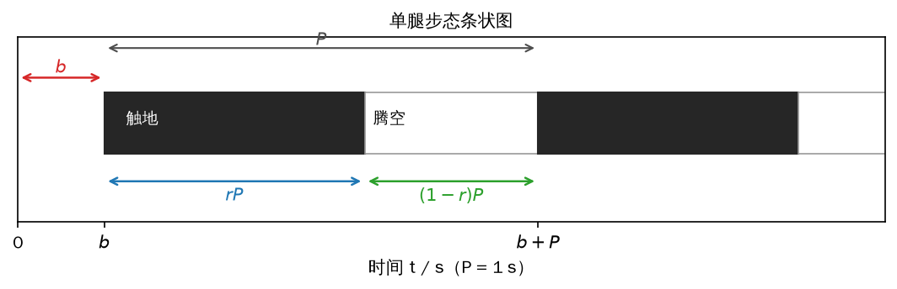
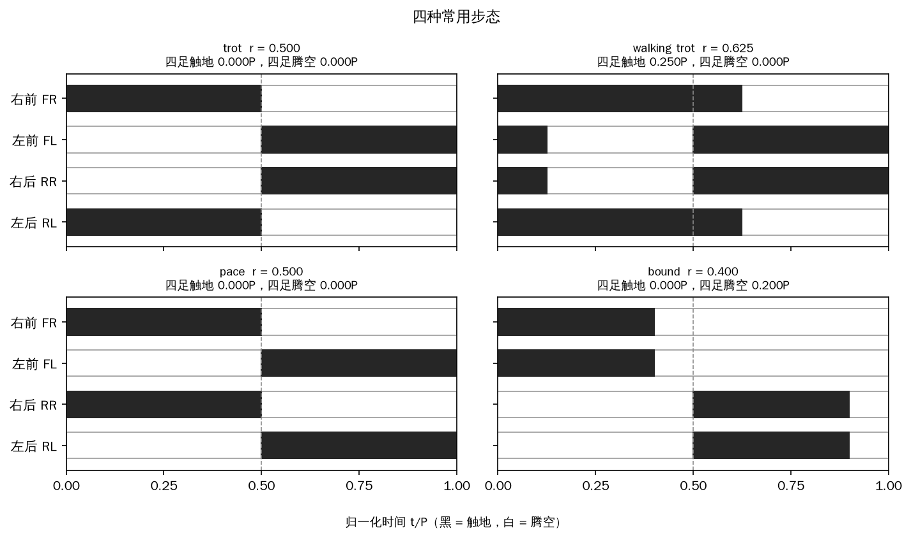
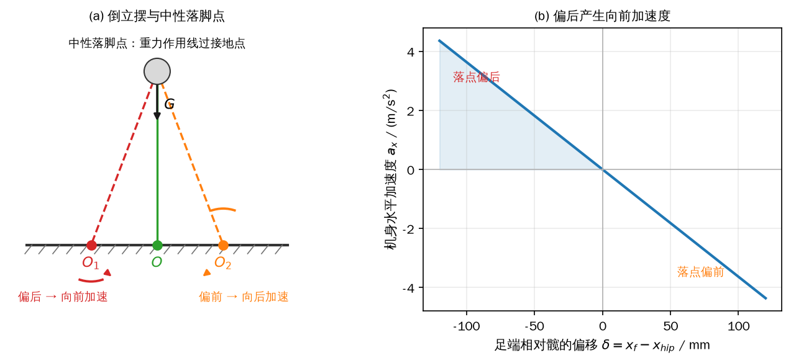
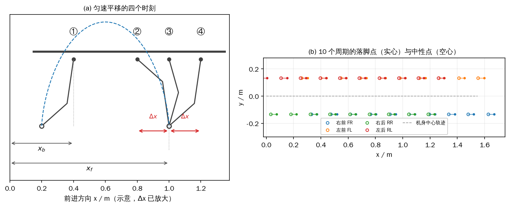
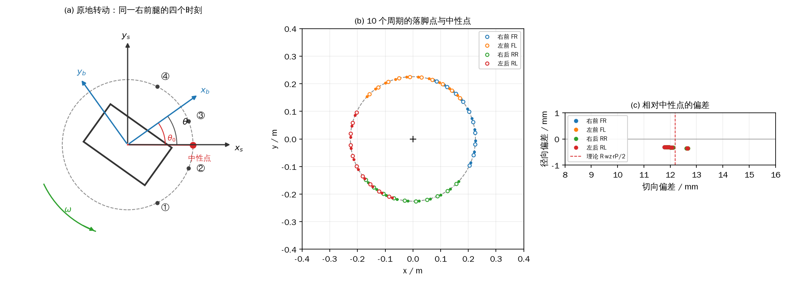
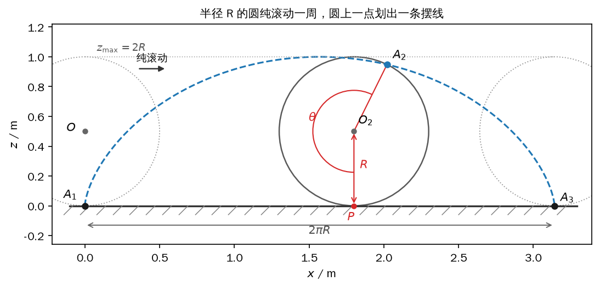
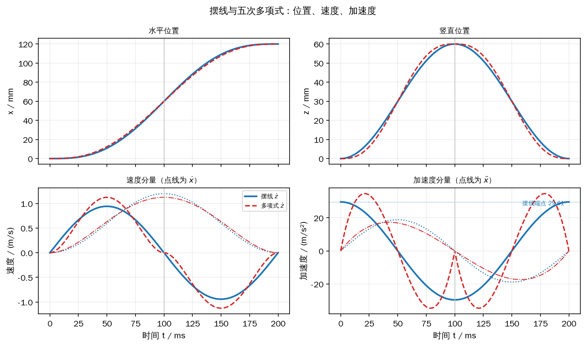
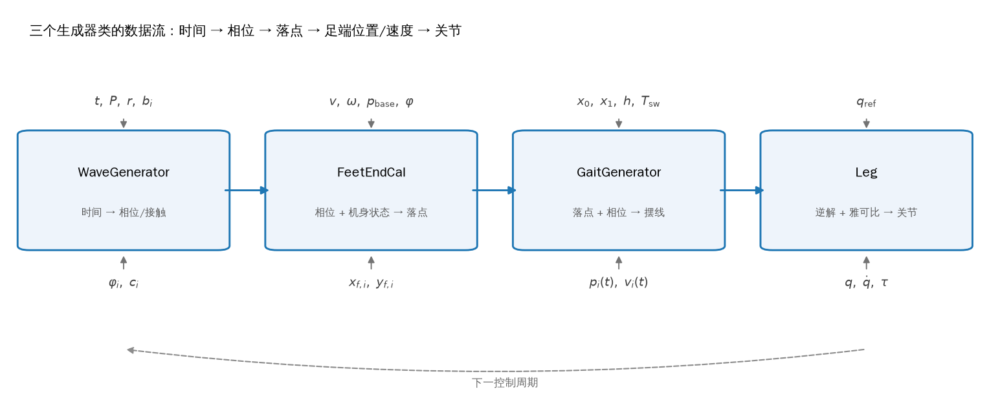
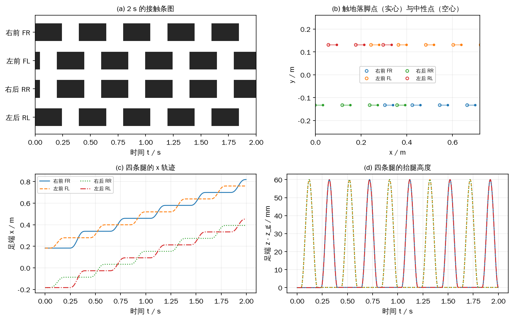

# 第 9 章 步态与轨迹：把脚放到该去的地方

第 8 章把四个足端都按在地上，用位姿 PD、QP 和单腿静力学分配支撑力。那套方法能让机器人站稳、抗住一次推扰，也能让机身做几厘米的小范围移动，但足端始终没有离开地面。要走得远，脚必须抬起来、在空中移到新的位置、再落下去；每落一次脚，机身就换到一块新的临时地基上。第 8 章回答“脚踩在地上怎样分力”，这一章回答“脚什么时候抬、落到哪、空中怎么走”。

这三个问题分别对应步态、落脚点和摆动轨迹。步态只排时间表：四条腿在一个周期里各自何时触地、何时腾空，不关心足端在空间中的坐标。落脚点把时间表接到空间上：根据机身速度、当前相位和期望速度，算出摆动腿应该落在哪个位置。摆动轨迹再把这个落点变成一条从离地点到落脚点的连续曲线，并给出每个时刻的位置与速度。三者串起来，才有一条完整的“时间 → 相位 → 落脚点 → 足端位置/速度”的链路。

这一章不接整机控制器，也不上实机。所有例子都是离线计算：先画步态条图，再画落脚点，最后画摆线。等这三组曲线都对了，第 10 章再把它们放进行走控制器，和状态估计、支撑力分配、摆动腿笛卡尔 PD 接在一起。符号沿用前面的约定：腿号 \(i=0,1,2,3\) 依次是右前、左前、右后、左后；世界系记 \(\{s\}\)，机身系记 \(\{b\}\)，单腿基座系记 \(\{0\}\)；机身偏航角记 \(\theta\)，逆时针为正。

## 9.1 步态：四条腿在时间轴上的分工

足端只有两种状态：触地时叫支撑腿（stance leg），腾空时叫摆动腿（swing leg）。四足行走时，每条腿都在这两个状态之间周期切换。把四条腿的切换时刻排成一张时间表，这张表就是步态（gait）。步态不描述足端在空间中的位置，也不描述机身怎样动；它只回答“第 \(i\) 条腿在第 \(t\) 时刻是支撑还是摆动”。同一个步态可以配不同的步长、不同的抬腿高度，空间上的差别由后面两节补上。

描述这张表需要四个量。第一个是步态周期 \(P\)，单位是秒，表示一条腿完成一次“触地—腾空”循环所需的时间。第二个是第 \(i\) 条腿的偏移时间 \(b_i\)，表示该腿第一次触地时刻相对全局 \(t=0\) 的延迟。第三个是触地系数（duty factor）\(r\)，表示触地时长占整个周期的比例。第四个是相位 \(\varphi\)，后面再定义。由 \(r\) 直接得到触地时长和腾空时长：

\[ T_{\mathrm{st}}=rP,\qquad T_{\mathrm{sw}}=(1-r)P. \tag{9-1} \]

这一章只讨论四条腿周期相等的情况。若四条腿的 \(P\) 不同，相位会一圈一圈地漂移，条状图不能再靠平移一条腿得到；那种步态在工程上很少用，也没有简单的解析落脚点公式。周期相等时，四条腿的差别全部落在 \(b_i\) 和 \(r\) 上。

把时间轴画成横条，黑色表示触地、白色表示腾空，就得到图 9-1 的单腿步态条状图。图中这条腿在 \(t=b\) 时第一次触地，黑色段长 \(rP\)；随后腾空，白色段长 \((1-r)P\)；到 \(t=b+P\) 时下一次触地，图案重复。偏移时间 \(b\) 是相位上的“延迟”，不是空间上的距离；它决定这条腿比参考腿晚多久开始支撑。



*图 9-1 一条腿在一个周期内的触地（黑）与腾空（白）；偏移时间 \(b\)、触地时长 \(rP\)、腾空时长 \((1-r)P\) 都画在同一根时间轴上*

最常见的四足步态是对角步态（trot）。按右前、左前、右后、左后的顺序取偏移时间

\[ b=[0,\ P/2,\ P/2,\ 0], \tag{9-2} \]

也就是右前和左后同相，左前和右后同相，两条对角线相差半个周期。取 \(r=0.5\)，每条腿触地和腾空各占一半；任意时刻通常有两条位于对角线的腿触地，另外两条腾空。对角支撑的好处是支撑点交叉分布在机身两侧，机身的横滚和俯仰都能找到力臂；坏处是只有两个点接触时，绕两点连线的力矩没有独立的着力点，第 8 章的 6 维力/力矩方程会掉秩。这个问题在第 10 章会用更大的触地系数避开，这里先记住它是 trot 的固有几何限制。

让触地系数大于 0.5，就得到步行对角步态（walking trot）。这时触地时间超过半个周期，一个周期里会出现两段四条腿同时触地的状态，每段时长记作 \(c\)。一个周期内，触地段由“四足同时触地 \(c\) + 只有对角两足触地 \((1-r)P\) + 四足同时触地 \(c\)”拼成，于是

<!-- 原书式（9.1） -->
\[ rP=c+(1-r)P+c=2c+(1-r)P,\qquad c=\left(r-\frac12\right)P. \tag{9-3} \]

两段四足触地的总时长是 \(2c=(2r-1)P\)。\(r=0.5\) 时 \(c=0\)，退化成普通 trot；\(r\) 越大，四足同时触地的时间越长，支撑越稳，但可用于摆腿的时间越短，同样的步长要求更高的足端速度。用 \(c\) 求左前、右后相对右前、左后的偏移：

<!-- 原书式（9.2） -->
\[ b=c+(1-r)P=\left(r-\frac12\right)P+(1-r)P=\frac{P}{2}. \tag{9-4} \]

这个结果说明，\(r\) 改变的是触地和腾空的比例，不改变两条对角线之间半个周期的相位差。步行 trot 的 \(b\) 仍然是 \(P/2\)，奔跑 trot（\(r<0.5\)）也一样：只不过 \(r>0.5\) 时多出来的是四足同时触地，\(r<0.5\) 时多出来的是四足同时腾空。前者更稳、更慢，后者更快、更容易失稳。

改变 \(b_i\) 和 \(r\) 还能得到其他步态，不需要改控制器结构。pace（踱步）让同侧腿同相，偏移取 \([0,P/2,0,P/2]\)，\(r=0.5\)；任意时刻仍有两条腿触地，但支撑点在同侧，机身会明显左右摆。bound（跃进）让两条前腿同相、两条后腿同相，偏移取 \([0,0,P/2,P/2]\)，\(r<0.5\)，一个周期里有两段四足腾空，机身像前后交替弹跳。pronk（弹跳）四条腿完全同相，偏移全为零，适合原地跳或越障。walk（四拍步）的四条腿依次触地，偏移可以取 \([0,0.5,0.25,0.75]\)、\(r=0.75\) 这样的一组值；四拍步的支撑三角形最大，但一个周期要依次抬四次腿，速度最慢。这些参数不是唯一的，不同文献对同一名字的偏移和占空比取法略有差别；关键是看条状图，确认任意时刻有几条腿触地、有没有飞行相。

相位 \(\varphi\) 是“归一化时间”。对某条腿的某个状态，设状态开始时刻为 \(t_0\)、结束时刻为 \(t_1\)，则

<!-- 原书式（9.5） -->
\[ \varphi=\frac{t-t_0}{t_1-t_0}\in[0,1]. \tag{9-5} \]

支撑相和摆动相各有一个相位：支撑相的 \(\varphi\) 从触地时的 0 走到离地时的 1，摆动相的 \(\varphi\) 从离地时的 0 走到触地时的 1。它不是“整条腿的周期进度”，而是“当前状态已经走了多少”。第 9.2 节要用摆动相的 \(\varphi\) 估计“还有多久触地”，所以这个区分很要紧。若把整条腿的周期进度当成相位，算出来的剩余时间会差一个支撑相，落脚点会整体偏后。

步态参数不能突变。机器人从固定站立切到行走时，四条腿都从触地开始；如果直接在某个时刻把四条腿的相位改成 trot 的相位，原本支撑的腿可能瞬间被要求抬起，原本腾空的腿可能瞬间被要求落地，机身会吃到一次冲击。正确做法是只在足端处于稳定触地的阶段切换：等这条腿进入支撑相、脚掌已经踩实，再改它的相位或周期；四条腿分几次改完，每次只改一条或一对。切换周期时也要从触地时刻重新起算，不能让相位在周期中间跳变。

示例 `9_1_gait.py` 用四条腿的条状图检查这些关系。程序不调用步态生成器也能算，但它同时用 `WaveGenerator` 采样做交叉校验：先用解析区间算出四足同时触地、四足同时腾空的时长和最少触地腿数，再让生成器以 2 ms 采样走一遍，两者必须一致。四种步态都取 \(P=1\) s，方便把时间直接读成占空比。

```python
{{#include code/ch09/9_1_gait.py:intervals}}
```

```python
{{#include code/ch09/9_1_gait.py:bars}}
```

```console
{{#include code/ch09/9_1_gait.out}}
```

trot 的触地和腾空各 0.5 s，四足同时触地为 0，最少触地腿数是 2；walking trot 取 \(r=0.625\)，触地 0.625 s、腾空 0.375 s，四足同时触地 0.25 s，正好是 \(2c=(2r-1)P=0.25\) s，最少触地腿数仍是 2；pace 的占空比和 trot 一样，但支撑的是同侧两条腿，最少触地腿数也是 2；bound 取 \(r=0.4\)，触地 0.4 s、腾空 0.6 s，一个周期里有两段各 0.1 s 的四足腾空，最少触地腿数是 0。采样校验和区间解完全一致，说明条状图的边界没有画错。



*图 9-2 2×2 面板：trot、walking trot、pace、bound 的条状图；黑为触地、白为腾空，虚线标出半周期，标题下给出四足同时触地和同时腾空的时长*

图 9-2 里的 walking trot 和原书图示的相位起点略有不同：本书以右前腿触地为 \(t=0\)，左前腿在半个周期后触地，所以左前、右后的黑条跨越了周期边界，在 0 附近留下一小段。这是相位起点的选择，不是步态不同；两段四足同时触地的时长仍等于 \(c\)。原书图 9.2b、9.2c 里的 \(r\) 值（约 0.625、0.375）和 bound 的 0.375 都是从图上读出的示例，不是步态的定义；本书示例明确写出所用数值，换一组参数，条状图会跟着变。

最后说明本书共用包的 trot 默认参数。原书 trot 示例取 \(r\approx0.5\)，两条对角腿交替支撑；本书 `GaitParams.trot` 默认 \(P=0.36\) s、\(r=0.60\)，`GaitParams()` 的默认值相同。改占空比不是为了改变步态名称，而是因为 \(r=0.5\) 时只有两个点接触，6 维力/力矩方程对绕两接触点连线的力矩掉秩；在 MuJoCo 里给横向速度指令时，这个欠约束会激发逐渐增长的横滚振荡。把 \(r\) 提到 0.60，每个周期多出两段很短的四足同时触地，方程满秩，横滚就稳住了。代价是腾空时间从 0.18 s 降到 0.144 s，同样的步长需要更快的摆腿；这个取舍在第 10 章还会出现。示例 9_1 为了把 \(c\) 画清楚仍取 \(r=0.625\)，9.4 节则用 \(P=0.40\) s、\(r=0.60\) 跑整循环，正文里的数值和各自脚本一致。

## 9.2 落脚点规划：中性点 + Raibert 修正

步态只排时间，落脚点才决定摆动腿往哪里去。落脚点选得不对，支撑腿的力再分配得好，机身也会越走越快或越走越慢。这一节先从一个足端的倒立摆模型引出“中性点”，再分别处理匀速平移、相位预测、速度误差修正和原地转动，最后合成完整的落点公式。

### 中性落脚点

把一个质量集中在机身上的倒立摆想成一条可伸缩的腿：上端是机身，下端是地面接触点，腿长可以变，但机身高度保持不变。接触点正好在机身正下方时，重力作用线穿过接触点，重力对接触点不产生力矩，倒立摆既不向前倒也不向后倒。这个接触点就是中性落脚点（neutral point）。接触点偏后，重力作用线落到接触点前方，重力矩把机身往前推；接触点偏前，重力矩把机身往后拉。图 9-3 画出了这三种情况。



*图 9-3 (a) 接触点在 \(O\) 时重力矩为零，在 \(O_1\)、\(O_2\) 时分别产生向前、向后的力矩；(b) 机身水平加速度与足端相对髋的偏移符号相反（负斜率），偏移为负（脚偏后）时加速度为正*

把机身水平位置记作 \(x\)，足端位置记作 \(x_f\)，机身高度记作 \(h\)。对接触点取力矩，重力矩是 \(mg(x-x_f)\)，倒立摆绕接触点的转动惯量近似为 \(mh^2\)，于是

\[ \ddot x=\frac{g}{h}\left(x-x_f\right). \tag{9-6} \]

这个式子说明：\(x>x_f\)（机身跑到脚前面）时 \(\ddot x>0\)，机身继续往前倒；\(x<x_f\) 时 \(\ddot x<0\)，机身往后倒。它只在足端不滑动、机身高度不变、腿部质量可以忽略时成立，但这三条假设在平地上慢走时足够用。

对四足机器人，通常同时有多个足端触地，严格的中性点要通过支撑多边形的合力矩来定义。工程上采用一个简化：把每条腿的中性点取在该腿足端正下方、与髋同高的地面投影处，机身重心在地面的投影落在对角两条腿中性点连线的中点。原书说 A1 的重心大致在躯干形心；本书第 6 章按 Menagerie 模型称过，腿占总质量的 62.2%，整机重心比躯干形心低，但水平投影仍在机身中心附近，所以这个水平方向的近似仍然成立。需要注意，A1 站立时腿是外展的：按 home 位形 \(q=0.9/-1.8\) rad 做正解，四个足端球心在机身系中是 \((\pm0.183,\mp0.132,-0.249)\) m（前腿取 \(+0.183\)，右腿取 \(-0.132\)），中性点到机身中心的半径 \(R=0.2257\) m，而髋关节投影的半径只有 \(0.1893\) m。足端比髋横向偏了约 85 mm，到机身中心的半径也由 0.1893 m 增到 0.2257 m，所以“中性点在髋正下方”只是近似；本书计算 \(R\) 和方位角 \(\theta_0\) 时用足端正解，不用髋的安装位置。这个差别在平移时只影响 \(y\) 的常数偏置，在转动时会影响整个落点圆弧。

### 匀速平移的落脚点

先看最简单的情况：机身以恒定速度 \(v_x\) 沿 \(x\) 前进，一条腿从 ① 离地，经过腾空到 ② 触地，再经过支撑到 ③ 时足端正好在髋的正下方，到 ④ 又离地。图 9-4(a) 画了这四个时刻。支撑期间足端在世界系中不动，机身往前走，所以髋相对足端从“落后”变成“超前”。如果触地时足端在髋前方半个支撑相行程处，那么半个支撑相后髋走到足端正上方，再过半个支撑相髋走到足端前方同样的距离；整个支撑相内髋相对足端对称地扫过 \(-\Delta x\) 到 \(+\Delta x\)，平均加速度为零。半个支撑相行程是

<!-- 原书式（9.3） -->
\[ \Delta x=\frac12 v_x T_{\mathrm{st}}. \tag{9-7} \]

设 ① 时刻髋的 \(x\) 坐标为 \(x_{h,0}\)，从 ① 到 ② 经过 \(T_{\mathrm{sw}}\)，髋前进 \(v_xT_{\mathrm{sw}}\)，再经过半个支撑相前进 \(\Delta x\)，到达 ③。落点就是 ③ 时刻髋正下方的位置，所以

<!-- 原书式（9.4） -->
\[ x_f=x_{h,0}+v_xT_{\mathrm{sw}}+\Delta x=x_{h,0}+v_x\left(T_{\mathrm{sw}}+\frac12T_{\mathrm{st}}\right). \tag{9-8} \]

原书在这里用 \(x_b\) 表示 ① 时刻大腿关节的 \(x\) 坐标；本书把它写成 \(x_{h,0}\)，把 \(x_b\) 留给 9.2.2 节的机身中心。两个符号混用会让读者把“髋的位置”和“机身中心的位置”直接相加，得到偏掉一个髋偏移的落点。

式（9-8）假设整个腾空和支撑期间速度不变。实际速度由估计器给出，会随打滑、地形和负载变化；等腿快触地时再按离地时的速度算，误差已经积累了一个腾空相。用相位把“剩余时间”接进来，就能在腾空过程中不断修正。设当前处于摆动相、相位为 \(\varphi\)，剩余腾空时间是 \((1-\varphi)T_{\mathrm{sw}}\)，触地后到中性点还有半个支撑相 \(T_{\mathrm{st}}/2\)，于是

<!-- 原书式（9.6） -->
\[ x_f=x_h(\varphi)+v_x\left[(1-\varphi)T_{\mathrm{sw}}+\frac12T_{\mathrm{st}}\right]. \tag{9-9} \]

这里 \(x_h(\varphi)\) 是当前时刻髋的 \(x\) 坐标，不是离地时刻的 \(x_{h,0}\)。\(\varphi=1\) 时剩余腾空为零，式（9-9）退化成 \(x_f=x_h(1)+\Delta x\)，与式（9-8）一致；\(\varphi=0\) 时多算一整个腾空相的位移。这个式子是“预测”，只在速度估计在剩余时间内不变的假设下成立；速度一变，预测就会偏，所以还需要下一段的修正。

### 速度误差修正

式（9-9）只保证“按当前速度，脚会落在中性点前方半个支撑相处”，不保证速度等于期望值。如果实际速度高于期望，落点应该再往前放一点，让支撑腿把机身往后推；实际速度低于期望，落点往后收，让机身往前加速。把期望速度记作 \(v_{xd},v_{yd}\)，误差增益记作 \(k_x,k_y\)，得到 Raibert 启发落脚点（Raibert heuristic footstep）：

<!-- 原书式（9.7） -->
\[ \begin{cases} x_f=x_h(\varphi)+v_x\left[(1-\varphi)T_{\mathrm{sw}}+\dfrac12T_{\mathrm{st}}\right]+k_x\left(v_x-v_{xd}\right),\\[6pt] y_f=y_h(\varphi)+v_y\left[(1-\varphi)T_{\mathrm{sw}}+\dfrac12T_{\mathrm{st}}\right]+k_y\left(v_y-v_{yd}\right). \end{cases} \tag{9-10} \]

\(k_x,k_y\) 的量纲是时间，不是无量纲增益：速度误差乘上它才是距离。A1 在 \(P=0.36\) s、\(r=0.60\) 时，\(k_x=0.06\) s 对应“速度差 0.1 m/s 就把落点挪 6 mm”。这个值太小，速度漂移收不回来；太大，落点会随速度噪声来回跳，支撑腿的力也跟着抖。平地可以先从 \(0.03\sim0.08\) s 试，实机上再按打滑和噪声往下调。

加上修正项后，\(\varphi=1\) 时落点与髋的距离不再等于 \(\Delta x\)，而是 \(\Delta x+k_x(v_x-v_{xd})\)。这不是公式推错了，而是 Raibert 方法的核心：中性点只负责“不加速”，速度误差要靠故意偏离中性点来修。把“保证等于 \(\Delta x\)”和“按误差偏移”分开看，就不会觉得两式矛盾。

### 原地转动的落脚点

机身绕竖直轴转动时，中性点不再沿直线平移，而是绕机身中心画圆弧。设机身中心在世界系中的位置是 \((x_b,y_b)\)，偏航角是 \(\theta_p\)（逆时针为正），当前角速度是 \(\omega\)，期望角速度是 \(\omega_d\)。第 \(i\) 条腿的中性点在机身系中的方位角记作 \(\theta_{0,i}\)，到机身中心的距离记作 \(R_i\)。以右前腿为例，① 离地、② 触地、③ 髋到中性点上方、④ 再离地；② 和 ④ 仍关于 ③ 对称。把平移公式里的“速度乘时间”换成“角速度乘时间”，得到目标方位角

<!-- 原书式（9.8） -->
\[ \theta_{f,i}=\theta_p+\theta_{0,i}+\omega\left[(1-\varphi)T_{\mathrm{sw}}+\frac12T_{\mathrm{st}}\right]+k_\omega\left(\omega-\omega_d\right). \tag{9-11} \]

这里 \(k_\omega\) 的量纲是秒，和 \(k_x,k_y\) 对应；代码里常把它叫 `kyaw`。正负号要统一：\(\theta_p\)、\(\theta_{0,i}\)、\(\omega\) 都按逆时针为正，右前腿的 \(\theta_{0,i}\) 是负的（约 \(-35.8^\circ\)），左前是正的，右后、左后分别约 \(-144.2^\circ\)、\(+144.2^\circ\)。原书图 9.6 把 \(\theta\) 画成 \(x_b\) 到 \(x_s\) 的夹角，又没有说明顺逆时针，照图直接代数相加容易把右前腿的落点算到左边去。本书统一用逆时针为正，并在代码里用 `atan2(y, x)` 从中性点坐标直接算 \(\theta_{0,i}\)。

得到 \(\theta_{f,i}\) 后，落点相对机身中心的位置是

<!-- 原书式（9.9） -->
\[ x_{f,i}=R_i\cos\theta_{f,i},\qquad y_{f,i}=R_i\sin\theta_{f,i}. \tag{9-12} \]

式（9-12）是相对机身中心的坐标，不是世界坐标；原书在这里说“世界坐标系中的 \(x,y\)”是不准确的，世界坐标还要加 \((x_b,y_b)\)。把平移项、转动项和速度修正合在一起，第 \(i\) 个足端的完整落点是

<!-- 原书式（9.10） -->
\[ \begin{cases} x_i=x_b+R_i\cos\theta_{f,i}+v_x\left[(1-\varphi)T_{\mathrm{sw}}+\dfrac12T_{\mathrm{st}}\right]+k_x\left(v_x-v_{xd}\right),\\[6pt] y_i=y_b+R_i\sin\theta_{f,i}+v_y\left[(1-\varphi)T_{\mathrm{sw}}+\dfrac12T_{\mathrm{st}}\right]+k_y\left(v_y-v_{yd}\right). \end{cases} \tag{9-13} \]

式（9-13）对每条腿用自己的 \(R_i,\theta_{0,i},\theta_{f,i}\)；原书为了简洁省略了下标，读者容易以为四条腿共用一个方位角。两个退化情形可以检查符号：纯平移时 \(\omega=\omega_d=0\)，\(\theta_{f,i}=\theta_p+\theta_{0,i}\) 是常数，式（9-13）退化成式（9-10）再加机身中心；纯转动时 \(v_x=v_y=0\)，落点落在以机身中心为圆心、半径 \(R_i\) 的圆弧上。两个退化情形都对了，再去看平移和转动同时存在的情况。

### 边界与代码

落点算出来不等于脚一定能踩到。先要检查它落在单腿工作空间内：A1 的大腿和小腿各 0.2 m，足端球半径 0.02 m，中性点半径 0.226 m，腿已经伸得比较直；再往前放几十毫米，逆解可能碰到奇异位形或关节限位。然后要检查落点不碰机身、不和其他腿的落点交叉，四条腿的落点还要满足支撑多边形的形状要求。最后是地形：落点下方如果有台阶或坑，足端不能按平地高度落地；第 10.7.1 节会用地形感知去改落点高度和抬腿轨迹。这一节只算水平 \(x,y\)，\(z\) 由地面高度和摆动轨迹给。

示例 `9_2_footstep.py` 用 A1 的实际几何跑两组 10 周期的场景：一组以 \(v_x=0.4\) m/s 直行，一组以 \(\omega_z=0.5\) rad/s 原地转。机身运动是运动学给定的，不是闭环控制；为了让 Raibert 修正项不为零，程序给指令速度叠了一个幅值 0.02 m/s（约 5%）、周期 0.55 s 的正弦误差，模拟估计器和打滑带来的速度波动。程序在每个足端由腾空变触地的时刻记录落点，再和该时刻的中性点比较。

```python
{{#include code/ch09/9_2_footstep.py:run}}
```

```console
{{#include code/ch09/9_2_footstep.out}}
```

平移组记录 40 个落点，相对中性点的前移均值 43.25 mm，理论值 \(v_xT_{\mathrm{st}}/2=0.4\times0.216/2=43.20\) mm，差 0.05 mm；标准差 1.53 mm，来自叠加的速度波动同时进入预测项和修正项。横向偏差均值 0.000 mm，因为直行时 \(v_y=0\)、\(\theta_{0,i}\) 的横向分量是常数。Raibert 修正项均值 0.03 mm、RMS 0.85 mm，说明这组速度波动下修正量只有亚毫米级；速度误差 RMS 0.0142 m/s、最大 0.0200 m/s，和注入的 0.02 m/s 幅值一致。

转动组同样记录 40 个落点。相对中性点的切向超前均值 12.19 mm，理论值 \(R\omega T_{\mathrm{st}}/2=0.2257\times0.5\times0.108=12.19\) mm，标准差 0.35 mm；径向偏差均值 \(-0.330\) mm，最大 0.356 mm，说明落点确实落在半径 \(R\) 的圆弧附近。角速度误差 RMS 0.0142 rad/s、最大 0.0200 rad/s，累计转角 1.800 rad（103.13°）。图 9-5(c) 把 40 个落点相对中性点的偏差画在切向—径向坐标里，点集中在 \(12.2\) mm 附近，径向在 0 上下不到 0.4 mm。



*图 9-4 (a) 匀速平移的四个时刻，\(\Delta x\) 是半个支撑相的位移，图中已放大；(b) 10 个周期的实际落点（实心）与中性点（空心），连线是 Raibert 修正后的前移量*



*图 9-5 (a) 原地转动时同一右前腿在四个时刻的中性点位置；(b) 10 个周期的落点与中性点；(c) 落点相对中性点的切向、径向偏差，虚线是理论切向超前 12.19 mm*

实机上落脚点误差会被打滑放大。仿真里足端球和地面的摩擦系数固定，落点到了就基本不动；实机的橡胶足端会压缩、会滚动，落地瞬间的切向速度如果没压到零，脚会在地上蹭几毫米，下一次落脚点又从这个蹭过的位置算起，误差会累积。工程上的对策一是把摆动腿落地前的切向速度压到接近零（9.3 节的摆线就是为此选的），二是用接触开关和关节力矩估计实际落点，三是把 \(k_x,k_y\) 适当调小，别让落点对速度噪声太敏感。这一节不需要实机，所有数值都可以在离线脚本里复现。

## 9.3 摆动腿轨迹：摆线的几何与速度

落脚点确定后，摆动腿要从当前离地点走到这个落点。对这条空中轨迹有三条期望：起落时刻足端速度小，最好在水平面没有滑动趋势；中段走得快，别把腾空时间浪费在慢慢挪腿上；整条曲线平滑，没有来回抖动。三条期望对应三个约束：两端速度为零、中段速度峰值高、加速度连续。多项式、分段直线和摆线都能满足一部分；多项式可以指定中途点和起落加速度，但系数要解线性方程组；分段直线设计简单，但折角处速度方向突变，落地会有冲击；摆线的表达式简单，参数有明确的几何意义，平地上够用，所以本书默认选摆线。

### 摆线的几何

取一个半径为 \(R\) 的圆，在水平地面上向右纯滚动。圆上固定一点 \(A\)，初始时 \(A\) 与地面接触于 \(A_1\)；圆滚过一圈，\(A\) 依次经过 \(A_2\)，最后到 \(A_3\)。\(A\) 在空间中划出的整段曲线就是摆线（cycloid），不是只有 \(A_2A_3\) 那一小段。图 9-6 画出了滚动过程中的几何关系。



*图 9-6 半径 \(R\) 的圆纯滚动一周，圆上一点从 \(A_1\) 经 \(A_2\) 到 \(A_3\)；水平行程 \(2\pi R\)，最高点 \(2R\)*

设圆滚过的角度为 \(\theta\)。纯滚动保证接触点到 \(A_1\) 的弧长等于圆心的水平位移，即 \(R\theta\)，所以圆心 \(O_2\) 的坐标是 \((R\theta,R)\)。从圆心指向 \(A_2\) 的半径向量，从竖直向下位置按滚动方向（顺时针）转过了 \(\theta\)，于是

<!-- 原书式（9.11） -->
\[ \begin{cases} x=R\theta-R\sin\theta=R(\theta-\sin\theta),\\ z=R-R\cos\theta=R(1-\cos\theta). \end{cases} \tag{9-14} \]

式（9-14）就是摆线的参数方程，原书式（9.11）与它相同；本书把它单独编号，是为了后面引用方便。\(\theta=0\) 时 \((x,z)=(0,0)\)，对应 \(A_1\)；\(\theta=2\pi\) 时 \((x,z)=(2\pi R,0)\)，对应 \(A_3\)；\(\theta=\pi\) 时 \(z=2R\)，是最高点。

把滚动角换成时间。设圆滚一圈、也就是摆动相持续的时间为 \(T_{\mathrm{sw}}\)，令 \(\theta=2\pi t/T_{\mathrm{sw}}\)，\(t\in[0,T_{\mathrm{sw}}]\)，得到

<!-- 原书式（9.12） -->
\[ \begin{cases} x=R\left(\dfrac{2\pi t}{T_{\mathrm{sw}}}-\sin\dfrac{2\pi t}{T_{\mathrm{sw}}}\right),\\[6pt] z=R\left(1-\cos\dfrac{2\pi t}{T_{\mathrm{sw}}}\right). \end{cases} \tag{9-15} \]

对时间求导，注意 \(\dot\theta=2\pi/T_{\mathrm{sw}}\)，得到速度

<!-- 原书式（9.13） -->
\[ \begin{cases} \dot x=\dfrac{2\pi R}{T_{\mathrm{sw}}}\left(1-\cos\dfrac{2\pi t}{T_{\mathrm{sw}}}\right),\\[6pt] \dot z=\dfrac{2\pi R}{T_{\mathrm{sw}}}\sin\dfrac{2\pi t}{T_{\mathrm{sw}}}. \end{cases} \tag{9-16} \]

\(t=0\) 和 \(t=T_{\mathrm{sw}}\) 时 \(\cos(2\pi t/T_{\mathrm{sw}})=1\)、\(\sin=0\)，所以 \(\dot x=\dot z=0\)，起落速度为零。\(t=T_{\mathrm{sw}}/2\) 时 \(\dot x=4\pi R/T_{\mathrm{sw}}\) 达到最大，\(\dot z=0\)，对应最高点。\(\dot x\) 恒为非负，说明足端在水平方向只会向前走，不会倒退；这也是摆线适合平地步行的原因之一。

### 缩放与三维扩展

基本摆线有两个绑在一起的尺寸：水平行程是 \(2\pi R\)，最高点是 \(2R\)。只要 \(R\) 定了，步长和抬腿高度就都定了，不能单独调节。实际步长 \(L\) 往往不等于 \(2\pi R\)，抬腿高度 \(h\) 也不等于 \(2R\)。如果对 \(x\) 和 \(z\) 同比例缩放 \(L/(2\pi R)\)，水平行程会变成 \(L\)，但最高点也会变成 \(2R\cdot L/(2\pi R)=L/\pi\)，高度仍然被步长绑死。要同时指定 \(L\) 和 \(h\)，必须对 \(x,y\) 和 \(z\) 用不同的缩放比例：先令 \(R=h/2\) 把高度定成 \(h\)，再单独把 \(x,y\) 缩放到目标步长。水平速度也跟着各自的缩放系数变：\(x\) 方向乘 \((x_1-x_0)/(2\pi R)\)，\(y\) 方向乘 \((y_1-y_0)/(2\pi R)\)，竖直速度乘 \(h/(2R)\)。所以同样的摆动时间下，步长越大、抬腿越高，足端速度越大。这样得到的曲线已经不是严格的等比例摆线，但保留了“两端速度为零、中段快”的形状，工程上仍叫它摆线轨迹。

设足端从 \((x_0,y_0,z_0)\) 离地，落点是 \((x_1,y_1,z_1)\)，摆动相相位 \(p=t/T_{\mathrm{sw}}\in[0,1]\)，抬腿高度 \(h\)（相对离地点，不是绝对高度）。把 \(R=h/2\) 代入式（9-15），\(x,y\) 各自按起终点差缩放，得到

<!-- 原书式（9.14） -->
\[ \begin{cases} x_c=x_0+\dfrac{x_1-x_0}{2\pi}\left(2\pi p-\sin 2\pi p\right),\\[6pt] y_c=y_0+\dfrac{y_1-y_0}{2\pi}\left(2\pi p-\sin 2\pi p\right),\\[6pt] z_c=z_0+\left(z_1-z_0\right)p+\dfrac{h}{2}\left(1-\cos 2\pi p\right). \end{cases} \tag{9-17} \]

对时间求导，用 \(\dot p=1/T_{\mathrm{sw}}\)，得到

<!-- 原书式（9.15） -->
\[ \begin{cases} \dot x_c=\dfrac{x_1-x_0}{T_{\mathrm{sw}}}\left(1-\cos 2\pi p\right),\\[6pt] \dot y_c=\dfrac{y_1-y_0}{T_{\mathrm{sw}}}\left(1-\cos 2\pi p\right),\\[6pt] \dot z_c=\dfrac{z_1-z_0}{T_{\mathrm{sw}}}+\dfrac{\pi h}{T_{\mathrm{sw}}}\sin 2\pi p. \end{cases} \tag{9-18} \]

式（9-17）的 \(z_c\) 比原书式（9.14）多了一项 \((z_1-z_0)p\)。原书开头写落点是 \((x_1,y_1,z_1)\)，但式（9.14）只让 \(z\) 回到 \(z_0\)；起落高度不同时，足端会在触地瞬间从 \(z_0\) 跳到 \(z_1\)，位置不连续。加上线性项后，\(p=0\) 时 \(z_c=z_0\)，\(p=1\) 时 \(z_c=z_1\)，位置连续了。代价是两端多出 \((z_1-z_0)/T_{\mathrm{sw}}\) 的竖直速度：平地 \(z_1=z_0\) 时这项为零，不影响“起落速度为零”；上下台阶时这项不为零，落地会有竖直冲击。高度差大时，应把线性项换成 \(3p^2-2p^3\) 这样的平滑项，或者直接用五次多项式；那会牺牲一些端点加速度的平滑性，但能把竖直速度压回零。这个取舍在第 10.7.1 节越障时会再讨论。

式（9-17）的 \(x,y\) 用同一个 \(2\pi p-\sin 2\pi p\) 形状，各自带自己的起终点差；\(z\) 用 \(1-\cos 2\pi p\) 抬到 \(z_0+h\) 再落回。三维轨迹的形状由 \(x_1-x_0\)、\(y_1-y_0\)、\(h\) 三个量决定：改 \(h\) 只改抬腿高度，改水平差只改步长，二者已经解耦。\(p=0.5\) 时 \(z_c=z_0+(z_1-z_0)/2+h/2\)，是最高点；如果 \(z_1=z_0\)，最高点就是 \(z_0+h\)。

这里的 \(x_c,y_c,z_c\) 都在世界系 \(\{s\}\) 中。第 5.4 节的逆运动学和笛卡尔 PD 是在单腿基座系 \(\{0\}\) 中定义的，送进去之前要先做两次变换：世界系到机身系 \(\boldsymbol p_b=\boldsymbol R_{sb}^{\mathrm T}(\boldsymbol p_s-\boldsymbol p_{sb})\)，再减掉髋安装偏置得到腿基座系。速度也要跟着旋转，\(\boldsymbol v_b=\boldsymbol R_{sb}^{\mathrm T}\boldsymbol v_s\)；如果只转位置不转速度，逆解得到的关节角速度方向会错。这个变换在第 9.4 节的 `GaitGenerator` 输出之后、`Leg.ik` 之前完成。

### 摆线与五次多项式的对比

示例 `9_3_cycloid.py` 取步长 \(L=0.12\) m、抬腿高度 \(h=0.06\) m、摆动时间 \(T_{\mathrm{sw}}=0.2\) s，把摆线和一条分段五次多项式放在一起比较。五次多项式在 \(p\in[0,0.5]\) 从 0 升到 \(h\)，在 \([0.5,1]\) 从 \(h\) 降回 0；每一段都用 \(10s^3-15s^4+6s^5\)，两端的速度和加速度都为零，中点也连续。水平方向用同一条五次曲线从 \(x_0\) 走到 \(x_1\)。

```python
{{#include code/ch09/9_3_cycloid.py:cycloid}}
```

```python
{{#include code/ch09/9_3_cycloid.py:quintic}}
```

```console
{{#include code/ch09/9_3_cycloid.out}}
```

两种轨迹的最大高度都是 60.00 mm，起落速度都是 0。摆线的最大速度是 1.2221 m/s，出现在 73.8 ms；五次多项式是 1.3151 m/s，出现在 56.1 ms。注意 1.2221 不是单独某个方向的速度：水平分量在 \(p=0.5\) 时达到 \(2L/T_{\mathrm{sw}}=1.2\) m/s，竖直分量在 \(p=0.25\) 时达到 \(\pi h/T_{\mathrm{sw}}=0.9425\) m/s，两个峰值错开，合速度的峰值是 1.2221 m/s。五次多项式的水平峰值是 \(1.875L/T_{\mathrm{sw}}=1.125\) m/s，竖直峰值是 \(3.75h/T_{\mathrm{sw}}=1.125\) m/s，合速度峰值 1.3151 m/s，比摆线高约 7.6%。

加速度的差别更值得看。摆线的 \(|a_x|\) 峰值 18.85 m/s²、\(|a_z|\) 峰值 29.61 m/s²，合加速度峰值 29.61 m/s²；五次多项式的 \(|a_x|\) 峰值 17.32 m/s²、\(|a_z|\) 峰值 34.64 m/s²，合加速度峰值 37.23 m/s²，比摆线高约 26%。但摆线在起落点的加速度是 \((0,29.61)\) m/s²：速度虽然为零，加速度却从支撑相的 0 直接跳到 29.61，落地瞬间有一个加速度台阶，等效于一次冲击。五次多项式把端点加速度也压到 \((0,0)\)，代价是中段加速度峰值更高。也就是说，摆线并不是“加速度最小”的轨迹，它只是“峰值较低、表达式简单”；五次多项式用更高的峰值换来了端点的平滑。平地步行为什么仍常用摆线：足端落地前的竖直速度已经压到零，剩下的不连续是加速度（也就是力）的台阶；这个台阶比五次多项式的中段加速度峰值更容易被电机和接触柔度吸收，而且摆线表达式简单、计算量小，峰值也更低。



*图 9-7 摆线（实线）与五次多项式（虚线）的 \(x(t)\)、\(z(t)\)、速度分量和加速度分量；点线是水平分量，灰色竖线是 \(T_{\mathrm{sw}}/2\)*

如果要在越障时指定中途点、或者要求起落加速度也为零，五次多项式或贝塞尔曲线更方便：给定若干控制点，解一个线性方程组就能让曲线经过它们。摆线的形状被 \(h\) 和水平差锁死，中途不能拐弯；在平地上这不是问题，遇到台阶或障碍就不够用了。第 10.7.1 节会把地形高度接进落点，把摆线换成带中途点的多项式。这一节不需要实机，所有曲线都能在离线脚本里复现。

## 9.4 实践：三个生成器类

前面三节各有一个公式群，落到代码里是三个类。`WaveGenerator` 管“时间 → 相位/接触”，`FeetEndCal` 管“相位 + 机身状态 → 落点”，`GaitGenerator` 管“落点 + 相位 → 摆线位置/速度”。三个类串起来，再接第 5 章的 `Leg.ik` 和 `Leg.jacobian`，就是一条完整的足端参考生成链。图 9-8 画出了这条链的输入输出。



*图 9-8 时间、步态参数和机身状态依次经过三个生成器，变成四条腿的足端位置/速度，再送进单腿逆解和雅可比*

### WaveGenerator

这个类的构造参数是 `period`、`duty` 和 `offsets`，分别对应 \(P\)、\(r\) 和四条腿的 \(b_i/P\)。`step(t, status)` 返回两个长度 4 的数组：`phase` 是每条腿当前状态的相位，`contact` 是 1/0 的触地标志。`stance_time`/`swing_time` 返回 \(rP\)、\((1-r)P\)，上层不用自己重算。`status` 有三种：`STANCE_ALL` 四条腿全触地，`SWING_ALL` 四条腿全腾空，`WAVE_ALL` 按 `offsets` 和 `duty` 交替。

这里有一个接口细节必须说清楚。共用包的 `step(t, status)` 在 `status` 不为空时会调用 `set_status(status, t)`，而 `set_status` 会把内部的时间起点 `_t0` 重置为 `t`。如果在每个控制周期都写 `step(t, "wave")`，`_t0` 会跟着 \(t\) 一起走，相位永远停在 0 附近，机器人看起来像在“原地抖腿”。正确用法是只在状态切换的那一次调用 `set_status("wave", t0)`，之后每周期调用 `step(t)`，不再传 `status`。示例 9_4 就是这么写的：`set_status(WAVE_ALL, 0.0)` 一次，循环里只调 `update(t, ...)`。还要注意，共用包的 `set_status` 只改状态、把 `_t0` 设到当前时刻，并不会自动等到“四条腿都踩实”再切；9.1 节说的稳定切换要由上层状态机判断。示例在 \(t=0\) 切换，是因为那时四条腿都触地；如果在周期中间切，就会违反 9.1 节的原则。

原书的 `WaveGenerator` 用 `calcContactPhase(phaseResult, contactResult, status)` 通过引用返回结果，还用 `setStartWave`、`setAllStance`、`setAllSwing` 控制启停，并用 `getTstance`、`getTswing`、`getT` 读取三个时长。本书的接口把这些合并成 `step`/`set_status` 和两个属性：`STANCE_ALL` 对应站立或停止踏步，`SWING_ALL` 只用于把机器人吊起来做单腿测试，不能在地面上直接切，否则四条支撑腿会同时失去支撑；`stance_time`/`swing_time` 对应前两个 getter，周期直接读 `period`。原书的 `freeze` 没有单独接口，要冻结相位就停止调用 `step`，或者把 `status` 切到 `STANCE_ALL` 并保持。原书提到的 `calWave` 是 `CtrlComponents` 里的封装函数，不是 `WaveGenerator` 的成员；本书不再保留这层包装，调用关系更直接。

### FeetEndCal

这个类的构造参数是 `kx`、`ky`、`kyaw`，分别对应式（9-10）的 \(k_x,k_y\) 和式（9-11）的 \(k_\omega\)。中性点半径 \(R_i\) 和方位角 \(\theta_{0,i}\) 不在构造函数里手填：构造时用 `A1Params.home_q` 做一次正解，得到四个足端球心，再算半径和方位角。这样换机器人、换站立构型时，\(R_i\) 和 \(\theta_{0,i}\) 自动跟着变，不会出现手填半径和实际腿长对不上。原书的 `FeetEndCal` 从机器人对象里读这些量，本包把它们显式存成数组，方便按腿取。核心方法是 `calc`，它实现式（9-13）。共用包的签名是

```text
calc(leg, v_cmd, w_cmd, base_pos, yaw, v_cur, w_cur, phase, stance_time, swing_time)
```

比大纲里的 `calc(leg, v_cmd, w_cmd, base, phase)` 多了当前速度、当前角速度和两个时长。多这几个参数不是接口设计得啰嗦，而是式（9-13）本身需要：单腿落点不只取决于相位，还取决于当前速度（预测项和修正项）、当前角速度（转动项）以及 \(T_{\mathrm{st}},T_{\mathrm{sw}}\)。如果只传相位，`FeetEndCal` 只能算一个退化的“中性点”，Raibert 修正就没了。返回值是世界系的 \((x,y,z)\)，其中 \(z\) 取地面高度 `ground_z`；摆动轨迹的抬腿高度不在这里加。

`calc` 只对摆动腿有意义。支撑腿的落点就是它触地时记住的位置，不需要每个周期重算；如果对支撑腿也调用 `calc`，相位是支撑相相位，式（9-13）会把“剩余腾空时间”算成“剩余支撑时间”，落点会漂。`GaitGenerator` 内部按 `contact` 区分，只对摆动腿调用 `calc`，支撑腿保持 `stance_pos` 不动。

### GaitGenerator

第三个类把前两个类组合起来。构造时传入 `A1Params`、`Quadruped` 和一组 `GaitParams`，内部建好 `WaveGenerator` 和 `FeetEndCal`。原书的 `cycloidXYPosition`、`cycloidXYVelocity`、`cycloidZPosition`、`cycloidZVelocity` 四个函数，在本包里合并成 `SwingTrajectory.position`/`velocity`，内部按 `kind` 分支；位置和速度一起算，避免两次调用时参数不一致。`set_gait(v_cmd_world, w_cmd, step_height)` 设置期望速度、期望角速度和抬腿高度；`update(t, base_pos, yaw, v_cur, w_cur, feet_current=None, status=None)` 每周期刷新一次；`foot_target(i)`、`foot_velocity(i)` 取出第 \(i\) 条腿的世界系位置和速度。

`update` 的内部顺序是：先让 `WaveGenerator` 出相位和接触；对每条腿，如果当前触地，就把足端固定在 `stance_pos`、速度清零；如果当前腾空，就调用 `FeetEndCal.calc` 算落点，再用 `SwingTrajectory` 从 `swing_start` 到落点生成摆线，按摆动相相位取位置和速度。摆动过程中落点会随速度估计不断更新，所以摆线的终点每个周期都在动；但起点 `swing_start` 在离地那一刻就固定了，不能跟着动，否则足端会在空中被“拽”回去。这个细节在原书 9.4.3 节没有展开：原书说 `run` “持续计算更新每个足端的目标落脚点”，读起来像是 `GaitGenerator` 自己算落点；本书把职责写清楚——落点由 `FeetEndCal` 算，`GaitGenerator` 只负责“已知落点后生成摆线”，`update` 里的调用只是把两者串起来。

### 调用顺序与离线验证

一次控制周期的顺序是固定的：先 `WaveGenerator` 得相位/接触，再 `FeetEndCal` 得落点，再 `GaitGenerator` 得足端目标，然后做世界系到机身系、再到腿基座系的变换，最后 `Leg.ik` 得关节角、`Leg.jacobian` 得关节角速度。顺序反过来就没有输入：没有相位就不知道哪条腿在摆，没有落点就不知道摆线终点，没有足端速度就不知道关节速度前馈。第 10 章的行走控制器会在这个顺序前面加状态估计，在后面加支撑力 QP 和关节 PD。

示例 `9_4_gait_classes.py` 用三个类跑 2 s 的 trot，取 \(P=0.4\) s、\(r=0.6\)、\(v_x=0.3\) m/s，正好 5 个周期。程序在每个周期起点打印四条腿的相位、接触状态和四个落点，并统计该周期内四条腿的最大足端速度。

```python
{{#include code/ch09/9_4_gait_classes.py:run}}
```

```console
{{#include code/ch09/9_4_gait_classes.out}}
```

每个周期起点的相位都是 \([0,0.833,0.833,0]\)，四条腿都触地。这是因为 \(r=0.6\)、两条对角线相差半个周期：右前、左后刚在 \(t=0\) 触地，左前、右后已经走完 0.833 个支撑相，再过 0.04 s 才离地。也就是说，每个周期起点正好落在一段四足同时触地的窗口里，这就是 9.1 节说的“稳定触地段”，切换步态应该选在这种时刻。

落点（相对机身中心）在稳态周期是 \(x=[219.0,159.0,-207.0,-147.0]\) mm、\(y=[-132.1,132.1,-132.1,132.1]\) mm。前腿中性点的 \(x\) 是 \(+183\) mm，后腿是 \(-183\) mm；右前、左后刚落地的腿比中性点前 \(36\) mm，正好是 \(v_xT_{\mathrm{st}}/2=0.3\times0.24/2=36\) mm；左前、右后已经支撑了 0.2 s，离中性点还差 \(0.3\times(0.2-0.12)=24\) mm，再走 0.04 s 就会到 \(-36\) mm 并离地。整个支撑相内，足端相对中性点从 \(+36\) mm 扫到 \(-36\) mm，总行程 \(v_xT_{\mathrm{st}}=72\) mm。\(y\) 的 \(\pm132.1\) mm 是 A1 站立腿的外展量，不是误差。

最大足端速度在第 0 个周期是 1.9500 m/s，从第 1 个周期起稳定在 1.5278 m/s。第 0 个周期是起步周期：\(t=0\) 时四条腿都在支撑，没有任何一条腿有“上一次支撑”的历史，第一次摆动只能从中性点出发，摆动行程比稳态多半个支撑相（36 mm），所以 \(2L/T_{\mathrm{sw}}=2\times0.156/0.16=1.95\) m/s。第 1 个周期开始，摆动行程回到 \(v_xP=0.12\) m，水平峰值 \(2\times0.12/0.16=1.5\) m/s，叠加竖直分量后是 1.5278 m/s。这个差异不是代码错误，而是起步瞬态；实机起步时也会出现，控制器要在前两个周期留一点力矩余量。

2 s 内记录 18 次触地切换，不是 20 次，因为 \(t=0\) 时右前、右后已经在支撑相，没有“腾空变触地”的跳变；把初始的两条支撑腿也算上，才是 5 个周期 \(\times\) 4 条腿 = 20 个落脚点。触地样本占 60.2%，比 \(r=0.6\) 多零点几个百分点，多出来的部分来自 \(t=0\) 的初始全触地段和采样边界，不是占空比设错了。



*图 9-9 (a) 2 s 的接触条图；(b) 触地落脚点与中性点；(c) 四条腿的 \(x\) 轨迹；(d) 四条腿相对地面的抬腿高度，虚线和点线用于区分重叠的对角腿*

### 参数联动

四个参数中改一个，其他三个的合适取值往往也要跟着改。`period` 变小，步频变高；如果 \(r\) 不变，触地和腾空时间都按比例缩短，同样的步长要求更高的足端速度，电机的力矩和带宽压力都变大。`duty` 变小，腾空变长，摆动腿有更多时间迈步，但支撑时间变短，四足同时触地的窗口消失，第 8 章的 QP 会更容易掉秩。`offsets` 改的是步态形状，trot、pace、bound、walk 都在这里区分；改 `offsets` 等于换步态，不能只改一条腿。`height` 只改抬腿高度，不影响水平落点，但抬得越高，摆动腿的关节力矩和落地冲击越大；示例取 \(h=0.06\) m；实机可在 0.04–0.08 m 之间试，台阶高度另算。

任何参数突变都要经过稳定触地段。改 `period` 时，最好等四条腿都触地的那一小段，把相位清零后按新周期重新起算；改 `duty` 时，等当前摆动腿落地再改，否则正在空中的腿会发现自己的剩余时间突然变了；改 `offsets` 等于换步态，先把 `status` 切到 `STANCE_ALL`，等四条腿都踩实，再切回 `WAVE_ALL`。`SWING_ALL` 只用于吊起测试，不能作为行走中的过渡状态。

原书这一节没有实机步骤，本书也不需要。用 `9_1_gait.py` 的条状图、`9_2_footstep.py` 的落点、`9_3_cycloid.py` 的摆线、`9_4_gait_classes.py` 的整循环，四条曲线都对上，再进第 10 章。实机上要验证的是另一件事：步态切换时机身有没有冲击、落脚点有没有打滑、抬腿高度够不够越过地面起伏；这些属于第 10 章的整机调试。

## 9.5 与原书的对应

本章覆盖原书第 9 章的 4 节、5 个小节和 15 条编号公式，没有原书表格。逐节对应关系如下。

| 原书节号 | 原书内容 | 本书位置 | 覆盖公式 |
| --- | --- | --- | --- |
| 9.1 | 四足机器人的常用步态 | 9.1 | 9.1、9.2 |
| 9.2 | 落脚点规划 | 9.2 | 9.3–9.10（逐条见下） |
| 9.2.1 | 机器人平移时的落脚点 | 9.2（匀速平移、速度修正两段） | 9.3、9.4、9.5、9.6、9.7 |
| 9.2.2 | 机器人转动时的落脚点 | 9.2（原地转动一段） | 9.8、9.9、9.10 |
| 9.3 | 摆动腿足端的轨迹规划 | 9.3 | 9.11、9.12、9.13、9.14、9.15 |
| 9.4 | 实践：步态与轨迹规划相关代码 | 9.4 | 无 |
| 9.4.1 | WaveGenerator 类 | 9.4（WaveGenerator 一段） | 无 |
| 9.4.2 | FeetEndCal 类 | 9.4（FeetEndCal 一段） | 无 |
| 9.4.3 | GaitGenerator 类 | 9.4（GaitGenerator、调用顺序两段） | 无 |

> 覆盖说明：原书图 9.1→本书图 9-1，9.2 与 9.3 合并为图 9-2 的 2×2 面板，9.4→9-3，9.5→9-4，9.6→9-5，9.7→9-6；图 9-7 是新增的摆线与五次多项式对比，图 9-8、9-9 是新增的数据流和离线验证；章首无编号题图由 9-1 承担。原书第 9 章没有表格，`notes/tables/tables.md` 中也没有对应条目，所以本章没有 `<!-- 原书表 -->` 标记。

原书的式（9.1）和式（9.2）分别给出步行 trot 的四足重叠时长 \(c\) 和对角偏移 \(b\)，本书按同样的数学内容重写为式（9-3）、（9-4），并补了 \(2c=(2r-1)P\) 的中间关系。式（9.3）、（9.4）、（9.6）、（9.7）是平移落脚点，本书写成式（9-7）–（9-10）；式（9.5）是相位定义，本书写成式（9-5）；式（9.8）–（9.10）是转动落脚点，本书写成式（9-11）–（9-13）；式（9.11）–（9.15）是摆线，本书写成式（9-14）–（9-18）。编号顺序和原书不完全一一对应，是因为本书在 9.1 节先给了 \(T_{\mathrm{st}},T_{\mathrm{sw}}\) 和 trot 的偏移，又在中性点一段插了一条倒立摆加速度公式，这几条在原书里没有编号；每个原书编号公式前仍有 `<!-- 原书式（…） -->` 标记，便于逐条核对。

原书有几处表述在本书里做了修正或补充。第一，原书式（9.4）用 \(x_b\) 表示大腿关节的 \(x\) 坐标，式（9.10）又用 \(x_b,y_b\) 表示机身中心，同一个符号两个含义；本书把前者写成 \(x_{h,0}\)，把 \(x_b\) 只留给机身中心。第二，原书式（9.6）说“这样就能保证”落点与髋的距离等于 \(\Delta x\)，这只在速度估计不变的假设下成立；本书把“预测”和“保证”分开写。第三，原书式（9.7）加上 \(k_x(v_x-v_{xd})\) 后，\(\varphi=1\) 时落点已经不等于 \(\Delta x\)，本书明确指出这是 Raibert 方法故意偏离中性点来调速，并给出 \(k_x\) 的量纲（秒）和初值范围。第四，原书式（9.9）只有 \(R\cos\theta_f,R\sin\theta_f\)，是相对机身中心的坐标，不是世界坐标；本书补上 \((x_b,y_b)\)，并把 \(\theta_f,R,\theta_0\) 都加上腿号下标。第五，原书式（9.14）的 \(z_c\) 只回到 \(z_0\)，落点高度 \(z_1\) 没用上；本书加了 \((z_1-z_0)p\) 的线性项，并说明它在起落高度不同时会留下竖直速度。第六，原书 trot 示例取 \(r\approx0.5\)，本书共用包默认 \(P=0.36\) s、\(r=0.60\)，原因是 \(r=0.5\) 时双点支撑的力/力矩方程掉秩，横向指令会激发横滚振荡；9.1 节和 9.4 节都写明了这个调整，示例 9_1 为画清楚 \(c\) 仍取 \(r=0.625\)，示例 9_4 取 \(P=0.40\) s、\(r=0.60\)。

第 10 章会把这一章的三条参考接到整机上：状态估计给出机身位置、速度和姿态，`WaveGenerator` 给出相位和接触，`FeetEndCal` 给出落点，`GaitGenerator` 给出摆动腿的足端位置/速度；支撑腿的力仍由第 8 章的 QP 分配，摆动腿用第 5 章的笛卡尔 PD 跟踪摆线，最后一起变成 12 个关节命令。那一章还会处理这一章没有碰的问题：支撑腿打滑、地形高度、步态切换时的机身冲击，以及实机上怎样整定 \(k_x,k_y,k_\omega\)。
