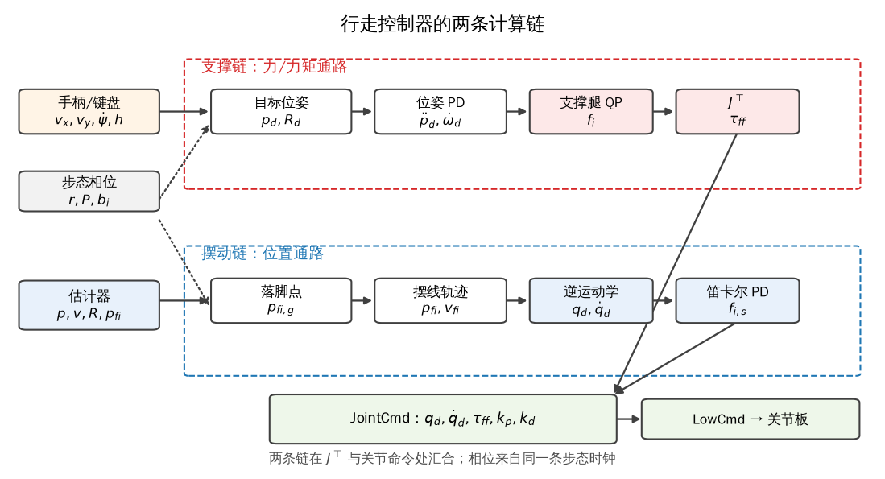
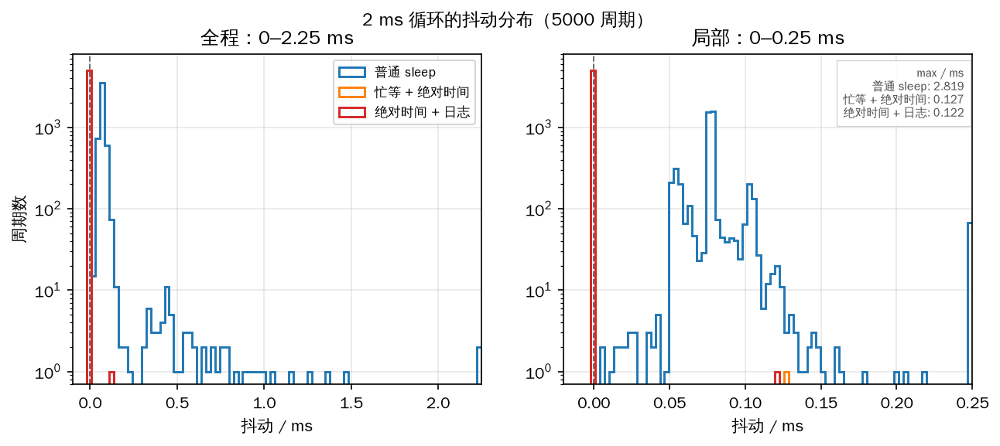
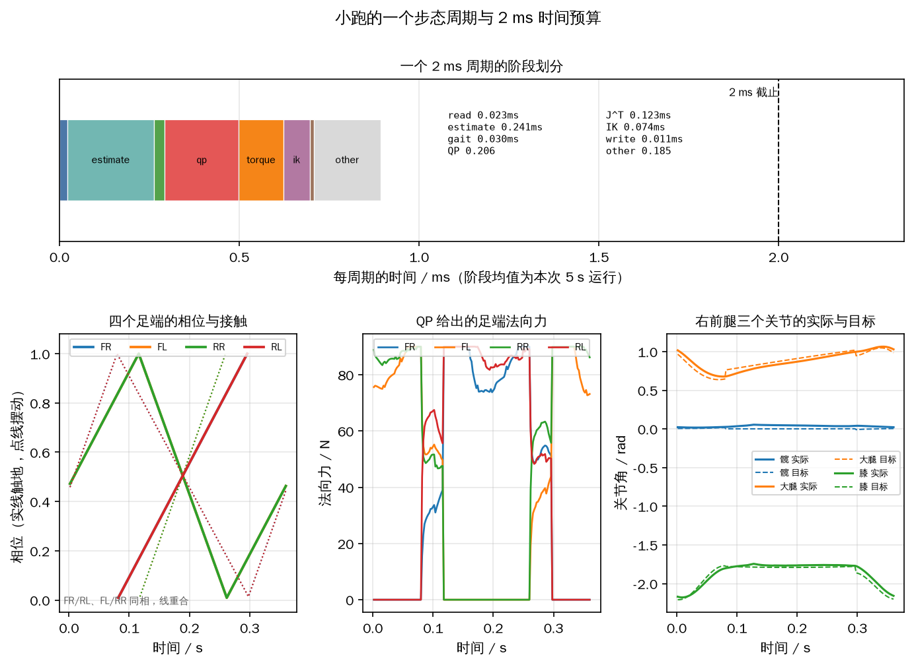
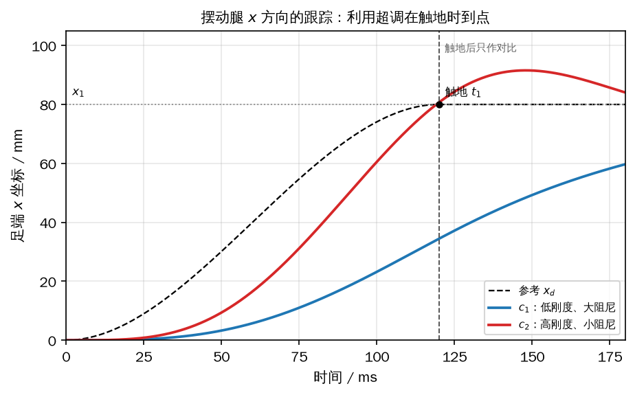
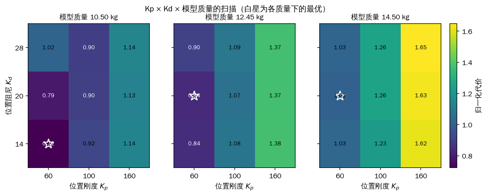
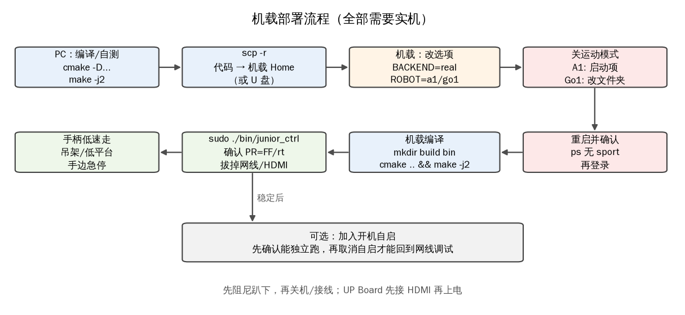
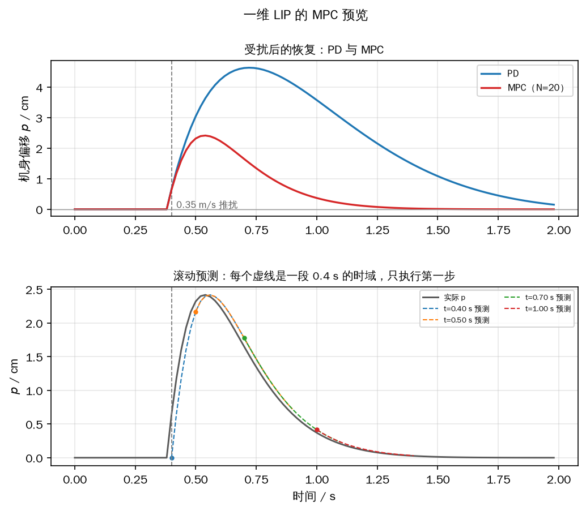
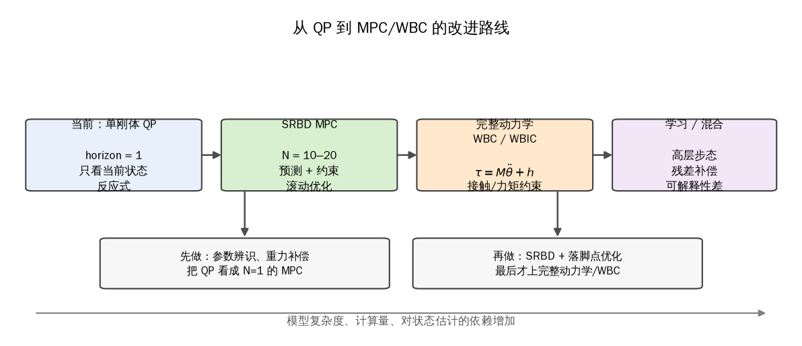

# 第 10 章 行走控制器：总装、调试与部署

前面八章分别造好了零件：第 2 章能读写电机报文，第 3 章能让机器人站起来，第 4、5 章会算单腿运动学和雅可比，第 6 章把整机压成一个刚体，第 7 章能从 IMU 和编码器估计机身状态，第 8 章会用二次规划分配四个足端力，第 9 章会按相位抬起和落下足端。这些零件单独都能跑，但把它们放进同一个 2 ms 周期时，新的问题才出现：谁先算、谁等谁、目标量放在哪个坐标系、哪条腿该出力、算不完怎么办。

本章做一次总装：10.1 画清两条计算链和四个足端的分工；10.2 把控制器写成有限状态机状态，拆开四个组件和 38 个中间变量；10.3 讨论 2 ms 周期怎样不被普通进程打断；10.4 按顺序走一遍构造、进入、运行和退出；10.5 给出调质量、增益和摆动腿的顺序；10.6 把程序搬到 A1/Go1 的机载计算机；10.7 说明继续往前的几条路。

本章的目标工况是平地和不很陡的坡地，速度限制在低速到中等速度。它不处理高速奔跑、跳跃、楼梯和碎石路，也不涉及第 11 章的地图与导航。文中所有实机步骤都标了 **【需要实机】**，本书只在仿真中验证了控制逻辑、调用顺序和参数趋势；实机操作必须按宇树公开资料和现场情况再核对。

## 10.1 行走控制器的控制逻辑

四条腿在任意时刻只做两件事之一：触地的腿支撑机身，腾空的腿把足端送到下一个落点。支撑腿通过足端力维持机身的高度和姿态，同时产生前进、侧移和转向所需的合力与合力矩；摆动腿不承担机身重量，它沿着一条从抬起点到落脚点的空间曲线运动，落地后角色互换。对角步态（trot）里，右前腿与左后腿同相，左前腿与右后腿同相，两对腿相差半个周期，所以正常行走时总有一对对角腿在地上。这里说的“交替”是两对腿成对交替，不是四条腿各自独立轮换。

步态时序由第 9 章的相位给出。设步态周期为 \(P\)、触地系数为 \(r\)，第 \(i\) 条腿的相位偏移为 \(b_i/P\)，那么它在每个周期里有 \(rP\) 的时间触地、\((1-r)P\) 的时间腾空。原书的 trot 取 \(r\approx 0.5\)、四条腿偏移为 \(0,0.5,0.5,0\)，两对腿的触地区间首尾相接。严格按 \(r=0.5\) 实现时，两对腿只在切换瞬间同时触地，中间没有四足支撑段；仿真里这种临界状态对横向扰动很敏感，本书共用包把默认值改成 \(P=0.36\,\mathrm{s}\)、\(r=0.60\)（见 10.4 的解释），时序仍是 trot，只是每对腿多撑 36 ms。把 \(r\) 调大得到步行对角步态（walking trot），把 \(r\) 调小则出现腾空段，接近奔跑对角步态（running trot）。

控制器内部有两条并行的计算链，它们吃同一份状态和同一条步态时钟，但在不同的地方结束。

第一条是支撑链，管“力”：目标位姿 \(\boldsymbol p_d,\boldsymbol R_d\) 与估计位姿比较，经位置环和姿态环得到期望线加速度 \(\ddot{\boldsymbol p}_d\) 和期望角加速度 \(\dot{\boldsymbol\omega}_d\)；这两个加速度连同四个支撑足相对重心的位置送进第 8 章的 QP，解出四个世界系足端力 \(\boldsymbol f_i\)；最后用单腿雅可比的转置把力映射成 12 个关节的前馈力矩 \(\boldsymbol\tau_{\mathrm{ff}}\)。这条链的输出是力矩，支撑腿主要靠它干活。

第二条是摆动链，管“位置”：第 9 章的落脚点规划先给出每条摆动腿的目标落点，摆线轨迹再给出足端在当前位置与落点之间的目标位置 \(\boldsymbol p_{fi,d}\) 和目标速度 \(\boldsymbol v_{fi,d}\)；逆运动学把它们变成关节目标角 \(\boldsymbol q_d\) 和关节目标角速度 \(\dot{\boldsymbol q}_d\)。这条链的输出是位置和速度，摆动腿主要靠它跟踪轨迹。为了让实际足端不落后于规划，摆动腿还会按第 5.4 节的笛卡尔 PD 算一个修正力，再用同一个 \(J^{\mathrm T}\) 映射成附加力矩；这个修正力和支撑腿的平衡力不是一回事。

两条链在雅可比的转置处汇合：支撑腿的 \(\boldsymbol\tau_{\mathrm{ff}}=-J^{\mathrm T}\boldsymbol R^{\mathrm T}\boldsymbol f_{\mathrm{stance}}\) 是主项，摆动腿的 \(\boldsymbol\tau_{\mathrm{ff}}=J^{\mathrm T}\boldsymbol R^{\mathrm T}\boldsymbol f_{\mathrm{swing}}\) 是跟踪修正项，最后和逆运动学给出的 \(\boldsymbol q_d,\dot{\boldsymbol q}_d\) 一起写进同一条关节命令。图 10-1 把这条数据流画成上下两层：上层是力，下层是位置，相位时钟同时决定哪条腿走上层、哪条腿走下层。



*图 10-1 支撑链（上）由目标位姿经位姿 PD、QP 和 \(J^{\mathrm T}\) 得到力矩；摆动链（下）由落脚点经摆线、逆解和笛卡尔 PD 得到位置与修正力矩；两条链在关节命令处汇合*

控制器的输入只有几路：操作者给出的前后速度 \(v_x\)、侧向速度 \(v_y\)、偏航角速度 \(\dot\psi\)，以及可选的机身高度和抬腿高度。输出是 12 组关节命令，每组包含目标角 \(q_{\mathrm{des}}\)、目标角速度 \(\dot q_{\mathrm{des}}\)、前馈力矩 \(\tau_{\mathrm{ff}}\)、位置增益 \(k_p\) 和速度增益 \(k_d\)。手柄的前后左右是在机体系 \(\{b\}\) 下表达的，必须先左乘 \(\boldsymbol R_{sb}\) 变到世界系，再积分成目标位置；如果直接把机体系速度当世界系用，机器人转过 90° 后“向前推”就会变成世界系里的固定方向，操作者会觉得摇杆突然失灵。

支撑腿的力不能随便分。四个足端共 12 个力分量，机身只有 6 个力/力矩平衡方程，解不唯一；可行的解还必须满足摩擦锥 \(|\boldsymbol f_{i,xy}|\le\mu f_{i,z}\)、单侧接触 \(f_{i,z}\ge 0\)、单腿法向力上限 \(f_{i,z}\le f_{\max}\)，以及腾空腿的力严格为零。把“尽量满足平衡方程”写成二次代价，把上述条件写成线性约束，就是第 8 章的带约束 QP。支撑腿数量少于两条时，6 个方程连秩都不够，控制器只能退化成“重力均分”或直接切安全状态，这也是接触状态必须可靠的原因。

摆动腿的力不进入这个 QP。它的作用是拉近实际足端与规划轨迹，形式是

\[ \boldsymbol f_{i,\mathrm{swing}}=\boldsymbol K_{p,\mathrm{sw}}(\boldsymbol p_{i,d}-\boldsymbol p_i)+\boldsymbol K_{d,\mathrm{sw}}(\boldsymbol v_{i,d}-\boldsymbol v_i), \]

其中位置和速度都在世界系或机体系里统一后再用，增益矩阵由调试给出。这个力只作用于腾空腿，如果把摆动腿的修正力也塞进平衡 QP，QP 会以为地面在腾空足上给了力，解出来的支撑力方向就错了。

行走控制器不是一个独立进程，而是有限状态机里的一个状态。本书共用包把它实现为 `TrottingController`，状态号是 `TROTTING`；它由 `FixedStand` 进入，可以切回 `Passive`（阻尼）或 `FixedStand`（站立）。状态机负责在切换时调用 `enter()`、`exit()`，控制器本身只关心“当前周期怎么算”。机载程序里跑的仍是状态机，`Trotting` 只是其中一个分支。

`10_1_control_loop.py` 用假数据把这条调用顺序走一遍：读 IMU、编码器和接触，估计机身与足端状态，读手柄并转到世界系，积分目标位姿，更新相位和落脚点，解支撑腿 QP，算摆动腿修正力，用 \(J^{\mathrm T}\) 映射力矩，做逆运动学，最后写关节命令。为了输出可复现，脚本没有打印墙钟时间，而是给每个阶段一个固定的微秒预算；它检查的是“下游读取的数组必须已经由上游产生”，顺序错了会直接抛 `KeyError`，和 C++ 里先调用后初始化是同一类错误。

```python
{{#include code/ch10/10_1_control_loop.py:pipeline}}
```

```console
{{#include code/ch10/10_1_control_loop.out}}
```

假数据流程总预算约 1.04 ms，QP 占 520 µs，是最大头；2 ms 周期还剩约 0.96 ms 给通信、日志和抖动。真正的时间要在目标机上量，10.4 会在仿真里测每个阶段的平均耗时，10.3 会讨论为什么平均值好看不等于最坏情况能按时完成。

调用顺序有三处不能交换：估计要在 QP 之前，相位和落脚点要在两条链之前，逆解和 \(J^{\mathrm T}\) 要在力与轨迹之后。读任何一份行走控制代码，先画出它的数据流，再判断它的周期预算。

## 10.2 `State_Trotting`：四个组件与 38 个中间变量

行走控制器在代码里是一个类，而不是一堆散落的函数。这样做有两个实际好处：状态切换时，类可以把上一状态的命令清干净；每个周期结束时，类的成员变量就是一份完整的“当前控制器快照”，调试时不用在几十个局部变量之间找。原书把这个类叫 `State_Trotting`，本书共用包叫 `TrottingController`，两者接口一致，只是命名更短。

### 四个组件与依赖注入

`State_Trotting` 自己不构造底层算法，它只持有四个长生命周期对象的指针。第一个是步态生成器 `GaitGenerator`，负责相位、落脚点和摆线，输出足端在世界系下的目标位置与速度。第二个是状态估计器 `Estimator`，每周期吃 IMU、12 个关节角和四个接触开关，输出机身位置、速度、姿态、足端位置和速度。第三个是机器人模型 `Quadruped`，提供四条腿的正运动学、逆运动学、雅可比和静力学，也保存关节限位、力矩上限和速度区间。第四个是平衡控制器 `BalanceCtrl`，负责位姿 PD、摩擦锥约束和支撑腿的 QP 力分配。

这四个对象由全局的 `CtrlComponents` 在程序启动时构造一次，再注入状态类。共用包里对应的是 `ControlContext`：它保存 `sim`、`robot`、`params`、控制周期 `dt`、站立关节角和几组增益，所有状态共享同一份。状态类只保存引用，不拥有这些对象的生命周期。原因很直接：`GaitGenerator` 要预分配轨迹对象，`BalanceCtrl` 要建立 OSQP 的稀疏矩阵模式，`Estimator` 要预分配 18×18 的协方差；这些构造都很贵，放进 2 ms 循环里会直接破坏实时性。反过来，依赖注入也让单元测试可以塞一个假传感器源或假机器人，不必启动 MuJoCo。10.2 的示例就是这么做的：`FakeSim` 只返回一组静止的 IMU、编码器和接触读数，控制器仍然走完整的 `enter()`、`run()`、`exit()`。

### 状态接口：enter、run、exit、checkTransition

有限状态机对每个状态只要求四个动作。`enter()` 在切入时执行一次：把目标位姿设成当前估计位姿，把目标速度清零，把用户命令清零，让步态复位到全触地，然后等待第一个周期。它的目的不是“让机器人站着”，而是避免切入瞬间目标从上一个状态的位置跳到一个无关的位置。如果目标位置还停在 `FixedStand` 的旧值，机器人一进 Trot 就会朝那个方向猛冲。

`run()` 每个控制周期执行一次，是控制器的主体。它读状态、读命令、算目标、算步态、算力、算关节命令，最后写底层命令。`exit()` 在切出时执行一次，停掉速度命令，并把本状态标记为未进入；共用包的实现把 `entered` 置回 `False`。`check_transition()` 处理按键或外部请求，返回下一个状态号或 `None`；状态机采用两阶段切换，本周期登记请求，下周期开头才执行旧状态的 `exit()` 和新状态的 `enter()`，这样状态总有机会完成自己的收尾。

### 38 个中间变量的五层分组

原书把 `State_Trotting` 的成员变量逐条列了 38 个。它们不是 38 个独立状态，而是同一条计算链在不同阶段的输入、输出和参数。按用途可以分成五层：估计状态 10 个（机身位置、速度、偏航、偏航角速度、四个足端位置/速度、两个旋转矩阵、12 个关节角），目标量 13 个（目标位置、世界系/机体系目标速度、目标偏航、目标角速度、足端目标位置/速度、目标姿态、目标线加速度/角加速度），力与关节命令 5 个（世界系/机体系足端力、目标关节角/角速度、前馈力矩），控制参数 7 个（步高、位置增益、位置阻尼、姿态增益、姿态阻尼、摆动腿笛卡尔增益），限幅 3 个（\(v_x,v_y,\dot\psi\) 的允许区间）。

变量名里有两个容易混的地方。`posFeet2BGlobal` 名字里有“2B”，原书却把它解释为世界系下相对机身中心的位置；`posFeet2BGoal` 才是机体系下的目标。读代码要看赋值和使用，不要看后缀猜坐标系。另一个是 `_posFeetGlobal` 和 `_posFeetGlobalGoal`：前者是估计器的输出，后者是步态生成器的输出，前者用于反馈，后者用于逆运动学，不能互换。足端力的坐标变换也要小心：QP 解出的是世界系“地面对足端”的力，映射关节力矩前要左乘 \(\boldsymbol R_{sb}^{\mathrm T}\) 变到机体系，共用包的 `to_joint_torque` 已经包含这一步和式（8-39）的负号。

38 个变量里没有 `_lowCmd`，也没有用户命令结构体和接触状态；这些量分别属于状态机基类、输入接口和步态生成器。原书没有交代这层归属，读的时候容易以为 `State_Trotting` 是一个自包含的黑箱。实际的分层是：`CtrlComponents` 管生命周期和共享对象，状态类管“这一周期怎么算”，`LowCmd` 管“怎么发给关节板”，三层各负其责。

### 命令坐标与安全边界

手柄的前后、左右、偏航都是在机体系 \(\{b\}\) 下给出的。`calcCmd` 要先把它们变成世界系速度 \(\boldsymbol v_s=\boldsymbol R_{sb}\boldsymbol v_b\)，再积分成目标位置 \(\boldsymbol p_d\)。这一步不能用上一周期的旋转矩阵，也不能用目标姿态，必须用当前估计的姿态；否则机器人转身时，速度指令会绕着世界系原点转，走出一条弧线。

安全边界放在 `run()` 的入口统一检查，而不是散落在各个计算函数里。检查项包括：速度命令是否超过 \(v_{\max}\)、偏航角速度是否超过 \(\omega_{\max}\)、目标关节角是否越过关节限位、前馈力矩是否接近 \(\pm 33.5\ \mathrm{N\cdot m}\)、姿态角是否超过设定上限、接触腿数是否少于两条。越界时先降速或把目标拉回，连续越界就切 `Passive`。共用包的 `TrottingController` 只实现主链路，限幅和姿态保护放在状态类外层；示例里的 `_vxLim`、`_vyLim`、`_wyawLim` 是这层限幅的接口示意，数值不是实机安全值。

### 示例：生命周期、38 个变量与退出清理

`10_2_trotting_class.py` 用假传感器实例化 `TrottingController`，跑三个周期，然后让 `check_transition()` 返回 `Passive`，观察状态机的收尾。脚本把 38 个变量按五组打印出来，每个变量给出形状和首值，最后检查 `exit()` 是否把速度命令清零。

```python
{{#include code/ch10/10_2_trotting_class.py:lifecycle}}
```

```python
{{#include code/ch10/10_2_trotting_class.py:variables}}
```

```console
{{#include code/ch10/10_2_trotting_class.out}}
```

输出里的调用顺序是 `enter → run#1 → check_transition → run#2 → check_transition → run#3 → check_transition → request=Passive`，和状态机的“先运行、再询问是否切换”一致。38 个变量按 10、13、5、7、3 分成五组，总数正好 38；矩阵形状也能对上：足端量是 \(4\times3\)，旋转矩阵是 \(3\times3\)，关节量是 12 维，限幅是区间端点 2 维。几个首值来自同一次静止运行：目标位置只前进了 0.1 mm，世界系速度只有 0.0143 m/s，说明一阶低通还在爬升；第一个足端力的 \(x\) 分量是 0.8641 N，前馈力矩首值是 2.3797 N·m；这些数只用于确认量纲和量级，不是性能指标。

`check_transition()` 返回 `Passive` 后，脚本调用 `exit()`，`v_cmd` 变成全零，`entered` 变成 `False`。`v_cmd_smooth` 还保留着 0.014 m/s 左右的平滑值，这是正常的：状态已经退出，`run()` 不会再被调用，下一次 `enter()` 会把平滑器一起清零。真正要检查的是“退出后没有任何代码继续用旧命令”，而不是“每个缓存都立刻变成零”。


*图 10-2 状态机持有 `State_Trotting`；`CtrlComponents` 构造并注入步态、估计、机器人模型和平衡控制器；状态类只持指针，最终写 `JointCmd` 和 `LowCmd`*

这张类关系图也解释了为什么 10.2 不展开算法：四个组件的内部已经在第 5、7、8、9 章讲过，本节只关心它们怎样被组织到一个状态里。把组织关系看清楚，10.4 的运行流程就是按固定顺序调用这些组件；顺序错了，要么读到未初始化的数组，要么把上一周期的力用到这一周期的姿态上。

## 10.3 实时进程：2 ms 周期为什么需要 `SCHED_FIFO`

Linux 默认的调度策略是分时复用：每个普通进程分到一小段时间片，用完就让给下一个，优先级相同的进程还会互相抢。桌面上的浏览器、编译器和日志服务都按这个规则跑，某个进程被暂停几毫秒，用户通常感觉不到。控制器不一样：它以 2 ms 为周期，500 Hz，每个周期要读传感器、跑估计、解 QP、做逆解、写命令；如果内核在这中间把 CPU 交给别的进程几毫秒，这一周期的命令就迟到了。关节控制板不会等，它会继续执行上一条命令，机器人看到的是一个突然变长的采样间隔，轻则抖动，重则失稳。

Linux 把进程分成普通进程和实时进程两套调度类。实时进程的优先级范围是 1–99，数值越大越高；普通进程的优先级不在这套数值里。实时策略常用的有两种：`SCHED_FIFO` 是先进先出，一个实时进程拿到 CPU 后，只要没有更高优先级的实时进程出现，它就一直占着，直到自己阻塞、让出或结束；`SCHED_RR` 是时间片轮转，同等优先级的实时进程按时间片轮流跑。行走控制器用 `SCHED_FIFO`，并且把优先级设到该策略的上限。原书在 `main.cpp` 里调用 `sched_get_priority_max(SCHED_FIFO)` 取上限（通常是 99），再用 `sched_setscheduler` 设成实时进程。

### 设置方法与权限

最小可用的设置代码只有三行：取进程号、填 `sched_param`、调用 `sched_setscheduler`。真正要写进工程时，还要检查每一步的返回值，并把失败原因打出来；原书只在 `sched_setscheduler` 返回 -1 时打印一句笼统的错误，然后继续运行，这样程序会在“以为自己实时、实际不是”的状态下控制机器人，是安全隐患。

```cpp
{{#include code/ch10/10_3_realtime_cpp.cpp:main}}
```

这段代码先尝试 `SCHED_FIFO`，无论成功与否都立即恢复 `SCHED_OTHER`，避免 10 秒的基准测试把机器占满。工程里的控制器不需要恢复，但要在失败时决定“报错退出”还是“降级到普通调度并禁止行走”。设置实时策略需要 root，或者进程拥有 `CAP_SYS_NICE` 能力；也可以把可执行文件加上 `setcap cap_sys_nice+ep`，或者用 `chrt -f 98 ./junior_ctrl` 启动，避免整个进程树都以 root 跑。原书用 `sudo su` 后再 `source` ROS 的 `setup.bash`，这在 ROS 1 下可行，但会改变 `HOME`、`PATH` 和 `ROS_*` 环境变量；ROS 2 下更稳妥的做法是只给控制线程提权，不要用 root 启动整个节点。

还有一个容易忽略的事实：Linux 的调度单位是线程，不是进程。`sched_setscheduler(pid, ...)` 只改主线程；如果控制循环跑在独立线程里，要用 `pthread_setschedparam` 或 `sched_setattr` 给那个线程单独设置。原书的主循环是单线程，所以进程级设置够用；一旦把日志、通信拆到别的线程，就必须逐线程处理。

### 实时不等于快

实时只保证“在优先级规则下不被普通进程抢走”，不保证“这段代码能在 2 ms 内算完”。如果 QP 本身要 3 ms，设成 `SCHED_FIFO` 只会让它更稳定地超时。工程上要做的第一件事是测最坏执行时间（worst-case execution time，WCET），不是平均时间：固定输入下跑几千个周期，记录每个阶段的最大值，再把 QP 的迭代次数、内存分配、异常分支都算进去。第二件事是给实时线程减负：矩阵预分配、求解器热启动、日志写环形缓冲区、文件落盘交给低优先级线程。第三件事是设一个“算不完”的兜底：QP 超时就沿用上一周期的力，或者按重力均分给支撑腿，同时置故障标志；绝不能在控制循环里等求解器返回。

优先级也不是越高越好。把控制线程设成 99，日志、通信、看门狗都可能长期得不到 CPU；Linux 还有实时带宽限制 `sched_rt_runtime_us`，默认给实时任务约 95% 的 CPU，长期占满会被内核强制节流，表现成周期性卡顿。实际工程常把控制线程放在 90–98，把最高优先级留给真正需要毫秒级响应的中断或安全任务。若要绝对准点，可用“睡眠 + 最后几十微秒忙等”：大部分时间让出 CPU，临近目标再自旋。

### 绝对时间睡眠与抖动测量

普通的 `sleep(2ms)` 是相对睡眠：它从“当前时刻”再睡 2 ms，而当前时刻已经包含了上一周期的计算和唤醒开销，误差会一周期一周期累加。绝对时间睡眠则是先算出本周期的目标时刻 \(t_k=t_0+kT\)，然后调用 `clock_nanosleep(CLOCK_MONOTONIC, TIMER_ABSTIME, &t_k, NULL)`，让内核直接睡到那个时刻。即使某一周期被耽搁，下一周期仍以 \(t_0\) 为基准，误差不会累积。`CLOCK_MONOTONIC` 不受系统时间调整影响，适合做周期基准；不要用 `gettimeofday` 的墙钟。

每个周期记录三个量：`t_start`（开始计算）、`t_end`（写完命令）、`jitter = t_wake - t_k`。`t_end - t_start` 是执行时间，`jitter` 是唤醒偏差，两者要分开看：执行时间超了是算法太重，jitter 大了是调度或中断干扰。示例把 5000 个周期的 jitter 存进数组，最后算均值、95 分位和最大值；这三个数比“平均 2 ms”更能说明问题。

### 示例：三种循环的抖动

`10_3_realtime.py` 测三种写法：普通 `sleep`、忙等 + 绝对时间、绝对时间 + 内存日志。三组都跑 5000 个周期，目标周期 2 ms，每周期模拟 0.12 ms 的计算。脚本会探测 `SCHED_FIFO` 权限，把进程绑到一个 CPU 核上，然后画抖动直方图。

```python
{{#include code/ch10/10_3_realtime.py:loop}}
```

```console
{{#include code/ch10/10_3_realtime.out}}
```

本书记录的这次运行以 root 执行，`SCHED_FIFO` 探测成功（最高优先级 99）；没有 `CAP_SYS_NICE` 的容器/沙箱里会得到 `errno=1`（`EPERM`），和普通用户运行一样。两个示例探测后都立即恢复 `SCHED_OTHER`，所以下面两段里的数字都是在普通调度下测得的，不含实时抢占的收益。普通 `sleep` 的平均 jitter 约 0.084 ms，95 分位约 0.106 ms，但最大值到 2.8 ms，5000 个周期累计漂移约 0.42 s；这就是相对睡眠的误差累积。忙等 + 绝对时间的平均 jitter 约 0.0001 ms，最大约 0.13 ms，末周期偏差约 0.0001 ms；绝对时间把漂移压住了，剩下的尖峰来自内核抢占和中断。带内存日志的一组和忙等几乎一样，因为日志只是往预分配的列表里追加，序列化写的是内存缓冲区；如果把 1000 条记录真的落盘，尾部会出现毫秒级尖峰，这正是 10.4 要把落盘移出实时线程的原因。



*图 10-3 左：0–2.25 ms 全程，普通 sleep 的分布宽、尾部到 2 ms 以上；右：0–0.25 ms 局部，忙等和内存日志几乎贴在 0 附近*

C++ 版 `10_3_realtime_cpp.cpp` 用同样的 2 ms 绝对目标和 `clock_nanosleep`，跑 5000 个周期，并打印 `SCHED_FIFO` 是否设置成功。它和 Python 版的区别在阻塞方式：Python 的“忙等”在目标前一直占着 CPU，C++ 的 `clock_nanosleep` 把 CPU 让出去，代价是唤醒延迟。本机一次运行的结果见下面的输出：平均偏差约 0.08 ms，95 分位约 0.095 ms，末周期偏差约 0.07 ms，绝对时间睡眠把累积漂移压住了；但最大唤醒抖动约 1.93 ms，已接近一个 2 ms 周期，普通调度下这个尖峰消不掉。这正是需要 `SCHED_FIFO` 的原因；时序数字会随机器负载变化。编译命令是

```console
{{#include code/ch10/10_3_realtime_cpp.out}}
```

```text
clang++ -std=c++17 -O2 -pthread 10_3_realtime_cpp.cpp -o 10_3_realtime_cpp
```

示例检查脚本用 `-std=c++20` 编译同一份源码，C++17 也能通过。

### CPU 亲和性与降级

多核机器上，控制线程可能在两个核之间迁移，每次迁移都会丢缓存、重新暖 TLB，表现为偶发的长延迟。用 `sched_setaffinity` 把控制线程绑到一个核，把日志、画图、通信线程放到另一个核，可以显著减少这类干扰。绑定不是越多越好：如果把所有线程都绑到同一个核，日志会和控制循环抢同一个 CPU；如果绑到超线程的两个逻辑核，它们共享执行单元，效果也不如两个物理核。

降级策略要提前写进代码，而不是等 QP 报错再想。共用包的 `BalanceCtrl` 在 OSQP 失败时调用 `_fallback`：按支撑腿数量均分重力和期望垂直加速度，返回一个只含 \(f_z\) 的保守力；控制器可以继续用一个周期，同时把 `last_status` 置成失败，让上层决定是否切 `Passive`。更完整的做法是保留上一周期的力 \(\boldsymbol f_{\mathrm{prev}}\)，因为连续两个周期力突变比“重力均分”更容易激起机身晃动；但上一周期的力可能对应已经抬起的腿，使用前要按当前接触状态清零。无论哪种兜底，都要保证“最坏情况下也有一个有限、满足摩擦锥的力”，不能让 NaN 或空指针进入关节命令。

本节记录的抖动都只在普通调度下测得。真正让 `SCHED_FIFO` 生效需要在实机或宿主机上以 root/`CAP_SYS_NICE` 运行 **【需要实机/root】**，并用 `ps -eo pid,comm,cls,rtprio | grep junior_ctrl` 或 `chrt -p <pid>` 确认策略是 `FF`、优先级是设定值；`top` 的 `PR` 列显示 `rt` 只能作为辅助判断。本书没有在本地验证实时优先级带来的抖动改善。

## 10.4 行走控制器的运行流程

10.2 讲了类里有什么，这一节讲一个周期里按什么顺序动。顺序不是风格问题：行走控制器的每一步都吃上一步的输出，估计没跑完就解 QP，用的是上一拍甚至未初始化的状态；步态没更新就做逆解，摆动腿会追着旧落脚点走。原书把流程总结成“构造 → enter → run 循环 → 写底层命令”，本书沿用这条主线，并把每一步的输入、输出和失败处理补全。

### 构造：把能预分配的都预分配

程序启动时构造状态对象。构造函数给步高、平衡增益和摆动腿增益赋初值，读取速度/角速度限幅、关节限位和力矩上限，并给估计器、步态生成器、QP 工作区预分配矩阵。`GaitGenerator` 的四条摆线对象、`BalanceCtrl` 的 OSQP 稀疏矩阵、`Estimator` 的 18×18 协方差都应该在此时建好，`run()` 里只更新数值，不做 `new`、`malloc` 或 Python 对象创建。实时回路里的第一次分配可能触发缺页，延迟足以让一个 2 ms 周期超时。

构造时还要确认模型和机器人匹配。质量、惯量、髋关节偏置、足端半径如果来自另一台机器人，控制器仍能算出结果，但力的分配和落点都会偏；上电前确认机型、固件和参数文件版本一致。

### enter：把目标拉到当前，而不是让机器人“站住”

切入 `Trotting` 时执行 `enter()`。它先读一次传感器和估计器，把目标位置 \(\boldsymbol p_d\) 设成当前估计位置，把目标偏航设成当前偏航，把目标速度、用户命令、平滑后的命令全部清零，再让步态复位到“四足触地”，记录四个足端的当前位置作为初始支撑点。这样第一个 `run()` 算出来的目标位姿和当前位置几乎重合，QP 只需要出力抵消重力，不会因为目标跳变而突然加速。

`enter()` 里还要把 QP 的上一周期力 `x_prev` 清零。如果不清，第一次求解的“力变化量”惩罚会把力往一个随机方向拉。估计器也要 `reset()`：用当前 IMU 姿态、关节角和接触状态初始化，水平位置设为零（实机上把进入点声明为原点），速度设为零；不能读仿真真值。

共用包的 `TrottingController.enter()` 还先保持 0.2 s 全触地再启动步态，避免“刚切进来就迈步”的冲击。实机上可以加长到 0.5 s，代价是操作者觉得反应慢。

### run：九步顺序

`run()` 每 2 ms 执行一次。下面按数据依赖排九步，顺序不能换。

1. 读传感器。IMU 给四元数、角速度、加速度；12 个关节编码器给 \(q,\dot q\)；四个接触开关给布尔量。共用包的 `read_sensors()` 只返回这些实机可测量，不返回机身真值。
2. 跑估计器。用 IMU 姿态、关节正运动学和接触状态更新机身位置/速度、足端位置/速度。估计器的 `dt` 用时间戳差，不用固定的 0.002；这一拍晚了 0.3 ms，`dt` 就是 0.0023。
3. 读用户命令。前后速度、侧向速度、偏航角速度、机身高度、步高；手柄有死区，键盘没有弹簧回中，所以仿真里额外提供“空格归零”。
4. 机体系转世界系。\(\boldsymbol v_s=\boldsymbol R_{sb}\boldsymbol v_b\)，\(\dot\psi_s=\dot\psi_b\)；高度是世界系的 \(z\)，不需要旋转。
5. 更新目标位姿。位置按 \(\boldsymbol p_d\leftarrow\boldsymbol p_d+\boldsymbol v_s\Delta t\) 积分，偏航按 \(\psi_d\leftarrow\psi_d+\dot\psi\Delta t\) 积分；速度命令先过一阶低通，时间常数约 80 ms，避免摇杆从 0 跳到 0.3 m/s 时目标位置突然加速。
6. 更新步态。把世界系速度、偏航角速度、步高送给 `GaitGenerator`，它推进相位、判断接触、给支撑腿保持落点、给摆动腿重算摆线。支撑腿的世界位置在触地时锁存，不随机身移动；摆动腿从抬起点沿摆线走到当前落脚点，落脚点每周期按 Raibert 修正更新。
7. 支撑腿 QP。用当前姿态、足端相对重心的位置、期望加速度和接触状态，解出四个世界系足端力；腾空腿的力约束为零。QP 的输入必须是本周期估计的状态，不能拿上一周期的缓存。
8. 摆动腿轨迹与逆解。摆动腿由摆线给目标位置/速度，逆运动学给 \(q_d,\dot q_d\)；实际足端与目标的偏差再用笛卡尔 PD 变成修正力，经 \(J^{\mathrm T}\) 映射成附加力矩。支撑腿也用逆解给一个目标角，但它的主要作用是让关节 PD 提供一点阻尼，力矩主项来自 QP。
9. 写 `LowCmd`。12 组 \(q_d,\dot q_d,\tau_{\mathrm ff},k_p,k_d\) 一次写入；摆动腿的 \(k_p,k_d\) 较大（位置模式），支撑腿的 \(k_p,k_d\) 较小（力矩为主、位置为辅）。写完后由总线线程发出去，控制线程不等发送完成。

### 命令限幅、斜坡与启停

速度命令要限幅，但不是把每个分量简单夹到 \([-v_{\max},v_{\max}]\)：前后和侧向的合力不能超过摩擦锥，偏航角速度受支撑三角形和足端切向力限制。稳妥的做法是按当前步态和接触状态给一个包络，再做一阶低通。目标位置还要限幅：如果操作者一直推着摇杆，目标位置会无限积分，控制器会一直追一个越来越远的点；实际实现要限制目标与当前估计位置的距离，比如不超过 0.3 m，超过就只更新速度、不更新位置。

步态的启动和停止要放在稳定触地段。起步时先全触地 0.2 s，再切 `WAVE_ALL`；停止时不要立刻把四条腿都设为支撑，否则正在腾空的腿会从半空直接僵住。正确做法是等摆动腿落地、接触开关确认后再切 `STANCE_ALL`。共用包的 `WaveGenerator` 提供 `STANCE_ALL`、`WAVE_ALL`、`SWING_ALL` 三种状态，切换由上层决定；`TrottingController.enter()` 用 0.2 s 全触地做起步缓冲，`exit()` 只清速度命令，落脚由下一个状态负责。

零速度命令时，机器人会原地踏步。原地踏步的足端仍在地面上小幅滑动，机身会慢慢漂移；原书用 `checkStepOrNot` 判断是否切回四足站立：速度、位置误差、速度误差、角速度任意一项超过阈值就继续踏步，否则站立。这个判断要加迟滞和最小停留时间，否则会在踏步和站立之间反复切换。原书用 `setStartWave`/`setAllStance` 切换；共用包没把这段逻辑放进 `TrottingController`，而是让上层决定何时 `stop()`。本书的做法是原地踏步超过 2 s 且速度、角速度都小于阈值才切 `FixedStand`，切换前确认四条腿都在支撑相。

### 时间同步与日志

控制周期用 `CLOCK_MONOTONIC`，不要用墙钟。IMU、编码器、接触开关各有自己的时间戳，进 `run()` 后先对齐到同一个控制时刻：如果传感器时间戳比控制时刻早一个周期以上，要么用上一拍的数据并置“延迟”标志，要么做一步状态预测；直接把旧数据当新数据，会让高增益下的相位滞后变成振荡。估计器的 `dt` 用实际时间差，QP 的离散化也用实际 `dt`，不要假设每个周期都精确 2 ms。

日志分两级。实时线程只写环形缓冲区：每条记录包含 \(p,v,R,f_i,\tau,\text{phase},\text{solve\_status}\)，用预分配的 NumPy 数组或 C++ 的 `std::array`，写指针取模，不分配、不格式化、不落盘。低优先级线程每 \(N\) 个周期把缓冲区复制一份，格式化成 CSV 或 rosbag，再写文件。这样即使磁盘慢，控制线程也只会丢日志，不会丢周期。日志要带 `solve_status` 和实际 `dt`，否则无法区分“控制器差”和“QP 没解出来”。

### 示例：5 s 小跑与一个周期

`10_4_trot_cycle.py` 用共用包的 `TrottingController` 跑 5 s、指令 \(v_x=0.3\ \mathrm{m/s}\)，给每个阶段包一层 `perf_counter`，统计读传感器、估计、步态、QP、力矩映射、逆解、写命令的平均耗时；同时记录一个步态周期的相位、接触、QP 法向力和右前腿三个关节的实际/目标角。真值只用于指标和图，控制器只读 `read_sensors()` 和估计器。

```python
{{#include code/ch10/10_4_trot_cycle.py:run}}
```

```console
{{#include code/ch10/10_4_trot_cycle.out}}
```

本机这次运行的总平均耗时约 0.89 ms，其中估计约 0.24 ms、QP 约 0.21 ms、力矩映射约 0.12 ms、逆解约 0.07 ms，剩下的读/写/步态和控制器自身开销约 0.25 ms。2 ms 预算还剩约 1.11 ms，看起来宽裕；但这是桌面 CPU 的平均值，不是最坏值，也不代表 UP Board 或树莓派。10.6 会要求在目标机上重测，10.3 的降级逻辑要一直留着。

QP 在 2500 个周期里全部返回成功（status=1 或 2），没有触发兜底。最大关节力矩 19.04 N·m，占 \(\pm33.5\ \mathrm{N\cdot m}\) 的 56.84%，出现在起步和触地冲击阶段；稳态力矩小得多。机身高度均值 0.2813 m，比 0.27 m 的目标高约 11 mm，高度误差 RMS 16.43 mm；roll/pitch 的 RMS 分别是 1.246° 和 0.752°；平均前进速度（真值，仅验收）0.3129 m/s，跟踪 0.3 m/s 的指令。高度偏高不是“控制器坏了”，而是单刚体模型的质量、重心和腿的等效长度没有完全对上，正好是 10.5 要调的第一项。



*图 10-4 上：一个 2 ms 周期的阶段划分，灰条是未归入任何阶段的控制器开销；下左：四个足端的相位与接触，对角腿同相所以两条线重合；下中：QP 给出的四个足端法向力，腾空腿为零；下右：右前腿三个关节的实际角与目标角*

图 10-4 的下面三栏能看出支撑/摆动的分工：法向力只在触地时非零，两条对角腿交替在 60–90 N 之间；相位在触地时从 1 跳回 0，摆动相从 0 走到 1。右前腿的髋关节几乎不动，大腿和膝关节在摆动相跟踪目标、在支撑相被 QP 力矩压住。实际角和目标角基本重合，说明关节 PD 的带宽够用；如果这个差值变大，先查 `kp/kd` 和力矩是否饱和，不要先怀疑 QP。

原书还讨论了其他步态：改 `WaveGenerator` 的周期、占空比和相位偏移，就得到 walking trot、running trot、pace、pronk。共用包的 `GaitParams` 已有预设，但占空比和相位一改，支撑三角形、落点修正和 QP 可行性都会变；这些步态通常不如 trot 稳，先在仿真确认接触顺序再上实机。

按键和状态切换沿用第 3 章：`<2>` 或手柄 `<L2+A>` 进 `FixedStand`，`<4>` 或手柄 `<START>` 进 `Trotting`，空格把键盘模拟的摇杆归零，`<L2+B>` 切阻尼。原书把最后一个键写成 `<I.2+B>`，是转写错误。实机上如果摔倒，自动保护应立刻切阻尼；保护没触发时操作者手动按 `<L2+B>`。这条路径 **【需要实机】**，仿真只能验证状态机和力矩符号，验证不了摔倒检测和急停。

## 10.5 行走控制器的调试：质量、增益、摆动腿

前面几章每做完一个模块就调过一次，所以到整机行走时，底层错误已经被排除了大半。剩下的问题大多来自“模型和机器人不一致”：单刚体的质量、重心、惯量是等效值，腿的柔性、足端橡胶、关节摩擦都没有进模型；平衡增益和摆动腿增益又互相耦合。这一节按“先质量/重心，再平衡增益，最后摆动腿”的顺序调，每一轮只改一个量，并记录改前改后的指标。

### 先调质量与重心

单刚体模型的质量 \(m\) 和重心 \(\boldsymbol c\) 决定了 QP 里的重力项 \(m\boldsymbol g\) 和力矩臂 \(\boldsymbol p_{fi}-\boldsymbol c\)。模型质量偏大，QP 会命令更大的支撑力，机身被顶高；模型质量偏小，支撑力不足，机身下沉。原书给的重心经验是低头对应重心偏后、抬头对应偏前；本书没有单独扫重心，实机上按这个方向试。质量方面，原书的经验是“行走时高度偏高说明质量偏小、偏低说明质量偏大”，但本书的仿真给出了相反的方向：把 QP 的模型质量从 10.5 kg 增到 14.5 kg，机身平均高度从 0.2785 m 升到 0.2842 m。原因不神秘：QP 的力平衡右端是 \(m(\boldsymbol a_{\mathrm{des}}-\boldsymbol g)\)，模型质量直接乘在重力上，质量越大，算出的支撑力越大，机身越高。原书的结论可能来自另一套力分配或高度环实现，不能当作普适规律。

调参不能背结论。在自己的机器人上做单向阶跃：只把模型质量改 \(+10\%\)，看高度升降；只把重心沿 \(x\) 移 \(+1\ \mathrm{cm}\)，看 pitch 抬头还是低头。记录方向、幅值和恢复时间。重心和质量要在行走状态下调，不能只在静止站立时调：行走时腿的构型、接触点和惯性力都变了，静止时对上的参数，走起来可能差几毫米。

调质量/重心时，先把位置刚度 \(K_{pp}\) 和姿态刚度 \(k_{pw}\) 适当减小，让高度和俯仰偏差表现得更明显，再改 \(m\) 和 \(\boldsymbol c\)，反复试到高度、姿态接近目标。调完再把刚度加回去；如果一开始就用高刚度，位置环会把模型误差“压”过去，看起来好了，实际上 QP 一直在输出很大的加速度，遇到扰动更容易饱和。

### 再调平衡增益

平衡控制器有四个增益：位置刚度 \(\boldsymbol K_p\)、位置阻尼 \(\boldsymbol K_d\)、姿态刚度 \(\boldsymbol k_{pw}\)、姿态阻尼 \(\boldsymbol K_{dw}\)。共用包的 `BalanceCtrl` 把它们存成 `Kp`、`Kd`、`kp_rot`、`Kd_rot`；位置环默认 \(\mathrm{diag}(100,100,400)\)，阻尼 \(\mathrm{diag}(20,20,40)\)，姿态刚度 \(\mathrm{diag}(150,150,50)\)，姿态阻尼 \(\mathrm{diag}(18,18,12)\)。位置环的 \(z\) 增益比 \(x,y\) 大，是因为高度直接由支撑力控制，响应可以快一些；偏航增益故意比横滚/俯仰软，因为偏航力矩只能靠四个切向摩擦力的力偶产生，太硬会打滑。

调节原则是“在保持平衡的前提下尽量小”。\(K_p\) 和 \(k_{pw}\) 太大，会给出很大的期望加速度 \(\boldsymbol a_{\mathrm{des}}\) 和角加速度 \(\dot{\boldsymbol\omega}_{\mathrm{des}}\)，QP 的右端 \(b\) 跟着变大，数值精度下降，甚至解出不可预料的方向；实机上还容易激发腿的柔性模态。阻尼按临界阻尼起步：单轴二阶系统取 \(K_d\approx 2\sqrt{K_p}\)（离散化后略小），再用实机响应微调。姿态环的横滚/俯仰可以比偏航硬，但不要把偏航调到和横滚一样，除非足端摩擦和机身惯量都允许。

### 最后调摆动腿

本书没有完整的四足多刚体动力学，无法为摆动腿给出重力与惯性力的前馈补偿，所以它主要靠反馈：关节位置环负责“腿形”，足端笛卡尔 PD 负责“落点”。共用包的摆动腿有两层增益：关节 \(k_p=[60,150,200]\)、\(k_d=[2,3,3]\)，笛卡尔 \(K_{p,\mathrm{sw}}=400\boldsymbol I\)、\(K_{d,\mathrm{sw}}=12\boldsymbol I\)。先调关节刚度，让实际关节角跟得上逆解给出的目标；再调足端刚度，让实际足端跟得上摆线。关节刚度不够，腿在摆动中期就塌下去，落点会短；足端刚度不够，触地前还在追目标，落地会弹。

原书建议“增大摆动腿关节刚度和足端刚度、减小阻尼”，并利用超调：只要触地时刻正好落在响应第一次到达目标的位置，之后的超调就不会发生。这个思路成立的前提很窄：步态周期、步高、负载、地面高度都不能变；触地时刻一偏，超调就变成真正的过冲，把机身推得晃。图 10-5 用二阶等效模型把这个权衡画出来：\(c_1\) 是低刚度、大阻尼，响应慢但不振荡；\(c_2\) 是高刚度、小阻尼，在 119.3 ms 第一次到达 80 mm，峰值 91.6 mm，超调 14.4%。如果触地发生在 120 ms 附近，\(c_2\) 正好到点；如果触地提前到 100 ms，它只走到 60 mm 左右，落点就短了。



*图 10-5 参考从 0 平滑到 80 mm，触地时刻 \(t_1=120\ \mathrm{ms}\)；\(c_1\) 在触地时只到 34.4 mm，\(c_2\) 在 119.3 ms 到点并继续冲到 91.6 mm；阴影区是触地后的对比，不代表腿还会自由振荡*

这张图是二阶等效模型，不是完整的 MuJoCo 腿；它说明的是“位置到点”和“速度匹配”之间的区别。触地时足端 \(x\) 方向的速度如果还不为零，即使位置到了，也会和地面发生滑移和冲击。调摆动腿时要把足端位置和速度一起看：位置在触地时刻到点、速度接近地面速度，才是好的落脚；只看位置，容易调出一个“到点但还在往前冲”的参数。

### 看什么信号

不要只看“走没走”。每次试验至少记录七类信号：机身高度及其 RMS 误差、roll/pitch 及其 RMS、四个足端法向力峰值、12 个关节力矩的最大值和饱和比例、QP 的 `solve_status` 和单次求解时间、触地相位与实际接触是否一致、以及累计前进距离/速度跟踪。高度和姿态说明“稳不稳”，力峰值和力矩饱和说明“有没有余量”，QP 状态说明“优化器有没有偷偷失败”，接触相位说明“步态和传感器是否对得上”。

单变量法：一次只改一个参数，改完先低速直行 10 s，再转向、侧移；每个工况记录参数和上面七类指标。一次改两个参数，出问题时无法判断是谁造成的。记录至少包含：日期、机型、负载、地面、步态参数、四组增益、模型质量/重心和结果；没有记录，下一次只能从头再来。

典型故障和第一检查项：左右摇摆，先看 roll 增益和左右腿相位，再看足端 \(y\) 力是否交替；点头，先看 pitch 增益和重心前后位置，再看支撑腿 \(x\) 力；打滑，先看落脚点是否超出摩擦锥、地面摩擦和足端橡胶，再考虑加大 \(K_d\)；腿抖，先看 \(k_d\) 是否太小、控制周期是否抖动、滤波器延迟是否太大；QP 无解，先看 \(f_{\max}\) 和摩擦锥是否太紧、接触腿数是否少于两条、期望加速度是否过大。不要一遇到问题就加刚度，刚度只会把问题推到更高的频率。

### 示例：参数扫描与摆动腿跟踪

`10_5_tuning.py` 分两部分。第一部分在同一个 A1 仿真上扫 \(K_p\in\{60,100,160\}\)、\(K_d\in\{14,20,28\}\)、模型质量 \(m\in\{10.5,12.45,14.5\}\ \mathrm{kg}\)，共 27 组；每组从 home 起步、指令 \(v_x=0.2\ \mathrm{m/s}\)，跑 1.5 s，前 0.4 s 不计入指标。代价取

\[ J=\left(\frac{\mathrm{RMS}(h-0.27)}{0.02}\right)^2+\left(\frac{\mathrm{RMS}(\phi,\theta)}{0.05}\right)^2+\left(\frac{\tau_{\max}}{33.5}\right)^2, \]

三项分别归一化到 2 cm、0.05 rad 和 33.5 N·m，量纲一致。第二部分用二阶等效模型画 \(c_1,c_2\) 的 \(x\) 跟踪，并打印触地误差、首次到点时间和峰值。

```python
{{#include code/ch10/10_5_tuning.py:sweep}}
```

```python
{{#include code/ch10/10_5_tuning.py:swing}}
```

```console
{{#include code/ch10/10_5_tuning.out}}
```

27 组里代价最低的三组是：10.50 kg / \(K_p=60\) / \(K_d=14\)（代价 0.7227）、10.50 kg / 60 / 20（0.7868）、12.45 kg / 60 / 20（0.8369）。三组都把 \(K_p\) 放在 60，说明在这套仿真里位置刚度越低、高度误差越小；在 10.5 kg 组，\(K_d\) 从 14 增到 28 时姿态 RMS 和力矩峰值都变大，代价反而上升。最低代价落在 10.5 kg，而不是真实的 12.45 kg，原因是代价里高度项权重最大，而 12.45 kg 的模型让机身平均高度到 0.282 m，10.5 kg 把它拉回 0.2785 m；这是“用模型质量补偿高度偏置”，不是“辨识出了真实质量”。12.45 kg / 60 / 20 的姿态 RMS 最低（0.0178 rad），说明真实质量在姿态上更自洽。扫描结果是局部敏感度图，不是系统辨识；真正要改质量，先称重或做摆锤实验，再用扫描确认方向。

图 10-6 把 27 个代价画成三张热图，白星是每个质量下的最优。三张图的颜色范围相同，可以直接比较：10.5 kg 的整体代价最低，14.5 kg 在 \(K_p=160\) 的右上角最差（1.65）；同一个质量下，\(K_p\) 从 60 增到 160 通常会让代价变大，\(K_d\) 的影响较小但非单调。热图不平滑，是因为 1.5 s 的短试验里触地冲击和相位占主导；不要对着单个格子调参，要看一片区域的趋势。



*图 10-6 三张热图分别是模型质量 10.50、12.45、14.50 kg；横轴 \(K_p\)、纵轴 \(K_d\)，格内是归一化代价，白星是该质量下的最小值；颜色范围三图统一*

### 实机调参的顺序与安全

实机调参 **【需要实机】**。第一次必须在吊架或低矮平台上，先让机器人吊着跑一遍步态，确认四条腿的相位、支撑/摆动切换和力方向；再放到低平台，让足端轻触地面，给 0.05 m/s 的低速直行；最后才落地。顺序是：先调模型质量和重心，再调平衡增益，再调摆动腿关节增益，最后调足端笛卡尔增益。每调一次，至少跑 10 s 直行、5 s 转向、5 s 侧移；记录高度、姿态、力峰值、力矩饱和和 QP 状态。出现以下任一情况立即停：力矩持续超过 80% 上限、姿态角超过 15°、QP 连续失败、足端力出现持续的单侧饱和、电机温度快速上升。

实机上不要边跑边弹图窗。原书用 `PyPlot` 在控制程序里画足端位置，`showPlotAll` 会阻塞控制循环；本书把数据写进环形缓冲区，实验结束后离线画。若要在实机上实时看，用 ROS 2 的 `ros2 bag` 记录话题，再在另一台机器上用 PlotJuggler 或 Python 看，不要把绘图放进 2 ms 线程。调参时手边要有急停或 `<L2+B>` 阻尼键，场地要留出机器人摔倒的空间；低电量、地面湿滑、关节温度高时不要做高速或大刚度试验。

## 10.6 部署到机载计算机

到 10.5 为止，控制器都跑在用户的计算机上，机器人通过网线接收命令。这样改代码、看日志、切仿真都方便，但机器人被一根线拴住，只能在小范围内来回走，做不了长距离、长时间的测试。把同一份控制程序搬到机器人自带的计算机上，拔掉网线，只留遥控器，才算真正“脱线”。这一步不改变算法，改变的是运行环境：CPU 架构、操作系统镜像、实时权限、厂家预装的运动模式，每一项都可能让程序跑不起来或让机器人乱动。

A1 的机载计算机是 UP Board，amd64 架构，默认用户 `unitree`，Home 是 `/home/unitree`；Go1 的是树莓派，arm64 架构，默认用户 `pi`，Home 是 `/home/pi`。两台机器都预装了厂家的运动模式程序，并且开机自启。运动模式本身也是一个关节控制器，它和用户的行走控制器同时向关节发命令时，两个控制回路会互相打架，机器人表现为抖动、抽动或突然迈步。所以部署的第一步不是编译，而是让厂家的运动模式不再自启。

### 10.6.1 关闭机器人计算机上的运动模式

先让机器人处于安全姿态。开机后按手柄 `<L2+B>` 进入阻尼模式，机器人会慢慢趴下；再按 `<L1+START>` 进入运动模式，确认遥控器和关节都正常。然后按第 3 章图 3.12 或 3.13 接好 HDMI、鼠标、键盘。A1 的 UP Board 有一个硬件限制：必须先接 HDMI 再上电，否则可能没有显示；这不是软件故障，顺序反过来就好。

进入机载计算机的桌面后，先确认运动模式进程是否在跑。A1 的进程名是 `A1_sport`，Go1 是 `Legged_sport`：

```text
ps aux | grep A1_sport | grep -v grep
ps aux | grep Legged_sport | grep -v grep
```

`ps aux` 列出所有进程，`grep` 筛出目标，`grep -v grep` 去掉“grep 自己”那一行。没有任何输出说明运动模式没在跑；有输出说明它还在运行，通常也还在开机自启。注意进程名会随固件版本变化，如果实际名字不是这两个，以 `ps aux` 里的真实名字为准，不要因为“grep 不到”就断定已经关闭。

A1 用 GNOME 的启动应用程序管理：在任意终端执行 `gnome-session-properties`，找到 `A1-Sport`，取消勾选，点 `close`，然后重启 UP Board。重启后再执行一次 `ps aux | grep A1_sport | grep -v grep`，确认没有输出。如果图形界面里没有这一项，或者取消勾选后进程仍在，检查 `~/.config/autostart/` 下的 `.desktop` 文件、systemd 服务和 `rc.local`；有些镜像用多种方式拉起运动模式，只改一处不够。

Go1 用文件夹编号管理自启。开机时 `~/Unitree/autostart` 下以数字开头的文件夹按顺序执行，每个文件夹里有一个同名 `.sh`。运动模式在 `02sportMode`：

```text
cd ~/Unitree/autostart
ls
mv 02sportMode sportMode
sudo reboot
```

把数字前缀去掉，启动脚本按数字排序时就找不到它。改名之前先 `ls` 确认没有同名的 `sportMode`，否则 `mv` 会把源目录移到目标目录里面，而不是改名。重启后再 `ps aux | grep Legged_sport | grep -v grep` 确认。恢复时把文件夹名改回 `02sportMode`，A1 则重新勾选 `A1-Sport`；实验前把原始配置备份一份，免得忘记改过什么。

关闭运动模式后，机器人上电时可能不会自动趴下，关节可能保持僵硬。第一次测试必须把机器人吊起或放在低矮平台上，手边留着遥控器的阻尼键和急停；不要一上电就让它承重。

### 10.6.2 编译行走控制器

把整个工程复制到机载计算机的 Home 下。A1 的目标是 `/home/unitree`，Go1 是 `/home/pi`；可以用 `scp -r`，也可以用 U 盘：

```text
scp -r unitree_guide unitree@192.168.123.161:/home/unitree/
scp -r unitree_guide pi@192.168.123.13:/home/pi/
```

IP、用户名和路径要按实际机器人替换。复制完成后，先确认目标机的架构：`uname -m` 输出 `x86_64` 对应 amd64，输出 `aarch64` 对应 arm64。原书用 `CMakeLists.txt` 里的六个变量控制平台，本书把它们折成两个选项，其余用普通 CMake 选项表达：

```text
原书 PLATFORM      -> -DQUADRUPED_ARCH=amd64|arm64
原书 CATKIN_MAKE   -> -DQUADRUPED_BACKEND=real（不再走 catkin）
原书 SIMULATION    -> -DQUADRUPED_BACKEND=real（关闭仿真）
原书 REAL_ROBOT    -> -DQUADRUPED_BACKEND=real（打开硬件接口）
原书 DEBUG         -> -DCMAKE_BUILD_TYPE=Release（发布版关闭调试输出）
原书 MOVE_BASE     -> 不链接导航模块（本章的行走控制器不需要）
```

A1 的配置命令是

```text
cd ~/unitree_guide
mkdir -p build bin
cmake -S . -B build -DQUADRUPED_BACKEND=real -DQUADRUPED_ROBOT=a1 \
      -DQUADRUPED_ARCH=amd64 -DCMAKE_BUILD_TYPE=Release
cmake --build build -j2
```

Go1 把 `a1` 换成 `go1`、`amd64` 换成 `arm64`。如果工程的 `CMakeLists.txt` 仍然用 `cmake ..` 的老写法，就在 `build` 目录里执行 `cmake ..` 和 `make -j2`，效果一样。`-j2` 是给 UP Board/树莓派留余量：这两台机器的内存不大，`make -j8` 可能在链接阶段被 OOM 杀死，看起来像代码错误，其实是编译并行度太高。编译前确认 `cmake`、`g++`/`clang++`、Eigen3 头文件都在；出厂镜像不一定带这些依赖，缺了就按发行版的包管理器装。

编译产物按工程设置可能落在 `bin/junior_ctrl` 或 `build/bin/junior_ctrl`。运行前先 `ls` 确认路径，再加 `sudo`：

```text
sudo ./bin/junior_ctrl
```

`sudo` 是为了 `SCHED_FIFO`；如果程序只打印“设置实时优先级失败”却继续跑，它仍然是普通进程，2 ms 周期没有保证。第一次运行把机器人吊起，确认 12 个关节的方向、零位、力矩符号和四条腿的相位，再放到低平台；确认无误后才拔掉网线、HDMI 和所有线缆，用遥控器低速行走。

开机自启要放在“已经能独立跑”之后。A1 可以在 `gnome-session-properties` 里加一条启动项，Go1 在 `~/Unitree/autostart` 下新建一个带数字前缀的文件夹和同名 `.sh`。这里有一个原书没展开的坑：自启脚本通常以普通用户运行，而 `junior_ctrl` 需要实时权限；要么给可执行文件 `setcap cap_sys_nice+ep`，要么用 systemd 服务指定 `User=root`，要么配置免密 sudo。直接写 `sudo ./junior_ctrl` 到自启脚本里，开机时没有终端输入密码，程序会卡住或静默失败。

还有一个顺序问题：如果个人计算机上的控制器还在跑，机载的 `junior_ctrl` 也起来了，两边会同时向关节发命令。回到网线调试前，必须先取消机载自启，或者确认 PC 端没有在发命令；实验结束后恢复厂家的运动模式自启，把 `CMakeLists.txt` 和自启配置改回原样，否则下次可能无法用原厂遥控器正常站立/趴下。

### 性能与验证

机载 CPU 比桌面慢，QP、估计和逆解的最坏执行时间要重新测。把 10.3 的抖动测试和 10.4 的阶段计时在目标机上各跑一遍，重点看最大值而不是平均值；如果 QP 的平均值已经接近 1 ms，最坏值很可能超过 2 ms。降级策略（上一周期的力、重力均分、切阻尼）要在目标机上验证，不能只在 PC 上验证。编译时 `make -j` 不超过核数，运行时把日志写到本地文件或环形缓冲区，不要把 `std::cout` 留在每周期的主循环里。

本节机器人操作 **【需要实机】**，本书没有在本地验证。下面的示例只做离线检查：它根据机型和代码路径生成 CMake、`scp`、`ps`、自启/恢复命令，检查本机的架构、依赖、实时权限和自启状态，不执行任何远程命令。

```python
{{#include code/ch10/10_6_deploy_check.py:checks}}
```

```console
{{#include code/ch10/10_6_deploy_check.out}}
```

这次本机检查的结果是：架构 PASS（本机 amd64，A1 目标 amd64）；依赖 PASS（cmake、编译器、Eigen3 都在）；权限 PASS（本次以 root 运行，euid=0，`SCHED_FIFO` 本机可用）；默认配置下普通用户或没有 `CAP_SYS_NICE` 的容器里这一项会是 WARN（`EPERM`），可以给可执行文件 `setcap cap_sys_nice+ep`，或在 `/etc/security/limits.conf` 中给相应用户加 `rtprio`（如 `unitree - rtprio 99`，重新登录后生效）；自启“待机载确认”，因为 `~/Unitree/autostart` 只存在于机器人上。代码路径默认 `~/unitree_guide` 在本机不存在，脚本只生成命令，不复制、不 ssh、不改任何系统配置。



*图 10-7 从 PC 编译、`scp`、机载改选项、关闭运动模式、重启确认、机载编译、`sudo` 运行、拔线行走，到可选的开机自启；所有步骤都需要实机*

部署不是“复制过去、编译、运行”这么简单，真正的风险在顺序：先关运动模式再编译，先吊起再落地，先确认能独立跑再自启，先取消自启再回到网线调试。任何一步反过来，都可能让两个控制器同时发命令，或者让机器人在没有保护的情况下迈步。

## 10.7 改进方向：从“能走”到“走得稳、走得远”

到 10.6，机器人已经能在平地上连续走，但这套控制器在几处做了简化：足端轨迹是摆线，落脚点只看机身速度和偏航，状态估计以 IMU 姿态加腿式里程计为主，动力学只用了单刚体加单腿静力学，平衡控制只解当前时刻的 QP。每一个简化都对应一条改进路线，四条路线不是并列的菜单，而是互相依赖：估计不准，MPC 的预测就会偏；动力学参数不准，WBC 的前馈就会错；落脚点不感知地形，再好的平衡控制器也上不了台阶。

### 10.7.1 步态轨迹

摆线的好处是两端速度为零、形式简单、参数少；缺点是中间形状固定，越障时足端容易擦到台阶边缘。把摆线换成多项式或样条，可以指定起点、终点、中途通过点，以及起落的速度和加速度边界；五次多项式能同时约束位置、速度、加速度，适合“抬得更高、绕开障碍、落地更平”的场合。多项式阶数越高，约束越多，但过冲和数值问题也越多；样条可以把多段拼起来，适合复杂地形。换轨迹时要注意触地瞬间的水平速度：位置到点但速度不为零，足端仍会滑移和冲击，所以轨迹规划要同时约束 \(p(T)=p_{\rm goal}\) 和 \(\dot p(T)\approx v_{\rm ground}\)。

落脚点目前由 Raibert 修正给出，只用了机身速度和偏航。改进方向是用深度相机、激光雷达或双目建立局部高程图，在图上筛掉过陡、过滑、不可达的格子，再选一个让支撑三角形和运动学都可行的落点。高程图的分辨率、更新频率、坐标系变换和延迟都要进设计；地图不是越细越好，2 ms 的控制回路不可能每周期重规划，通常 10–50 Hz 更新地图、2–10 Hz 重规划落脚点。触地检测是另一块：用足端力传感器、关节力矩或力估计器判断腿是否真正接触，接触了就按支撑腿控制，没接触就继续摆动；检测要加迟滞和滤波，否则触地瞬间的力振荡会让支撑/摆动反复切换。

### 10.7.2 估计器

本书的估计器把姿态主要交给 IMU，位置和速度靠腿式里程计，模型是线性的，实现简单，但长距离会漂。Bloesch 等人的工作把关节编码器和 IMU 放进一个考虑非线性姿态的扩展卡尔曼滤波器（EKF），也有 UKF 和因子图实现；Camurri 等人在此基础上加入视觉和激光，修正位置漂移。改进的状态量通常包括机身位置、速度、姿态、IMU 零偏，有时还包括足端接触状态和足端位置；观测包括足端运动学、接触约束、视觉/激光位姿。难点不在滤波器形式，而在时间同步、外参标定、异常值剔除、触地误判和足端打滑：一次误触地就能让腿式里程计跳几厘米，一次外参错位就能让视觉和 IMU 打架。

估计器还要输出延迟和协方差。控制器用的是“过去”的状态，延迟超过几个周期，高增益就会振荡；MPC/WBC 可以用协方差做鲁棒或加权。改进的验证不能只看“曲线平滑”，要和动捕、全站仪或激光跟踪仪比位置/姿态误差，做长距离直线、原地转向、打滑地面三类测试。没有外部参考时，至少记录估计与足端运动学的残差、接触切换时的跳变和 10 s 漂移率。

### 10.7.3 机器人动力学模型

本书的支撑腿力矩用 \(\boldsymbol\tau=\boldsymbol J^{\mathrm T}\boldsymbol f\) 近似，摆动腿没有前馈，靠反馈硬追。低速时腿的惯性力小，这个近似够用；速度一高，腿的质量、科里奥利力和关节摩擦都上来，误差会大到影响落点和平衡。完整的多刚体动力学写成

<!-- 原书式（10.1） -->
\[ \boldsymbol\tau=\boldsymbol M(\boldsymbol\theta)\ddot{\boldsymbol\theta}+\boldsymbol h(\boldsymbol\theta,\dot{\boldsymbol\theta}) . \tag{10-1} \]

其中 \(\boldsymbol\tau\) 是 \(n\) 个关节的力矩，\(\boldsymbol\theta\) 是关节角，\(\boldsymbol M(\boldsymbol\theta)\) 是对称正定的 \(n\times n\) 关节空间惯性矩阵，\(\boldsymbol h\) 是包含科里奥利/向心、重力和摩擦的非线性项。把 \(\boldsymbol h\) 拆开写更清楚：

\[ \boldsymbol h(\boldsymbol\theta,\dot{\boldsymbol\theta})=\boldsymbol C(\boldsymbol\theta,\dot{\boldsymbol\theta})\dot{\boldsymbol\theta}+\boldsymbol g(\boldsymbol\theta)+\boldsymbol\tau_{\mathrm f}. \]

固定基座的四足 \(n=12\)；带浮动基座时状态多了 6 个自由度，方程要加上基座运动和接触力，式（10-1）本身不包含单边接触和摩擦锥，所以 WBC 还要把接触约束单独写进去。求 \(\boldsymbol M,\boldsymbol h\) 有两条路：拉格朗日法从动能/势能推导，自由度少时清楚，多了非常繁琐；牛顿—欧拉法递推每个连杆的力和力矩，Featherstone 的铰接体算法把复杂度降到 \(O(n)\)，RBDL、Pinocchio 等库可以直接调用。工程上通常用后者，前者用来教学和核对。

有了完整动力学，可以先做重力补偿 \(\boldsymbol\tau_{\rm ff}=\boldsymbol g(\boldsymbol\theta)\)，再做逆动力学前馈 \(\boldsymbol\tau_{\rm ff}=\boldsymbol M\ddot{\boldsymbol\theta}_d+\boldsymbol h\)，最后才考虑 WBC。Khatib 的 WBC 把机身位姿、足端位置、接触力、关节力矩限制放进一个优化问题，按优先级或权重求解；Kim 的 kinWBC 和 WBIC 把运动学任务和接触冲量分开处理，在 Mini-Cheetah 上实现了高速运动。WBC 的收益是能同时处理多任务和约束，代价是需要准确的模型、接触状态和参数辨识。

### 10.7.4 平衡控制器

当前的 QP 只看当前时刻：由当前位姿误差算期望加速度，再分配当前足端力。它没有预测，属于反应式控制；机身速度高、下一步要触地或要减速时，QP 只能等偏差出现再纠正。模型预测控制（MPC）用模型预测未来 \(N\) 步，在满足摩擦锥、力上限、关节力矩和运动学约束的前提下优化一串控制量，只执行第一步，下一周期用新状态重新优化。模型可以是线性倒立摆（LIP）、单刚体动力学（SRBD）或完整多刚体；模型越准，计算越重。MPC 的频率通常低于 500 Hz（例如 50–100 Hz），两次 MPC 之间由低层控制器跟踪。

MPC 的收益是能提前加减速、提前调整落点、吸收扰动；代价是计算量、模型精度和状态估计依赖。约束不可行、求解超时、模型不准时，要有兜底：退回当前 QP、重力均分或切阻尼。预测时域 \(N\) 和控制周期要一起选：\(N\Delta t\) 太短，看不到未来；太长，模型误差和计算量都上来。一个实用的迁移路径是：先把当前 QP 看成 horizon=1 的 MPC，理解“预测—约束—只执行第一步”；再把模型换成 SRBD、加长 horizon、加落脚点优化；最后才上完整动力学/WBC。

学习类方法是另一条路：在仿真里训练策略，再迁移到实机（sim-to-real）。优点是能处理复杂地形、减少手工建模；缺点是可解释性和安全性差、需要大量数据和域随机化。常见做法是“学习 + 模型”混合：MPC/WBC 做底层保证稳定，学习做高层步态、落脚点或残差补偿；或者用学习加速 MPC。评价指标要提前定：跟踪误差、姿态/高度波动、落点误差、触地冲击、能耗、计算时间、成功率。完整动力学、WBC 和 MPC 的实机验证超出本书范围 **【需要实机】**；本节只给方向与仿真预览。

### 示例：一维 LIP 的 MPC 预览

`10_7_mpc_preview.py` 把机身水平运动压成一维线性倒立摆：\(\ddot p=\omega^2 p+u\)，\(\omega=\sqrt{g/z_0}=6.0277\ \mathrm{rad/s}\)，\(z_0=0.27\ \mathrm{m}\)。MPC 取 \(N=20\)、\(\Delta t=20\ \mathrm{ms}\)，时域 0.4 s，约束 \(|u|\le 3\ \mathrm{m/s^2}\)，代价是位置/速度误差加控制量；终端代价用离散代数 Riccati 方程的解。PD 基线用同一模型、同一饱和，在 \(t=0.4\ \mathrm{s}\) 给一个 \(+0.35\ \mathrm{m/s}\) 的速度冲量，模拟侧向推扰。

```python
{{#include code/ch10/10_7_mpc_preview.py:mpc}}
```

```console
{{#include code/ch10/10_7_mpc_preview.out}}
```

PD 的最大偏移 4.640 cm，恢复到 \(\pm5\ \mathrm{mm}\) 用 1.72 s，代价 0.03023；MPC 的最大偏移 2.417 cm，恢复时间 0.94 s，代价 0.01555，末值接近 0。100 次 QP 的求解时间均值 0.0169 ms、95 分位 0.0248 ms、最大 0.0524 ms；这个量级在 PC 上很轻，但一维 LIP 只是真实四足 MPC 的玩具，SRBD 的变量数和约束多一个量级，不能直接把 0.02 ms 外推到机载计算机。MPC 的优势来自“提前看到推扰会把自己推远”，在速度冲量刚发生时就开始反向用力；PD 只能等位置偏了再回正，所以峰值更高、恢复更慢。



*图 10-8 上：PD 与 MPC 在 0.35 m/s 推扰后的机身偏移；下：四个时刻的 0.4 s 预测轨迹，虚线是预测、圆点是当前状态，控制器只执行第一步*



*图 10-9 从 horizon=1 的单刚体 QP，到 SRBD MPC、完整动力学 WBC，再到学习/混合；越往右模型越复杂、计算量越大、对状态估计和参数辨识的依赖越强*

这条路线不是“越右越好”。平地低速行走，当前 QP 的鲁棒性和可调试性反而更好；确认瓶颈在“看不到未来”或“腿的动力学不可忽略”时，才值得付出 MPC/WBC 的复杂度。先把估计、接触检测和参数辨识做好，再换控制器。

## 10.8 与原书的对应

本章覆盖原书第 10 章的 7 节、6 个小节和式（10.1），没有原书表格。逐节对应如下。

| 原书节号 | 原书内容 | 本书位置 | 覆盖公式 |
| --- | --- | --- | --- |
| 10.1 | 行走控制器的控制逻辑 | 10.1 | 无 |
| 10.2 | State_Trotting 类简介 | 10.2 | 无 |
| 10.3 | 实时进程 | 10.3 | 无 |
| 10.4 | 行走控制器的运行流程 | 10.4 | 无 |
| 10.5 | 行走控制器的调试 | 10.5 | 无 |
| 10.6 | 在机器人上编译控制程序 | 10.6 | 无 |
| 10.6.1 | 关闭机器人计算机上的运动模式 | 10.6（要点 2–3） | 无 |
| 10.6.2 | 编译行走控制器 | 10.6（要点 4–7） | 无 |
| 10.7 | 行走控制器的改进方向 | 10.7 | 无 |
| 10.7.1 | 步态轨迹 | 10.7.1 | 无 |
| 10.7.2 | 估计器 | 10.7.2 | 无 |
| 10.7.3 | 机器人动力学模型 | 10.7.3 | 式（10.1） |
| 10.7.4 | 平衡控制器 | 10.7.4 | 无 |

> 覆盖说明：原书图 10.1 由本书图 10-5 替代；章首无编号题图由 10-1 承担；原书 12 组代码/终端截图改为代码块、流程图和类图。原书 trot 的 \(r\approx0.5\) 在本书改为 \(r=0.60\)、\(P=0.36\ \mathrm{s}\)，原因在 10.1 和 10.4 说明。原书“高度偏高说明模型质量偏小”的方向与本书 10.5 的仿真相反，正文以实测方向为准并解释了原因。
