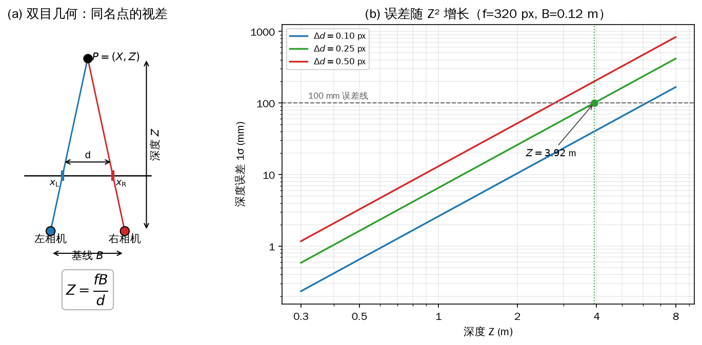
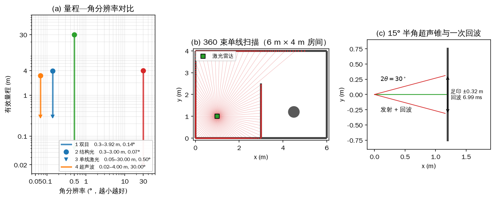
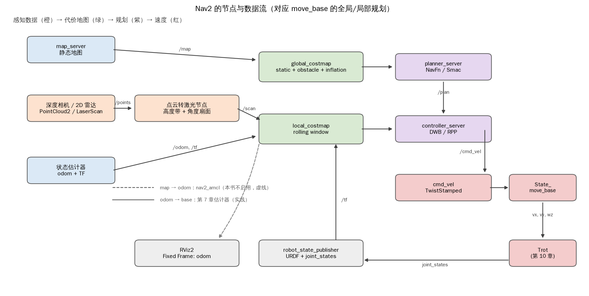
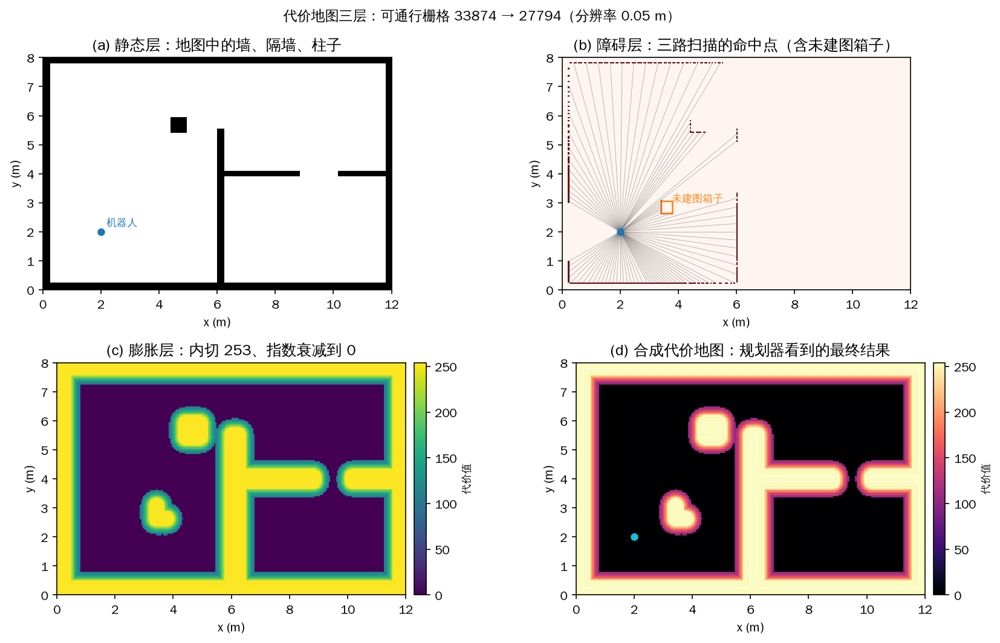
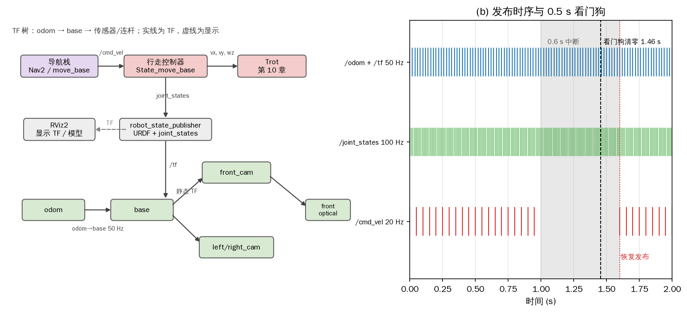
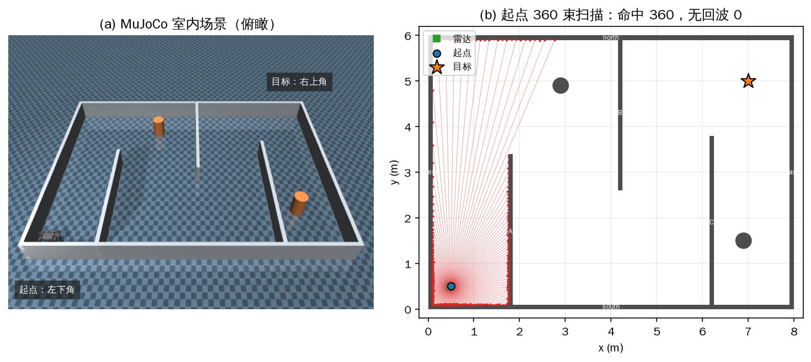
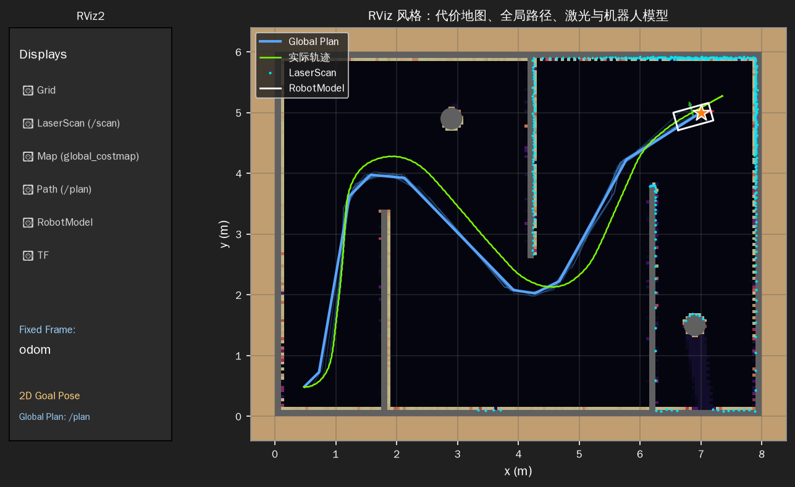
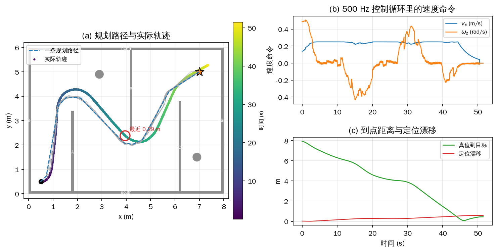
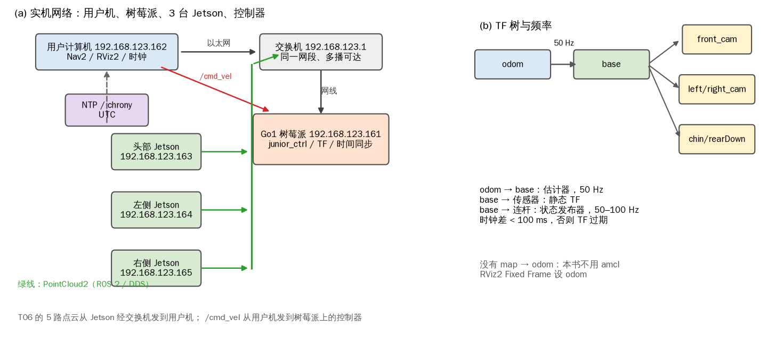

# 第 11 章 感知与导航：从看到障碍到自主到达

第 10 章把 12 个关节、步态、支撑力分配和状态估计接成了一个能小跑的控制器。只要给它三个数——前进速度 \(v_x\)、侧移速度 \(v_y\)、偏航角速度 \(\omega_z\)——A1 就能在平地上稳定地走。但那三个数一直来自摇杆：操作者看着机器人，决定往哪走、走多快。要让机器人自己完成“从起点到目标”的任务，还缺一条从环境到速度命令的链路：先看见障碍，再知道自己在哪里，然后规划一条绕开障碍的路，最后把路径变成 \(v_x,v_y,\omega_z\) 送给第 10 章的 Trot。

这一章就走这条链路。11.1 先比较四类常用的距离传感器，回答“什么样的数据能用来避障”；11.2 把这些数据放进 ROS 2 的导航栈，讲清地图、代价地图、全局/局部规划和参数；11.3 定义导航栈与行走控制器之间的接口，也就是 TF、`/cmd_vel` 和 `joint_states`；11.4 在 MuJoCo 里用仿真激光雷达、占据栅格、A* 和纯跟踪跑一次完整的自主避障；11.5 把同一套逻辑迁到 Go1 教育版，处理时间、点云、网络和启动顺序。

这一章不重写 SLAM，也不训练视觉模型。建图在 11.4 用已知场景直接生成占据栅格，定位沿用第 7 章的足端里程计；重点是“传感器数据怎样变成代价地图，代价地图怎样变成速度命令”。仿真的载体是 A1，实机的目标是 Go1 教育版；两者都是 12 个关节、每条腿 3 个自由度，导航栈看到的部分是一样的。

## 11.1 机器人距离传感器：四种原理与选型

距离传感器（range sensor）测量机器人到周围障碍物的距离。导航避障、抓取、建图都要先有这个量。工程上常见的四类——双目视觉深度相机、结构光相机、激光雷达、超声波测距传感器——没有一类能在所有场景下占优。它们的分歧不在“准不准”这一个指标，而在测量原理：靠环境光还是主动发光，靠飞行时间还是靠几何视差，输出的是稠密的深度图/点云还是单个距离。

按“被动/主动”分，双目相机不向外发光，靠环境照明和场景纹理，属于被动；结构光、激光雷达、超声波都主动发射能量再接收回波或投影图案，属于主动。按“是否测飞行时间”分，激光雷达和超声波直接测发射到接收的时间差 \(\Delta t\)；双目测左右图像的视差；结构光测投影图案在物体表面的位移或形变。按输出分，前三种通常给出深度图或点云，超声波通常只给出探头正前方的一个距离。这三个维度决定了后面的选型：要稠密三维信息，选前三种；只要近处有没有障碍，超声波最省。

### 11.1.1 双目视觉：用视差换深度

双目视觉深度相机有两个光心分开的相机，两个光心之间的距离叫基线（baseline）\(B\)，单位是米。同一个物点在左右两幅图像上的横坐标不同，这个差叫视差（disparity）\(d\)，单位是像素。把左相机光心放在原点、右相机光心放在 \(x=B\) 处，两相机光轴平行、像平面已经校正到同一平面。物点在相机系下的坐标为 \((X,Z)\)，\(Z\) 是沿光轴的深度。按针孔模型，左图像上的横坐标是 \(x_{\mathrm L}=fX/Z\)，右图像上是 \(x_{\mathrm R}=f(X-B)/Z\)，其中 \(f\) 是以像素为单位的焦距。两式相减，基线把 \(X\) 消掉：

\[ d=x_{\mathrm L}-x_{\mathrm R}=\frac{fB}{Z}. \tag{11-1} \]

移项就得到双目测距的核心关系：

\[ Z=\frac{fB}{d}. \tag{11-2} \]

式（11-2）说明深度与视差成反比：同一个物点越近，视差越大；越远，视差越小。图 11-1(a) 画了这条几何关系，左右相机、基线 \(B\)、像平面上的两个像点、视差 \(d\) 和深度 \(Z\) 都标在同一张平面图上。实际的双目相机还要做内参标定、左右相机的极线校正和时间同步；没有校正时，同名点不在同一行上，按行搜索会匹配错，式（11-2）也就不成立。这一步在实机上 **【需要实机】**，仿真里由理想相机模型代替。



*图 11-1 (a) 左右相机、基线 \(B\)、同名点的视差 \(d\) 与深度 \(Z\) 的几何关系；(b) 取 \(f=320\) px、\(B=0.12\) m、视差误差 \(0.25\) px 时，深度误差随 \(Z^2\) 增长，100 mm 误差线对应 3.92 m*

对视差关系求导，可以得到深度误差的一阶估计。设视差的标准差为 \(\Delta d\)，则

\[ \Delta Z\approx \frac{Z^{2}}{fB}\,\Delta d. \tag{11-3} \]

同样的视差误差在远处会被放大 \(Z^2/(fB)\) 倍。取 \(f=320\) px、\(B=0.12\) m，则 \(fB=38.4\) px·m；视差误差 \(0.25\) px 时，1 m 处的深度误差是 6.51 mm，2 m 处 26.04 mm，4 m 处 104.17 mm，8 m 处 416.67 mm。若把“深度误差小于 100 mm”当作可用判据，这套参数的有效量程只到 3.92 m。图 11-1(b) 画了 \(\Delta d=0.10,0.25,0.50\) px 三条曲线：视差误差翻倍，误差曲线整体上移一倍；基线或焦距翻倍，曲线整体下移一倍。这解释了为什么远距离点云不能直接当激光雷达用：不是点云“稀疏”这么简单，而是每个点的深度不确定度已经超过了导航要的分辨率。

式（11-3）还说明，基线、焦距和图像分辨率共同决定远距离的深度分辨能力，不能只说“基线决定最大测量范围”。基线大、焦距长、像素多，远距离的视差才够分辨；代价是体积、近处盲区和标定难度。Go1 教育版用双目相机做主要的深度来源，优点是成本低、不主动发光、室外可用；缺点是依赖纹理。纯色墙面、光滑金属、玻璃、重复的瓷砖或栅栏，都会让稠密立体匹配找不到稳定的同名点，深度图上出现空洞或错误。实际的双目深度相机通常做稠密立体匹配，输出逐像素视差图，而不是只匹配几个特征点；但“没有纹理就没有可靠匹配”这条约束是一样的。Go1 的双目相机探测距离较短，这也是 11.2 不用 `amcl` 的原因之一。

### 11.1.2 结构光：把纹理投到物体上

结构光相机针对的正是“纯色表面没有纹理”这个弱点。它包含一个投影器和一个相机，两者光心分开，基线为 \(B\)。投影器向物体表面投射已知图案——散斑、条纹或编码图案——相机从另一个角度接收被表面调制后的图案。表面越远，图案在相机图像里的位置偏移越小；把投影图案和接收图案做解码，找到同名图案点的位移 \(p\)（像素），就又回到一个三角测量问题：

\[ Z=\frac{fB}{p}. \tag{11-4} \]

这里的 \(B\) 是投影器光心到相机光心的基线，\(p\) 是图案位移，不是双目两幅图像的同名点视差；式（11-4）的形式与式（11-2）相同，是因为两者都是“已知基线 + 已知焦距 + 测像点位移”的三角测量。结构光的纹理是投影器“造”出来的，所以对纯色物体、白墙、无花纹的纸箱效果比双目好。解码通常在专用芯片或轻量算法里完成，计算量可以控制得很低，但不是“完全不需要计算”；编码结构光和相移法的解码并不比双目匹配便宜。

结构光的主要弱点是怕环境光。太阳光在近红外波段有很强的背景辐射，会把投影图案淹没，信噪比下降，所以它更适合室内。多个结构光相机同时工作还会互相干扰，两个投影器的图案叠在一起，解码器分不清是谁投的。选型时还要核对具体型号的原理：Intel RealSense 的 D400 系列（如 D435）是主动双目立体相机，不是结构光；SR300、L515 等型号才更接近结构光或 TOF 方案。微软 Kinect 也有 v1（结构光）和 v2（TOF）两代，不能用一个品牌代替原理。本书的仿真不模拟结构光，Go1 也不使用它；讲它是为了说明“为什么 Go1 选双目而不是结构光”，以及室内近距离抓取为什么会选它。

### 11.1.3 激光雷达：测光往返的时间

激光雷达（LiDAR，也写作 LADAR）用飞行时间（time-of-flight，TOF）测距法：发射一束激光脉冲，光遇到障碍物反射，接收器记录回波。设从发射到接收的时间差为 \(\Delta t\)，光速为 \(c\approx 2.998\times10^{8}\ \mathrm{m/s}\)，光走了一个往返，所以

\[ d=\frac{c\,\Delta t}{2}. \tag{11-5} \]

分母的 2 是因为光去了一趟又回来。式（11-5）把测距精度直接绑在计时精度上：要得到 10 mm 的距离分辨率，时间测量要分辨 \(2\times0.010/c\approx66.7\) ps；要测 30 m，往返时间约 200 ns。这就是激光雷达的计时电路、光电探测器和光学系统要求高的原因。

单线激光雷达只在一个平面内扫描，每一束给出“一个角度 + 一个距离”，大量光束拼成扫描平面内的距离轮廓，也就是 2D 激光雷达；多线雷达在竖直方向排多个收发通道，一次扫描得到多个平面，输出 3D 点云。激光雷达的优点是量程远、角度分辨率高、不受环境可见光影响，适合大范围建图和定位；缺点是近处有最小探测距离，玻璃、镜面、黑色低反射率表面的回波很弱或直接丢失，雨雾和粉尘会衰减光束，室外使用还要看人眼安全等级。它输出的 `LaserScan` 正好是 2D 导航栈需要的格式，所以加装 2D 雷达的机器人通常把它当主传感器。

示例 `11_1_sensors.py` 用一个纯几何模型扫了一间 6 m × 4 m 的房间：四面外墙、一道从 \(y=0\) 到 \(y=2.5\) 的隔墙、一根半径 0.25 m 的圆柱，雷达放在 \((1.0,1.0)\)，360 束、1°、量程 8 m。光线与线段、圆求交，取最近的交点。结果是 360 束全部有回波，最近 1.00 m（左侧外墙），最远 4.98 m（右上方墙角），与房间尺寸一致。这个模型没有噪声、没有缺失、没有光束发散，是理想传感器；11.4 会换成 MuJoCo 的 `Lidar2D`，并叠加 0.01 m 的高斯距离噪声；本例场景封闭，没有出现回波缺失。两者扫描几何相同，差别只在回波与噪声模型。

```python
{{#include code/ch11/11_1_sensors.py:raycast}}
```

```console
{{#include code/ch11/11_1_sensors.out}}
```

### 11.1.4 超声波：圆锥波束与一次回波

超声波测距传感器同样用飞行时间（time-of-flight，TOF）测距法。探头向前发射一个或多个超声波脉冲，声波在空气中传播，遇到障碍物反射形成回声，接收器测出发射到接收的时间差 \(\Delta t\)。声速远低于光速，记为 \(v_{\mathrm s}\)，则

\[ d=\frac{v_{\mathrm s}\,\Delta t}{2}. \tag{11-6} \]

声速随温度变化，近似为

\[ v_{\mathrm s}\approx331.4+0.6\,T\ \mathrm{m/s}, \tag{11-7} \]

其中 \(T\) 是摄氏温度。20 ℃ 时 \(v_{\mathrm s}=343.4\) m/s；0 ℃ 到 40 ℃，声速从约 331 m/s 变到 355 m/s，不补偿会带来约 7% 的距离误差。示例里 1.2 m 的回波时间是 6.989 ms，4 m 是 23.296 ms；单探头在 4 m 量程下的理论测量上限只有 42.9 Hz，实际产品还要留出余振和串扰间隔，所以刷新率通常比激光雷达低一个量级。

超声波的波束是一个圆锥，不是一条直线。取半角 15°（全角 30°），1.2 m 处的波束足印半径是 \(1.2\tan15^\circ=0.322\) m；也就是说，回波只告诉你“这个圆锥里有东西”，不能告诉你它在圆锥的哪个方向。角分辨率按 30° 量级看，比双目和激光雷达差两个数量级。图 11-2(c) 画了这根圆锥和一次回波：墙面正对探头时回波很强；换成一个半径 5 cm 的小圆柱，它在 1.2 m 处只占波束截面的 2.4%，回波约低 16.2 dB，很容易被噪声淹没。窗帘、海绵、泡沫、塑料这些吸声材料更差；人腿这类小圆柱也不如正对的大平板。

超声波的价格低、重量轻、功耗低，几乎不占算力，适合近距离补盲和安全停障。它的工程问题包括：多个探头之间的串扰（一个探头发出的声波被另一个接收）、温度和湿度对声速的影响、风噪、机器人自身运动带来的多普勒频移。它通常发布 `sensor_msgs/Range` 一类的单距离消息，不是稠密点云，所以不能直接生成 2D 激光扫描；本章的导航数据链没有把超声波接进去，它只在“双目看不见纯色平面”时提供一条保命的近距距离。

### 选型：没有全能传感器

把四类传感器放在同一张量程—角分辨率图上看，差异一目了然。图 11-2(a) 的横轴是角分辨率（对数，越小越好），纵轴是有效量程（对数），竖线从最小量程画到最大量程。双目和结构光的角分辨率很高，但有效量程分别受式（11-3）的误差增长和投影功率限制；单线激光雷达量程最远、角分辨率居中；超声波量程最短、角分辨率最差，但价格和算力最低。图中的数值是本书按公开规格整理的典型量级，具体型号必须以数据手册为准；示例脚本把它们打印成表，便于替换成自己手头的型号。



*图 11-2 (a) 四类传感器的有效量程与角分辨率，竖线表示最小到最大量程；(b) 纯几何模型生成的 360 束单线扫描，房间 6 m × 4 m，含一道隔墙和一根圆柱；(c) 半角 15° 的超声锥在 1.2 m 墙面上形成 ±0.32 m 的足印，回波 6.99 ms*

选型要同时看九个维度：量程、精度、视场角、光照条件、被测物表面材质、成本、体积、功耗、算力。量程决定“多远开始刹车”，精度决定“能不能从门缝里过去”，视场角决定“要不要转头看”，光照和材质决定“会不会在特定场景失效”，后四项决定“装不装得上、跑不跑得动”。没有一种传感器能在九个维度上都占优，实际系统都是互补组合。Go1 教育版的“双目 + 超声波”就是典型：双目负责大部分场景的稠密深度，超声波补纯色、无纹理的平面障碍；双目在室外可用，超声波在近处便宜可靠，两者的失效场景不重叠。

把四类传感器的典型参数并排放在一起，可以得到下面的选型表。表中的“有效量程”不是数据手册的最大量程，而是按本书的误差判据（双目 \(\Delta Z<100\) mm）或典型工作范围截取的；换一个判据，数字会变。

| 传感器 | 有效量程 (m) | 角分辨率 (°) | 典型误差 | 主要失效场景 |
| --- | --- | --- | --- | --- |
| 双目视觉 | 0.30–3.92 | 0.14 | 6.5 mm @ 1 m | 纯色、光滑、玻璃、重复纹理 |
| 结构光 | 0.30–3.00 | 0.07 | 2 mm @ 1 m | 日光、多个投影器互扰、远距离 |
| 单线激光 | 0.05–30.00 | 0.50 | ±20 mm | 近处盲区、玻璃/镜面/黑色表面、雨雾 |
| 超声波 | 0.02–4.00 | 30.00 | 10 mm + 1% d | 吸声材料、小圆柱、串扰、风 |

表里的角分辨率：双目按 90° 视场、640 像素算得 0.14°，结构光按 87°、1280 像素算得 0.07°，单线激光按 0.5° 的角步距，超声波按 30° 全角。双目和结构光的“角分辨率”是像素角分辨率，不是深度分辨率；它们在角度上很细，但深度误差随距离增长，这两个指标不能混着比。

### 从传感器到 2D 导航

导航栈最终要的不是点云，而是 2D 平面内的障碍。`move_base` 和 Nav2 的代价地图把世界切成栅格，每个栅格记录“这里能不能走”；3D 点云必须先压成 2D 激光扫描，或者按高度带筛成障碍层。转换的关系很简单：对每一个高度落在 \([z_{\min},z_{\max}]\) 内的点 \((x,y,z)\)，计算它的水平距离和方位角，

\[ r=\sqrt{x^{2}+y^{2}},\qquad \theta=\operatorname{atan2}(y,x), \tag{11-8} \]

再把 \(r\) 填进 `LaserScan` 中角度 \(\theta\) 对应的格；同一个角度有多个点时，通常取最近的那个，因为最近的障碍最先挡住去路。点云转激光节点的 `min_height`/`max_height` 就是在选 \(z\) 的区间，`angle_min`/`angle_max` 就是在选 \(\theta\) 的扇面，`range_min`/`range_max` 限制 \(r\)。地面噪声大时提高 `min_height`，把地面附近的点排除；相机边缘画质差时缩小 `angle_min` 到 `angle_max`，牺牲视野换干净的数据。

转换节点的包名和可执行文件如下，具体参数名各版本略有差异：

```text
pointcloud_to_laserscan
```

这里有两个容易忽略的前提。第一，点的坐标必须在同一个坐标系里算：点云消息带 `frame_id`，转换节点要用 TF 把它变到 `target_frame`（通常是 `base` 或 `odom`）；如果 `base` 到相机的静态 TF 没有发布，转换节点不会输出扫描，只会报 “Lookup would require extrapolation” 或类似错误。第二，`min_height`/`max_height` 是沿目标坐标系的 \(z\) 轴量的，`target_frame` 设错，整片点云会被滤掉。真实传感器的标定、点云检查和 TF 验证 **【需要实机】**；仿真激光雷达在共用包的 `nav.py` 中实现，11.4 直接调用。

## 11.2 ROS 2 导航栈：从 `move_base` 到 Nav2

把传感器数据变成速度命令的中间层是导航栈。原书用的是 ROS 1 的 `move_base`：输入一张 2D 地图、距离传感器测到的障碍、足端里程计给出的位姿，输出三个速度分量。ROS 2 把这套东西拆成了多个生命周期节点，统称 Nav2：`map_server` 管地图，`planner_server` 管全局路径，`controller_server` 管局部速度，`bt_navigator` 用行为树把它们串起来，`behavior_server` 提供恢复动作。名字变了，数据流没变：地图和障碍进代价地图，代价地图进规划器，规划器出路径，控制器把路径变成速度。

导航栈只决定“往哪走、走多快”，不管 12 条腿怎么迈。它输出的 \(v_x\)、\(v_y\)、\(\omega_z\) 是机体系下的前向、侧向线速度和绕竖直轴的偏航角速度，记成

\[ \boldsymbol{u}=[v_x,\ v_y,\ \omega_z]^{\mathrm T}. \tag{11-9} \]

在 ROS 1 里这三个分量放在 `geometry_msgs/Twist` 的 `linear.x`、`linear.y`、`angular.z`；ROS 2 里常用带时间戳的 `geometry_msgs/TwistStamped`，字段在 `twist` 下面，时间戳在 `header.stamp`。第 10 章的 Trot 控制器只认这三个数，所以导航栈和行走控制器之间只需要一条 `/cmd_vel` 话题。11.3 会把这条接口的六项契约写清楚。

### 11.2.1 导航功能包的输入、输出与安装

导航栈的输入有三类。第一是 2D 地图：可以是预先建好的占据栅格，也可以是本地滚动窗口；前者告诉规划器“墙在哪里”，后者只覆盖机器人附近几米。第二是距离传感器测到的障碍：`LaserScan` 或 `PointCloud2`，用来在运行时补充地图里没有的箱子、人腿和临时障碍。第三是里程计/定位：机器人当前在哪个栅格、朝哪个方向。输出就是式（11-9）的三个速度，以及给 RViz 看的全局路径、局部路径和代价地图。

定位这一环要单独说明。原书没有用 `amcl`（自适应蒙特卡罗定位），而是用第 7 章的足端里程计加 IMU 估计位姿。原因很实际：Go1 的双目相机探测距离短，能看到的特征少，`amcl` 用这样短的点云去和地图匹配，粒子会发散，结果不稳定。ROS 2 对应的是 `nav2_amcl`，本书同样不启用。代价是 `odom` 系会随足端打滑慢慢漂移：第 7 章的估计器没有外部绝对位置观测，走十几米后 x/y 漂几十厘米是正常的；11.4 的仿真会看到这个漂移，11.5 的实机会更明显。要更高的到点精度，应该加激光/视觉地图匹配或外部定位，而不是把仿真真值接进控制器。

安装分两部分。ROS 2 的导航包用 apt 装，命令里的发行版代号按自己的系统替换（Humble、Jazzy 等）；原书的 `ros-melodic-navigation` 属于 ROS 1 melodic，2023 年已经停止维护，不要照抄：

```text
sudo apt install ros-$ROS_DISTRO-navigation2 ros-$ROS_DISTRO-nav2-bringup
```

宇树的示例包 `unitree_move_base` 仍在宇树 GitHub 主页上，里面有 launch、config、rviz 配置和点云转换节点。把它放在工作空间的 `src/` 下，先 `source /opt/ros/$ROS_DISTRO/setup.bash`，再 `colcon build`，最后 `source install/setup.bash`；少最后一步，`ros2 launch` 会找不到包。原书用 `catkin_make` 和 `devel/setup.bash`，对应关系就是 `colcon build` 和 `install/setup.bash`。原书还要求 `joint-state-publisher`、`openni` 相机驱动和点云转激光包；ROS 2 对应 `joint_state_publisher` 和点云转激光包，`openni` 是否必要取决于相机驱动。装完用 `ros2 pkg prefix unitree_move_base` 验证包路径，再用 `ros2 launch ... --show-args` 看参数；安装和编译本身不需要机器人，但真正运行要看 11.5 的网络和权限。

### 11.2.2 RViz 可视化

Gazebo 能显示机器人和物理世界，但不适合把导航数据叠在一起看。RViz（ROS 2 里叫 RViz2）是专门的 3D 可视化工具：它订阅话题，把点云、激光扫描、地图、路径、机器人模型、TF 坐标系画在同一个视图里。调试导航时，RViz 是第一现场：机器人不动，先看有没有扫描、有没有代价地图、有没有路径，比盯着终端打印快得多。

打开 RViz 后先设 `Fixed Frame`。本书不用 `amcl`，所以固定 frame 设 `odom`；设成 `map` 而 TF 树里没有 `map → odom`，所有显示项都会报 “No transform”。然后加显示项：`LaserScan` 选 `/faceLaserScan`（或 `/scan`），`Map` 选 `/global_costmap/costmap` 和 `/local_costmap/costmap`，`Path` 选 `/plan` 和 `/local_plan`，`RobotModel` 用 `robot_description`，`TF` 展开看 `odom → base → 各传感器`。颜色按背景调，深色背景下激光用亮红、路径用亮蓝，截图才看得清。

设目标用工具栏的 “2D Goal Pose”（ROS 1 叫 “2D Nav Goal”）：点一下目标位置，按住左键拖出朝向，松开后导航栈收到目标位姿。目标不要选在墙里、未知区域或机器人正后方太远的地方；选在障碍物上，规划器会失败或触发恢复行为；选得太远，局部代价地图看不到，控制器会先按全局路径走，接近后再重新规划。调好显示项后用 “Save Config” 存成 `.rviz` 文件，下次 `rviz2 -d <文件>` 直接复现。原书的 `move_base.rviz` 里带了 `Pose Array`（`/particlecloud`）和 `Odometry EKF`，那是 `amcl`/定位融合的显示项；本书不用 `amcl`，这两项没有数据，应当删掉，免得读者以为定位在跑。

### 11.2.3 距离传感器信号

Go1 教育版有 5 路相机，对应 5 个点云话题。表 T06 是原书给出的 5 路 topic 和安装方位，名字和方位都不改；仿真和实机使用同一组名字，这是同一套 launch 能复用的前提。

<!-- 原书表 T06 -->
| Topic 路径 | 来源／方位 |
| --- | --- |
| `/cam1/point_cloud_face` | 机器人头部，正前方深度相机 |
| `/cam2/point_cloud_chin` | 机器人头部，正下方深度相机 |
| `/cam3/point_cloud_left` | 机器人躯干，左侧深度相机 |
| `/cam4/point_cloud_right` | 机器人躯干，右侧深度相机 |
| `/cam5/point_cloud_rearDown` | 机器人躯干，正下方深度相机 |

数据取自原书表 T06。

这 5 路里，只有正前、左侧、右侧三路对 2D 平面导航有用；两个向下的相机看到的是地面和桌沿，对本章的 2D 代价地图没有直接帮助。但“本章不用”不等于“永远没用”：向下相机能看到坑洞、台阶边缘和桌沿，是做负障碍检测和悬崖保护的传感器，轮式/履带式平台经常专门装一个。Go1 的 5 个相机也不都是双目深度相机，原书把“相机”和“深度相机”混着说；具体哪一路能出深度、哪一路只是全景，要看机型配置。

`move_base` 和 Nav2 的代价地图能接受 3D 的 `PointCloud2`，也能接受 2D 的 `LaserScan`。原书说“Go1 提供的是较新的 `PointCloud2`，所以 `move_base` 不能直接用”，这个因果不成立：`costmap_2d` 本身就支持 `PointCloud2` 类型的观测源。真正需要转换的原因是本章要在 2D 平面内导航，要把 3D 点云压成 2D 扫描，同时兼容可能加装的 2D 激光雷达。转换由点云转激光节点完成，包名如下：

```text
pointcloud_to_laserscan
```

转换只处理前、左、右三路，得到表 T07 的 3 个 `LaserScan` 话题。

<!-- 原书表 T07 -->
| Topic 路径 | 来源／方位 |
| --- | --- |
| `/faceLaserScan` | 机器人头部，正前方 |
| `/leftLaserScan` | 机器人躯干，左侧 |
| `/rightLaserScan` | 机器人躯干，右侧 |

数据取自原书表 T07。

转换节点的关键参数是 `min_height`、`max_height`、`angle_min`、`angle_max`，此外还要设 `target_frame`、`range_min`、`range_max`、`scan_time`、`queue_size` 和 `transform_tolerance`。`min_height`/`max_height` 选参与转换的高度带：地面噪声大时提高 `min_height`，把地面附近的点排除；天花板、桌面上方的悬挂物则用 `max_height` 挡掉。`angle_min`/`angle_max` 选扇面：相机边缘画质差，缩小扇面能减少边缘噪声，但两侧的视野会变窄。转换的几何就是 11.1 的式（11-8）：高度带内的每个点算水平距离 \(r\) 和方位角 \(\theta\)，同一角度取最近的 \(r\)。

转换节点依赖 TF。它要把点云从相机的 `frame_id` 变到 `target_frame`（通常是 `base`），如果 `base → 相机` 的静态 TF 没有发布，节点不会输出扫描，只会报 “Lookup would require extrapolation” 一类的错误。实机上这是最常见的失败原因之一：话题有数据、RViz 里能看到点云，但 `/faceLaserScan` 一直是空的。检查顺序是先 `ros2 topic echo --once /cam1/point_cloud_face --field header` 看 `frame_id`，再 `ros2 run tf2_ros tf2_echo base <frame_id>` 看变换是否存在。这些命令 **【需要 ROS 2 环境】**，本书没有在本机执行。

### 11.2.4 costmap 参数

代价地图（costmap）把环境切成栅格，每个栅格有一个代价值：障碍/致命障碍最高，空闲为 0，未知区域和膨胀区在两者之间。规划器偏好低代价，所以“代价”不只是“能不能走”，还包含“离障碍多远才安全”。`move_base` 和 Nav2 都维护两张图：全局代价地图给全局规划器，覆盖整个任务区域；本地代价地图给局部规划器，只覆盖机器人附近几米，随机器人滚动。

代价地图由层叠起来。静态层（static layer）来自 `map_server` 的占据栅格，只读；障碍层（obstacle layer）把传感器看到的障碍写进去，可以 marking（标记）也可以 clearing（清除）；膨胀层（inflation layer）按到最近障碍的距离生成一圈渐变代价，保证机身不贴墙。Nav2 还常用体素层（voxel layer）处理 3D 点云、语义层（semantic layer）标记草地/人流等区域；本章只用前三层。膨胀代价常用指数衰减：

\[ c(d)=252\exp\left(-3\left(d-r_{\mathrm{in}}\right)\right),\qquad r_{\mathrm{in}}<d\le r_{\mathrm{infl}}, \tag{11-10} \]

其中 \(r_{\mathrm{in}}\) 是内切半径（inscribed radius），\(r_{\mathrm{infl}}\) 是膨胀半径（inflation radius），\(d\) 是栅格到最近障碍的距离；障碍本身记 254，内切圆内记 253，膨胀带外记 0。式（11-10）的系数不是 ROS 的硬性规定，具体实现可能用别的衰减；要紧的是“离障碍越近代价越高，超过 \(r_{\mathrm{infl}}\) 就回到 0”。

共用参数和两张图的参数很多，表 11-1 把常用的列在一起。数值是本书 Go1/A1 量级的起点，不是唯一正确值；换机器人、换场地要重调。`obstacle_range` 是“多远内的障碍写进地图”，`raytrace_range` 是“多远内没有障碍就清除”，后者必须大于前者，否则刚标记的障碍下一帧就被清掉，代价地图会抖。`footprint` 是机器人俯视投影的多边形，四足机器人按长方形近似；`inflation_radius` 要大于机身边缘到旋转中心的最大距离，否则原地转时会擦墙。

| 参数 | 所属 | 含义 | 常用值 |
| --- | --- | --- | --- |
| `obstacle_range` | 共用 | 标记障碍的最大距离 | 2.5 m |
| `raytrace_range` | 共用 | 清除障碍的最大距离 | 3.0 m |
| `footprint` | 共用 | 机器人俯视多边形 | 0.60 m × 0.30 m |
| `inflation_radius` | 共用 | 膨胀半径 | 0.55 m |
| `max_obstacle_height` | 共用 | 参与代价的最高点 | 1.0 m |
| `min_obstacle_height` | 共用 | 参与代价的最低点 | 0.05 m |
| `observation_sources` | 共用 | 观测源列表 | face left right |
| `data_type` | 观测源 | 消息类型 | `LaserScan` |
| `topic` | 观测源 | 话题名 | `/faceLaserScan` 等 |
| `marking` | 观测源 | 是否标记障碍 | true |
| `clearing` | 观测源 | 是否清除障碍 | true |
| `expected_update_rate` | 观测源 | 期望更新周期 | 0.2 s |
| `global_frame` | 本地图 | 地图坐标系 | `odom` |
| `robot_base_frame` | 本地图 | 机身坐标系 | `base` |
| `update_frequency` | 本地图 | 更新频率 | 5.0 Hz |
| `publish_frequency` | 本地图 | 发布频率 | 1.0 Hz |
| `static_map` | 本地图 | 是否用静态地图 | false |
| `rolling_window` | 本地图 | 是否滚动窗口 | true |
| `width` / `height` | 本地图 | 窗口大小 | 4.0 m / 4.0 m |
| `resolution` | 本地图 | 栅格分辨率 | 0.05 m |
| `transform_tolerance` | 本地图 | 允许的 TF 延迟 | 0.5 s |
| `map_type` | 本地图 | 地图类型 | `costmap` |

表 11-1 代价地图常用参数（本书整理的起点值，不是原书表格）

全局图与本地图的 `global_frame` 要分开看。本地图用 `odom` 是对的：它只关心机器人附近几米，里程计漂移在这么短的距离内可以忽略。全局图如果也用 `odom`，长距离导航会随着漂移整体偏掉，目标点在图上看起来“到了”，实际位置却偏了；有 `map` 坐标系时全局图应该用 `map`，由定位节点发布 `map → odom`。本书不用 `amcl`，没有 `map`，所以全局图也只能用 `odom`，这是本章定位精度受限的根源。原书说“全局图和本地图参数基本相同”，在不用 `amcl` 的前提下成立；一旦加装激光雷达或启用 `amcl`，两张图必须分开配。

`expected_update_rate` 是很容易忽略的一项。它表示“这个传感器应该多久来一帧”；超过这个时间没更新，代价地图会认为数据过期，不再用它。设得太小，网络一抖就报过期；设得太大，传感器已经坏了代价地图还在用旧数据。一般取传感器实际周期的 2–3 倍。`observation_sources` 里的每个名字都要有对应的 `topic`、`data_type`、`marking`、`clearing`、`expected_update_rate` 子项，少一项这个源就不生效。调试时用 `ros2 param get /local_costmap/local_costmap inflation_radius` 确认参数真的加载了，别只改 YAML 不重启。这些命令 **【需要 ROS 2 环境】**。

### 11.2.5 局部规划器参数：从 base_local_planner 到 DWB

局部规划器负责把全局路径变成短时速度。ROS 1 的 `base_local_planner` 实现的是 Trajectory Rollout，`dwa_local_planner` 实现的才是 DWA（dynamic window approach，动态窗口法）；原书把两者混在一个模块里讲，读者容易以为 `base_local_planner` 同时实现了两种算法。ROS 2 对应 `controller_server`，常用 DWB（DWA 的改进版）和 Regulated Pure Pursuit（RPP）。11.4 的纯跟踪就是 RPP 的简化版：按前视距离选路径点，算 \(v\) 和 \(\omega\)，不采样大量轨迹。

DWA 的核心是速度空间里的两个集合。机器人自身极限给出

\[ V_{\mathrm s}=\left\{(v,\omega)\ \middle|\ v_{\min}\le v\le v_{\max},\ \omega_{\min}\le \omega\le \omega_{\max}\right\}, \tag{11-11} \]

一个控制周期 \(\Delta t\) 内，受加速度极限限制的可达速度窗口是

\[ V_{\mathrm d}=\left\{(v,\omega)\ \middle|\ v\in[v_{\mathrm c}-a_{\max}\Delta t,\ v_{\mathrm c}+a_{\max}\Delta t],\ \omega\in[\omega_{\mathrm c}-\alpha_{\max}\Delta t,\ \omega_{\mathrm c}+\alpha_{\max}\Delta t]\right\}. \tag{11-12} \]

DWA 在 \(V_{\mathrm s}\cap V_{\mathrm d}\) 里采样，预测每条轨迹的代价（到障碍的距离、到路径的距离、到目标的距离、速度），选代价最小的一组。`max_vel_*`、`acc_lim_*`、`controller_frequency` 这三个东西就是通过式（11-11）和式（11-12）共同限制采样的：频率高，\(\Delta t\) 小，可达窗口窄，机器人反应细但算得勤；频率低，窗口宽，动作大但容易冲过头。

19 个参数的名称和起点值放在下面的 YAML 里，作用和调参方向列在表 11-2。单位统一用 m、m/s、m/s²、rad、rad/s、rad/s²；ROS 参数文件里不写单位，填错单位不会报错，只会表现成“机器人走得很怪”。`min_vel_x` 可以取负值表示允许后退；`escape_vel` 必须为负，它是脱困时后退的速度；原地转还有一个最小角速度，设得太大转得猛，设得太小可能转不动。

```yaml
controller_server:
  controller_frequency: 10.0
  max_vel_x: 0.30
  min_vel_x: -0.10
  max_vel_y: 0.15
  min_vel_y: -0.15
  max_vel_theta: 0.80
  min_vel_theta: 0.10
  min_in_place_vel_theta: 0.30
  escape_vel: -0.10
  acc_lim_x: 0.80
  acc_lim_y: 0.50
  acc_lim_theta: 1.50
  holonomic_robot: true
  y_vels: [-0.15, 0.0, 0.15]
  xy_goal_tolerance: 0.15
  yaw_goal_tolerance: 0.15
  latch_xy_goal_tolerance: true
  recovery_behavior_enabled: true
  clearing_rotation_allowed: true
```

| 作用 | 常用值 | 调大的效果 | 调小的效果 |
| --- | --- | --- | --- |
| 允许脱困 | true | 卡住时会清图/旋转 | 卡住后直接停 |
| 允许原地旋转清障 | true | 更容易重见障碍 | 只能前后挪 |
| 速度发布频率 | 10 Hz | 反应细、算力高 | 反应粗、易过冲 |
| 最大前进速度 | 0.30 m/s | 更快、更危险 | 更慢、更稳 |
| 最小前进速度 | −0.10 m/s | 限制后退 | 允许更快后退 |
| 最大侧移速度 | 0.15 m/s | 侧移更快 | 侧移更保守 |
| 最小侧移速度 | −0.15 m/s | 限制反向 | 反向侧移更快 |
| 最大偏航角速度 | 0.80 rad/s | 转得快、易超调 | 转得慢、更稳 |
| 最小偏航角速度 | 0.10 rad/s | 起步转得猛 | 可能转不动 |
| 最小原地转速 | 0.30 rad/s | 原地转更快 | 原地转更慢 |
| 脱困后退速度 | −0.10 m/s | 退得更慢 | 退得更快 |
| 前向加速度上限 | 0.80 m/s² | 加速猛 | 加速柔 |
| 侧向加速度上限 | 0.50 m/s² | 侧移猛 | 侧移柔 |
| 角加速度上限 | 1.50 rad/s² | 转向猛 | 转向柔 |
| 是否全向 | true | 采样侧移 | 只走前进/转向 |
| 侧移候选速度 | [−0.15, 0, 0.15] | 侧移选择多 | 侧移选择少 |
| 位置到点容差 | 0.15 m | 到点松 | 到点严、易反复调整 |
| 航向到点容差 | 0.15 rad | 朝向松 | 朝向严、易原地磨 |
| 到点后锁位置 | true | 只调朝向 | 继续微调位置 |

表 11-2 局部规划器参数与调参方向（本书整理，不是原书表格）

`holonomic_robot` 的“完整/非完整”说法要小心。完整约束（holonomic）指约束可以积分为位置约束，非完整约束（nonholonomic）指约束不可积分；轮式小车不能侧移是“非完整”的典型例子，四足能侧移可以按“全向/完整”处理，但这不是“四足一定完整、轮式一定非完整”的普遍规律。四足侧移能力受关节和摩擦限制，`max_vel_y` 和 `y_vels` 不要设得太大，否则控制器会给出超出关节能力的侧向速度。锁位置参数的实际含义也不是“到不了才转”，而是“一旦进入 `xy_goal_tolerance` 就锁住位置目标，之后只调整偏航角”，避免在目标附近来回挪。

### 示例：三层代价地图

`11_2_costmap.py` 用共用包的 `GridMap.from_occupancy` 读入一张 12 m × 8 m 的室内占据栅格：外墙、一道从南墙到 \(y=5.5\) 的隔墙、一道带门洞的横隔墙、一根方柱。机器人放在 \((2.0,2.0)\)，三路 120° 视场的扫描分别朝前、左、右，量程 7 m；场内另放一个没有写进静态地图的箱子，用来模拟“地图里没有、传感器刚看到”的临时障碍。脚本按 `inflation_radius` 做欧氏距离变换，生成 254/253/指数衰减三层代价，再统计膨胀前后的可通行栅格。

```python
{{#include code/ch11/11_2_costmap.py:costs}}
```

```console
{{#include code/ch11/11_2_costmap.out}}
```

静态层有 4510 个障碍格、33890 个空闲格；三路扫描共命中 339 个障碍格，其中 29 束落在未建图的箱子上。膨胀前可通行 33874 格（静态障碍和障碍层之外的格子），膨胀后按 \(\text{cost}<253\) 算只剩 27794 格，减少 6080 格，占 17.9%；最大代价 254，代价大于 0 的栅格 17928 个，膨胀带最远 0.55 m。这个减少量说明膨胀不是“画一圈线”：0.55 m 的膨胀半径在 0.05 m 栅格上会吃掉很多窄通道，门洞、走廊宽度必须比 `2 × inflation_radius` 宽，否则规划器找不到路。



*图 11-3 从 `map_server`、传感器、估计器到全局/本地代价地图，再到 `planner_server`、`controller_server`、`/cmd_vel` 和 `State_move_base` 的数据流；橙色是感知，绿色是代价地图，紫色是规划，红色是速度；`map → odom` 由 `nav2_amcl` 提供，本书不启用（虚线），`odom → base` 由第 7 章估计器提供（实线）*



*图 11-4 (a) 静态层的墙、隔墙和方柱；(b) 三路扫描的命中点，橙色框是未建图的箱子；(c) 膨胀层，254 为障碍、253 为内切圆、向外指数衰减；(d) 合成代价地图，规划器实际看到的结果；可通行栅格从 33874 降到 27794*

图 11-4(b) 里前、左、右三路各有 181 束，前向和左向各命中 170 束，右向 181 束；没命中的共 22 束（前向、左向各 11 束），是从门洞穿出去、在 7 m 量程内没有碰到墙的光线，对应真实雷达的“无回波”。障碍层只标记命中点，不标记整条射线；清除（clearing）则相反，用射线穿过的格子把旧障碍清掉。图 11-4(c) 的膨胀层是从“静态层 ∪ 障碍层”一起算的，所以箱子周围也有一圈代价，规划器会提前绕开它，而不是等激光打到才反应。

这一节的数值和 11.4 的仿真不是同一套参数：这里为了把三层画清楚，用了 12 m × 8 m 的静态地图和 0.55 m 膨胀；11.4 的 MuJoCo 场景是 8 m × 6 m，膨胀按机身半宽 0.16 m 加 0.39 m 安全裕量取 0.55 m；裕量这么大，是因为纯足端里程计在十几米的路径上会漂几十厘米，路径不能贴着墙算。参数要跟着平台和场地走，不能把示例里的数字直接抄到实机。ROS 2 的 `ros2 launch`、`ros2 param` 命令 **【需要 ROS 2 环境】**，本书没有在本机运行；参数含义和调参方向可以离线阅读。

## 11.3 控制程序接口：TF、`/cmd_vel` 与 `joint_states`

导航栈算出了速度，行走控制器得能接住。原书在 `unitree_guide` 里做了三处修改：估计器发布机器人位姿和 `odom → base` 的 TF；有限状态机新增 `State_move_base` 状态，订阅 `/cmd_vel`；`IOSDK.cpp` 把 12 个关节状态发布成 ROS 话题，供 RViz 显示。三处修改都用条件编译包住，`CMakeLists.txt` 里把 `MOVE_BASE` 设为 `ON` 才会编进去；对应的文件是 `Estimator.cpp`、`State_move_base.cpp`、`IOSDK.cpp`，宏名放在下面的代码块里，正文不再重复这个长名字。

```text
COMPILE_WITH_MOVE_BASE
```

本书的控制器是 Python 的 `TrottingController`，没有这些 C++ 文件，但接口契约完全一样：估计器给出位姿和 TF，控制器订阅速度、发布关节状态。这一节把这个契约写成六项——topic 名、消息类型、频率、坐标系、单位、符号——任何一项不一致，导航都会“有输出但不走”。

### 11.3.1 估计器发布位姿与 TF

ROS 用 TF 管理坐标系之间的变换。一次变换包含父坐标系、子坐标系、时间戳和一个刚体变换；二维导航只关心平面位姿，但消息里仍然是完整的三维变换。估计器每个控制周期算出机身位姿后，把它写成齐次矩阵：

\[ {}^{odom}\boldsymbol{T}_{base}= \begin{bmatrix} \boldsymbol{R} & \boldsymbol{p}\\ \boldsymbol{0}^{\mathrm T} & 1 \end{bmatrix}, \tag{11-13} \]

其中 \(\boldsymbol{R}\) 是 `base` 相对 `odom` 的旋转，\(\boldsymbol{p}\) 是平移。TF 广播的就是这个矩阵随时间的变化。导航栈不直接读估计器的内部变量，它通过 TF 或 `/odom` 话题拿位姿；所以估计器必须把同一份位姿同时发布到这两个地方，且时间戳一致。

TF 树的主干是 `odom → base → 各传感器/各连杆`。`odom` 是里程计坐标系，连续但不绝对；`base` 是机身坐标系，原点在躯干中心；相机、雷达、足端都挂在 `base` 下面。`map → odom` 由定位节点提供，用来把漂移的里程计拉回地图；本书不用 `amcl`，没有 `map`，所以 TF 树通常只有 `odom` 这一段。RViz 的 `Fixed Frame` 设 `odom` 就是这个原因。

时间戳、`frame_id` 和频率必须一致。位姿发布频率不需要跟 500 Hz 的控制周期一样高：控制器跑 500 Hz，TF/位姿限制在 50–100 Hz 就够导航栈用，频率太高只会增加网络和导航包的计算量。时间戳要用当前的 ROS 时间，不能用控制周期计数；时间戳太旧，导航栈会报 “extrapolation into the past”，RViz 里机器人会抖。协方差也要填一个合理的量级，全零会被当成“完全可信”，后续融合时无法修正漂移。

### 11.3.2 控制器接收速度命令

`/cmd_vel` 是速度命令，不是位置命令。ROS 1 用 `geometry_msgs/Twist`，ROS 2 常用 `geometry_msgs/TwistStamped`；两者都包含三个分量：`linear.x`、`linear.y`、`angular.z`。控制器把它们解释成机体系下的平移速度和绕竖直轴的角速度：

\[ \boldsymbol{v}_{b}=[v_x,\ v_y,\ 0]^{\mathrm T},\qquad \boldsymbol{\omega}_{b}=[0,\ 0,\ \omega_z]^{\mathrm T}. \tag{11-14} \]

这里 \(v_x\) 沿机身前方，\(v_y\) 沿机身左侧，\(\omega_z\) 逆时针为正。控制器再把它们转成第 10 章 Trot 的目标速度/目标位姿；步态、支撑力分配、关节力矩都不需要导航栈知道。原书新增的 `State_move_base` 是 `State_Trotting` 的子类，继承行走功能，重写 `getUserCmd`，把摇杆输入换成 `/cmd_vel` 的回调值。加入有限状态机后，键盘 `<5>` 或手柄 `<L2+Y>` 从 `FixedStand` 切到导航状态；进入后机器人不再响应摇杆，要退回手动得切到别的状态。

速度命令必须加超时看门狗。导航栈以固定频率发布新速度，如果它崩溃、网络断开或用户关掉 RViz，控制器不能保持最后一条命令一直走。做法是记录最后一次收到 `/cmd_vel` 的时间，超过阈值（例如 0.5 s）就把 \(v_x,v_y,\omega_z\) 全部清零，并切回安全的站立/踏步状态。还要加限幅：前后、侧向、偏航分别夹到机器人能力范围内，加速度用一阶低通或斜坡限制。11.5 的实机第一次测试会把 \(v_x\) 限到 0.2 m/s、\(\omega_z\) 限到 0.4 rad/s，就是这条要求。

### 11.3.3 发布关节角度

RViz 里的机器人模型要动腿，光有机身位姿不够，还需要 12 个关节的角度。原书在 `IOSDK.cpp` 里，从真实机器人拿到关节状态后填充 `sensor_msgs/JointState` 并发布。消息的 `name` 是关节名数组，`position` 是角度（rad），`velocity` 是角速度（rad/s），`effort` 是力矩（N·m）；`header.stamp` 用当前 ROS 时间。关节名必须和 URDF 里的名字一一对应，顺序不重要但名字要匹配；写错一个名字，RViz 里那条腿就不动，或者整条链的 TF 断掉。

仿真里关节状态由 Gazebo 插件提供，实机里由 `IOSDK.cpp` 提供；两者都只是一条 `JointState` 话题。真正把关节角变成连杆位姿的是状态发布器（包名见下）：它订阅 `JointState`，沿 URDF 的关节树逐级算变换，

\[ {}^{base}\boldsymbol{T}_{link_i} ={}^{base}\boldsymbol{T}_{link_{i-1}} \cdot {}^{link_{i-1}}\boldsymbol{T}_{joint_i}(q_i). \tag{11-15} \]

```text
robot_state_publisher
```

状态发布器本身不测量关节角，它只做“角度 → TF”的换算；实机没有 Gazebo 的关节状态，问题不是状态发布器不能用，而是没有 `JointState` 来源。发布频率 50–100 Hz 足够 RViz，太高会占网络和 CPU。仿真和实机可以用同一份 RViz 配置，前提是话题名和关节名一致。

ROS 2 的差异集中在三处：`/cmd_vel` 用 `TwistStamped`，时间戳在 `header.stamp`；TF 用 `tf2_ros` 的 `TransformBroadcaster`/`Buffer`，查询用 `lookup_transform`；QoS 要匹配，传感器数据常用 `SensorDataQoS`（best effort），`/cmd_vel` 用 reliable，QoS 不匹配会表现为“话题存在但收不到”。状态发布器仍然负责由 URDF + `joint_states` 算连杆 TF，这一点和 ROS 1 一样。相关命令 **【需要 ROS 2 环境】**，真实 TF/话题 **【需要实机】**。

### 接口契约

把上面三节收成一张表，就是导航栈和控制器之间的契约。表 11-3 里的六项必须逐项对齐；调试时“机器人有 `/cmd_vel` 但不走”多半是其中一项错了，而不是算法错了。

| 接口 | 消息类型 | 方向 | 频率 | 坐标系 | 单位/符号 |
| --- | --- | --- | --- | --- | --- |
| `/cmd_vel` | `TwistStamped`（ROS 2）/ `Twist`（ROS 1） | 导航栈 → 控制器 | 10–20 Hz | `base` | m/s、rad/s；前进 +x，左转 +z |
| `/odom` | `nav_msgs/Odometry` | 估计器 → 导航栈 | 50 Hz | `odom`，子帧 `base` | m、rad |
| `/tf` | `tf2_msgs/TFMessage` | 估计器/状态发布器 → 所有 | 50–100 Hz | `odom → base → 传感器/连杆` | m、rad |
| `/joint_states` | `sensor_msgs/JointState` | 控制器 → 状态发布器 | 50–100 Hz | `base` | rad、rad/s、N·m |

表 11-3 导航—控制器接口契约（本书整理）

`/cmd_vel` 的符号约定要单独强调：`linear.x` 正表示前进，`angular.z` 正表示左转（逆时针）。如果实机上机器人后退或右转，先查这两个符号，不要先改控制器增益。`/odom` 的 `frame_id` 必须是 `odom`、`child_frame_id` 必须是 `base`；写成 `world`、`body` 或大小写不一致，TF 树就接不上。`/joint_states` 的 12 个名字以 URDF 为准，例如 `FR_hip_joint`、`FR_thigh_joint`、`FR_calf_joint`，四条腿各三个。

### 示例：消息总线上的接口

`11_3_interface.py` 用一个确定性的消息总线模拟这四个话题：估计器以 50 Hz 发布 `/odom` 和 `odom → base` 的 TF，导航以 20 Hz 发布 `/cmd_vel`，控制器以 100 Hz 发布 12 个关节状态，相机以 10 Hz 发布扫描并带 40 ms 传输延迟。脚本在 1.0–1.6 s 之间故意停发 `/cmd_vel`，看 0.5 s 看门狗什么时候清零；再故意把点云的 `frame_id` 写成 `camera_link`（TF 树里只有 `front_cam`），验证断裂检测。

```python
{{#include code/ch11/11_3_interface.py:bus}}
```

```console
{{#include code/ch11/11_3_interface.out}}
```

2 s 内 `/odom` 和 `/tf` 各 101 帧，中位间隔 20.00 ms，正好 50 Hz；`/cmd_vel` 29 帧，中位间隔 50.00 ms（20 Hz），但 2 s 平均只有 14.5 Hz，因为中间停了 0.6 s；`/joint_states` 201 帧、10.00 ms（100 Hz）；`/scan` 21 帧、100.00 ms（10 Hz）。最后一条 `/cmd_vel` 在 0.95 s 到达，看门狗在 1.456 s 清零，1.60 s 恢复发布后重新给出 0.30 m/s。这个时间差说明看门狗阈值必须大于导航的发布周期（50 ms）并留够余量，0.5 s 是常用值；设成 0.1 s，网络一抖就急停，设成 2 s，机器人已经撞上了才停。

TF 链查到 `base` 在 \((0.60,0.04)\)、yaw 0.20 rad，`base → front_cam` 的平移是 0.250 m。把点云的 `frame_id` 写成 `camera_link` 时，20 帧（10 Hz × 2 s）全部查不到变换；改回 `front_cam` 后立刻成功。这就是 11.2.3 说的“点云有数据但扫描为空”的根因：不是转换节点坏了，是 TF 树里没有那个 frame。关节状态这边，12 个名字全部匹配 URDF；故意把第一个写成 `FR_hip`，脚本报告未知关节 `['FR_hip']`，RViz 里对应的腿就不会动。



*图 11-5 (a) `odom → base → 传感器/连杆` 的 TF 树，以及 `/cmd_vel`、`joint_states`、`/tf` 的流向；实线是 TF，虚线是 RViz 显示；(b) 2 s 内 50 Hz 位姿、100 Hz 关节、20 Hz 速度的发布时序，灰色段是 0.6 s 中断，黑虚线是看门狗在 1.46 s 清零，红点线是 1.60 s 恢复发布*

图 11-5(b) 里 100 Hz 的关节刻度比 50 Hz 的位姿密一倍，20 Hz 的速度最稀；三条时间轴共用同一个横轴，能直接看出“导航 20 Hz、控制 500 Hz”之间差了一个数量级。控制器每 2 ms 跑一次，但不能每 2 ms 都发一条 `/cmd_vel` 或 `/joint_states`；导航和显示按自己的频率来，控制器在两次消息之间保持上一条命令，靠看门狗兜底。这个频率分层是接口设计的一部分，不是实现细节。

## 11.4 在仿真中做导航：激光雷达 + 栅格地图 + A* + 纯跟踪

11.1 解决了“看见”，11.2 解决了“数据怎么进导航栈”，11.3 解决了“速度怎么交给控制器”。这一节把三块接成一个闭环：MuJoCo 里的 A1 从 \((0.5,0.5)\) 出发，绕过外墙、三道隔墙和两根柱子，到达 \((7.0,5.0)\)。整条链路是 `Lidar2D` → `GridMap` → `AStarPlanner` → `PurePursuit` → 第 10 章 Trot → MuJoCo 位姿 → 下一帧扫描。仿真里没有 ROS，但每个模块对应 Nav2 的一个节点：`Lidar2D` 对应雷达驱动，`GridMap` 对应代价地图，`AStarPlanner` 对应 `planner_server`，`PurePursuit` 对应 `controller_server` 的 Regulated Pure Pursuit。

### 仿真场景与已知栅格

场景是 8 m × 6 m 的矩形房间：四面外墙高 0.6 m，内部有三道竖隔墙，按“上—下—上”的缺口排成蛇形；另外两根半径 0.18 m 的圆柱放在走廊里，让路径不能是一条直线。起点在左下角 \((0.5,0.5)\)，目标在右上角 \((7.0,5.0)\)。图 11-6(a) 是 MuJoCo 的俯瞰渲染，能同时看到外墙、三道隔墙、两根柱子和站在左下的 A1；图 11-6(b) 是起点的 360 束扫描，射线打到墙上，命中 360 束、无回波 0 束。



*图 11-6 (a) 8 m × 6 m 的 MuJoCo 房间，外墙 + 三道隔墙 + 两根圆柱，A1 在左下起点；(b) `Lidar2D` 的 360 束、1°、6 m 扫描，红色为射线与命中点*

仿真用的 `Lidar2D` 从 MuJoCo 几何体求交，默认 360 束、1°、量程 6 m、最小 0.05 m，无回波返回 `inf`；示例给它加了 0.01 m 的高斯距离噪声，模拟真实雷达的测距抖动。它没有光束发散、没有运动畸变、没有时间延迟，也没有玻璃/镜面造成的丢失，所以是“理想传感器”。这一节的场景是封闭房间，几乎所有方向都有回波；换成有门洞、玻璃或室外的场景，`inf` 的比例会明显上升，代价地图要按“无回波”处理，不能当成“那里没有障碍”。

建图按大纲用已知场景直接生成占据栅格，替代 SLAM：分辨率 0.05 m，墙体、柱子所在栅格标为占据，房间外标为占据（防止规划器从外墙外面绕过去），房间内标为空闲；激光仍然每帧写入障碍层，用来演示“传感器数据补充地图”。示例调用 `GridMap.from_occupancy(occupancy, resolution, origin=...)` 一次完成建图和膨胀，再用 `NavStack.reset(keep_map=True)` 保留这层静态地图；`reset()` 的默认行为仍是清空地图，所以不需要的旧写法不必改。`robot_half_width=0.16`、`safety_margin=0.39` 相加得到 0.55 m 的膨胀半径。为什么取这么大？因为纯足端里程计在十几米的路径上会漂几十厘米，路径必须离墙足够远，才能让“估计位置”与“真实位置”的偏差不把机器人推进墙里。

### 全局规划：8 邻域 A* 与视线简化

A* 在 8 邻域栅格上搜索，边代价是 1（上下左右）或 \(\sqrt2\)（斜向），启发函数用 octile 距离：设横向差 \(dx\)、纵向差 \(dy\)，启发值取 \(\max(dx,dy)+(\sqrt2-1)\min(dx,dy)\)。它不高估真实代价，所以 A* 找到的是最短路。斜向移动不允许“切角”：如果两个正交邻居中有一个是障碍，斜向边就不走，否则机器人会从两个箱子的缝里“斜穿”过去，实际机身过不去。

障碍的处理放在膨胀层：占据栅格按 0.55 m 膨胀后，膨胀区直接标成不可通行，A* 只走空闲格。这等价于给障碍一个非常大的代价值，规划器不会为了缩短几厘米去贴墙。路径找到后先做视线简化：从起点开始，尽量往后面的点连直线，如果整条线段都穿过可通行格，就把中间的点丢掉；再做两轮移动平均平滑，每次平滑都检查新线段是否仍然可通行，避免把路径推进墙角。输出保留首尾精确端点。

示例第一次规划扩展 3584 个节点，得到 11.43 m 的路径；最后一次规划只扩展几个节点，因为机器人已经在目标附近。A* 的搜索规模是稳定指标：首次扩展 3584 个节点，换一台机器这个数不变；规划频率 1 Hz，搜索发生在 2 ms 控制周期之外，不影响 500 Hz 的 Trot。

### 局部跟踪：纯跟踪的 \(v\) 与 \(\omega\)

全局路径是一串折线点，局部控制器要把它变成每个控制周期的 \(v_x\) 和 \(\omega_z\)。纯跟踪（pure pursuit）先找到机器人当前位置在路径上的投影，再沿路径往前取一个前视距离 \(L_d\) 的点作为临时目标，记目标相对机身的方位角为 \(\alpha\)：

\[ \alpha=\operatorname{wrap}\left(\operatorname{atan2}(y_t-y,\ x_t-x)-\psi\right), \tag{11-16} \]

其中 \((x,y)\) 是机器人位置，\(\psi\) 是偏航角，\((x_t,y_t)\) 是前视点。纯跟踪的曲率与 \(\alpha\) 的关系是

\[ \omega=v\,\frac{2\sin\alpha}{L_d}. \tag{11-17} \]

示例取 \(L_d=0.50\) m、\(v_{\max}=0.25\) m/s、\(\omega_{\max}=0.9\) rad/s。速度按到目标的距离和航向误差衰减：

\[ v=v_{\max}\cdot\min\left(1,\frac{d_{\mathrm{goal}}}{r_{\mathrm{slow}}}\right)\cdot\max\left(0.25,\cos\alpha\right), \tag{11-18} \]

其中 \(d_{\mathrm{goal}}\) 是到最终目标的距离，\(r_{\mathrm{slow}}=0.9\) m。离目标越近越慢，航向误差越大越慢。如果 \(|\alpha|>0.45\pi\)，目标在侧后方，继续前进会画一个大圈，这时把 \(v\) 设为 0、只给 \(\omega\)，原地转过去；如果 \(v\) 已经很小但航向误差仍大于 0.15 rad，也原地转，避免“慢慢挪着转”把机身别住。式（11-18）的 0.25 是下限，防止速度掉到 0 后彻底不动。

这套逻辑对应 Nav2 的 Regulated Pure Pursuit：前视距离、速度上限、到点减速、航向保护都是它的参数。区别是 Nav2 还会检查前视点附近的碰撞、按曲率限制速度，示例为了把公式讲清楚，只保留了最基本的几何关系。示例的 500 Hz 循环里，纯跟踪每个周期都算一次，扫描 10 Hz、重规划 1 Hz；规划结果没更新时，控制器继续跟踪上一条路径。

### 11.4.1 操作流程

如果按原书的 ROS/Gazebo 流程走，操作顺序是：启动室内场景的 Gazebo launch → 启动 `junior_ctrl` → 键盘 `<2>` 或手柄 `<L2+A>` 进固定站立 → 键盘 `<5>` 或手柄 `<L2+Y>` 进导航 → 启动导航与 RViz 的顶层 launch → 在 RViz 里设 “2D Goal Pose”。ROS 2 的等价命令见 11.4.2；下面的 Python 脚本把“站立—小跑—导航”压成一个进程，省去 ROS 中间层，但状态顺序相同。

`11_4_nav_sim.py` 的启动顺序是：先让 A1 在起点站立 1 s，再小跑 1.6 s 让估计器收敛；然后把“起点 \((0.5,0.5)\)”写进估计器和步态锚点，开始导航循环。写起点时不能只改估计器的 \(x,y\)：估计器状态里还有四个足端的世界坐标，只改机身会让“机身—足端”相差 0.5 m，滤波器立刻发散。示例把机身和四个足端一起平移，等于在实机上先测量一次起点位姿。

```python
{{#include code/ch11/11_4_nav_sim.py:boot}}
```

```python
{{#include code/ch11/11_4_nav_sim.py:loop}}
```

```console
{{#include code/ch11/11_4_nav_sim.out}}
```

运行结果分三段看。第一段是到达：导航栈在 50.51 s 判定到达；真值在 44.63 s 首次进入离目标 0.30 m 的范围，但估计器此时比真值落后约 0.5 m，控制器继续往前走，最后停在 \((7.35,5.27)\)，离目标 0.446 m。第二段是精度：终点估计 \((6.88,4.93)\)，定位漂移 0.585 m，漂移 RMSE 0.343 m，偏航 RMSE 0.270 rad；实际路径 12.59 m，而首次规划只有 11.43 m，多出来的 1.16 m 是跟踪误差和绕行修正。第三段是安全与规划：最小障碍距离 0.289 m（机身中心到墙面），碰撞 0 次、摔倒 0 次，扫描 516 次、规划 52 次、失败 0 次、重规划 51 次；\(v_x\) 最大 0.25 m/s，\(\omega_z\) 最大 0.508 rad/s，加速度 RMS 0.16 m/s²。

“导航栈判定到达”和“真值到达”差 5.9 s，终点误差 0.446 m，这不是控制器没算对，而是**估计器漂了**。估计器只靠足端里程计和 IMU，没有地图匹配；机器人每走一步，足端都会打滑一点，十几米后累计 0.585 m。导航栈在估计坐标里看到“到点了”，真实机器人还在往前。要缩小这个误差，应该加外部定位（激光/视觉地图匹配、动作捕捉或 `amcl`），而不是把 `xy_goal_tolerance` 调到 0.5 m 掩盖问题。这也是 11.5 实机部分反复强调时间同步和 TF 的原因：定位链路里任何一环偏了，最后都表现为“到点不准”。



*图 11-7 RViz 风格的导航视图：左侧是 Displays 面板和 `Fixed Frame: odom`，右侧是占据栅格（越亮越接近障碍）、全局路径（蓝）、实际轨迹（绿）、激光点（青）和带机身坐标轴的机器人模型；这是在仿真里生成的示意图，不是 RViz 截图*

图 11-7 把 RViz 里最该看的东西放在一张图上：`Fixed Frame` 是 `odom`，`LaserScan` 是青色点，`Map` 是底图，`Path` 是蓝线，`RobotModel` 是白色机身和红/绿坐标轴。实际调试时，先确认这五项都有数据，再看路径是否贴着膨胀区、机器人是否在路径上。如果 `Map` 全灰、`LaserScan` 没有点，先查 TF 和话题，不要先调规划器。



*图 11-8 (a) 多次规划的路径（灰细线）、其中一条（蓝虚线）和实际轨迹（按时间着色），红圈是最小障碍距离 0.289 m 的位置；(b) 500 Hz 循环里的 \(v_x\) 与 \(\omega_z\)；(c) 真值到目标的距离与定位漂移*

图 11-8(a) 能看出实际轨迹在几个拐角处比规划路径“鼓”出去：纯跟踪有前视距离，转弯时会切一点内道；估计漂移又让真实轨迹整体偏向外侧。红圈标出的最近点只有 0.289 m，扣掉机身/腿约 0.2 m 的半径，实际余量不到 10 cm，所以 0.55 m 的膨胀不是浪费。图 11-8(b) 里 \(v_x\) 在转弯时降到 0.1 m/s 以下，\(\omega_z\) 在 ±0.51 rad/s 内；图 11-8(c) 的漂移曲线单调上升，说明没有外部观测时误差只会积累，不会自己回来。

### 11.4.2 launch 文件解析

原书的 `rvizMoveBase.launch` 做了三件事：先 include 点云转激光的 launch，再 include `move_base` 的 launch，最后启动 RViz 并加载 `.rviz` 配置。ROS 2 的对应关系是：点云转换仍是一个独立节点，`move_base` 换成 `nav2_bringup` 里的 `navigation_launch.py`（它拉起 `planner_server`、`controller_server`、`behavior_server`、`bt_navigator` 和两张代价地图），RViz 换成 `rviz2 -d`。命令如下，**需要 ROS 2 环境**，本书没有在本机执行：

```text
ros2 launch nav2_bringup navigation_launch.py params_file:=go1_nav2.yaml
ros2 run pointcloud_to_laserscan pointcloud_to_laserscan_node --ros-args \
  -p target_frame:=base -p min_height:=0.10 -p max_height:=1.20 \
  -p angle_min:=-1.05 -p angle_max:=1.05
rviz2 -d go1_nav2.rviz
```

launch 文件的四个机制要会读：`<arg>` 定义可配置项（仿真/实机、机器人名、地图路径），`<include>` 引入子 launch，`<node>` 启动节点，`<rosparam>` 把 YAML 加载到节点命名空间，`<remap>` 把话题改名。原书的顶层 launch 只写了 include 和 node，没有解释参数文件怎么进 `move_base` 的命名空间；ROS 2 用 `params_file` 和 `--ros-args -p` 显式传参，改参数时先确认改的是哪个节点的 YAML。`<remap>` 尤其重要：如果导航发布 `/cmd_vel`、控制器订阅 `/cmd_vel_nav`，不改 remap 就会出现“导航有输出、机器人不动”。

```text
<launch>
  <arg name="use_sim_time" default="true"/>
  <include file=".../pointCloud2LaserScan.launch"/>
  <include file=".../move_base.launch"/>
  <node pkg="rviz" type="rviz" name="rviz"
        args="-d $(find unitree_move_base)/config/move_base.rviz"/>
</launch>
```

这段 XML 是原书顶层 launch 的结构示意，不是可直接运行的 ROS 2 文件；ROS 2 的 launch 是 Python 文件，写法不同，但 include/node/参数加载的层次是一样的。仿真里 `use_sim_time` 要设 true，让节点使用 `/clock`；实机上设 false，用系统时间。这个开关设错，TF 时间戳会整体偏几秒，RViz 里所有数据都“过期”。

仿真与实机的差异要提前记住：仿真激光雷达没有光束发散、没有回波缺失、没有时间延迟，示例只加了 1 cm 高斯测距噪声；实机点云有边缘噪声、玻璃/镜面缺失、时间戳抖动，`min_height`、`angle_min`、`inflation_radius` 都不能直接照搬。11.5 会把实机多出来的四件事逐项展开。

## 11.5 在实机上做导航：时间、点云、网络、启动

仿真里所有节点都在一台机器上，时钟是同一个，话题发出去就有人收。实机不是这样：用户计算机跑导航和 RViz，Go1 树莓派跑控制器，三台 Jetson Nano 各自发布点云，中间隔着网线和交换机。算法本身与 11.4 相同，实机多出来的是四件工程事——时间同步、点云发布、局域网通信、TF/权限。四件事任何一件没配好，导航都会“看起来在跑，实际不动”。这一节全部 **【需要实机】**，ROS 2 命令 **【需要 ROS 2 环境】**；本书没有在本地验证，步骤按原书和宇树、ROS 2 的公开资料整理。

### 11.5.1 时间同步

ROS 消息带时间戳：一帧点云记录“测量时刻”，一帧 TF 记录“这个变换对应的时刻”，一帧 `/cmd_vel` 记录“这条速度是什么时候算出来的”。如果用户机和 Go1 树莓派的时钟差了几百毫秒，点云在导航栈看来就是“来自过去”或“来自未来”：代价地图会认为传感器数据过期，TF 会报 extrapolation，消息队列会丢帧。时钟差要小于 `transform_tolerance`（常用 0.5 s）和传感器周期的较小者，否则再大的容差也救不回来；对点云和 TF，100 ms 是更实用的上限。

表 T08 是原书的 `timedatectl` 输出，字段和数据原样保留。

<!-- 原书表 T08 -->
| 字段 | 输出值 |
| --- | --- |
| Local time | 四 2021-09-30 14:54:20 CST |
| Universal time | 四 2021-09-30 06:54:20 UTC |
| RTC time | 四 2021-09-30 06:54:20 |
| Time zone | Asia/Shanghai (CST, +0800) |
| System clock synchronized | yes |
| systemd-timesyncd.service active | yes |
| RTC in local TZ | no |

数据取自原书表 T08。

逐字段读：`Local time` 是本地时间，带时区缩写；`Universal time` 是 UTC；`RTC time` 是主板硬件时钟；`Time zone` 是时区；同步状态字段为 yes 表示系统时钟已经同步；服务字段为 yes 表示时间同步服务在运行；`RTC in local TZ` 为 no 表示硬件时钟按 UTC 存。表里 Local 是 14:54:20、Universal 是 06:54:20，差 8 小时，正好是 `+0800`；这说明“本地时间”只是 UTC 加时区偏移，不是两个不同的时刻。

这里要纠正原书的一个实质错误：原书说“ROS 的时间戳基于系统当地时间 Local time”，因此要求把树莓派的时区改成用户机的时区。ROS 的 `ros::Time`/`rclcpp::Time` 是 Unix 纪元以来的秒和纳秒，本质是 UTC，不带时区；只要两台机器的 UTC 一致，ROS 时间戳就一致。改 `Time zone` 只改变 `timedatectl`、日志和文件时间的本地显示，不改变 ROS 时间戳。图 11-10 用一个欧洲时区的用户机做对比：两台机器的 UTC 都是 06:54:20，本地时间一个是 14:54:20、一个是 08:54:20，但 ROS 看到的是同一个 UTC。把树莓派时区改成 `Asia/Shanghai` 只影响人读日志，不能代替时钟同步。



*图 11-9 (a) 用户计算机、交换机、Go1 树莓派和三台 Jetson 的连接，点云经交换机上行、`/cmd_vel` 下行；(b) `odom → base → 各传感器` 的 TF 树和频率，本书不用 `amcl`，所以没有 `map → odom`*

时间同步的现代做法是用 NTP（网络时间协议）持续同步，而不是一次性 `ntpdate`。一次 NTP 交换有四个时刻：用户机发出请求 \(T_1\)、服务器收到 \(T_2\)、服务器回复 \(T_3\)、用户机收到 \(T_4\)。时钟偏移和往返时延的估计是

\[ \theta=\frac{(T_2-T_1)+(T_3-T_4)}{2},\qquad \delta=\frac{(T_4-T_1)-(T_3-T_2)}{2}. \tag{11-19} \]

如果网络往返对称，\(\theta\) 就是两台机器的钟差；\(\delta\) 是往返时延，用来判断这次测量可不可信。Ubuntu 自带 `systemd-timesyncd`，打开它用 `sudo timedatectl set-ntp true`，用 `timedatectl` 看同步状态；需要更高精度时换 `chrony`，用 `chronyc tracking` 看偏移和抖动。原书的 `ntpdate` 已经弃用，`/etc/init.d/ntp` 在 systemd 系统上也不一定存在；如果机器人局域网没有外网，可以把用户计算机配置成 NTP 服务器，让树莓派和 Nano 向它同步，而不是让它们去连 `ntp.ubuntu.com`。同步后把系统时间写进硬件时钟用 `sudo hwclock -w`；树莓派通常没有板载 RTC，这条命令可能直接失败，工控机才有电池供电的 RTC。主板电池多为不可充电的 CR2032，“开机充电”只适用于可充电 RTC，不要照搬。

`11_5_time_sync.py` 解析 T08，并读取两组模拟的 `date +%s.%N`：第一组 Go1 比用户机慢 42.5 ms，小于 100 ms，通过；第二组快 180 ms，不通过。NTP 偏移用四个时间戳算，示例得到 \(-4.0\) ms、往返时延 14.0 ms。脚本不修改系统时间，只做判断和打印；它还把网络/TF 拓扑和 `timedatectl` 输出画成图 11-9、图 11-10。

```python
{{#include code/ch11/11_5_time_sync.py:checks}}
```

```console
{{#include code/ch11/11_5_time_sync.out}}
```


*图 11-10 左：Go1 树莓派的 `timedatectl`，数据取自原书 T08；右：一台 `Europe/Berlin` 时区的用户机，UTC 与左图相同、本地时间不同；黄框标出必须一致的 `Universal time`，说明同步看 UTC，不看本地时区*

### 11.5.2 让机器人开始发送点云

仿真里 Gazebo 一启动，模型上的相机就自动发布点云；实机不会。Go1 教育版的 5 路相机分布在不同 Jetson Nano 上，需要把宇树的点云发布包装到对应的 Nano，按包内 `readme.txt` 编译、配置、启动。包名放在下面的代码块里，正文称“点云发布包”：

```text
unitree_pointCloud_publisher
```

每个 Nano 的启动脚本通常叫 `startNode.sh`，里面会写 `ROS_MASTER_URI`（ROS 1）或 `ROS_DOMAIN_ID`（ROS 2），以及本机 IP。启动后在用户机上 `ros2 topic list` 应看到 11.2.3 表 T06 的 5 个 topic；只看到名字不够，还要用 `ros2 topic hz /cam1/point_cloud_face` 看频率、用 `ros2 topic echo --once /cam1/point_cloud_face --field header` 看 `frame_id` 和时间戳。如果点云有数据但 `frame_id` 是 `camera` 而 TF 树里只有 `front_cam`，点云转激光节点仍然不工作；先用 `ros2 run tf2_ros tf2_echo base <frame_id>` 确认变换存在。

5 路 topic 里前、左、右三路进 2D 导航，两个向下的相机本章不用；它们能看到地面、桌沿和坑洞，是做悬崖保护的好数据，不要因为本章不用就拆掉。点云发布包的安装步骤依赖仓库的 README，版本更新后命令可能变；本书不复制它的源码，也不假设它一定叫某个节点名。

### 11.5.3 局域网通信

ROS 1 用两个环境变量：`ROS_MASTER_URI` 指向运行 `roscore` 的用户机（例如 `http://192.168.123.162:11311`），`ROS_IP` 是本机在局域网中的地址。五台机器（用户机、树莓派、三台 Nano）的 `ROS_MASTER_URI` 必须指向同一台 master，每台的 `ROS_IP` 必须是自己的、彼此可达的地址；写反了就会出现“能 ping 通但节点列表是空的”。ROS 2 去掉了 master，用 DDS 发现：所有机器设同一个 `ROS_DOMAIN_ID`（例如 42），`ROS_LOCALHOST_ONLY=0`，在同一网段、多播可达，防火墙放行 DDS 的 UDP 端口。`ROS_DOMAIN_ID` 不同，节点就像在两个平行世界；`ROS_LOCALHOST_ONLY=1` 则只允许本机通信。

用 `ip addr` 或 `hostname -I` 查本机地址，用 `ping` 确认用户机、树莓派、Nano 两两可达，用 `ros2 multicast receive`/`ros2 multicast send` 检查多播。USB 外接网口拔掉后，`ROS_MASTER_URI` 对应的 IP 不存在，ROS 启动会卡住；重新插上，或把 `.bashrc` 里的两行注释掉再开新终端。多网卡机器要确认 `ROS_IP` 绑在有线网段，不要绑到 Wi-Fi。ROS 1 的 master 没有鉴权，同一局域网的人可以发布/订阅任意 topic；只在可信网络使用，必要时隔离网段。

示例的检查清单有 8 项：同网段、`ping`、`ROS_DOMAIN_ID`、`ROS_LOCALHOST_ONLY`、多播、防火墙、时差、`odom → base` TF。时差 180 ms 那一组有 1 项不通过，结论是“不通过”；把时差修正到 100 ms 内，8 项全过。清单不是形式，任何一项不通过都足以让导航停在“有 topic、没数据”。

### 11.5.4 启动导航

ROS 1 的顺序如下，前一步没成功不要做下一步：

```text
roscore                                  # 用户机，ROS 1 master
startNode.sh                             # 每台 Jetson，发布点云
junior_ctrl                              # 树莓派，root
<L2+A>                                   # 固定站立
<L2+Y>                                   # 进入导航状态
robotTF.launch                           # 机器人 TF / 关节状态
rvizMoveBase.launch                      # 点云转换 + move_base + RViz
```

RViz 里设 “2D Goal Pose” 是最后一步。`junior_ctrl` 用 root 是为了实时调度和底层硬件/网络访问，不是因为“计算压力大”；能只用 `sudo` 提升必要权限就不要整机 root。ROS 2 把 `roscore` 换成 DDS，把 `move_base` 的 launch 换成 `nav2_bringup`，把 RViz 换成 `rviz2 -d`，顺序不变：先点云、再控制器、再 TF/状态发布器、最后 RViz 和目标。

原书的 CMake 有四个开关，实机导航要同时打开：

```text
set(CATKIN_MAKE ON)
set(SIMULATION OFF)
set(REAL_ROBOT ON)
set(MOVE_BASE ON)
```

`CATKIN_MAKE` 表示用 catkin 编译，`SIMULATION` 关闭仿真接口，`REAL_ROBOT` 打开实机通信，`MOVE_BASE` 编入导航状态和 TF/关节发布。少一个，控制器可能仍然走仿真接口，或者不发布 `odom → base`。改完重新 `catkin_make`，并确认 `source` 的是新编译的工作空间。

安全要求写在前面：第一次实机导航把 `max_vel_x` 设到 0.2 m/s、`max_vel_theta` 设到 0.4 rad/s；场地清空，地面平坦、无玻璃/镜面、无台阶，有人手持急停；`/cmd_vel` 超时清零（0.5 s）必须生效；随时可以按 `<L2+B>` 切阻尼。先在支架上或吊起来验证前进、左转的符号，再放到地面。导航失控时不要追机器人，先按急停/切阻尼，再查 `/cmd_vel` 和状态机。

启动后在 RViz 里确认 T07 的 3 路 `/faceLaserScan`、`/leftLaserScan`、`/rightLaserScan` 有数据；任一为空，先查点云 topic、TF 和 `min_height`，不要直接改规划器。

排查顺序固定为：`ros2 topic list` 看 5 路点云 → `ros2 topic hz` 看频率 → `tf2_echo` 看 TF → RViz 看代价地图有没有障碍 → `ros2 topic echo /cmd_vel` 看有没有速度 → 控制器状态是不是 `move_base` → 关节命令有没有下发。这个顺序从传感器往执行器走，哪一步断了下游一定不动；反过来从 `/cmd_vel` 往前查，容易在“有速度但机器人不动”上绕圈。

## 11.6 与原书的对应

本章原书没有编号公式，T06、T07、T08 三张表原样使用；下面的表把原书每个节和小节对到本书位置，方便逐条核对。

| 原书节号 | 原书内容 | 本书位置 | 覆盖公式/表格 |
| --- | --- | --- | --- |
| 11.1 | 机器人距离传感器 | 11.1 | 无编号公式（补充 6 条测距关系） |
| 11.1.1 | 双目视觉深度相机 | 11.1（双目视觉） | 无编号：`Z=fB/d`、误差∝Z² |
| 11.1.2 | 结构光相机 | 11.1（结构光） | 无编号：三角测量 |
| 11.1.3 | 激光雷达 | 11.1（激光雷达） | 无编号：`d=cΔt/2` |
| 11.1.4 | 超声波测距传感器 | 11.1（超声波） | 无编号：`d=vΔt/2` |
| 11.2 | ROS 导航功能包 | 11.2 | 无 |
| 11.2.1 | 导航功能包的简介与安装 | 11.2.1 | 无 |
| 11.2.2 | RViz 可视化 | 11.2.2 | 无 |
| 11.2.3 | 距离传感器信号 | 11.2.3 | T06、T07 |
| 11.2.4 | costmap 参数 | 11.2.4 | 无 |
| 11.2.5 | 局部规划器参数（base_local_planner） | 11.2.5 | 无 |
| 11.3 | 机器人控制程序接口 | 11.3 | 无 |
| 11.3.1 | 估计器发布机器人位姿 | 11.3.1 | 无 |
| 11.3.2 | 控制器接收速度命令 | 11.3.2 | 无 |
| 11.3.3 | 发布关节角度 | 11.3.3 | 无 |
| 11.4 | 实践：在 ROS 中仿真导航功能 | 11.4 | 无 |
| 11.4.1 | 操作流程 | 11.4.1 | 无 |
| 11.4.2 | launch 文件解析 | 11.4.2 | 无 |
| 11.5 | 实践：在实机中实现导航功能 | 11.5 | 无 |
| 11.5.1 | 时间同步 | 11.5.1 | T08 |
| 11.5.2 | 让机器人开始发送点云数据 | 11.5.2 | T06 |
| 11.5.3 | ROS 下的局域网通信 | 11.5.3 | 无 |
| 11.5.4 | 启动导航功能 | 11.5.4 | T07 |

> 覆盖说明：原书本章没有编号公式；`Z=fB/d`、`ΔZ∝Z²`、结构光三角测量、`d=cΔt/2`、`d=v_sΔt/2`、`v_s(T)` 六组（七条）测距关系以本书式（11-1）–（11-7）写出，`cmd_vel`、TF、关节链关系以式（11-9）–（11-15）写出，NTP 钟差以式（11-19）写出，均不加“原书式”标记。T06、T07、T08 逐格引用，没有改 topic 名、方位或字段值。原书图 11.1–11.3 分别由本书图 11-6、图 11-7、图 11-10 替代；章首页与章末题图分别由 11-6、11-9 承担，均为仿真生成或终端文本重绘，不使用原图。
