# 高级运算符 {#Advanced-Operators}

定义自定义运算符、执行位运算，并使用结果构造器语法。

除了 [基本运算符](basic-operators.md) 中介绍的运算符之外，Swift 还提供了若干高级运算符，用于执行更复杂的值操作。它们包括你从 C 和 Objective-C 中熟悉的所有位运算符和位移运算符。

与 C 中的算术运算符不同，Swift 中的算术运算符默认不会溢出。溢出行为会被捕获并报告为错误。若要有意启用溢出行为，可以使用 Swift 的第二套默认允许溢出的算术运算符，例如溢出加法运算符（`&+`）。所有这些溢出运算符都以与号（`&`）开头。

当你定义自己的结构体、类和枚举时，为这些自定义类型提供 Swift 标准运算符的自定义实现会很有用。Swift 让你可以轻松地为这些运算符提供量身定制的实现，并精确决定它们在你创建的每种类型上的行为。

你并不局限于预定义的运算符。Swift 允许你自由定义自己的中缀、前缀、后缀和赋值运算符，并为其指定自定义的优先级和结合性值。这些运算符可以像任何预定义运算符一样在你的代码中使用和采纳，你甚至可以扩展现有类型来支持你定义的自定义运算符。

## 位运算符 {#Bitwise-Operators}

*位运算符*（bitwise operator）让你可以操作某个数据结构中各个原始数据位。它们常用于底层编程，例如图形编程和设备驱动程序开发。当你处理来自外部的原始数据时，位运算符也很有用，例如为通过自定义协议进行通信而编码和解码数据。

Swift 支持 C 中所有的位运算符，如下所述。

### 按位取反运算符 {#Bitwise-NOT-Operator}

*按位取反运算符*（`~`）会反转一个数中的所有位：

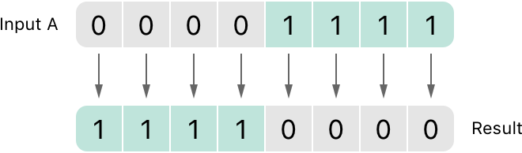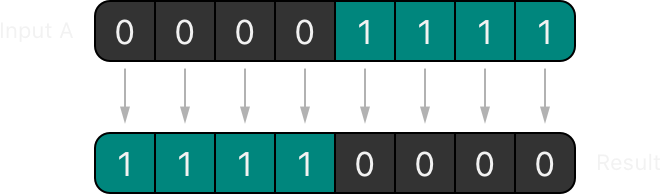

按位取反运算符是前缀运算符，直接出现在它作用的值之前，中间不加任何空白：

```swift
let initialBits: UInt8 = 0b00001111
let invertedBits = ~initialBits  // equals 11110000
```

`UInt8` 整数有八位，可以存储 `0` 到 `255` 之间的任何值。这个例子用一个二进制值 `00001111` 初始化 `UInt8` 整数，它的前四位被设为 `0`，后四位被设为 `1`。这相当于十进制值 `15`。

随后用按位取反运算符创建一个名为 `invertedBits` 的新常量，它的值等于 `initialBits`，但所有位都被反转了。0 变成 1，1 变成 0。`invertedBits` 的值为 `11110000`，相当于无符号十进制值 `240`。

### 按位与运算符 {#Bitwise-AND-Operator}

*按位与运算符*（`&`）会合并两个数的位。它返回一个新数，只有当*两个*输入数的对应位都等于 `1` 时，新数的该位才被设为 `1`：

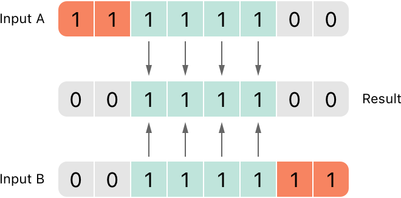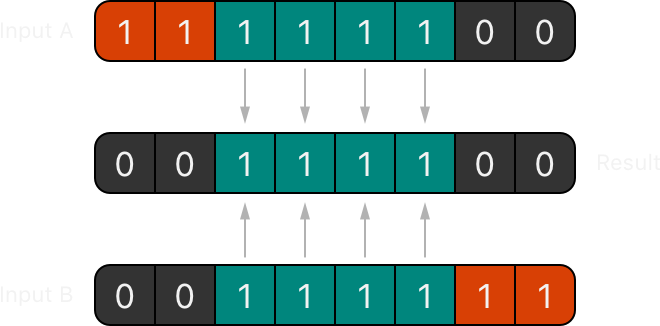

在下面的例子中，`firstSixBits` 和 `lastSixBits` 的值都有四个中间位等于 `1`。按位与运算符将它们合并，得到数 `00111100`，相当于无符号十进制值 `60`：

```swift
let firstSixBits: UInt8 = 0b11111100
let lastSixBits: UInt8  = 0b00111111
let middleFourBits = firstSixBits & lastSixBits  // equals 00111100
```

### 按位或运算符 {#Bitwise-OR-Operator}

*按位或运算符*（`|`）会比较两个数的位。只要*任一*输入数的对应位等于 `1`，该运算符返回的新数的这一位就设为 `1`：

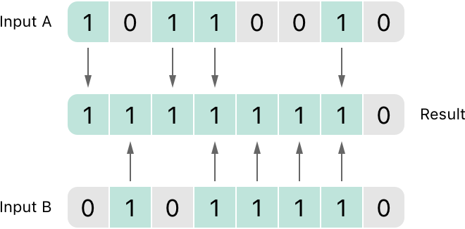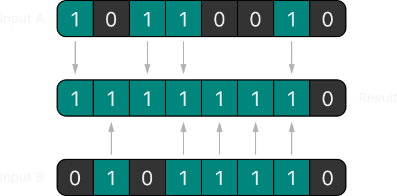

在下面的例子中，`someBits` 和 `moreBits` 在不同的位上被设为 `1`。按位或运算符将它们合并，得到数 `11111110`，等于无符号十进制数 `254`：

```swift
let someBits: UInt8 = 0b10110010
let moreBits: UInt8 = 0b01011110
let combinedbits = someBits | moreBits  // equals 11111110
```

### 按位异或运算符 {#Bitwise-XOR-Operator}

*按位异或运算符*，又称“排他或运算符”（`^`），会比较两个数的位。该运算符返回一个新数：输入位不同时，新数的对应位设为 `1`；输入位相同时，设为 `0`：

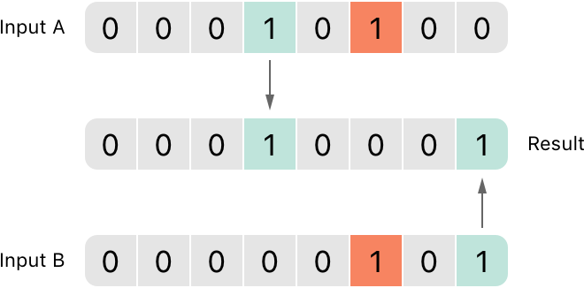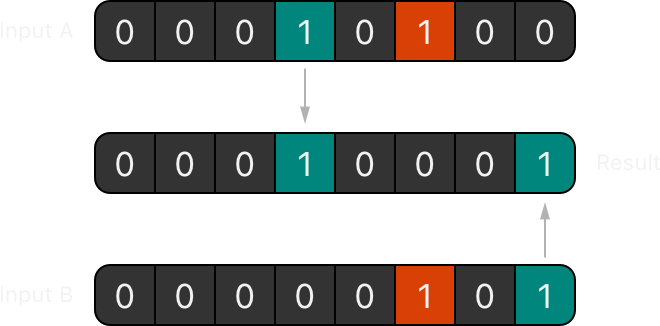

在下面的例子中，`firstBits` 和 `otherBits` 各自都有某一位被设为 `1`，而另一个数在该位置上不是 `1`。按位异或运算符在输出值中将这两位都设为 `1`。`firstBits` 和 `otherBits` 中所有其他位都相同，在输出值中被设为 `0`：

```swift
let firstBits: UInt8 = 0b00010100
let otherBits: UInt8 = 0b00000101
let outputBits = firstBits ^ otherBits  // equals 00010001
```

### 按位左移和右移运算符 {#Bitwise-Left-and-Right-Shift-Operators}

*按位左移运算符*（`<<`）和*按位右移运算符*（`>>`）会按照下面定义的规则，将数中的所有位向左或向右移动若干位。

按位左移和右移的效果相当于把整数乘以或除以 2 的幂。将整数的位向左移动一位会使其值翻倍，向右移动一位则会使其值减半。

#### 无符号整数的移位行为 {#Shifting-Behavior-for-Unsigned-Integers}

无符号整数的位移行为如下：

1. 现有的位按请求的位数向左或向右移动。
2. 任何被移出整数值存储范围的位都会被丢弃。
3. 原始位向左或向右移动后空出的位置会补零。

这种方式称为*逻辑移位*（logical shift）。

下图展示了 `11111111 << 1`（即把 `11111111` 向左移动 1 位）和 `11111111 >> 1`（即把 `11111111` 向右移动 1 位）的结果。绿色的数字是被移动的位，灰色的数字是被丢弃的位，粉色的 0 是补入的位：

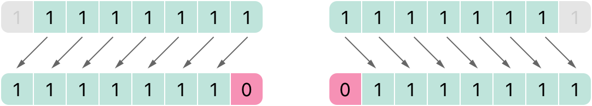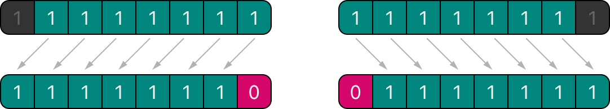

下面是在 Swift 代码中进行位移的样子：

```swift
let shiftBits: UInt8 = 4   // 00000100 in binary
shiftBits << 1             // 00001000
shiftBits << 2             // 00010000
shiftBits << 5             // 10000000
shiftBits << 6             // 00000000
shiftBits >> 2             // 00000001
```

你可以用位移来在其他数据类型中编码和解码值：

```swift
let pink: UInt32 = 0xCC6699
let redComponent = (pink & 0xFF0000) >> 16    // redComponent is 0xCC, or 204
let greenComponent = (pink & 0x00FF00) >> 8   // greenComponent is 0x66, or 102
let blueComponent = pink & 0x0000FF           // blueComponent is 0x99, or 153
```

这个例子使用名为 `pink` 的 `UInt32` 常量来存储粉色对应的层叠样式表（CSS）颜色值。CSS 颜色值 `#CC6699` 在 Swift 的十六进制表示法中写作 `0xCC6699`。然后，通过按位与运算符（`&`）和按位右移运算符（`>>`），将这个颜色分解为红色（`CC`）、绿色（`66`）和蓝色（`99`）分量。

红色分量通过对 `0xCC6699` 和 `0xFF0000` 执行按位与得到。`0xFF0000` 中的 0 实际上“屏蔽”了 `0xCC6699` 的第二和第三个字节，使 `6699` 被忽略，结果剩下 `0xCC0000`。

然后将这个数向右移动 16 位（`>> 16`）。十六进制数中每两个字符使用 8 位，因此向右移动 16 位会把 `0xCC0000` 变成 `0x0000CC`。这与 `0xCC` 相同，其十进制值为 `204`。

同样，绿色分量通过对 `0xCC6699` 和 `0x00FF00` 执行按位与得到，输出值为 `0x006600`。然后将这个输出值向右移动八位，得到值 `0x66`，其十进制值为 `102`。

最后，蓝色分量通过对 `0xCC6699` 和 `0x0000FF` 执行按位与得到，输出值为 `0x000099`。由于 `0x000099` 已经等于 `0x99`，其十进制值为 `153`，所以直接使用这个值，无需向右移位。

#### 有符号整数的移位行为 {#Shifting-Behavior-for-Signed-Integers}

有符号整数的移位行为比无符号整数更复杂，原因是有符号整数在二进制中的表示方式。（为简单起见，下面的例子基于 8 位有符号整数，但同样的原理适用于任意大小的有符号整数。）

有符号整数使用它的第一位（称为*符号位*，sign bit）来表示该整数是正还是负。符号位为 `0` 表示正数，符号位为 `1` 表示负数。

其余的位（称为*数值位*，value bits）存储实际的值。正数的存储方式与无符号整数完全相同，从 `0` 开始向上计数。下面是 `Int8` 中表示数字 `4` 的位：

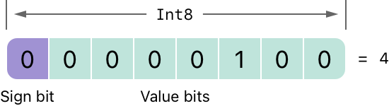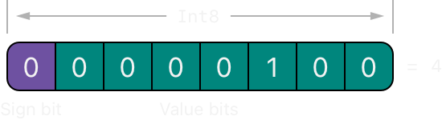

符号位是 `0`（表示“正”），七个数值位就是二进制表示的数值 `4`。

然而，负数的存储方式不同。负数的存储方式是用 2 的 n 次方减去该数的绝对值，其中 n 是数值位的数量。一个八位有符号整数有七个数值位，因此这里计算的是 2 的 7 次方，即 `128`。

下面是 `Int8` 中表示数字 `-4` 的位：

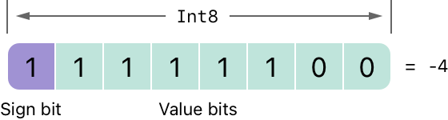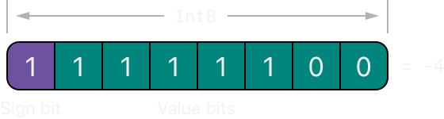

这一次，符号位是 `1`（表示“负”），七个数值位的二进制值为 `124`（即 `128 - 4`）：

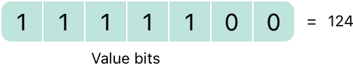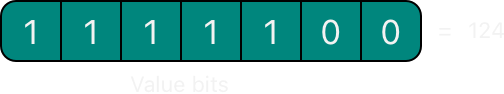

这种负数的编码方式称为*二进制补码*（two's complement）表示法。它可能看起来不是表示负数的常见方式，但它有几个优点。

首先，你可以把 `-1` 加到 `-4` 上，只需对所有八位（包括符号位）执行标准的二进制加法，完成后丢弃八位中放不下的内容：

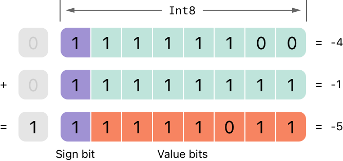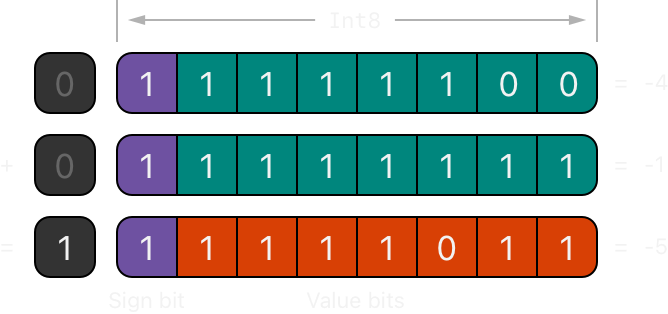

其次，二进制补码表示法还让你可以像正数一样对负数的位进行左移和右移，并且每次左移仍然使值翻倍，每次右移仍然使值减半。为此，有符号整数右移时会使用一条额外的规则：有符号整数右移时，应用与无符号整数相同的规则，但左侧空出的位要用*符号位*填充，而不是用 0 填充。

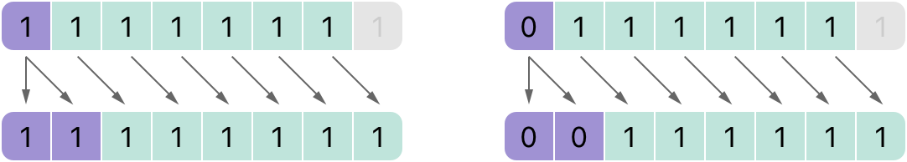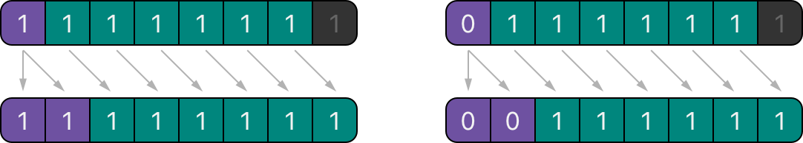

这一操作确保有符号整数右移后符号不变，称为*算术移位*（arithmetic shift）。

由于正数和负数的特殊存储方式，将其中任何一个右移都会使其更接近零。移位时保持符号位不变，意味着负数在其值向零靠近时仍然是负数。

## 溢出运算符 {#Overflow-Operators}

如果你试图把一个数存入无法容纳该值的整数常量或变量，Swift 默认会报告错误，而不是允许创建一个无效值。当你处理过大或过小的数时，这种行为提供了额外的安全性。

例如，`Int16` 整数类型可以容纳 `-32768` 到 `32767` 之间的任何有符号整数。试图把 `Int16` 常量或变量设为这个范围之外的数会导致错误：

```swift
var potentialOverflow = Int16.max
// potentialOverflow equals 32767, which is the maximum value an Int16 can hold
potentialOverflow += 1
// this causes an error
```

当值变得过大或过小时提供错误处理，可以让你在编写处理边界值条件的代码时灵活得多。

不过，当你确实希望溢出情况截断可用的位数时，可以选择启用这种行为，而不是触发错误。Swift 提供了三个算术*溢出运算符*，用于在整数计算中选择启用溢出行为。这些运算符都以与号（`&`）开头：

- 溢出加法（`&+`）
- 溢出减法（`&-`）
- 溢出乘法（`&*`）

### 值溢出 {#Value-Overflow}

数字可能向正方向或负方向溢出。

下面的例子展示了当无符号整数允许向正方向溢出时会发生什么，这里使用溢出加法运算符（`&+`）：

```swift
var unsignedOverflow = UInt8.max
// unsignedOverflow equals 255, which is the maximum value a UInt8 can hold
unsignedOverflow = unsignedOverflow &+ 1
// unsignedOverflow is now equal to 0
```

变量 `unsignedOverflow` 用 `UInt8` 能容纳的最大值（`255`，二进制为 `11111111`）初始化。然后用溢出加法运算符（`&+`）将其加 `1`。这使其二进制表示刚好超出 `UInt8` 能容纳的大小，导致它溢出边界，如下图所示。溢出加法后仍在 `UInt8` 范围内的值是 `00000000`，即零。

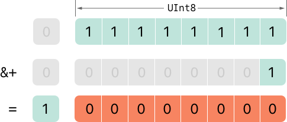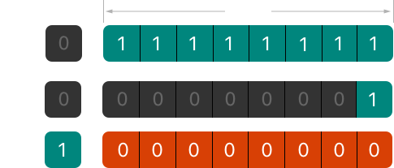

当无符号整数允许向负方向溢出时，会发生类似的情况。下面是使用溢出减法运算符（`&-`）的例子：

```swift
var unsignedOverflow = UInt8.min
// unsignedOverflow equals 0, which is the minimum value a UInt8 can hold
unsignedOverflow = unsignedOverflow &- 1
// unsignedOverflow is now equal to 255
```

`UInt8` 能容纳的最小值是零，二进制为 `00000000`。如果使用溢出减法运算符（`&-`）从 `00000000` 中减去 `1`，这个数就会溢出并回绕到 `11111111`，即十进制数 `255`。

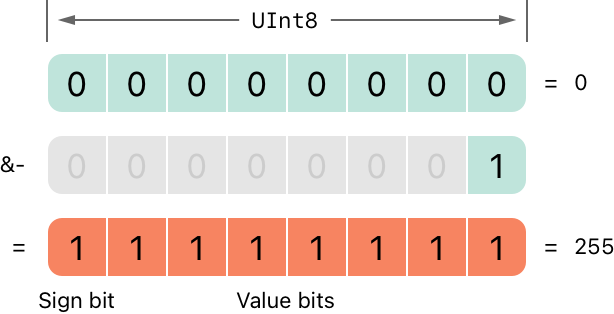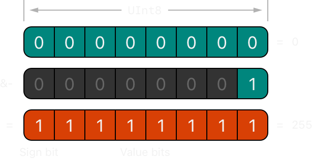

有符号整数也会发生溢出。有符号整数的所有加法和减法都以按位方式进行，符号位也作为被加或减的数的一部分，详见 [按位左移和右移运算符](advanced-operators.md#Bitwise-Left-and-Right-Shift-Operators)。

```swift
var signedOverflow = Int8.min
// signedOverflow equals -128, which is the minimum value an Int8 can hold
signedOverflow = signedOverflow &- 1
// signedOverflow is now equal to 127
```

`Int8` 能容纳的最小值是 `-128`，二进制为 `10000000`。用溢出运算符从这个二进制数中减去 `1`，得到二进制值 `01111111`，这会翻转符号位，得到正数 `127`，即 `Int8` 能容纳的最大正值。

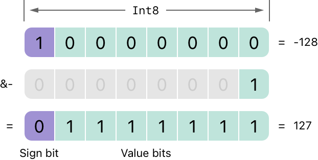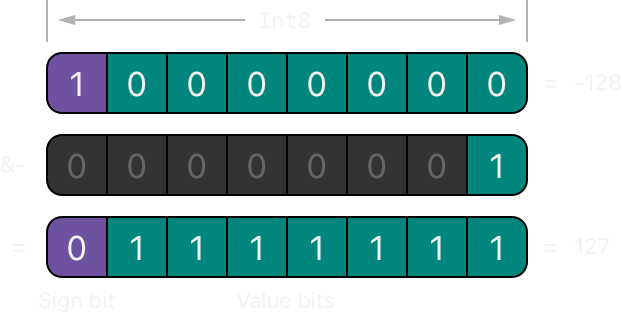

对于有符号整数和无符号整数，向正方向溢出都会从最大有效整数值回绕到最小值，向负方向溢出则会从最小值回绕到最大值。

## 优先级和结合性 {#Precedence-and-Associativity}

运算符*优先级*（precedence）决定了一些运算符比其他运算符优先级更高；这些运算符会先被应用。

运算符*结合性*（associativity）定义了相同优先级的运算符如何组合在一起——是从左侧组合，还是从右侧组合。可以把它理解为“它们与左侧的表达式结合”，或者“它们与右侧的表达式结合”。

在确定复合表达式的计算顺序时，考虑每个运算符的优先级和结合性很重要。例如，运算符优先级解释了为什么下面的表达式等于 `17`。

```swift
2 + 3 % 4 * 5
// this equals 17
```

如果严格从左到右阅读，你可能会以为表达式这样计算：

- `2` 加 `3` 等于 `5`
- `5` 对 `4` 取余等于 `1`
- `1` 乘以 `5` 等于 `5`

然而，实际答案是 `17`，而不是 `5`。优先级更高的运算符会先于优先级较低的运算符求值。在 Swift 中，和 C 一样，取余运算符（`%`）和乘法运算符（`*`）的优先级高于加法运算符（`+`）。因此，它们都会在考虑加法之前求值。

不过，取余和乘法彼此的优先级*相同*。要确定确切的计算顺序，你还需要考虑它们的结合性。取余和乘法都与左侧的表达式结合。可以把它理解为从左侧开始，在表达式的这些部分加上隐式括号：

```swift
2 + ((3 % 4) * 5)
```

`(3 % 4)` 是 `3`，因此它等价于：

```swift
2 + (3 * 5)
```

`(3 * 5)` 是 `15`，因此它等价于：

```swift
2 + 15
```

这次计算得出最终答案 `17`。

关于 Swift 标准库提供的运算符，包括运算符优先级组和结合性设置的完整列表，请参阅 [Operator Declarations](https://developer.apple.com/documentation/swift/operator_declarations)。

> 注意：Swift 的运算符优先级和结合性规则比 C 和 Objective-C 中的更简单、更可预测。不过，这也意味着它们与 C 系语言并不完全相同。把现有代码迁移到 Swift 时，要小心确保运算符的相互作用仍符合你的意图。

## 运算符方法 {#Operator-Methods}

类和结构体可以提供现有运算符的自定义实现。这称为*重载*（overloading）现有运算符。

下面的例子展示了如何为自定义结构体实现算术加法运算符（`+`）。算术加法运算符是二元运算符，因为它作用于两个操作对象；它也是中缀运算符，因为它出现在这两个操作对象之间。

这个例子定义了一个表示二维位置向量 `(x, y)` 的 `Vector2D` 结构体，随后定义了一个*运算符方法*（operator method），用于将 `Vector2D` 结构体的实例相加：

```swift
struct Vector2D {
    var x = 0.0, y = 0.0
}

extension Vector2D {
    static func + (left: Vector2D, right: Vector2D) -> Vector2D {
       return Vector2D(x: left.x + right.x, y: left.y + right.y)
    }
}
```

这个运算符方法定义为 `Vector2D` 上的类型方法，方法名与被重载的运算符（`+`）匹配。由于加法并不是向量的核心行为，这个类型方法定义在 `Vector2D` 的扩展中，而不是写在 `Vector2D` 的结构体声明主体中。由于算术加法运算符是二元运算符，这个运算符方法接收两个 `Vector2D` 类型的输入参数，并返回一个输出值，类型也是 `Vector2D`。

在这个实现中，输入参数命名为 `left` 和 `right`，表示位于 `+` 运算符左侧和右侧的 `Vector2D` 实例。该方法返回一个新的 `Vector2D` 实例，其 `x` 和 `y` 属性用两个相加的 `Vector2D` 实例的 `x` 和 `y` 属性之和初始化。

这个类型方法可以作为中缀运算符用于现有的 `Vector2D` 实例之间：

```swift
let vector = Vector2D(x: 3.0, y: 1.0)
let anotherVector = Vector2D(x: 2.0, y: 4.0)
let combinedVector = vector + anotherVector
// combinedVector is a Vector2D instance with values of (5.0, 5.0)
```

这个例子将向量 `(3.0, 1.0)` 和 `(2.0, 4.0)` 相加，得到向量 `(5.0, 5.0)`，如下图所示。

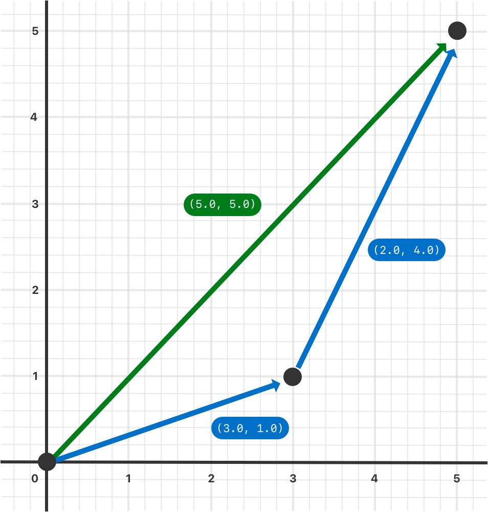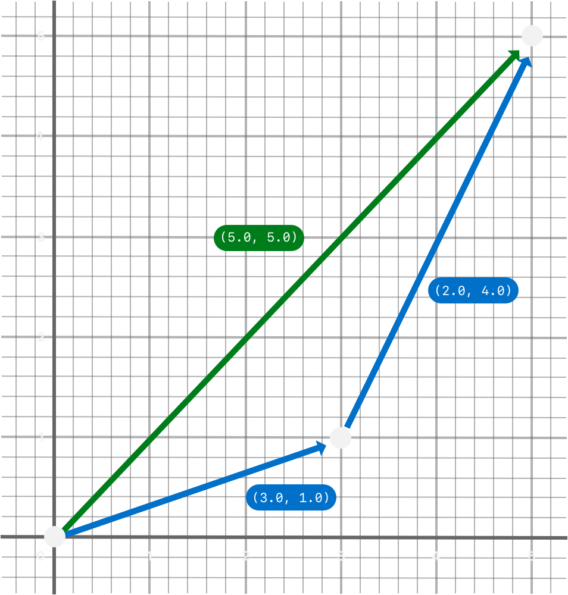

### 前缀和后缀运算符 {#Prefix-and-Postfix-Operators}

上面展示的例子演示了二元中缀运算符的自定义实现。类和结构体也可以提供标准*一元运算符*的实现。一元运算符只作用于一个操作对象。如果位于操作对象之前（例如 `-a`），就是*前缀*运算符；如果位于操作对象之后（例如 `b!`），就是*后缀*运算符。

声明运算符方法时，将 `prefix` 或 `postfix` 修饰符写在 `func` 关键字之前，就实现了一个前缀或后缀一元运算符：

```swift
extension Vector2D {
    static prefix func - (vector: Vector2D) -> Vector2D {
        return Vector2D(x: -vector.x, y: -vector.y)
    }
}
```

上面的例子为 `Vector2D` 实例实现了一元减号运算符（`-a`）。一元减号运算符是前缀运算符，因此该方法必须用 `prefix` 修饰符限定。

对于简单的数值，一元减号运算符把正数转换为对应的负数，反之亦然。`Vector2D` 实例的相应实现会对 `x` 和 `y` 两个属性执行这一操作：

```swift
let positive = Vector2D(x: 3.0, y: 4.0)
let negative = -positive
// negative is a Vector2D instance with values of (-3.0, -4.0)
let alsoPositive = -negative
// alsoPositive is a Vector2D instance with values of (3.0, 4.0)
```

### 复合赋值运算符 {#Compound-Assignment-Operators}

*复合赋值运算符*（compound assignment operator）将赋值（`=`）与另一种运算结合在一起。例如，加法赋值运算符（`+=`）把加法和赋值合并成一个操作。需要把复合赋值运算符的左侧输入参数类型标记为 `inout`，因为该参数的值会在运算符方法内部被直接修改。

下面的例子为 `Vector2D` 实例实现了一个加法赋值运算符方法：

```swift
extension Vector2D {
    static func += (left: inout Vector2D, right: Vector2D) {
        left = left + right
    }
}
```

由于前面已经定义了加法运算符，这里不需要重新实现加法过程。加法赋值运算符方法利用现有的加法运算符方法，把左值设为左值加右值：

```swift
var original = Vector2D(x: 1.0, y: 2.0)
let vectorToAdd = Vector2D(x: 3.0, y: 4.0)
original += vectorToAdd
// original now has values of (4.0, 6.0)
```

> 注意：不能重载默认赋值运算符（`=`）。只有复合赋值运算符可以重载。同样，三元条件运算符（`a ? b : c`）也不能重载。

### 等价运算符 {#Equivalence-Operators}

默认情况下，自定义类和结构体没有*等价运算符*（equivalence operator）的实现，即*等于*运算符（`==`）和*不等于*运算符（`!=`）。你通常实现 `==` 运算符，并使用 Swift 标准库对 `!=` 运算符的默认实现，它对 `==` 运算符的结果取反。实现 `==` 运算符有两种方式：你可以自己实现，或者对许多类型而言，可以请 Swift 为你合成一个实现。无论哪种方式，都需要添加对 Swift 标准库 `Equatable` 协议的遵循。

实现 `==` 运算符的方式与其他中缀运算符相同：

```swift
extension Vector2D: Equatable {
    static func == (left: Vector2D, right: Vector2D) -> Bool {
       return (left.x == right.x) && (left.y == right.y)
    }
}
```

上面的例子实现了一个 `==` 运算符，用于检查两个 `Vector2D` 实例是否具有等价的值。在 `Vector2D` 的语境中，把“相等”理解为“两个实例具有相同的 `x` 值和 `y` 值”是合理的，因此运算符实现采用了这一逻辑。

现在可以使用这个运算符检查两个 `Vector2D` 实例是否等价：

```swift
let twoThree = Vector2D(x: 2.0, y: 3.0)
let anotherTwoThree = Vector2D(x: 2.0, y: 3.0)
if twoThree == anotherTwoThree {
    print("These two vectors are equivalent.")
}
// Prints "These two vectors are equivalent."
```

在许多简单的情况下，你可以请 Swift 为你提供等价运算符的合成实现，详见 [使用合成实现采纳协议](protocols.md#Adopting-a-Protocol-Using-a-Synthesized-Implementation)。

## 自定义运算符 {#Custom-Operators}

除了 Swift 提供的标准运算符之外，你还可以声明并实现自己的*自定义运算符*（custom operator）。关于可用于定义自定义运算符的字符列表，请参阅 [运算符](lexical-structure.md#Operators)。

新运算符使用 `operator` 关键字在全局层面声明，并用 `prefix`、`infix` 或 `postfix` 修饰符标记：

```swift
prefix operator +++
```

上面的例子定义了一个名为 `+++` 的新前缀运算符。这个运算符在 Swift 中没有既有含义，因此在下面处理 `Vector2D` 实例的特定语境中，为它赋予了自定义含义。在本例中，`+++` 被视为一个新的“前缀翻倍”运算符。它通过前面定义的加法赋值运算符把向量与自身相加，从而使 `Vector2D` 实例的 `x` 和 `y` 值翻倍。要实现 `+++` 运算符，请向 `Vector2D` 添加一个名为 `+++` 的类型方法，如下所示：

```swift
extension Vector2D {
    static prefix func +++ (vector: inout Vector2D) -> Vector2D {
        vector += vector
        return vector
    }
}

var toBeDoubled = Vector2D(x: 1.0, y: 4.0)
let afterDoubling = +++toBeDoubled
// toBeDoubled now has values of (2.0, 8.0)
// afterDoubling also has values of (2.0, 8.0)
```

### 自定义中缀运算符的优先级 {#Precedence-for-Custom-Infix-Operators}

每个自定义中缀运算符都属于一个*优先级组*（precedence group）。优先级组规定了运算符相对于其他中缀运算符的优先级，以及该运算符的结合性。关于这些特性如何影响中缀运算符与其他中缀运算符的相互作用，请参阅 [优先级和结合性](advanced-operators.md#Precedence-and-Associativity)。

没有显式放入某个优先级组的自定义中缀运算符会被赋予一个默认优先级组，其优先级仅高于三元条件运算符的优先级。

下面的例子定义了一个名为 `+-` 的新自定义中缀运算符，它属于优先级组 `AdditionPrecedence`：

```swift
infix operator +-: AdditionPrecedence
extension Vector2D {
    static func +- (left: Vector2D, right: Vector2D) -> Vector2D {
        return Vector2D(x: left.x + right.x, y: left.y - right.y)
    }
}
let firstVector = Vector2D(x: 1.0, y: 2.0)
let secondVector = Vector2D(x: 3.0, y: 4.0)
let plusMinusVector = firstVector +- secondVector
// plusMinusVector is a Vector2D instance with values of (4.0, -2.0)
```

这个运算符将两个向量的 `x` 值相加，并从第一个向量的 `y` 值中减去第二个向量的 `y` 值。由于它本质上是一个“加法类”运算符，因此被赋予了与 `+` 和 `-` 等加法类中缀运算符相同的优先级组。关于 Swift 标准库提供的运算符，包括运算符优先级组和结合性设置的完整列表，请参阅 [Operator Declarations](https://developer.apple.com/documentation/swift/operator_declarations)。关于优先级组的更多信息，以及定义自己的运算符和优先级组的语法，请参阅 [运算符声明](declarations.md#Operator-Declaration)。

> 注意：定义前缀或后缀运算符时不需要指定优先级。不过，如果对同一个操作数同时应用前缀和后缀运算符，后缀运算符会先应用。

## 结果构造器 {#Result-Builders}

*结果构造器*（result builder）是你定义的一种类型，它以自然、声明式的方式为创建列表或树之类的嵌套数据添加语法。使用结果构造器的代码可以包含普通的 Swift 语法，例如 `if` 和 `for`，以处理有条件或重复的数据片段。

下面的代码定义了几个类型，用于在一行中用星号和文本进行绘制。

```swift
protocol Drawable {
    func draw() -> String
}
struct Line: Drawable {
    var elements: [Drawable]
    func draw() -> String {
        return elements.map { $0.draw() }.joined(separator: "")
    }
}
struct Text: Drawable {
    var content: String
    init(_ content: String) { self.content = content }
    func draw() -> String { return content }
}
struct Space: Drawable {
    func draw() -> String { return " " }
}
struct Stars: Drawable {
    var length: Int
    func draw() -> String { return String(repeating: "*", count: length) }
}
struct AllCaps: Drawable {
    var content: Drawable
    func draw() -> String { return content.draw().uppercased() }
}
```

`Drawable` 协议定义了可绘制对象（例如线条或形状）的要求：该类型必须实现 `draw()` 方法。`Line` 结构体表示单行绘图，并充当大多数绘图的顶层容器。要绘制一个 `Line`，该结构体会对线条的每个组成部分调用 `draw()`，然后把得到的字符串拼接成一个字符串。`Text` 结构体包装一个字符串，使其成为绘图的一部分。`AllCaps` 结构体包装并修改另一个绘图，把绘图中的任何文本转换为大写。

通过调用这些类型的构造器，可以创建一幅绘图：

```swift
let name: String? = "Ravi Patel"
let manualDrawing = Line(elements: [
     Stars(length: 3),
     Text("Hello"),
     Space(),
     AllCaps(content: Text((name ?? "World") + "!")),
     Stars(length: 2),
])
print(manualDrawing.draw())
// Prints "***Hello RAVI PATEL!**".
```

这段代码可以工作，但有点别扭。`AllCaps` 之后深度嵌套的括号很难读。当 `name` 为 `nil` 时使用“World”的后备逻辑必须用 `??` 运算符内联完成，如果逻辑再复杂一点就会很难办。如果你需要在绘图中加入 `switch` 或 `for` 循环来构建某一部分，则无法做到。结果构造器让你可以重写这样的代码，使其看起来像普通的 Swift 代码。

要定义结果构造器，请在类型声明上写 `@resultBuilder` 特性。例如，下面的代码定义了一个名为 `DrawingBuilder` 的结果构造器，它让你可以用声明式语法描述一幅绘图：

```swift
@resultBuilder
struct DrawingBuilder {
    static func buildBlock(_ components: Drawable...) -> Drawable {
        return Line(elements: components)
    }
    static func buildEither(first: Drawable) -> Drawable {
        return first
    }
    static func buildEither(second: Drawable) -> Drawable {
        return second
    }
}
```

`DrawingBuilder` 结构体定义了三个方法，分别实现结果构造器语法的一部分。`buildBlock(_:)` 方法增加了在代码块中写一系列行的支持。它把该代码块中的组成部分合并成一个 `Line`。`buildEither(first:)` 和 `buildEither(second:)` 方法增加了对 `if`-`else` 的支持。

你可以把 `@DrawingBuilder` 特性应用于函数的参数，这样传给该函数的闭包就会被转换为结果构造器根据该闭包创建的值。例如：

```swift
func draw(@DrawingBuilder content: () -> Drawable) -> Drawable {
    return content()
}
func caps(@DrawingBuilder content: () -> Drawable) -> Drawable {
    return AllCaps(content: content())
}

func makeGreeting(for name: String? = nil) -> Drawable {
    let greeting = draw {
        Stars(length: 3)
        Text("Hello")
        Space()
        caps {
            if let name = name {
                Text(name + "!")
            } else {
                Text("World!")
            }
        }
        Stars(length: 2)
    }
    return greeting
}
let genericGreeting = makeGreeting()
print(genericGreeting.draw())
// Prints "***Hello WORLD!**".

let personalGreeting = makeGreeting(for: "Ravi Patel")
print(personalGreeting.draw())
// Prints "***Hello RAVI PATEL!**".
```

`makeGreeting(for:)` 函数接收一个 `name` 参数，并用它绘制个性化的问候语。`draw(_:)` 和 `caps(_:)` 函数都接收一个闭包作为实参，该闭包用 `@DrawingBuilder` 特性标记。调用这些函数时，你使用的就是 `DrawingBuilder` 定义的特殊语法。Swift 会把这种对绘图的声明式描述转换成一连串对 `DrawingBuilder` 方法的调用，以构建出作为函数实参传入的值。例如，Swift 会把该例子中对 `caps(_:)` 的调用转换成类似下面的代码：

```swift
let capsDrawing = caps {
    let partialDrawing: Drawable
    if let name = name {
        let text = Text(name + "!")
        partialDrawing = DrawingBuilder.buildEither(first: text)
    } else {
        let text = Text("World!")
        partialDrawing = DrawingBuilder.buildEither(second: text)
    }
    return partialDrawing
}
```

Swift 会把 `if`-`else` 块转换成对 `buildEither(first:)` 和 `buildEither(second:)` 方法的调用。虽然你在自己的代码中不会调用这些方法，但展示转换结果可以让你更容易看出，使用 `DrawingBuilder` 语法时 Swift 是如何转换你的代码的。

要在特殊的绘图语法中增加对 `for` 循环的支持，请添加一个 `buildArray(_:)` 方法。

```swift
extension DrawingBuilder {
    static func buildArray(_ components: [Drawable]) -> Drawable {
        return Line(elements: components)
    }
}
let manyStars = draw {
    Text("Stars:")
    for length in 1...3 {
        Space()
        Stars(length: length)
    }
}
```

在上面的代码中，`for` 循环会创建一个绘图数组，`buildArray(_:)` 方法则把这个数组变成一个 `Line`。

关于 Swift 如何把构造器语法转换成对构造器类型方法的调用的完整列表，请参阅 [resultBuilder](attributes.md#resultBuilder)。
