# 自动引用计数 {#Automatic-Reference-Counting}

为对象的生命周期以及对象之间的关系建模。

Swift 使用*自动引用计数*（ARC）来跟踪和管理你 App 的内存占用。在大多数情况下，这意味着 Swift 中的内存管理“自然而然就能正常工作”，你不需要自己操心内存管理。当类实例不再被需要时，ARC 会自动释放这些实例占用的内存。

不过，在某些情况下，ARC 需要更多关于代码各部分之间关系的信息，才能替你管理内存。本章介绍这些情形，并说明如何让 ARC 管理你 App 的全部内存。在 Swift 中使用 ARC，与在 Objective-C 中使用 ARC 的方式非常相似，参见 [Transitioning to ARC Release Notes](https://developer.apple.com/library/content/releasenotes/ObjectiveC/RN-TransitioningToARC/Introduction/Introduction.html)。

引用计数只适用于类的实例。结构体和枚举是值类型，不是引用类型，不会按引用存储和传递。

## ARC 如何工作 {#How-ARC-Works}

每当你创建类的新实例时，ARC 都会分配一块内存来存储该实例的信息。这块内存保存实例的类型信息，以及与该实例关联的所有存储属性的值。

此外，当实例不再被需要时，ARC 会释放该实例占用的内存，让这块内存可以另作他用。这确保类实例在不再需要时不会一直占用内存空间。

然而，如果 ARC 释放了一个仍在使用中的实例，就再也不能访问该实例的属性，也不能调用它的方法了。事实上，如果你试图访问该实例，App 很可能会崩溃。

为了确保实例在仍然需要时不会消失，ARC 会跟踪当前有多少属性、常量和变量引用着每个类实例。只要还存在至少一个指向该实例的有效引用，ARC 就不会释放该实例。

为此，每当你把一个类实例赋给属性、常量或变量时，该属性、常量或变量就会对该实例建立一个*强引用*。之所以称为“强”引用，是因为它牢牢持有该实例，只要这个强引用还在，就不允许该实例被释放。

## ARC 实战 {#ARC-in-Action}

下面是一个演示自动引用计数如何工作的例子。这个例子从一个名为 `Person` 的简单类开始，它定义了一个名为 `name` 的存储常量属性：

```swift
class Person {
    let name: String
    init(name: String) {
        self.name = name
        print("\(name) is being initialized")
    }
    deinit {
        print("\(name) is being deinitialized")
    }
}
```

`Person` 类有一个构造器，它设置实例的 `name` 属性，并打印一条消息，表示初始化正在进行。`Person` 类还有一个析构器，在类的实例被释放时打印一条消息。

下一段代码定义了三个 `Person?` 类型的变量，用来在后续代码中为一个新的 `Person` 实例建立多个引用。由于这些变量是可选类型（`Person?` 而不是 `Person`），它们会自动初始化为 `nil`，目前并不引用任何 `Person` 实例。

```swift
var reference1: Person?
var reference2: Person?
var reference3: Person?
```

现在可以创建一个新的 `Person` 实例，并把它赋给这三个变量之一：

```swift
reference1 = Person(name: "John Appleseed")
// Prints "John Appleseed is being initialized".
```

注意，当你调用 `Person` 类的构造器时，就会打印 `"John Appleseed is being initialized"` 这条消息。这证实初始化已经发生。

由于新的 `Person` 实例已赋给 `reference1` 变量，现在 `reference1` 到该新实例之间存在一个强引用。由于至少有一个强引用，ARC 确保这个 `Person` 实例保留在内存中，不会被释放。

如果你把同一个 `Person` 实例再赋给另外两个变量，就会再建立两个指向该实例的强引用：

```swift
reference2 = reference1
reference3 = reference1
```

现在，这个单一的 `Person` 实例共有*三个*强引用。

如果通过给其中两个变量赋 `nil` 来断开两个强引用（包括最初的那个引用），就只剩一个强引用，`Person` 实例不会被释放：

```swift
reference1 = nil
reference2 = nil
```

直到第三个也是最后一个强引用被断开时，ARC 才会释放 `Person` 实例，此时显然你已不再使用该实例：

```swift
reference3 = nil
// Prints "John Appleseed is being deinitialized".
```

## 类实例之间的强引用循环 {#Strong-Reference-Cycles-Between-Class-Instances}

在上面的例子中，ARC 能够跟踪你创建的新 `Person` 实例的引用数量，并在该实例不再需要时释放它。

然而，也可能写出这样的代码：某个类的实例*永远*不会达到强引用数为零的状态。如果两个类实例互相持有强引用，使得每个实例都让另一个保持存活，就会出现这种情况。这称为*强引用循环*。

解决强引用循环的办法，是把类之间的一些关系定义为弱引用或无主引用，而不是强引用。这一过程在 [解决类实例之间的强引用循环](automatic-reference-counting.md#Resolving-Strong-Reference-Cycles-Between-Class-Instances) 中描述。不过，在学习如何解决强引用循环之前，先理解这种循环是如何产生的会很有帮助。

下面是一个意外造成强引用循环的例子。这个例子定义了两个类，`Person` 和 `Apartment`，分别模拟一栋公寓楼及其住户：

```swift
class Person {
    let name: String
    init(name: String) { self.name = name }
    var apartment: Apartment?
    deinit { print("\(name) is being deinitialized") }
}

class Apartment {
    let unit: String
    init(unit: String) { self.unit = unit }
    var tenant: Person?
    deinit { print("Apartment \(unit) is being deinitialized") }
}
```

每个 `Person` 实例都有一个 `String` 类型的 `name` 属性，以及一个初始值为 `nil` 的可选 `apartment` 属性。`apartment` 属性是可选类型，因为一个人不一定总有公寓。

同样，每个 `Apartment` 实例都有一个 `String` 类型的 `unit` 属性，以及一个初始值为 `nil` 的可选 `tenant` 属性。`tenant` 属性是可选类型，因为一套公寓不一定总有租户。

这两个类还都定义了一个析构器，打印一条表明该类的实例正在被析构的消息。这样你就能看到 `Person` 和 `Apartment` 的实例是否按预期被释放。

下面这段代码定义了两个可选类型的变量 `john` 和 `unit4A`，稍后会把它们分别设为一个特定的 `Person` 实例和一个特定的 `Apartment` 实例。由于是可选类型，这两个变量的初始值都是 `nil`：

```swift
var john: Person?
var unit4A: Apartment?
```

现在可以创建一个特定的 `Person` 实例和一个特定的 `Apartment` 实例，并把这两个新实例赋给 `john` 和 `unit4A` 变量：

```swift
john = Person(name: "John Appleseed")
unit4A = Apartment(unit: "4A")
```

创建并赋值这两个实例后，强引用如图所示。`john` 变量现在对新 `Person` 实例有一个强引用，`unit4A` 变量对新 `Apartment` 实例有一个强引用：

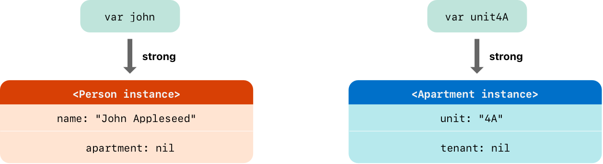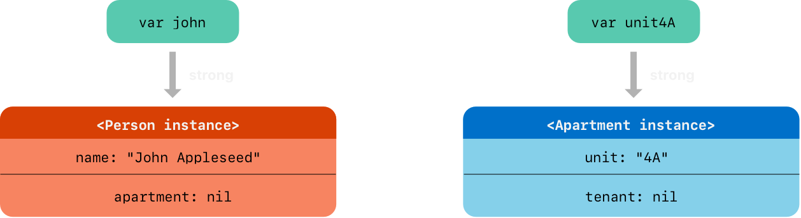

现在可以把这两个实例关联起来，让这个人拥有一套公寓，让这套公寓有一个租户。注意，这里用感叹号（`!`）解包并访问存储在 `john` 和 `unit4A` 可选变量中的实例，以便设置这些实例的属性：

```swift
john!.apartment = unit4A
unit4A!.tenant = john
```

把两个实例关联起来后，强引用如图所示：

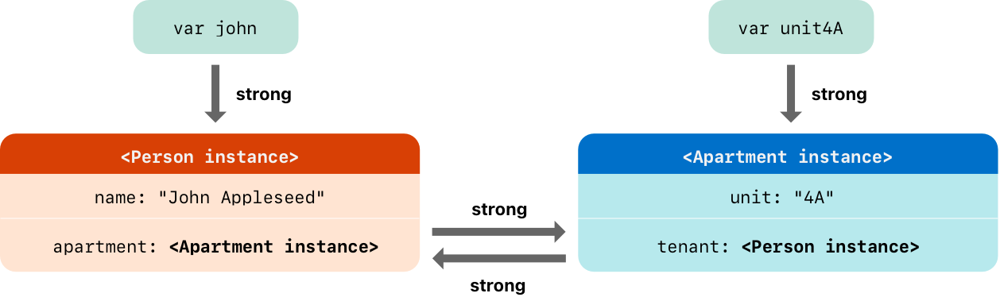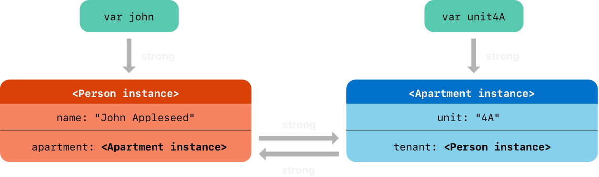

遗憾的是，关联这两个实例会在它们之间造成一个强引用循环。`Person` 实例现在对 `Apartment` 实例有一个强引用，而 `Apartment` 实例也对 `Person` 实例有一个强引用。因此，当你断开 `john` 和 `unit4A` 变量持有的强引用时，引用计数不会降到零，ARC 也不会释放这两个实例：

```swift
john = nil
unit4A = nil
```

注意，把这两个变量设为 `nil` 时，两个析构器都没有被调用。强引用循环使 `Person` 和 `Apartment` 实例永远无法被释放，从而在 App 中造成内存泄漏。

把 `john` 和 `unit4A` 变量设为 `nil` 后，强引用如图所示：

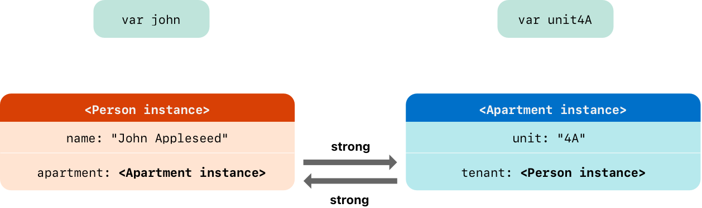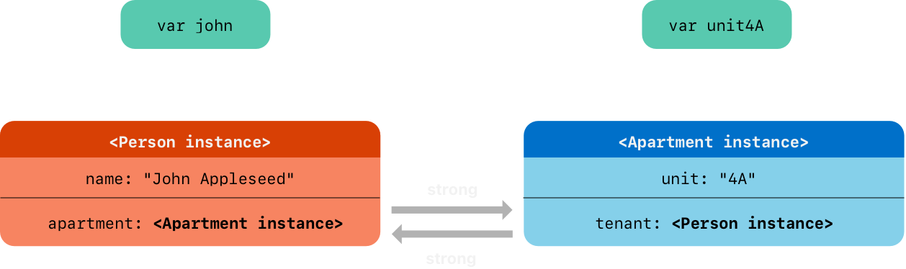

`Person` 实例与 `Apartment` 实例之间的强引用依然存在，无法断开。

## 解决类实例之间的强引用循环 {#Resolving-Strong-Reference-Cycles-Between-Class-Instances}

当你处理类类型的属性时，Swift 提供了两种解决强引用循环的方法：弱引用和无主引用。

弱引用和无主引用让引用循环中的一个实例可以引用另一个实例，而*不*强持有它。这样实例之间可以互相引用，而不会造成强引用循环。

当另一个实例的生命周期更短时——也就是说，当另一个实例可能先被释放时——使用弱引用。在上面的 `Apartment` 例子中，公寓在其生命周期中的某个时刻可以没有租户，因此在这种情况下，弱引用是打破引用循环的合适方式。相反，当另一个实例具有相同或更长的生命周期时，使用无主引用。

### 弱引用 {#Weak-References}

*弱引用*是一种不会强持有它所引用实例的引用，因此不会阻止 ARC 释放被引用的实例。这种行为使该引用不会成为强引用循环的一部分。要表示弱引用，请在属性或变量声明前加上 `weak` 关键字。

由于弱引用不强持有它所引用的实例，该实例可能在弱引用仍然引用它时就被释放。因此，当弱引用所引用的实例被释放时，ARC 会自动把该弱引用设为 `nil`。而且，由于弱引用需要允许在运行时把其值改为 `nil`，它们总是被声明为可选类型的变量，而不是常量。

你可以像检查其他任何可选值一样，检查弱引用中是否存在值，并且永远不会得到一个指向已不存在的无效实例的引用。

> 注意：当 ARC 把弱引用设为 `nil` 时，不会调用属性观察器。

下面的例子与上面的 `Person` 和 `Apartment` 例子相同，但有一个重要区别。这一次，`Apartment` 类型的 `tenant` 属性被声明为弱引用：

```swift
class Person {
    let name: String
    init(name: String) { self.name = name }
    var apartment: Apartment?
    deinit { print("\(name) is being deinitialized") }
}

class Apartment {
    let unit: String
    init(unit: String) { self.unit = unit }
    weak var tenant: Person?
    deinit { print("Apartment \(unit) is being deinitialized") }
}
```

两个变量（`john` 和 `unit4A`）产生的强引用，以及两个实例之间的关联，都像之前一样建立：

```swift
var john: Person?
var unit4A: Apartment?

john = Person(name: "John Appleseed")
unit4A = Apartment(unit: "4A")

john!.apartment = unit4A
unit4A!.tenant = john
```

把两个实例关联起来后，引用如图所示：

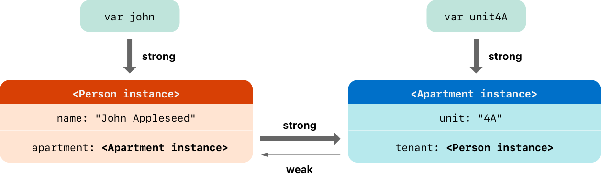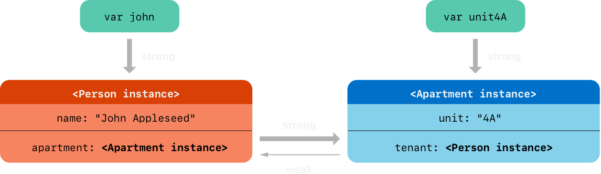

`Person` 实例仍然对 `Apartment` 实例有一个强引用，但 `Apartment` 实例现在对 `Person` 实例持有的是*弱*引用。这意味着，当你通过把 `john` 变量设为 `nil` 来断开它持有的强引用时，就不再有任何强引用指向 `Person` 实例：

```swift
john = nil
// Prints "John Appleseed is being deinitialized".
```

由于不再有指向 `Person` 实例的强引用，它被释放，`tenant` 属性被设为 `nil`：

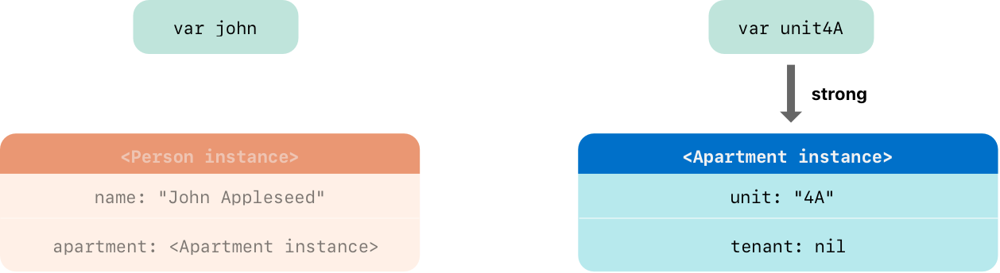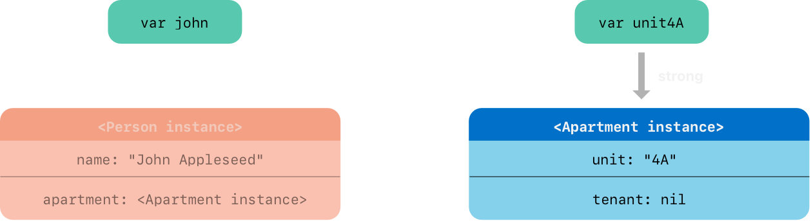

对 `Apartment` 实例仅存的强引用来自 `unit4A` 变量。如果你断开*那个*强引用，就不再有任何强引用指向 `Apartment` 实例：

```swift
unit4A = nil
// Prints "Apartment 4A is being deinitialized".
```

由于不再有指向 `Apartment` 实例的强引用，它也被释放：

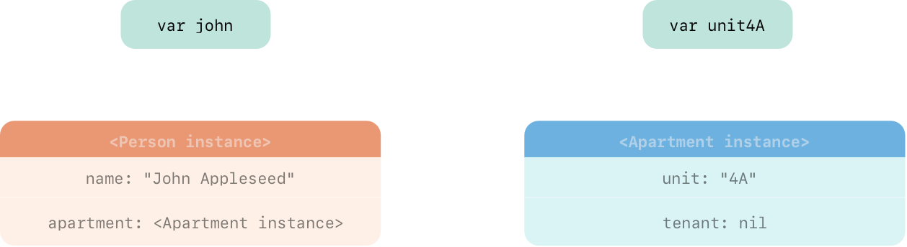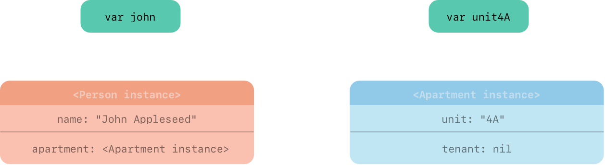

> 注意：在使用垃圾回收的系统中，弱指针有时被用来实现简单的缓存机制，因为没有强引用的对象只有在内存压力触发垃圾回收时才会被释放。然而，在使用 ARC 时，值在最后一个强引用被移除后就会立即释放，因此弱引用不适合用于这种目的。

### 无主引用 {#Unowned-References}

与弱引用一样，*无主引用*不强持有它所引用的实例。不过，与弱引用不同，无主引用用于另一个实例具有相同或更长生命周期的情况。要表示无主引用，请在属性或变量声明前加上 `unowned` 关键字。

与弱引用不同，无主引用预期总是有值。因此，把值标记为无主并不会使它成为可选类型，ARC 也永远不会把无主引用的值设为 `nil`。

> 重要：只有在你确定该引用*总是*指向一个尚未被释放的实例时，才使用无主引用。
>
> 如果在该实例被释放后试图访问无主引用的值，就会得到运行时错误。

下面的例子定义了两个类，`Customer` 和 `CreditCard`，分别模拟银行客户和该客户可能持有的一张信用卡。这两个类各自把另一个类的实例存储为属性。这种关系有可能造成强引用循环。

`Customer` 与 `CreditCard` 之间的关系，与上面弱引用示例中 `Apartment` 与 `Person` 之间的关系略有不同。在这个数据模型中，客户可能有信用卡，也可能没有，但一张信用卡*总是*与某个客户关联。`CreditCard` 实例的存活时间永远不会超过它所引用的 `Customer`。为了表示这一点，`Customer` 类有一个可选的 `card` 属性，而 `CreditCard` 类有一个无主（且非可选）的 `customer` 属性。

此外，只有把 `number` 值和 `customer` 实例传给自定义的 `CreditCard` 构造器，才*能*创建新的 `CreditCard` 实例。这确保在创建 `CreditCard` 实例时，它总是关联着一个 `customer` 实例。

因为信用卡总是有客户，所以把它的 `customer` 属性定义为无主引用，以避免强引用循环：

```swift
class Customer {
    let name: String
    var card: CreditCard?
    init(name: String) {
        self.name = name
    }
    deinit { print("\(name) is being deinitialized") }
}

class CreditCard {
    let number: UInt64
    unowned let customer: Customer
    init(number: UInt64, customer: Customer) {
        self.number = number
        self.customer = customer
    }
    deinit { print("Card #\(number) is being deinitialized") }
}
```

> 注意：`CreditCard` 类的 `number` 属性定义为 `UInt64` 类型而不是 `Int`，以确保 `number` 属性的容量足够在 32 位和 64 位系统上存储 16 位的卡号。

下面这段代码定义了一个名为 `john` 的可选 `Customer` 变量，用来存储对某个特定客户的引用。由于是可选类型，这个变量的初始值为 `nil`：

```swift
var john: Customer?
```

现在可以创建一个 `Customer` 实例，并用它来初始化一个新的 `CreditCard` 实例，再把这个实例赋给该客户的 `card` 属性：

```swift
john = Customer(name: "John Appleseed")
john!.card = CreditCard(number: 1234_5678_9012_3456, customer: john!)
```

把两个实例关联起来后，引用如图所示：

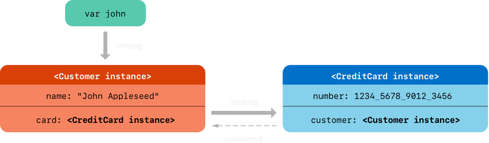

现在 `Customer` 实例对 `CreditCard` 实例有一个强引用，而 `CreditCard` 实例对 `Customer` 实例有一个无主引用。

由于 `customer` 是无主引用，当你断开 `john` 变量持有的强引用时，就不再有任何强引用指向 `Customer` 实例：

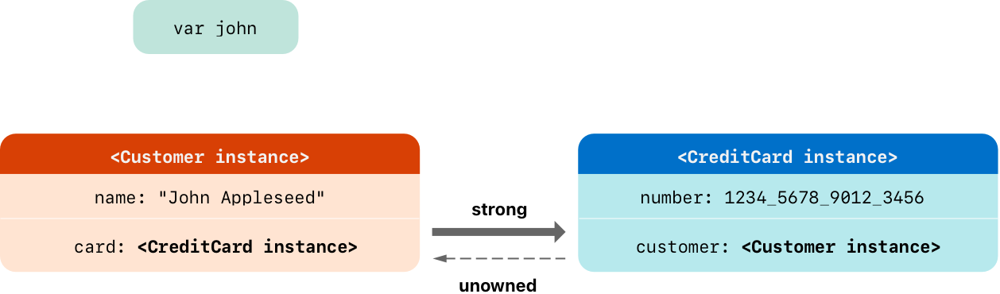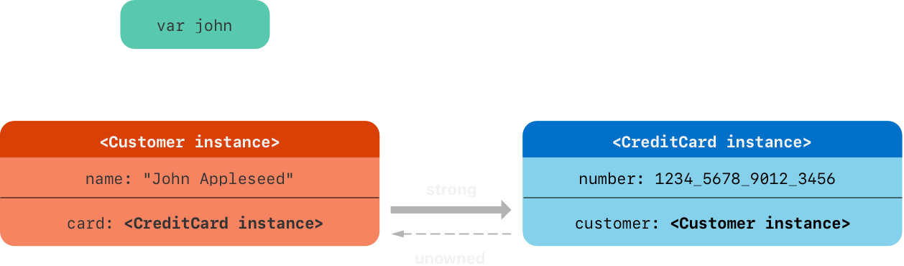

由于不再有指向 `Customer` 实例的强引用，它被释放。此后，也不再有任何强引用指向 `CreditCard` 实例，于是它也被释放：

```swift
john = nil
// Prints "John Appleseed is being deinitialized".
// Prints "Card #1234567890123456 is being deinitialized".
```

上面最后一段代码表明，在 `john` 变量被设为 `nil` 之后，`Customer` 实例和 `CreditCard` 实例的析构器都打印了各自的“deinitialized”消息。

> 注意：上面的例子演示了如何使用*安全*的无主引用。对于需要禁用运行时安全检查的情况——例如出于性能原因——Swift 还提供了*不安全*的无主引用。与所有不安全操作一样，你需要负责检查代码的安全性。
>
> 通过写 `unowned(unsafe)` 来表示不安全的无主引用。如果在不安全无主引用所指向的实例被释放后试图访问它，程序会尝试访问该实例原先所在的内存位置，这是一种不安全操作。

### 无主可选引用 {#Unowned-Optional-References}

你可以把指向类的可选引用标记为无主。就 ARC 的所有权模型而言，无主可选引用和弱引用可以在相同的场景中使用。区别在于，使用无主可选引用时，你需要负责确保它始终指向一个有效对象，或者被设为 `nil`。

下面是一个记录学校某个系所开设课程的示例：

```swift
class Department {
    var name: String
    var courses: [Course]
    init(name: String) {
        self.name = name
        self.courses = []
    }
}

class Course {
    var name: String
    unowned var department: Department
    unowned var nextCourse: Course?
    init(name: String, in department: Department) {
        self.name = name
        self.department = department
        self.nextCourse = nil
    }
}
```

`Department` 对该系开设的每门课程都保持一个强引用。在 ARC 的所有权模型中，系拥有它的课程。`Course` 有两个无主引用，一个指向系，另一个指向学生接下来应该修的课程；课程不拥有这两个对象中的任何一个。每门课程都属于某个系，所以 `department` 属性不是可选类型。不过，由于有些课程没有推荐的后续课程，`nextCourse` 属性是可选类型。

下面是使用这些类的示例：

```swift
let department = Department(name: "Horticulture")

let intro = Course(name: "Survey of Plants", in: department)
let intermediate = Course(name: "Growing Common Herbs", in: department)
let advanced = Course(name: "Caring for Tropical Plants", in: department)

intro.nextCourse = intermediate
intermediate.nextCourse = advanced
department.courses = [intro, intermediate, advanced]
```

上面的代码创建了一个系及其三门课程。入门课程和中级课程的 `nextCourse` 属性中都存储了一门建议的后续课程，该属性持有对“学生学完这门课后应该修的课程”的无主可选引用。

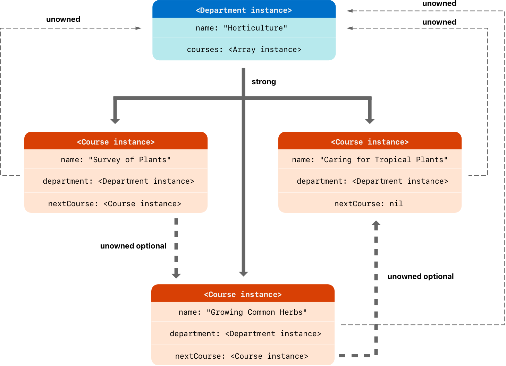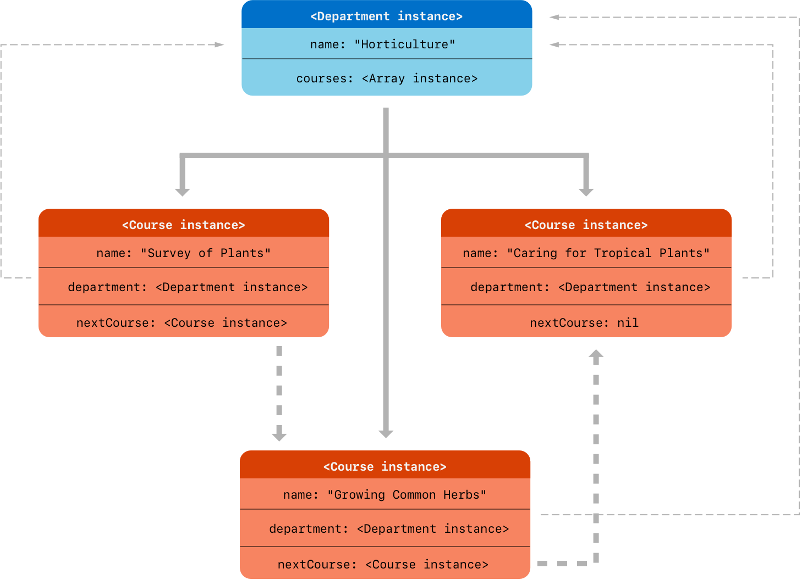

无主可选引用不强持有它所包装的类实例，因此不会阻止 ARC 释放该实例。它在 ARC 下的行为与无主引用相同，区别在于无主可选引用可以是 `nil`。

与非可选的无主引用一样，你需要负责确保 `nextCourse` 始终指向一门尚未被释放的课程。例如，在这种情况下，当你从 `department.courses` 中删除一门课程时，还需要移除其他课程可能对该课程持有的任何引用。

> 注意：可选值的底层类型是 `Optional`，它是 Swift 标准库中的一个枚举。不过，可选类型是“值类型不能用 `unowned` 标记”这一规则的一个例外。
>
> 包装类实例的可选值不使用引用计数，所以你不需要对可选值保持强引用。

### 无主引用和隐式解包可选属性 {#Unowned-References-and-Implicitly-Unwrapped-Optional-Properties}

上面关于弱引用和无主引用的示例涵盖了两种较常见的情形，这些情形需要打破强引用循环。

`Person` 和 `Apartment` 的例子展示了一种情况：两个都允许为 `nil` 的属性有可能造成强引用循环。这种情况最好用弱引用来解决。

`Customer` 和 `CreditCard` 的例子展示了一种情况：一个允许为 `nil` 的属性和另一个不能为 `nil` 的属性有可能造成强引用循环。这种情况最好用无主引用来解决。

不过，还有第三种情况：两个属性都应该始终有值，而且一旦初始化完成，任何一个属性都不应为 `nil`。在这种情况下，可以把一个类上的无主属性与另一个类上的隐式解包可选属性结合起来。

这样，一旦初始化完成，两个属性都可以直接访问（无需可选解包），同时仍能避免引用循环。本节介绍如何建立这样的关系。

下面的例子定义了两个类，`Country` 和 `City`，各自把另一个类的实例存储为属性。在这个数据模型中，每个国家都必须有一个首都，而每个城市都必须属于一个国家。为了表示这一点，`Country` 类有一个 `capitalCity` 属性，`City` 类有一个 `country` 属性：

```swift
class Country {
    let name: String
    var capitalCity: City!
    init(name: String, capitalName: String) {
        self.name = name
        self.capitalCity = City(name: capitalName, country: self)
    }
}

class City {
    let name: String
    unowned let country: Country
    init(name: String, country: Country) {
        self.name = name
        self.country = country
    }
}
```

为了建立两个类之间的相互依赖关系，`City` 的构造器接收一个 `Country` 实例，并把这个实例存储到它的 `country` 属性中。

`City` 的构造器是在 `Country` 的构造器内部调用的。然而，如 [两段式构造过程](initialization.md#Two-Phase-Initialization) 所述，在新的 `Country` 实例完全初始化之前，`Country` 的构造器不能把 `self` 传给 `City` 的构造器。

为满足这一要求，把 `Country` 的 `capitalCity` 属性声明为隐式解包可选属性，即在类型标注末尾加感叹号（`City!`）来表示。这意味着 `capitalCity` 属性像其他可选属性一样默认值为 `nil`，但如 [隐式解包可选类型](the-basics.md#Implicitly-Unwrapped-Optionals) 所述，访问它时不需要解包其值。

由于 `capitalCity` 有默认值 `nil`，新的 `Country` 实例一旦在其构造器中设置好 `name` 属性，就被视为完全初始化。这意味着 `Country` 构造器只要设置了 `name` 属性，就可以开始引用并传递隐式的 `self` 属性。因此，当 `Country` 构造器设置自己的 `capitalCity` 属性时，可以把 `self` 作为参数之一传给 `City` 构造器。

这一切意味着，你可以在一条语句中创建 `Country` 和 `City` 实例，而不会造成强引用循环；并且 `capitalCity` 属性可以直接访问，不需要用感叹号解包它的可选值：

```swift
var country = Country(name: "Canada", capitalName: "Ottawa")
print("\(country.name)'s capital city is called \(country.capitalCity.name)")
// Prints "Canada's capital city is called Ottawa".
```

在上面的例子中，使用隐式解包可选类型意味着满足了两段式类构造器的全部要求。初始化完成后，`capitalCity` 属性可以像非可选值一样使用和访问，同时仍能避免强引用循环。

## 闭包引起的强引用循环 {#Strong-Reference-Cycles-for-Closures}

你已经看到，当两个类实例属性互相持有强引用时，如何造成强引用循环。你也看到了如何使用弱引用和无主引用来打破这些强引用循环。

如果你把一个闭包赋给类实例的属性，而该闭包体捕获了这个实例，也可能造成强引用循环。这种捕获可能是因为闭包体访问了实例的属性（如 `self.someProperty`），也可能是因为闭包调用了实例的方法（如 `self.someMethod()`）。无论哪种情况，这些访问都会让闭包“捕获” `self`，从而造成强引用循环。

出现这种强引用循环，是因为闭包和类一样是*引用类型*。当你把一个闭包赋给属性时，赋的是对该闭包的一个*引用*。本质上，这和上面的问题相同——两个强引用让彼此保持存活。不过，这一次不是两个类实例，而是一个类实例和一个闭包让彼此保持存活。

Swift 为这个问题提供了一种优雅的解决方案，称为*闭包捕获列表*。不过，在学习如何用闭包捕获列表打破强引用循环之前，先理解这种循环是如何产生的会很有帮助。

下面的例子演示了在使用引用 `self` 的闭包时，如何造成强引用循环。这个例子定义了一个名为 `HTMLElement` 的类，为 HTML 文档中的单个元素提供了一个简单的模型：

```swift
class HTMLElement {
    let name: String
    let text: String?

    lazy var asHTML: () -> String = {
        if let text = self.text {
            return "<\(self.name)>\(text)</\(self.name)>"
        } else {
            return "<\(self.name) />"
        }
    }

    init(name: String, text: String? = nil) {
        self.name = name
        self.text = text
    }

    deinit {
        print("\(name) is being deinitialized")
    }
}
```

`HTMLElement` 类定义了一个 `name` 属性，表示元素的名称，例如标题元素用 `"h1"`，段落元素用 `"p"`，换行元素用 `"br"`。`HTMLElement` 还定义了一个可选的 `text` 属性，你可以把它设为一个字符串，表示要在该 HTML 元素中渲染的文本。

除了这两个简单属性，`HTMLElement` 类还定义了一个名为 `asHTML` 的延迟属性。这个属性引用一个闭包，该闭包把 `name` 和 `text` 组合成一个 HTML 字符串片段。`asHTML` 属性的类型是 `() -> String`，即“一个不接受参数、返回 `String` 值的函数”。

默认情况下，`asHTML` 属性被赋予一个返回 HTML 标签字符串表示的闭包。如果可选的 `text` 值存在，这个标签就包含该值；如果 `text` 不存在，标签中就没有文本内容。对于段落元素，闭包会返回 `"<p>some text</p>"` 或 `"<p />"`，取决于 `text` 属性等于 `"some text"` 还是 `nil`。

`asHTML` 属性的命名和使用方式有点像实例方法。不过，由于 `asHTML` 是闭包属性而不是实例方法，如果你想改变某个特定 HTML 元素的 HTML 渲染方式，可以用自定义闭包替换 `asHTML` 属性的默认值。

例如，可以把 `asHTML` 属性设为一个闭包：当 `text` 属性为 `nil` 时，该闭包使用某个默认文本，以避免返回空 HTML 标签：

```swift
let heading = HTMLElement(name: "h1")
let defaultText = "some default text"
heading.asHTML = {
    return "<\(heading.name)>\(heading.text ?? defaultText)</\(heading.name)>"
}
print(heading.asHTML())
// Prints "<h1>some default text</h1>".
```

> 注意：`asHTML` 属性被声明为延迟属性，因为只有在元素确实需要为某个 HTML 输出目标渲染为字符串值时才会用到它。`asHTML` 是延迟属性这一点意味着你可以在默认闭包中引用 `self`，因为直到初始化完成、且已知 `self` 存在之后，才会访问这个延迟属性。

`HTMLElement` 类提供了一个构造器，它接收 `name` 实参和（可选的）`text` 实参来初始化新元素。该类还定义了一个析构器，打印一条消息以显示 `HTMLElement` 实例何时被释放。

下面演示如何使用 `HTMLElement` 类创建并打印一个新实例：

```swift
var paragraph: HTMLElement? = HTMLElement(name: "p", text: "hello, world")
print(paragraph!.asHTML())
// Prints "<p>hello, world</p>".
```

> 注意：上面的 `paragraph` 变量被定义为*可选*的 `HTMLElement`，以便在下面把它设为 `nil`，用来演示强引用循环的存在。

遗憾的是，上面这样写的 `HTMLElement` 类会在 `HTMLElement` 实例与其默认 `asHTML` 值所用的闭包之间造成强引用循环。这个循环如图所示：

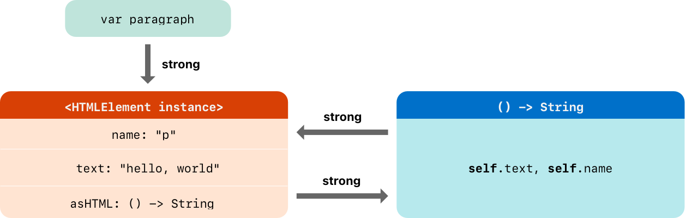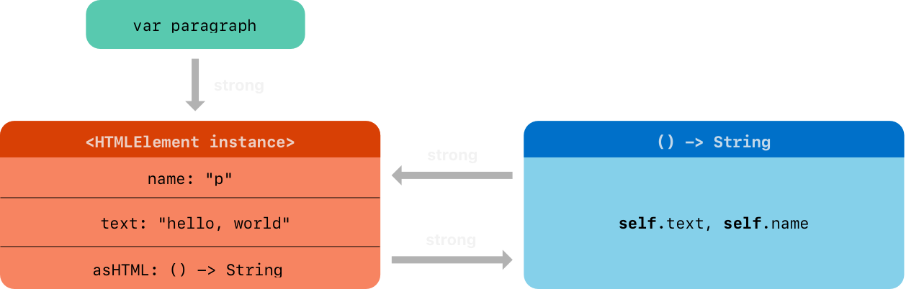

实例的 `asHTML` 属性持有对其闭包的强引用。然而，由于闭包在其内部引用了 `self`（用来引用 `self.name` 和 `self.text`），闭包会*捕获* `self`，这意味着它反过来持有对 `HTMLElement` 实例的强引用。两者之间就造成了强引用循环。（关于在闭包中捕获值的更多信息，参见 [捕获值](closures.md#Capturing-Values)。）

> 注意：即使闭包多次引用 `self`，它也只会捕获一个指向 `HTMLElement` 实例的强引用。

如果你把 `paragraph` 变量设为 `nil`，断开它对 `HTMLElement` 实例的强引用，强引用循环仍会阻止 `HTMLElement` 实例及其闭包被释放：

```swift
paragraph = nil
```

注意，`HTMLElement` 析构器中的消息没有被打印，这表明 `HTMLElement` 实例没有被释放。

## 解决闭包引起的强引用循环 {#Resolving-Strong-Reference-Cycles-for-Closures}

解决闭包与类实例之间的强引用循环的办法，是在闭包的定义中定义*捕获列表*。捕获列表定义在闭包体内捕获一个或多个引用类型时使用的规则。与两个类实例之间的强引用循环一样，你要把每个被捕获的引用声明为弱引用或无主引用，而不是强引用。选择弱引用还是无主引用，取决于代码各部分之间的关系。

> 注意：每当在闭包中引用 `self` 的成员时，Swift 都要求写成 `self.someProperty` 或 `self.someMethod()`（而不是只写 `someProperty` 或 `someMethod()`）。这有助于你记住：可能会意外捕获 `self`。

### 定义捕获列表 {#Defining-a-Capture-List}

捕获列表中的每一项，都是把 `weak` 或 `unowned` 关键字与一个类实例引用（如 `self`）或一个用某个值初始化的变量（如 `delegate = self.delegate`）配对。这些配对写在一对方括号内，用逗号分隔。

如果闭包提供了形参列表和返回类型，就把捕获列表放在它们前面：

```swift
lazy var someClosure = {
        [unowned self, weak delegate = self.delegate]
        (index: Int, stringToProcess: String) -> String in
    // closure body goes here
}
```

如果闭包没有指定形参列表或返回类型（因为它们可以从上下文中推断出来），就把捕获列表放在闭包的最开头，后面跟 `in` 关键字：

```swift
lazy var someClosure = {
        [unowned self, weak delegate = self.delegate] in
    // closure body goes here
}
```

### 弱引用和无主引用 {#Weak-and-Unowned-References}

当闭包和它捕获的实例总是互相引用，并且总是同时被释放时，把闭包中的捕获定义为无主引用。

相反，当被捕获的引用将来某个时刻可能变为 `nil` 时，就把捕获定义为弱引用。弱引用总是可选类型，并且当它们引用的实例被释放时会自动变为 `nil`。这样你就可以在闭包体内检查它们是否存在。

> 注意：如果被捕获的引用永远不会变为 `nil`，就应该始终把它捕获为无主引用，而不是弱引用。

对于上面 [闭包引起的强引用循环](automatic-reference-counting.md#Strong-Reference-Cycles-for-Closures) 中 `HTMLElement` 例子的强引用循环，无主引用是合适的捕获方式。下面这样写 `HTMLElement` 类即可避免循环：

```swift
class HTMLElement {
    let name: String
    let text: String?

    lazy var asHTML: () -> String = {
            [unowned self] in
        if let text = self.text {
            return "<\(self.name)>\(text)</\(self.name)>"
        } else {
            return "<\(self.name) />"
        }
    }

    init(name: String, text: String? = nil) {
        self.name = name
        self.text = text
    }

    deinit {
        print("\(name) is being deinitialized")
    }
}
```

除了在 `asHTML` 闭包中增加了捕获列表之外，这个 `HTMLElement` 实现与之前的实现完全相同。在这里，捕获列表是 `[unowned self]`，意思是“把 self 捕获为无主引用，而不是强引用”。

你可以像之前一样创建并打印 `HTMLElement` 实例：

```swift
var paragraph: HTMLElement? = HTMLElement(name: "p", text: "hello, world")
print(paragraph!.asHTML())
// Prints "<p>hello, world</p>".
```

有了捕获列表后，引用如图所示：

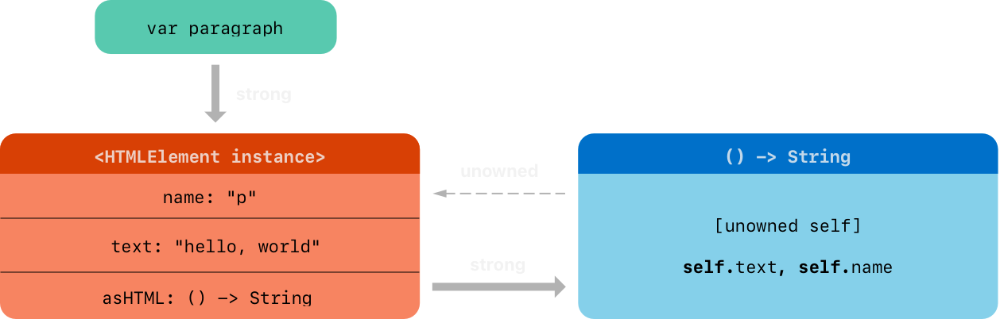

这一次，闭包对 `self` 的捕获是无主引用，不会强持有它捕获的 `HTMLElement` 实例。如果把 `paragraph` 变量持有的强引用设为 `nil`，`HTMLElement` 实例就会被释放，从下面例子中打印的析构器消息可以看出这一点：

```swift
paragraph = nil
// Prints "p is being deinitialized".
```

关于捕获列表的更多信息，参见 [捕获列表](expressions.md#Capture-Lists)。
