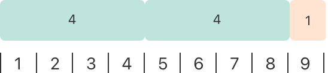
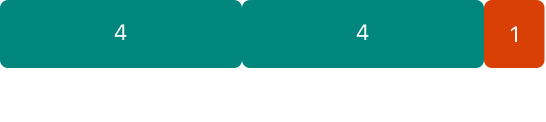

# 基本运算符 {#Basic-Operators}

执行赋值、算术和比较等运算。

*运算符*（operator）是一种特殊符号或短语，用于检查、修改或组合值。例如，加法运算符（`+`）将两个数相加，如 `let i = 1 + 2`；逻辑与运算符（`&&`）组合两个布尔值，如 `if enteredDoorCode && passedRetinaScan`。

Swift 支持你可能已经从 C 等语言中熟悉的运算符，并改进了一些能力，以消除常见的编码错误。赋值运算符（`=`）不返回值，以防在本应使用等于运算符（`==`）时误用它。算术运算符（`+`、`-`、`*`、`/`、`%` 等）会检测并禁止值溢出，以免在处理变得大于或小于其存储类型所允许取值范围的数字时产生意外结果。你可以使用 Swift 的溢出运算符主动启用值溢出行为，详见 [溢出运算符](advanced-operators.md#Overflow-Operators)。

Swift 还提供了 C 中没有的区间运算符，例如 `a..<b` 和 `a...b`，作为表示一个值区间的简写。

本章介绍 Swift 中的常用运算符。[高级运算符](advanced-operators.md) 涵盖 Swift 的高级运算符，并介绍如何定义自己的自定义运算符，以及为自己的自定义类型实现标准运算符。

## 术语 {#Terminology}

运算符分为一元、二元或三元：

- *一元*运算符作用于单个目标（如 `-a`）。一元*前缀*运算符紧挨在其目标之前（如 `!b`），一元*后缀*运算符紧挨在其目标之后（如 `c!`）。
- *二元*运算符作用于两个目标（如 `2 + 3`），并且是*中缀*的，因为它们出现在两个目标之间。
- *三元*运算符作用于三个目标。与 C 一样，Swift 只有一个三元运算符，即三元条件运算符（`a ? b : c`）。

运算符所作用的值是*操作数*（operand）。在表达式 `1 + 2` 中，`+` 符号是中缀运算符，它的两个操作数是值 `1` 和 `2`。

## 赋值运算符 {#Assignment-Operator}

*赋值运算符*（`a = b`）用 `b` 的值初始化或更新 `a` 的值：

```swift
let b = 10
var a = 5
a = b
// a is now equal to 10
```

如果赋值语句右侧是一个包含多个值的元组，可以一次把它的元素分解到多个常量或变量中：

```swift
let (x, y) = (1, 2)
// x is equal to 1, and y is equal to 2
```

与 C 和 Objective-C 中的赋值运算符不同，Swift 中的赋值运算符本身不返回值。下面的语句无效：

```swift
if x = y {
    // This isn't valid, because x = y doesn't return a value.
}
```

这一特性可防止在本应使用等于运算符（`==`）时误用赋值运算符（`=`）。通过让 `if x = y` 无效，Swift 帮助你避免代码中的这类错误。

## 算术运算符 {#Arithmetic-Operators}

Swift 的所有数值类型都支持四种标准*算术运算符*：

- 加法（`+`）
- 减法（`-`）
- 乘法（`*`）
- 除法（`/`）

```swift
1 + 2       // equals 3
5 - 3       // equals 2
2 * 3       // equals 6
10.0 / 2.5  // equals 4.0
```

与 C 和 Objective-C 中的算术运算符不同，Swift 的算术运算符默认不允许值溢出。你可以使用 Swift 的溢出运算符（如 `a &+ b`）主动启用值溢出行为。详见 [溢出运算符](advanced-operators.md#Overflow-Operators)。

加法运算符也支持 `String` 拼接：

```swift
"hello, " + "world"  // equals "hello, world"
```

### 取余运算符 {#Remainder-Operator}

*取余运算符*（`a % b`）会算出 `a` 中最多能容纳多少个完整的 `b`，并返回剩余的值（称为*余数*）。

> 注意：在其他语言中，取余运算符（`%`）也被称为*取模运算符*（modulo operator）。不过，它在 Swift 中处理负数时的行为意味着，严格来说，它是取余而不是取模运算。

取余运算符的工作方式如下。要计算 `9 % 4`，首先算出 `9` 中能容纳多少个 `4`：



`9` 中可以容纳两个 `4`，余数是 `1`（以橙色显示）。

在 Swift 中，这样写：

```swift
9 % 4    // equals 1
```

为了确定 `a % b` 的结果，`%` 运算符会计算下面的等式，并返回 `remainder` 作为输出：

`a` = (`b` x `some multiplier`) + `remainder`

其中 `some multiplier` 表示 `a` 中最多能容纳多少个完整的 `b`。

将 `9` 和 `4` 代入这个等式，得到：

`9` = (`4` x `2`) + `1`

计算 `a` 为负数时的余数也采用同样的方法：

```swift
-9 % 4   // equals -1
```

将 `-9` 和 `4` 代入等式，得到：

`-9` = (`4` x `-2`) + `-1`

余数值为 `-1`。

当 `b` 为负数时，`b` 的符号会被忽略。这意味着 `a % b` 和 `a % -b` 总是得到相同的结果。

### 一元减运算符 {#Unary-Minus-Operator}

数值的符号可以用前置的 `-` 来切换，这称为*一元减运算符*：

```swift
let three = 3
let minusThree = -three       // minusThree equals -3
let plusThree = -minusThree   // plusThree equals 3, or "minus minus three"
```

一元减运算符（`-`）直接放在它所作用的值之前，中间不加任何空白。

### 一元加运算符 {#Unary-Plus-Operator}

*一元加运算符*（`+`）只是返回它所作用的值，不做任何改变：

```swift
let minusSix = -6
let alsoMinusSix = +minusSix  // alsoMinusSix equals -6
```

尽管一元加运算符实际上什么也不做，但在对负数使用一元减运算符时，你可以用它来为代码中的正数提供一种对称性。

## 复合赋值运算符 {#Compound-Assignment-Operators}

与 C 一样，Swift 提供了*复合赋值运算符*，把赋值（`=`）与另一种运算组合起来。一个例子是*加法赋值运算符*（`+=`）：

```swift
var a = 1
a += 2
// a is now equal to 3
```

表达式 `a += 2` 是 `a = a + 2` 的简写。实际上，加法和赋值被组合成一个运算符，同时执行这两项任务。

> 注意：复合赋值运算符不返回值。例如，不能写 `let b = a += 2`。

关于 Swift 标准库提供的运算符，请参阅 [Operator Declarations](https://developer.apple.com/documentation/swift/operator_declarations)。

## 比较运算符 {#Comparison-Operators}

Swift 支持以下比较运算符：

- 等于（`a == b`）
- 不等于（`a != b`）
- 大于（`a > b`）
- 小于（`a < b`）
- 大于等于（`a >= b`）
- 小于等于（`a <= b`）

> 注意：Swift 还提供了两个*恒等运算符*（`===` 和 `!==`），用于测试两个对象引用是否都指向同一个对象实例。更多信息，详见 [恒等运算符](classes-and-structures.md#Identity-Operators)。

每个比较运算符都返回一个 `Bool` 值，表示语句是否成立：

```swift
1 == 1   // true because 1 is equal to 1
2 != 1   // true because 2 isn't equal to 1
2 > 1    // true because 2 is greater than 1
1 < 2    // true because 1 is less than 2
1 >= 1   // true because 1 is greater than or equal to 1
2 <= 1   // false because 2 isn't less than or equal to 1
```

比较运算符常用于条件语句，例如 `if` 语句：

```swift
let name = "world"
if name == "world" {
    print("hello, world")
} else {
    print("I'm sorry \(name), but I don't recognize you")
}
// Prints "hello, world", because name is indeed equal to "world".
```

关于 `if` 语句的更多内容，详见 [控制流](control-flow.md)。

如果两个元组具有相同的类型和相同数量的值，就可以比较它们。元组从左到右逐个值进行比较，直到遇到两个不相等的值。然后比较这两个值，该比较的结果决定整个元组比较的结果。如果所有元素都相等，那么这两个元组本身就相等。例如：

```swift
(1, "zebra") < (2, "apple")   // true because 1 is less than 2; "zebra" and "apple" aren't compared
(3, "apple") < (3, "bird")    // true because 3 is equal to 3, and "apple" is less than "bird"
(4, "dog") == (4, "dog")      // true because 4 is equal to 4, and "dog" is equal to "dog"
```

在上面的例子中，第一行展示了从左到右的比较行为。因为 `1` 小于 `2`，所以 `(1, "zebra")` 被认为小于 `(2, "apple")`，无论元组中其他值是什么。`"zebra"` 不小于 `"apple"` 并不重要，因为比较已经由元组的第一个元素决定了。不过，当元组的第一个元素相同时，它们的第二个元素*会*被比较——第二行和第三行就是这种情况。

只有当某个运算符能应用于两个元组中各自的每个值时，才能用该运算符比较这两个元组。例如，如下面的代码所示，可以比较两个 `(String, Int)` 类型的元组，因为 `String` 和 `Int` 值都能用 `<` 运算符比较。相比之下，两个 `(String, Bool)` 类型的元组不能用 `<` 运算符比较，因为 `<` 运算符不能应用于 `Bool` 值。

```swift
("blue", -1) < ("purple", 1)        // OK: Evaluates to true.
("blue", false) < ("purple", true)  // Error: Can't use < to compare Boolean values.
```

> 注意：Swift 标准库为元素少于七个的元组提供了比较运算符。要比较七个或更多元素的元组，你必须自己实现比较运算符。

## 三元条件运算符 {#Ternary-Conditional-Operator}

*三元条件运算符*是一种有三个部分的特殊运算符，形式为 `question ? answer1 : answer2`。它是一种简写，根据 `question` 为真还是为假，对两个表达式之一求值。如果 `question` 为真，就对 `answer1` 求值并返回其值；否则，对 `answer2` 求值并返回其值。

三元条件运算符是下面代码的简写：

```swift
if question {
    answer1
} else {
    answer2
}
```

下面是一个计算表格行高的示例。如果该行有表头，行高应比内容高度高 50 点；如果没有表头，则高 20 点：

```swift
let contentHeight = 40
let hasHeader = true
let rowHeight = contentHeight + (hasHeader ? 50 : 20)
// rowHeight is equal to 90
```

上面的示例是下面代码的简写：

```swift
let contentHeight = 40
let hasHeader = true
let rowHeight: Int
if hasHeader {
    rowHeight = contentHeight + 50
} else {
    rowHeight = contentHeight + 20
}
// rowHeight is equal to 90
```

第一个示例使用三元条件运算符，意味着可以在一行代码中把 `rowHeight` 设为正确的值，这比第二个示例中的代码更简洁。

三元条件运算符为决定采用两个表达式中的哪一个提供了一种高效的简写。不过，使用三元条件运算符时要小心。如果过度使用，它的简洁性可能导致代码难以阅读。避免把多个三元条件运算符组合到一条复合语句中。

## 空合运算符 {#Nil-Coalescing-Operator}

*空合运算符*（`a ?? b`）会在可选值 `a` 包含值时将其解包，如果 `a` 为 `nil`，则返回默认值 `b`。表达式 `a` 始终是可选类型。表达式 `b` 必须与 `a` 中存储的值的类型相同。

空合运算符是下面代码的简写：

```swift
a != nil ? a! : b
```

上面的代码使用三元条件运算符和强制解包（`a!`），在 `a` 不为 `nil` 时访问 `a` 中包装的值，否则返回 `b`。空合运算符提供了一种更优雅的方式，以简洁易读的形式封装这种条件检查和解包。

> 注意：如果 `a` 的值不是 `nil`，则不会对 `b` 的值求值。这称为*短路求值*（short-circuit evaluation）。

下面的示例使用空合运算符，在默认颜色名称和用户定义的可选颜色名称之间做出选择：

```swift
let defaultColorName = "red"
var userDefinedColorName: String?   // defaults to nil

var colorNameToUse = userDefinedColorName ?? defaultColorName
// userDefinedColorName is nil, so colorNameToUse is set to the default of "red"
```

`userDefinedColorName` 变量定义为一个可选的 `String`，默认值为 `nil`。因为 `userDefinedColorName` 是可选类型，所以可以使用空合运算符来考虑它的值。在上面的示例中，该运算符用于为名为 `colorNameToUse` 的 `String` 变量确定初始值。因为 `userDefinedColorName` 为 `nil`，表达式 `userDefinedColorName ?? defaultColorName` 返回 `defaultColorName` 的值，即 `"red"`。

如果你给 `userDefinedColorName` 赋一个非 `nil` 的值，并再次执行空合运算符检查，就会使用 `userDefinedColorName` 中包装的值，而不是默认值：

```swift
userDefinedColorName = "green"
colorNameToUse = userDefinedColorName ?? defaultColorName
// userDefinedColorName isn't nil, so colorNameToUse is set to "green"
```

## 区间运算符 {#Range-Operators}

Swift 包含若干*区间运算符*，它们是表示一个值区间的简写。

### 闭区间运算符 {#Closed-Range-Operator}

*闭区间运算符*（`a...b`）定义一个从 `a` 到 `b` 的区间，包含 `a` 和 `b` 两个值。`a` 的值不能大于 `b`。

闭区间运算符在遍历一个希望使用其中所有值的区间时很有用，例如使用 `for`-`in` 循环：

```swift
for index in 1...5 {
    print("\(index) times 5 is \(index * 5)")
}
// 1 times 5 is 5
// 2 times 5 is 10
// 3 times 5 is 15
// 4 times 5 is 20
// 5 times 5 is 25
```

关于 `for`-`in` 循环的更多内容，详见 [控制流](control-flow.md)。

### 半开区间运算符 {#Half-Open-Range-Operator}

*半开区间运算符*（`a..<b`）定义一个从 `a` 到 `b` 的区间，但不包含 `b`。它被称为*半开*，是因为它包含第一个值，但不包含最后一个值。与闭区间运算符一样，`a` 的值不能大于 `b`。如果 `a` 的值等于 `b`，那么得到的区间将为空。

半开区间在处理数组等以零为起始索引的列表时特别有用，因为此时计数到列表长度（但不包括长度本身）很方便：

```swift
let names = ["Anna", "Alex", "Brian", "Jack"]
let count = names.count
for i in 0..<count {
    print("Person \(i + 1) is called \(names[i])")
}
// Person 1 is called Anna
// Person 2 is called Alex
// Person 3 is called Brian
// Person 4 is called Jack
```

注意，该数组包含四个元素，但 `0..<count` 只计数到 `3`（数组中最后一个元素的索引），因为它是半开区间。关于数组的更多内容，详见 [数组](collection-types.md#Arrays)。

### 单侧区间 {#One-Sided-Ranges}

闭区间运算符还有一种替代形式，用于表示向一个方向尽可能延伸的区间——例如，包含数组中从索引 2 到数组末尾所有元素的区间。在这些情况下，可以省略区间运算符一侧的值。这种区间称为*单侧区间*（one-sided range），因为运算符只有一侧有值。例如：

```swift
for name in names[2...] {
    print(name)
}
// Brian
// Jack

for name in names[...2] {
    print(name)
}
// Anna
// Alex
// Brian
```

半开区间运算符也有单侧形式，只写它的最后一个值。就像两侧都写值一样，最后一个值不属于该区间。例如：

```swift
for name in names[..<2] {
    print(name)
}
// Anna
// Alex
```

单侧区间还可用于其他场景，而不仅限于下标。不能遍历省略第一个值的单侧区间，因为不清楚迭代应该从哪里开始。你*可以*遍历省略最后一个值的单侧区间；不过，由于该区间会无限延伸，务必为循环添加一个显式的结束条件。还可以检查单侧区间是否包含某个特定值，如下面的代码所示。

```swift
let range = ...5
range.contains(7)   // false
range.contains(4)   // true
range.contains(-1)  // true
```

## 逻辑运算符 {#Logical-Operators}

*逻辑运算符*会修改或组合布尔逻辑值 `true` 和 `false`。Swift 支持 C 系语言中的三种标准逻辑运算符：

- 逻辑非（`!a`）
- 逻辑与（`a && b`）
- 逻辑或（`a || b`）

### 逻辑非运算符 {#Logical-NOT-Operator}

*逻辑非运算符*（`!a`）会反转布尔值，使 `true` 变成 `false`，`false` 变成 `true`。

逻辑非运算符是前缀运算符，紧挨在它所作用的值之前出现，中间不加任何空白。它可以读作“非 `a`”，如下例所示：

```swift
let allowedEntry = false
if !allowedEntry {
    print("ACCESS DENIED")
}
// Prints "ACCESS DENIED".
```

短语 `if !allowedEntry` 可以读作“如果未被允许进入”（if not allowed entry）。只有当“未被允许进入”为真，也就是 `allowedEntry` 为 `false` 时，后续代码行才会执行。

正如这个例子所示，谨慎选择布尔常量和变量的名称，有助于保持代码可读且简洁，同时避免双重否定或令人困惑的逻辑语句。

### 逻辑与运算符 {#Logical-AND-Operator}

*逻辑与运算符*（`a && b`）创建这样的逻辑表达式：两个值都必须为 `true`，整个表达式才为 `true`。

如果任一值为 `false`，整个表达式也会为 `false`。事实上，如果*第一个*值为 `false`，第二个值甚至不会被求值，因为它不可能使整个表达式等于 `true`。这称为*短路求值*。

下面的示例考虑两个 `Bool` 值，只有当两个值都为 `true` 时才允许访问：

```swift
let enteredDoorCode = true
let passedRetinaScan = false
if enteredDoorCode && passedRetinaScan {
    print("Welcome!")
} else {
    print("ACCESS DENIED")
}
// Prints "ACCESS DENIED".
```

### 逻辑或运算符 {#Logical-OR-Operator}

*逻辑或运算符*（`a || b`）是由两个相邻的竖线字符组成的中缀运算符。你可以用它创建这样的逻辑表达式：两个值中只要有*一个*为 `true`，整个表达式就为 `true`。

与上面的逻辑与运算符一样，逻辑或运算符也使用短路求值来考虑其表达式。如果逻辑或表达式的左侧为 `true`，右侧就不会被求值，因为它无法改变整个表达式的结果。

在下面的示例中，第一个 `Bool` 值（`hasDoorKey`）为 `false`，但第二个值（`knowsOverridePassword`）为 `true`。因为有一个值为 `true`，整个表达式也求值为 `true`，于是允许访问：

```swift
let hasDoorKey = false
let knowsOverridePassword = true
if hasDoorKey || knowsOverridePassword {
    print("Welcome!")
} else {
    print("ACCESS DENIED")
}
// Prints "Welcome!"
```

### 组合逻辑运算符 {#Combining-Logical-Operators}

你可以组合多个逻辑运算符，创建更长的复合表达式：

```swift
if enteredDoorCode && passedRetinaScan || hasDoorKey || knowsOverridePassword {
    print("Welcome!")
} else {
    print("ACCESS DENIED")
}
// Prints "Welcome!"
```

这个示例使用多个 `&&` 和 `||` 运算符来创建一个更长的复合表达式。不过，`&&` 和 `||` 运算符仍然只作用于两个值，所以这实际上是三个更小的表达式串联在一起。这个示例可以读作：

如果我们输入了正确的门禁密码并通过了视网膜扫描，或者我们有有效的门钥匙，或者我们知道应急覆盖密码，那么允许访问。

根据 `enteredDoorCode`、`passedRetinaScan` 和 `hasDoorKey` 的值，前两个子表达式为 `false`。不过，由于知道应急覆盖密码，整个复合表达式仍然求值为 `true`。

> 注意：Swift 的逻辑运算符 `&&` 和 `||` 是左结合的，这意味着包含多个逻辑运算符的复合表达式会先计算最左边的子表达式。

### 显式括号 {#Explicit-Parentheses}

有时，在并非严格需要括号时加上括号会很有用，可以让复杂表达式的意图更易读。在上面的门禁访问示例中，在复合表达式的第一部分加上括号有助于明确其意图：

```swift
if (enteredDoorCode && passedRetinaScan) || hasDoorKey || knowsOverridePassword {
    print("Welcome!")
} else {
    print("ACCESS DENIED")
}
// Prints "Welcome!"
```

括号清楚地表明，前两个值被视为整个逻辑中一个单独的可能状态。复合表达式的输出不会改变，但整体意图对读者来说更清晰。可读性始终优先于简洁性；在有助于明确意图的地方使用括号。
