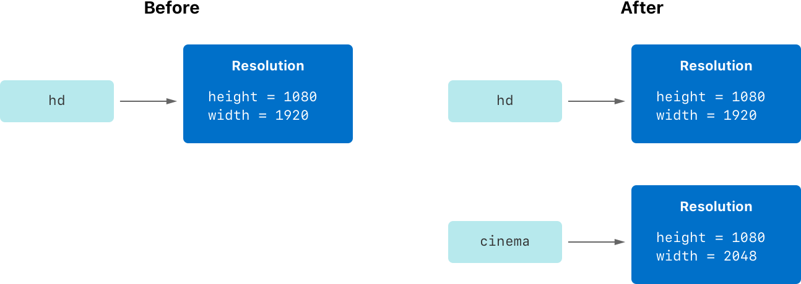
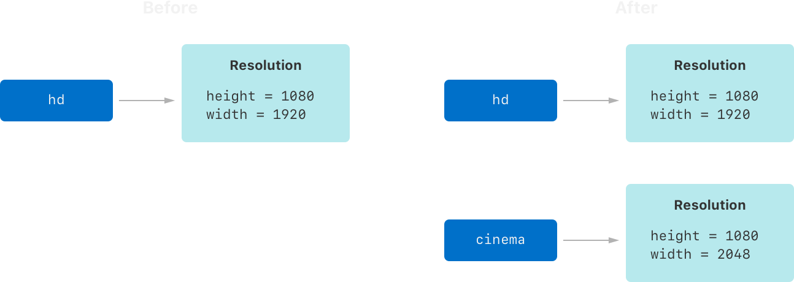
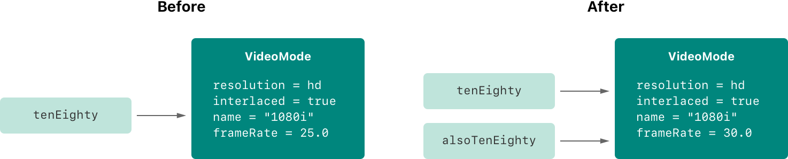
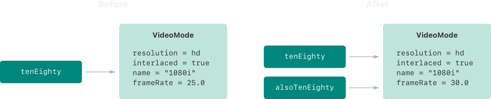

# 结构体和类 {#Structures-and-Classes}

为封装数据的自定义类型建模。

*结构体*和*类*是通用的、灵活的构造，构成了程序代码的基本构件。你可以为结构体和类定义属性和方法以添加功能，所用的语法与定义常量、变量和函数时相同。

与其他编程语言不同，Swift 不要求你为自定义的结构体和类分别创建接口文件和实现文件。在 Swift 中，你只需在一个文件中定义结构体或类，该类或结构体对外的接口就会自动供其他代码使用。

> 注意：类的实例传统上称为*对象*。不过，Swift 的结构体和类在功能上彼此接近的程度远高于其他语言中的结构体和类，而且本章的大部分内容介绍的功能同时适用于类或结构体类型的实例。因此，这里使用更通用的术语*实例*。

## 结构体与类的比较 {#Comparing-Structures-and-Classes}

Swift 中的结构体和类有许多共同点。两者都可以：

- 定义属性来存储值
- 定义方法来提供功能
- 定义下标，以便用下标语法访问其值
- 定义构造器来设置初始状态
- 被扩展，从而在默认实现之外扩充功能
- 遵循协议，以提供某种标准功能

更多信息，详见 [属性](properties.md)、[方法](methods.md)、[下标](subscripts.md)、[构造过程](initialization.md)、[扩展](extensions.md) 和 [协议](protocols.md)。

类具有结构体所不具备的额外能力：

- 继承使一个类可以继承另一个类的特性。
- 类型转换使你可以在运行时检查和解释类实例的类型。
- 析构器使类的实例可以释放其已分配的任何资源。
- 引用计数允许对同一个类实例存在多个引用。

更多信息，详见 [继承](inheritance.md)、[类型转换](type-casting.md)、[析构过程](deinitialization.md) 和 [自动引用计数](automatic-reference-counting.md)。

类所支持的这些额外能力是以增加复杂度为代价的。一般原则是：优先使用结构体，因为它们更容易理解；只有在合适或必要时才使用类。在实践中，这意味着你定义的大多数自定义类型都会是结构体和枚举。更详细的比较，参见 [Choosing Between Structures and Classes](https://developer.apple.com/documentation/swift/choosing_between_structures_and_classes)。

> 注意：类和 actor 有许多相同的特征和行为。关于 actor 的信息，详见 [并发](concurrency.md)。

### 定义语法 {#Definition-Syntax}

结构体和类的定义语法相似。用 `struct` 关键字引入结构体，用 `class` 关键字引入类。两者都把完整的定义放在一对大括号中：

```swift
struct SomeStructure {
    // structure definition goes here
}
class SomeClass {
    // class definition goes here
}
```

> 注意：每当你定义新的结构体或类时，你都在定义一种新的 Swift 类型。请为类型使用 `UpperCamelCase` 命名（如这里的 `SomeStructure` 和 `SomeClass`），以与 Swift 标准类型（如 `String`、`Int` 和 `Bool`）的大小写风格保持一致。请为属性和方法使用 `lowerCamelCase` 命名（如 `frameRate` 和 `incrementCount`），以便与类型名区分开。

下面是一个结构体定义和一个类定义的示例：

```swift
struct Resolution {
    var width = 0
    var height = 0
}
class VideoMode {
    var resolution = Resolution()
    var interlaced = false
    var frameRate = 0.0
    var name: String?
}
```

上面的示例定义了一个名为 `Resolution` 的新结构体，用于描述基于像素的显示分辨率。这个结构体有两个存储属性，分别名为 `width` 和 `height`。存储属性是作为结构体或类的一部分捆绑存储的常量或变量。由于这两个属性被设为初始整数值 `0`，它们的类型被推断为 `Int`。

上面的示例还定义了一个名为 `VideoMode` 的新类，用于描述视频显示所用的特定视频模式。这个类有四个变量存储属性。第一个是 `resolution`，它用一个新的 `Resolution` 结构体实例初始化，因此该属性的类型被推断为 `Resolution`。其余三个属性：对于新创建的 `VideoMode` 实例，会把 `interlaced` 设为 `false`（表示“非隔行视频”），把播放帧率设为 `0.0`，并把名为 `name` 的值设为一个可选 `String` 值。`name` 属性会自动获得默认值 `nil`，即“没有 `name` 值”，因为它是可选类型。

### 结构体和类的实例 {#Structure-and-Class-Instances}

`Resolution` 结构体定义和 `VideoMode` 类定义只描述了 `Resolution` 或 `VideoMode` 会是什么样子，它们本身并不描述某个具体的分辨率或视频模式。要做到这一点，你需要创建该结构体或类的实例。

结构体和类创建实例的语法非常相似：

```swift
let someResolution = Resolution()
let someVideoMode = VideoMode()
```

结构体和类都使用构造器语法来创建新实例。最简单的构造器语法是类或结构体的类型名后跟一对空括号，例如 `Resolution()` 或 `VideoMode()`。这会创建该类或结构体的新实例，其中任何属性都初始化为默认值。类和结构体的构造过程在 [构造过程](initialization.md) 中有更详细的介绍。

### 访问属性 {#Accessing-Properties}

你可以使用*点语法*访问实例的属性。在点语法中，把属性名紧接在实例名之后，中间用一个句点（`.`）分隔，不加任何空格：

```swift
print("The width of someResolution is \(someResolution.width)")
// Prints "The width of someResolution is 0".
```

在这个例子中，`someResolution.width` 指 `someResolution` 的 `width` 属性，返回其默认初始值 `0`。

你可以逐层深入访问子属性，例如 `VideoMode` 的 `resolution` 属性中的 `width` 属性：

```swift
print("The width of someVideoMode is \(someVideoMode.resolution.width)")
// Prints "The width of someVideoMode is 0".
```

也可以用点语法为变量属性赋新值：

```swift
someVideoMode.resolution.width = 1280
print("The width of someVideoMode is now \(someVideoMode.resolution.width)")
// Prints "The width of someVideoMode is now 1280".
```

### 结构体类型的成员逐一构造器 {#Memberwise-Initializers-for-Structure-Types}

所有结构体都有一个自动生成的*成员逐一构造器*（memberwise initializer），你可以用它来初始化新结构体实例的成员属性。新实例各属性的初始值可以按名称传给成员逐一构造器：

```swift
let vga = Resolution(width: 640, height: 480)
```

与结构体不同，类实例不会获得默认的成员逐一构造器。构造器的详细介绍见 [构造过程](initialization.md)。

## 结构体和枚举是值类型 {#Structures-and-Enumerations-Are-Value-Types}

*值类型*是这样一种类型：当它被赋给变量或常量，或传递给函数时，它的值会被*拷贝*。

其实你在前面的章节中已经大量使用了值类型。事实上，Swift 中的所有基本类型——整数、浮点数、布尔值、字符串、数组和字典——都是值类型，并且在底层以结构体的形式实现。

在 Swift 中，所有结构体和枚举都是值类型。这意味着你创建的任何结构体和枚举实例，以及它们作为属性拥有的任何值类型，在代码中传递时总是会被拷贝。

> 注意：Swift 标准库定义的集合（如数组、字典和字符串）使用一种优化来降低拷贝的性能开销。这些集合不会立即执行拷贝，而是让原实例和各个副本共享存储元素的内存。如果集合的某个副本被修改，元素会在修改之前才被拷贝。你在代码中看到的行为始终像是立即进行了一次拷贝。

请看下面的例子，它使用上一个示例中的 `Resolution` 结构体：

```swift
let hd = Resolution(width: 1920, height: 1080)
var cinema = hd
```

这个例子声明了一个名为 `hd` 的常量，把它设为一个用全高清视频的宽和高（宽 1920 像素，高 1080 像素）初始化的 `Resolution` 实例。

接着，它声明了一个名为 `cinema` 的变量，把它设为 `hd` 的当前值。因为 `Resolution` 是结构体，所以会创建现有实例的一个*副本*，并将这个新副本赋给 `cinema`。尽管 `hd` 和 `cinema` 现在的宽和高相同，但它们在底层是两个完全不同的实例。

接下来，`cinema` 的 `width` 属性被改为数字电影放映所用 2K 标准（宽 2048 像素，高 1080 像素）的宽度，这个标准比全高清稍宽：

```swift
cinema.width = 2048
```

查看 `cinema` 的 `width` 属性，可以看到它确实变成了 `2048`：

```swift
print("cinema is now \(cinema.width) pixels wide")
// Prints "cinema is now 2048 pixels wide".
```

然而，原来的 `hd` 实例的 `width` 属性仍然是旧值 `1920`：

```swift
print("hd is still \(hd.width) pixels wide")
// Prints "hd is still 1920 pixels wide".
```

当 `cinema` 被赋予 `hd` 的当前值时，存储在 `hd` 中的*值*被拷贝到了新的 `cinema` 实例中。最终得到的是两个包含相同数值的完全独立的实例。不过，由于它们是彼此独立的实例，把 `cinema` 的宽度设为 `2048` 不会影响存储在 `hd` 中的宽度，如下图所示：



枚举也具有相同的行为：

```swift
enum CompassPoint {
    case north, south, east, west
    mutating func turnNorth() {
        self = .north
    }
}
var currentDirection = CompassPoint.west
let rememberedDirection = currentDirection
currentDirection.turnNorth()

print("The current direction is \(currentDirection)")
print("The remembered direction is \(rememberedDirection)")
// Prints "The current direction is north".
// Prints "The remembered direction is west".
```

当 `rememberedDirection` 被赋予 `currentDirection` 的值时，它实际上被设为了该值的一个副本。此后改变 `currentDirection` 的值，不会影响存储在 `rememberedDirection` 中的原值副本。

## 类是引用类型 {#Classes-Are-Reference-Types}

与值类型不同，*引用类型*在被赋给变量或常量、或传递给函数时*不会*被拷贝。此时使用的不是副本，而是对同一个现有实例的引用。

下面的例子使用上面定义的 `VideoMode` 类：

```swift
let tenEighty = VideoMode()
tenEighty.resolution = hd
tenEighty.interlaced = true
tenEighty.name = "1080i"
tenEighty.frameRate = 25.0
```

这个例子声明了一个名为 `tenEighty` 的新常量，让它引用 `VideoMode` 类的一个新实例。这个视频模式被赋予前面那个 `1920`×`1080` 高清分辨率的副本。它被设为隔行扫描，名称设为 `"1080i"`，帧率设为每秒 `25.0` 帧。

接着，`tenEighty` 被赋给一个名为 `alsoTenEighty` 的新常量，`alsoTenEighty` 的帧率被修改：

```swift
let alsoTenEighty = tenEighty
alsoTenEighty.frameRate = 30.0
```

因为类是引用类型，`tenEighty` 和 `alsoTenEighty` 实际上都引用*同一个* `VideoMode` 实例。实际上，它们只是同一个实例的两个不同名字，如下图所示：



查看 `tenEighty` 的 `frameRate` 属性，可以看到它正确报告了底层 `VideoMode` 实例的新帧率 `30.0`：

```swift
print("The frameRate property of tenEighty is now \(tenEighty.frameRate)")
// Prints "The frameRate property of tenEighty is now 30.0".
```

这个例子也说明了引用类型为什么更难理解。如果 `tenEighty` 和 `alsoTenEighty` 在程序代码中相隔很远，可能很难找出这个视频模式被修改的所有途径。凡是你使用 `tenEighty` 的地方，都必须同时考虑使用 `alsoTenEighty` 的代码，反之亦然。相比之下，值类型更容易理解，因为与同一个值交互的所有代码在源文件中都靠得很近。

注意，`tenEighty` 和 `alsoTenEighty` 被声明为*常量*，而不是变量。然而，你仍然可以修改 `tenEighty.frameRate` 和 `alsoTenEighty.frameRate`，因为 `tenEighty` 和 `alsoTenEighty` 这两个常量本身的值实际上并没有变化。`tenEighty` 和 `alsoTenEighty` 本身并不“存储”这个 `VideoMode` 实例——它们都在底层*引用*一个 `VideoMode` 实例。被改变的是底层 `VideoMode` 的 `frameRate` 属性，而不是指向该 `VideoMode` 的常量引用的值。

### 恒等运算符 {#Identity-Operators}

因为类是引用类型，所以多个常量和变量可以在底层引用同一个类实例。（结构体和枚举则不是这样，因为它们在赋给常量或变量、或传递给函数时总是会被拷贝。）

有时需要判断两个常量或变量是否引用同一个类实例。为此，Swift 提供了两个恒等运算符：

- 恒等于（`===`）
- 不恒等于（`!==`）

可以用这两个运算符检查两个常量或变量是否引用同一个实例：

```swift
if tenEighty === alsoTenEighty {
    print("tenEighty and alsoTenEighty refer to the same VideoMode instance.")
}
// Prints "tenEighty and alsoTenEighty refer to the same VideoMode instance."
```

注意，*恒等于*（用三个等号表示，即 `===`）与*等于*（用两个等号表示，即 `==`）的含义不同。*恒等于*表示两个类类型的常量或变量引用完全相同的类实例。*等于*表示按照类型设计者所定义的、对*相等*的某种恰当含义，两个实例在值上被认为相等或等价。

当你定义自己的结构体和类时，需要由你决定两个实例在什么情况下算作相等。为 `==` 和 `!=` 运算符定义自己的实现的过程，详见 [等价运算符](advanced-operators.md#Equivalence-Operators)。

### 指针 {#Pointers}

如果你有使用 C、C++ 或 Objective-C 的经验，可能知道这些语言用*指针*来引用内存地址。引用某个引用类型实例的 Swift 常量或变量类似于 C 中的指针，但它不是直接指向内存地址的指针，也不需要你写星号（`*`）来表示正在创建引用。相反，这些引用像 Swift 中的其他常量或变量一样定义。Swift 标准库提供了指针和缓冲区类型，在你需要直接与指针交互时可以使用——参见 [Manual Memory Management](https://developer.apple.com/documentation/swift/swift_standard_library/manual_memory_management)。
