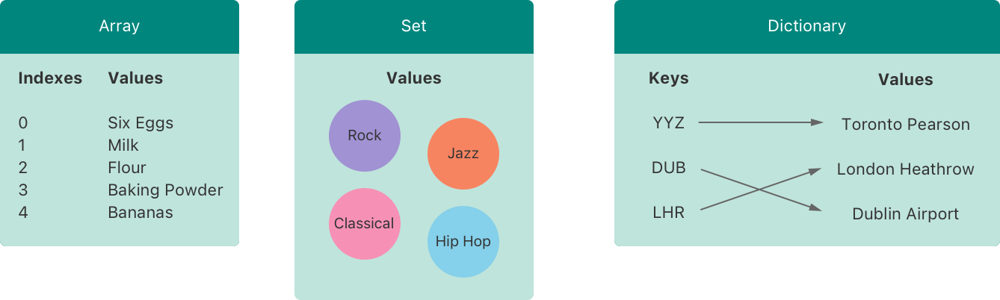
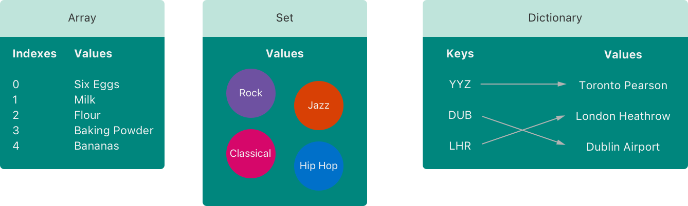
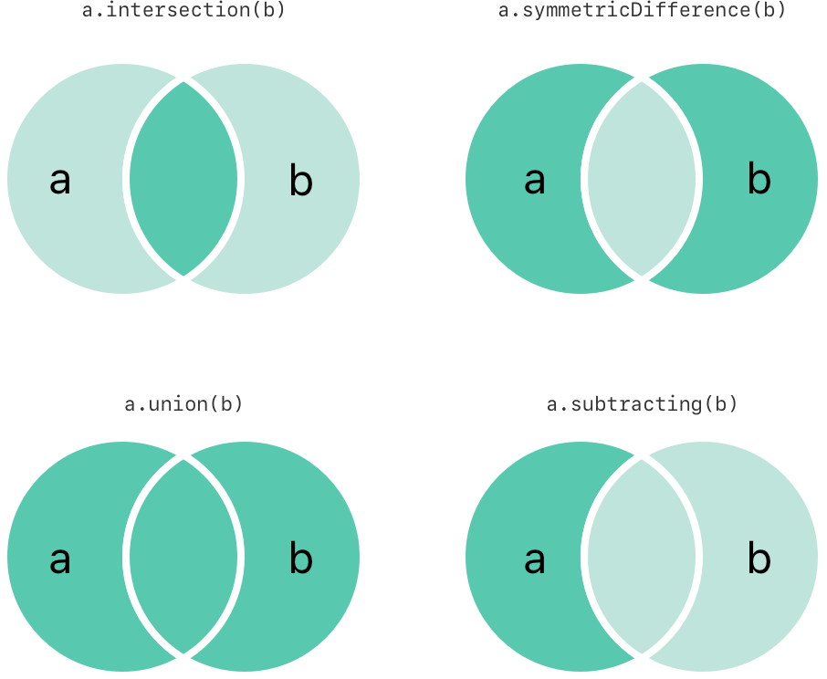
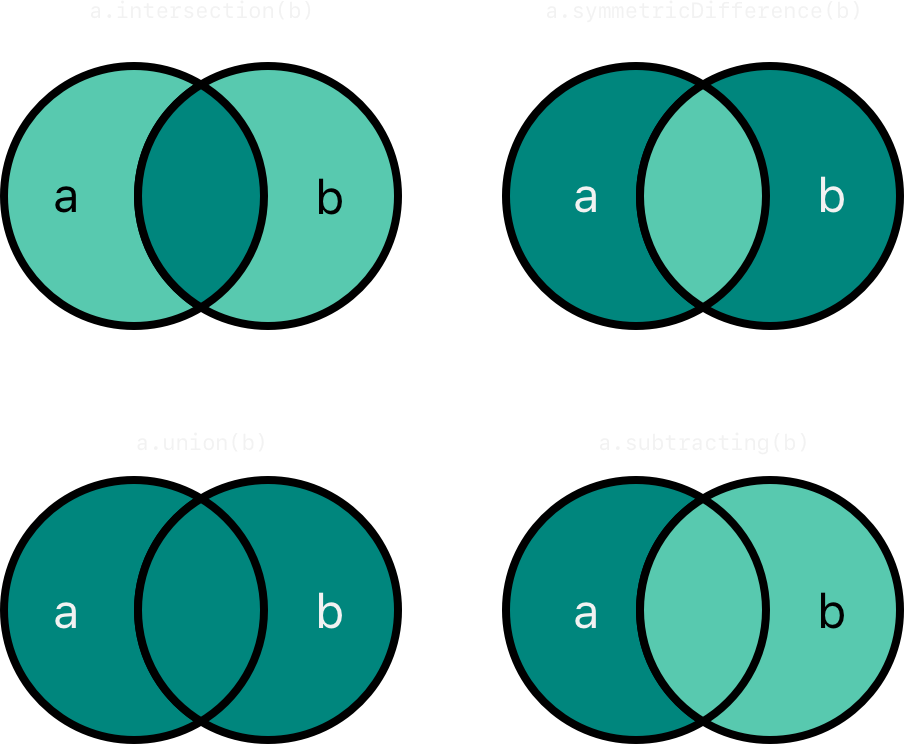
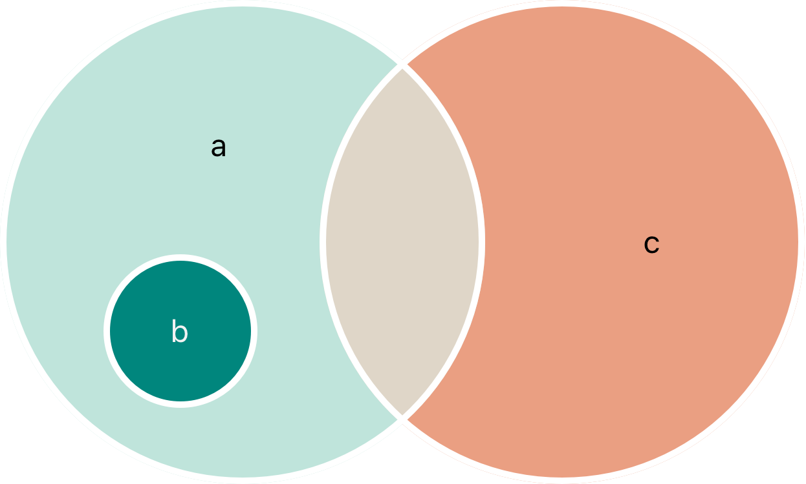
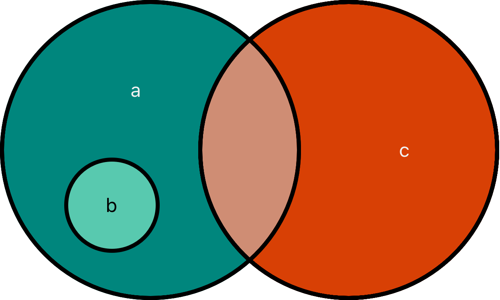

# 集合类型 {#Collection-Types}

使用数组、集合和字典来组织数据。

Swift 提供了三种主要的*集合类型*（collection type），分别是数组、集合和字典，用于存储值的集合。数组是有序的值集合。集合是无序且不含重复值的集合。字典是无序的键值关联集合。



Swift 中的数组、集合和字典始终明确自己可存储的值和键的类型。这意味着你不会误将错误类型的值插入集合。这也意味着你可以确信从集合中取出的值的类型。

> 注意：Swift 的数组、集合和字典类型实现为*泛型集合*（generic collection）。关于泛型类型和集合的更多信息，详见 [泛型](generics.md)。

## 集合的可变性 {#Mutability-of-Collections}

如果你创建一个数组、集合或字典，并将它赋给变量，那么所创建的集合将是*可变的*。这意味着你可以在集合创建之后，通过添加、移除或更改集合中的元素来更改（或*改变*）集合。如果你将数组、集合或字典赋给常量，则该集合是*不可变的*，其大小和内容都不能更改。

> 注意：在集合不需要更改的所有情况下，都创建不可变集合是一种好做法。这样做可以让你更容易理解代码，也能让 Swift 编译器优化你所创建的集合的性能。

## 数组 {#Arrays}

*数组*（array）将相同类型的值存储在有序列表中。同一个值可以在数组的不同位置多次出现。

> 注意：Swift 的 `Array` 类型桥接到 Foundation 的 `NSArray` 类。
>
> 关于在 Foundation 和 Cocoa 中使用 `Array` 的更多信息，参见 [Bridging Between Array and NSArray](https://developer.apple.com/documentation/swift/array#Bridging-Between-Array-and-NSArray)。

### 数组类型的简写语法 {#Array-Type-Shorthand-Syntax}

Swift 数组的类型完整写法是 `Array<Element>`，其中 `Element` 是数组允许存储的值的类型。你也可以将数组类型简写为 `[Element]`。虽然这两种形式在功能上完全相同，但更推荐简写形式，并且本指南在指代数组类型时始终使用简写形式。

### 创建空数组 {#Creating-an-Empty-Array}

在 Swift 中，你可以用两种方式创建空数组。如果上下文已经提供了类型信息，例如函数实参，或者已经标注了类型的变量或常量，你可以使用空数组字面量，它写作 `[]`（一对空方括号）：

```swift
var someInts: [Int] = []
print("someInts is of type [Int] with \(someInts.count) items.")
// Prints "someInts is of type [Int] with 0 items."
```

或者，你可以使用显式构造器语法创建某个类型的空数组，即在方括号中写元素类型，后面跟一对圆括号——例如下面代码中的 `[Int]()`：

```swift
var someInts = [Int]()
print("someInts is of type [Int] with \(someInts.count) items.")
// Prints "someInts is of type [Int] with 0 items."
```

两种方式产生的结果相同。不过，空数组字面量更短，通常也更容易阅读。

在这两种情况下，你都可以使用空数组字面量（`[]`）将空数组重新赋给已有的变量：

```swift
someInts.append(3)
// someInts now contains 1 value of type Int
someInts = []
// someInts is now an empty array, but is still of type [Int]
```

### 使用默认值创建数组 {#Creating-an-Array-with-a-Default-Value}

Swift 的 `Array` 类型还提供一个构造器，用于创建指定大小、且所有值都设为同一个默认值的数组。你向这个构造器传入一个相应类型的默认值（名为 `repeating`），以及该值在新数组中重复的次数（名为 `count`）：

```swift
var threeDoubles = Array(repeating: 0.0, count: 3)
// threeDoubles is of type [Double], and equals [0.0, 0.0, 0.0]
```

### 通过将两个数组相加来创建数组 {#Creating-an-Array-by-Adding-Two-Arrays-Together}

你可以使用加法运算符（`+`）将两个类型兼容的现有数组相加，从而创建一个新数组。新数组的类型由你相加的两个数组的类型推断而来：

```swift
var anotherThreeDoubles = Array(repeating: 2.5, count: 3)
// anotherThreeDoubles is of type [Double], and equals [2.5, 2.5, 2.5]

var sixDoubles = threeDoubles + anotherThreeDoubles
// sixDoubles is inferred as [Double], and equals [0.0, 0.0, 0.0, 2.5, 2.5, 2.5]
```

### 使用数组字面量创建数组 {#Creating-an-Array-with-an-Array-Literal}

你也可以用*数组字面量*（array literal）初始化数组，它是一种将一个或多个值写为数组集合的简写方式。数组字面量写为一列值，以逗号分隔，并用一对方括号括起来：

```swift
[<#value 1#>, <#value 2#>, <#value 3#>]
```

下面的示例创建一个名为 `shoppingList` 的数组，用于存储 `String` 值：

```swift
var shoppingList: [String] = ["Eggs", "Milk"]
// shoppingList has been initialized with two initial items
```

`shoppingList` 变量声明为“一个字符串值数组”，写作 `[String]`。因为这个特定的数组指定了值类型 `String`，所以它只允许存储 `String` 值。这里，`shoppingList` 数组用两个 `String` 值（`"Eggs"` 和 `"Milk"`）初始化，这两个值写在一个数组字面量中。

> 注意：`shoppingList` 数组声明为变量（使用 `var` 关键字）而不是常量（使用 `let` 关键字），因为下面的示例会向购物清单中添加更多元素。

在这个例子中，数组字面量只包含两个 `String` 值，没有其他内容。这与 `shoppingList` 变量声明中的类型（一个只能包含 `String` 值的数组）相符，因此允许用这个数组字面量赋值，以此用两个初始项初始化 `shoppingList`。

得益于 Swift 的类型推断，如果你用一个包含同类型值的数组字面量来初始化数组，就不必写出数组的类型。`shoppingList` 的初始化也可以改用更简短的形式：

```swift
var shoppingList = ["Eggs", "Milk"]
```

因为数组字面量中的所有值都是同一类型，Swift 可以推断出 `[String]` 是用于 `shoppingList` 变量的正确类型。

你可以在数组字面量的最后一个值后面加一个逗号，这称为*尾随逗号*（trailing comma）：

```swift
var shoppingList = [
    "Eggs",
    "Milk",
]
```

因为尾随逗号让每一行都以相同方式结尾，所以对于上面这种每行一个值的数组，它是一种很有用的写法。更改数组时，你只需添加、移除或重新排列值——不必添加或移除逗号。

### 访问和修改数组 {#Accessing-and-Modifying-an-Array}

你可以通过数组的方法和属性，或使用下标语法来访问和修改数组。

要查明数组中元素的数量，请检查其只读的 `count` 属性：

```swift
print("The shopping list contains \(shoppingList.count) items.")
// Prints "The shopping list contains 2 items."
```

使用布尔值 `isEmpty` 属性，可以快捷地检查 `count` 属性是否等于 `0`：

```swift
if shoppingList.isEmpty {
    print("The shopping list is empty.")
} else {
    print("The shopping list isn't empty.")
}
// Prints "The shopping list isn't empty."
```

你可以通过调用数组的 `append(_:)` 方法在数组末尾添加新元素：

```swift
shoppingList.append("Flour")
// shoppingList now contains 3 items, and someone is making pancakes
```

或者，使用加法赋值运算符（`+=`）追加一个包含一个或多个类型兼容元素的数组：

```swift
shoppingList += ["Baking Powder"]
// shoppingList now contains 4 items
shoppingList += ["Chocolate Spread", "Cheese", "Butter"]
// shoppingList now contains 7 items
```

使用*下标语法*（subscript syntax），在数组名之后紧接着的方括号中传入要取回值的索引，即可从数组中取回值：

```swift
var firstItem = shoppingList[0]
// firstItem is equal to "Eggs"
```

> 注意：数组中第一个元素的索引是 `0`，而不是 `1`。Swift 中的数组始终以零作为起始索引。

你可以使用下标语法更改指定索引处的现有值：

```swift
shoppingList[0] = "Six eggs"
// the first item in the list is now equal to "Six eggs" rather than "Eggs"
```

使用下标语法时，你指定的索引必须有效。例如，写 `shoppingList[shoppingList.count] = "Salt"` 试图在数组末尾追加一个元素，会导致运行时错误。

你还可以使用下标语法一次更改一个区间内的值，即使用于替换的值集合与要替换的区间长度不同。下面的示例将 `"Chocolate Spread"`、`"Cheese"` 和 `"Butter"` 替换为 `"Bananas"` 和 `"Apples"`：

```swift
shoppingList[4...6] = ["Bananas", "Apples"]
// shoppingList now contains 6 items
```

要在数组的指定索引处插入元素，请调用数组的 `insert(_:at:)` 方法：

```swift
shoppingList.insert("Maple Syrup", at: 0)
// shoppingList now contains 7 items
// "Maple Syrup" is now the first item in the list
```

这次对 `insert(_:at:)` 方法的调用将值为 `"Maple Syrup"` 的新元素插入到购物清单的最前面，由索引 `0` 指明。

同样，你可以使用 `remove(at:)` 方法从数组中移除元素。该方法移除指定索引处的元素，并返回被移除的元素（如果不需要，可以忽略返回值）：

```swift
let mapleSyrup = shoppingList.remove(at: 0)
// the item that was at index 0 has just been removed
// shoppingList now contains 6 items, and no Maple Syrup
// the mapleSyrup constant is now equal to the removed "Maple Syrup" string
```

> 注意：如果你尝试访问或修改数组中现有边界之外的索引处的值，就会触发运行时错误。你可以在使用索引之前，通过将其与数组的 `count` 属性比较来检查索引是否有效。数组中最大的有效索引是 `count - 1`，因为数组的索引从零开始——不过，当 `count` 为 `0`（表示数组为空）时，没有有效的索引。

移除元素后，数组中的空隙会被填补，因此索引 `0` 处的值再次等于 `"Six eggs"`：

```swift
firstItem = shoppingList[0]
// firstItem is now equal to "Six eggs"
```

如果你想移除数组中的最后一个元素，请使用 `removeLast()` 方法而不是 `remove(at:)` 方法，以避免查询数组的 `count` 属性。与 `remove(at:)` 方法一样，`removeLast()` 也返回被移除的元素：

```swift
let apples = shoppingList.removeLast()
// the last item in the array has just been removed
// shoppingList now contains 5 items, and no apples
// the apples constant is now equal to the removed "Apples" string
```

### 遍历数组 {#Iterating-Over-an-Array}

你可以使用 `for`-`in` 循环遍历数组中的所有值：

```swift
for item in shoppingList {
    print(item)
}
// Six eggs
// Milk
// Flour
// Baking Powder
// Bananas
```

如果你既需要每个元素的整数索引，又需要它的值，请改用 `enumerated()` 方法遍历数组。对于数组中的每个元素，`enumerated()` 方法返回一个由整数和该元素组成的元组。整数从零开始，每处理一个元素递增一；如果遍历整个数组，这些整数与元素的索引一致。你可以在遍历过程中将这个元组分解为临时常量或变量：

```swift
for (index, value) in shoppingList.enumerated() {
    print("Item \(index + 1): \(value)")
}
// Item 1: Six eggs
// Item 2: Milk
// Item 3: Flour
// Item 4: Baking Powder
// Item 5: Bananas
```

关于 `for`-`in` 循环的更多信息，详见 [For-In 循环](control-flow.md#For-In-Loops)。

## 集合 {#Sets}

*集合*（set）在无序的集合中存储相同类型且互不相同的值。当元素的顺序不重要，或者你需要确保某个元素只出现一次时，可以使用集合而不是数组。

> 注意：Swift 的 `Set` 类型桥接到 Foundation 的 `NSSet` 类。
>
> 关于在 Foundation 和 Cocoa 中使用 `Set` 的更多信息，参见 [Bridging Between Set and NSSet](https://developer.apple.com/documentation/swift/set#Bridging-Between-Set-and-NSSet)。

### 集合类型的哈希值 {#Hash-Values-for-Set-Types}

一个类型必须是*可哈希的*（hashable），才能存储在集合中——也就是说，该类型必须提供一种为自身计算*哈希值*（hash value）的方法。哈希值是一个 `Int` 值，对于所有比较相等的对象都相同，因此如果 `a == b`，`a` 的哈希值就等于 `b` 的哈希值。

Swift 的所有基本类型（如 `String`、`Int`、`Double` 和 `Bool`）默认都是可哈希的，可以用作集合的值类型或字典的键类型。没有关联值的枚举成员值（如 [枚举](enumerations.md) 中所述）默认也是可哈希的。

> 注意：你可以让自己的自定义类型遵循 Swift 标准库中的 `Hashable` 协议，从而将它们用作集合的值类型或字典的键类型。关于实现必需的 `hash(into:)` 方法的信息，参见 [`Hashable`](https://developer.apple.com/documentation/swift/hashable)。关于遵循协议的信息，详见 [协议](protocols.md)。

### 集合类型语法 {#Set-Type-Syntax}

Swift 集合的类型写作 `Set<Element>`，其中 `Element` 是集合允许存储的类型。与数组不同，集合没有等价的简写形式。

### 创建和初始化空集合 {#Creating-and-Initializing-an-Empty-Set}

你可以使用构造器语法创建某个类型的空集合：

```swift
var letters = Set<Character>()
print("letters is of type Set<Character> with \(letters.count) items.")
// Prints "letters is of type Set<Character> with 0 items."
```

> 注意：`letters` 变量的类型根据构造器的类型推断为 `Set<Character>`。

或者，如果上下文已经提供了类型信息，例如函数实参，或者已经标注了类型的变量或常量，你可以用空数组字面量创建空集合：

```swift
letters.insert("a")
// letters now contains 1 value of type Character
letters = []
// letters is now an empty set, but is still of type Set<Character>
```

### 使用数组字面量创建集合 {#Creating-a-Set-with-an-Array-Literal}

你也可以用数组字面量初始化集合，作为一种将一个或多个值写为集合的简写方式。

下面的示例创建一个名为 `favoriteGenres` 的集合，用于存储 `String` 值：

```swift
var favoriteGenres: Set<String> = ["Rock", "Classical", "Hip hop"]
// favoriteGenres has been initialized with three initial items
```

`favoriteGenres` 变量声明为“一个 `String` 值集合”，写作 `Set<String>`。因为这个特定的集合指定了值类型 `String`，所以它*只*允许存储 `String` 值。这里，`favoriteGenres` 集合用三个 `String` 值（`"Rock"`、`"Classical"` 和 `"Hip hop"`）初始化，这些值写在一个数组字面量中。

> 注意：`favoriteGenres` 集合声明为变量（使用 `var` 关键字）而不是常量（使用 `let` 关键字），因为下面的示例会添加和移除元素。

仅凭数组字面量无法推断出集合类型，因此必须显式声明 `Set` 类型。不过，得益于 Swift 的类型推断，如果你用一个只包含一种类型值的数组字面量来初始化集合，就不必写出集合元素的类型。`favoriteGenres` 的初始化也可以改用更简短的形式：

```swift
var favoriteGenres: Set = ["Rock", "Classical", "Hip hop"]
```

因为数组字面量中的所有值都是同一类型，Swift 可以推断出 `Set<String>` 是用于 `favoriteGenres` 变量的正确类型。

### 访问和修改集合 {#Accessing-and-Modifying-a-Set}

你可以通过集合的方法和属性来访问和修改集合。

要查明集合中元素的数量，请检查其只读的 `count` 属性：

```swift
print("I have \(favoriteGenres.count) favorite music genres.")
// Prints "I have 3 favorite music genres."
```

使用布尔值 `isEmpty` 属性，可以快捷地检查 `count` 属性是否等于 `0`：

```swift
if favoriteGenres.isEmpty {
    print("As far as music goes, I'm not picky.")
} else {
    print("I have particular music preferences.")
}
// Prints "I have particular music preferences."
```

你可以通过调用集合的 `insert(_:)` 方法向集合中添加新元素：

```swift
favoriteGenres.insert("Jazz")
// favoriteGenres now contains 4 items
```

你可以通过调用集合的 `remove(_:)` 方法移除元素；如果该元素是集合的成员，该方法会移除它并返回被移除的值，如果集合不包含该元素则返回 `nil`。或者，也可以用 `removeAll()` 方法移除集合中的所有元素。

```swift
if let removedGenre = favoriteGenres.remove("Rock") {
    print("\(removedGenre)? I'm over it.")
} else {
    print("I never much cared for that.")
}
// Prints "Rock? I'm over it."
```

要检查集合是否包含某个特定元素，请使用 `contains(_:)` 方法。

```swift
if favoriteGenres.contains("Funk") {
    print("I get up on the good foot.")
} else {
    print("It's too funky in here.")
}
// Prints "It's too funky in here."
```

### 遍历集合 {#Iterating-Over-a-Set}

你可以使用 `for`-`in` 循环遍历集合中的值。

```swift
for genre in favoriteGenres {
    print("\(genre)")
}
// Classical
// Jazz
// Hip hop
```

关于 `for`-`in` 循环的更多信息，详见 [For-In 循环](control-flow.md#For-In-Loops)。

Swift 的 `Set` 类型没有定义的顺序。要按特定顺序遍历集合的值，请使用 `sorted()` 方法，它返回一个按 `<` 运算符排序、包含集合元素的数组。

```swift
for genre in favoriteGenres.sorted() {
    print("\(genre)")
}
// Classical
// Hip hop
// Jazz
```

## 执行集合操作 {#Performing-Set-Operations}

你可以高效地执行基本的集合操作，例如合并两个集合、确定两个集合有哪些共同的值，或者确定两个集合是否包含全部、部分或完全不含相同的值。

### 基本集合操作 {#Fundamental-Set-Operations}

下面的插图描绘了两个集合——`a` 和 `b`——阴影区域表示各种集合操作的结果。



- 使用 `intersection(_:)` 方法创建一个新集合，其中只包含两个集合共有的值。
- 使用 `symmetricDifference(_:)` 方法创建一个新集合，其中包含两个集合中某一方有、但并非两方都有的值。
- 使用 `union(_:)` 方法创建一个新集合，其中包含两个集合的所有值。
- 使用 `subtracting(_:)` 方法创建一个新集合，其中包含不在指定集合中的值。

```swift
let oddDigits: Set = [1, 3, 5, 7, 9]
let evenDigits: Set = [0, 2, 4, 6, 8]
let singleDigitPrimeNumbers: Set = [2, 3, 5, 7]

oddDigits.union(evenDigits).sorted()
// [0, 1, 2, 3, 4, 5, 6, 7, 8, 9]
oddDigits.intersection(evenDigits).sorted()
// []
oddDigits.subtracting(singleDigitPrimeNumbers).sorted()
// [1, 9]
oddDigits.symmetricDifference(singleDigitPrimeNumbers).sorted()
// [1, 2, 9]
```

### 集合的成员关系与相等性 {#Set-Membership-and-Equality}

下面的插图描绘了三个集合——`a`、`b` 和 `c`——重叠区域表示集合之间共享的元素。集合 `a` 是集合 `b` 的*超集*（superset），因为 `a` 包含 `b` 中的所有元素。反之，集合 `b` 是集合 `a` 的*子集*（subset），因为 `b` 中的所有元素也都被 `a` 包含。集合 `b` 和集合 `c` 彼此*不相交*（disjoint），因为它们没有任何共同的元素。



- 使用“相等”运算符（`==`）判断两个集合是否包含完全相同的值。
- 使用 `isSubset(of:)` 方法判断一个集合的所有值是否都包含在指定集合中。
- 使用 `isSuperset(of:)` 方法判断一个集合是否包含指定集合中的所有值。
- 使用 `isStrictSubset(of:)` 或 `isStrictSuperset(of:)` 方法判断一个集合是否为另一个指定集合的子集或超集，但不与之相等。
- 使用 `isDisjoint(with:)` 方法判断两个集合是否没有共同的值。

```swift
let houseAnimals: Set = ["🐶", "🐱"]
let farmAnimals: Set = ["🐮", "🐔", "🐑", "🐶", "🐱"]
let cityAnimals: Set = ["🐦", "🐭"]

houseAnimals.isSubset(of: farmAnimals)
// true
farmAnimals.isSuperset(of: houseAnimals)
// true
farmAnimals.isDisjoint(with: cityAnimals)
// true
```

## 字典 {#Dictionaries}

*字典*（dictionary）在无序的集合中存储相同类型的键与相同类型的值之间的关联。每个值都与一个唯一的*键*（key）关联，键充当该值在字典中的标识符。与数组中的元素不同，字典中的元素没有指定的顺序。当你需要根据标识符查找值时，就可以使用字典，这与现实中的字典用于查找某个单词的定义非常相似。

> 注意：Swift 的 `Dictionary` 类型桥接到 Foundation 的 `NSDictionary` 类。
>
> 关于在 Foundation 和 Cocoa 中使用 `Dictionary` 的更多信息，参见 [Bridging Between Dictionary and NSDictionary](https://developer.apple.com/documentation/swift/dictionary#Bridging-Between-Dictionary-and-NSDictionary)。

### 字典类型的简写语法 {#Dictionary-Type-Shorthand-Syntax}

Swift 字典的类型完整写法是 `Dictionary<Key, Value>`，其中 `Key` 是可以作为字典键的值的类型，`Value` 是字典为这些键存储的值的类型。

> 注意：字典的 `Key` 类型必须遵循 `Hashable` 协议，就像集合的值类型一样。

你也可以将字典类型简写为 `[Key: Value]`。虽然这两种形式在功能上完全相同，但更推荐简写形式，并且本指南在指代字典类型时始终使用简写形式。

### 创建空字典 {#Creating-an-Empty-Dictionary}

与数组一样，你可以使用构造器语法创建某个类型的空 `Dictionary`：

```swift
var namesOfIntegers: [Int: String] = [:]
// namesOfIntegers is an empty [Int: String] dictionary
```

这个示例创建一个类型为 `[Int: String]` 的空字典，用于存储整数值的人类可读名称。它的键是 `Int` 类型，值是 `String` 类型。

如果上下文已经提供了类型信息，你可以用空字典字面量创建空字典，它写作 `[:]`（一对中括号内有一个冒号）：

```swift
namesOfIntegers[16] = "sixteen"
// namesOfIntegers now contains 1 key-value pair
namesOfIntegers = [:]
// namesOfIntegers is once again an empty dictionary of type [Int: String]
```

### 使用字典字面量创建字典 {#Creating-a-Dictionary-with-a-Dictionary-Literal}

你也可以用*字典字面量*（dictionary literal）初始化字典，其语法与前面见到的数组字面量类似。字典字面量是一种将一个或多个键值对写为 `Dictionary` 集合的简写方式。

*键值对*（key-value pair）是键和值的组合。在字典字面量中，每个键值对中的键和值用冒号分隔。键值对写成一个列表，以逗号分隔，并用一对方括号括起来：

```swift
[<#key 1#>: <#value 1#>, <#key 2#>: <#value 2#>, <#key 3#>: <#value 3#>]
```

下面的示例创建一个字典来存储国际机场的名称。在这个字典中，键是三个字母的国际航空运输协会代码，值是机场名称：

```swift
var airports: [String: String] = ["YYZ": "Toronto Pearson", "DUB": "Dublin"]
```

`airports` 字典声明为 `[String: String]` 类型，意思是“一个键为 `String` 类型、值也为 `String` 类型的 `Dictionary`”。

> 注意：`airports` 字典声明为变量（使用 `var` 关键字），而不是常量（使用 `let` 关键字），因为下面的示例会向字典中添加更多机场。

`airports` 字典用一个包含两个键值对的字典字面量初始化。第一个键值对的键是 `"YYZ"`，值是 `"Toronto Pearson"`。第二个键值对的键是 `"DUB"`，值是 `"Dublin"`。

这个字典字面量包含两个 `String: String` 键值对。这个键值类型与 `airports` 变量声明中的类型（一个键只能是 `String`、值也只能是 `String` 的字典）相符，因此允许用这个字典字面量赋值，以此用两个初始项初始化 `airports` 字典。

与数组一样，如果你用一个键和值的类型都一致的字典字面量来初始化字典，就不必写出字典的类型。`airports` 的初始化也可以改用更简短的形式：

```swift
var airports = ["YYZ": "Toronto Pearson", "DUB": "Dublin"]
```

因为字面量中的所有键彼此类型相同，所有值也彼此类型相同，Swift 可以推断出 `[String: String]` 是用于 `airports` 字典的正确类型。

与数组字面量一样，字典字面量可以在最后一个键值对后面包含一个尾随逗号：

```swift
var airports = [
    "YYZ": "Toronto Pearson",
    "DUB": "Dublin",
]
```

### 访问和修改字典 {#Accessing-and-Modifying-a-Dictionary}

你可以通过字典的方法和属性，或使用下标语法来访问和修改字典。

与数组一样，要查明 `Dictionary` 中元素的数量，可以检查其只读的 `count` 属性：

```swift
print("The airports dictionary contains \(airports.count) items.")
// Prints "The airports dictionary contains 2 items."
```

使用布尔值 `isEmpty` 属性，可以快捷地检查 `count` 属性是否等于 `0`：

```swift
if airports.isEmpty {
    print("The airports dictionary is empty.")
} else {
    print("The airports dictionary isn't empty.")
}
// Prints "The airports dictionary isn't empty."
```

你可以使用下标语法向字典中添加新元素。使用相应类型的新键作为下标索引，并赋一个相应类型的新值：

```swift
airports["LHR"] = "London"
// the airports dictionary now contains 3 items
```

你也可以使用下标语法更改与某个特定键关联的值：

```swift
airports["LHR"] = "London Heathrow"
// the value for "LHR" has been changed to "London Heathrow"
```

作为使用下标的替代，可以使用字典的 `updateValue(_:forKey:)` 方法为某个特定键设置或更新值。与上面的下标示例一样，如果键不存在，`updateValue(_:forKey:)` 方法会为它设置一个值；如果该键已存在，则更新其值。不过，与下标不同的是，`updateValue(_:forKey:)` 方法在执行更新后返回*旧*值。这使你能够检查是否发生了更新。

`updateValue(_:forKey:)` 方法返回一个字典值类型的可选值。例如，对于存储 `String` 值的字典，该方法返回 `String?` 类型的值，即“可选 `String`”。如果更新前该键有值，这个可选值包含该键的旧值；如果没有值，则为 `nil`：

```swift
if let oldValue = airports.updateValue("Dublin Airport", forKey: "DUB") {
    print("The old value for DUB was \(oldValue).")
}
// Prints "The old value for DUB was Dublin."
```

你也可以使用下标语法从字典中取回某个特定键的值。由于可能请求一个不存在的键的值，字典的下标返回一个字典值类型的可选值。如果字典包含所请求键的值，下标返回一个包含该键现有值的可选值。否则，下标返回 `nil`：

```swift
if let airportName = airports["DUB"] {
    print("The name of the airport is \(airportName).")
} else {
    print("That airport isn't in the airports dictionary.")
}
// Prints "The name of the airport is Dublin Airport."
```

你可以使用下标语法，通过为某个键赋 `nil` 值来从字典中移除该键值对：

```swift
airports["APL"] = "Apple International"
// "Apple International" isn't the real airport for APL, so delete it
airports["APL"] = nil
// APL has now been removed from the dictionary
```

或者，使用 `removeValue(forKey:)` 方法从字典中移除键值对。如果该键值对存在，该方法会移除它并返回被移除的值；如果不存在，则返回 `nil`：

```swift
if let removedValue = airports.removeValue(forKey: "DUB") {
    print("The removed airport's name is \(removedValue).")
} else {
    print("The airports dictionary doesn't contain a value for DUB.")
}
// Prints "The removed airport's name is Dublin Airport."
```

### 遍历字典 {#Iterating-Over-a-Dictionary}

你可以使用 `for`-`in` 循环遍历字典中的键值对。字典中的每个元素都以 `(key, value)` 元组的形式返回，你可以在遍历过程中将这个元组的成员分解为临时常量或变量：

```swift
for (airportCode, airportName) in airports {
    print("\(airportCode): \(airportName)")
}
// LHR: London Heathrow
// YYZ: Toronto Pearson
```

关于 `for`-`in` 循环的更多信息，详见 [For-In 循环](control-flow.md#For-In-Loops)。

你也可以通过访问字典的 `keys` 和 `values` 属性，获取由字典的键或值组成的可迭代集合：

```swift
for airportCode in airports.keys {
    print("Airport code: \(airportCode)")
}
// Airport code: LHR
// Airport code: YYZ

for airportName in airports.values {
    print("Airport name: \(airportName)")
}
// Airport name: London Heathrow
// Airport name: Toronto Pearson
```

如果你需要在接受 `Array` 实例的 API 中使用字典的键或值，请用 `keys` 或 `values` 属性初始化一个新数组：

```swift
let airportCodes = [String](airports.keys)
// airportCodes is ["LHR", "YYZ"]

let airportNames = [String](airports.values)
// airportNames is ["London Heathrow", "Toronto Pearson"]
```

Swift 的 `Dictionary` 类型没有定义的顺序。要按特定顺序遍历字典的键或值，请对其 `keys` 或 `values` 属性使用 `sorted()` 方法。
