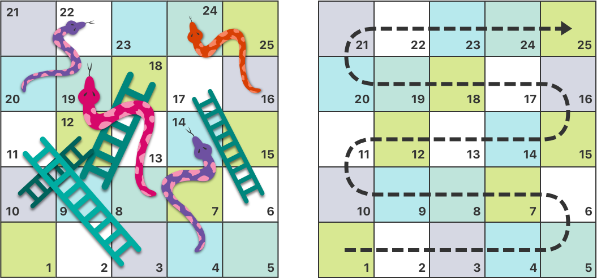
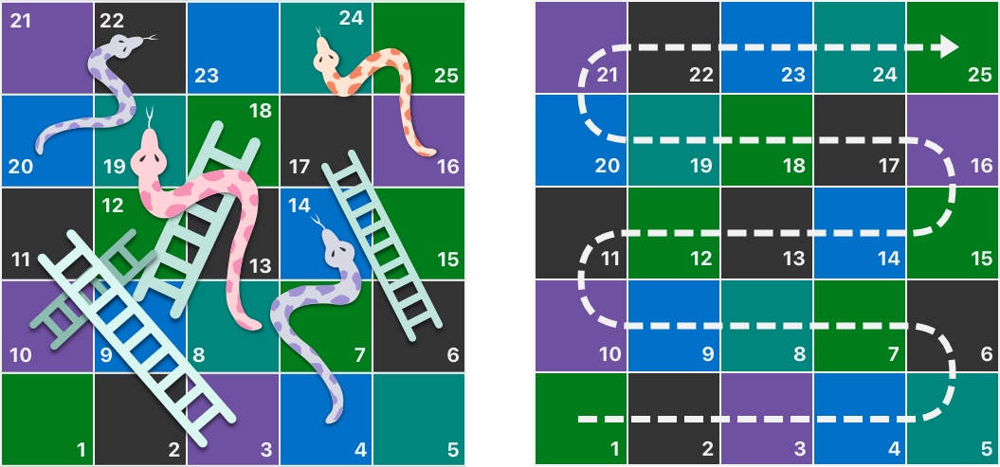
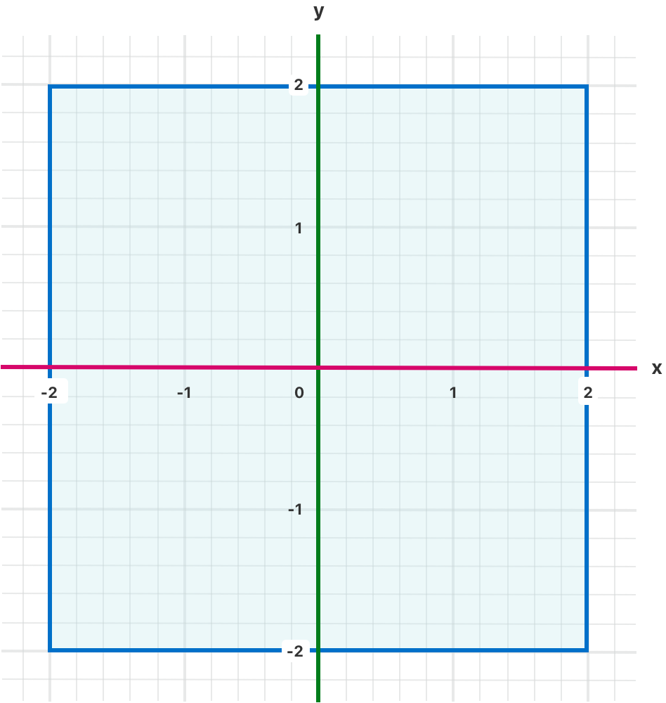
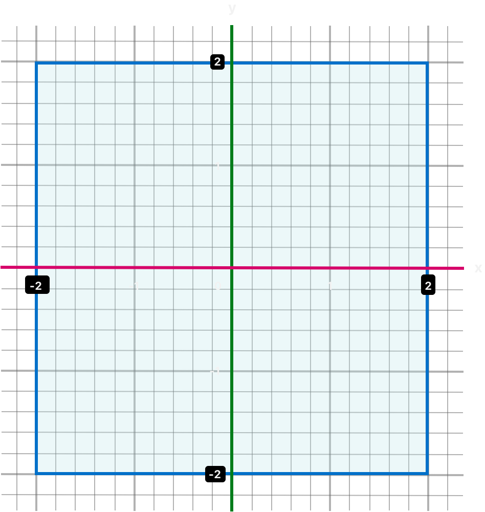
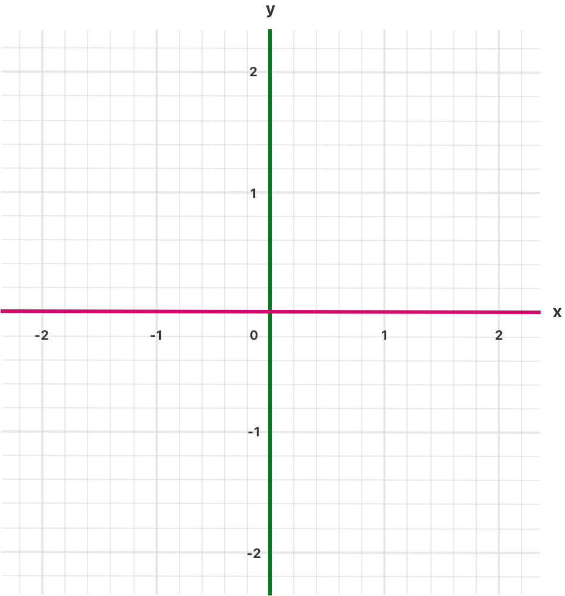
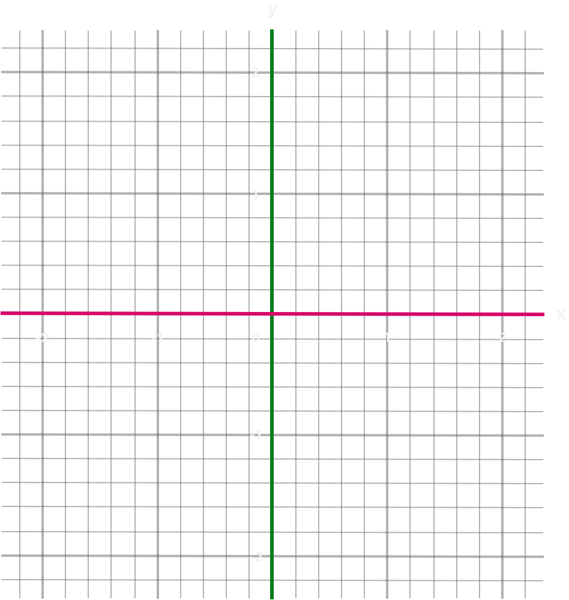
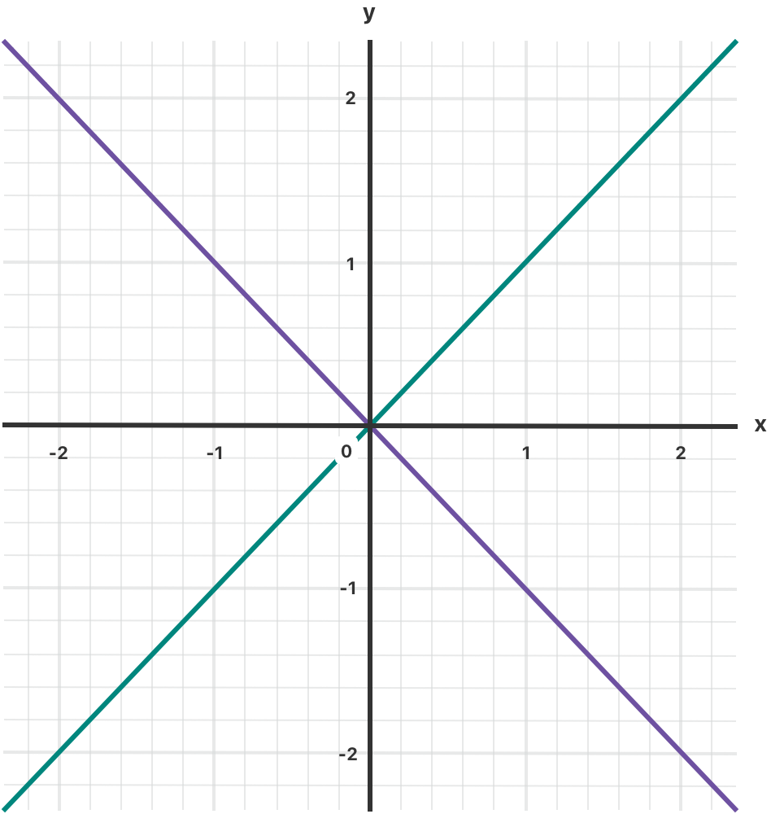
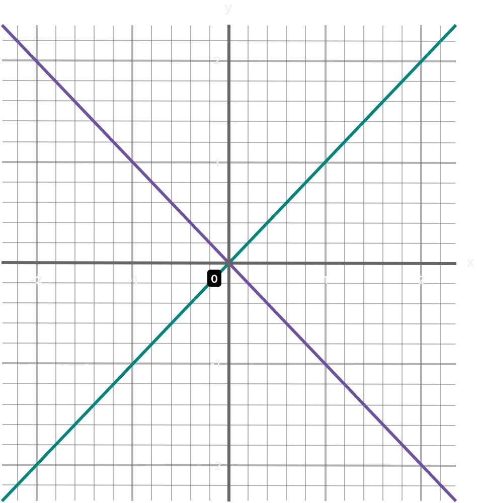

# 控制流 {#Control-Flow}

用分支、循环和提前退出组织代码。

Swift 提供了多种控制流语句。包括多次执行同一任务的 `while` 循环；根据特定条件执行不同代码分支的 `if`、`guard` 和 `switch` 语句；以及把执行流程转移到代码中另一位置的 `break` 和 `continue` 等语句。Swift 提供的 `for`-`in` 循环让遍历数组、字典、区间、字符串和其他序列变得容易。Swift 还提供 `defer` 语句，用于包装在离开当前作用域时执行的代码。

Swift 的 `switch` 语句比许多类 C 语言中的对应语句强大得多。分支可以匹配许多不同的模式，包括区间匹配、元组以及到特定类型的转换。`switch` 分支中匹配到的值可以绑定到临时常量或变量，供该分支的主体使用；每个分支还可以用 `where` 子句表达复杂的匹配条件。

## For-In 循环 {#For-In-Loops}

你可以用 `for`-`in` 循环遍历序列，例如数组中的元素、数字区间或字符串中的字符。

下面的例子用 `for`-`in` 循环遍历数组中的元素：

```swift
let names = ["Anna", "Alex", "Brian", "Jack"]
for name in names {
    print("Hello, \(name)!")
}
// Hello, Anna!
// Hello, Alex!
// Hello, Brian!
// Hello, Jack!
```

你也可以遍历字典来访问它的键值对。遍历字典时，其中每一项都以 `(key, value)` 元组的形式返回；你可以把这个 `(key, value)` 元组的成员分解为显式命名的常量，供 `for`-`in` 循环的主体使用。在下面的代码示例中，字典的键被分解为名为 `animalName` 的常量，字典的值被分解为名为 `legCount` 的常量。

```swift
let numberOfLegs = ["spider": 8, "ant": 6, "cat": 4]
for (animalName, legCount) in numberOfLegs {
    print("\(animalName)s have \(legCount) legs")
}
// cats have 4 legs
// ants have 6 legs
// spiders have 8 legs
```

`Dictionary` 的内容本质上是无序的，遍历它们并不保证取回的顺序。特别是，向 `Dictionary` 中插入元素的顺序并不决定遍历它们的顺序。关于数组和字典的更多信息，详见 [集合类型](collection-types.md)。

你也可以把 `for`-`in` 循环用于数字区间。下面的例子打印 5 的乘法表的前几项：

```swift
for index in 1...5 {
    print("\(index) times 5 is \(index * 5)")
}
// 1 times 5 is 5
// 2 times 5 is 10
// 3 times 5 is 15
// 4 times 5 is 20
// 5 times 5 is 25
```

被遍历的序列是从 `1` 到 `5`（含两端）的数字区间，这里用闭区间运算符（`...`）来表示。`index` 的值被设为该区间中的第一个数字（`1`），然后执行循环内的语句。在这个例子中，循环只包含一条语句，它打印当前 `index` 值对应的 5 的乘法表的一项。执行完该语句后，`index` 的值被更新为区间中的第二个值（`2`），并再次调用 `print(_:separator:terminator:)` 函数。这个过程一直持续到区间末尾。

在上面的例子中，`index` 是一个常量，其值在循环的每次迭代开始时自动设置。因此，`index` 不必在使用前声明。只要它出现在循环声明中，就会被隐式声明，不需要 `let` 声明关键字。

如果你不需要序列中的每个值，可以用下划线代替变量名来忽略这些值。

```swift
let base = 3
let power = 10
var answer = 1
for _ in 1...power {
    answer *= base
}
print("\(base) to the power of \(power) is \(answer)")
// Prints "3 to the power of 10 is 59049".
```

上面的例子计算一个数的乘方（这里计算的是 `3` 的 `10` 次幂）。它从初始值 `1`（即 `3` 的 `0` 次幂）开始，乘以 `3`，共乘十次，使用的是从 `1` 开始、到 `10` 结束的闭区间。在这个计算中，每次循环的计数器值并不需要——代码只是把循环执行正确的次数。用下划线字符（`_`）代替循环变量，会让各个值被忽略，并且在循环的每次迭代中都不提供对当前值的访问。

在某些情况下，你可能不想使用包含两个端点的闭区间。设想在表盘上绘制每一分钟的刻度线。你想从第 `0` 分钟开始绘制 `60` 条刻度线。使用半开区间运算符（`..<`）可以包含下界但不包含上界。关于区间的更多信息，详见 [区间运算符](basic-operators.md#Range-Operators)。

```swift
let minutes = 60
for tickMark in 0..<minutes {
    // render the tick mark each minute (60 times)
}
```

有些用户可能希望界面上的刻度线更少。他们可能更愿意每隔 `5` 分钟画一条刻度线。使用 `stride(from:to:by:)` 函数可以跳过不需要的刻度。

```swift
let minuteInterval = 5
for tickMark in stride(from: 0, to: minutes, by: minuteInterval) {
    // render the tick mark every 5 minutes (0, 5, 10, 15 ... 45, 50, 55)
}
```

也可以使用闭区间，只需改用 `stride(from:through:by:)`：

```swift
let hours = 12
let hourInterval = 3
for tickMark in stride(from: 3, through: hours, by: hourInterval) {
    // render the tick mark every 3 hours (3, 6, 9, 12)
}
```

上面的例子用 `for`-`in` 循环遍历区间、数组、字典和字符串。不过，只要这些类型遵循 [`Sequence`](https://developer.apple.com/documentation/swift/sequence) 协议，你就可以用这种语法遍历*任何*集合，包括你自己定义的类和集合类型。

## While 循环 {#While-Loops}

`while` 循环执行一组语句，直到某个条件变为 `false`。当第一次迭代开始之前无法知道迭代次数时，最适合使用这类循环。Swift 提供两种 `while` 循环：

- `while` 在每次循环开始时求值其条件。
- `repeat`-`while` 在每次循环结束时求值其条件。

### While {#While}

`while` 循环先求值一个条件。如果条件为 `true`，则重复执行一组语句，直到条件变为 `false`。

下面是 `while` 循环的一般形式：

```swift
while <#condition#> {
   <#statements#>
}
```

下面的例子玩一个简单的*蛇与梯子*（Snakes and Ladders）游戏，它也称为*滑梯与梯子*（Chutes and Ladders）：



游戏规则如下：

- 棋盘有 25 个方格，目标是落在第 25 格上或越过它。
- 玩家的起始方格是“第零格”，它正好位于棋盘左下角之外。
- 每一轮，你掷一个六面骰子，并按照上方虚线箭头指示的水平路径前进相应的格数。
- 如果这一轮结束时你停在梯子的底部，就沿梯子向上移动。
- 如果这一轮结束时你停在蛇的头部，就沿蛇向下移动。

游戏棋盘用一个 `Int` 值数组表示。它的大小基于名为 `finalSquare` 的常量，这个常量既用于初始化数组，也用于在示例后面检查获胜条件。因为玩家从棋盘外开始，位于“第零格”，所以棋盘用 26 个值为零的 `Int` 初始化，而不是 25 个。

```swift
let finalSquare = 25
var board = [Int](repeating: 0, count: finalSquare + 1)
```

然后为一些方格设置更具体的值，用于蛇和梯子。有梯子底部的方格带一个正数，让你沿棋盘向上移动；而有蛇头的方格带一个负数，让你沿棋盘向下移动。

```swift
board[03] = +08; board[06] = +11; board[09] = +09; board[10] = +02
board[14] = -10; board[19] = -11; board[22] = -02; board[24] = -08
```

第 3 格是梯子的底部，它会把你送到第 11 格。为了表示这一点，`board[03]` 等于 `+08`，它等价于整数值 `8`（`3` 与 `11` 之差）。为了让数值和语句对齐，这里显式地在一元减运算符（`-i`）旁使用一元加运算符（`+i`），并把小于 `10` 的数字补零。（这两种风格手法都不是严格必需的，但它们让代码更整洁。）

```swift
var square = 0
var diceRoll = 0
while square < finalSquare {
    // roll the dice
    diceRoll += 1
    if diceRoll == 7 { diceRoll = 1 }
    // move by the rolled amount
    square += diceRoll
    if square < board.count {
        // if we're still on the board, move up or down for a snake or a ladder
        square += board[square]
    }
}
print("Game over!")
```

上面的例子用非常简单的方式模拟掷骰子。它不生成随机数，而是从 `diceRoll` 值为 `0` 开始。每次执行 `while` 循环时，`diceRoll` 加一，然后检查它是否变得太大。每当这个值等于 `7`，就说明掷出的点数太大，把它重置为 `1`。结果是一串总是 `1`、`2`、`3`、`4`、`5`、`6`、`1`、`2` 依此类推的 `diceRoll` 值。

掷完骰子后，玩家向前移动 `diceRoll` 格。掷出的点数可能让玩家越过第 25 格，这种情况下游戏结束。为了处理这种情况，代码检查 `square` 是否小于 `board` 数组的 `count` 属性。如果 `square` 有效，就把 `board[square]` 中存储的值加到当前的 `square` 值上，让玩家沿梯子或蛇向上或向下移动。

> 注意：如果不执行这项检查，`board[square]` 可能会尝试访问 `board` 数组边界之外的值，从而触发运行时错误。

当前这次 `while` 循环执行随即结束，然后检查循环条件，判断是否应再次执行循环。如果玩家已经移动到第 `25` 格或越过它，循环条件求值为 `false`，游戏结束。

在这种情况下，`while` 循环是合适的，因为在 `while` 循环开始时无法确定游戏的时长。循环会一直执行到满足某个特定条件为止。

### Repeat-While {#Repeat-While}

`while` 循环的另一种变体称为 `repeat`-`while` 循环，它先执行一遍循环块，*然后*才考虑循环条件。之后它继续重复循环，直到条件为 `false`。

> 注意：Swift 中的 `repeat`-`while` 循环类似于其他语言中的 `do`-`while` 循环。

下面是 `repeat`-`while` 循环的一般形式：

```swift
repeat {
   <#statements#>
} while <#condition#>
```

下面再次给出*蛇与梯子*的例子，这次写成 `repeat`-`while` 循环而不是 `while` 循环。`finalSquare`、`board`、`square` 和 `diceRoll` 的值与 `while` 循环中的初始化方式完全相同。

```swift
let finalSquare = 25
var board = [Int](repeating: 0, count: finalSquare + 1)
board[03] = +08; board[06] = +11; board[09] = +09; board[10] = +02
board[14] = -10; board[19] = -11; board[22] = -02; board[24] = -08
var square = 0
var diceRoll = 0
```

在这个版本的游戏里，循环中的*第一个*动作是检查梯子或蛇。棋盘上没有任何梯子会让玩家直接到达第 25 格，因此不可能通过爬梯子赢得游戏。所以，把检查蛇或梯子作为循环中的第一个动作是安全的。

游戏开始时，玩家位于“第零格”。`board[0]` 总是等于 `0`，没有影响。

```swift
repeat {
    // move up or down for a snake or ladder
    square += board[square]
    // roll the dice
    diceRoll += 1
    if diceRoll == 7 { diceRoll = 1 }
    // move by the rolled amount
    square += diceRoll
} while square < finalSquare
print("Game over!")
```

代码检查完蛇和梯子后，掷骰子，玩家向前移动 `diceRoll` 格。当前这次循环执行随即结束。

循环条件（`while square < finalSquare`）与之前相同，但这一次要等到第一次循环运行*结束*时才求值。`repeat`-`while` 循环的结构比上一个例子中的 `while` 循环更适合这个游戏。在上面的 `repeat`-`while` 循环中，`square += board[square]` 总是在循环的 `while` 条件确认 `square` 仍在棋盘上之后*立即*执行。这一行为消除了前面描述的 `while` 循环版本中所需的数组边界检查。

## 条件语句 {#Conditional-Statements}

根据特定条件执行不同的代码片段往往很有用。你可能想在发生错误时运行一段额外的代码，或在某个值过高或过低时显示一条消息。为此，你需要让代码的某些部分变成*有条件的*。

Swift 提供两种向代码中添加条件分支的方式：`if` 语句和 `switch` 语句。通常，你用 `if` 语句求值只有少数几种可能结果的简单条件。`switch` 语句更适合具有多种可能排列的复杂条件，在模式匹配有助于选择合适的代码分支来执行时很有用。

### If {#If}

在其最简单的形式中，`if` 语句只有一个 `if` 条件。只有当该条件为 `true` 时，它才执行一组语句。

```swift
var temperatureInFahrenheit = 30
if temperatureInFahrenheit <= 32 {
    print("It's very cold. Consider wearing a scarf.")
}
// Prints "It's very cold. Consider wearing a scarf."
```

上面的例子检查温度是否低于或等于 32 华氏度（水的冰点）。如果是，就打印一条消息。否则不打印任何消息，代码在 `if` 语句的右花括号之后继续执行。

`if` 语句还可以为 `if` 条件为 `false` 的情况提供另一组语句，称为 *else 子句*（else clause）。这些语句由 `else` 关键字标示。

```swift
temperatureInFahrenheit = 40
if temperatureInFahrenheit <= 32 {
    print("It's very cold. Consider wearing a scarf.")
} else {
    print("It's not that cold. Wear a T-shirt.")
}
// Prints "It's not that cold. Wear a T-shirt."
```

这两个分支中总会执行一个。由于温度已经升到 `40` 华氏度，不再冷到需要建议戴围巾，因此转而触发 `else` 分支。

你可以把多个 `if` 语句串联起来，以考虑更多子句。

```swift
temperatureInFahrenheit = 90
if temperatureInFahrenheit <= 32 {
    print("It's very cold. Consider wearing a scarf.")
} else if temperatureInFahrenheit >= 86 {
    print("It's really warm. Don't forget to wear sunscreen.")
} else {
    print("It's not that cold. Wear a T-shirt.")
}
// Prints "It's really warm. Don't forget to wear sunscreen."
```

这里增加了一个额外的 `if` 语句，用来应对特别高的温度。最后的 `else` 子句保留下来，为所有不太热也不太冷的温度打印一条回应。

不过，最后的 `else` 子句是可选的；如果这组条件不需要完备，就可以省略它。

```swift
temperatureInFahrenheit = 72
if temperatureInFahrenheit <= 32 {
    print("It's very cold. Consider wearing a scarf.")
} else if temperatureInFahrenheit >= 86 {
    print("It's really warm. Don't forget to wear sunscreen.")
}
```

由于温度既不够低，无法触发 `if` 条件，也不够高，无法触发 `else if` 条件，所以不打印任何消息。

Swift 提供了一种 `if` 的简写形式，可以在设置值时使用。例如，考虑以下代码：

```swift
let temperatureInCelsius = 25
let weatherAdvice: String

if temperatureInCelsius <= 0 {
    weatherAdvice = "It's very cold. Consider wearing a scarf."
} else if temperatureInCelsius >= 30 {
    weatherAdvice = "It's really warm. Don't forget to wear sunscreen."
} else {
    weatherAdvice = "It's not that cold. Wear a T-shirt."
}

print(weatherAdvice)
// Prints "It's not that cold. Wear a T-shirt."
```

这里，每个分支都为 `weatherAdvice` 常量设置一个值，该常量在 `if` 语句之后被打印。

使用另一种语法，即 `if` 表达式，你可以更简洁地编写这段代码：

```swift
let weatherAdvice = if temperatureInCelsius <= 0 {
    "It's very cold. Consider wearing a scarf."
} else if temperatureInCelsius >= 30 {
    "It's really warm. Don't forget to wear sunscreen."
} else {
    "It's not that cold. Wear a T-shirt."
}

print(weatherAdvice)
// Prints "It's not that cold. Wear a T-shirt."
```

在这个 `if` 表达式版本中，每个分支都包含一个值。如果某个分支的条件为真，就在给 `weatherAdvice` 赋值时把该分支的值用作整个 `if` 表达式的值。每个 `if` 分支都有对应的 `else if` 分支或 `else` 分支，从而确保总有一个分支会匹配，并且无论哪些条件为真，`if` 表达式总能产生一个值。

由于赋值的语法从 `if` 表达式之外开始，所以不必在每个分支内重复写 `weatherAdvice =`。相反，`if` 表达式的每个分支产生 `weatherAdvice` 的三个可能值之一，赋值操作使用该值。

`if` 表达式的所有分支都必须包含相同类型的值。由于 Swift 分别检查每个分支的类型，像 `nil` 这样可用于多种类型的值会使 Swift 无法自动确定 `if` 表达式的类型。这时你需要显式指定类型——例如：

```swift
let freezeWarning: String? = if temperatureInCelsius <= 0 {
    "It's below freezing. Watch for ice!"
} else {
    nil
}
```

在上面的代码中，`if` 表达式的一个分支具有字符串值，另一个分支具有 `nil` 值。`nil` 值可以用作任何可选类型的值，所以你必须显式写明 `freezeWarning` 是一个可选字符串，详见 [类型标注](the-basics.md#Type-Annotations)。

提供这种类型信息的另一种方式是为 `nil` 提供显式类型，而不是为 `freezeWarning` 提供显式类型：

```swift
let freezeWarning = if temperatureInCelsius <= 0 {
    "It's below freezing. Watch for ice!"
} else {
    nil as String?
}
```

`if` 表达式可以通过抛出错误或调用像 `fatalError(_:file:line:)` 这样永不返回的函数来应对意外失败。例如：

```swift
let weatherAdvice = if temperatureInCelsius > 100 {
    throw TemperatureError.boiling
} else {
    "It's a reasonable temperature."
}
```

在这个例子中，`if` 表达式检查预报温度是否高于 100°C——水的沸点。这么高的温度会使 `if` 表达式抛出 `.boiling` 错误，而不是返回文本摘要。尽管这个 `if` 表达式可能抛出错误，你也不需要在其前面写 `try`。关于错误处理的信息，详见 [错误处理](error-handling.md)。

除了像上面的示例那样在赋值语句的右侧使用 `if` 表达式外，你还可以把它们用作函数或闭包返回的值。

### Switch {#Switch}

`switch` 语句会考虑一个值，并将它与若干可能的匹配模式进行比较。然后它根据第一个成功匹配的模式，执行相应的代码块。在响应多种潜在状态方面，`switch` 语句提供了 `if` 语句之外的另一种选择。

在其最简单的形式中，`switch` 语句将一个值与一个或多个相同类型的值进行比较。

```swift
switch <#some value to consider#> {
case <#value 1#>:
    <#respond to value 1#>
case <#value 2#>,
    <#value 3#>:
    <#respond to value 2 or 3#>
default:
    <#otherwise, do something else#>
}
```

每个 `switch` 语句都由多个可能的*分支*（case）组成，每个分支都以 `case` 关键字开头。除了与特定值比较之外，Swift 还提供多种方式让每个分支指定更复杂的匹配模式。这些选项将在本章后面描述。

与 `if` 语句的主体一样，每个分支都是独立的代码执行路径。`switch` 语句决定应该选择哪条路径。这个过程称为对所考虑的值进行*切换*（switching）。

每个 `switch` 语句都必须是*完备的*（exhaustive）。也就是说，被考虑的类型的每个可能值都必须由某个 `switch` 分支匹配。如果为每个可能值都提供分支并不合适，你可以定义一个默认分支来覆盖所有未显式处理的值。这个默认分支由 `default` 关键字标示，并且必须始终放在最后。

下面的例子用 `switch` 语句来考虑一个名为 `someCharacter` 的小写字符：

```swift
let someCharacter: Character = "z"
switch someCharacter {
case "a":
    print("The first letter of the Latin alphabet")
case "z":
    print("The last letter of the Latin alphabet")
default:
    print("Some other character")
}
// Prints "The last letter of the Latin alphabet".
```

这个 `switch` 语句的第一个分支匹配英文字母表的第一个字母 `a`，第二个分支匹配最后一个字母 `z`。由于 `switch` 必须为每个可能的字符（而不仅仅是每个字母字符）提供分支，这个 `switch` 语句使用 `default` 分支来匹配 `a` 和 `z` 之外的所有字符。这一安排确保 `switch` 语句是完备的。

与 `if` 语句一样，`switch` 语句也有表达式形式：

```swift
let anotherCharacter: Character = "a"
let message = switch anotherCharacter {
case "a":
    "The first letter of the Latin alphabet"
case "z":
    "The last letter of the Latin alphabet"
default:
    "Some other character"
}

print(message)
// Prints "The first letter of the Latin alphabet".
```

在这个例子中，`switch` 表达式中的每个分支都包含当该分支匹配 `anotherCharacter` 时要用于 `message` 的值。由于 `switch` 总是完备的，因此总有值可赋。

与 `if` 表达式一样，你可以不为某个分支提供值，而是抛出错误或调用像 `fatalError(_:file:line:)` 这样永不返回的函数。你可以在赋值语句的右侧使用 `switch` 表达式（如上面的示例所示），也可以把它用作函数或闭包返回的值。

#### 不存在隐式贯穿 {#No-Implicit-Fallthrough}

与 C 和 Objective-C 中的 `switch` 语句不同，Swift 中的 `switch` 语句默认不会从每个分支的底部贯穿（fall through）到下一个分支。相反，一旦第一个匹配的 `switch` 分支执行完毕，整个 `switch` 语句就结束执行，不需要显式的 `break` 语句。这使得 `switch` 语句比 C 中的对应语句更安全、更易用，并避免错误地执行多个 `switch` 分支。

> 注意：虽然 Swift 中不需要 `break`，但你可以使用 `break` 语句来匹配并忽略某个分支，或者在匹配的分支执行完毕之前跳出该分支。详情请见 [Switch 语句中的 Break](control-flow.md#Break-in-a-Switch-Statement)。

每个分支的主体*必须*包含至少一条可执行语句。下面的代码是无效的，因为第一个分支是空的：

```swift
let anotherCharacter: Character = "a"
switch anotherCharacter {
case "a": // Invalid, the case has an empty body
case "A":
    print("The letter A")
default:
    print("Not the letter A")
}
// This will report a compile-time error.
```

与 C 中的 `switch` 语句不同，这个 `switch` 语句不会同时匹配 `"a"` 和 `"A"`。相反，它会报告一个编译时错误，指出 `case "a":` 不包含任何可执行语句。这种方式避免了从一个分支意外贯穿到另一个分支，使代码更安全，意图也更清晰。

要编写一个用单个分支同时匹配 `"a"` 和 `"A"` 的 `switch`，可以把这两个值合并成一个复合分支，用逗号分隔各个值。

```swift
let anotherCharacter: Character = "a"
switch anotherCharacter {
case "a", "A":
    print("The letter A")
default:
    print("Not the letter A")
}
// Prints "The letter A".
```

为了可读性，复合分支也可以写成多行。关于复合分支的更多信息，详见 [复合分支](control-flow.md#Compound-Cases)。

> 注意：要在某个 `switch` 分支末尾显式贯穿，请使用 `fallthrough` 关键字，如 [Fallthrough](control-flow.md#Fallthrough) 所述。

#### 区间匹配 {#Interval-Matching}

可以检查 `switch` 分支中的值是否包含在某个区间内。下面的例子使用数字区间，为任意大小的数字提供自然语言式的数量描述：

```swift
let approximateCount = 62
let countedThings = "moons orbiting Saturn"
let naturalCount: String
switch approximateCount {
case 0:
    naturalCount = "no"
case 1..<5:
    naturalCount = "a few"
case 5..<12:
    naturalCount = "several"
case 12..<100:
    naturalCount = "dozens of"
case 100..<1000:
    naturalCount = "hundreds of"
default:
    naturalCount = "many"
}
print("There are \(naturalCount) \(countedThings).")
// Prints "There are dozens of moons orbiting Saturn."
```

在上面的例子中，`approximateCount` 在一个 `switch` 语句中求值。每个分支都把这个值与一个数字或区间进行比较。由于 `approximateCount` 的值落在 12 和 100 之间，`naturalCount` 被赋值为 `"dozens of"`，执行随即转移出 `switch` 语句。

#### 元组 {#Tuples}

你可以用元组在同一个 `switch` 语句中测试多个值。元组的每个元素都可以与不同的值或值的区间进行测试。或者，使用下划线字符（`_`），也称为通配符模式，来匹配任何可能的值。

下面的例子取一个 (x, y) 坐标点，用 `(Int, Int)` 类型的简单元组表示，并在示例后面的图中对它进行分类。

```swift
let somePoint = (1, 1)
switch somePoint {
case (0, 0):
    print("\(somePoint) is at the origin")
case (_, 0):
    print("\(somePoint) is on the x-axis")
case (0, _):
    print("\(somePoint) is on the y-axis")
case (-2...2, -2...2):
    print("\(somePoint) is inside the box")
default:
    print("\(somePoint) is outside of the box")
}
// Prints "(1, 1) is inside the box".
```



这个 `switch` 语句判断该点是在原点 (0, 0)、在红色的 x 轴上、在绿色的 y 轴上、在以原点为中心的蓝色 4×4 方框内，还是在方框之外。

与 C 不同，Swift 允许多个 `switch` 分支考虑相同的值。事实上，点 (0, 0) 可以匹配这个例子中全部*四个*分支。不过，如果可能存在多个匹配，总是使用第一个匹配的分支。点 (0, 0) 会先匹配 `case (0, 0)`，因此所有其他匹配的分支都会被忽略。

#### 值绑定 {#Value-Bindings}

`switch` 分支可以把它匹配到的值命名为临时常量或变量，供分支主体使用。这种行为称为*值绑定*（value binding），因为这些值被绑定到分支主体内的临时常量或变量上。

下面的例子取一个 (x, y) 坐标点，用 `(Int, Int)` 类型的元组表示，并在后面的图中对它进行分类：

```swift
let anotherPoint = (2, 0)
switch anotherPoint {
case (let x, 0):
    print("on the x-axis with an x value of \(x)")
case (0, let y):
    print("on the y-axis with a y value of \(y)")
case let (x, y):
    print("somewhere else at (\(x), \(y))")
}
// Prints "on the x-axis with an x value of 2".
```



这个 `switch` 语句判断该点是在红色的 x 轴上、在绿色的 y 轴上，还是在其他位置（不在任何一条轴上）。

这三个 `switch` 分支声明了占位常量 `x` 和 `y`，它们临时取用 `anotherPoint` 元组中的一个或两个值。第一个分支 `case (let x, 0)` 匹配任何 `y` 值为 `0` 的点，并把该点的 `x` 值赋给临时常量 `x`。类似地，第二个分支 `case (0, let y)` 匹配任何 `x` 值为 `0` 的点，并把该点的 `y` 值赋给临时常量 `y`。

声明临时常量之后，就可以在分支的代码块内使用它们。这里用它们打印该点的分类结果。

这个 `switch` 语句没有 `default` 分支。最后一个分支 `case let (x, y)` 声明了一个由两个占位常量组成的元组，可以匹配任何值。由于 `anotherPoint` 始终是两个值的元组，这个分支会匹配所有剩余的可能值，因此不需要 `default` 分支就能让 `switch` 语句完备。

#### Where {#Where}

`switch` 分支可以使用 `where` 子句来检查附加条件。

下面的例子在后面的图中对一个 (x, y) 坐标点进行分类：

```swift
let yetAnotherPoint = (1, -1)
switch yetAnotherPoint {
case let (x, y) where x == y:
    print("(\(x), \(y)) is on the line x == y")
case let (x, y) where x == -y:
    print("(\(x), \(y)) is on the line x == -y")
case let (x, y):
    print("(\(x), \(y)) is just some arbitrary point")
}
// Prints "(1, -1) is on the line x == -y".
```



这个 `switch` 语句判断该点是在 `x == y` 的绿色对角线上、在 `x == -y` 的紫色对角线上，还是两者都不是。

这三个 `switch` 分支声明了占位常量 `x` 和 `y`，它们临时取用 `yetAnotherPoint` 中的两个元组值。这些常量被用作 `where` 子句的一部分，以构成动态过滤器。只有当 `where` 子句的条件对该值求值为 `true` 时，`switch` 分支才会匹配 `point` 的当前值。

与上一个例子一样，最后一个分支匹配所有剩余的可能值，因此不需要 `default` 分支就能让 `switch` 语句完备。

#### 复合分支 {#Compound-Cases}

多个共享同一主体的 switch 分支可以通过在 `case` 后写多个模式来合并，每个模式之间用逗号分隔。只要其中任何一个模式匹配，就认为该分支匹配。如果列表很长，这些模式可以写成多行。例如：

```swift
let someCharacter: Character = "e"
switch someCharacter {
case "a", "e", "i", "o", "u":
    print("\(someCharacter) is a vowel")
case "b", "c", "d", "f", "g", "h", "j", "k", "l", "m",
    "n", "p", "q", "r", "s", "t", "v", "w", "x", "y", "z":
    print("\(someCharacter) is a consonant")
default:
    print("\(someCharacter) isn't a vowel or a consonant")
}
// Prints "e is a vowel".
```

这个 `switch` 语句的第一个分支匹配英语中全部五个小写元音字母。类似地，第二个分支匹配全部小写英语辅音字母。最后，`default` 分支匹配任何其他字符。

复合分支也可以包含值绑定。复合分支的所有模式都必须包含相同的值绑定集合，并且每个绑定都必须从复合分支的所有模式中获得相同类型的值。这确保无论复合分支的哪一部分匹配，该分支主体中的代码总能访问到绑定的值，而且该值的类型始终相同。

```swift
let stillAnotherPoint = (9, 0)
switch stillAnotherPoint {
case (let distance, 0), (0, let distance):
    print("On an axis, \(distance) from the origin")
default:
    print("Not on an axis")
}
// Prints "On an axis, 9 from the origin".
```

上面的 `case` 有两个模式：`(let distance, 0)` 匹配 x 轴上的点，`(0, let distance)` 匹配 y 轴上的点。两个模式都包含对 `distance` 的绑定，并且 `distance` 在两个模式中都是整数——这意味着 `case` 主体中的代码总能访问到 `distance` 的值。

## 模式 {#Patterns}

在前面的例子中，每个 switch 分支都包含一个模式，用来指示哪些值与该分支匹配。你也可以把模式用作 `if` 语句的条件。如下所示：

```swift
let somePoint = (12, 100)
if case (let x, 100) = somePoint {
    print("Found a point on the y=100 line, at \(x)")
}
// Prints "Found a point on the y=100 line, at 12".
```

在这段代码中，`if` 语句的条件以 `case` 开头，表明该条件是一个模式而不是布尔值。如果模式匹配，就认为 `if` 的条件为真，于是 `if` 语句主体中的代码会运行。在 `if case` 之后可以写的模式，与在 switch 分支中可以写的模式相同。

在 `for`-`in` 循环中，即使代码中不写 `case`，你也可以用值绑定模式为值的各个部分命名：

```swift
let points = [(10, 0), (30, -30), (-20, 0)]

for (x, y) in points {
    if y == 0 {
        print("Found a point on the x-axis at \(x)")
    }
}
// Prints "Found a point on the x-axis at 10".
// Prints "Found a point on the x-axis at -20".
```

上面的 `for`-`in` 循环遍历一个元组数组，把元组的第一个和第二个元素绑定到常量 `x` 和 `y`。循环内的语句可以使用这些常量，例如检查该点是否位于 x 轴上的 `if` 语句。编写这段代码的更简洁方式是用 `for`-`case`-`in` 循环把值绑定和条件结合起来。下面的代码与上面的 `for`-`in` 循环行为相同：

```swift
for case (let x, 0) in points {
    print("Found a point on the x-axis at \(x)")
}
// Prints "Found a point on the x-axis at 10".
// Prints "Found a point on the x-axis at -20".
```

在这段代码中，条件作为模式的一部分集成到 `for`-`case`-`in` 循环中。`for`-`case`-`in` 循环中的语句只对 x 轴上的点运行。这段代码产生的结果与上面的 `for`-`in` 循环相同，但它是只遍历集合中特定元素的一种更紧凑的方式。

`for`-`case`-`in` 循环也可以包含 `where` 子句，用来检查附加条件。只有当 `where` 子句匹配当前元素时，循环内的语句才会运行。例如：

```swift
for case let (x, y) in points where x == y || x == -y  {
    print("Found (\(x), \(y)) along a line through the origin")
}
// Prints "Found (30, -30) along a line through the origin".
```

这段代码把元组的第一个和第二个元素作为常量绑定到 `x` 和 `y`，然后在 `where` 子句中检查它们的值。如果 `where` 子句为 `true`，就运行 `for` 循环主体中的代码；否则继续迭代下一个元素。

由于模式可以绑定值，`if`-`case` 语句和 `for`-`case`-`in` 循环很适合处理带关联值的枚举，详见 [关联值](enumerations.md#Associated-Values)。

## 控制转移语句 {#Control-Transfer-Statements}

*控制转移语句*（control transfer statements）通过把控制权从一段代码转移到另一段代码，改变代码的执行顺序。Swift 有五种控制转移语句：

- `continue`
- `break`
- `fallthrough`
- `return`
- `throw`

`continue`、`break` 和 `fallthrough` 语句将在下面描述。`return` 语句在 [函数](functions.md) 中描述，`throw` 语句在 [用抛出函数传播错误](error-handling.md#Propagating-Errors-Using-Throwing-Functions) 中描述。

### Continue {#Continue}

`continue` 语句告诉循环停止当前正在做的事，并在循环的下一次迭代开始时重新开始。它表示“当前这次循环迭代已经完成”，但不会完全离开循环。

下面的例子从小写字符串中移除所有元音字母和空格，生成一个隐晦的谜题短语：

```swift
let puzzleInput = "great minds think alike"
var puzzleOutput = ""
let charactersToRemove: [Character] = ["a", "e", "i", "o", "u", " "]
for character in puzzleInput {
    if charactersToRemove.contains(character) {
        continue
    }
    puzzleOutput.append(character)
}
print(puzzleOutput)
// Prints "grtmndsthnklk".
```

上面的代码在匹配到元音字母或空格时调用 `continue` 关键字，使当前这次循环迭代立即结束，并直接跳到下一次迭代的开头。

### Break {#Break}

`break` 语句会立即结束整个控制流语句的执行。当你希望比原本更早地终止 `switch` 或循环语句时，可以在 `switch` 或循环语句内部使用 `break` 语句。

#### 循环语句中的 Break {#Break-in-a-Loop-Statement}

在循环语句内部使用时，`break` 会立即结束该循环的执行，并把控制权转移到循环右花括号（`}`）之后的代码。当前这次循环迭代中不再执行其他代码，也不会开始循环的其他迭代。

#### Switch 语句中的 Break {#Break-in-a-Switch-Statement}

在 `switch` 语句内部使用时，`break` 会使 `switch` 语句立即结束执行，并把控制权转移到 `switch` 语句右花括号（`}`）之后的代码。

这种行为可以用来匹配并忽略 `switch` 语句中的一个或多个分支。由于 Swift 的 `switch` 语句是完备的，并且不允许空分支，有时需要有意匹配并忽略某个分支，以明确表达你的意图。为此，把 `break` 语句写成你想要忽略的那个分支的整个主体。当 `switch` 语句匹配到该分支时，分支内的 `break` 语句会立即结束 `switch` 语句的执行。

> 注意：只包含注释的 `switch` 分支会被报告为编译时错误。注释不是语句，不会使 `switch` 分支被忽略。要忽略某个 `switch` 分支，请始终使用 `break` 语句。

下面的例子用 switch 判断一个 `Character` 值，确定它是否表示四种语言之一的数字符号。为简洁起见，多个值被放在同一个 `switch` 分支中。

```swift
let numberSymbol: Character = "三"  // Chinese symbol for the number 3
var possibleIntegerValue: Int?
switch numberSymbol {
case "1", "١", "一", "๑":
    possibleIntegerValue = 1
case "2", "٢", "二", "๒":
    possibleIntegerValue = 2
case "3", "٣", "三", "๓":
    possibleIntegerValue = 3
case "4", "٤", "四", "๔":
    possibleIntegerValue = 4
default:
    break
}
if let integerValue = possibleIntegerValue {
    print("The integer value of \(numberSymbol) is \(integerValue).")
} else {
    print("An integer value couldn't be found for \(numberSymbol).")
}
// Prints "The integer value of 三 is 3."
```

这个例子检查 `numberSymbol`，判断它是拉丁文、阿拉伯文、中文还是泰文中表示数字 `1` 到 `4` 的符号。如果找到匹配，`switch` 语句的某个分支会把名为 `possibleIntegerValue` 的 `Int?` 可选类型变量设置为相应的整数值。

`switch` 语句执行完毕后，例子使用可选绑定来判断是否找到了值。由于 `possibleIntegerValue` 是可选类型，它有一个隐式的初始值 `nil`，因此只有当 `switch` 语句的前四个分支之一把 `possibleIntegerValue` 设为实际值时，可选绑定才会成功。

由于在上面的例子中列出所有可能的 `Character` 值并不现实，所以用一个 `default` 分支处理所有未匹配的字符。这个 `default` 分支不需要执行任何操作，因此只用一条 `break` 语句作为它的主体。一旦匹配到 `default` 分支，`break` 语句就结束 `switch` 语句的执行，代码从 `if let` 语句继续执行。

### Fallthrough {#Fallthrough}

在 Swift 中，`switch` 语句不会从每个分支的底部贯穿到下一个分支。也就是说，一旦第一个匹配的分支执行完毕，整个 `switch` 语句就结束执行。相比之下，C 要求你在每个 `switch` 分支末尾插入显式的 `break` 语句来防止贯穿。避免默认贯穿意味着 Swift 的 `switch` 语句比 C 中的对应语句更简洁、更可预测，从而避免错误地执行多个 `switch` 分支。

如果你需要 C 风格的贯穿行为，可以用 `fallthrough` 关键字逐个分支地选择启用这种行为。下面的例子使用 `fallthrough` 生成一个数字的文字描述。

```swift
let integerToDescribe = 5
var description = "The number \(integerToDescribe) is"
switch integerToDescribe {
case 2, 3, 5, 7, 11, 13, 17, 19:
    description += " a prime number, and also"
    fallthrough
default:
    description += " an integer."
}
print(description)
// Prints "The number 5 is a prime number, and also an integer."
```

这个例子声明一个名为 `description` 的新 `String` 变量，并为它赋一个初始值。然后函数用 `switch` 语句考虑 `integerToDescribe` 的值。如果 `integerToDescribe` 的值是列表中的某个质数，函数就在 `description` 末尾追加文本，说明该数字是质数。接着它使用 `fallthrough` 关键字，“落入” `default` 分支。`default` 分支在描述末尾追加一些额外文本，`switch` 语句至此结束。

除非 `integerToDescribe` 的值在已知质数列表中，否则它根本不会被第一个 `switch` 分支匹配。由于没有其他特定分支，`integerToDescribe` 会由 `default` 分支匹配。

`switch` 语句执行完毕后，使用 `print(_:separator:terminator:)` 函数打印该数字的描述。在这个例子中，数字 `5` 被正确地识别为质数。

> 注意：`fallthrough` 关键字不会检查它使执行落入的那个 `switch` 分支的条件。`fallthrough` 关键字只是让代码执行直接转到下一个分支（或 `default` 分支）块中的语句，就像 C 标准 `switch` 语句的行为那样。

### 带标签的语句 {#Labeled-Statements}

在 Swift 中，你可以把循环和条件语句嵌套在其他循环和条件语句内部，创建复杂的控制流结构。不过，循环和条件语句都可以使用 `break` 语句提前结束执行。因此，有时需要明确指出你希望 `break` 语句终止哪个循环或条件语句。类似地，如果你有多个嵌套循环，明确指出 `continue` 语句应影响哪个循环也会很有用。

为了实现这些目标，你可以用*语句标签*（statement label）标记循环语句或条件语句。对于条件语句，可以在 `break` 语句中使用语句标签，以结束带标签语句的执行。对于循环语句，可以在 `break` 或 `continue` 语句中使用语句标签，以结束或继续带标签语句的执行。

带标签语句的写法是：把标签放在与语句引导关键字同一行，后面跟一个冒号。下面是 `while` 循环使用这种语法的一个例子，尽管该原理对所有循环和 `switch` 语句都相同：

```swift
<#label name#>: while <#condition#> {
   <#statements#>
}
```

下面的例子把 `break` 和 `continue` 语句与带标签的 `while` 循环一起使用，实现本章前面见过的*蛇与梯子*游戏的改编版本。这一回，游戏多了一条额外规则：

- 要获胜，你必须*恰好*落在第 25 格上。

如果某次掷出的点数会让你越过第 25 格，你必须重新掷，直到掷出恰好能落在第 25 格上所需的点数。

游戏棋盘与之前相同。


`finalSquare`、`board`、`square` 和 `diceRoll` 的值与之前一样初始化：

```swift
let finalSquare = 25
var board = [Int](repeating: 0, count: finalSquare + 1)
board[03] = +08; board[06] = +11; board[09] = +09; board[10] = +02
board[14] = -10; board[19] = -11; board[22] = -02; board[24] = -08
var square = 0
var diceRoll = 0
```

这个版本的游戏使用 `while` 循环和 `switch` 语句实现游戏逻辑。`while` 循环有一个名为 `gameLoop` 的语句标签，表示它是蛇与梯子游戏的主游戏循环。

`while` 循环的条件是 `while square != finalSquare`，以体现你必须恰好落在第 25 格上。

```swift
gameLoop: while square != finalSquare {
    diceRoll += 1
    if diceRoll == 7 { diceRoll = 1 }
    switch square + diceRoll {
    case finalSquare:
        // diceRoll will move us to the final square, so the game is over
        break gameLoop
    case let newSquare where newSquare > finalSquare:
        // diceRoll will move us beyond the final square, so roll again
        continue gameLoop
    default:
        // this is a valid move, so find out its effect
        square += diceRoll
        square += board[square]
    }
}
print("Game over!")
```

每次循环开始时掷骰子。循环不会立即移动玩家，而是用 `switch` 语句考虑移动的结果，并判断该移动是否允许：

- 如果掷出的点数会让玩家移动到最后一格上，游戏结束。`break gameLoop` 语句把控制权转移到 `while` 循环之外的第一行代码，从而结束游戏。
- 如果掷出的点数会让玩家移动到最后一格*之外*，该移动无效，玩家需要重新掷骰子。`continue gameLoop` 语句结束当前这次 `while` 循环迭代，并开始下一次循环迭代。
- 在其他所有情况下，掷出的点数都是有效移动。玩家向前移动 `diceRoll` 格，游戏逻辑检查是否有蛇或梯子。随后循环结束，控制权返回 `while` 条件，以决定是否需要进行另一轮。

> 注意：如果上面的 `break` 语句没有使用 `gameLoop` 标签，它就会跳出 `switch` 语句，而不是 `while` 语句。使用 `gameLoop` 标签可以清楚地表明应该终止哪个控制语句。
>
> 在调用 `continue gameLoop` 跳到循环的下一次迭代时，并不严格需要使用 `gameLoop` 标签。游戏中只有一个循环，因此 `continue` 语句会影响哪个循环不存在歧义。不过，在 `continue` 语句中使用 `gameLoop` 标签也无妨。这样做与在 `break` 语句旁使用该标签保持一致，并有助于让游戏的逻辑更清晰易读。

## 提前退出 {#Early-Exit}

`guard` 语句与 `if` 语句一样，根据表达式的布尔值执行语句。你可以用 `guard` 语句要求某个条件必须为真，只有这样，`guard` 语句之后的代码才会执行。与 `if` 语句不同，`guard` 语句总是有一个 `else` 子句——如果条件不为真，就执行 `else` 子句中的代码。

```swift
func greet(person: [String: String]) {
    guard let name = person["name"] else {
        return
    }

    print("Hello \(name)!")

    guard let location = person["location"] else {
        print("I hope the weather is nice near you.")
        return
    }

    print("I hope the weather is nice in \(location).")
}

greet(person: ["name": "John"])
// Prints "Hello John!"
// Prints "I hope the weather is nice near you."
greet(person: ["name": "Jane", "location": "Cupertino"])
// Prints "Hello Jane!"
// Prints "I hope the weather is nice in Cupertino."
```

如果满足 `guard` 语句的条件，代码就在 `guard` 语句的右花括号之后继续执行。任何通过可选绑定作为条件的一部分而获得值的变量或常量，都可以在 `guard` 语句所在的代码块其余部分使用。

如果不满足该条件，就执行 `else` 分支中的代码。该分支必须转移控制权，以退出 `guard` 语句所在的代码块。它可以用 `return`、`break`、`continue` 或 `throw` 等控制转移语句做到这一点，也可以调用像 `fatalError(_:file:line:)` 这样不返回的函数或方法。

与用 `if` 语句做同样的检查相比，用 `guard` 语句表达要求能提高代码的可读性。它让你可以编写通常会被执行的代码，而不必把它包在 `else` 块中；还让你可以把处理要求未满足情况的代码放在该要求旁边。

## 延迟执行 {#Deferred-Actions}

`if` 和 `while` 这类控制流结构让你控制某部分代码是否执行或执行多少次，而 `defer` 控制的是某段代码*何时*执行。你可以用 `defer` 块编写稍后执行的代码，即程序到达当前作用域末尾时执行的代码。例如：

```swift
var score = 1
if score < 10 {
    defer {
        print(score)
    }
    score += 5
}
// Prints "6".
```

在上面的例子中，`defer` 块内的代码在退出 `if` 语句主体之前执行。首先，`if` 语句中的代码运行，把 `score` 增加五。然后，在退出 `if` 语句的作用域之前，运行延迟的代码，打印 `score`。

`defer` 内的代码总是会运行，无论程序以何种方式退出该作用域。这也包括从函数提前退出、跳出 `for` 循环或抛出错误等情况。这种行为使 `defer` 适用于需要保证一对操作必定发生的场景——例如手动分配和释放内存、打开和关闭底层文件描述符、开始和结束数据库事务——因为你可以在代码中把这两个操作写在彼此旁边。例如，下面的代码通过在一段代码中加上再减去 100，为分数提供一个临时加成：

```swift
var score = 3
if score < 100 {
    score += 100
    defer {
        score -= 100
    }
    // Other code that uses the score with its bonus goes here.
    print(score)
}
// Prints "103".
```

如果在同一作用域中编写多个 `defer` 块，最先指定的那个最后运行。

```swift
if score < 10 {
    defer {
        print(score)
    }
    defer {
        print("The score is:")
    }
    score += 5
}
// Prints "The score is:".
// Prints "6".
```

如果你的程序停止运行——例如因为运行时错误或崩溃——延迟的代码不会执行。不过，在抛出错误之后，延迟的代码确实会执行；关于在错误处理中使用 `defer` 的信息，详见 [指定清理动作](error-handling.md#Specifying-Cleanup-Actions)。

## 检查 API 可用性 {#Checking-API-Availability}

Swift 内置对检查 API 可用性的支持，确保你不会意外使用在给定部署目标上不可用的 API。

编译器使用 SDK 中的可用性信息来验证代码中使用的所有 API 在你项目指定的部署目标上是否可用。如果你尝试使用不可用的 API，Swift 会在编译时报错。

你可以在 `if` 或 `guard` 语句中使用*可用性条件*（availability condition），根据你想使用的 API 在运行时是否可用，有条件地执行一个代码块。编译器在验证该代码块中的 API 是否可用时，会使用来自可用性条件的信息。

```swift
if #available(iOS 10, macOS 10.12, *) {
    // Use iOS 10 APIs on iOS, and use macOS 10.12 APIs on macOS
} else {
    // Fall back to earlier iOS and macOS APIs
}
```

上面的可用性条件指定：在 iOS 上，`if` 语句的主体只在 iOS 10 及更高版本中执行；在 macOS 上，只在 macOS 10.12 及更高版本中执行。最后一个实参 `*` 是必需的，它指明在任何其他平台上，`if` 的主体在你的目标所指定的最低部署目标上执行。

在其一般形式中，可用性条件接受一组平台名称和版本。你可以使用 `iOS`、`macOS`、`watchOS`、`tvOS` 和 `visionOS` 等平台名称——完整列表详见 [声明特性](attributes.md#Declaration-Attributes)。除了指定 iOS 8 或 macOS 10.10 这样的主版本号外，你还可以指定 iOS 11.2.6 和 macOS 10.13.3 这样的次版本号。

```swift
if #available(<#platform name#> <#version#>, <#...#>, *) {
    <#statements to execute if the APIs are available#>
} else {
    <#fallback statements to execute if the APIs are unavailable#>
}
```

当你把可用性条件与 `guard` 语句一起使用时，它会细化该代码块中其余代码所使用的可用性信息。

```swift
@available(macOS 10.12, *)
struct ColorPreference {
    var bestColor = "blue"
}

func chooseBestColor() -> String {
    guard #available(macOS 10.12, *) else {
       return "gray"
    }
    let colors = ColorPreference()
    return colors.bestColor
}
```

在上面的例子中，`ColorPreference` 结构体要求 macOS 10.12 或更高版本。`chooseBestColor()` 函数以一个可用性 `guard` 检查开头。如果平台版本太旧，无法使用 `ColorPreference`，就回退到始终可用的行为。在 `guard` 语句之后，你可以使用要求 macOS 10.12 或更高版本的 API。

除了 `#available`，Swift 还支持使用不可用条件进行相反的检查。例如，下面两种检查做的是同一件事：

```swift
if #available(iOS 10, *) {
} else {
    // Fallback code
}

if #unavailable(iOS 10) {
    // Fallback code
}
```

当检查只包含回退代码时，使用 `#unavailable` 形式有助于让代码更易读。
