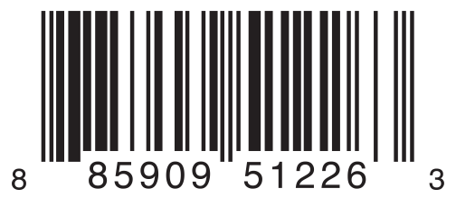

# 枚举 {#Enumerations}

为定义一组可能取值的自定义类型建模。

*枚举*（enumeration）为一组相关的值定义了一个共同类型，并让你能在代码中以类型安全的方式使用这些值。

如果你熟悉 C，就会知道 C 的枚举为一组整数值赋予相关的名字。Swift 中的枚举要灵活得多，而且不必为枚举的每个成员都提供一个值。如果为每个枚举成员都提供了一个值（称为*原始*值），这个值可以是字符串、字符，或任何整数或浮点类型的值。

另一种做法是，枚举成员可以指定*任意*类型的关联值，与各个成员值一起存储，这很像其他语言中的联合体（union）或变体（variant）。你可以把一组相关的成员定义在同一个枚举中，其中每个成员都关联着一组各不相同的、类型恰当的值。

Swift 中的枚举本身就是一等类型。它们采纳了许多传统上只有类才支持的特性，例如用计算属性提供关于枚举当前值的附加信息，用实例方法提供与枚举所表示的值相关的功能。枚举还可以定义构造器来提供初始成员值；可以被扩展，从而在原始实现之外扩充功能；还可以遵循协议以提供标准功能。

关于这些能力的更多信息，详见 [属性](properties.md)、[方法](methods.md)、[构造过程](initialization.md)、[扩展](extensions.md) 和 [协议](protocols.md)。

## 枚举语法 {#Enumeration-Syntax}

你用 `enum` 关键字引入枚举，并把完整的定义放在一对大括号中：

```swift
enum SomeEnumeration {
    // enumeration definition goes here
}
```

下面是一个表示指南针四个主要方位的示例：

```swift
enum CompassPoint {
    case north
    case south
    case east
    case west
}
```

枚举中定义的值（如 `north`、`south`、`east` 和 `west`）就是它的*枚举成员*（enumeration case）。你用 `case` 关键字引入新的枚举成员。

> 注意：与 C 和 Objective-C 等语言不同，Swift 的枚举成员默认没有一组整数值。在上面的 `CompassPoint` 示例中，`north`、`south`、`east` 和 `west` 并不隐式等于 `0`、`1`、`2` 和 `3`。相反，不同的枚举成员本身就是值，其类型被明确指定为 `CompassPoint`。

多个成员可以出现在同一行，用逗号分隔：

```swift
enum Planet {
    case mercury, venus, earth, mars, jupiter, saturn, uranus, neptune
}
```

每个枚举定义都定义了一个新类型。与 Swift 中的其他类型一样，它们的名字（如 `CompassPoint` 和 `Planet`）以大写字母开头。请用单数而不是复数给枚举类型命名，这样读起来更一目了然：

```swift
var directionToHead = CompassPoint.west
```

`directionToHead` 用 `CompassPoint` 的某个可能值初始化时，其类型会被推断出来。一旦 `directionToHead` 被声明为 `CompassPoint`，你就可以用更简短的点语法把它设为另一个 `CompassPoint` 值：

```swift
directionToHead = .east
```

`directionToHead` 的类型已经确定，因此在设置它的值时可以省略类型。在处理明确指定类型的枚举值时，这样写出的代码可读性很高。

## 使用 switch 语句匹配枚举值 {#Matching-Enumeration-Values-with-a-Switch-Statement}

你可以用 `switch` 语句匹配单个枚举值：

```swift
directionToHead = .south
switch directionToHead {
case .north:
    print("Lots of planets have a north")
case .south:
    print("Watch out for penguins")
case .east:
    print("Where the sun rises")
case .west:
    print("Where the skies are blue")
}
// Prints "Watch out for penguins".
```

这段代码可以这样理解：

“考虑 `directionToHead` 的值。当它等于 `.north` 时，打印 `"Lots of planets have a north"`。当它等于 `.south` 时，打印 `"Watch out for penguins"`。”

……以此类推。

正如 [控制流](control-flow.md) 所述，在考虑枚举的成员时，`switch` 语句必须是穷尽的。如果省略了 `.west` 对应的 `case`，这段代码就无法编译，因为它没有考虑到 `CompassPoint` 成员的完整列表。要求穷尽可以确保枚举成员不会被意外遗漏。

当为每个枚举成员都提供 `case` 并不合适时，你可以提供一个 `default` 分支来覆盖所有没有显式处理的成员：

```swift
let somePlanet = Planet.earth
switch somePlanet {
case .earth:
    print("Mostly harmless")
default:
    print("Not a safe place for humans")
}
// Prints "Mostly harmless".
```

## 遍历枚举的成员 {#Iterating-over-Enumeration-Cases}

对某些枚举来说，拥有一个包含其全部成员的集合会很有用。在枚举名后面写上 `: CaseIterable` 即可启用这一功能。Swift 会把包含所有成员的集合作为枚举类型的 `allCases` 属性暴露出来。示例如下：

```swift
enum Beverage: CaseIterable {
    case coffee, tea, juice
}
let numberOfChoices = Beverage.allCases.count
print("\(numberOfChoices) beverages available")
// Prints "3 beverages available".
```

在上面的示例中，你写 `Beverage.allCases` 来访问一个包含 `Beverage` 枚举所有成员的集合。你可以像使用其他任何集合一样使用 `allCases`——集合的元素是枚举类型的实例，因此在这里它们是 `Beverage` 值。上面的示例统计了成员的数量，下面的示例则用 `for`-`in` 循环遍历所有成员。

```swift
for beverage in Beverage.allCases {
    print(beverage)
}
// coffee
// tea
// juice
```

上面示例中使用的语法把该枚举标记为遵循 [`CaseIterable`](https://developer.apple.com/documentation/swift/caseiterable) 协议。关于协议的信息，详见 [协议](protocols.md)。

## 关联值 {#Associated-Values}

上一节的示例展示了枚举成员如何本身就是定义好的（且有类型的）值。你可以把常量或变量设为 `Planet.earth`，之后再检查这个值。不过，有时把其他类型的值与这些成员值一起存储会很有用。这种附加信息称为*关联值*（associated value），每当你把该成员作为值用在代码中时，它都可以不同。

你可以定义 Swift 枚举来存储任意给定类型的关联值，而且如果需要，每个枚举成员的关联值类型可以不同。类似这样的枚举在其他编程语言中被称为*可辨识联合*（discriminated union）、*标记联合*（tagged union）或*变体*（variant）。

例如，假设一个库存跟踪系统需要用两种不同类型的条形码来跟踪产品。有些产品使用 UPC 格式的一维条形码，该格式使用数字 `0` 到 `9`。每个条形码都有一位数字系统位，后面跟着五位厂商代码位和五位产品代码位。最后还有一位校验位，用来验证条形码是否被正确扫描：



另一些产品使用 QR 码格式的二维条形码，这种条形码可以使用任何 ISO 8859-1 字符，并能编码最长 2,953 个字符的字符串：


对库存跟踪系统来说，把 UPC 条形码存为四个整数组成的元组、把 QR 码条形码存为任意长度的字符串，是很方便的。

在 Swift 中，用来定义这两种产品条形码的枚举可能像这样：

```swift
enum Barcode {
    case upc(Int, Int, Int, Int)
    case qrCode(String)
}
```

这段定义可以这样理解：

“定义一个名为 `Barcode` 的枚举类型，它可以取值为 `upc`（关联一个类型为 (`Int`, `Int`, `Int`, `Int`) 的值），也可以取值为 `qrCode`（关联一个类型为 `String` 的值）。”

这个定义并没有提供任何实际的 `Int` 或 `String` 值——它只定义了当 `Barcode` 常量或变量等于 `Barcode.upc` 或 `Barcode.qrCode` 时，可以存储的关联值的*类型*。

然后你就可以用这两种类型中的任意一种创建新的条形码：

```swift
var productBarcode = Barcode.upc(8, 85909, 51226, 3)
```

这个示例创建了一个名为 `productBarcode` 的新变量，并给它赋一个 `Barcode.upc` 值，其关联元组值为 `(8, 85909, 51226, 3)`。

你可以为同一产品指定另一种类型的条形码：

```swift
productBarcode = .qrCode("ABCDEFGHIJKLMNOP")
```

此时，原来的 `Barcode.upc` 及其整数值被新的 `Barcode.qrCode` 及其字符串值取代。类型为 `Barcode` 的常量或变量可以存储 `.upc` 或 `.qrCode`（连同它们的关联值），但在任意时刻只能存储其中之一。

你可以用 switch 语句检查不同的条形码类型，类似于 [使用 switch 语句匹配枚举值](enumerations.md#Matching-Enumeration-Values-with-a-Switch-Statement) 中的示例。不过这一次，关联值会作为 switch 语句的一部分被提取出来。你把每个关联值提取为常量（加 `let` 前缀）或变量（加 `var` 前缀），以便在 `switch` 分支体中使用：

```swift
switch productBarcode {
case .upc(let numberSystem, let manufacturer, let product, let check):
    print("UPC: \(numberSystem), \(manufacturer), \(product), \(check).")
case .qrCode(let productCode):
    print("QR code: \(productCode).")
}
// Prints "QR code: ABCDEFGHIJKLMNOP."
```

如果某个枚举成员的所有关联值都提取为常量，或者都提取为变量，那么为了简洁，你可以在成员名之前放一个 `let` 或 `var` 标注：

```swift
switch productBarcode {
case let .upc(numberSystem, manufacturer, product, check):
    print("UPC : \(numberSystem), \(manufacturer), \(product), \(check).")
case let .qrCode(productCode):
    print("QR code: \(productCode).")
}
// Prints "QR code: ABCDEFGHIJKLMNOP."
```

当你只想匹配枚举中的一个成员时——例如为了提取它的关联值——可以用 `if`-`case` 语句代替完整的 switch 语句。它看起来像这样：

```swift
if case .qrCode(let productCode) = productBarcode {
    print("QR code: \(productCode).")
}
```

就像前面的 switch 语句一样，这里把 `productBarcode` 变量与模式 `.qrCode(let productCode)` 进行匹配。和 switch 分支中一样，写 `let` 会把关联值提取为常量。关于 `if`-`case` 语句的更多信息，详见 [模式](control-flow.md#Patterns)。

## 原始值 {#Raw-Values}

[关联值](enumerations.md#Associated-Values) 中的条形码示例展示了枚举成员如何声明自己存储不同类型的关联值。作为关联值之外的另一种选择，枚举成员可以预先填充默认值（称为*原始值*，raw value），这些值的类型全都相同。

下面是一个把原始 ASCII 值与具名枚举成员一起存储的示例：

```swift
enum ASCIIControlCharacter: Character {
    case tab = "\t"
    case lineFeed = "\n"
    case carriageReturn = "\r"
}
```

这里，名为 `ASCIIControlCharacter` 的枚举的原始值被定义为 `Character` 类型，并被设为一些较常见的 ASCII 控制字符。`Character` 值的说明详见 [字符串和字符](strings-and-characters.md)。

原始值可以是字符串、字符，或任何整数或浮点数类型。每个原始值在其枚举声明中必须唯一。

虽然原始值和关联值都能为枚举附加一个值，但理解两者的区别很重要。原始值是在代码中定义枚举成员时选定的，例如上面的三个 ASCII 码。某个特定枚举成员的原始值始终相同。相比之下，关联值是在用枚举的某个成员创建新常量或变量时选定的，而且每次都可以选不同的值。

### 隐式赋值的原始值 {#Implicitly-Assigned-Raw-Values}

处理存储整数或字符串原始值的枚举时，你不必为每个成员显式指定原始值。如果不指定，Swift 会自动为你赋值。

例如，用整数作为原始值时，每个成员的隐式值比前一个成员大 1。如果第一个成员没有设置值，它的值就是 `0`。

下面的枚举是前面 `Planet` 枚举的改进版，用整数原始值表示每颗行星离太阳的次序：

```swift
enum Planet: Int {
    case mercury = 1, venus, earth, mars, jupiter, saturn, uranus, neptune
}
```

在上面的示例中，`Planet.mercury` 的显式原始值是 `1`，`Planet.venus` 的隐式原始值是 `2`，以此类推。

用字符串作为原始值时，每个成员的隐式值就是该成员名称的文本。

下面的枚举是前面 `CompassPoint` 枚举的改进版，用字符串原始值表示每个方位的名称：

```swift
enum CompassPoint: String {
    case north, south, east, west
}
```

在上面的示例中，`CompassPoint.south` 的隐式原始值是 `"south"`，以此类推。

你可以通过枚举成员的 `rawValue` 属性访问它的原始值：

```swift
let earthsOrder = Planet.earth.rawValue
// earthsOrder is 3

let sunsetDirection = CompassPoint.west.rawValue
// sunsetDirection is "west"
```

### 从原始值初始化 {#Initializing-from-a-Raw-Value}

如果你定义的枚举带有原始值类型，该枚举会自动获得一个构造器，它接受一个原始值类型的值（形参名为 `rawValue`），并返回一个枚举成员或 `nil`。你可以用这个构造器尝试创建该枚举的新实例。

这个示例根据原始值 `7` 识别出天王星：

```swift
let possiblePlanet = Planet(rawValue: 7)
// possiblePlanet is of type Planet? and equals Planet.uranus
```

然而，并非所有可能的 `Int` 值都能找到对应的行星。因此，原始值构造器始终返回一个*可选类型*的枚举成员。在上面的示例中，`possiblePlanet` 的类型是 `Planet?`，即“可选 `Planet`”。

> 注意：原始值构造器是一个可失败构造器，因为并非每个原始值都会返回一个枚举成员。更多信息，详见 [可失败构造器](declarations.md#Failable-Initializers)。

如果你尝试查找位置为 `11` 的行星，原始值构造器返回的可选 `Planet` 值将是 `nil`：

```swift
let positionToFind = 11
if let somePlanet = Planet(rawValue: positionToFind) {
    switch somePlanet {
    case .earth:
        print("Mostly harmless")
    default:
        print("Not a safe place for humans")
    }
} else {
    print("There isn't a planet at position \(positionToFind)")
}
// Prints "There isn't a planet at position 11".
```

这个示例使用可选绑定尝试访问原始值为 `11` 的行星。语句 `if let somePlanet = Planet(rawValue: 11)` 创建一个可选 `Planet`，如果可以取到值，就把 `somePlanet` 设为那个可选 `Planet` 的值。在这个例子中，无法取到位置为 `11` 的行星，所以转而执行 `else` 分支。

## 递归枚举 {#Recursive-Enumerations}

*递归枚举*（recursive enumeration）是指这样的枚举：它的一个或多个成员的关联值是此枚举的另一个实例。在枚举成员前写 `indirect` 即可表明该成员是递归的，这会告诉编译器插入必要的间接层。

例如，下面是一个存储简单算术表达式的枚举：

```swift
enum ArithmeticExpression {
    case number(Int)
    indirect case addition(ArithmeticExpression, ArithmeticExpression)
    indirect case multiplication(ArithmeticExpression, ArithmeticExpression)
}
```

你也可以把 `indirect` 写在枚举开头，为所有带关联值的枚举成员启用间接层：

```swift
indirect enum ArithmeticExpression {
    case number(Int)
    case addition(ArithmeticExpression, ArithmeticExpression)
    case multiplication(ArithmeticExpression, ArithmeticExpression)
}
```

这个枚举可以存储三种算术表达式：一个普通数字、两个表达式相加，以及两个表达式相乘。`addition` 和 `multiplication` 成员的关联值也是算术表达式——这些关联值使表达式可以嵌套。例如，表达式 `(5 + 4) * 2` 在乘法右侧是一个数字，在乘法左侧是另一个表达式。由于数据是嵌套的，用来存储这些数据的枚举也需要支持嵌套——这意味着该枚举必须是递归的。下面的代码展示了为 `(5 + 4) * 2` 创建 `ArithmeticExpression` 递归枚举的过程：

```swift
let five = ArithmeticExpression.number(5)
let four = ArithmeticExpression.number(4)
let sum = ArithmeticExpression.addition(five, four)
let product = ArithmeticExpression.multiplication(sum, ArithmeticExpression.number(2))
```

递归函数是处理具有递归结构的数据的一种直接方式。例如，下面是一个对算术表达式求值的函数：

```swift
func evaluate(_ expression: ArithmeticExpression) -> Int {
    switch expression {
    case let .number(value):
        return value
    case let .addition(left, right):
        return evaluate(left) + evaluate(right)
    case let .multiplication(left, right):
        return evaluate(left) * evaluate(right)
    }
}

print(evaluate(product))
// Prints "18".
```

这个函数对普通数字求值时直接返回其关联值。对加法或乘法求值时，它先对左侧表达式求值，再对右侧表达式求值，然后把两者相加或相乘。
