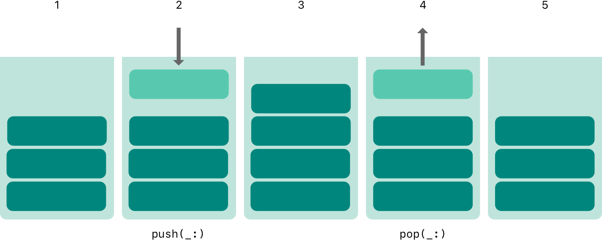
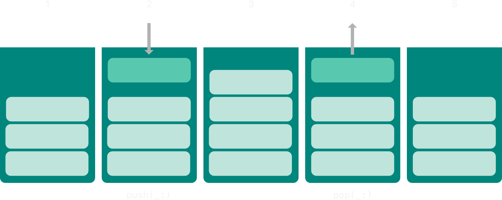
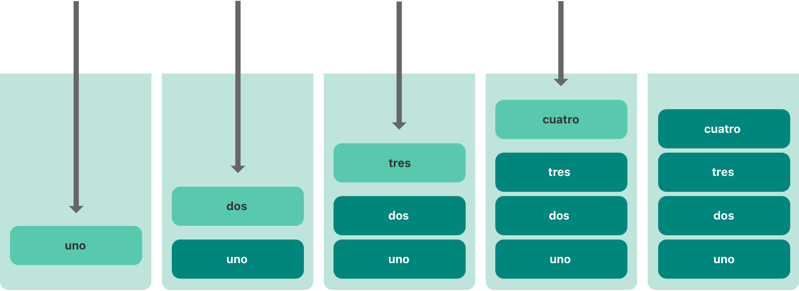
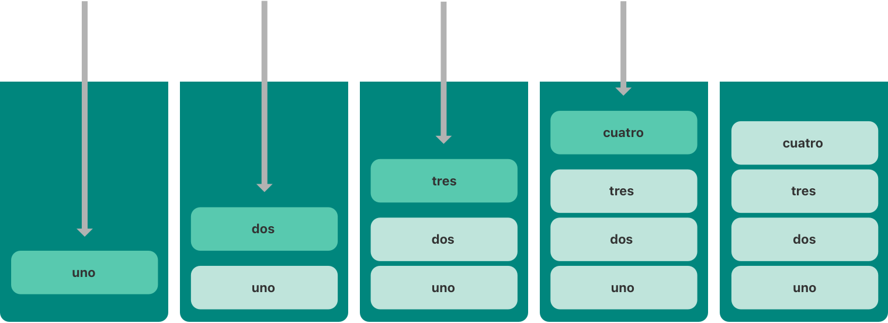
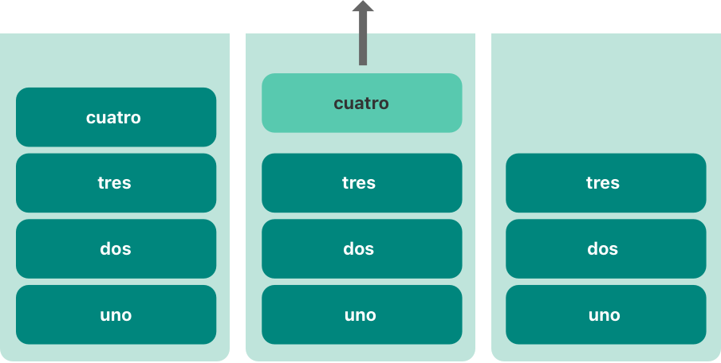
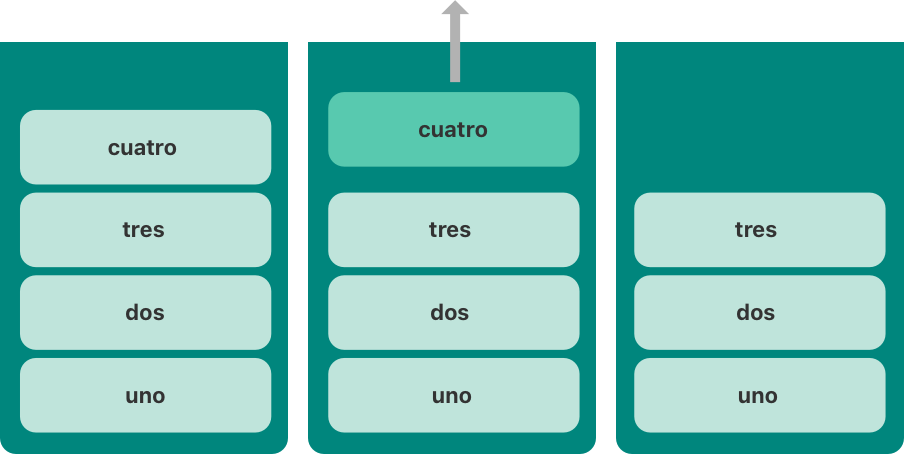

# 泛型 {#Generics}

编写能适用于多种类型的代码，并为这些类型指定要求。

*泛型代码*（generic code）让你能编写灵活、可复用的函数和类型，它们可以适用于任何类型，只要满足你定义的要求。这样写出的代码避免了重复，并能以清晰、抽象的方式表达意图。

泛型是 Swift 最强大的特性之一，Swift 标准库的很多部分都是用泛型代码构建的。事实上，你在整个*语言指南*中一直在使用泛型，即使你并没有意识到。例如，Swift 的 `Array` 和 `Dictionary` 类型都是泛型集合。你可以创建一个存放 `Int` 值的数组，也可以创建一个存放 `String` 值的数组，实际上可以创建存放 Swift 中任何其他类型的数组。同样，你可以创建字典来存储任何指定类型的值，而且对该类型没有任何限制。

## 泛型解决的问题 {#The-Problem-that-Generics-Solve}

下面是一个标准的非泛型函数 `swapTwoInts(_:_:)`，它交换两个 `Int` 值：

```swift
func swapTwoInts(_ a: inout Int, _ b: inout Int) {
    let temporaryA = a
    a = b
    b = temporaryA
}
```

这个函数利用输入输出参数来交换 `a` 和 `b` 的值，详见 [输入输出参数](functions.md#In-Out-Parameters)。

`swapTwoInts(_:_:)` 函数把 `b` 的原始值换到 `a` 中，把 `a` 的原始值换到 `b` 中。你可以调用这个函数来交换两个 `Int` 变量中的值：

```swift
var someInt = 3
var anotherInt = 107
swapTwoInts(&someInt, &anotherInt)
print("someInt is now \(someInt), and anotherInt is now \(anotherInt)")
// Prints "someInt is now 107, and anotherInt is now 3".
```

`swapTwoInts(_:_:)` 函数很有用，但它只能用于 `Int` 值。如果你想交换两个 `String` 值，或者两个 `Double` 值，就必须编写更多函数，例如下面展示的 `swapTwoStrings(_:_:)` 和 `swapTwoDoubles(_:_:)` 函数：

```swift
func swapTwoStrings(_ a: inout String, _ b: inout String) {
    let temporaryA = a
    a = b
    b = temporaryA
}

func swapTwoDoubles(_ a: inout Double, _ b: inout Double) {
    let temporaryA = a
    a = b
    b = temporaryA
}
```

你可能已经注意到，`swapTwoInts(_:_:)`、`swapTwoStrings(_:_:)` 和 `swapTwoDoubles(_:_:)` 这三个函数的主体完全相同。唯一的区别在于它们接受的值的类型（`Int`、`String` 和 `Double`）。

编写一个能交换*任意*类型的两个值的函数会更有用，也灵活得多。泛型代码让你能够编写这样的函数。（这些函数的泛型版本将在下文定义。）

> 注意：在这三个函数中，`a` 和 `b` 的类型必须相同。如果 `a` 和 `b` 的类型不同，就无法交换它们的值。Swift 是一门类型安全的语言，不允许（例如）`String` 类型的变量和 `Double` 类型的变量互相交换值。尝试这样做会导致编译时错误。

## 泛型函数 {#Generic-Functions}

*泛型函数*（generic function）可以适用于任何类型。下面是上面 `swapTwoInts(_:_:)` 函数的泛型版本，名为 `swapTwoValues(_:_:)`：

```swift
func swapTwoValues<T>(_ a: inout T, _ b: inout T) {
    let temporaryA = a
    a = b
    b = temporaryA
}
```

`swapTwoValues(_:_:)` 函数的主体与 `swapTwoInts(_:_:)` 函数的主体完全相同。不过，`swapTwoValues(_:_:)` 的第一行与 `swapTwoInts(_:_:)` 略有不同。下面比较二者的第一行：

```swift
func swapTwoInts(_ a: inout Int, _ b: inout Int)
func swapTwoValues<T>(_ a: inout T, _ b: inout T)
```

这个函数的泛型版本使用一个*占位*类型名（这里是 `T`），而不是一个*实际*类型名（例如 `Int`、`String` 或 `Double`）。占位类型名并不说明 `T` 必须是什么，但它*确实*表明 `a` 和 `b` 必须是同一个类型 `T`，无论 `T` 代表什么。用于替换 `T` 的实际类型在每次调用 `swapTwoValues(_:_:)` 函数时确定。

泛型函数与非泛型函数的另一个区别是：泛型函数的名字（`swapTwoValues(_:_:)`）后面跟着尖括号（`<T>`）中的占位类型名（`T`）。这对尖括号告诉 Swift，`T` 是 `swapTwoValues(_:_:)` 函数定义中的一个占位类型名。因为 `T` 是占位符，Swift 不会去寻找一个名为 `T` 的实际类型。

现在可以像调用 `swapTwoInts` 那样调用 `swapTwoValues(_:_:)` 函数，区别在于可以传入*任意*类型的两个值，只要这两个值的类型相同即可。每次调用 `swapTwoValues(_:_:)` 时，用于 `T` 的类型都会根据传入函数的值的类型推断出来。

在下面两个例子中，`T` 分别被推断为 `Int` 和 `String`：

```swift
var someInt = 3
var anotherInt = 107
swapTwoValues(&someInt, &anotherInt)
// someInt is now 107, and anotherInt is now 3

var someString = "hello"
var anotherString = "world"
swapTwoValues(&someString, &anotherString)
// someString is now "world", and anotherString is now "hello"
```

> 注意：上面定义的 `swapTwoValues(_:_:)` 函数受到 Swift 标准库中一个名为 `swap` 的泛型函数的启发，该函数会自动提供给你在 App 中使用。如果你需要在自己的代码中实现 `swapTwoValues(_:_:)` 函数的行为，可以使用 Swift 现有的 `swap(_:_:)` 函数，而不必自己提供实现。

## 类型形参 {#Type-Parameters}

在上面的 `swapTwoValues(_:_:)` 示例中，占位类型 `T` 就是一个*类型形参*（type parameter）。类型形参指定并命名一个占位类型，写在函数名之后、一对匹配的尖括号之间（例如 `<T>`）。

指定类型形参后，你就可以用它来定义函数形参的类型（例如 `swapTwoValues(_:_:)` 函数的 `a` 和 `b` 形参），或者用作函数的返回类型，或者用作函数体内的类型标注。在每种情况下，类型形参都会在函数被调用时替换为*实际*类型。（在上面的 `swapTwoValues(_:_:)` 示例中，第一次调用函数时 `T` 被替换为 `Int`，第二次调用时被替换为 `String`。）

你可以在尖括号内写多个类型形参名，用逗号分隔，从而提供多个类型形参。

## 类型形参的命名 {#Naming-Type-Parameters}

在大多数情况下，类型形参使用描述性名称，例如 `Dictionary<Key, Value>` 中的 `Key` 和 `Value`，以及 `Array<Element>` 中的 `Element`，这些名称告诉读者类型形参与使用它的泛型类型或函数之间的关系。然而，当二者之间没有有意义的关联时，按传统可以用单个字母命名，例如 `T`、`U` 和 `V`，比如上面 `swapTwoValues(_:_:)` 函数中的 `T`。

类型形参使用大驼峰命名法，例如 `T` 和 `MyTypeParameter`，以表明它们是*类型*的占位符，而不是值的占位符。

> 注意：如果你不需要为类型形参命名，而且它的泛型类型约束很简单，可以使用另一种轻量级语法，详见 [不透明参数类型](opaque-types.md#Opaque-Parameter-Types)。

## 泛型类型 {#Generic-Types}

除了泛型函数，Swift 还允许你定义自己的*泛型类型*（generic type）。这些自定义的类、结构体和枚举可以适用于*任意*类型，方式类似于 `Array` 和 `Dictionary`。

本节介绍如何编写一个名为 `Stack` 的泛型集合类型。栈是一组有序的值，类似于数组，但操作比 Swift 的 `Array` 类型更受限。数组允许在任意位置插入和移除新项。而栈只允许在集合末尾追加新项（称为*压入*（push）一个新值到栈上）。同样，栈只允许从集合末尾移除项（称为从栈上*弹出*（pop）一个值）。

> 注意：`UINavigationController` 类使用栈的概念来为其导航层级中的视图控制器建模。你调用 `UINavigationController` 类的 `pushViewController(_:animated:)` 方法把一个视图控制器添加（或压入）到导航栈上，调用它的 `popViewControllerAnimated(_:)` 方法从导航栈中移除（或弹出）一个视图控制器。当你需要严格按“后进先出”的方式管理集合时，栈是一种有用的集合模型。

下图展示了栈的压入和弹出行为：



1. 栈上当前有三个值。
2. 第四个值被压入栈顶。
3. 栈现在有四个值，最近压入的值在栈顶。
4. 栈顶的项被弹出。
5. 弹出一个值后，栈再次剩下三个值。

下面编写一个非泛型版本的栈，这里是一个存放 `Int` 值的栈：

```swift
struct IntStack {
    var items: [Int] = []
    mutating func push(_ item: Int) {
        items.append(item)
    }
    mutating func pop() -> Int {
        return items.removeLast()
    }
}
```

这个结构体使用一个名为 `items` 的 `Array` 属性来存储栈中的值。`Stack` 提供两个方法 `push` 和 `pop`，用于把值压入栈和从栈中弹出。这些方法被标记为 `mutating`，因为它们需要修改（或*改变*）结构体的 `items` 数组。

不过，上面展示的 `IntStack` 类型只能用于 `Int` 值。定义一个*泛型* `Stack` 结构体，使其能管理*任意*类型值的栈，会有用得多。

下面是同一段代码的泛型版本：

```swift
struct Stack<Element> {
    var items: [Element] = []
    mutating func push(_ item: Element) {
        items.append(item)
    }
    mutating func pop() -> Element {
        return items.removeLast()
    }
}
```

注意，`Stack` 的泛型版本与非泛型版本基本相同，只是用一个名为 `Element` 的类型形参代替了实际类型 `Int`。这个类型形参写在结构体名字之后的一对尖括号中（`<Element>`）。

`Element` 为稍后提供的类型定义了一个占位名称。这个稍后才会确定的类型可以在结构体定义中的任何位置用 `Element` 来引用。在这个例子中，`Element` 作为占位符出现在三个地方：

- 创建一个名为 `items` 的属性，它用一个类型为 `Element` 的空数组初始化
- 指定 `push(_:)` 方法有一个名为 `item` 的形参，其类型必须是 `Element`
- 指定 `pop()` 方法返回的值是一个类型为 `Element` 的值

由于它是泛型类型，`Stack` 可以用来创建 Swift 中*任意*有效类型的栈，方式类似于 `Array` 和 `Dictionary`。

你可以在尖括号中写出要存储在栈中的类型，以此创建新的 `Stack` 实例。例如，要创建一个新的字符串栈，可以写 `Stack<String>()`：

```swift
var stackOfStrings = Stack<String>()
stackOfStrings.push("uno")
stackOfStrings.push("dos")
stackOfStrings.push("tres")
stackOfStrings.push("cuatro")
// the stack now contains 4 strings
```

下图展示了把四个值压入栈后 `stackOfStrings` 的样子：



从栈中弹出一个值会移除并返回栈顶的值 `"cuatro"`：

```swift
let fromTheTop = stackOfStrings.pop()
// fromTheTop is equal to "cuatro", and the stack now contains 3 strings
```

下图展示了弹出栈顶值后栈的样子：



## 扩展泛型类型 {#Extending-a-Generic-Type}

扩展泛型类型时，不需要在扩展的定义中提供类型形参列表。相反，*原始*类型定义中的类型形参列表在扩展体内可用，并且使用原始类型形参名来引用原始定义中的类型形参。

下面的例子扩展泛型 `Stack` 类型，添加一个名为 `topItem` 的只读计算属性，它返回栈顶的项，但不把它从栈中弹出：

```swift
extension Stack {
    var topItem: Element? {
        return items.isEmpty ? nil : items[items.count - 1]
    }
}
```

`topItem` 属性返回一个类型为 `Element` 的可选值。如果栈为空，`topItem` 返回 `nil`；如果栈不为空，`topItem` 返回 `items` 数组中的最后一项。

注意，这个扩展没有定义类型形参列表。相反，扩展中使用 `Stack` 类型已有的类型形参名 `Element`，来表示 `topItem` 计算属性的可选类型。

现在，`topItem` 计算属性可以用于任何 `Stack` 实例，在不移除栈顶项的情况下访问和查询它。

```swift
if let topItem = stackOfStrings.topItem {
    print("The top item on the stack is \(topItem).")
}
// Prints "The top item on the stack is tres."
```

泛型类型的扩展还可以包含被扩展类型的实例必须满足的要求，满足后才能获得新功能，详见下文 [带泛型 where 子句的扩展](generics.md#Extensions-with-a-Generic-Where-Clause)。

## 类型约束 {#Type-Constraints}

`swapTwoValues(_:_:)` 函数和 `Stack` 类型可以适用于任何类型。然而，有时对可用于泛型函数和泛型类型的类型施加某些*类型约束*（type constraint）是很有用的。类型约束指定类型形参必须继承自特定的类，或者遵循特定的协议或协议组合。

例如，Swift 的 `Dictionary` 类型限制了可以用作字典键的类型。如 [字典](collection-types.md#Dictionaries) 所述，字典键的类型必须是*可哈希的*。也就是说，它必须提供一种方式使自己能被唯一表示。`Dictionary` 需要其键可哈希，这样才能检查它是否已经包含某个特定键的值。如果没有这个要求，`Dictionary` 就无法判断应该为某个特定键插入还是替换值，也无法找到字典中已有给定键的值。

这个要求由 `Dictionary` 键类型上的类型约束来保证，该约束指定键类型必须遵循 `Hashable` 协议，这是一个在 Swift 标准库中定义的特殊协议。Swift 的所有基本类型（例如 `String`、`Int`、`Double` 和 `Bool`）默认都是可哈希的。关于如何让你自己的自定义类型遵循 `Hashable` 协议，参见 [Conforming to the Hashable Protocol](https://developer.apple.com/documentation/swift/hashable#Conforming-to-the-Hashable-Protocol)。

在创建自定义泛型类型时，你可以定义自己的类型约束，这些约束提供了泛型编程的大部分能力。像 `Hashable` 这样的抽象概念从概念特征而非具体类型来描述类型。

### 类型约束语法 {#Type-Constraint-Syntax}

编写类型约束时，在类型形参名后面写一个类约束或协议约束，二者用冒号分隔，作为类型形参列表的一部分。下面展示了泛型函数上类型约束的基本语法（泛型类型的语法与此相同）：

```swift
func someFunction<T: SomeClass, U: SomeProtocol>(someT: T, someU: U) {
    // function body goes here
}
```

上面这个假想的函数有两个类型形参。第一个类型形参 `T` 有一个类型约束，要求 `T` 是 `SomeClass` 的子类。第二个类型形参 `U` 有一个类型约束，要求 `U` 遵循 `SomeProtocol` 协议。

### 类型约束的实际运用 {#Type-Constraints-in-Action}

下面是一个名为 `findIndex(ofString:in:)` 的非泛型函数，它接受一个要查找的 `String` 值和一个要在其中查找的 `String` 值数组。`findIndex(ofString:in:)` 函数返回一个可选的 `Int` 值：如果找到，就是数组中第一个匹配字符串的索引；如果找不到，就是 `nil`：

```swift
func findIndex(ofString valueToFind: String, in array: [String]) -> Int? {
    for (index, value) in array.enumerated() {
        if value == valueToFind {
            return index
        }
    }
    return nil
}
```

`findIndex(ofString:in:)` 函数可以用来在字符串数组中查找一个字符串值：

```swift
let strings = ["cat", "dog", "llama", "parakeet", "terrapin"]
if let foundIndex = findIndex(ofString: "llama", in: strings) {
    print("The index of llama is \(foundIndex)")
}
// Prints "The index of llama is 2".
```

然而，在数组中查找某个值的索引这一思路并不只对字符串有用。你可以把同样的功能写成泛型函数，只需把任何提到字符串的地方替换为某个类型 `T` 的值。

你可能期望 `findIndex(ofString:in:)` 的泛型版本 `findIndex(of:in:)` 会这样编写。注意，这个函数的返回类型仍然是 `Int?`，因为函数返回的是可选索引号，而不是数组中的可选值。不过要提醒你——这个函数无法编译，原因会在示例之后解释：

```swift
func findIndex<T>(of valueToFind: T, in array:[T]) -> Int? {
    for (index, value) in array.enumerated() {
        if value == valueToFind {
            return index
        }
    }
    return nil
}
```

上面这样写，函数无法编译。问题出在相等性检查“`if value == valueToFind`”上。Swift 中并非每个类型都能用等于运算符（`==`）进行比较。例如，如果你创建自己的类或结构体来表示复杂的数据模型，那么 Swift 无法替你猜测该类型“等于”的含义。因此，无法保证这段代码适用于*每一种*可能的类型 `T`，尝试编译时就会报告相应的错误。

不过，还有办法。Swift 标准库定义了一个名为 `Equatable` 的协议，它要求任何遵循该协议的类型实现等于运算符（`==`）和不等于运算符（`!=`），以便比较该类型的任意两个值。Swift 的所有标准类型都自动支持 `Equatable` 协议。

任何 `Equatable` 类型都可以安全地与 `findIndex(of:in:)` 函数一起使用，因为它保证支持等于运算符。为了表达这一点，在定义函数时，把 `Equatable` 类型约束写进类型形参的定义中：

```swift
func findIndex<T: Equatable>(of valueToFind: T, in array:[T]) -> Int? {
    for (index, value) in array.enumerated() {
        if value == valueToFind {
            return index
        }
    }
    return nil
}
```

`findIndex(of:in:)` 的单个类型形参写作 `T: Equatable`，意思是“任何遵循 `Equatable` 协议的类型 `T`”。

现在，`findIndex(of:in:)` 函数可以成功编译，并且可以用于任何 `Equatable` 类型，例如 `Double` 或 `String`：

```swift
let doubleIndex = findIndex(of: 9.3, in: [3.14159, 0.1, 0.25])
// doubleIndex is an optional Int with no value, because 9.3 isn't in the array
let stringIndex = findIndex(of: "Andrea", in: ["Mike", "Malcolm", "Andrea"])
// stringIndex is an optional Int containing a value of 2
```

## 关联类型 {#Associated-Types}

定义协议时，有时把一个或多个关联类型声明为协议定义的一部分是很有用的。*关联类型*（associated type）为协议中使用的某个类型提供一个占位名称。该关联类型实际使用的类型要等到协议被采纳时才指定。关联类型用 `associatedtype` 关键字指定。

### 关联类型的实际运用 {#Associated-Types-in-Action}

下面是一个名为 `Container` 的协议示例，它声明了一个名为 `Item` 的关联类型：

```swift
protocol Container {
    associatedtype Item
    mutating func append(_ item: Item)
    var count: Int { get }
    subscript(i: Int) -> Item { get }
}
```

`Container` 协议定义了任何容器都必须提供的三项必需能力：

- 必须能够通过 `append(_:)` 方法向容器中添加新项。
- 必须能够通过返回 `Int` 值的 `count` 属性访问容器中项的数量。
- 必须能够通过接受 `Int` 索引值的下标获取容器中的每一项。

这个协议没有规定容器中的项应如何存储，也没有规定它们可以是什么类型。协议只规定了任何类型要被视为 `Container` 所必须提供的三项功能。遵循协议的类型可以提供额外功能，只要满足这三项要求即可。

任何遵循 `Container` 协议的类型都必须能够指定它所存储值的类型。具体来说，它必须确保只有类型正确的项才能添加到容器中，并且必须明确其下标返回的项的类型。

为了定义这些要求，`Container` 协议需要一种方式来引用容器将要持有的元素类型，而不必知道某个具体容器的该类型是什么。`Container` 协议需要规定：传给 `append(_:)` 方法的任何值必须与容器的元素类型相同，容器下标返回的值也必须与容器的元素类型相同。

为此，`Container` 协议声明了一个名为 `Item` 的关联类型，写作 `associatedtype Item`。协议没有定义 `Item` 是什么——这一信息留给遵循协议的类型提供。尽管如此，`Item` 这个别名提供了一种方式来引用 `Container` 中项的类型，并定义用于 `append(_:)` 方法和下标的类型，以确保任何 `Container` 的预期行为都得到保证。

下面是上面 [泛型类型](generics.md#Generic-Types) 中非泛型 `IntStack` 类型的一个版本，它经过调整以遵循 `Container` 协议：

```swift
struct IntStack: Container {
    // original IntStack implementation
    var items: [Int] = []
    mutating func push(_ item: Int) {
        items.append(item)
    }
    mutating func pop() -> Int {
        return items.removeLast()
    }
    // conformance to the Container protocol
    typealias Item = Int
    mutating func append(_ item: Int) {
        self.push(item)
    }
    var count: Int {
        return items.count
    }
    subscript(i: Int) -> Int {
        return items[i]
    }
}
```

`IntStack` 类型实现了 `Container` 协议的全部三项要求，并且在每种情况下都封装了 `IntStack` 类型已有的部分功能来满足这些要求。

此外，`IntStack` 指定，对于 `Container` 的这个实现，合适的 `Item` 是 `Int` 类型。`typealias Item = Int` 这个定义把抽象的 `Item` 类型变成了这个 `Container` 协议实现中的具体类型 `Int`。

得益于 Swift 的类型推断，你实际上不需要在 `IntStack` 的定义中声明具体的 `Item` 为 `Int`。因为 `IntStack` 遵循了 `Container` 协议的所有要求，Swift 只需查看 `append(_:)` 方法 `item` 形参的类型和下标返回类型，就能推断出应使用的合适 `Item`。事实上，如果你从上面的代码中删除 `typealias Item = Int` 这一行，一切仍然可以工作，因为应该为 `Item` 使用什么类型是清楚的。

你也可以让泛型 `Stack` 类型遵循 `Container` 协议：

```swift
struct Stack<Element>: Container {
    // original Stack<Element> implementation
    var items: [Element] = []
    mutating func push(_ item: Element) {
        items.append(item)
    }
    mutating func pop() -> Element {
        return items.removeLast()
    }
    // conformance to the Container protocol
    mutating func append(_ item: Element) {
        self.push(item)
    }
    var count: Int {
        return items.count
    }
    subscript(i: Int) -> Element {
        return items[i]
    }
}
```

这一次，类型形参 `Element` 被用作 `append(_:)` 方法 `item` 形参的类型以及下标的返回类型。因此，Swift 可以推断出 `Element` 就是这个特定容器应使用的 `Item` 类型。

### 扩展现有类型来指定关联类型 {#Extending-an-Existing-Type-to-Specify-an-Associated-Type}

你可以扩展现有类型来添加协议一致性，详见 [用扩展添加协议一致性](protocols.md#Adding-Protocol-Conformance-with-an-Extension)。这包括带关联类型的协议。

Swift 的 `Array` 类型已经提供了 `append(_:)` 方法、`count` 属性，以及一个用 `Int` 索引获取元素的下标。这三项能力与 `Container` 协议的要求相符。这意味着你只需声明 `Array` 采纳该协议，就可以扩展 `Array` 使其遵循 `Container` 协议。用一个空扩展即可做到，详见 [用扩展声明协议采纳](protocols.md#Declaring-Protocol-Adoption-with-an-Extension)：

```swift
extension Array: Container {}
```

`Array` 已有的 `append(_:)` 方法和下标使 Swift 能够推断出用于 `Item` 的合适类型，就像上面泛型 `Stack` 类型那样。定义这个扩展后，你可以把任何 `Array` 用作 `Container`。

### 为关联类型添加约束 {#Adding-Constraints-to-an-Associated-Type}

你可以为协议中的关联类型添加类型约束，要求遵循类型满足这些约束。例如，下面的代码定义了 `Container` 的一个版本，要求容器中的项可比较相等。

```swift
protocol Container {
    associatedtype Item: Equatable
    mutating func append(_ item: Item)
    var count: Int { get }
    subscript(i: Int) -> Item { get }
}
```

要遵循这个版本的 `Container`，容器的 `Item` 类型必须遵循 `Equatable` 协议。

### 在关联类型的约束中使用协议 {#Using-a-Protocol-in-Its-Associated-Types-Constraints}

协议可以出现在它自己的要求中。例如，下面这个协议细化了 `Container` 协议，添加了对 `suffix(_:)` 方法的要求。`suffix(_:)` 方法从容器末尾返回给定数量的元素，并把它们存储在 `Suffix` 类型的实例中。

```swift
protocol SuffixableContainer: Container {
    associatedtype Suffix: SuffixableContainer where Suffix.Item == Item
    func suffix(_ size: Int) -> Suffix
}
```

在这个协议中，`Suffix` 是一个关联类型，就像上面 `Container` 示例中的 `Item` 类型一样。`Suffix` 有两个约束：它必须遵循 `SuffixableContainer` 协议（即当前正在定义的协议），并且它的 `Item` 类型必须与容器的 `Item` 类型相同。对 `Item` 的约束是一个泛型 `where` 子句，详见下文 [带泛型 where 子句的关联类型](generics.md#Associated-Types-with-a-Generic-Where-Clause)。

下面是上面 [泛型类型](generics.md#Generic-Types) 中 `Stack` 类型的一个扩展，它为 `Stack` 添加了对 `SuffixableContainer` 协议的遵循：

```swift
extension Stack: SuffixableContainer {
    func suffix(_ size: Int) -> Stack {
        var result = Stack()
        for index in (count-size)..<count {
            result.append(self[index])
        }
        return result
    }
    // Inferred that Suffix is Stack.
}
var stackOfInts = Stack<Int>()
stackOfInts.append(10)
stackOfInts.append(20)
stackOfInts.append(30)
let suffix = stackOfInts.suffix(2)
// suffix contains 20 and 30
```

在上面的例子中，`Stack` 的 `Suffix` 关联类型也是 `Stack`，因此对 `Stack` 的后缀操作返回另一个 `Stack`。另一种情况是，遵循 `SuffixableContainer` 的类型可以有一个与自身不同的 `Suffix` 类型——也就是说，后缀操作可以返回不同的类型。例如，下面是非泛型 `IntStack` 类型的一个扩展，它添加了 `SuffixableContainer` 一致性，并使用 `Stack<Int>` 而不是 `IntStack` 作为其后缀类型：

```swift
extension IntStack: SuffixableContainer {
    func suffix(_ size: Int) -> Stack<Int> {
        var result = Stack<Int>()
        for index in (count-size)..<count {
            result.append(self[index])
        }
        return result
    }
    // Inferred that Suffix is Stack<Int>.
}
```

## 泛型 where 子句 {#Generic-Where-Clauses}

如 [类型约束](generics.md#Type-Constraints) 所述，类型约束让你能为与泛型函数、下标或类型相关联的类型形参定义要求。

为关联类型定义要求也很有用。你可以通过定义*泛型 where 子句*（generic where clause）来做到这一点。泛型 `where` 子句让你能要求某个关联类型必须遵循特定协议，或者要求某些类型形参与关联类型必须相同。泛型 `where` 子句以 `where` 关键字开头，后面跟着对关联类型的约束，或类型与关联类型之间的相等关系。泛型 `where` 子句写在类型或函数体左花括号的正前方。

下面的例子定义了一个名为 `allItemsMatch` 的泛型函数，它检查两个 `Container` 实例是否以相同顺序包含相同的项。如果所有项都匹配，函数返回布尔值 `true`；如果不匹配，返回 `false`。

要检查的两个容器不必是相同类型的容器（不过也可以相同），但它们必须持有相同类型的项。这一要求通过类型约束和泛型 `where` 子句的组合来表达：

```swift
func allItemsMatch<C1: Container, C2: Container>
        (_ someContainer: C1, _ anotherContainer: C2) -> Bool
        where C1.Item == C2.Item, C1.Item: Equatable {

    // Check that both containers contain the same number of items.
    if someContainer.count != anotherContainer.count {
        return false
    }

    // Check each pair of items to see if they're equivalent.
    for i in 0..<someContainer.count {
        if someContainer[i] != anotherContainer[i] {
            return false
        }
    }

    // All items match, so return true.
    return true
}
```

这个函数接受两个实参，名为 `someContainer` 和 `anotherContainer`。`someContainer` 实参的类型是 `C1`，`anotherContainer` 实参的类型是 `C2`。`C1` 和 `C2` 都是类型形参，代表两个容器类型，在调用函数时确定。

函数的两个类型形参上附加了以下要求：

- `C1` 必须遵循 `Container` 协议（写作 `C1: Container`）。
- `C2` 也必须遵循 `Container` 协议（写作 `C2: Container`）。
- `C1` 的 `Item` 必须与 `C2` 的 `Item` 相同（写作 `C1.Item == C2.Item`）。
- `C1` 的 `Item` 必须遵循 `Equatable` 协议（写作 `C1.Item: Equatable`）。

第一个和第二个要求在函数的类型形参列表中定义，第三个和第四个要求在函数的泛型 `where` 子句中定义。

这些要求的含义是：

- `someContainer` 是类型为 `C1` 的容器。
- `anotherContainer` 是类型为 `C2` 的容器。
- `someContainer` 和 `anotherContainer` 包含相同类型的项。
- `someContainer` 中的项可以用不等于运算符（`!=`）检查是否彼此不同。

第三和第四个要求合起来意味着，`anotherContainer` 中的项*也*可以用 `!=` 运算符检查，因为它们与 `someContainer` 中的项类型完全相同。

这些要求使 `allItemsMatch(_:_:)` 函数能够比较这两个容器，即使它们属于不同的容器类型。

`allItemsMatch(_:_:)` 函数首先检查两个容器是否包含相同数量的项。如果项数不同，它们就不可能匹配，函数返回 `false`。

完成这项检查后，函数用 `for`-`in` 循环和半开区间运算符（`..<`）遍历 `someContainer` 中的所有项。对于每一项，函数检查 `someContainer` 中的项是否不等于 `anotherContainer` 中对应的项。如果两项不相等，两个容器就不匹配，函数返回 `false`。

如果循环结束都没有发现不匹配，两个容器就匹配，函数返回 `true`。

下面是 `allItemsMatch(_:_:)` 函数的实际运行示例：

```swift
var stackOfStrings = Stack<String>()
stackOfStrings.push("uno")
stackOfStrings.push("dos")
stackOfStrings.push("tres")

var arrayOfStrings = ["uno", "dos", "tres"]

if allItemsMatch(stackOfStrings, arrayOfStrings) {
    print("All items match.")
} else {
    print("Not all items match.")
}
// Prints "All items match."
```

上面的例子创建了一个 `Stack` 实例来存储 `String` 值，并向栈中压入三个字符串。这个例子还创建了一个 `Array` 实例，用包含同样三个字符串的数组字面量初始化。尽管栈和数组的类型不同，但它们都遵循 `Container` 协议，并且都包含相同类型的值。因此，你可以把这两个容器作为实参调用 `allItemsMatch(_:_:)` 函数。在上面的例子中，`allItemsMatch(_:_:)` 函数正确地报告两个容器中的所有项都匹配。

## 带泛型 where 子句的扩展 {#Extensions-with-a-Generic-Where-Clause}

你还可以在扩展中使用泛型 `where` 子句。下面的例子扩展前面示例中的泛型 `Stack` 结构体，添加一个 `isTop(_:)` 方法。

```swift
extension Stack where Element: Equatable {
    func isTop(_ item: Element) -> Bool {
        guard let topItem = items.last else {
            return false
        }
        return topItem == item
    }
}
```

这个新的 `isTop(_:)` 方法首先检查栈是否为空，然后把给定的项与栈顶的项进行比较。如果不用泛型 `where` 子句而直接这样做，就会遇到问题：`isTop(_:)` 的实现使用了 `==` 运算符，但 `Stack` 的定义并不要求其项可比较相等，因此使用 `==` 运算符会导致编译时错误。使用泛型 `where` 子句可以给扩展添加新要求，这样只有当栈中的项可比较相等时，扩展才会添加 `isTop(_:)` 方法。

下面是 `isTop(_:)` 方法的实际运行示例：

```swift
if stackOfStrings.isTop("tres") {
    print("Top element is tres.")
} else {
    print("Top element is something else.")
}
// Prints "Top element is tres."
```

如果在元素不可比较相等的栈上调用 `isTop(_:)` 方法，就会得到编译时错误。

```swift
struct NotEquatable { }
var notEquatableStack = Stack<NotEquatable>()
let notEquatableValue = NotEquatable()
notEquatableStack.push(notEquatableValue)
notEquatableStack.isTop(notEquatableValue)  // Error
```

你可以把泛型 `where` 子句用于对协议的扩展。下面的例子扩展前面示例中的 `Container` 协议，添加一个 `startsWith(_:)` 方法。

```swift
extension Container where Item: Equatable {
    func startsWith(_ item: Item) -> Bool {
        return count >= 1 && self[0] == item
    }
}
```

`startsWith(_:)` 方法首先确保容器至少有一个项，然后检查容器中的第一个项是否与给定的项匹配。这个新的 `startsWith(_:)` 方法可以用于任何遵循 `Container` 协议的类型，包括上面用到的栈和数组，只要容器中的项可比较相等即可。

```swift
if [9, 9, 9].startsWith(42) {
    print("Starts with 42.")
} else {
    print("Starts with something else.")
}
// Prints "Starts with something else."
```

上面例子中的泛型 `where` 子句要求 `Item` 遵循某个协议，但你也可以编写要求 `Item` 为特定类型的泛型 `where` 子句。例如：

```swift
extension Container where Item == Double {
    func average() -> Double {
        var sum = 0.0
        for index in 0..<count {
            sum += self[index]
        }
        return sum / Double(count)
    }
}
print([1260.0, 1200.0, 98.6, 37.0].average())
// Prints "648.9".
```

这个例子给 `Item` 类型为 `Double` 的容器添加一个 `average()` 方法。它遍历容器中的项并将它们相加，再除以容器的 `count` 来计算平均值。它显式地把 `count` 从 `Int` 转换为 `Double`，以便进行浮点数除法。

你可以在作为扩展一部分的泛型 `where` 子句中包含多个要求，就像在其他地方编写的泛型 `where` 子句一样。列表中的每个要求用逗号分隔。

## 上下文 where 子句 {#Contextual-Where-Clauses}

当你在泛型类型的上下文中工作时，可以编写泛型 `where` 子句作为声明的一部分，而这个声明本身没有泛型类型约束。例如，你可以在泛型类型的下标上、或在泛型类型的扩展中的方法上编写泛型 `where` 子句。`Container` 协议是泛型的，下面例子中的 `where` 子句指定了必须满足哪些类型约束，才能让这些新方法在容器上可用。

```swift
extension Container {
    func average() -> Double where Item == Int {
        var sum = 0.0
        for index in 0..<count {
            sum += Double(self[index])
        }
        return sum / Double(count)
    }
    func endsWith(_ item: Item) -> Bool where Item: Equatable {
        return count >= 1 && self[count-1] == item
    }
}
let numbers = [1260, 1200, 98, 37]
print(numbers.average())
// Prints "648.75".
print(numbers.endsWith(37))
// Prints "true".
```

这个例子在容器中的项为整数时给 `Container` 添加一个 `average()` 方法，在项可比较相等时添加一个 `endsWith(_:)` 方法。两个函数都包含一个泛型 `where` 子句，为 `Container` 原始声明中的泛型 `Item` 类型形参添加类型约束。

如果你想不使用上下文 `where` 子句来编写这段代码，就要写两个扩展，每个泛型 `where` 子句一个。上面和下面的例子行为相同。

```swift
extension Container where Item == Int {
    func average() -> Double {
        var sum = 0.0
        for index in 0..<count {
            sum += Double(self[index])
        }
        return sum / Double(count)
    }
}
extension Container where Item: Equatable {
    func endsWith(_ item: Item) -> Bool {
        return count >= 1 && self[count-1] == item
    }
}
```

在使用上下文 `where` 子句的版本中，`average()` 和 `endsWith(_:)` 的实现都位于同一个扩展中，因为每个方法的泛型 `where` 子句都陈述了要使该方法可用所需满足的要求。把这些要求移到扩展的泛型 `where` 子句中，方法在相同情况下可用，但每个要求需要一个扩展。

## 带泛型 where 子句的关联类型 {#Associated-Types-with-a-Generic-Where-Clause}

你可以在关联类型上包含泛型 `where` 子句。例如，假设你想做一个包含迭代器的 `Container` 版本，就像 Swift 标准库中 `Sequence` 协议使用的迭代器那样。写法如下：

```swift
protocol Container {
    associatedtype Item
    mutating func append(_ item: Item)
    var count: Int { get }
    subscript(i: Int) -> Item { get }

    associatedtype Iterator: IteratorProtocol where Iterator.Element == Item
    func makeIterator() -> Iterator
}
```

`Iterator` 上的泛型 `where` 子句要求，无论迭代器是什么类型，它都必须遍历与容器项相同类型的元素。`makeIterator()` 函数提供对容器迭代器的访问。

对于继承自另一个协议的协议，可以通过在协议声明中包含泛型 `where` 子句来为继承的关联类型添加约束。例如，下面的代码声明了一个 `ComparableContainer` 协议，要求 `Item` 遵循 `Comparable`：

```swift
protocol ComparableContainer: Container where Item: Comparable { }
```

## 泛型下标 {#Generic-Subscripts}

下标可以是泛型的，并且可以包含泛型 `where` 子句。把占位类型名写在 `subscript` 之后的尖括号中，并把泛型 `where` 子句写在 `subscript` 主体左花括号的正前方。例如：

```swift
extension Container {
    subscript<Indices: Sequence>(indices: Indices) -> [Item]
            where Indices.Iterator.Element == Int {
        var result: [Item] = []
        for index in indices {
            result.append(self[index])
        }
        return result
    }
}
```

这个对 `Container` 协议的扩展添加了一个下标，它接受一串索引，并返回一个数组，其中包含每个给定索引处的项。这个泛型下标的约束如下：

- 尖括号中的类型形参 `Indices` 必须是遵循 Swift 标准库中 `Sequence` 协议的类型。
- 这个下标接受一个形参 `indices`，它是 `Indices` 类型的一个实例。
- 泛型 `where` 子句要求该序列的迭代器必须遍历 `Int` 类型的元素。这确保序列中的索引与容器使用的索引类型相同。

综合起来，这些约束意味着传给 `indices` 形参的值是一个整数序列。

## 隐式约束 {#Implicit-Constraints}

除了你显式写出的约束之外，泛型代码中的许多地方还会隐式要求遵循某些非常常见的协议，例如 [`Copyable`][]。

这些你无需写出的泛型约束被称为*隐式约束*（implicit constraints）。例如，下面两个函数声明都要求 `MyType` 是可复制的：

[`Copyable`]: https://developer.apple.com/documentation/swift/copyable

```swift
function someFunction<MyType> { ... }
function someFunction<MyType: Copyable> { ... }
```

在上面的代码中，第一个声明有一个隐式约束，第二个版本显式列出了该协议一致性。在大多数代码中，类型也会隐式遵循这些常见协议。更多信息，参见 [协议的隐式一致性](protocols.md#Implicit-Conformance-to-a-Protocol)。

因为 Swift 中的大多数类型都遵循这些协议，所以在所有地方都写出来会很重复。相反，只标记例外，就能凸显出省略了某个常见约束的地方。要抑制隐式约束，请在协议名前面加一个波浪号（`~`）。你可以把 `~Copyable` 读作“也许可复制”——这个被抑制的约束允许该位置同时使用可复制和不可复制的类型。注意，`~Copyable` 并不*要求*类型不可复制。例如：

```swift
func f<MyType>(x: inout MyType) {
    let x1 = x  // The value of x1 is a copy of x's value.
    let x2 = x  // The value of x2 is a copy of x's value.
}

func g<AnotherType: ~Copyable>(y: inout AnotherType) {
    let y1 = y  // The assignment consumes y's value.
    let y2 = y  // Error: Value consumed more than once.
}
```

在上面的代码中，函数 `f()` 隐式要求 `MyType` 可复制。在函数体内，`x` 的值在赋值时被复制给 `x1` 和 `x2`。相比之下，`g()` 抑制了对 `AnotherType` 的隐式约束，这允许你传入可复制或不可复制的值。在函数体内，你不能复制 `y` 的值，因为 `AnotherType` 可能不可复制。赋值会消耗 `y` 的值，而多次消耗该值会出错。像 `y` 这样的不可复制值必须以输入输出参数、借用参数或消耗参数传递——更多信息，参见 [借用参数与消耗参数](declarations.md#Borrowing-and-Consuming-Parameters)。

关于泛型代码何时会包含对某个给定协议的隐式约束，详见该协议的参考文档。
