# 构造过程 {#Initialization}

为类型的存储属性设置初始值，并执行一次性设置。

*构造过程*（initialization）是为类、结构体或枚举的实例做好准备以供使用的过程。这个过程包括为该实例的每个存储属性设置初始值，以及在新实例可以使用之前执行任何其他所需的设置或初始化。

你通过定义*构造器*（initializer）来实现这个构造过程。构造器类似于特殊的方法，可以调用来创建特定类型的新实例。与 Objective-C 的构造器不同，Swift 的构造器不返回值。它们的主要作用是确保类型的新实例在首次使用之前被正确构造。

类类型的实例还可以实现*析构器*（deinitializer），在类的实例被释放之前执行自定义清理。关于析构器的更多信息，详见 [析构过程](deinitialization.md)。

## 为存储属性设置初始值 {#Setting-Initial-Values-for-Stored-Properties}

类和结构体*必须*在创建其实例时，把所有存储属性都设置为合适的初始值。存储属性不能处于未确定的状态。

你可以在构造器中为存储属性设置初始值，也可以在定义属性时为其指定默认属性值。这些做法将在下面几节中介绍。

> 注意：当你为存储属性指定默认值，或在构造器中设置其值时，该属性的值是直接设置的，不会调用任何属性观察器。

### 构造器 {#Initializers}

调用*构造器*来创建特定类型的新实例。最简单的形式下，构造器就像没有参数的实例方法，用 `init` 关键字书写：

```swift
init() {
    // perform some initialization here
}
```

下面的例子定义了一个名为 `Fahrenheit` 的新结构体，用来存储以华氏度表示的温度。`Fahrenheit` 结构体有一个存储属性 `temperature`，类型为 `Double`：

```swift
struct Fahrenheit {
    var temperature: Double
    init() {
        temperature = 32.0
    }
}
var f = Fahrenheit()
print("The default temperature is \(f.temperature)° Fahrenheit")
// Prints "The default temperature is 32.0° Fahrenheit".
```

这个结构体定义了一个没有参数的构造器 `init`，把存储属性 `temperature` 初始化为 `32.0`（水的冰点，单位为华氏度）。

### 默认属性值 {#Default-Property-Values}

如上所示，你可以在构造器内设置存储属性的初始值。另一种做法是在属性声明时指定*默认属性值*。只要在定义属性时为其赋一个初始值，就指定了默认属性值。

> 注意：如果某个属性始终取相同的初始值，就提供默认值，而不是在构造器中设置值。最终结果是一样的，但默认值让属性的初始化与其声明联系得更紧密。这样构造器更短、更清晰，也让你可以从默认值推断属性的类型。本章后面会讲到，默认值还让你更容易利用默认构造器和构造器继承。

你可以为 `temperature` 属性在声明处提供一个默认值，从而把上面的 `Fahrenheit` 结构体写得更简单：

```swift
struct Fahrenheit {
    var temperature = 32.0
}
```

## 自定义构造过程 {#Customizing-Initialization}

你可以通过输入参数、可选类型的属性，或者在构造过程中给常量属性赋值，来自定义构造过程，如下面几节所述。

### 构造参数 {#Initialization-Parameters}

你可以在构造器定义中提供*构造参数*（initialization parameters），用来定义自定义构造过程所需值的类型和名称。构造参数的能力和语法与函数和方法的形参相同。

下面的例子定义了一个名为 `Celsius` 的结构体，用来存储以摄氏度表示的温度。`Celsius` 结构体实现了两个自定义构造器 `init(fromFahrenheit:)` 和 `init(fromKelvin:)`，它们用来自不同温标的值来初始化该结构体的新实例：

```swift
struct Celsius {
    var temperatureInCelsius: Double
    init(fromFahrenheit fahrenheit: Double) {
        temperatureInCelsius = (fahrenheit - 32.0) / 1.8
    }
    init(fromKelvin kelvin: Double) {
        temperatureInCelsius = kelvin - 273.15
    }
}
let boilingPointOfWater = Celsius(fromFahrenheit: 212.0)
// boilingPointOfWater.temperatureInCelsius is 100.0
let freezingPointOfWater = Celsius(fromKelvin: 273.15)
// freezingPointOfWater.temperatureInCelsius is 0.0
```

第一个构造器有一个构造参数，实参标签为 `fromFahrenheit`，形参名称为 `fahrenheit`。第二个构造器有一个构造参数，实参标签为 `fromKelvin`，形参名称为 `kelvin`。两个构造器都把各自的实参转换为对应的摄氏度值，并将该值存储到名为 `temperatureInCelsius` 的属性中。

### 形参名称与实参标签 {#Parameter-Names-and-Argument-Labels}

与函数和方法的形参一样，构造参数既可以有在构造器内部使用的形参名称，也可以有在调用构造器时使用的实参标签。

然而，构造器的圆括号前没有像函数和方法那样用于标识的函数名。因此，构造器形参的名称和类型在确定应该调用哪个构造器时起着特别重要的作用。正因如此，如果你没有为构造器的某个形参提供实参标签，Swift 会为构造器中的*每一个*形参自动提供一个实参标签。

下面的例子定义了一个名为 `Color` 的结构体，它有三个常量属性 `red`、`green` 和 `blue`。这些属性存储 `0.0` 到 `1.0` 之间的值，表示颜色中红、绿、蓝三种成分的多少。

`Color` 提供了一个构造器，它有三个名称恰当的 `Double` 类型形参，分别对应红、绿、蓝三种成分。`Color` 还提供了第二个构造器，只有一个 `white` 形参，用于为三种颜色成分提供相同的值。

```swift
struct Color {
    let red, green, blue: Double
    init(red: Double, green: Double, blue: Double) {
        self.red   = red
        self.green = green
        self.blue  = blue
    }
    init(white: Double) {
        red   = white
        green = white
        blue  = white
    }
}
```

两个构造器都可以用来创建新的 `Color` 实例，只需为每个构造器形参提供带名称的值：

```swift
let magenta = Color(red: 1.0, green: 0.0, blue: 1.0)
let halfGray = Color(white: 0.5)
```

注意，不使用实参标签就无法调用这些构造器。如果构造器定义了实参标签，调用时就必须始终使用它们；省略实参标签会导致编译时错误：

```swift
let veryGreen = Color(0.0, 1.0, 0.0)
// this reports a compile-time error - argument labels are required
```

### 不带实参标签的构造参数 {#Initializer-Parameters-Without-Argument-Labels}

如果你不想为某个构造参数使用实参标签，可以为该形参写一个下划线（`_`）来代替显式的实参标签，以覆盖默认行为。

下面是上文 [构造参数](initialization.md#Initialization-Parameters) 中 `Celsius` 示例的扩展版本，额外增加了一个构造器，用于根据已经是摄氏度数值的 `Double` 值创建新的 `Celsius` 实例：

```swift
struct Celsius {
    var temperatureInCelsius: Double
    init(fromFahrenheit fahrenheit: Double) {
        temperatureInCelsius = (fahrenheit - 32.0) / 1.8
    }
    init(fromKelvin kelvin: Double) {
        temperatureInCelsius = kelvin - 273.15
    }
    init(_ celsius: Double) {
        temperatureInCelsius = celsius
    }
}
let bodyTemperature = Celsius(37.0)
// bodyTemperature.temperatureInCelsius is 37.0
```

构造器调用 `Celsius(37.0)` 的意图很明确，不需要实参标签。因此，把这个构造器写成 `init(_ celsius: Double)` 是合适的，这样就可以通过提供一个不带名称的 `Double` 值来调用它。

### 可选类型的属性 {#Optional-Property-Types}

如果你的自定义类型有一个存储属性，逻辑上允许“没有值”——也许是因为它的值无法在构造过程中设置，或者是因为它允许在稍后的某个时间点“没有值”——那就把这个属性声明为*可选*类型。可选类型的属性会自动初始化为 `nil`，表示该属性在构造过程中有意被设定为“尚无值”。

下面的例子定义了一个名为 `SurveyQuestion` 的类，其中有一个名为 `response` 的可选 `String` 属性：

```swift
class SurveyQuestion {
    var text: String
    var response: String?
    init(text: String) {
        self.text = text
    }
    func ask() {
        print(text)
    }
}
let cheeseQuestion = SurveyQuestion(text: "Do you like cheese?")
cheeseQuestion.ask()
// Prints "Do you like cheese?"
cheeseQuestion.response = "Yes, I do like cheese."
```

调查问题的回答要等提问之后才能知道，因此 `response` 属性被声明为 `String?` 类型，即“可选 `String`”。当 `SurveyQuestion` 的新实例被构造时，它会自动被赋予默认值 `nil`，表示“还没有字符串”。

### 在构造过程中给常量属性赋值 {#Assigning-Constant-Properties-During-Initialization}

你可以在构造过程中的任何时候给常量属性赋值，只要在构造过程结束时它已被设为确定的值即可。常量属性一旦被赋值，就不能再修改。

> 注意：对于类的实例，常量属性在构造过程中只能由引入该属性的类修改，子类不能修改它。

你可以修改上面的 `SurveyQuestion` 示例，把问题的 `text` 属性从变量属性改为常量属性，以表示 `SurveyQuestion` 的实例创建后问题不再改变。尽管 `text` 属性现在是常量，仍然可以在类的构造器中为它赋值：

```swift
class SurveyQuestion {
    let text: String
    var response: String?
    init(text: String) {
        self.text = text
    }
    func ask() {
        print(text)
    }
}
let beetsQuestion = SurveyQuestion(text: "How about beets?")
beetsQuestion.ask()
// Prints "How about beets?"
beetsQuestion.response = "I also like beets. (But not with cheese.)"
```

## 默认构造器 {#Default-Initializers}

对于所有属性都提供了默认值、并且自身没有提供任何构造器的结构体或类，Swift 会提供一个*默认构造器*。默认构造器只是创建一个新实例，并把所有属性都设为其默认值。

下面的例子定义了一个名为 `ShoppingListItem` 的类，它封装了购物清单中某一项的名称、数量和购买状态：

```swift
class ShoppingListItem {
    var name: String?
    var quantity = 1
    var purchased = false
}
var item = ShoppingListItem()
```

由于 `ShoppingListItem` 类的所有属性都有默认值，而且它是一个没有父类的基类，因此 `ShoppingListItem` 会自动获得一个默认构造器实现，用于创建一个所有属性都设为默认值的新实例。（`name` 属性是可选的 `String` 属性，因此会自动获得默认值 `nil`，即使这个值并没有写在代码里。）上面的例子使用 `ShoppingListItem` 类的默认构造器，以构造器语法创建一个该类的新实例，写作 `ShoppingListItem()`，并将这个新实例赋给名为 `item` 的变量。

### 结构体类型的成员逐一构造器 {#Memberwise-Initializers-for-Structure-Types}

如果结构体类型没有定义任何自定义构造器，它就会自动获得一个*成员逐一构造器*。与默认构造器不同，即使结构体有未提供默认值的存储属性，它也会获得成员逐一构造器。

成员逐一构造器是初始化新结构体实例各个成员属性的简便方式。可以按名称将新实例各属性的初始值传给成员逐一构造器。

下面的例子定义了一个名为 `Size` 的结构体，它有两个属性 `width` 和 `height`。通过赋予默认值 `0.0`，两个属性都被推断为 `Double` 类型。

`Size` 结构体自动获得一个 `init(width:height:)` 成员逐一构造器，你可以用它来初始化新的 `Size` 实例：

```swift
struct Size {
    var width = 0.0, height = 0.0
}
let twoByTwo = Size(width: 2.0, height: 2.0)
```

调用成员逐一构造器时，可以省略任何有默认值的属性的值。在上面的例子中，`Size` 结构体的 `height` 和 `width` 属性都有默认值。你可以省略其中一个或两个属性，构造器会为你省略的任何属性使用默认值。例如：

```swift
let zeroByTwo = Size(height: 2.0)
print(zeroByTwo.width, zeroByTwo.height)
// Prints "0.0 2.0".

let zeroByZero = Size()
print(zeroByZero.width, zeroByZero.height)
// Prints "0.0 0.0".
```

## 值类型的构造器代理 {#Initializer-Delegation-for-Value-Types}

构造器可以调用其他构造器来完成实例构造过程的一部分。这个过程称为*构造器代理*（initializer delegation），它可以避免在多个构造器之间重复代码。

构造器代理的工作方式以及允许哪些形式的代理，在值类型和类类型中是不同的。值类型（结构体和枚举）不支持继承，因此它们的构造器代理过程相对简单，因为它们只能代理到自己提供的另一个构造器。然而，类可以继承其他类，详见 [继承](inheritance.md)。这意味着类有额外的责任：确保它们继承的所有存储属性在构造过程中都被赋予合适的值。这些责任将在下文 [类的继承与构造过程](initialization.md#Class-Inheritance-and-Initialization) 中描述。

对于值类型，在编写自己的自定义构造器时，你用 `self.init` 来引用同一值类型的其他构造器。你只能在构造器内部调用 `self.init`。

注意，如果你为值类型定义了自定义构造器，就无法再访问该类型的默认构造器（如果是结构体，还包括成员逐一构造器）。这一限制可以防止这样一种情况：更复杂的构造器中提供的额外必要设置，被使用某个自动构造器的人意外绕过。

> 注意：如果你希望自定义的值类型既能用默认构造器和成员逐一构造器初始化，又能用自己定义的自定义构造器初始化，就把自定义构造器写在扩展中，而不是作为值类型原始实现的一部分。更多信息，详见 [扩展](extensions.md)。

下面的例子定义了一个自定义的 `Rect` 结构体来表示几何矩形。这个例子需要两个辅助结构体 `Size` 和 `Point`，它们的所有属性都提供了默认值 `0.0`：

```swift
struct Size {
    var width = 0.0, height = 0.0
}
struct Point {
    var x = 0.0, y = 0.0
}
```

你可以用以下三种方式之一来初始化下面的 `Rect` 结构体——使用其默认的、初始化为零的 `origin` 和 `size` 属性值，提供一个特定的原点与尺寸，或者提供一个特定的中心点与尺寸。这三种构造方式由 `Rect` 结构体定义中的三个自定义构造器表示：

```swift
struct Rect {
    var origin = Point()
    var size = Size()
    init() {}
    init(origin: Point, size: Size) {
        self.origin = origin
        self.size = size
    }
    init(center: Point, size: Size) {
        let originX = center.x - (size.width / 2)
        let originY = center.y - (size.height / 2)
        self.init(origin: Point(x: originX, y: originY), size: size)
    }
}
```

第一个 `Rect` 构造器 `init()` 在功能上等同于结构体在没有自定义构造器时会获得的默认构造器。这个构造器有一个空实现，用一对空的花括号 `{}` 表示。调用这个构造器会返回一个 `Rect` 实例，其 `origin` 和 `size` 属性都用各自属性定义中的默认值 `Point(x: 0.0, y: 0.0)` 和 `Size(width: 0.0, height: 0.0)` 初始化：

```swift
let basicRect = Rect()
// basicRect's origin is (0.0, 0.0) and its size is (0.0, 0.0)
```

第二个 `Rect` 构造器 `init(origin:size:)` 在功能上等同于结构体在没有自定义构造器时会获得的成员逐一构造器。这个构造器只是把 `origin` 和 `size` 实参值赋给相应的存储属性：

```swift
let originRect = Rect(origin: Point(x: 2.0, y: 2.0),
    size: Size(width: 5.0, height: 5.0))
// originRect's origin is (2.0, 2.0) and its size is (5.0, 5.0)
```

第三个 `Rect` 构造器 `init(center:size:)` 稍微复杂一些。它先根据 `center` 点和 `size` 值计算出合适的原点，然后调用（或者说*代理*给）`init(origin:size:)` 构造器，由后者把新的原点和尺寸值存储到相应的属性中：

```swift
let centerRect = Rect(center: Point(x: 4.0, y: 4.0),
    size: Size(width: 3.0, height: 3.0))
// centerRect's origin is (2.5, 2.5) and its size is (3.0, 3.0)
```

`init(center:size:)` 构造器本来可以自己把 `origin` 和 `size` 的新值赋给相应的属性。然而，利用一个已经提供了这一功能的现有构造器对 `init(center:size:)` 来说更方便，意图也更清晰。

> 注意：如果想了解不自行定义 `init()` 和 `init(origin:size:)` 构造器而编写这个示例的其他方式，详见 [扩展](extensions.md)。

## 类的继承与构造过程 {#Class-Inheritance-and-Initialization}

类的所有存储属性——包括从父类继承来的任何属性——*必须*在构造过程中被赋予初始值。

Swift 为类类型定义了两种构造器，以帮助确保所有存储属性都获得初始值。它们分别称为指定构造器和便利构造器。

### 指定构造器与便利构造器 {#Designated-Initializers-and-Convenience-Initializers}

*指定构造器*是类的主要构造器。指定构造器会完整地初始化该类引入的所有属性，并调用合适的父类构造器，让构造过程沿着父类链继续向上进行。

类的指定构造器通常很少，一个类只有一个指定构造器的情况也很常见。指定构造器是构造过程发生的“漏斗”点，构造过程通过它继续沿父类链向上进行。

每个类都必须至少有一个指定构造器。在某些情况下，这个要求可以通过从父类继承一个或多个指定构造器来满足，如下文 [自动构造器继承](initialization.md#Automatic-Initializer-Inheritance) 所述。

*便利构造器*是类的次要的、起支持作用的构造器。你可以定义一个便利构造器，让它调用与自身同一个类中的指定构造器，并把该指定构造器的某些形参设为默认值。你也可以定义便利构造器，为特定的使用场景或输入值类型创建该类的实例。

如果你的类不需要便利构造器，就不必提供。只要针对常见构造模式的捷径能节省时间，或者能让类的构造过程意图更清晰，就应该创建便利构造器。

### 指定构造器与便利构造器的语法 {#Syntax-for-Designated-and-Convenience-Initializers}

类的指定构造器的写法与值类型的简单构造器相同：

```swift
init(<#parameters#>) {
   <#statements#>
}
```

便利构造器的写法相同，只是要在 `init` 关键字之前加上 `convenience` 修饰符，中间用一个空格分隔：

```swift
convenience init(<#parameters#>) {
   <#statements#>
}
```

### 类类型的构造器代理 {#Initializer-Delegation-for-Class-Types}

为了简化指定构造器与便利构造器之间的关系，Swift 对构造器之间的代理调用应用以下三条规则：

- **规则 1**：指定构造器必须调用其直接父类的指定构造器。

- **规则 2**：便利构造器必须调用*同一个*类中的另一个构造器。

- **规则 3**：便利构造器最终必须调用一个指定构造器。

一个简单的记忆方法是：

- 指定构造器必须总是向*上*代理。
- 便利构造器必须总是*横向*代理。

下图说明了这些规则：

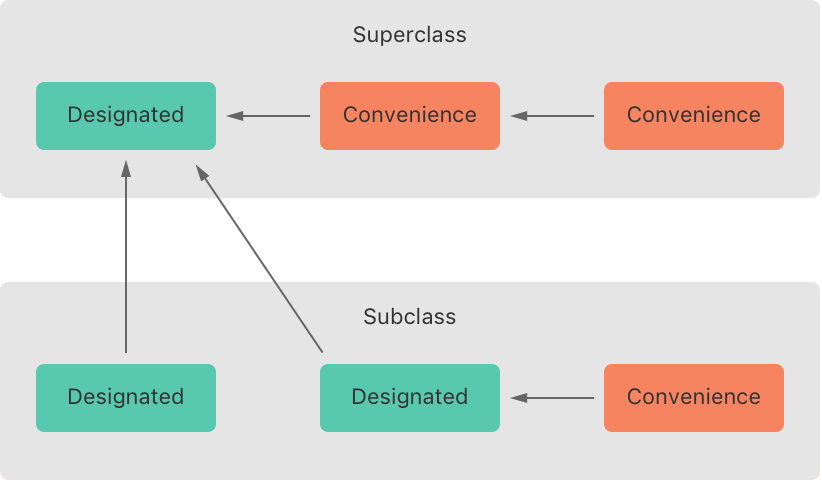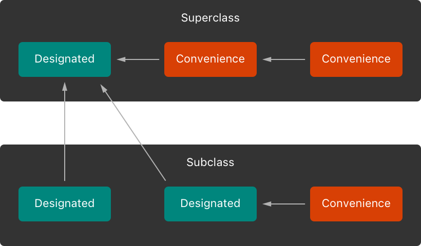

图中，父类有一个指定构造器和两个便利构造器。一个便利构造器调用另一个便利构造器，后者又调用那个唯一的指定构造器。这满足了上面的规则 2 和规则 3。父类本身没有更上层的父类，因此规则 1 不适用。

图中的子类有两个指定构造器和一个便利构造器。这个便利构造器必须调用两个指定构造器之一，因为它只能调用同一个类中的另一个构造器。这满足了上面的规则 2 和规则 3。两个指定构造器都必须调用父类中那个唯一的指定构造器，以满足上面的规则 1。

> 注意：这些规则不影响类的使用者如何*创建*各个类的实例。上图里的任何构造器都可以用来创建其所属类的一个完整初始化的实例。这些规则只影响你如何编写类的构造器的实现。

下图展示了一个更复杂的、包含四个类的类层次结构。它说明了该层次结构中的指定构造器如何充当类构造过程的“漏斗”点，从而简化链条中各个类之间的相互关系：

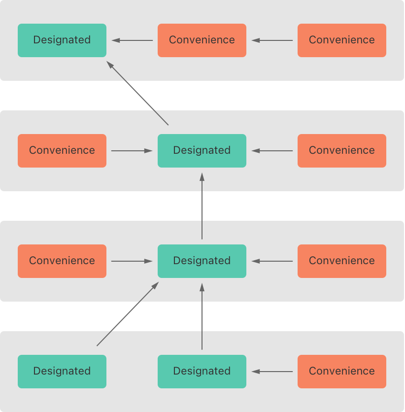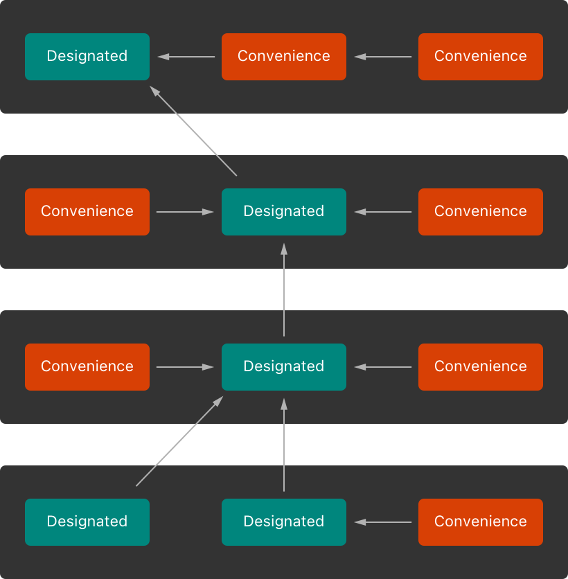

### 两段式构造过程 {#Two-Phase-Initialization}

Swift 中的类构造过程是一个两段式过程。在第一阶段，每个存储属性都由引入它的类赋予初始值。一旦每个存储属性的初始状态都已确定，第二阶段就开始，每个类都有机会进一步自定义其存储属性，之后新实例才被视为可以使用。

采用两段式构造过程可以让构造过程安全，同时仍让类层次结构中的每个类拥有完全的灵活性。两段式构造过程可以防止在属性初始化之前访问属性值，也可以防止属性值被另一个构造器意外地设为不同的值。

> 注意：Swift 的两段式构造过程与 Objective-C 中的构造过程类似。主要区别在于，在第一阶段，Objective-C 会为每个属性赋予零值或空值（例如 `0` 或 `nil`）。Swift 的构造流程更灵活，因为它允许你设置自定义的初始值，并且能够处理 `0` 或 `nil` 不是有效默认值的类型。

Swift 编译器会执行四项有用的安全检查，以确保两段式构造过程无误地完成：

- **安全检查 1**：指定构造器必须先确保其类引入的所有属性都已初始化，然后才能向上代理给父类构造器。

如上所述，只有当对象所有存储属性的初始状态都已确定时，该对象的内存才被视为完全初始化。为了满足这条规则，指定构造器必须确保自己的所有属性都已初始化，然后再沿链条向上交接。

- **安全检查 2**：指定构造器必须先向上代理给父类构造器，然后才能给继承来的属性赋值。否则，指定构造器所赋的新值会在父类执行自己的构造过程时被覆盖。

- **安全检查 3**：便利构造器必须先代理给另一个构造器，然后才能给*任何*属性赋值（包括同一个类中定义的属性）。否则，便利构造器所赋的新值会被其所在类的指定构造器覆盖。

- **安全检查 4**：在第一阶段构造过程完成之前，构造器不能调用任何实例方法、不能读取任何实例属性的值，也不能把 `self` 作为值来引用。

类实例在第一阶段结束之前并不完全有效。只有在第一阶段结束时确定类实例已经有效之后，才能访问属性、调用方法。

基于上面的四项安全检查，两段式构造过程的具体流程如下：

**第一阶段**

- 在某个类上调用一个指定构造器或便利构造器。
- 为那个类的新实例分配内存。此时内存尚未初始化。
- 该类的指定构造器确认该类引入的所有存储属性都有值。这些存储属性的内存现在已初始化。
- 该指定构造器把工作交给父类构造器，让其对自己的存储属性执行同样的任务。
- 这个过程沿类的继承链一直向上继续，直到到达链条顶端。
- 一旦到达链条顶端，并且链条中最后一个类已确保其所有存储属性都有值，实例的内存就被视为完全初始化，第一阶段完成。

**第二阶段**

- 从链条顶端自上而下，链条中的每个指定构造器都可以选择进一步自定义实例。此时构造器可以访问 `self`，可以修改其属性、调用其实例方法，等等。
- 最后，链条中的任何便利构造器都可以选择自定义实例并操作 `self`。

对于一个假设的子类和父类，第一阶段在一次构造调用中的过程如下：

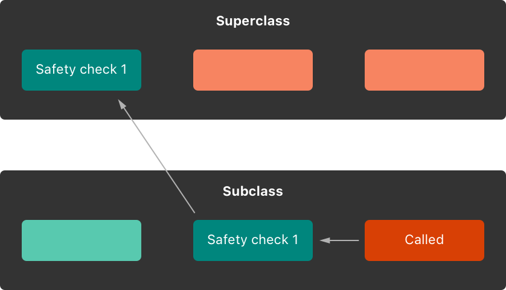

在这个例子中，构造过程从调用子类的一个便利构造器开始。这个便利构造器此时还不能修改任何属性。它横向代理给同一个类中的指定构造器。

指定构造器按照安全检查 1 确保子类的所有属性都有值。然后它调用父类的指定构造器，让构造过程沿链条向上继续。

父类的指定构造器确保父类的所有属性都有值。没有更上层的父类需要构造，因此不需要进一步代理。

父类的所有属性一旦都有初始值，其内存就被视为完全初始化，第一阶段完成。

对于同一次构造调用，第二阶段的过程如下：

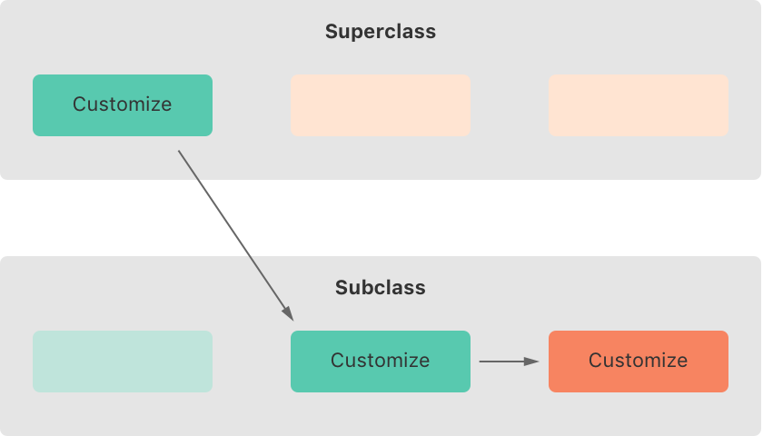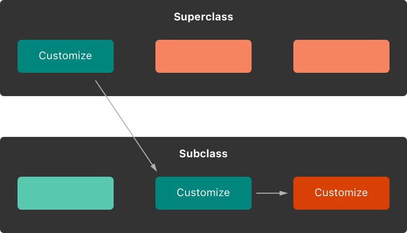

父类的指定构造器现在有机会进一步自定义实例（不过它并非必须这样做）。

父类的指定构造器完成后，子类的指定构造器可以执行额外的自定义（不过同样并非必须）。

最后，子类的指定构造器完成后，最初被调用的便利构造器可以执行额外的自定义。

### 构造器继承与重写 {#Initializer-Inheritance-and-Overriding}

与 Objective-C 中的子类不同，Swift 子类默认不继承其父类的构造器。Swift 的做法可以防止这样一种情况：父类中一个简单的构造器被更专门的子类继承，并被用来创建一个未完全或未正确构造的子类新实例。

> 注意：在某些情况下，父类构造器*确实*会被继承，但只有在这样做既安全又合适时才会如此。更多信息，详见下文 [自动构造器继承](initialization.md#Automatic-Initializer-Inheritance)。

如果你希望自定义子类提供与父类相同的一个或多个构造器，可以在子类中为这些构造器提供自定义实现。

当你编写的子类构造器与父类的*指定*构造器匹配时，你实际上是在重写那个指定构造器。因此，必须在子类构造器定义之前写 `override` 修饰符。即使你重写的是自动提供的默认构造器，也是如此，详见 [默认构造器](initialization.md#Default-Initializers)。

与被重写的属性、方法或下标一样，`override` 修饰符的存在会促使 Swift 检查父类是否有匹配的指定构造器可供重写，并验证你用于重写的构造器的形参是否按预期指定。

> 注意：重写父类指定构造器时，你总是要写 `override` 修饰符，即使子类对该构造器的实现是一个便利构造器。

反过来，如果你编写的子类构造器与父类的*便利*构造器匹配，那么根据上文 [类类型的构造器代理](initialization.md#Initializer-Delegation-for-Class-Types) 中描述的规则，子类永远不能直接调用那个父类便利构造器。因此，严格来说，你的子类并没有重写父类的构造器。所以，在为父类便利构造器提供匹配的实现时，不要写 `override` 修饰符。

下面的例子定义了一个名为 `Vehicle` 的基类。这个基类声明了一个名为 `numberOfWheels` 的存储属性，默认 `Int` 值为 `0`。名为 `description` 的计算属性使用 `numberOfWheels` 属性来生成描述车辆特征的 `String`：

```swift
class Vehicle {
    var numberOfWheels = 0
    var description: String {
        return "\(numberOfWheels) wheel(s)"
    }
}
```

`Vehicle` 类为其唯一的存储属性提供了默认值，并且自身没有提供任何自定义构造器。因此，它会自动获得一个默认构造器，详见 [默认构造器](initialization.md#Default-Initializers)。默认构造器（在可用时）总是类的指定构造器，可用于创建一个 `numberOfWheels` 为 `0` 的新 `Vehicle` 实例：

```swift
let vehicle = Vehicle()
print("Vehicle: \(vehicle.description)")
// Vehicle: 0 wheel(s)
```

下一个例子定义了 `Vehicle` 的一个子类，名为 `Bicycle`：

```swift
class Bicycle: Vehicle {
    override init() {
        super.init()
        numberOfWheels = 2
    }
}
```

`Bicycle` 子类定义了一个自定义的指定构造器 `init()`。这个指定构造器与 `Bicycle` 的父类中的一个指定构造器匹配，因此 `Bicycle` 中的这个构造器版本带有 `override` 修饰符。

`Bicycle` 的 `init()` 构造器首先调用 `super.init()`，这会调用 `Bicycle` 的父类 `Vehicle` 的默认构造器。这确保了继承来的 `numberOfWheels` 属性在 `Bicycle` 有机会修改它之前已由 `Vehicle` 完成初始化。调用 `super.init()` 之后，`numberOfWheels` 的原始值被替换为新值 `2`。

如果创建一个 `Bicycle` 实例，你可以调用它继承来的 `description` 计算属性，看看它的 `numberOfWheels` 属性是如何被更新的：

```swift
let bicycle = Bicycle()
print("Bicycle: \(bicycle.description)")
// Bicycle: 2 wheel(s)
```

如果子类构造器在构造过程的第二阶段没有执行任何自定义，并且父类有一个同步的、不带实参的指定构造器，那么你可以在为子类的所有存储属性赋值之后省略对 `super.init()` 的调用。如果父类的构造器是异步的，则需要显式写出 `await super.init()`。

这个例子定义了 `Vehicle` 的另一个子类，名为 `Hoverboard`。在其构造器中，`Hoverboard` 类只设置它的 `color` 属性。这个构造器没有显式调用 `super.init()`，而是依赖对父类构造器的隐式调用来完成整个过程。

```swift
class Hoverboard: Vehicle {
    var color: String
    init(color: String) {
        self.color = color
        // super.init() implicitly called here
    }
    override var description: String {
        return "\(super.description) in a beautiful \(color)"
    }
}
```

`Hoverboard` 的实例使用由 `Vehicle` 构造器提供的默认车轮数量。

```swift
let hoverboard = Hoverboard(color: "silver")
print("Hoverboard: \(hoverboard.description)")
// Hoverboard: 0 wheel(s) in a beautiful silver
```

> 注意：子类可以在构造过程中修改继承来的变量属性，但不能修改继承来的常量属性。

### 自动构造器继承 {#Automatic-Initializer-Inheritance}

如上所述，子类默认不继承其父类的构造器。然而，在满足某些条件时，父类构造器*确实*会被自动继承。在实践中，这意味着在许多常见场景下你不需要编写构造器重写，只要这样做是安全的，就可以用最小的代价继承父类的构造器。

假设你为子类中引入的任何新属性都提供了默认值，则适用以下两条规则：

- **规则 1**：如果你的子类没有定义任何指定构造器，它会自动继承其父类的所有指定构造器。

- **规则 2**：如果你的子类提供了其父类*所有*指定构造器的实现——无论是按照规则 1 继承它们，还是在其定义中提供自定义实现——那么它会自动继承父类的所有便利构造器。

即使你的子类增加了更多便利构造器，这些规则也同样适用。

> 注意：子类可以把父类的指定构造器实现为子类的便利构造器，作为满足规则 2 的一部分。

### 指定构造器与便利构造器实战 {#Designated-and-Convenience-Initializers-in-Action}

下面的例子演示了指定构造器、便利构造器和自动构造器继承的实际运用。这个例子定义了由 `Food`、`RecipeIngredient` 和 `ShoppingListItem` 三个类组成的层次结构，并展示了它们的构造器如何相互作用。

这个层次结构中的基类名为 `Food`，是一个用于封装食物名称的简单类。`Food` 类引入了一个 `String` 属性 `name`，并提供了两个用于创建 `Food` 实例的构造器：

```swift
class Food {
    var name: String
    init(name: String) {
        self.name = name
    }
    convenience init() {
        self.init(name: "[Unnamed]")
    }
}
```

下图展示了 `Food` 类的构造器链：

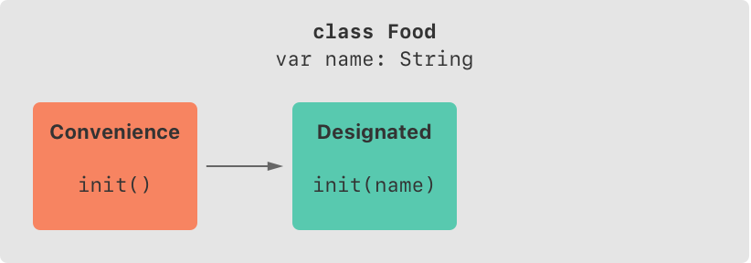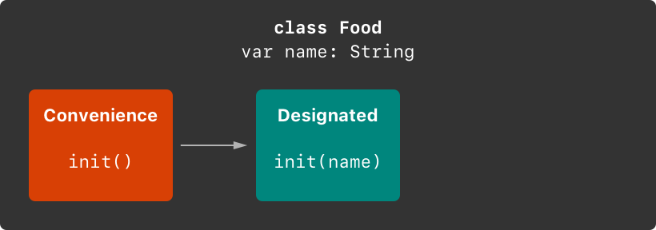

类没有默认的成员逐一构造器，因此 `Food` 类提供了一个指定构造器，接受一个名为 `name` 的实参。这个构造器可用于创建具有特定名称的新 `Food` 实例：

```swift
let namedMeat = Food(name: "Bacon")
// namedMeat's name is "Bacon"
```

`Food` 类中的 `init(name: String)` 构造器是作为*指定*构造器提供的，因为它确保新 `Food` 实例的所有存储属性都被完整初始化。`Food` 类没有父类，因此 `init(name: String)` 构造器不需要调用 `super.init()` 来完成构造。

`Food` 类还提供了一个不带实参的*便利*构造器 `init()`。`init()` 构造器通过横向代理到 `Food` 类的 `init(name: String)`，并传入 `name` 值 `[Unnamed]`，为新食物提供一个默认的占位名称：

```swift
let mysteryMeat = Food()
// mysteryMeat's name is "[Unnamed]"
```

层次结构中的第二个类是 `Food` 的子类，名为 `RecipeIngredient`。`RecipeIngredient` 类模拟烹饪食谱中的一种原料。它引入了一个名为 `quantity` 的 `Int` 属性（此外还从 `Food` 继承了 `name` 属性），并定义了两个用于创建 `RecipeIngredient` 实例的构造器：

```swift
class RecipeIngredient: Food {
    var quantity: Int
    init(name: String, quantity: Int) {
        self.quantity = quantity
        super.init(name: name)
    }
    override convenience init(name: String) {
        self.init(name: name, quantity: 1)
    }
}
```

下图展示了 `RecipeIngredient` 类的构造器链：

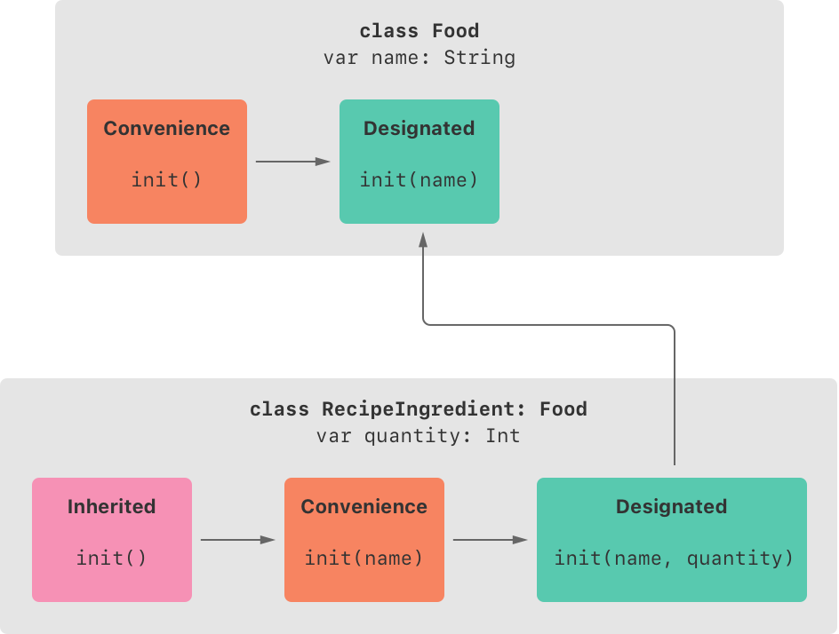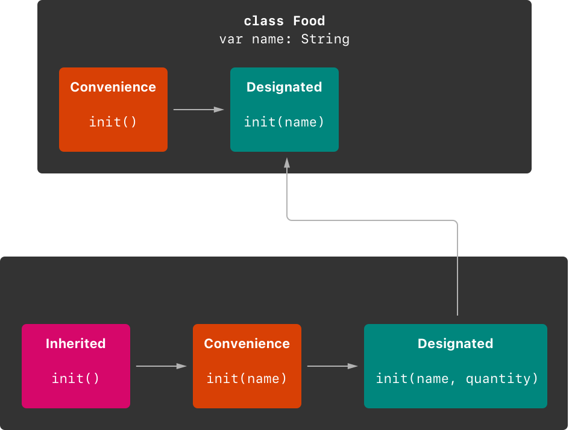

`RecipeIngredient` 类有一个指定构造器 `init(name: String, quantity: Int)`，可用于填充新 `RecipeIngredient` 实例的所有属性。这个构造器先把传入的 `quantity` 实参赋给 `quantity` 属性，这是 `RecipeIngredient` 引入的唯一新属性。完成之后，构造器向上代理到 `Food` 类的 `init(name: String)` 构造器。这个过程满足上文 [两段式构造过程](initialization.md#Two-Phase-Initialization) 中的安全检查 1。

`RecipeIngredient` 还定义了一个便利构造器 `init(name: String)`，用于仅根据名称创建 `RecipeIngredient` 实例。对于任何未显式指定数量的 `RecipeIngredient` 实例，这个便利构造器都假定数量为 `1`。这个便利构造器的定义让创建 `RecipeIngredient` 实例更快、更方便，并且在创建多个数量为 1 的 `RecipeIngredient` 实例时避免了代码重复。这个便利构造器只是横向代理到该类的指定构造器，并传入 `quantity` 值 `1`。

`RecipeIngredient` 提供的 `init(name: String)` 便利构造器接受的形参与 `Food` 的 `init(name: String)` *指定*构造器相同。因为这个便利构造器重写了其父类的指定构造器，所以必须用 `override` 修饰符标记（详见 [构造器继承与重写](initialization.md#Initializer-Inheritance-and-Overriding)）。

尽管 `RecipeIngredient` 把 `init(name: String)` 构造器作为便利构造器提供，但它仍然提供了其父类所有指定构造器的实现。因此，`RecipeIngredient` 也会自动继承其父类的所有便利构造器。

在这个例子中，`RecipeIngredient` 的父类是 `Food`，它有一个名为 `init()` 的便利构造器。因此，这个构造器被 `RecipeIngredient` 继承。继承来的 `init()` 版本的行为与 `Food` 版本完全相同，只是它代理到 `RecipeIngredient` 版本的 `init(name: String)`，而不是 `Food` 版本。

这三个构造器都可以用来创建新的 `RecipeIngredient` 实例：

```swift
let oneMysteryItem = RecipeIngredient()
let oneBacon = RecipeIngredient(name: "Bacon")
let sixEggs = RecipeIngredient(name: "Eggs", quantity: 6)
```

层次结构中的第三个也是最后一个类是 `RecipeIngredient` 的子类，名为 `ShoppingListItem`。`ShoppingListItem` 类模拟出现在购物清单中的食谱原料。

购物清单中的每一项最初都是“未购买”状态。为了表示这一点，`ShoppingListItem` 引入了一个名为 `purchased` 的布尔属性，默认值为 `false`。`ShoppingListItem` 还添加了一个计算属性 `description`，用于提供 `ShoppingListItem` 实例的文本描述：

```swift
class ShoppingListItem: RecipeIngredient {
    var purchased = false
    var description: String {
        var output = "\(quantity) x \(name)"
        output += purchased ? " ✔" : " ✘"
        return output
    }
}
```

> 注意：`ShoppingListItem` 没有定义构造器来为 `purchased` 提供初始值，因为购物清单中的项（如此处所建模的）最初总是未购买的。

由于 `ShoppingListItem` 为其引入的所有属性都提供了默认值，并且自身没有定义任何构造器，它会自动继承其父类的*所有*指定构造器和便利构造器。

下图展示了所有三个类的整体构造器链：

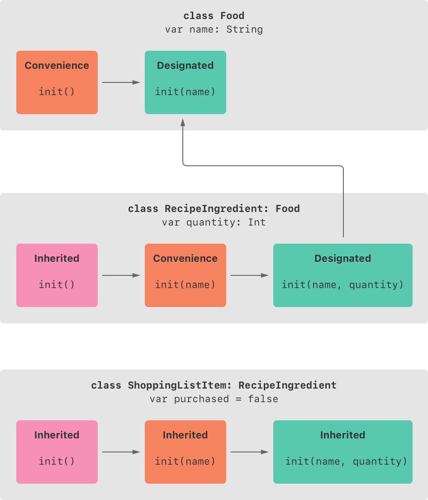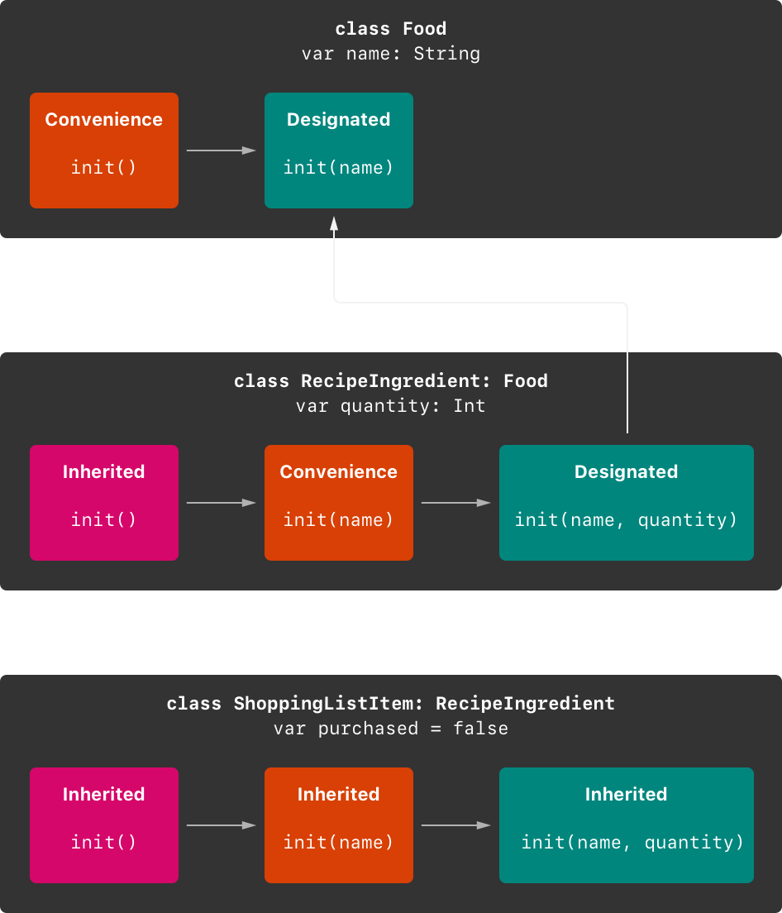

你可以使用全部三个继承来的构造器来创建新的 `ShoppingListItem` 实例：

```swift
var breakfastList = [
    ShoppingListItem(),
    ShoppingListItem(name: "Bacon"),
    ShoppingListItem(name: "Eggs", quantity: 6),
]
breakfastList[0].name = "Orange juice"
breakfastList[0].purchased = true
for item in breakfastList {
    print(item.description)
}
// 1 x Orange juice ✔
// 1 x Bacon ✘
// 6 x Eggs ✘
```

这里，一个名为 `breakfastList` 的新数组由一个包含三个新 `ShoppingListItem` 实例的数组字面量创建。该数组的类型被推断为 `[ShoppingListItem]`。数组创建后，数组开头那个 `ShoppingListItem` 的名称从 `"[Unnamed]"` 改为 `"Orange juice"`，并被标记为已购买。打印数组中每一项的描述可以看出，它们的默认状态都按预期设置好了。

## 可失败构造器 {#Failable-Initializers}

有时，定义一个构造过程可能失败的类、结构体或枚举是很有用的。这种失败可能由无效的构造参数值、缺少所需的外部资源，或某种其他导致构造过程无法成功的条件触发。

为了处理可能失败的构造情况，可以在类、结构体或枚举的定义中定义一个或多个可失败构造器。在 `init` 关键字后面加一个问号（`init?`）即可写出可失败构造器。

> 注意：不能定义形参类型和名称都相同的可失败构造器和不可失败构造器。

可失败构造器会创建其所构造类型的*可选*值。在可失败构造器中写 `return nil`，可以指示出可能触发构造失败的位置。

> 注意：严格来说，构造器并不返回值。它们的作用是确保在构造过程结束时 `self` 已被完整、正确地构造。虽然你用 `return nil` 来触发构造失败，但不要用 `return` 关键字来表示构造成功。

例如，数值类型转换就实现了可失败构造器。为了确保数值类型之间的转换能精确保持原值，请使用 `init(exactly:)` 构造器。如果类型转换无法保持原值，构造器就会失败。

```swift
let wholeNumber: Double = 12345.0
let pi = 3.14159

if let valueMaintained = Int(exactly: wholeNumber) {
    print("\(wholeNumber) conversion to Int maintains value of \(valueMaintained)")
}
// Prints "12345.0 conversion to Int maintains value of 12345".

let valueChanged = Int(exactly: pi)
// valueChanged is of type Int?, not Int

if valueChanged == nil {
    print("\(pi) conversion to Int doesn't maintain value")
}
// Prints "3.14159 conversion to Int doesn't maintain value".
```

下面的例子定义了一个名为 `Animal` 的结构体，其中有一个名为 `species` 的常量 `String` 属性。`Animal` 结构体还定义了一个可失败构造器，只有一个名为 `species` 的形参。这个构造器检查传给它的 `species` 值是否为空字符串。如果发现空字符串，就触发构造失败。否则，设置 `species` 属性的值，构造成功：

```swift
struct Animal {
    let species: String
    init?(species: String) {
        if species.isEmpty { return nil }
        self.species = species
    }
}
```

你可以用这个可失败构造器尝试构造新的 `Animal` 实例，并检查构造是否成功：

```swift
let someCreature = Animal(species: "Giraffe")
// someCreature is of type Animal?, not Animal

if let giraffe = someCreature {
    print("An animal was initialized with a species of \(giraffe.species)")
}
// Prints "An animal was initialized with a species of Giraffe".
```

如果你给可失败构造器的 `species` 形参传入空字符串值，构造器就会触发构造失败：

```swift
let anonymousCreature = Animal(species: "")
// anonymousCreature is of type Animal?, not Animal

if anonymousCreature == nil {
    print("The anonymous creature couldn't be initialized")
}
// Prints "The anonymous creature couldn't be initialized".
```

> 注意：检查空字符串值（例如 `""` 而不是 `"Giraffe"`）与检查 `nil` 以表示*可选* `String` 值缺失并不相同。在上面的例子中，空字符串（`""`）是一个有效的、非可选的 `String`。然而，让动物的 `species` 属性取空字符串是不合适的。为了体现这一限制，可失败构造器一旦发现空字符串就触发构造失败。

### 枚举的可失败构造器 {#Failable-Initializers-for-Enumerations}

你可以用可失败构造器根据一个或多个形参选择合适的枚举成员。如果提供的形参与任何合适的枚举成员都不匹配，构造器就可以失败。

下面的例子定义了一个名为 `TemperatureUnit` 的枚举，它有三种可能的状态（`kelvin`、`celsius` 和 `fahrenheit`）。这里用可失败构造器为表示温度符号的 `Character` 值找到合适的枚举成员：

```swift
enum TemperatureUnit {
    case kelvin, celsius, fahrenheit
    init?(symbol: Character) {
        switch symbol {
        case "K":
            self = .kelvin
        case "C":
            self = .celsius
        case "F":
            self = .fahrenheit
        default:
            return nil
        }
    }
}
```

你可以用这个可失败构造器为三种可能的状态选择合适的枚举成员，并在形参与这些状态都不匹配时让构造失败：

```swift
let fahrenheitUnit = TemperatureUnit(symbol: "F")
if fahrenheitUnit != nil {
    print("This is a defined temperature unit, so initialization succeeded.")
}
// Prints "This is a defined temperature unit, so initialization succeeded."

let unknownUnit = TemperatureUnit(symbol: "X")
if unknownUnit == nil {
    print("This isn't a defined temperature unit, so initialization failed.")
}
// Prints "This isn't a defined temperature unit, so initialization failed."
```

### 带原始值的枚举的可失败构造器 {#Failable-Initializers-for-Enumerations-with-Raw-Values}

带原始值的枚举会自动获得一个可失败构造器 `init?(rawValue:)`，它接受一个名为 `rawValue`、类型为相应原始值类型的形参，并在找到匹配的枚举成员时选择该成员，在没有匹配值时触发构造失败。

你可以改写上面的 `TemperatureUnit` 示例，改用 `Character` 类型的原始值，并利用 `init?(rawValue:)` 构造器：

```swift
enum TemperatureUnit: Character {
    case kelvin = "K", celsius = "C", fahrenheit = "F"
}

let fahrenheitUnit = TemperatureUnit(rawValue: "F")
if fahrenheitUnit != nil {
    print("This is a defined temperature unit, so initialization succeeded.")
}
// Prints "This is a defined temperature unit, so initialization succeeded."

let unknownUnit = TemperatureUnit(rawValue: "X")
if unknownUnit == nil {
    print("This isn't a defined temperature unit, so initialization failed.")
}
// Prints "This isn't a defined temperature unit, so initialization failed."
```

### 构造失败的传播 {#Propagation-of-Initialization-Failure}

类、结构体或枚举的可失败构造器可以横向代理到同一个类、结构体或枚举中的另一个可失败构造器。同样，子类的可失败构造器可以向上代理到父类的可失败构造器。

无论哪种情况，如果你代理到的另一个构造器导致构造失败，整个构造过程都会立即失败，不再执行任何后续构造代码。

> 注意：可失败构造器也可以代理到不可失败构造器。如果你需要给一个本来不会失败的现有构造过程增加一个可能的失败状态，就可以采用这种做法。

下面的例子定义了 `Product` 的一个子类，名为 `CartItem`。`CartItem` 类模拟在线购物车中的一件商品。`CartItem` 引入了一个名为 `quantity` 的存储常量属性，并确保该属性的值始终至少为 `1`：

```swift
class Product {
    let name: String
    init?(name: String) {
        if name.isEmpty { return nil }
        self.name = name
    }
}

class CartItem: Product {
    let quantity: Int
    init?(name: String, quantity: Int) {
        if quantity < 1 { return nil }
        self.quantity = quantity
        super.init(name: name)
    }
}
```

`CartItem` 的可失败构造器首先验证收到的 `quantity` 值大于等于 `1`。如果 `quantity` 无效，整个构造过程立即失败，不再执行任何后续构造代码。同样，`Product` 的可失败构造器会检查 `name` 值，如果 `name` 是空字符串，构造过程立即失败。

如果用非空名称和大于等于 `1` 的数量创建 `CartItem` 实例，构造就会成功：

```swift
if let twoSocks = CartItem(name: "sock", quantity: 2) {
    print("Item: \(twoSocks.name), quantity: \(twoSocks.quantity)")
}
// Prints "Item: sock, quantity: 2".
```

如果尝试用 `0` 作为 `quantity` 值创建 `CartItem` 实例，`CartItem` 的构造器会导致构造失败：

```swift
if let zeroShirts = CartItem(name: "shirt", quantity: 0) {
    print("Item: \(zeroShirts.name), quantity: \(zeroShirts.quantity)")
} else {
    print("Unable to initialize zero shirts")
}
// Prints "Unable to initialize zero shirts".
```

同样，如果尝试用空的 `name` 值创建 `CartItem` 实例，父类 `Product` 的构造器会导致构造失败：

```swift
if let oneUnnamed = CartItem(name: "", quantity: 1) {
    print("Item: \(oneUnnamed.name), quantity: \(oneUnnamed.quantity)")
} else {
    print("Unable to initialize one unnamed product")
}
// Prints "Unable to initialize one unnamed product".
```

### 重写可失败构造器 {#Overriding-a-Failable-Initializer}

你可以像重写任何其他构造器一样，在子类中重写父类的可失败构造器。另一种做法是用子类的*不可失败*构造器重写父类的可失败构造器。这让你可以定义一个构造过程不会失败的子类，即使其父类的构造过程允许失败。

注意，如果用不可失败的子类构造器重写可失败的父类构造器，那么向上代理到父类构造器的唯一方式就是对可失败父类构造器的结果进行强制解包。

> 注意：你可以用不可失败构造器重写可失败构造器，但反过来不行。

下面的例子定义了一个名为 `Document` 的类。这个类模拟一个文档：它的 `name` 属性在构造时可以是非空字符串值或 `nil`，但不能是空字符串：

```swift
class Document {
    var name: String?
    // this initializer creates a document with a nil name value
    init() {}
    // this initializer creates a document with a nonempty name value
    init?(name: String) {
        if name.isEmpty { return nil }
        self.name = name
    }
}
```

下一个例子定义了 `Document` 的一个子类，名为 `AutomaticallyNamedDocument`。`AutomaticallyNamedDocument` 子类重写了 `Document` 引入的两个指定构造器。这些重写确保：如果实例在构造时没有提供名称，或者传给 `init(name:)` 构造器的是空字符串，那么 `AutomaticallyNamedDocument` 实例的初始 `name` 值就是 `"[Untitled]"`：

```swift
class AutomaticallyNamedDocument: Document {
    override init() {
        super.init()
        self.name = "[Untitled]"
    }
    override init(name: String) {
        super.init()
        if name.isEmpty {
            self.name = "[Untitled]"
        } else {
            self.name = name
        }
    }
}
```

`AutomaticallyNamedDocument` 用不可失败的 `init(name:)` 构造器重写了其父类可失败的 `init?(name:)` 构造器。因为 `AutomaticallyNamedDocument` 处理空字符串情况的方式与父类不同，它的构造器不需要失败，因此它提供的是不可失败版本的构造器。

你可以在构造器中使用强制解包，在子类不可失败构造器的实现中调用父类的可失败构造器。例如，下面的 `UntitledDocument` 子类名称始终是 `"[Untitled]"`，它在构造过程中使用了父类可失败的 `init(name:)` 构造器。

```swift
class UntitledDocument: Document {
    override init() {
        super.init(name: "[Untitled]")!
    }
}
```

在这种情况下，如果父类的 `init(name:)` 构造器曾以空字符串作为名称被调用，强制解包操作就会导致运行时错误。然而，由于这里是用字符串字面量调用的，你可以看出构造器不会失败，因此在这种情况下不会发生运行时错误。

### init! 可失败构造器 {#The-init-Failable-Initializer}

通常，你定义一个可失败构造器，在 `init` 关键字后面加问号（`init?`），以创建相应类型的可选实例。另一种做法是定义可失败构造器来创建相应类型的隐式解包可选实例：在 `init` 关键字后面加感叹号（`init!`）而不是问号即可。

你可以从 `init?` 代理到 `init!`，反之亦然；也可以用 `init!` 重写 `init?`，反之亦然。你还可以从 `init` 代理到 `init!`，不过如果 `init!` 构造器导致构造失败，这样做会触发断言。

## 必要构造器 {#Required-Initializers}

在类构造器定义之前写 `required` 修饰符，表示该类的每个子类都必须实现这个构造器：

```swift
class SomeClass {
    required init() {
        // initializer implementation goes here
    }
}
```

在必要构造器的每个子类实现之前，也必须写 `required` 修饰符，以表示这个构造器要求同样适用于链条中更下层的子类。重写必要构造器时，不要写 `override` 修饰符：

```swift
class SomeSubclass: SomeClass {
    required init() {
        // subclass implementation of the required initializer goes here
    }
}
```

> 注意：如果可以用继承来的构造器满足要求，就不必提供必要构造器的显式实现。

## 用闭包或函数设置默认属性值 {#Setting-a-Default-Property-Value-with-a-Closure-or-Function}

如果存储属性的默认值需要一些自定义或设置，你可以用闭包或全局函数来为该属性提供自定义的默认值。每当该属性所属类型的新实例被构造时，就会调用这个闭包或函数，并将其返回值作为属性的默认值。

这类闭包或函数通常会创建一个与属性类型相同的临时值，调整该值以表示所需的初始状态，然后返回这个临时值作为属性的默认值。

下面是使用闭包提供默认属性值的骨架示例：

```swift
class SomeClass {
    let someProperty: SomeType = {
        // create a default value for someProperty inside this closure
        // someValue must be of the same type as SomeType
        return someValue
    }()
}
```

注意，闭包末尾的花括号后面跟着一对空圆括号。这告诉 Swift 立即执行这个闭包。如果省略这对圆括号，你就是在尝试把闭包本身赋给该属性，而不是把闭包的返回值赋给该属性。

> 注意：如果你用闭包来初始化属性，请记住在闭包执行时，实例的其余部分尚未构造完成。这意味着你不能在闭包内访问任何其他属性值，即使那些属性有默认值也不行。你也不能使用隐式的 `self` 属性，或者调用实例的任何方法。

下面的例子定义了一个名为 `Chessboard` 的结构体，用来模拟国际象棋的棋盘。国际象棋在 8 x 8 的棋盘上进行，黑白方格交替排列。

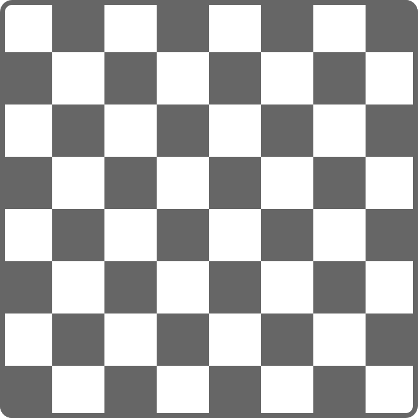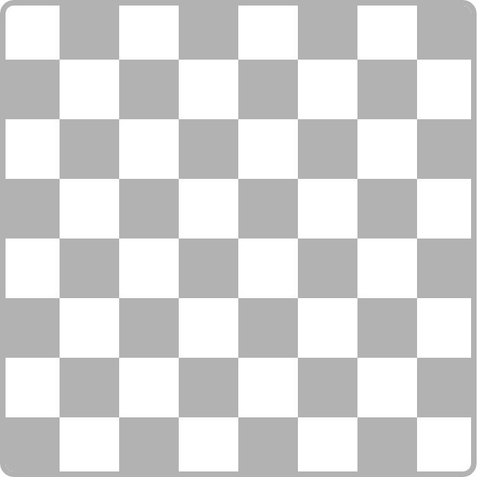

为了表示这个棋盘，`Chessboard` 结构体有一个名为 `boardColors` 的属性，它是一个包含 64 个 `Bool` 值的数组。数组中的 `true` 值表示黑色方格，`false` 值表示白色方格。数组中的第一项表示棋盘左上角的方格，最后一项表示右下角的方格。

`boardColors` 数组用一个闭包来初始化，以设置其颜色值：

```swift
struct Chessboard {
    let boardColors: [Bool] = {
        var temporaryBoard: [Bool] = []
        var isBlack = false
        for i in 1...8 {
            for j in 1...8 {
                temporaryBoard.append(isBlack)
                isBlack = !isBlack
            }
            isBlack = !isBlack
        }
        return temporaryBoard
    }()
    func squareIsBlackAt(row: Int, column: Int) -> Bool {
        return boardColors[(row * 8) + column]
    }
}
```

每当创建新的 `Chessboard` 实例时，就会执行这个闭包，计算并返回 `boardColors` 的默认值。上面例子中的闭包在一个名为 `temporaryBoard` 的临时数组中计算并设置棋盘上每个方格应有的颜色，并在设置完成后将这个临时数组作为闭包的返回值返回。返回的数组值会存储到 `boardColors` 中，并可以用 `squareIsBlackAt(row:column:)` 工具函数查询：

```swift
let board = Chessboard()
print(board.squareIsBlackAt(row: 0, column: 1))
// Prints "true".
print(board.squareIsBlackAt(row: 7, column: 7))
// Prints "false".
```
